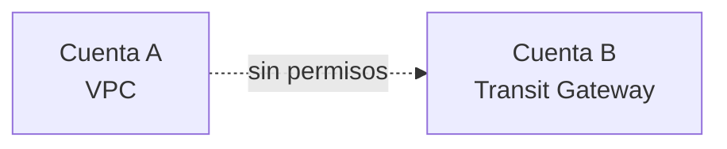
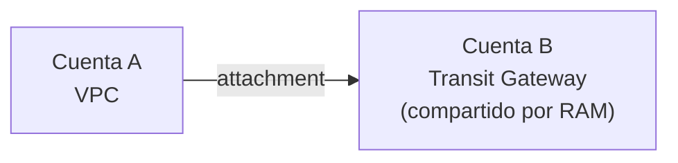

# AWS Resource Access Manager (RAM) Solutions

> [!abstract] Qué es este archivo
> Séptima lección del módulo. El problema es concreto: **la VPC es de la cuenta A, el transit gateway es de la
> cuenta B**, y A necesita adjuntarse igual.
>
> Tres bloques: **AWS RAM** como mecanismo de compartición entre cuentas, el caso **Transit Gateway con y sin
> RAM** —con dos excepciones que el examen usa— y el detalle de **AZ name vs. AZ ID**, que aparece apenas se
> comparte una **subred**.
>
> Video: **1 min 54 s**.

> [!quote] La idea que ordena todo
> **RAM comparte el recurso, no el control.** La cuenta dueña sigue siendo dueña; la otra cuenta recibe
> **acceso**, con **sus propias** políticas y permisos encima.

---

## Resumen en una frase

> **AWS RAM** hace que un recurso de la cuenta B —un **transit gateway**, una **subred**— esté **disponible**
> para la cuenta A, sin darle permiso para **administrar** nada en B y sin duplicar el recurso.

---

## 1. Qué es AWS RAM y qué no es

**Definición de la fuente:** un servicio que provee **compartición segura de recursos de AWS entre cuentas de
AWS**. **No sirve para administrar** recursos: provee las **features** para **hacerlos disponibles** entre
cuentas.

| | AWS RAM |
| --- | --- |
| **Qué hace** | Compartir recursos **entre cuentas** o **dentro de la organización** |
| **Qué NO hace** | **Administrar** los recursos compartidos |
| **Qué gana la otra cuenta** | **Acceso** al recurso |
| **Qué pasa con sus políticas** | **Aplican igual**: las políticas y permisos **de esa cuenta** rigen sobre el recurso compartido |

**El ahorro que justifica todo:** se **aprovisiona centralmente** y se comparte, en vez de **proveer y
administrar el recurso en cada cuenta**.

> [!important] La distinción que decide preguntas
> Compartir **no** es delegar administración. La cuenta A puede **usar** el transit gateway de B; **no** puede
> **gestionarlo**. Si el enunciado pide “que A administre el TGW de B”, RAM **no es la respuesta**.

---

## 2. Cómo se comparte: resource share

**El modelo:** se comparten **los recursos que especificás** con **los principals que especificás**.

- **Dentro de la organización:** para compartir con la organización hay que **habilitar el resource sharing
  desde la management account**.
- **Permisos de IAM:** por defecto, los usuarios de IAM **no pueden crear ni modificar** recursos de RAM. Hay que
  **crear políticas de IAM** que otorguen permisos sobre **recursos y acciones de API específicas**, y
  **adjuntarlas** a los usuarios o grupos que las necesiten.

**Ciclo de vida de un share:**

| Acción | Qué permite |
| --- | --- |
| **Modificar** | Cambiar un resource share que ya creaste |
| **Eliminar** | Borrarlo cuando ya no se necesita |
| **Ver los shares a los que te agregaron** | Saber qué te compartieron |
| **Ver los recursos compartidos a los que tenés acceso** | Saber qué podés usar |
| **Ver las cuentas que te compartieron recursos** | Saber quién te dio acceso |
| **Leave a resource share** | Salir cuando ya no necesitás el acceso |

> [!note] Ampliación (no está en la fuente)
> “Salir” de un share es la parte que suele olvidarse en el diseño: el acceso **no se hereda para siempre**. Si
> una cuenta deja el share, los recursos que dependían de él —por ejemplo, VPC adjuntas a un TGW compartido—
> pierden la base y hay que revisar las dependencias antes de salir.

---

## 3. El caso del módulo: TGW de otra cuenta

**Sin RAM:** todos los recursos de AWS tienen **cuenta dueña**. El transit gateway **es específico de una
cuenta**, y los usuarios de otras cuentas **no tienen permisos** para adjuntarle VPC.

**Con RAM:** se **comparte el transit gateway** para **attachments de VPC** entre cuentas o con toda la
organización. Los principals de la cuenta A **con los permisos correctos** ven el TGW como **recurso compartido**
y pueden **adjuntarle VPC**.

**Las dos reglas de ubicación de attachments** —la parte que se pregunta:

| Attachment | Dónde debe estar la cuenta |
| --- | --- |
| **VPC** | En la cuenta que **recibe** el TGW compartido y lo adjunta |
| **Site-to-Site VPN** | **En la misma cuenta dueña del transit gateway** — sin excepción |
| **Direct Connect gateway** | Usa una **transit gateway association**; puede estar **en la misma cuenta que el DX gateway o en otra** |

> [!warning] La asimetría que se cobra caro
> **VPN:** obligatoriamente en la cuenta del **dueño del TGW**. **Direct Connect gateway:** **puede** estar en
> otra cuenta. Si el escenario mezcla las dos, la respuesta correcta depende de **cuál** attachment es.

---

## 4. Qué se puede compartir

La fuente dice que RAM soporta **una variedad de servicios y recursos**, y da una lista —**no exhaustiva**— que
en el original está en una imagen:

| Servicio / feature | |
| --- | --- |
| **AWS App Mesh** | **Amazon Aurora** |
| **AWS Certificate Manager** | **AWS CodeBuild** |
| **Amazon EC2** | **Amazon EC2 Image Builder** |
| **AWS Glue** | **AWS License Manager** |
| **AWS Outposts** | **AWS Resource Groups** |
| **Amazon Route 53** | **Amazon VPC** |

**El ejemplo de VPC que da el video:** compartir **una subred** de una de tus VPC como recurso, para que un
**administrador de otra cuenta** pueda **lanzar una instancia EC2 en tu subred**.

> [!note] Ampliación (no está en la fuente)
> El caso de **subred compartida** es el que obliga a leer la sección siguiente: la subred existe **en una AZ
> física concreta**, y el nombre `us-east-1a` **no** significa lo mismo en las dos cuentas.

---

## 5. AZ name vs. AZ ID

**El problema:** para distribuir recursos entre las Availability Zones de una Región, AWS **mapea las AZ a
códigos de forma independiente para cada cuenta**. La AZ `us-east-1a` **de tu cuenta** puede **no** ser la misma
**ubicación física** que `us-east-1a` **de otra cuenta**.

**La solución:** coordinar por **AZ ID**, que es un identificador **único y consistente** de una Availability
Zone.

| | **AZ name** | **AZ ID** |
| --- | --- | --- |
| **Ejemplo** | `us-east-1a` | `use1-az1` |
| **Alcance** | **Por cuenta** | **Global y consistente** |
| **¿Misma ubicación física entre cuentas?** | **No necesariamente** | **Sí, siempre** |
| **Para qué sirve** | Referencia local en tu cuenta | **Coordinar entre cuentas** |

**El ejemplo de la fuente:** si compartís una **subred** en la AZ con **AZ ID `use1-az2`**, esa subred queda
disponible para la otra cuenta **en la AZ cuyo AZ ID también es `use1-az2`**.

> [!important] La regla práctica
> **Entre cuentas se habla de AZ ID, nunca de letra.** Sirve para ubicar recursos relativos a otra cuenta, para
> elegir dónde compartir una subred y para no romper un esquema de alta disponibilidad que “parecía” simétrico.

---

## 6. Traducción del contenido

> [!info] Sección de referencia (opcional)
> Esto es la **traducción fiel** de las fuentes, para verificar que no se perdió nada. **No hace falta leerla
> para estudiar**: lo que se estudia son las secciones **1 a 5** y se cierra con la **8**.
> Usala solo si (a) algo de arriba te quedó dudoso, (b) querés el detalle textual del video, o (c) antes del
> examen querés chequear que no se escapó un matiz.

### 6.1 Lectura: servicios y features que soportan AWS RAM

**¿Y si una empresa quiere adjuntar VPC a un transit gateway que no es suyo?** En esta lección vas a explorar
cómo **AWS Resource Access Manager**, o **AWS RAM**, puede ayudar.

**AWS Resource Access Manager (AWS RAM)** es un servicio que provee **compartición segura de recursos de AWS
entre cuentas de AWS**. **No podés administrar recursos con AWS RAM**, pero **sí provee las features** que podés
usar para **hacer recursos disponibles entre cuentas de AWS**. AWS RAM **soporta una variedad de servicios y
recursos**.

> [!note] La imagen de la fuente no está en el vault
> Lista de servicios que soportan AWS RAM (`assets/images/1ac8b5a4-900b-41da-8801-1c30e3da5031.png`): **AWS App
> Mesh**, **Amazon Aurora**, **AWS Certificate Manager**, **AWS CodeBuild**, **Amazon EC2**, **Amazon EC2 Image
> Builder**, **AWS Glue**, **AWS License Manager**, **AWS Outposts**, **AWS Resource Groups**, **Amazon Route
> 53** y **Amazon VPC**.

**AWS RAM** te da la habilidad de **compartir tus recursos de forma segura entre cuentas de AWS o dentro de tu
organización**. Podés **aprovisionar recursos centralmente** y usar AWS RAM para **compartirlos con otras
cuentas**, **eliminando la necesidad de aprovisionar y administrar recursos en cada cuenta**. Cuando
**compartís un recurso con otra cuenta**, esa cuenta **obtiene acceso al recurso**. **Las políticas y permisos de
esa cuenta aplican al recurso compartido.** **Tenés que habilitar el resource sharing desde la management
account** de tu organización.

Los servicios y features que soportan AWS RAM **incluyen** los de la imagen de arriba.

**Por defecto, los usuarios de AWS Identity and Access Management (IAM) no tienen permisos** para **crear o
modificar recursos de AWS RAM**. Para que los usuarios de IAM puedan **crear o modificar recursos y realizar
tareas**, tenés que **crear políticas de IAM** que **otorguen permisos para usar recursos y acciones de API
específicas**. Después **adjuntás esas políticas** a los **usuarios o grupos de IAM** que necesiten esos
permisos.

Con AWS RAM, **compartís los recursos que especificás con los principals que especificás**. **En cualquier
momento** podés **modificar los resource shares que creaste** y **borrarlos cuando ya no se necesitan**. También
podés usar AWS RAM para **ver los resource shares a los que te agregaron**, **los recursos compartidos a los que
tenés acceso** y **las cuentas que te compartieron recursos**. Podés **dejar un resource share** cuando ya no
necesitás acceso a los recursos compartidos.

### 6.2 Video: AWS RAM (transcripción)

Ahora vamos a hablar de **AWS Resource Access Manager**, o **AWS RAM** para abreviar. AWS RAM ayuda a
**compartir tus recursos de forma segura entre cuentas de AWS dentro de tu organización y con principals de
IAM**. En este caso, **lo que nos interesa es la compartición entre cuentas**. Queremos que **distintas cuentas
adjunten VPC a un transit gateway que no es suyo**. Vamos a ver **cómo AWS RAM puede ayudar** con eso.

**Este es el desafío.** Los **transit gateways pueden soportar attachments de VPC de distintas cuentas**, pero
**por defecto solo la cuenta dueña del transit gateway —la cuenta B en este ejemplo— puede adjuntar VPC**. El
requisito era **permitir que principals autorizados y otras cuentas, como la cuenta A de acá, adjunten sus VPC
al transit gateway**. Podés **cumplir ese requisito compartiendo el transit gateway con AWS RAM** con la cuenta
A. Los **principals y la cuenta A con los permisos correctos** van a **ver el transit gateway como un recurso
compartido** y van a **poder adjuntarle VPC**.

Y notá que **AWS RAM no le está dando a la gente de la cuenta A permiso para administrar recursos en la cuenta
B**. **Solo hace que los recursos estén disponibles entre cuentas de AWS**. El ejemplo usó **el transit gateway
como caso de uso**, pero hay **muchos más servicios** que se pueden compartir entre organizaciones y cuentas
usando AWS RAM. Por ejemplo, **acá está Amazon VPC en la lista**. Si quisiera, podría **compartir una subred de
una de mis VPC como recurso**, **permitiendo que un administrador de otra cuenta despliegue una instancia EC2 en
mi subred**.

*Duración del video: **1 minuto 54 segundos**.*

### 6.3 Lectura: Transit Gateway con y sin AWS RAM

**¿Cómo podemos permitir que distintas cuentas adjunten VPC a un transit gateway que no es suyo?**

**Transit Gateway sin AWS RAM.** **Todos los recursos de AWS tienen un dueño de cuenta.** Los **transit
gateways son específicos de una cuenta**. **Los usuarios de otras cuentas no tienen los permisos** para
**adjuntar VPC a un transit gateway que es de otra cuenta**.

> [!note] La imagen de la fuente no está en el vault
> Diagrama *VPC en la cuenta A que no se conecta con el TGW de la cuenta B*
> (`assets/images/5GHJP3VA1Y.png`).

**Transit Gateway con AWS RAM.** Usá **AWS RAM** para **compartir un transit gateway para attachments de VPC
entre cuentas o con toda tu organización en AWS Organizations**. Tené en cuenta lo siguiente cuando quieras
compartir un transit gateway:

- **Tenés que crear un attachment de Site-to-Site VPN en la misma cuenta de AWS que es dueña del transit
  gateway.**
- **Un attachment a un Direct Connect gateway usa una transit gateway association** y **puede estar en la misma
  cuenta de AWS que el Direct Connect gateway, o en una cuenta distinta** de la del Direct Connect gateway.

> [!note] La imagen de la fuente no está en el vault
> Diagrama *VPC en la cuenta A conectada al TGW de la cuenta B* (`assets/images/33RSNNNMR3.png`).

### 6.4 Lectura: Availability Zone Name comparado con el mapeo de AZ ID

Para **asegurar que los recursos se distribuyan entre las Availability Zones de una Región**, **mapeamos las
Availability Zones a códigos de forma independiente para cada cuenta de AWS**. Por ejemplo, **la Availability
Zone `us-east-1a` de tu cuenta de AWS podría no ser la misma ubicación física que `us-east-1a` de otra cuenta de
AWS**.

> [!note] La imagen de la fuente no está en el vault
> Diagrama de la Región `us-east-1` con tres Availability Zones —`use1-az1`, `use1-az2`, `use1-az3`— y dos
> cuentas a cada lado apuntando a esas AZ con **AZ IDs distintos** (`assets/images/N852CGY7XT.png`).

Para **coordinar Availability Zones entre cuentas**, **tenés que usar el AZ ID**, que es un **identificador
único y consistente** de una Availability Zone. Por ejemplo, **`use1-az1` es un AZ ID de la Región `us-east-1`**
y **tiene la misma ubicación física en todas las cuentas de AWS**. Podés **ver los AZ IDs de tu cuenta** para
**determinar la ubicación física de tus recursos relativa a los recursos de otra cuenta**. Por ejemplo, si
**compartís una subred en la Availability Zone con el AZ ID `use1-az2` con otra cuenta**, **esa subred está
disponible para esa cuenta en la Availability Zone cuyo AZ ID también es `use1-az2`**.

---

## 7. Quién puede hacer qué

| Necesidad | Quién | Mecanismo |
| --- | --- | --- |
| Que otra cuenta adjunte su VPC a mi TGW | **Cuenta dueña del TGW** | Compartir el TGW por **RAM** |
| Que otra cuenta lance EC2 en mi red | **Cuenta dueña de la VPC** | Compartir la **subred** por **RAM** |
| Crear o modificar un resource share | **Usuario de IAM con política explícita** | Política de IAM sobre acciones de **RAM** |
| Compartir con toda la organización | **Management account** | **Habilitar** el resource sharing en Organizations |
| Administrar el recurso compartido | **Solo la cuenta dueña** | RAM **no** transfiere administración |
| Elegir la AZ correcta al compartir una subred | **Ambas cuentas** | **AZ ID**, no el nombre de la AZ |

---

## 8. Para el examen (SAP-C02)

> [!important] Lo que hay que retener
> 1. **RAM comparte acceso, no administración**: el recurso sigue siendo de la cuenta dueña.
> 2. **No administra recursos**; solo los **hace disponibles** entre cuentas.
> 3. Compartir **dentro de la organización** exige **habilitar el resource sharing desde la management
>    account**.
> 4. **IAM no trae permisos de RAM por defecto**: hay que **crear y adjuntar políticas**.
> 5. **Se comparten recursos específicos con principals específicos**; el share se puede **modificar, borrar o
>    dejar**.
> 6. **TGW cross-account**: se comparte el **transit gateway** por RAM y la otra cuenta **le adjunta VPC**.
> 7. **Site-to-Site VPN**: el attachment va **en la cuenta dueña del TGW**, siempre.
> 8. **Direct Connect gateway**: puede estar **en la misma cuenta que el DX gateway o en otra**.
> 9. **VPC** también se comparte: por ejemplo, **una subred** para que otra cuenta **lance EC2** ahí.
> 10. **AZ name ≠ AZ ID**: `us-east-1a` **no** es la misma ubicación física entre cuentas; se coordina con
>     **AZ ID** (`use1-az1`, `use1-az2`).

> [!warning] Trampa clásica del examen
> Escenario: “la cuenta A necesita adjuntar su VPC al **transit gateway de la cuenta B**, y además la **VPN
> Site-to-Site** tiene que quedar en la cuenta A”. La respuesta **no** es posible tal cual: la **VPN debe estar
> en la cuenta dueña del TGW**. Y si el attachment es de **Direct Connect gateway**, ahí sí **puede** estar en
> otra cuenta.

---

## Relacionado

- [[AWS Solutions Architect Advanced - Designing Advanced Network Architectures]] *(índice del módulo)*
- [[Use Cases - Transit Gateway]] — el caso de attachments cross-account en la práctica
- [[AWS Transit Gateway Setup]] — qué hace el dueño del TGW con sus route tables
- [[AWS Transit Gateway Network Manager]] — visibilidad de un TGW que puede estar compartido
- [[IP Address Management and IPv6 Adoption]] — RAM también comparte **pools de IPAM**
- [[AWS Organizations and IAM Identity Center]] — management account, OU y habilitación del sharing
- [[1.4 Diseñar un entorno de AWS de varias cuentas]] — la tarea que cubre este mecanismo
- Siguiente paso del módulo: [[VPC Endpoints]] — compartir un servicio sin unir las redes

---

## Registro de integración

| Fecha | Qué llegó | Dónde se integró |
| --- | --- | --- |
| 27/10/2026 | Lección 07 completa: RAM, TGW compartido y AZ ID | Nota completa (secciones 1–8) |

**Discrepancias y vacíos registrados (no corregidos):**

1. **Cuatro imágenes no están en el vault**: `1ac8b5a4-…png` (servicios soportados), `5GHJP3VA1Y.png` (sin RAM),
   `33RSNNNMR3.png` (con RAM) y `N852CGY7XT.png` (mapeo de AZ IDs). Se describen desde el texto alternativo, en el
   lugar donde irían.
2. **La fuente repite el título**: “Services and features that support AWS RAM” aparece como encabezado de la
   página y como subtítulo de la sección. Se conserva una sola vez.
3. **La lista de servicios sale del texto alternativo de la imagen**, y la fuente solo dice que “incluye”. Se
   transcribe como **no exhaustiva**.
4. **Hay un `###` vacío** entre “Transit Gateway with and without AWS RAM” y la sección de AZ. Es un artefacto de
   la fuente: se ignora y se registra.
5. **El video no tiene título propio**: va embebido dentro de la lectura, con transcripción, y dura 1 min 54 s.
6. **La fuente no da cuotas** de resource shares ni límites por servicio. No se agregaron.
7. **“IAM principles”** aparece en la transcripción del video; la lectura dice **IAM users**. Se conserva cada
   término en su bloque.

**Decisiones de transcripción:**

- Se conservan **resource share**, **principal**, **attachment**, **management account**, **AZ ID**,
  **transit gateway association** y **resource sharing**.
- Las **cifras** se transcriben literales: **1 min 54 s**, **`us-east-1a`**, **`use1-az1`/`use1-az2`**,
  **tres AZ** en el diagrama.
- Las **dos reglas de ubicación** (VPN y DX gateway) se transcriben **literales**, porque la diferencia entre
  ambas es el punto del examen.
