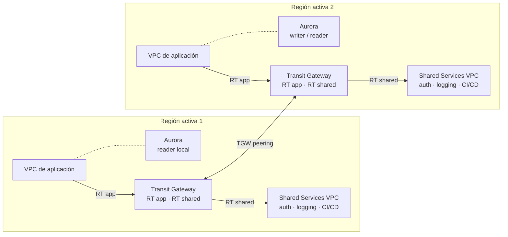

# Finished Architecture - Networking

> [!abstract] Qué es este archivo
> Décima lección y **cierre del módulo**. No trae servicios nuevos: **arma la arquitectura final** del caso de
> la plataforma de gaming con todo lo que vinimos viendo —**Transit Gateway**, **route tables dedicadas**,
> **shared services**, **RAM**, **PrivateLink**, **Route 53 Resolver**— y explica **por qué cada pieza está ahí**.
>
> Video: **4 min 52 s**. Es la nota que conviene repasar **antes** del examen, después de las otras nueve.

> [!quote] La idea que ordena todo
> **De malla a hub-and-spoke, y de copias a servicios compartidos.** La arquitectura no crece agregando enlaces:
> crece **adjuntando VPC a un hub** y **consumiendo lo que ya existe** en la región.

---

## Resumen en una frase

> **Un Transit Gateway por región**, con **peering entre regiones**, **dos route tables** para segmentar
> (**RT app** y **RT shared**), una **Shared Services VPC** por región expuesta por **PrivateLink** y compartida
> por **RAM**, y **Route 53 Resolver endpoints** para el DNS cruzado — con **Aurora Global Database** intacta.

---

## 1. La arquitectura, de un vistazo

**El cambio de fondo:** la plataforma venía de **VPC peering punto a punto**, que se vuelve una malla
inmanejable a medida que se suman juegos y servicios. La solución reemplaza eso por **Transit Gateway como hub
regional**.

| Pieza | Rol en el diseño |
| --- | --- |
| **Transit Gateway** | **Hub regional** de conectividad; cada VPC se conecta **una sola vez** |
| **TGW peering** | Une los **transit gateways de las regiones activas** |
| **RT app** | Deja que las **VPC de aplicación** lleguen a **shared services** |
| **RT shared** | Deja que **shared services** responda a las apps, **sin** app-to-app |
| **Shared Services VPC** | **Una por región**: authentication, logging y CI/CD |
| **AWS RAM** | Comparte los **servicios** entre cuentas |
| **PrivateLink** | Expone esos servicios **sin IP pública** ni ruteo complejo |
| **Route 53 Resolver endpoints** | **DNS cruzado** entre VPC, también compartido por **RAM** |
| **Aurora Global Database** | Se **mantiene** como está: readers locales, writer con failover |
| **CloudWatch metrics** | Visibilidad sobre los **transit gateways** |

> [!note] Diagrama reconstruido (la imagen de la fuente no está en el vault)
> `assets/images/PKTGDFU178.jpeg` — diagrama de la solución final. Lo que sigue es una **reconstrucción a partir
> del texto**, no una copia del original.

**Cómo leer el diagrama:** la **ida** app → shared va por **RT app**; la **vuelta** la habilita **RT shared**.
No hay flecha directa entre `A1` y `A2`: **esa ausencia es una decisión**, no un olvido.

---

## 2. Transit Gateway: el hub

**Cómo lo describe la fuente:** un **cloud router** que **simplifica todo**. En vez de administrar **múltiples
peering connections** cada vez que se agrega un juego o un servicio, **cada VPC necesita una sola conexión al
transit gateway**.

| Antes | Después |
| --- | --- |
| **Malla punto a punto** de peering | **Hub-and-spoke** |
| Un enlace **por cada par** de VPC | **Un attachment por VPC** |
| Crece **cuadrático** con cada VPC nueva | Crece **lineal** |
| Configuración repetida en cada par | **Una** configuración por VPC |

**Alcance:** se levanta un **transit gateway en cada región activa**, con **transit gateway peering entre
regiones**. Eso da un **backbone consistente y confiable** para la comunicación cross-region.

> [!important] Lo que se gana no es “menos cable”, es **menos superficie de error**
> Cada peering nuevo era una configuración más que podía quedar mal. Con el hub, **agregar una VPC es un
> attachment**, no un acuerdo bilateral entre dos equipos.

---

## 3. Segmentación: dos route tables por TGW

**La parte más fina del diseño.** Cada transit gateway usa **dos route tables**, y la separación es lo que
produce la seguridad:

| Route table | Qué permite | Qué **no** permite |
| --- | --- | --- |
| **RT app** | **VPC de aplicación → shared services** | App → app directa |
| **RT shared** | **Shared services → VPC de aplicación** (la respuesta) | Que las apps se salteen el control |

**El resultado:** las aplicaciones **consumen servicios compartidos** y **no se hablan entre sí**. Eso da
**control preciso sobre los flujos** y es, según la fuente, **crucial para la seguridad**.

> [!warning] La tentación que rompe el diseño
> Si aparece un requerimiento de “que el juego A le hable al juego B”, **no se resuelve agregando una ruta**:
> eso anula la segmentación que sostiene el modelo. Primero se decide **si ese tráfico debe existir**.

---

## 4. Shared services: una VPC por región

**El problema que evita:** duplicar **authentication, logging y CI/CD** en **cada región**.

**La solución:** una **Shared Services VPC dedicada en cada región** que hostea **todos los servicios comunes**
que las demás aplicaciones necesitan.

| Pieza | Función |
| --- | --- |
| **Shared Services VPC** | Concentra auth, logging y CI/CD **por región** |
| **AWS RAM** | **Comparte esos servicios entre cuentas** |
| **PrivateLink** | **Expone** los servicios a otras VPC **sin IP pública** y **sin reglas de ruteo complejas** |

**Cómo lo describe el video:** es como tener un **API gateway interno**, **totalmente administrado por AWS**.

**El efecto:** **menos overhead operativo** y **consistencia** en el acceso seguro a los servicios.

> [!note] Ampliación (no está en la fuente)
> “Una por región” es una decisión de **latencia y de dominio de falla**, no de comodidad: el servicio queda
> **cerca** de quien lo consume y **cada región** puede seguir operando si la otra se degrada. El detalle de
> **cuántas** regiones entra en el horizonte del rediseño sigue abierto en el índice del módulo.

---

## 5. Lo que **no** se cambia: Aurora Global Database

**La decisión:** se **mantiene el setup actual** de **Aurora Global Database**, donde las **VPC de aplicación
usan readers locales** y **failover al writer cuando hace falta**.

**Por qué:** el **transit gateway soporta principalmente tráfico de plataforma y de shared services**. La base
**no se enruta por el hub**.

**El resultado:** se conserva el **acceso de baja latencia** que los juegos necesitan, **mejorando** al mismo
tiempo la **confiabilidad de los servicios de soporte**.

> [!important] El criterio de diseño
> No todo pasa por el hub. **El tráfico sensible a latencia se queda local**; el hub se usa para lo que
> **necesita centralización**. Forzar la base a cruzar regiones habría sido el error caro.

---

## 6. DNS: dos capas distintas

| Capa | Servicio | Para qué |
| --- | --- | --- |
| **Tráfico de usuarios** | **Route 53 latency-based routing** | **Dirige a los usuarios** a la región que corresponde |
| **Resolución entre VPC** | **Route 53 Resolver endpoints** en la **Shared Services VPC** | **Nombres cruzados** entre VPC |

**Cómo se comparten:** los **Resolver endpoints** se comparten **vía AWS Resource Access Manager**, lo que
**asegura una resolución de DNS consistente en toda la plataforma**.

> [!warning] No confundir las dos capas
> **Latency-based routing** decide **a qué región va el usuario**. **Resolver endpoints** resuelven **nombres
> entre VPC**. Una pregunta sobre “resolver un dominio privado desde otra VPC” **no** se contesta con latency
> routing.

---

## 7. Costos, límites y monitoreo

**Los trade-offs, explícitos en la fuente:**

| Se paga / se limita | Se compensa con |
| --- | --- |
| **Attachments** de Transit Gateway | **Ahorro operativo** de centralizar shared services |
| **Data processing** del TGW | **Eliminación** de la administración de **peering punto a punto** |
| **Límites de attachments y de route tables** | Un modelo que **escala agregando attachments**, no pares |

**Monitoreo:** **CloudWatch metrics sobre los transit gateways**, para **trackear costos**, **optimizar rutas**
y **verificar el cumplimiento de los requisitos de performance**.

> [!note] Ampliación (no está en la fuente)
> Los **límites de route tables** son la razón por la que la segmentación se hace con **dos tablas y reglas**,
> y no con **una tabla por VPC**: el diseño tiene que entrar en la cuota, no solo en el diagrama.

### Por qué escala

**Agregar un juego o una región:** se **adjunta la VPC nueva al transit gateway** y **queda con acceso inmediato
a todos los shared services**. Sin configuraciones de peering nuevas, sin duplicar servicios.

---

## 8. Traducción del contenido

> [!info] Sección de referencia (opcional)
> Esto es la **traducción fiel** de las fuentes, para verificar que no se perdió nada. **No hace falta leerla
> para estudiar**: lo que se estudia son las secciones **1 a 7** y se cierra con la **10**.
> Usala solo si (a) algo de arriba te quedó dudoso, (b) querés el detalle textual del cierre, o (c) antes del
> examen querés chequear que no se escapó un matiz.

### 8.1 Video: Finished architecture (transcripción)

Ahora que compartí **nuestro proceso de requirements gathering**, dejame **recorrerte la arquitectura
multi-región que diseñamos para esta plataforma de gaming**. Esta solución **ataca sus desafíos inmediatos de
escalado** y, al mismo tiempo, **da una base para el crecimiento futuro**.

Empecemos por **el core de nuestro diseño**. Estamos **implementando AWS Transit Gateway como hub regional para
la conectividad de red**, y esto es **una mejora significativa sobre su enfoque actual de VPC peering punto a
punto**. Pensá en **Transit Gateway como un router en la nube que simplifica todo**. En vez de **administrar
múltiples peering connections a medida que agregan juegos y servicios nuevos**, **cada VPC necesita solo una
conexión al transit gateway**. **Mucho más limpio, ¿no?**

Ahora estamos **levantando un transit gateway en cada región activa, con transit gateway peering entre
regiones**. Eso nos da **un backbone consistente y confiable para la comunicación cross-region**.

Pero **acá es donde se pone interesante**. Estamos usando **dos route tables distintas por transit gateway**.
**La primera, que llamamos RT app, solo permite que las VPC de aplicación hablen con shared services.** **La
segunda, RT shared, deja que la VPC de shared services se comunique de vuelta con las apps, pero no permite
comunicación directa app-to-app.** **Esta segmentación es crucial para la seguridad** y nos da **control preciso
sobre los flujos de tráfico**.

Y **uno de los aspectos más potentes de este diseño es nuestro enfoque de shared services**. En vez de
**duplicar servicios de authentication, logging y CI/CD en cada región**, **creamos una VPC dedicada de shared
services en cada región**. Esta VPC **hostea todos los servicios comunes que las otras aplicaciones
necesitan**. Estamos usando **AWS Resource Access Manager para compartir estos servicios entre cuentas**, lo
que **reduce drásticamente el overhead operativo** y **asegura consistencia para el acceso seguro a los
servicios**.

Estamos **implementando AWS PrivateLink endpoints en la shared services VPC**. Esto nos **deja exponer
servicios a otras VPC sin usar IPs públicas ni crear reglas de ruteo complejas**. Es como tener **un API gateway
interno totalmente administrado por AWS**.

**Consideramos cuidadosamente los trade-offs de este diseño.** Así que **sí, hay costos asociados con los
attachments de transit gateway y el data processing**, y **tenemos que administrar los límites de attachments y
de route tables**. Pero **esos costos se compensan con los ahorros operativos de centralizar los shared
services** y con **la eliminación de la administración de peering punto a punto**.

**Para el despliegue existente de Aurora Global Database, mantenemos la configuración actual**, donde **las VPC
de aplicación usan readers locales y hacen failover al writer cuando hace falta**. **El transit gateway soporta
principalmente tráfico de plataforma y de shared services.** Esto nos **deja mantener el acceso de baja latencia
a la base que los juegos requieren**, mientras **mejoramos la confiabilidad de los servicios de soporte**.

**También pensamos en la resolución de DNS.** Mientras **Route 53 latency-based routing sigue dirigiendo el
tráfico de usuarios**, estamos **agregando Route 53 Resolver endpoints en la shared services VPC para la
resolución de nombres entre VPC**. Estos endpoints **se comparten vía Resource Access Manager**, **asegurando
una resolución de DNS consistente en toda la plataforma**.

**La belleza de esta arquitectura es su escalabilidad.** Cuando **quieren agregar un juego nuevo o expandirse a
una región nueva**, **simplemente adjuntan la VPC nueva al transit gateway** y **obtienen inmediatamente acceso a
todos los shared services**. **Se terminaron las configuraciones de peering complejas y la duplicación de
servicios.**

**Mirando el monitoreo y las operaciones**, van a tener **visibilidad clara en toda su red a través de las
métricas de CloudWatch sobre los transit gateways**. Esto los **ayuda a trackear costos, optimizar rutas y
asegurar que están cumpliendo los requisitos de performance**.

Y **lo que realmente me gusta de este diseño es cómo transforma su arquitectura**: de **una malla compleja de
conexiones** a **un modelo limpio de hub-and-spoke**. Les da **la escala que necesitan para crecer**, mientras
**reduce la complejidad operativa**. Y como estamos usando **servicios administrados como Transit Gateway y
PrivateLink**, **su equipo puede enfocarse en construir buenos juegos en vez de administrar infraestructura de
red**. Esta solución los **prepara para el éxito, ahora y en el futuro**.

Obtienen **networking simplificado, shared services centralizados, seguridad mejorada por segmentación** y **una
base que puede escalar con el negocio**. Es **exactamente lo que necesitan** para **soportar su plataforma de
gaming en crecimiento**, manteniendo **operaciones optimizadas y eficientes**.

*Duración del video: **4 minutos 52 segundos**.*

### 8.2 Lectura: architecture recap

> [!note] La imagen de la fuente no está en el vault
> Diagrama de la arquitectura final de la solución de gaming (`assets/images/PKTGDFU178.jpeg`). Reconstruido en
> §1 a partir del texto.

- Implementar **AWS Transit Gateways** en **múltiples regiones**, con **route tables dedicadas**.
- **Aplicar seguridad mediante segmentación de tráfico.**
- **Crear Shared Services VPCs en cada región** para **centralizar servicios comunes** como authentication,
  logging y CI/CD, **reduciendo duplicación y overhead operativo**.
- **Aprovechar AWS PrivateLink** para el **acceso seguro a los servicios**.
- **Mantener el setup existente de Aurora Global Database** para el **rendimiento del juego**.
- **Incorporar Route 53 Resolver endpoints** para una **resolución de DNS consistente entre VPC**.

---

## 9. El caso, requisito por requisito

> [!note] Síntesis propia (no está en la fuente)
> Este cuadro cruza los **cinco requisitos de la lección 01** con las decisiones de esta arquitectura. El
> cruce es mío; lo que está en la fuente es cada decisión por separado.

| Requisito (lección 01) | Cómo lo resuelve esta arquitectura |
| --- | --- |
| **Red escalable** | **TGW hub-and-spoke**: una VPC nueva = **un attachment** |
| **Servicios centralizados** | **Shared Services VPC por región** + **RAM** |
| **Diseñado para failover** | **TGW peering** entre regiones + **Aurora Global Database** con failover al writer |
| **Segmentación por seguridad** | **RT app** y **RT shared**: apps **sin** app-to-app |
| **Performance** | **Base local** (readers) y **PrivateLink** para servicios, sin salir a internet |

---

## 10. Para el examen (SAP-C02)

> [!important] Lo que hay que retener
> 1. **TGW reemplaza la malla de peering**: **una conexión por VPC**, no un enlace por par.
> 2. **Un TGW por región activa** + **TGW peering** entre regiones.
> 3. **Dos route tables por TGW**: **RT app** (apps → shared) y **RT shared** (shared → apps).
> 4. **No hay app-to-app**: la segmentación es **deliberada** y es el control de seguridad.
> 5. **Shared Services VPC en cada región**: authentication, logging y CI/CD **no se duplican**.
> 6. **RAM** comparte los servicios entre cuentas; **PrivateLink** los expone **sin IP pública**.
> 7. **Aurora Global Database se mantiene**: readers **locales**, failover al writer; **no pasa por el TGW**.
> 8. **DNS en dos capas**: **latency-based routing** para usuarios y **Resolver endpoints** para entre VPC,
>    **compartidos por RAM**.
> 9. **Costos**: attachments y data processing del TGW, compensados por el ahorro de no administrar peering.
> 10. **Monitoreo**: **CloudWatch metrics sobre los transit gateways** para costos, rutas y performance.

> [!warning] Trampa clásica del examen
> Escenario: “las aplicaciones de la misma región necesitan comunicarse entre sí; agregamos una ruta en
> **RT app**”. La respuesta es que **eso rompe la segmentación**: el diseño **excluye** el app-to-app a
> propósito. Y si piden resolver **DNS privado entre VPC**, no es **latency-based routing**: son **Route 53
> Resolver endpoints** compartidos por **RAM**.

---

## Relacionado

- [[AWS Solutions Architect Advanced - Designing Advanced Network Architectures]] *(índice del módulo)*
- [[Gathering the Customer Requirements - Networking]] — los cinco requisitos que esta arquitectura cumple
- [[VPC Connectivity]] — por qué la malla de peering no escala
- [[AWS Transit Gateway Setup]] — attachments, route tables y asociación
- [[Use Cases - Transit Gateway]] — shared services y aislamiento en la práctica
- [[AWS Resource Access Manager (RAM) Solutions]] — compartir los servicios entre cuentas
- [[VPC Endpoints]] · [[AWS PrivateLink Components]] — cómo se expone el servicio compartido
- [[AWS Transit Gateway Network Manager]] — visibilidad y diagnóstico de esta topología
- [[IP Address Management and IPv6 Adoption]] — el espacio de direcciones de todas esas VPC
- [[1.1 Diseñar estrategias de conectividad de redes]] — la tarea que el módulo cubre
- Siguiente paso del módulo: [[BuildingBlocks Videos - Networking]] — tres casos resueltos con criterio

---

## Registro de integración

| Fecha | Qué llegó | Dónde se integró |
| --- | --- | --- |
| 27/10/2026 | Lección 10 completa: arquitectura final del caso gaming | Nota completa (secciones 1–10) |

**Discrepancias y vacíos registrados (no corregidos):**

1. **La imagen no está en el vault**: `PKTGDFU178.jpeg` (diagrama de la solución final). El diagrama de §1 es
   una **reconstrucción propia** desde el texto, marcada como tal.
2. **La transcripción tiene erratas de la fuente**: “Think of transit gateway **As** a cloud router” y “AWS
   **transit gateway**” en minúscula. Se normaliza la transcripción sin alterar el sentido.
3. **“CICD”** aparece sin barra en la fuente; se transcribe como **CI/CD**.
4. **No hay Knowledge Check**: la lección cierra con el **architecture recap**.
5. **La fuente no da cifras** de costos, de límites de attachments ni de route tables: solo dice que **hay que
   administrarlos**. No se agregaron números.
6. **La fuente no dice cuántas regiones** entran en el horizonte del rediseño. La duda sigue **abierta** en el
   índice del módulo.
7. **El cuadro de §9 es síntesis propia**: cruza los requisitos de la lección 01 con las decisiones de esta
   lección. La fuente no hace ese cruce.

**Decisiones de transcripción:**

- Se conservan **Transit Gateway**, **TGW peering**, **RT app**, **RT shared**, **shared services**,
  **PrivateLink**, **Route 53 Resolver endpoints**, **latency-based routing**, **Aurora Global Database** y
  **hub-and-spoke**.
- Las **cifras** se transcriben literales: **4 min 52 s**, **dos route tables**, **una Shared Services VPC por
  región**.
- Los **nombres de las route tables** se conservan **exactamente** como los da la fuente, porque son el ancla
  de la segmentación.
