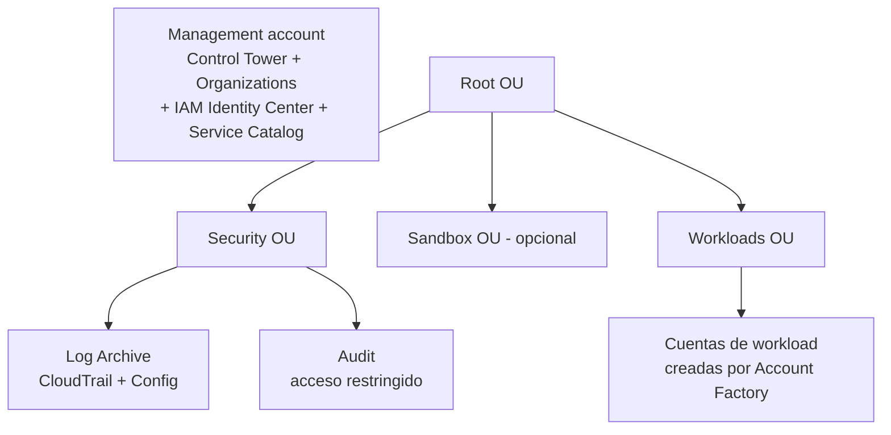

# AWS Control Tower

> [!abstract] Qué es este archivo
> **Control Tower** es el **orquestador** que arma y gobierna el entorno multi-cuenta: crea la **landing zone**,
> las OUs, las cuentas compartidas, los **controls** y el acceso SSO. Acá está el detalle de cada pieza
> (landing zone, controls, Account Factory, dashboard, enrollment) y las best practices.

> [!quote] La analogía del módulo
> Una **torre de control de aeropuerto** no vuela aviones ni carga valijas: **coordina y monitorea** a todos los
> que sí lo hacen. Control Tower hace lo mismo: **no corre tus workloads**, orquesta los servicios que sí
> (Organizations, IAM Identity Center, Service Catalog).

---

## Resumen en una frase

> Control Tower = **landing zone + controls + Account Factory + dashboard**, para tener **gobernanza a escala
> sin frenar la agilidad** de los builders.

---

## 1. El problema que resuelve

| Presión | Detalle |
| --- | --- |
| **Gobernanza** | Necesitás guardrails para la arquitectura multi-cuenta |
| **Agilidad** | Los builders quieren seguir moviéndose rápido (la razón por la que fueron a la nube) |
| **Complejidad** | Con muchas cuentas y equipos, el setup y la gobernanza consumen tiempo y frenan la innovación |

**Propuesta de Control Tower:** setup automatizado de **best practices**, guardrails para **gobernanza continua**
y un **dashboard unificado** de visibilidad sobre toda la organización.

**Cuándo usarlo (según la lectura):** entorno AWS **nuevo**, recién arrancando el journey a AWS, nueva iniciativa
cloud o **completamente nuevo en AWS** → Control Tower te da gobernanza y best practices **desde el día uno**.
Para clientes nuevos, **se recomienda empezar con Control Tower**.

> [!important] Es un orquestador, no un servicio de workloads
> Control Tower **crea una capa de orquestación** que combina e integra capacidades de **Organizations**,
> **IAM Identity Center** y **AWS Service Catalog**. No ejecuta tus aplicaciones.

---

## 2. Landing zone (LZ)

> **Definición:** entorno multi-cuenta de AWS **bien arquitecturado**, basado en **best practices de seguridad y
> compliance**. Es un **contenedor de nivel superior** para Organizations.

### Lo que Control Tower crea automáticamente

| Crea | Detalle |
| --- | --- |
| **Root OU** | La raíz de la organización |
| **Security OU** | Contiene las cuentas de seguridad |
| **Sandbox OU** | **Opcional** |
| **Cuenta Log Archive** | Recolecta **todos** los logs (CloudTrail + AWS Config), incluidos los de las demás cuentas |
| **Cuenta Audit** | Cuenta **restringida** para que seguridad/compliance revisen otras cuentas **sin loguearse en ellas** |
| **Controls** | Para **hacer cumplir políticas** y **detectar** malas configuraciones o **drift** |
| **Directorio en IAM Identity Center** | Con **grupos preconfigurados** y **acceso SSO** |
| **20 preventive controls + 6 detective controls** | Cifras exactas del setup; se aplican a **toda la organización salvo la management account** |

### Las cuentas, una por una

| Cuenta | Para qué sirve | Regla |
| --- | --- | --- |
| **Management** | Facturación de la LZ, **Account Factory**, gestión de **OUs y controls** | **No correr workloads de producción**. Crear una cuenta aparte para eso |
| **Log Archive** | Logs centralizados de **todas** las cuentas | Administradores y auditores revisan acciones y eventos desde acá |
| **Audit** | Acceso de **seguridad y compliance** a las demás cuentas | **Restringida**; no requiere loguearse en cada cuenta |
| **Workloads** | Tus cargas | Se crean con **baselines de cuenta y red** desde templates |

> [!tip] Patrón que se repite en todo el módulo
> **Logs y auditoría viven en cuentas separadas.** Ya lo viste en [[Multi-Account Access Solutions]]; Control
> Tower lo **automatiza**.

### Blueprints que implementa el setup

| Blueprint | Qué deja preconfigurado |
| --- | --- |
| **Multi-account environment** | Estructura de cuentas con **AWS Organizations** |
| **Identity management** | **IAM Identity Center** con **directorio default** |
| **Centralized logging** | **AWS CloudTrail + AWS Config** → **Amazon S3** |
| **Cross-account security audits** | Auditorías de seguridad entre cuentas con **IAM** e **IAM Identity Center** |

### Lo que Control Tower NO decide por vos

> **Control Tower es un punto de partida**, no la landing zone terminada. Vos tenés que definir tu estrategia
> **según tus requisitos únicos**:

| Decisión | Qué hay que resolver |
| --- | --- |
| **Account structure** | Cuántas cuentas, con qué granularidad, cómo se agrupan en OUs |
| **Networking** | VPCs, CIDRs, conectividad entre cuentas (Transit Gateway, VPC peering, IPAM) |
| **Security** | Cifrado, perímetro, inspección de tráfico, identidad, detección |
| **Access management** | Quién entra a qué, con qué roles y permission sets |

> [!note] Sobre la fuente
> Al principio el carrusel "Landing Zone" (6 slides) solo traía el texto del **slide 1**; el resto se renderizaba
> en el cliente. La **continuación de la clase** (26/10) completó ese contenido: ya está integrado en
> [[#9.4 Lectura: Landing zone]] y en las secciones 2, 5, 6 y 7.

---

## 3. Home Region y alcance

| Elemento | Alcance |
| --- | --- |
| **Home Region** | La región que usás para acceder a la consola **cuando creás la LZ** |
| Recursos creados en el setup | Algunos se aprovisionan **en la home Region** |
| **OUs y cuentas** | **Globales** |
| **Preventive controls** | Funcionan **globalmente** |
| **Detective controls** | Solo en las **regiones donde Control Tower está soportado** |

> [!warning] Regla de las best practices
> **La región donde más trabajás debería ser tu home Region.**

---

## 4. Controls

> **Definición:** reglas de alto nivel que dan **gobernanza continua** al entorno. Se expresan en
> **lenguaje llano** (*plain language*).

### Dos ejes independientes

| Eje | Valores |
| --- | --- |
| **Behavior** (comportamiento) | **Preventive**, **Detective**, **Proactive** |
| **Guidance** (guía) | Práctica recomendada sobre **cómo aplicar** el control a las OUs |

> El **guidance es independiente** del behavior: un control puede ser preventivo y a la vez "recomendado".

### Tabla comparativa

| | **Preventive** | **Detective** | **Proactive** |
| --- | --- | --- | --- |
| **Qué hace** | **Impide** acciones que violan políticas | **Detecta** incumplimiento de recursos en las cuentas | **Escanea** los recursos **antes** de aprovisionarlos |
| **Implementado con** | **Service Control Policies (SCPs)** | **AWS Config rules** + **Lambda** | **AWS CloudFormation hooks** |
| **Resultado** | La acción **falla** | **Alertas** en el dashboard | Recurso **no se aprovisiona** si no cumple |
| **Status** | `enforced` / `not enabled` | `clear` / `in violation` / `not enabled` | `PASS` / `FAIL` / `SKIP` |
| **Control de ejemplo** | Prohibir **lectura pública** en buckets S3 | Habilitar **CloudTrail** y **AWS Config** | Asegurar **cifrado de volúmenes EBS** en instancias EC2 |
| **Alcance** | **Global** | Solo **regiones soportadas** | Recursos que se aprovisionan **por CloudFormation** |

> [!note] Ampliación (no está en la fuente)
> En AWS los niveles de **guidance** son **Mandatory**, **Strongly recommended** y **Elective**. La lectura solo
> menciona el concepto; los nombres son útiles para el examen.

> [!important] Por qué importa la diferencia
> Si el examen dice *"impedir que se cree un recurso no conforme"* → **preventive**. Si dice *"detectar y
> alertar"* → **detective**. Si dice *"validar **antes** de aprovisionar"* → **proactive**.

---

## 5. Account Factory

> **Qué es:** el **producto de consola** dentro de **AWS Service Catalog** que **automatiza el aprovisionamiento
> de cuentas** en la landing zone.

| Aspecto | Detalle |
| --- | --- |
| **Vía estándar** | **Account Factory** (consola) |
| **Requisito** | La LZ **no debe estar en estado de drift** para usar **Enroll account** |
| **Automatización** | Se puede provisionar **programáticamente** con **IAM roles + Lambda** |
| **Baselines** | **Cuenta y red** estandarizadas, definidas en **templates** |
| **Blueprints** | Templates que definen **settings de cuenta y red**; hay **predefinidos** o **personalizados** |
| **Quién provisiona** | Normalmente un **cloud administrator**; con los permisos correctos, **usuarios finales** también → **advanced account provisioning** |

### Tres formas de crear member accounts

| Vía | Cómo funciona |
| --- | --- |
| **Account Factory (consola)** | Producto dentro de **AWS Service Catalog** |
| **Enroll account** | Función dentro de **AWS Control Tower**; requiere la LZ **sin drift** |
| **Programática** | Desde la **management account**, con **código Lambda + roles IAM** apropiados |

### Service Catalog: el motor debajo

| Concepto | Definición |
| --- | --- |
| **Product** | Set estandarizado de recursos AWS desplegado con **IaC** (CloudFormation o Terraform) |
| **Portfolio** | Agrupación de products; se usa comúnmente como **permissions boundary** |
| **Permiso** | Vía **IAM** le das a un equipo acceso a un **portfolio** de recursos aprobados |

**Ejemplo de product:** una instancia **EC2** con un **volumen EBS** adjunto y un **bucket S3** para estáticos.

**Relación con Control Tower:** **Account Factory es un product de Service Catalog**. Control Tower lo configura
automáticamente como servicio subyacente para provisionar cuentas.

> **Dos niveles de gobernanza:**
> - **Control Tower** → gobernanza **a nivel de cuenta**.
> - **Service Catalog** → gobernanza **granular a nivel de recurso**.

> [!warning] Error clásico al enrolar
> Si enrolás una cuenta **existente**, **escribí bien el email existente**. Si no, **se crea una cuenta nueva**.

---

## 6. Dashboard

Vista **casi continua** del entorno multi-cuenta:

- **Visibilidad** de todas las cuentas aprovisionadas de la empresa.
- **Reportes** de los controls **detective y preventive** habilitados.
- **Estado** de los recursos que **no cumplen** las políticas aplicadas por controls, **organizados por cuenta y
  por OU**.

### Qué se monitorea (y dónde se ve)

| Qué | Dónde |
| --- | --- |
| **Estado de los controls** | **Consola de Control Tower**, en todo momento |
| **Salud y estado** de las cuentas de Account Factory | Monitoreo constante |
| **Acciones y eventos de la management account** | Página **Activities** de la consola |
| **Acciones y eventos de las member accounts** | **Archivos de la log archive account** |

> El **logging es automático**: Control Tower se integra con **Amazon CloudWatch**, así que **todas** las
> acciones quedan registradas (management account + member accounts).

---

## 7. Automate enrollment (enrolar cuentas existentes)

| Punto clave | Detalle |
| --- | --- |
| **Punto de partida** | Podés desplegar Control Tower **sobre una organización existente** |
| **Default** | Las cuentas **no enroladas** quedan **fuera** de la gobernanza de Control Tower |
| **Acción requerida** | Hay que **enrolarlas explícitamente** |
| **Qué significa enrolar** | **Mover** una cuenta no enrolada a una **OU registrada** |
| **Cómo funciona** | Con **trusted access**, **CloudFormation** crea/actualiza/elimina stacks en **múltiples cuentas y regiones** en **una sola operación**; Control Tower aplica **roles y permisos** a la cuenta **antes** de moverla |

### Pasos del script de enrollment

| # | Paso |
| --- | --- |
| 1 | Acceder a una **instancia EC2** en la **management account**, en la **home Region** |
| 2 | Obtener **credenciales temporales** de **AWSAdministratorAccess** en el login de **IAM Identity Center** |
| 3 | **Descargar y ejecutar** el script `script.py` de enrollment |
| 4 | El script crea el rol **AWSControlTowerExecution** en la **cuenta destino**, usando **automatic deployments for a stack set** |
| 5 | Control Tower **valida el rol y las OUs** e invoca el **launch de un product de Account Factory** |
| 6 | Se crea un **usuario de IAM Identity Center** con **el mismo email** que la cuenta de AWS |

---

## 8. Best Practices

1. **Limitar** la asignación de **permisos de administrador** en la **management account**.
2. **Comunicar a los administradores** qué **preventive controls** aplican a **cada OU**, para que corran sus
   workloads correctamente.
3. **Comunicar a administradores de cuenta y usuarios** a qué recursos tienen acceso en la landing zone.
4. Los **desarrolladores de AWS** deben **conocer los preventive controls** de las cuentas y OUs que usan.
5. La **región donde más trabajás** debe ser la **home Region**.
6. **No modificar ni borrar** recursos creados por Control Tower en la **management account** ni en las
   **shared accounts**.

> [!tip] La número 2 y la 4 son la misma lección de la demo de Organizations
> Los guardrails **sorprenden** si nadie los comunicó. Gobernanza sin comunicación = tickets de soporte.

---

## 9. Traducción del contenido

> [!info] Sección de referencia (opcional)
> Traducción fiel de las fuentes. Para estudiar alcanza con las secciones **1 a 8** y cerrar con la **10**.
> Usala si algo quedó dudoso o para verificar que no se escapó un matiz.

### 9.1 Video (transcripción)

Bien, ahora veremos **AWS Control Tower**, un servicio que te ayuda a **configurar y gobernar un entorno
multi-cuenta de AWS con reglas de seguridad y cumplimiento**.

Supongamos que tu empresa está creciendo y enfrentás un desafío común: querés **gobernanza y guardrails** para
tu arquitectura multi-cuenta, pero tus **builders quieren seguir moviéndose rápido y mantenerse competitivos**.
Esto es importante: para muchos clientes, **la agilidad es una de las grandes ventajas** que los atrajo a la
nube, además de otras como el **ahorro de costos**. **Control Tower está diseñado para equilibrar la necesidad de
los builders de mantenerse ágiles con la gobernanza a escala.** Te ayuda a **configurar y gobernar rápidamente
entornos multi-cuenta que sean conformes y seguros**.

Si trabajaste con AWS un tiempo, sabés que hay **distintos tipos de servicios de AWS**: algunos que **hacen el
trabajo de correr tus workloads** en la nube y otros que son más bien **orquestadores**. No realizan tareas como
construir o ejecutar aplicaciones por sí mismos: **administran y coordinan otros servicios** que sí lo hacen.
**Control Tower es uno de esos orquestadores.** Pensá en la **torre de control de un aeropuerto grande y
concurrido**: la gente en la torre **no vuela aviones ni maneja valijas**; **coordinan y monitorean** las
acciones de todos los demás que hacen el trabajo real de llevarte a vos y a tus cosas a donde tienen que ir. Con
AWS Control Tower es igual.

Usando Control Tower, configurás **Landing Zones**. Una **landing zone (LZ)** es un **entorno multi-cuenta de AWS
bien arquitecturado, basado en best practices de seguridad y compliance**. La LZ es un **contenedor de nivel
superior para Organizations**.

Acá hay un ejemplo: tenemos una **management account** donde corren todos estos servicios que Control Tower
orquesta: **Service Catalog, Organizations, IAM Identity Center**. Cuando configurás tu LZ, Control Tower hace
**muchas cosas por vos automáticamente**:

- Crea la **root organizational unit**, una **security OU** y, opcionalmente, una **sandbox OU**.
- Crea **dos cuentas compartidas**: la **log archive account** y la **audit account**.
- Aplica **controls** para **hacer cumplir políticas** y **detectar malas configuraciones o drift** en esas
  cuentas aprovisionadas. (Lo veremos con más detalle más adelante en el video.)
- Y crea un **directorio en IAM Identity Center** con **grupos preconfigurados y acceso SSO**.

Profundicemos en esas cuentas. La **management account**, como su nombre implica, es **solo para el centro de
control y los servicios que orquesta**: **no queremos desplegar ningún otro servicio ahí**. Está la **Log
Archive account**, que usa **CloudTrail y AWS Config** para **recolectar todos los logs de forma central**,
incluidos los de **todas las demás cuentas**; administradores y auditores pueden usar esos archivos para
**revisar acciones y eventos ocurridos**. Y está la **audit account**, una **cuenta restringida** diseñada para
permitir que tus equipos de **seguridad y compliance** accedan a **revisar otras cuentas sin loguearse
directamente en ellas**. Y después tenemos las **demás cuentas aprovisionadas para tus workloads**.

Control Tower usa un **account factory** que **automatiza el aprovisionamiento de cuentas**. Esas cuentas
aprovisionadas tienen **baselines de cuenta y de red** usando **templates que vos configurás**.

Hablemos un poco más de los **controls**, porque son una gran parte de cómo mantenemos gobernanza **mientras
seguimos siendo ágiles**. Los **controls son reglas de alto nivel** que proveen **gobernanza continua** para todo
tu entorno. Pueden ser **preventive, detective o proactive**:

- Los **preventive controls** aseguran que tus cuentas mantengan el cumplimiento **prohibiendo acciones** que
  violan políticas. Se implementan usando **service control policies**.
- Los **detective controls** **detectan incumplimiento**, como violaciones de políticas, usando **reglas de AWS
  Config y funciones Lambda**, y **levantan alertas**.
- Los **proactive controls** **escanean los recursos antes de que se aprovisionen** para asegurar que cumplan,
  usando **CloudFormation hooks**.

Cuando trabajás con Control Tower, usás **Account Factory** para aprovisionar cuentas en tu landing zone, y
podés hacerlo **manualmente o programáticamente**. Account Factory usa templates llamados **blueprints** para
definir **settings de cuenta y red**. Hay **blueprints predefinidos** disponibles o podés crear tus propias
**configuraciones personalizadas**. **Account Factory es un componente de AWS Service Catalog**, que **almacena
los blueprints y despliega cuentas** con las **baselines y controls** que especificaste.

Veamos más de cerca **Service Catalog**. Service Catalog te permite desplegar **sets estandarizados de recursos
de AWS llamados products** usando **infraestructura como código**, ya sea **CloudFormation o Terraform**. Por
ejemplo, un **product** simple podría ser una **instancia EC2** con un **volumen EBS adjunto** y un **bucket S3**
para almacenar recursos estáticos. Los **products** en Service Catalog se organizan en **portfolios**, que se
usan comúnmente como **permissions boundary**. Usando **IAM**, le das a un equipo **permiso a un portfolio** de
recursos estandarizados que querés que puedan desplegar. Eso es lo que pasa también con Control Tower: **Account
Factory es un product en Service Catalog**.

Este ejemplo también muestra que puede haber **múltiples roles** involucrados. Normalmente, un **cloud
administrator** usará la funcionalidad **enroll account** de Control Tower para **aprovisionar cuentas nuevas o
enrolar cuentas existentes**. Pero también podés **permitir que usuarios finales aprovisionen cuentas** si les
das los permisos correctos: eso se llama **advanced account provisioning**.

### 9.2 Lectura: AWS Control Tower solutions

Si tu organización tiene **múltiples cuentas y equipos**, el **setup y la gobernanza** en la nube pueden ser
**complejos y consumir tiempo**, **frenando la innovación** que intentás acelerar.

**AWS Control Tower:**

- Provee una forma de **configurar y gobernar un entorno multi-cuenta de AWS nuevo y seguro**.
- Usa **best practices establecidas** a través de la experiencia trabajando con **miles de empresas** en su
  migración a la nube.
- **Aprovisiona cuentas nuevas en unos pocos clics**, con la tranquilidad de que tus cuentas **cumplen las
  políticas de toda la compañía**.

Si estás **construyendo un entorno AWS nuevo**, **recién empezando** tu journey a AWS, **iniciando una nueva
iniciativa cloud** o sos **completamente nuevo en AWS**, Control Tower puede ayudarte a **empezar rápido con
gobernanza y best practices incluidas**.

**Equilibrar agilidad y gobernanza a escala**

Una organización debe **equilibrar la necesidad de los builders de mantenerse ágiles** con la **gobernanza a
escala**. Establecer los **estándares fundacionales** te da la capacidad de **configurar, aprovisionar y operar**
tu entorno tanto para **agilidad de negocio** como para **gobernanza a escala**.

Cuando creás una landing zone, la **región que usás para acceder a la consola** se convierte en tu **home AWS
Region** para Control Tower. Durante el proceso de creación, **algunos recursos se aprovisionan en la home
Region**. Otros, como las **OUs y las cuentas de AWS**, son **globales**. Actualmente, **todos los preventive
controls funcionan globalmente**; sin embargo, los **detective controls solo funcionan en las regiones donde AWS
Control Tower está soportado**.

Para la lista de regiones donde Control Tower está disponible, revisá la **AWS Regional Services List**.

### 9.3 Lectura: AWS Control Tower components

AWS Control Tower crea una **capa de orquestación** que **combina e integra** las capacidades de **varios otros
servicios de AWS**, incluidos **Organizations, IAM Identity Center y AWS Service Catalog**.

**1: Management Account**

La **management account** es la cuenta que creaste **específicamente para tu landing zone**. Se usa para
**facturar todo** lo de tu landing zone, para el **aprovisionamiento de cuentas con Account Factory** y para
**administrar OUs y controls**. **No se recomienda correr ningún tipo de workload de producción** desde una
management account de Control Tower. **Creá una cuenta separada de Control Tower para correr tus workloads**.
Cuando configurás tu landing zone, se crea una **serie de recursos de AWS dentro de tu management account**.

**2: Landing Zone**

Una **landing zone** es un entorno multi-cuenta de AWS **Well-Architected**, **escalable y seguro**. Es un
**punto de partida** desde el cual tu organización puede **lanzar y desplegar workloads y aplicaciones** rápido y
con confianza en su **seguridad y en su entorno de infraestructura**.

**3: Controls**

Un **control** es una **regla de alto nivel** que provee **gobernanza continua** para todo el entorno de AWS.
Se expresa en **lenguaje llano**. Existen **tres tipos**: **preventive, detective y proactive**.

**4: Account Factory**

Control Tower ofrece un **Account Factory integrado** que ayuda a **automatizar el workflow de aprovisionamiento
de cuentas** en tu organización.

**5: Dashboard**

El **dashboard** ofrece **supervisión casi continua** de la landing zone a los **administradores centrales de
cloud**. Se usa para revisar: **cuentas aprovisionadas** en toda la empresa, **controls habilitados** y
**recursos no conformes organizados por cuenta y por OU**.

### 9.4 Lectura: Landing zone

AWS Control Tower es un **servicio administrado**. Tenés algunas opciones para crear tu landing zone en AWS:
podés elegir un **servicio administrado que orqueste tu entorno** o trabajar con un **AWS Partner** para
construir la tuya. **Recomendamos que los clientes nuevos empiecen con AWS Control Tower.**

**Construir una landing zone** implica **tomar decisiones técnicas y de negocio** sobre **estructura de cuentas,
redes, seguridad y gestión de accesos**, de acuerdo con el **crecimiento y los objetivos de negocio futuros** de
tu organización.

> **Nota:** AWS Control Tower es un **punto de partida** para una landing zone. Necesitás **determinar tu
> estrategia de redes, gestión de accesos y seguridad**, según tus **requisitos únicos**, a medida que
> construís tu landing zone.

**Acciones que Control Tower ejecuta en tu management account al crear la LZ:**

- Crea **tres OUs de Organizations**: **Root**, **Security** y **Sandbox** (opcional), dentro de la estructura
  organizacional raíz.
- Crea **dos cuentas compartidas**: **log archive** y **audit**.
- Crea un **directorio cloud-native en IAM Identity Center** con **grupos preconfigurados** y **acceso SSO**.
- Aplica **20 preventive controls** para hacer cumplir políticas.
- Aplica **6 detective controls** para detectar violaciones de configuración.
- **Salvo la management account**, aplica los controls a **toda la organización**.

**Log archive account**

Cuenta **dedicada a recolectar todos los logs de forma central**, incluidos los de las demás cuentas.
**Administradores y auditores** usan esos archivos para **revisar acciones y eventos**. El **monitoreo** es parte
importante del **AWS Well-Architected Framework** (los resultados del monitoreo se guardan en logs, por eso
**logging y monitoring están íntimamente relacionados**). Best practice: **recolectar datos de monitoreo de
todas las partes de la solución en los logs**, para poder depurar mejor una falla multi-punto.

**Qué monitorea Control Tower:**

- **Estado de los controls**: monitoreo constante, visible de un vistazo en la consola.
- **Salud y estado de las cuentas** aprovisionadas en Account Factory.
- **Logging automático** de acciones y eventos vía integración con **Amazon CloudWatch**: se registran las
  acciones de la **management account** y de las **member accounts**. Las de la management account se ven en la
  página **Activities**; las de las member accounts, en los **archivos de la log archive**.

**Audit account**

Cuenta **restringida** que da a los equipos de **seguridad y compliance** acceso de **lectura y escritura** a
**todas las cuentas** de la landing zone. El acceso es **programático**: se revisan las cuentas mediante un
**rol otorgado únicamente a funciones AWS Lambda**. La audit account **no permite loguearse manualmente** en
otras cuentas.

**Member accounts — tres métodos de creación:**

1. Consola de **Account Factory** (parte de **AWS Service Catalog**).
2. Función **Enroll account** dentro de **AWS Control Tower**.
3. Desde la **management account** de la LZ, con **código Lambda y roles IAM** apropiados.

**Resumen de la lectura:** la landing zone de Control Tower es un entorno multi-cuenta **preconfigurado, seguro**,
que implementa best practices de **estructura organizacional, gestión de identidad y logging** mediante
**Organizations, IAM Identity Center y CloudTrail**. Los usuarios finales aprovisionan cuentas estandarizadas
desde **Service Catalog** manteniendo seguridad y compliance en toda la organización.

### 9.5 Lectura: Controls

Los controls se **categorizan según su behavior y su guidance**. El **behavior** de cada control es
**preventive, detective o proactive**. El **guidance** se refiere a la **práctica recomendada** sobre **cómo
aplicar** cada control a tus OUs. **El guidance es independiente de si el behavior es preventive, detective o
proactive.**

- **Preventive:** asegura que tus cuentas mantengan el cumplimiento porque **prohíbe acciones que llevan a
  violaciones de políticas**.
- **Detective:** **detecta el incumplimiento de recursos** dentro de tus cuentas, como violaciones de políticas,
  y **provee alertas a través del dashboard**.
- **Proactive:** **escanea tus recursos antes de que se aprovisionen** y asegura que cumplan con el control. **Los
  recursos que no cumplen no se aprovisionan.** Se implementan mediante **AWS CloudFormation hooks** y aplican a
  recursos que **serían aprovisionados por AWS CloudFormation**.

**Tabla de la lectura:**

| Preventive | Detective | Proactive |
| --- | --- | --- |
| **Prohíbe** acciones que llevan a violaciones de políticas. **Sample control:** prohibir lectura pública en buckets S3 | **Detecta** incumplimiento de recursos en tus cuentas. **Sample control:** habilitar CloudTrail y AWS Config | **Escanea** recursos **antes** de aprovisionarlos y asegura que cumplan. **Sample control:** asegurar cifrado de volúmenes EBS adjuntos a instancias EC2 |
| Status: **enforced** o **not enabled** | Status: **clear**, **in violation** o **not enabled** | Se implementa con **CloudFormation hooks**; status **PASS**, **FAIL** o **SKIP** |

### 9.6 Lectura: Account Factory

La **forma estándar de aprovisionar cuentas** es a través de **Account Factory**, un **producto basado en
consola que forma parte de AWS Service Catalog**. Si tu landing zone **no está en estado de drift**, podés usar
**Enroll account**. Algunos clientes pueden preferir **configurar cuentas nuevas programáticamente** usando
**roles de IAM y funciones Lambda**. Con los **permisos de grupo de usuarios adecuados**, quienes aprovisionan
pueden especificar **baselines y configuraciones de red estandarizadas** para todas las cuentas de su
organización.

> **Nota:** si estás **enrolando una cuenta de AWS existente**, asegurate de **escribir correctamente la
> dirección de email existente**. De lo contrario, **se creará una cuenta nueva**.

**AWS Service Catalog**

AWS Control Tower **configura automáticamente AWS Service Catalog** como el **servicio subyacente** para el
aprovisionamiento de cuentas nuevas a través de Account Factory. Mientras **Control Tower provee gobernanza
central a nivel de cuenta**, **Service Catalog puede proveer gobernanza granular a nivel de recurso**. Con
Service Catalog también podés **aprovisionar infraestructura y stacks de aplicaciones aprobados por IT** para
usar dentro de tus cuentas. Con Account Factory también podés **crear baselines y opciones de configuración
aprobadas** para las cuentas de tu organización.

**Dashboard**

AWS Control Tower ofrece un **dashboard** para una **supervisión casi continua** de tu entorno multi-cuenta.
Tenés **visibilidad de las cuentas aprovisionadas** en toda tu empresa. El dashboard provee **reportes de los
controls detective y preventive** que habilitaste en tus cuentas, y también **el estado de los recursos que no
cumplen** las políticas aplicadas mediante controls.

### 9.7 Lectura: Automate Enrollment

Podés **desplegar AWS Control Tower en tu AWS Organizations existente**. Las **cuentas no enroladas** que
lanzaste **antes** de desplegar Control Tower **quedan fuera de la gobernanza de Control Tower por default**.
**Debés enrolarlas explícitamente.** Enrolar una cuenta existente en Control Tower implica **mover una cuenta no
enrolada a una OU registrada**.

Cuando se habilita **trusted access**, **AWS CloudFormation** puede **crear, actualizar o eliminar stacks** en
**múltiples cuentas y regiones de AWS con una sola operación**. Control Tower **depende de esta capacidad de
confianza** para **aplicar roles y permisos a cuentas existentes antes de moverlas** a una OU registrada y, de
ese modo, **ponerlas bajo gobernanza**.

**Pasos del enrollment con script:**

1. **Amazon EC2:** en tu entorno de Control Tower, **accedé a una instancia EC2** que corre en la **management
   account** de la **home Region**.
2. **Credenciales temporales:** obtené **credenciales temporales de IAM Identity Center**.
3. **`script.py`:** **descargá y ejecutá** el script de enrollment.
4. **Cuenta destino:** el script **inicia la creación de un rol de CloudFormation**.
5. **Account Factory:** Control Tower **valida el rol y las OUs** e **invoca el launch de un product de Account
   Factory**.
6. **Usuario de IAM Identity Center:** se **crea un usuario**.

### 9.8 Lectura: Best Practices

Revisá las siguientes best practices:

- **Limitá la asignación de permisos de administrador** para la **management account**.
- **Comunicá a los administradores los preventive controls** que aplican a **cada OU**, para que puedan correr
  sus workloads apropiadamente.
- **Comunicá a los administradores de cuenta y a los usuarios** a qué recursos tienen acceso en tu landing zone.
- Los **desarrolladores de AWS deben conocer los preventive controls** que aplican a las cuentas y OUs que usan.
- **La región de AWS donde hacés más trabajo debería ser tu home Region.**
- **No modifiques ni borres recursos creados por AWS Control Tower** en la **management account** ni en las
  **shared accounts**.

---

## 10. Para el examen (SAP-C02)

> [!important] Lo que hay que retener
> 1. Control Tower es un **orquestador** (Organizations + IAM Identity Center + Service Catalog), **no** un
>    servicio de workloads.
> 2. **Landing zone** = entorno multi-cuenta bien arquitecturado; crea **root OU + Security OU + Sandbox OU
>    opcional + Log Archive + Audit + controls + directorio SSO**.
> 3. **Management account**: solo facturación, Account Factory y gestión de OUs/controls. **Nunca workloads**.
> 4. **Log Archive** centraliza **CloudTrail + Config**; **Audit** permite revisar otras cuentas **sin loguearse
>    en ellas**.
> 5. **Preventive = SCP** · **Detective = Config + Lambda** · **Proactive = CloudFormation hooks**.
> 6. **Proactive** es el único que **bloquea antes** del aprovisionamiento; **preventive** bloquea la acción.
> 7. **Account Factory = product de Service Catalog**; los templates son **blueprints**.
> 8. Cuentas **preexistentes** quedan **fuera** de la gobernanza hasta que las **enrolás** (mover a OU
>    registrada).
> 9. **Enroll account** requiere que la LZ **no esté en drift**.
> 10. **Preventive controls son globales**; **detective** solo en regiones soportadas.
> 11. La **home Region** se **fija al crear la LZ** (es la región que usás para acceder a la consola); por
>    **best practice**, elegí la **región donde más trabajás**.
> 12. El setup aplica **20 preventive + 6 detective controls**; **salvo la management account**, aplican a
>    **toda la organización**.
> 13. **Tres vías** para member accounts: **Account Factory**, **Enroll account**, **Lambda + roles IAM** desde
>    la management account.
> 14. **Audit account** = acceso **read and write** a todas las cuentas, pero **programático** y **solo por un rol
>    otorgado a funciones Lambda**; **no** se loguea manualmente en otras cuentas.
> 15. Enrollment: **AWSAdministratorAccess** → se crea el rol **AWSControlTowerExecution** → usuario de
>    IAM Identity Center con **el mismo email** de la cuenta.
> 16. **Logging automático** vía **CloudWatch**: management account → página **Activities**; member accounts →
>    **log archive**.

> [!warning] Trampas típicas
> - "Poner la app de producción en la management account" → **mal**, va en una cuenta aparte.
> - "Enrolar una cuenta existente con un email mal tipeado" → **crea una cuenta nueva**.
> - "Control proactivo con SCP" → **mal**, proactive es **CloudFormation hooks**.
> - "Detective controls en cualquier región" → **solo donde Control Tower está soportado**.
> - "La audit account sirve para loguearse en cada cuenta" → **mal**: el acceso es **programático, vía rol para
>   Lambda**.
> - "Los controles aplican también a la management account" → **mal**: aplican a toda la organización **excepto**
>   la management account.

---

## 📥 Registro de integración

| Fecha | Qué llegó | Dónde se integró |
| --- | --- | --- |
| 26/10/2026 | **Continuación de la clase**: video completo (6:19) + lectura "components" + lectura "Landing zone" completa | Secciones 2, 4, 5, 6, 7, 9.3, 9.4 y 10 |
| 26/10/2026 | **Revisión de detalles**: el punto 11 decía "home Region = la región que más usás" y contradecía la tabla de la §3 (se fija al crear la LZ) | §10, punto 11 |

**Qué se agregó (no estaba en la versión anterior):** cifras **20 preventive / 6 detective**, la lista de
**blueprints**, las **tres vías** de member accounts, el alcance **read and write** de la audit account, el
**monitoreo** vía **CloudWatch / página Activities**, los nombres exactos **AWSAdministratorAccess** y
**AWSControlTowerExecution**, y el texto completo de los **componentes 2–5** y de la **lectura de landing zone**
(antes solo se tenía el slide 1 del carrusel).

---

## Relacionado

- [[Gathering the customer REquirements]] — el cliente que necesita exactamente esta base
- [[Multi-Account Access Solutions]] — cross-account roles, log account, Service Catalog
- [[AWS Organizations and IAM Identity Center]] — las dos piezas que Control Tower orquesta
- [[AWS Solutions Architect Advanced - Designing a Multi-Account Architecture]] *(índice del módulo)*
