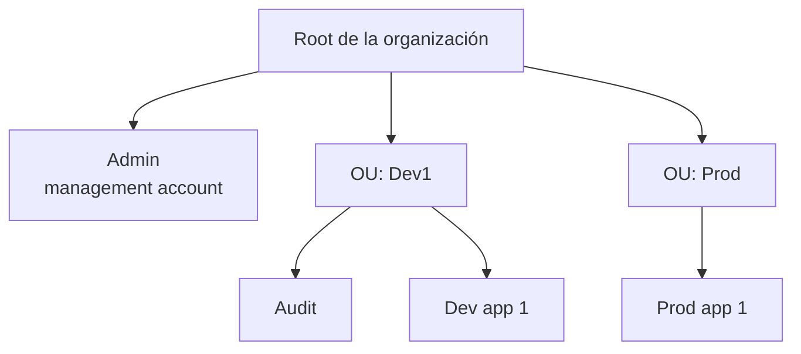
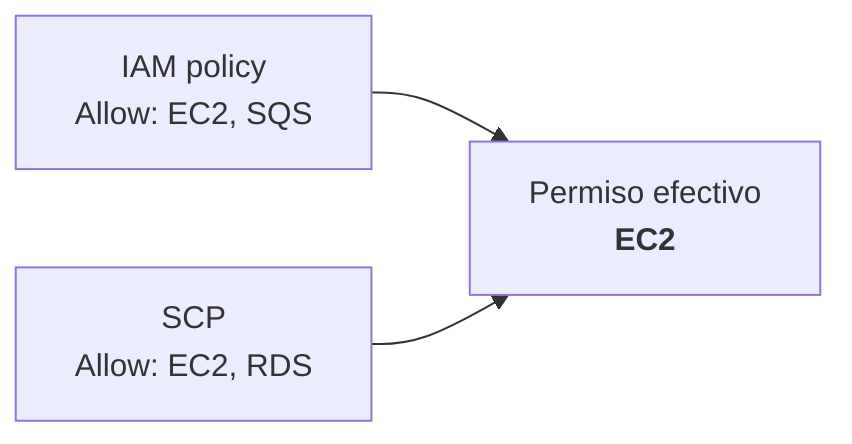

# AWS Organizations and IAM Identity Center

> [!abstract] Qué es este archivo
> Las **dos herramientas base** para administrar muchas cuentas: **AWS Organizations** (estructura, facturación
> consolidada y guardrails con **SCPs**) e **IAM Identity Center** (SSO para cuentas AWS, apps SaaS y apps
> propias). Incluye la **demo de Organizations**, la teoría de SCPs y el **setup de Identity Center**.

> [!quote] Las dos analogías del módulo
> - **SCP = el menú del restaurante.** Si estás en un sushi bar y pedís barbecue, te dicen que no: no está en el menú. No es que el mozo te odie, es que el menú **limita** lo que podés pedir.
> - **IAM Identity Center = una sola puerta de entrada.** Un login (AD) y desde ahí entrás a todo lo asignado.

---

## Resumen en una frase

> **Organizations** ordena las cuentas en una jerarquía (Root → OUs → cuentas) y aplica **guardrails heredables**;
> **IAM Identity Center** resuelve el **SSO** y se integra con esa jerarquía para dar acceso centralizado.

---

## 1. El problema: muchas cuentas, mucho costo operativo

| Síntoma | Causa |
| --- | --- |
| Políticas IAM duplicadas y desincronizadas | **Las IAM policies solo aplican a una cuenta** |
| Facturas separadas, aunque las maneje el mismo equipo | Una factura por cuenta |
| Usuarios con múltiples logins | AD + cada cuenta AWS + apps externas (Box, Salesforce) |
| Sobrecarga del administrador | Alta, media y revocación manuales, cuenta por cuenta |

**Lo que pide el negocio:** *provisionar y administrar cuentas de forma central* + *single sign-on*.

---

## 2. AWS Organizations

Servicio de **gestión de cuentas** con **estructura en niveles**, igual que la empresa.



| Concepto | Definición |
| --- | --- |
| **Root** | Raíz del árbol. Todo lo que se aplique acá **cascada a toda la org** |
| **OU (Organizational Unit)** | Agrupación de cuentas; se puede **anidar** |
| **Management account** | Cuenta administradora de la organización. **No se usa para cargas de trabajo** |
| **Member accounts** | Cuentas miembro, sujetas a las políticas de la org |

**Beneficios clave:**

1. **Gestión por unidad:** un equipo administra **todas sus cuentas como una sola unidad**.
2. **Facturación consolidada** (consolidated billing): una factura para toda la org.
3. **Herencia de políticas:** se aplica una política a la OU y **todas las cuentas heredan** automáticamente.
4. **Creación y movimiento de cuentas** desde un único lugar (crear, mover a OU, administrar).

> [!warning] Buena práctica de la demo
> La cuenta **Admin** es la **management account**: se usa **solo para administrar la organización**.
> **No se construye nada ahí.** (Si se compromete, se compromete todo.)

---

## 3. Service Control Policies (SCPs)

### Qué son

> Un **SCP es un guardrail**: define **límites** sobre los permisos que se pueden asignar a los principals de
> una OU / cuenta.

| Pregunta | Respuesta |
| --- | --- |
| ¿Otorgan permisos? | **NO.** Los permisos los otorgan las **IAM policies** (identity-based o resource-based) |
| ¿A quién afectan? | A **todas las IAM identities**, **incluido el root user** de la cuenta miembro |
| ¿Dónde se aplican? | En **Root**, **OU** o **cuenta**; aplica a ese nivel **y a todos sus hijos** |
| ¿Cuándo están disponibles? | Solo si la organización tiene **all features enabled**; **no** con solo consolidated billing |
| ¿Qué pasa si hay conflicto? | El **Deny explícito gana**. Para permitir, hace falta Allow en **cada nivel** y en IAM |

### Permisos efectivos = IAM ∩ SCP



**Ejemplo del video:**

- **SCP** permite solo `EC2` y `RDS`.
- **IAM policy** permite `EC2` y `SQS`.
- **Resultado:** podés hacer todo lo que quieras en **EC2**… y nada más.
  - **RDS:** no, porque la **IAM policy** no lo concede.
  - **SQS:** no, porque el **SCP** lo restringe.

> [!important] Regla de troubleshooting
> Si "la IAM policy dice que sí" pero igual falla, **mirá el SCP**. Siempre se revisan **las dos capas**.

### Default de la organización

| SCP | Qué hace |
| --- | --- |
| **FullAWSAccess** | Se crea y adjunta automáticamente al **Root** al habilitar SCPs. **No restringe nada** |
| SCPs propias (ej. `us-east-1-only`) | Restringen de verdad; se adjuntan a Root, OU o cuenta |

> [!warning] Cuidado con el Root
> Un SCP en el **Root** cascadea a **toda la organización**. Pensalo dos veces antes de aplicar algo
> demasiado restrictivo ahí: **afecta a todos**.

### Anatomía de un SCP de región

Ejemplo de la demo (`us-east-1-only`): **deniega cualquier acción de la API de S3 fuera de `us-east-1`**.

> [!note] JSON reconstruido
> La demo muestra el JSON en pantalla pero no lo transcribe. Este es un **equivalente ilustrativo** del
> comportamiento descrito, no el texto literal de AWS.

```json
{
  "Version": "2012-10-17",
  "Statement": [
    {
      "Sid": "DenyS3OutsideUSEast1",
      "Effect": "Deny",
      "Action": "s3:*",
      "Resource": "*",
      "Condition": {
        "StringNotEquals": { "aws:RequestedRegion": "us-east-1" }
      }
    }
  ]
}
```

---

## 4. IAM Identity Center

### El problema que resuelve

```
Sin Identity Center                       Con Identity Center
─────────────────────                     ───────────────────
Login en AD            ─┐                 Login en AD (una vez)
Login en Cuenta Dev    ─┤  N passwords              │
Login en Cuenta Prod   ─┤  N riesgos                ▼
Login en Box           ─┤                 Portal de Identity Center
Login en Salesforce    ─┘                 ├── Cuenta Dev
                                          ├── Cuenta Prod
                                          ├── App SaaS
                                          └── App custom (SAML 2.0)
```

### Qué centraliza

- **SSO** a **todas las cuentas AWS** y a **aplicaciones en la nube**.
- **SSO y permisos** de usuario a través de **todas las cuentas** de la organización.
- Acceso a **apps SaaS** de terceros, apps integradas con AWS SSO y **apps custom que soportan SAML 2.0**.
- Un **user portal** único donde el usuario ve **todo lo asignado**.

### Integración con Organizations

- Está **profundamente integrado** con Organizations y con las **API de AWS** (a diferencia de otros SSO "adaptados" a la nube).
- **Enumera todas las cuentas** de la org.
- Si las cuentas están en **OUs**, se ven **con esa misma estructura** en la consola de Identity Center.
- Permite **descubrir cuentas, desplegar permission sets y administrar acceso desde un solo lugar**.

### Setup (2 caminos)

| | **Opción 1: usuarios en Identity Center** | **Opción 2: directorio existente** |
| --- | --- | --- |
| Fuente de identidad | Identity Center | **AWS Directory Service for Microsoft AD** o **IdP externo** (provisionado) |
| Gestión de usuarios | En la consola de Identity Center | Herramientas estándar de **AD / Windows Server** |
| Agrupación | **Grupos** + **permission sets** | Grupos sincronizados desde AD |
| Onboarding | Rápido: usuario → grupo → acceso automático | Según el directorio corporativo |

**Cómo se asignan permisos (opción 1):**

1. Crear **usuarios** (email + nombre).
2. Agruparlos (ej. grupo **DevOps**).
3. Crear **permission sets** (definen acciones permitidas sobre recursos AWS).
4. Asignar el permission set al **grupo** sobre las cuentas (ej. producción).
5. Todo usuario que entra al grupo **hereda** el acceso SSO **automáticamente**.

**Detalle del alta de usuario:** Identity Center envía un **email** para que el usuario **defina su propia contraseña**; después entra al **user portal** con su email y esa contraseña.

**AD sync:** sincroniza **grupos además de usuarios**. Los cambios en AD **se reflejan automáticamente** en Identity Center, reduciendo el trabajo administrativo.

### AWS CLI v2

> Con **AWS CLI v2** se puede usar Identity Center para **autenticación federada de comandos CLI**.
> **Solo con CLI v2** (no v1).

---

## 5. Demo: AWS Organizations + SCPs (paso a paso)

Duración del video: **7 min 58 s**.

| # | Paso | Resultado |
| --- | --- | --- |
| 1 | Entrar a **AWS Organizations → AWS accounts** como usuario de la **management account** | Sos "el jefe" de la org |
| 2 | Revisar la estructura: **Root** → **OU `Dev1`** (vacía) + 2 cuentas en el Root | **Admin** (management) y **Audit** |
| 3 | Seleccionar **Audit → Actions → Move** | Se abre el destino |
| 4 | Elegir **Dev1 → Move AWS account** | Audit queda dentro de la OU |
| 5 | Ir al **Root → pestaña Policies** | Solo **SCPs** habilitados |
| 6 | Abrir **FullAWSAccess** | JSON con acceso total: **no restringe nada por default** |
| 7 | Ir a **Policies → Service control policies → `us-east-1-only`** | Restringe la API de **S3 a `us-east-1`** |
| 8 | Pestaña **Targets** | La SCP **no está adjunta a nadie** todavía |
| 9 | En la cuenta **Audit** (región **us-east-2**), crear bucket `aws-demo-audit-9999` | **Funciona** (no hay restricción) |
| 10 | Volver a la management account → **Targets → Attach → Dev1 → Attach policy** | La SCP ahora aplica a **Dev1 y sus hijos** |
| 11 | En **Audit**, crear bucket `aws-demo-audit-8888` en `us-east-2` | **Falla**: *denied by the service control policy* |
| 12 | Expandir la **API response** | El motivo es la **región incorrecta**, no el permiso IAM |

> [!tip] Moraleja de la demo
> El usuario tenía **full admin** en la cuenta, y aun así **no pudo** crear el bucket: **el SCP está por encima**.
> Eso incluye al **root de la cuenta miembro**.
>
> Corolario de gestión: **comunicá las reglas**. Que un auditor no pueda crear un bucket puede sorprenderlo;
> que no pueda **tirar firewalls** o **reestructurar la VPC** probablemente no.

---

## 6. Traducción del contenido

> [!info] Sección de referencia (opcional)
> Esto es la **traducción fiel** de las fuentes, para verificar que no se perdió nada. **No hace falta leerla
> para estudiar**: lo que se estudia son las secciones **1 a 5** y se cierra con la **8**.
> Usala solo si (a) algo de arriba te quedó dudoso, (b) querés el detalle textual de la demo, o (c) antes del
> examen querés chequear que no se escapó un matiz.

### 6.1 Video principal (transcripción)

Hay muchas ventajas en tener múltiples cuentas, pero a medida que tu huella de AWS crece, trabajar con muchas
cuentas puede volverse complejo. Tus administradores necesitan una forma de **provisionar y administrar cuentas
de manera central**, y tus usuarios no van a querer iniciar sesión por separado en múltiples cuentas de AWS y
en otras aplicaciones de negocio: **quieren una solución de single sign-on**. En este tema veremos **dos
herramientas potentes** para resolver estos problemas: **AWS Organizations** e **IAM Identity Center**.

Acá hay un ejemplo del desafío que podés encontrar con múltiples cuentas: **las políticas de IAM solo aplican a
una cuenta específica de AWS**. Entonces, si querés **permisos estandarizados entre cuentas** —y muchas veces
lo vas a querer— tenés que **duplicar y administrar las políticas de IAM en cada cuenta**. También obtenés
**múltiples facturas, una por cuenta**, aunque todas las maneje el mismo equipo. Acá es donde **AWS Organizations**
ayuda.

**AWS Organizations** es un **servicio de administración de cuentas** que tiene una **estructura en niveles**,
igual que tu negocio. Esas **OUs** del diagrama son **unidades organizativas** que definís para agrupar cuentas.
Esto permite que tus equipos **administren todas las cuentas de las que son responsables como una sola unidad** y
reciban **facturación consolidada**. También podés **agregar controles a una OU usando políticas**, y **todas las
cuentas dentro de la OU heredan automáticamente la política**. En este ejemplo vemos un tipo común de política:
un **SCP**, o **service control policy**.

Veamos de cerca. Un **service control policy es un guardrail**: establece **límites sobre los permisos que se
pueden asignar a los principals de esa OU**. Pensalo como el **menú de un restaurante**: si estás en un
restaurante de sushi y tratás de pedir barbecue, es una mala idea por varias razones, entre ellas que **no está
en el menú**. Notá que **el SCP no le otorga permiso a nadie para hacer nada**: eso lo hacen **las políticas de
IAM**. El SCP solo **limita qué permisos pueden conceder las políticas de IAM**, y esos límites **aplican a
todos, incluso a los root users de las cuentas de la OU**. Esto ayuda a mantener la **gobernanza entre muchas
cuentas**.

En este ejemplo, el **SCP solo permite acciones de EC2 o RDS**. Un administrador crea una **política de IAM** en
una de las cuentas de la OU que permite a los principals **administrar EC2 y SQS**. ¿Cuál es el efecto? Si asumís
un rol con esa política de IAM adjunta, podés realizar **cualquier acción que quieras sobre recursos de EC2**,
pero eso es todo. **No tenés permiso para RDS** porque la política de IAM no lo concede. Y **tampoco tenés
permiso para SQS**, que quizás esperabas tener, porque **el SCP lo está restringiendo**. Ahí ves dónde esto se
vuelve parte de tu proceso de **troubleshooting de permisos** dentro de una organización: si solo mirás la
política de IAM, parece que deberías poder hacer algo; **también tenés que mirar si hay un SCP** que restringe
lo que intentás hacer.

Ahora hablemos de ayudar a tus usuarios a trabajar con múltiples cuentas. Los miembros de tu equipo tienen
**varios lugares donde iniciar sesión**. Empiezan el día logueándose en **Active Directory** o en otro proveedor
de identidad. Después tienen que loguearse en **una o más cuentas de AWS** para construir en la nube. Y además
tienen **aplicaciones externas como Box o Salesforce** con sus propias credenciales. Manejar todo esto **rompe
su flujo de trabajo**, y realmente querrían una **solución de single sign-on**. **IAM Identity Center** es una
buena solución para esto: ayuda a administrar el **acceso SSO a cuentas de AWS, aplicaciones de terceros de uso
común y algunas aplicaciones personalizadas**. Con esto configurado, tus usuarios pueden **loguearse una sola vez
en Active Directory** y luego ir a un **portal que provee Identity Center**, donde acceden a **todas sus cuentas
de AWS asignadas, aplicaciones en la nube y aplicaciones personalizadas en un solo lugar**.

Identity Center está **estrechamente integrado con Organizations**, así que si organizaste tus cuentas bajo OUs,
**las vas a ver mostradas de esa manera** dentro de la consola de IAM Identity Center. También podés **crear
usuarios en IAM Identity Center** y administrar el acceso de usuarios a **todas tus cuentas y aplicaciones de
AWS de forma central**. Ya viste algunos aspectos clave de AWS Organizations e IAM Identity Center: **usados
juntos** te ayudan a administrar múltiples cuentas de AWS a medida que tu organización crece.

### 6.2 Lectura: AWS Organizations

Administrar múltiples cuentas es **más difícil sin AWS Organizations**. Cuando los desarrolladores deben
loguearse por separado en **Active Directory, en AWS y después en otras aplicaciones de negocio**, eso
**interrumpe constantemente su flujo de trabajo**.

**Solución 1: con políticas de IAM**

Las **políticas de IAM solo aplican a una cuenta específica de AWS**. Como resultado, **debés duplicar y
administrar las políticas de IAM en cada cuenta** para desplegar **permisos estandarizados** en todas. Si, por
ejemplo, **toda una unidad de negocio no tiene acceso a Amazon S3**, tenés que **crear una política de IAM para
cada usuario individualmente**.

**Solución 2: con AWS Organizations**

Podés usar **SCPs** para **permitir o denegar** acceso a servicios de AWS para cuentas miembro individuales con
AWS Organizations. También podés usar SCPs para **controlar el acceso de grupos de cuentas dentro de una OU**.
Las acciones especificadas en un SCP adjunto **afectan a todas las identidades de IAM, incluido el root user de
la cuenta miembro**.

El diagrama muestra una organización de AWS con **estructura de árbol invertido**: desde arriba, una **cuenta
root de AWS** se ramifica en **dos OUs**; la OU izquierda contiene una **cuenta** y una **OU anidada con un SCP**;
la OU derecha tiene una cuenta y una **OU anidada sin SCP**; ambas OUs tienen más cuentas dentro.

> **Nota:** los **SCPs asociados a una OU son heredados por todas las cuentas** de esa OU.

### 6.3 Demo: AWS Organizations (transcripción)

Bienvenidos a esta demostración de **AWS Organizations**. En esta demo voy a mostrar cómo **agregar cuentas a
una organización** y cómo **aplicar guardrails a las cuentas miembro usando service control policies**.

Empecemos con una mirada rápida a la **estructura de una organización**. Una organización de AWS se arma **en
niveles que podés alinear con tu organización de negocio**. Desde el **root** de la organización tenés **una o
más OUs** (unidades organizativas). Estas OUs **contienen cuentas de AWS**, y podés administrar esas cuentas
miembro **habilitando políticas**. Las políticas que nos interesan en esta demo son los **SCPs** (service control
policies). Un **SCP es un conjunto de guardrails** que podés aplicar para **restringir los permisos de las
cuentas de una OU**. **Incluso el root de una cuenta miembro queda restringido** por un SCP aplicado a la OU a
la que pertenece.

Veámoslo en acción. Estoy en **AWS Organizations** y selecciono **AWS accounts**. Estoy logueado como usuario de
la **management account**, así que soy "el jefe" de esta organización, al menos en términos de AWS. Desde acá
puedo **crear cuentas nuevas** y **administrar la estructura** de la organización.

Lo que tengo es una organización **muy simple** para la demo. Acá está el **Root**, y desde el Root tenemos una
**OU, Dev1**. La expando y veo que está **vacía**. Y tengo **dos cuentas en el Root**: la cuenta **Admin**, que es
la **management account** de la organización —siguiendo buenas prácticas, **no quiero construir nada en esta
cuenta**, solo debe usarse para administrar la organización como estoy haciendo ahora—, y otra cuenta que creé,
una cuenta **Audit** para quienes monitorearán cosas en la OU **Dev1**.

Agreguemos esa cuenta a la OU. Selecciono la cuenta **Audit**, voy a **Actions** y elijo **Move**. Selecciono el
destino, **Dev1**, y elijo **Move AWS account**. Listo, ya está todo preparado para crear las demás cuentas que
tendrá esta OU.

Además de crear y organizar cuentas, también puedo **administrarlas desde acá**. Tengo algunas **restricciones**
que quiero poner sobre cuánto permiso tendrán las cuentas miembro de la OU **Dev1**. Eso lo hago aplicando
**service control policies**. Selecciono el **Root** de la organización y reviso qué políticas hay aplicadas.

Acá está la estructura bajo el Root, y si selecciono la pestaña **Policies**, veo qué políticas se aplicaron al
Root. Hay varios tipos de políticas que podés adjuntar; ahora mismo **solo están habilitados los SCPs**. Podés
adjuntar SCPs **en cualquier nivel** de la organización: al **Root**, a una **OU** o a una **cuenta específica**,
y se aplicará a ese recurso **y a todos sus hijos**.

Y por eso **esta advertencia es importante**: cualquier SCP aplicado al Root **va a cascadear a toda la org**.
Así que **pensá con cuidado antes de aplicar algo demasiado restrictivo al Root**: va a afectar a todos.

Ahora mismo, el **único SCP aplicado al Root** es **FullAWSAccess**, que se creó y aplicó automáticamente al
habilitar SCPs. Podés adivinar qué hace por el nombre, pero veámoslo igual. Selecciono **FullAWSAccess** y bajo
hasta el **JSON**: sí, tal como dice el nombre, **acceso total**. **Nada está restringido por default**.

Recordá: este SCP **tampoco está otorgando permisos**. Las cuentas miembro seguirán otorgando permisos a sus
principals usando **IAM**. **Los SCPs son guardrails.** Si ponés una restricción a nivel organización, podés
**impedir que cualquiera —incluso el root de una cuenta miembro— haga algo que no querés**.

Veamos un ejemplo. Desde el menú selecciono **Policies** y bajo hasta **service control policies**. Ahí está el
SCP **FullAWSAccess** y otro que creé antes. Seleccionemos **`us-east1-only`** y miremos. Bajo al **JSON** y veo
que esta política **restringe cualquier acción que use la API de S3 a una región: `us-east-1`**. Entonces,
cualquiera a quien le aplique esta política tendrá esa restricción.

Veamos a quién está aplicada. Selecciono la pestaña **Targets** y, ahora mismo, **esta política no está adjunta
a ningún lado**, así que **nadie** en mi organización tiene esta restricción. Puedo demostrarlo cambiando a la
consola de una **cuenta miembro**. Ahora estoy logueado como usuario de la cuenta **Audit** en la región
**`us-east-2`**, y quiero crear un **bucket de S3** para guardar mis audit trails y otros documentos. Selecciono
**Create bucket**, le doy un nombre único: `aws-demo-audit-9999`. Bajo y selecciono **Create bucket**. Listo.

Volvamos a la **management account** de la organización y **adjuntemos este SCP a la OU Dev1** para ver qué pasa.
Desde la pestaña **Targets** selecciono **Attach**, marco la casilla junto a **Dev1** y selecciono **Attach
policy**. Volviendo a **Targets**, veo que este SCP **ahora aplica a Dev1 y a todos sus hijos**. Si selecciono
**Dev1** desde acá, puedo recordar quiénes son esos hijos: **solo la cuenta Audit** en este ejemplo.

Volvamos al usuario de la cuenta **Audit** e intentemos **la misma acción otra vez**. Selecciono **Create
bucket**, le doy un nombre —esta vez `aws-demo-audit-8888`—, bajo y selecciono **Create bucket**. **No, falló.**
Si expando la **API response**, veo por qué: **la acción fue denegada por el service control policy porque
intenté crear un bucket en la región equivocada**, `us-east-2` en vez de `us-east-1`. **Los guardrails del SCP
aplican aunque le haya dado full admin access a este usuario** cuando creé la cuenta.

Eso también resalta la **necesidad de una buena comunicación dentro de la organización**. Ojalá que alguien que
administra una cuenta creada para auditores **no se sorprenda demasiado** al descubrir que no puede **tirar
firewalls** o **reestructurar la VPC**; pero una restricción como esta **sí podría sorprenderlo**. Así que
**asegurate de avisar a todos cuáles son las reglas** cuando empiezan a trabajar en tu organización. Y eso es
todo en nuestra demo de **AWS Organizations**. Gracias por mirar.

### 6.4 Lectura: Service Control Policies (SCPs)

Los **service control policies (SCPs)** son un tipo de **política de organización** que podés usar para
**administrar permisos** en tu organización. Los SCPs ofrecen **control central sobre los permisos máximos
disponibles** para todas las cuentas de tu organización. Ayudan a asegurar que tus cuentas **se mantengan dentro
de las guías de control de acceso** de la organización. **Los SCPs solo están disponibles en una organización
que tenga todas las funcionalidades habilitadas** (`all features`); **no** están disponibles si la organización
solo habilitó **consolidated billing**.

**SCPs solos**

Adjuntar un SCP a una entidad de la organización (**root, OU o cuenta**) **define un control**, o establece
límites, sobre las acciones que los **usuarios y roles de IAM** de las cuentas afectadas pueden realizar.
**Los SCPs solos no son suficientes para permitir acceso** en las cuentas de tu organización: **un SCP no
otorga permisos**.

**Permisos de IAM**

Todavía necesitás adjuntar **políticas identity-based o resource-based** a los usuarios o roles de IAM, o a los
recursos de las cuentas de tu organización, para **otorgar permisos realmente**. Cuando un usuario o rol de IAM
pertenece a una cuenta que es miembro de una organización, **los SCPs pueden limitar sus permisos efectivos**.

*Diagrama de Venn:* el círculo de **permisos de IAM** permite **SQS y EC2**; el de **SCPs** permite **S3 y
EC2**. **La intersección es solo EC2**: únicamente lo que ambos permiten es lo que queda habilitado.

### 6.5 Lectura: IAM Identity Center

**Sin IAM Identity Center**

Sin IAM Identity Center, los usuarios con cuentas en **múltiples proveedores de identidad** —como **Active
Directory, AWS y servicios externos de terceros**— deben **loguearse individualmente en cada identidad**. Esos
múltiples logins son **tediosos** para los usuarios y **aumentan el riesgo** en función de la cantidad de
contraseñas que deben guardar y recordar.

**Con IAM Identity Center**

AWS IAM Identity Center ayuda a administrar **centralizadamente**:

- Acceso **SSO a todas tus cuentas de AWS** y aplicaciones en la nube.
- **SSO y permisos de usuario** a través de **todas tus cuentas** en Organizations.
- Acceso y permisos a **aplicaciones SaaS de terceros** de uso común, aplicaciones integradas con AWS SSO y
  **aplicaciones personalizadas que soportan SAML 2.0**.

IAM Identity Center incluye un **user portal** donde los usuarios finales encuentran y acceden a **todas sus
cuentas de AWS, aplicaciones en la nube y aplicaciones personalizadas asignadas en un solo lugar**.

**Integraciones con AWS Organizations**

IAM Identity Center está **profundamente integrado con Organizations y con las operaciones de la API de AWS**,
a diferencia de otras soluciones SSO construidas para la nube. **Enumera nativamente todas tus cuentas de AWS**.
Si organizaste tus cuentas bajo **OUs**, **las verás mostradas de esa manera** en la consola de IAM Identity
Center. Así podés **descubrir tus cuentas rápido, desplegar conjuntos comunes de permisos y administrar el
acceso desde una ubicación central**.

**Setup de IAM Identity Center**

Empecemos habilitando IAM Identity Center en la consola de AWS y después elegí con qué opción vas a administrar
tus usuarios:

- **Opción 1:** podés **agregar a los usuarios que creás en IAM Identity Center a grupos**. También podés crear
  **permission sets** que definen las acciones permitidas sobre un recurso de AWS y asignarlos a tus usuarios y
  grupos. Por ejemplo, podés otorgar al grupo **DevOps** acceso SSO a tus **cuentas de producción**. Los
  usuarios agregados al grupo DevOps obtienen **automáticamente** acceso SSO a esas cuentas. Esta automatización
  ayuda a **incorporar usuarios nuevos** y a dar a los usuarios existentes acceso a **nuevas cuentas y
  aplicaciones rápidamente**.
- **Opción 2:** si preferís, podés **conectarte a un directorio existente en AWS Directory Service for Microsoft
  Active Directory** y administrar tus usuarios con las **herramientas estándar de administración de Active
  Directory** que provee Windows Server. También podés **provisionar usuarios y grupos desde un proveedor de
  identidad externo** hacia IAM Identity Center y administrar los permisos de acceso en la consola de IAM
  Identity Center. Si elegís administrar tus usuarios en IAM Identity Center, podés **crear usuarios rápido** y
  después **organizarlos en grupos**, todo dentro de la consola.

**Más detalles:** podés crear usuarios en IAM Identity Center configurando su **dirección de email y nombre**.
Cuando creás un usuario, IAM Identity Center le **envía un email por default** para que **establezca su propia
contraseña**. El usuario usará su **email** y la contraseña que configuró en IAM Identity Center para **iniciar
sesión en el user portal**, y desde ahí acceder a todas sus cuentas y aplicaciones asignadas en un solo lugar.

IAM Identity Center soporta **sincronización con Microsoft Active Directory**. Sincroniza **grupos, además de la
información de usuario**, para los clientes que usan Active Directory como fuente de identidad. Podés administrar
usuarios y grupos en Active Directory, y la **sincronización de AD de IAM Identity Center** asegura que esa
información sea accesible **de manera consistente** dentro de las cuentas y aplicaciones de AWS. **Cualquier
cambio** que hagas a la información de usuarios y grupos en Active Directory **se refleja automáticamente** en
IAM Identity Center, **reduciendo el esfuerzo administrativo** de gestionar identidades en AWS.

**Configurar AWS CLI para usar IAM Identity Center**

Además de simplificar la autenticación y el acceso a cuentas de AWS y aplicaciones habilitadas para SAML,
también podés usar IAM Identity Center con **AWS CLI versión 2** para **autenticación federada de comandos de
CLI**.

> **Nota:** esta funcionalidad está disponible **solo con AWS CLI versión 2**.

---

## 7. Organizations vs. Identity Center (quién hace qué)

| Necesidad | Herramienta | Mecanismo |
| --- | --- | --- |
| Agrupar cuentas | **Organizations** | **OUs** |
| Una sola factura | **Organizations** | **Consolidated billing** |
| Límite máximo de permisos | **Organizations** | **SCPs** |
| Otorgar permisos concretos | **IAM** | Identity-based / resource-based policies |
| Un solo login para todo | **IAM Identity Center** | **SSO** + **permission sets** |
| Ver cuentas por OU en el portal | **Identity Center** | Integración nativa con Organizations |
| Acceso desde terminal | **Identity Center** | **AWS CLI v2** (federado) |

---

## 8. Para el examen (SAP-C02)

> [!important] Lo que hay que retener
> 1. **SCP ≠ permiso.** Es un **guardrail**; los permisos los da **IAM**. Efectivo = **IAM ∩ SCP**.
> 2. Los SCPs **alcanzan al root user** de la cuenta miembro. Nada de "el root no se toca".
> 3. Los SCPs **se heredan** desde Root/OU hacia las cuentas; **Deny explícito gana**.
> 4. Un SCP en el **Root cascadea a toda la org** → riesgo alto, aplicar con cuidado.
> 5. **`FullAWSAccess`** es el default y **no restringe nada**.
> 6. SCPs requieren **all features**; **no** funcionan con solo consolidated billing.
> 7. **IAM Identity Center** es la respuesta a "un solo login para cuentas AWS + apps SaaS + apps custom".
> 8. Identity Center **nativamente enumera las cuentas y respeta la estructura de OUs** de Organizations.
> 9. **Permission sets** + **grupos** = onboarding automático de usuarios.
> 10. **AWS CLI v2** es requisito para el login federado de la CLI con Identity Center.

> [!warning] Trampa clásica del examen
> Escenario: "el usuario tiene `AdministratorAccess` pero recibe `AccessDenied`". La respuesta **no** es dar más
> permisos IAM: es revisar el **SCP** (o un **Deny** explícito) que está limitando por encima.

---

## Relacionado

- [[Gathering the customer REquirements]] — el cliente que necesita exactamente esta base
- [[Multi-Account Access Solutions]] — cross-account roles, logs centralizados y Service Catalog
- [[AWS Solutions Architect Advanced - Designing a Multi-Account Architecture]] *(índice del módulo)*
- Siguiente paso del módulo: **AWS Control Tower** y **CI/CD**
