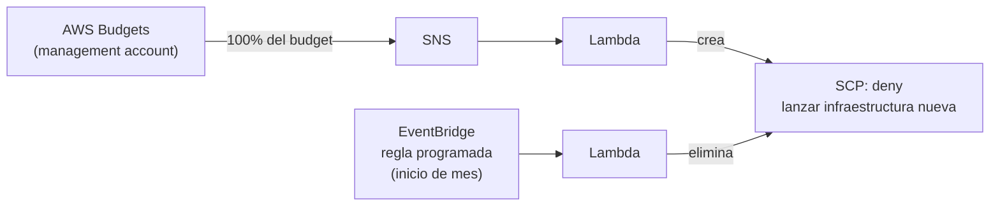

# BuildingBlocks Videos

> [!abstract] Qué es este archivo
> Tres **casos cortos** (2–3 min cada uno) donde Melissa y Joe discuten un problema y **descartan opciones** hasta
> llegar a la solución. Son el mejor formato para entrenar el criterio de examen: **qué se descarta y por qué**.
>
> 1. **Notificaciones multi-cuenta** → Security Hub como *single pane of glass*.
> 2. **Costos en cuentas de desarrollo** → Budgets centralizados + **SCP** vía Lambda.
> 3. **Comunicación con CIDR solapado** → **PrivateLink**.

> [!quote] El patrón que se repite en los tres
> **Primero se propone la solución obvia. Después se descubre por qué falla. Y gana la que cumple el requisito
> con menor sobrecarga operativa.**

---

## 1. Multi account notifications

### El problema

Una empresa de **diseño web** construye y administra productos para clientes, y **cada cliente tiene su propia
cuenta de AWS**. El equipo de operaciones está **desbordado de reportes de incidentes**, y la situación **empeora
a medida que crecen**: más clientes = más cuentas.

### Los dos requisitos

| # | Requisito |
| --- | --- |
| 1 | Visibilidad de **qué acceso se otorga a identidades IAM externas** |
| 2 | Visibilidad de **qué información sensible en Amazon S3 es públicamente accesible** |

### Opción descartada (la "obvia")

> **Cross-account roles → publicar todos los findings a un bucket S3 en la operations account → Lambda que genera
> dashboards de CloudWatch, invocada por reglas de EventBridge desde los findings de IAM Access Analyzer y Macie.**

**Por qué se descartó:**

- **Hay código custom que mantener**.
- Va **contra el pilar de excelencia operativa**: hay que **reducir la carga operativa**, no inventar una.

### La solución

> **AWS Organizations** para consolidar las cuentas + **AWS Security Hub** con **IAM Access Analyzer** y
> **Amazon Macie** habilitados → el equipo de seguridad ve **todo en un solo lugar**.

| Servicio | Qué aporta |
| --- | --- |
| **AWS Organizations** | **Consolida las cuentas** bajo un paraguas común; gestión centralizada |
| **AWS Security Hub** | **Single pane of glass**: agrega findings, **compliance standards** integrados y **checks
  automatizados** |
| **IAM Access Analyzer** | Detecta **acceso externo** otorgado a **identidades IAM** |
| **Amazon Macie** | Encuentra **datos sensibles en S3** (y accesibilidad pública) |
| **CloudTrail** | **Audit trail** que necesitan |

**Por qué gana:** es **lo que AWS ya provee out of the box** → **mínima sobrecarga operativa**, y además alinea con
el **pilar de seguridad** (controles automatizados + monitoreo centralizado).

> [!important] Patrón de examen
> **"Single pane of glass" + findings de seguridad multi-cuenta + menos carga operativa → Security Hub.**
> Si la opción correcta implica **escribir y mantener una Lambda** para agregar findings, **está mal** salvo que
> pidan algo que Security Hub no soporte.

---

## 2. Development account cost controls

### El problema

Múltiples **equipos de desarrollo**, cada uno con **su propia cuenta** bajo Organizations. **Se pasan del
presupuesto mensual**. Cada equipo tiene **usuarios IAM y grupos de developer con permisos administrativos y de
costos**.

### Intento 1 — Budgets en cada cuenta de desarrollo

> **AWS Budgets** en cada cuenta dev → al llegar al **100 %** del budget, **SNS** dispara una **Lambda** que
> **agrega una política restrictiva al grupo IAM de developers**.

**Por qué falla:** como los developers tienen **admin access**, **pueden quitarse la política** del grupo IAM y
**seguir gastando**.

### Intento 2 — Mover los Budgets a la management account

> Mismos Budgets, pero **en la management account**, para que **no puedan deshabilitarlos**.

**Por qué falla igual:** el problema **no era dónde viven los Budgets**, sino que **cualquier restricción a nivel
IAM la puede deshacer un admin**.

### La solución

> **AWS Budgets en la management account** + **SNS** → **Lambda** que **crea una SCP** para **denegar el
> lanzamiento de infraestructura nueva** + **EventBridge** con una **regla programada** que invoca otra **Lambda**
> para **quitar la SCP al inicio de cada mes**, cuando el presupuesto se reinicia.

| Pieza | Rol |
| --- | --- |
| **Budgets en management** | Los developers **no pueden deshabilitarlos** |
| **SNS** | Notifica el cruce del umbral |
| **Lambda (on breach)** | Crea la **SCP** de bloqueo |
| **SCP** | **Deniega lanzar infraestructura nueva**; **no se puede override ni con admin** |
| **EventBridge (scheduled)** | Dispara la **limpieza mensual** |
| **Lambda (cleanup)** | **Remueve la SCP** al reiniciarse el presupuesto |

### Por qué esta vez sí funciona

> [!important] La jerarquía que hay que tener clara
> **SCP > IAM.** Una SCP aplica **desde el nivel de organización hacia abajo**, así que **ni un usuario con admin
> access puede pasarla por arriba**.
>
> Una política IAM sí se puede quitar. Una SCP, no.

**Alineación con Well-Architected:** **cost optimization** (governanza y control de costos con límites definidos)
+ **operational excellence** (todo automatizado, sin intervención manual).

---

## 3. Cross-account communication con CIDR solapado

> [!warning] Ojo con el título de la fuente
> La lección lo titula **"Cross-Region communication"**, pero el caso **no es entre regiones**: es entre **dos
> cuentas** con **VPCs que usan el mismo CIDR**. Lo dejo anotado para no confundir el concepto al repasar.

### El problema

| Dato | Detalle |
| --- | --- |
| **Dos aplicaciones** | Una de **processing** y una de **billing** |
| **Dónde viven** | En **cuentas de AWS diferentes** |
| **Qué necesitan** | Que **processing** se comunique con **billing** por un **puerto TCP custom** |
| **La complicación** | **Ambas VPC usan `10.0.0.0/16`** (CIDR solapado) |

### La restricción que decide todo

> El cliente pidió **mínimo esfuerzo operativo**: **recrear la VPC y redesplegar la aplicación** implicaría
> **downtime y esfuerzo significativos**.

### Opción 1 — Renumerar (descartada *en este caso*)

> Crear una **VPC nueva** en la cuenta de billing con **otro CIDR** y armar **VPC peering**.

**A favor:** a **largo plazo** es lo mejor para **costo y complejidad**.
**En contra:** **downtime + redespliegue** → **viola el requisito** del cliente.

### Opción 2 — Private NAT gateways + Transit Gateway (descartada)

> Agregar **subnets front-end chicas** a cada VPC con **private NAT gateways**, conectarlas a un **Transit
> Gateway** y **rutear** el tráfico desde las **subnets de backend** hacia los **private NAT gateways**.

**Funciona**, pero:

- Es **bastante complejo**.
- **No es la opción más eficiente en costo**.

### Opción 3 — AWS PrivateLink (la elegida)

> Crear un **VPC endpoint service** en la cuenta de **processing** y un **interface endpoint** en la cuenta de
> **billing**.

| Ventaja | Detalle |
| --- | --- |
| **Sin conflictos de IP** | **PrivateLink usa elastic network interfaces dentro de la VPC del consumer** |
| **Mínimo esfuerzo operativo** | **No hay que reconfigurar las aplicaciones existentes**: solo **apuntar al DNS name del endpoint** |
| **Escala bien** | Pensado para este tipo de integración |
| **Seguridad** | **Conectividad privada sin exponer el servicio a internet** |

### Comparación

| Opción | Funciona con CIDR solapado | Esfuerzo / downtime | Costo | Veredicto |
| --- | --- | --- | --- | --- |
| **Renumerar + peering** | ✅ (deja de solapar) | **Alto** (redesplegar) | Bajo a largo plazo | ❌ Viola el requisito |
| **Private NAT + TGW** | ✅ (traduce) | Medio-alto (ruteo complejo) | **Más caro** | ❌ Complejo y caro |
| **PrivateLink** | ✅ (no usa IPs del otro lado) | **Bajo** (solo DNS) | Adecuado | ✅ **Elegida** |

> [!important] Regla de examen
> **CIDR solapado + no se puede renumerar + mínimo esfuerzo → PrivateLink.**
> **Peering y Transit Gateway NO enrutan entre rangos solapados.** NAT lo resuelve, pero **agrega complejidad y
> costo**.

---

## 4. Traducción del contenido

### 4.1 Multi account notifications

Hola Joe, revisemos la arquitectura de esta empresa de **diseño web**. Ahí está. **Construyen y administran
productos para sus clientes, y cada cliente tiene su propia cuenta de AWS**. El problema es del lado de la
**gestión**: su **equipo de operaciones está desbordado de reportes de incidentes**. Puedo ver por qué sería un
problema, y **va a empeorar a medida que crezcan**: **más clientes significa más cuentas para administrar**.

Exacto. Sus requisitos son **proveer mejor visibilidad en dos cosas clave**: **qué acceso se otorga a identidades
IAM externas** y **qué información sensible almacenada en Amazon S3 es públicamente accesible**. Parece un caso
clásico donde necesitan **monitoreo de seguridad centralizado**. De acuerdo.

Empecemos usando **AWS Organizations** para **llevar todas esas cuentas de clientes bajo un mismo paraguas**. Es
un muy buen comienzo: la **gestión centralizada** los va a ayudar mucho. Y para cubrir sus requisitos específicos
de monitoreo, sumamos **IAM Access Analyzer** para los **chequeos de identidad** y **Amazon Macie** para
**encontrar datos sensibles en S3**. Pero **todavía necesitan un solo lugar para monitorear todo eso** en vez de
**saltar constantemente entre cuentas**. Suena como que buscan un **single pane of glass** para las notificaciones.
Exacto: **monitoreo centralizado**.

Podríamos **configurar roles cross-account** para **publicar todos esos findings en un bucket S3 en su operations
account** y **escribir una función Lambda que genere dashboards de CloudWatch**, invocada por **reglas de
EventBridge** a partir de los findings de IAM Access Analyzer y Macie. Sí, eso funciona, pero **implica código
custom que mantener** y, mirando el **pilar de excelencia operativa**, queremos **reducir la carga operativa donde
sea posible**. Entonces, **¿por qué no usar Security Hub?** Así **no construimos algo que AWS ya provee out of the
box**.

Me gusta: el equipo de seguridad puede **habilitar Macie e IAM Access Analyzer en todas las cuentas** y **ver los
findings en un solo lugar**. Además, con **Security Hub** obtenemos **compliance standards integrados** y **checks
de seguridad automatizados**. Exacto. Y la **integración con CloudTrail** les da el **audit trail** que
necesitan. Esta parece la **solución más eficiente con la menor sobrecarga operativa**. Creo que encontramos la
respuesta: usar **Organizations** para consolidar las cuentas, **habilitar Security Hub con Macie e IAM Access
Analyzer** y dejar que el **equipo de seguridad administre todo centralmente**. Limpio y simple. Y alinea
perfectamente con el **énfasis del pilar de seguridad en controles automatizados y monitoreo centralizado**.

### 4.2 Development account cost controls

Joe, estaba hablando con un cliente sobre su **entorno de desarrollo**. Ahí está. Tienen **múltiples equipos de
desarrollo, cada uno con su propia cuenta de AWS bajo Organizations**. El problema es que **se siguen pasando de
los presupuestos mensuales**. No es raro. Déjame adivinar: **los developers tienen admin access en sus cuentas**.
Exacto. Cada equipo tiene **usuarios IAM y grupos de developer con permisos administrativos y de costos**. La
empresa quiere **poner restricciones para controlar el gasto**.

Lo primero que se me ocurre es **configurar AWS Budgets en cada cuenta de desarrollo**. Cuando el uso llega al
**100 % del presupuesto mensual**, podríamos usar **SNS** para **disparar una Lambda que agregue una política
restrictiva al grupo IAM de developers**. Veo por dónde vas, pero **hay algo más que considerar**: como los
developers tienen **admin access**, **podrían simplemente quitar esa política de su grupo IAM y seguir gastando**.
Necesitamos algo que **no puedan overridear**.

Buen punto. ¿Y si **movemos los Budgets a la management account**? Así los developers **no podrían
deshabilitarlos**. Me gusta, pero **seguimos con el mismo problema al intentar restringir los grupos IAM**: los
developers **pueden deshacer cualquier cambio que hagamos en IAM** porque tienen admin access. Necesitamos algo
que funcione **desde un nivel más alto**.

**¿Qué tal Service Control Policies?** Se aplican **desde el nivel de organización hacia abajo**, así que **ni
siquiera los usuarios con admin access pueden overridearlas**. Es exactamente el tipo de solución que necesitamos.
Podemos configurar los **Budgets en la management account** y, cuando una cuenta de desarrollo **alcanza su límite
mensual**, la **Lambda crea una SCP para denegar el lanzamiento de infraestructura nueva**. Los developers **no
pueden overridear las SCPs ni con admin access**. Sí, y podemos usar **EventBridge** para **programar otra Lambda
que remueva esas SCPs al inicio de cada mes**, cuando el presupuesto se reinicia.

Esto alinea perfectamente con el **pilar de optimización de costos** del Well-Architected Framework:
**governanza y controles de costos fuertes** mientras **se permite que los equipos innoven con límites más
definidos**. De acuerdo. Y como los controles son **automatizados y administrados centralmente**, también apoya la
**excelencia operativa**. ¿Listo para presentarlo al cliente? Dale. Le da los **controles de gasto** que necesita
**dentro de las restricciones de sus permisos IAM existentes**. Además **está todo automatizado, sin intervención
manual**.

### 4.3 Cross-Region communication

Hola Joe. Hoy tenemos un **desafío de networking** interesante. Este cliente tiene **dos aplicaciones, una de
processing y una de billing, corriendo en cuentas de AWS diferentes**. ¿Cuál es el problema que intentan resolver?
La aplicación de **processing necesita comunicarse con la de billing por un puerto TCP custom**, pero acá se pone
un poco complicado: **ambas VPC fueron creadas con el mismo bloque CIDR `10.0.0.0/16`**.

Mi primer pensamiento: **deberían renumerar una o ambas redes**, crear una **VPC nueva en la cuenta de billing con
otro CIDR** y **configurar VPC peering** entre ellas. Te escucho y **lo consideré también**. A **largo plazo** es lo
mejor para administrar **costo y complejidad**, pero cuando preguntamos por sus **requisitos operativos**
mencionaron específicamente que quieren **mínimo esfuerzo operativo**: **recrear la VPC y redesplegar** la
aplicación requeriría **downtime y esfuerzo significativos**. Cierto.

Si **no pueden renumerar**, necesitan un **workaround**, porque **no se puede rutear entre redes con bloques CIDR
solapados**, ni con **peering** ni con **Transit Gateway**. **Network address translation** podría funcionar si
agregaran **subnets front-end chicas** a estas VPCs con **private NAT gateways**, las conectaran a un **Transit
Gateway** y configuraran el **ruteo** para que el tráfico de las **subnets de backend** vaya a los **private NAT
gateways**. Es bastante ingenioso y **funciona**, pero es **un poco complejo** y no creo que sea **la solución más
eficiente en costo**.

Pero tu sugerencia sobre NAT me hizo pensar: lo que realmente necesitan es **un servicio que haga la traducción de
red por ellos en segundo plano, sin que tengan que administrarlo**. Eso me llevó a **PrivateLink**. Podríamos
crear un **VPC endpoint service en la cuenta de processing** y un **interface endpoint en la cuenta de billing**.
Me gusta que el **service provider y el consumer no tengan que preocuparse por conflictos de IP**, porque
**PrivateLink usa elastic network interfaces dentro de la VPC del consumer**, y **alinea con el requisito de
mínimo esfuerzo operativo**, porque **no hay que reconfigurar las aplicaciones existentes**: solo tienen que
**apuntar al DNS name del endpoint**. Exacto. Además **escala bien** y, desde el punto de vista de seguridad,
**provee conectividad privada sin exponer el servicio a internet**.

¿Recomendamos este enfoque? Definitivamente: **cumple todos sus requisitos** — comunicación segura por su **puerto
TCP custom**, **maneja los rangos de IP solapados** y **minimiza la sobrecarga operativa**.

---

## 5. Para el examen (SAP-C02)

> [!important] Lo que hay que retener
> 1. **Single pane of glass** de findings multi-cuenta → **Security Hub** (+ **Macie** para datos sensibles en S3,
>    **Access Analyzer** para acceso externo de identidades IAM).
> 2. **Security Hub** trae **compliance standards** y **checks automatizados** + **CloudTrail** para auditoría.
> 3. **Descartar soluciones custom** (S3 + Lambda + EventBridge + dashboards) cuando existe un servicio administrado:
>    **menos carga operativa**.
> 4. **SCP > IAM**: una SCP **no se puede overridear ni con admin access**.
> 5. **Budgets en la management account** para que no los deshabiliten; el bloqueo real lo hace la **SCP**.
> 6. **SCP de deny** para **frenar el lanzamiento de infraestructura nueva**; **EventBridge scheduled** + Lambda
>    para **removerla al reiniciar el mes**.
> 7. **CIDR solapado**: **peering** y **Transit Gateway** **no enrutan** entre rangos iguales.
> 8. **Private NAT + TGW** funciona, pero es **complejo y caro**.
> 9. **PrivateLink**: endpoint service (provider) + interface endpoint (consumer); **ENIs en la VPC del consumer**;
>    **sin conflictos de IP**; solo **cambia el DNS name**.
> 10. **PrivateLink** = privado, **no expone a internet**, y **mínimo esfuerzo operativo**.

> [!warning] Trampas típicas
> - "Centralizar findings con una Lambda y dashboards propios" → **funciona, pero es la respuesta equivocada** si
>   existe **Security Hub**: agrega código a mantener.
> - "Una política IAM restrictiva frena a un admin" → **no**, la puede quitar; **SCP sí lo frena**.
> - "Poner Budgets en cada cuenta dev alcanza" → **no**: el problema es la capacidad de **deshacer** la restricción.
> - "VPC peering entre VPCs con el mismo CIDR" → **no funciona**.
> - "Transit Gateway resuelve el solapamiento" → **no**.
> - "PrivateLink requiere reconfigurar la aplicación" → **no**: **solo el DNS name** del endpoint.
> - "Renumerar es siempre la respuesta correcta" → **solo si no hay restricción de downtime**; acá **violaba el
>   requisito**.

---

## 🔗 Relacionado

- [[AWS Solutions Architect Advanced - Designing a Multi-Account Architecture]] — índice del módulo
- [[AWS Organizations and IAM Identity Center]] — Organizations y **SCPs**
- [[AWS Control Tower]] — dónde viven los guardrails y el monitoreo
- [[Finished Architecture]] — el uso de SCPs y monitoreo en el caso integral
- [[1.1 Diseñar estrategias de conectividad de redes]] — PrivateLink, peering, TGW
- [[1.2 Prescribir controles de seguridad]] — Security Hub, Macie, Access Analyzer
- [[1.5 Determinar las estrategias de optimización de costos y visibilidad]] — Budgets y control de gasto
- [[3.2 Estrategia para mejorar la seguridad]] · [[3.5 Identificar oportunidades de optimización de costos]] — el
  mismo tema desde la mejora continua
- [[Definicion servicios]] — definiciones de los servicios usados
