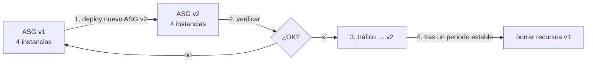

# CI/CD Deployment Models

> [!abstract] Qué es este archivo
> Cómo se **implementa un cambio** en producción: **in-place, rolling, immutable y blue/green**.
> La estrategia no se elige por gusto técnico: la **dicta el negocio** (cómo trabajás con tus clientes) y los
> **recursos disponibles** (¿podés levantar instancias nuevas o tenés que actualizar las existentes?).
>
> Este tema cae en **Tarea 2.1 — estrategia de implementación** y también en **Tarea 3.1 — excelencia
> operativa** (evaluar y mejorar los procesos de despliegue actuales).

> [!quote] La idea que ordena todo
> **Una buena arquitectura no sirve de nada si no se puede desplegar bien y rápido.**
> Y el riesgo del despliegue se maneja de una sola forma: **teniendo a dónde volver**.

---

## Resumen en una frase

> Elegís la estrategia según **cuánto downtime tolerás** y **si podés pagar recursos extra**: in-place (mismo
> recurso, riesgo alto), rolling (por porciones, dos versiones conviviendo), immutable (flota nueva, rollback por
> tráfico) y blue/green (entorno duplicado, corte total o gradual).

---

## 1. Qué define la estrategia

| Pregunta de negocio | Qué determina |
| --- | --- |
| **¿Cómo trabajás con tus clientes?** | ¿Hacés **100 % del testing y hardening** antes de entregar, o tenés una estrategia **iterativa** con usuarios de **beta** que te dan feedback? |
| **¿Qué recursos tenés disponibles?** | ¿Podés **escalar instancias EC2 nuevas** para el update, o **tenés que actualizar in-place** sobre las existentes? |

> [!tip] La regla práctica
> **Si podés levantar recursos nuevos, comprás riesgo bajo (y pagás costo + gestión).**
> **Si no podés, actualizás sobre lo que hay y aceptás más riesgo.**

---

## 2. Las cuatro estrategias

| Estrategia | Qué hace | Recursos nuevos | Downtime | Rollback |
| --- | --- | --- | --- | --- |
| **In-place** | Actualiza la app **en las instancias existentes** | ❌ No | Sí, si es **all at once** | Volver a desplegar la versión anterior |
| **Rolling** | Actualiza **por porciones** de la flota | ❌ No (mismos recursos) | **Cero**, si es gradual | Otro rolling hacia atrás |
| **Immutable** | Levanta **infraestructura nueva** con la versión nueva | ✅ **Nuevo ASG** | **Cero** | **Cambiar el tráfico** a la versión vieja |
| **Blue/green** | **Entorno duplicado** y swap de tráfico | ✅ **Entorno completo** | **Cero** | **Revertir el tráfico** al blue |

> [!note] Definición de la lectura (literal)
> **Blue/green:** "los sistemas usan el **mismo backend** (entorno paralelo), clonando e intercambiando entornos
> paralelos para **reducir el downtime**".

---

## 3. In-place

> **Qué es:** actualizar la aplicación **en las instancias existentes**, en vez de reemplazarlas por nuevas.

Dos formas de hacerlo:

| Forma | Consecuencia |
| --- | --- |
| **Todas a la vez** (*all at once*) | Hay que **agendar una ventana de mantenimiento**: la aplicación **no está disponible** |
| **Rolling** (gradual) | **Siempre hay alguna versión disponible** durante el upgrade; igual conviene elegir un horario tranquilo |

**Cuándo aparece:** EC2 existentes, servidores **on-premises**, o cuando **no hay presupuesto/posibilidad** de
levantar recursos adicionales.

---

## 4. Rolling

> **Qué es:** desplegar **gradualmente** sobre una porción de la flota de producción.

**Cómo queda la flota durante el despliegue:**

```
[ v1 ][ v1 ][ v2 ][ v2 ]   ← dos versiones conviviendo
```

| Característica | Detalle |
| --- | --- |
| **Downtime** | **Cero**: la flota se divide en porciones y no se actualiza toda junta |
| **Alcance del fallo** | Si falla, **solo afecta a la porción actualizada** |
| **Costo** | **No** requiere infraestructura nueva (se sobrescribe el código existente) |
| **Punto débil** | Si falla, **volver atrás requiere otro rolling deployment** |

### 4.1 Cuántas instancias a la vez (CodeDeploy)

| Opción | Efecto |
| --- | --- |
| **One at a time** | Máxima disponibilidad, más lento |
| **Half at a time** | Punto medio |
| **All at once** | Sin versiones conviviendo, pero **con downtime** |
| **Custom** | Vos definís el porcentaje/cantidad |

> **Deployment type de CodeDeploy:** este mecanismo es el **in-place**; el otro tipo que soporta CodeDeploy es
> **blue/green**.

### 4.2 Rollback automático

- Se configura **al crear la aplicación** o al **crear/actualizar un deployment group**.
- Dispara cuando **el deployment falla** o cuando **cruza un umbral de monitoreo** que definiste.
- Acción: despliega la **última versión conocida como buena** (*last known good revision*).
- **CloudWatch alarms:** podés **detener el deployment** si la versión nueva empieza a **saturar la CPU** o hace
  algo que no querés.

> [!important] Detalle fino de CodeDeploy
> El **CodeDeploy agent** borra de cada instancia **todos los archivos instalados por el deployment más
> reciente**. Si en las rutas destino aparecen **archivos que no eran parte del deployment anterior**, elegís qué
> hacer en el próximo deployment.

| Opción para archivos ajenos | Qué pasa |
| --- | --- |
| **Fail the deployment** | Se reporta error y el estado queda **Failed** |
| **Overwrite the content** | La versión del **application revision** reemplaza la que está en la instancia |
| **Retain the content** | El archivo del destino **se mantiene**; no se copia el del revision |

---

## 5. Immutable (entornos descartables)

> **Qué es:** en vez de actualizar, **levantás infraestructura nueva** con la versión nueva.

**Cuándo es la mejor opción:** la aplicación tiene **dependencias desconocidas**, o la infraestructura viene
**parcheada y reparcheada** durante mucho tiempo (actualizarla se vuelve cada vez más difícil).

### Cómo funciona



**Los cuatro pasos:**

1. Desplegar un **Auto Scaling group nuevo** con las instancias de la versión actualizada.
2. **Verificar** el deployment.
3. **Cambiar el tráfico** a la versión nueva. Si surge un problema, **volver a v1**.
4. Cuando v2 corre bien **durante un período**, **borrar los recursos de v1**.

**La ventaja decisiva:** si algo falla, **cambiás el tráfico** y listo. Un **rolling fallido**, en cambio, exige
**otro rolling deployment** para volver atrás. Recuperarse es **mucho más rápido**.

**El costo:** recursos duplicados durante la ventana de despliegue + **gestión adicional**.

---

## 6. Blue/green

| Entorno | Qué es |
| --- | --- |
| **Blue** | El entorno de **producción actual**, con **tráfico vivo** |
| **Green** | Entorno **idéntico**, con la **única diferencia** de correr la **versión nueva** del código |

**El flujo:** se enruta el tráfico de producción de **blue → green**. Si algo sale mal, **se revierte el tráfico**
al blue original.

### Dos métodos de redirección (los más comunes)

1. **DNS cutover** (cambio de DNS).
2. **Swapping de Auto Scaling groups**.

> [!tip] Regla de examen
> Blue/green **no** es sinónimo de "cambiar el DNS". El **swap de ASG** es igual de válido, y muchas veces es la
> respuesta correcta cuando el escenario pide **no tocar DNS/TTL**.

### Formas de hacer el corte

| Forma | Cómo | Riesgo |
| --- | --- | --- |
| **All at once** | 100 % del tráfico al green | Todo o nada |
| **Linear** | Gradual: **10 % cada 5 minutos**, por ejemplo | Bajo, controlado |
| **Canary** | **Dos pasos**: primero un **% chico** (ej. 10 %), se observa, y después **el resto** | Mínimo: el "canario" avisa antes |

> **Canary** viene del canario en la mina: **el que avisa primero si el aire está mal**.

### Por qué se usa

- **Reduce el riesgo** de desplegar una versión nueva.
- La versión nueva se vuelve visible **de a poco y bajo tu control**; cuando tomás confianza, reemplazás la
  anterior **por completo**.
- Mitiga los riesgos clásicos del despliegue: **downtime** y **capacidad de rollback**.

---

## 7. Cómo elegir (mapa de decisión)

| Si el escenario dice… | Pensá en… |
| --- | --- |
| "No se pueden crear recursos nuevos" / on-premises | **In-place** o **rolling** |
| "Ventana de mantenimiento aceptable" | **In-place, all at once** |
| "Cero downtime, sin recursos extra" | **Rolling** gradual |
| "Dependencias desconocidas" / "infra parcheada muchas veces" | **Immutable** |
| "Rollback lo más rápido posible" | **Immutable** o **blue/green** (se cambia el tráfico) |
| "Probar con un % chico de usuarios antes del release total" | **Canary** (blue/green) |
| "Corte gradual y sostenido, ej. 10 % cada 5 min" | **Linear** (blue/green) |
| "Entorno idéntico en paralelo" | **Blue/green** |

> [!important] La comparación que más se pregunta
> **Immutable vs blue/green:** ambos usan infraestructura nueva y ambos hacen rollback por tráfico. La diferencia
> está en el **alcance**: immutable reemplaza **la flota** (nuevo ASG del mismo entorno); blue/green monta un
> **entorno paralelo completo** y conmuta entre blue y green.

---

## 8. Traducción del contenido

### 8.1 Video (transcripción)

Veamos diferentes **estrategias de despliegue de aplicaciones**. A menudo, tu **estrategia de despliegue está
impulsada por tu estrategia de negocio**. ¿Cómo trabajás con tus clientes? Quizá querés hacer el **100 % del
testing y hardening antes de entregar actualizaciones**, o quizá tenés una **estrategia más iterativa** donde
algunos usuarios hacen **beta testing** y te dan feedback para incorporar al release final. ¿Y qué **recursos**
vas a tener disponibles para los despliegues nuevos? ¿Es una opción **escalar instancias EC2** cuando actualizás
o tenés que hacer **todas las actualizaciones in-place sobre las instancias existentes**? Son cosas a pensar
cuando elegís una estrategia.

Esta es una vista de alto nivel de las distintas estrategias. Lo primero a pensar es si estás desplegando sobre
**recursos existentes**, como instancias EC2 o servidores on-premises. Si es así, es un **in-place deployment**.
¿Cómo lo hacés? ¿Actualizás **todas las instancias al mismo tiempo**? Eso implica **agendar una ventana de
mantenimiento** en la que la aplicación no está disponible. ¿O hacés un **rolling update**, donde desplegás
gradualmente la versión nueva **manteniendo algunas instancias online con la versión anterior**? Quizá igual
quieras agendar un horario tranquilo, pero **al menos siempre tenés alguna versión de la app disponible** durante
el upgrade.

Si es una opción **desplegar instancias adicionales** para soportar el upgrade, tenés opciones extra: podés hacer
un **immutable upgrade**, lanzando **instancias nuevas con la versión nueva** para reemplazar las existentes en
lugar de actualizar in-place; o podés **levantar un entorno duplicado** con la versión nueva y **mover el tráfico
gradualmente** una vez que tenés confianza en que funciona. Esto es genial para **minimizar el impacto** de los
upgrades en las operaciones del negocio, aunque **trae costo y gestión adicionales**.

Veamos estas opciones de cerca. Acá hay un **rolling deployment usando CodeDeploy**. Vos elegís **cuántas
instancias se actualizan a la vez**. Podés actualizar **todo de una** si no querés que corran al mismo tiempo
versiones viejas y nuevas de la misma aplicación, o podés **evitar el downtime** haciéndolo gradual: **una a la
vez, la mitad a la vez o un valor custom**; y podés configurarlo para que haga **rollback automático si el
deployment falla**. También podés hacer que los deployments **se detengan según una alarma de CloudWatch** si la
versión nueva empieza a **saturar la CPU** o hace algo que no te gusta.

Con un **immutable update** estás desplegando **recursos nuevos**. Quizá la aplicación estuvo **parcheada y
reparcheada** muchas veces y querés **empezar de cero** con la versión nueva. En este ejemplo desplegás un
**Auto Scaling group nuevo** con un **set completo de instancias nuevas** corriendo la versión nueva, y tu
**capacidad de mover el tráfico es la red de seguridad**. Si algo sale mal con el entorno nuevo, **volvés el
tráfico a las versiones viejas**. Podés recuperarte de los problemas **mucho más rápido** que si tuvieras que
revertir todo como en un in-place upgrade fallido.

**Blue/green** es una estrategia común cuando buscás **reducir el riesgo** de desplegar una versión nueva. El
**entorno blue** es tu entorno de producción existente. El **entorno green es idéntico** salvo que corre la
versión nueva de la app. Cuando estás listo para cortar a la versión nueva, podés mover **el 100 % del tráfico de
una** si querés, o proceder **más cautelosamente**: en un **linear shift** movés el tráfico **gradualmente** de
blue a green, por ejemplo **10 % cada cinco minutos**, así los usuarios se exponen a la versión nueva de a poco.
O podés optar por una **estrategia canary**, donde desplegás **en dos pasos**: primero movés una **cantidad chica
de tráfico**, digamos **10 %**, a la versión nueva — ese es tu **canario**, igual que el canario en la mina de
carbón: lo estás mirando para ver cómo le va. Si todo se ve bien con el canario, movés **el resto del tráfico** a
green. Ambas son buenas formas de **limitar el alcance** de los problemas que aparezcan durante el upgrade.

### 8.2 Lectura: Deployment strategies

Una **deployment strategy** describe **cómo vas a implementar un cambio**. Existen varias: **in-place, rolling,
immutable y blue/green**.

- **In-place:** actualizar la aplicación **en las instancias existentes**, en lugar de reemplazarlas por nuevas.
- **Rolling:** desplegar **gradualmente** las actualizaciones a **una porción** de la flota de producción.
- **Immutable:** **levantar infraestructura nueva** con la versión nueva de la aplicación.
- **Blue/green:** los sistemas usan el **mismo backend** (entorno paralelo), **clonando e intercambiando**
  entornos paralelos para **reducir el downtime**.

### 8.3 Lectura: Rolling deployments and rollbacks

Los **rolling deployments** típicamente despliegan **sobre recursos existentes**. Con muchos de los mecanismos
(como **AWS CodeDeploy**) podés especificar **cuántas instancias** se despliegan a la vez. Aunque hay eficiencia
en **sobrescribir el código existente**, los rolling deployments se vuelven **difíciles después de fallas**,
cuando hay que **volver a una versión anterior**.

En un rolling deployment la flota se **divide en porciones** para no actualizarla toda junta. Durante el proceso
corren **dos versiones** (nueva y anterior) **en la misma flota**. Da **zero-downtime update**. Si el deployment
falla, **solo afecta la porción actualizada**.

Podés configurar un **deployment group** o un deployment para que haga **rollback automático** cuando falla o
cuando cruza un **umbral de monitoreo** que especificaste. En ese caso despliega la **última versión conocida como
buena** de un application revision. Configurás los rollbacks automáticos **al crear una aplicación** o **al crear
o actualizar un deployment group**.

**Elegir una estrategia de deployment:** una a la vez · la mitad a la vez · todo a la vez · custom · **deployment
type de CodeDeploy**.

Como parte del proceso, el **CodeDeploy agent** **remueve de cada instancia todos los archivos instalados por el
deployment más reciente**. Si en las ubicaciones destino aparecen **archivos que no eran parte del deployment
anterior**, podés elegir qué hace CodeDeploy con ellos en el próximo deployment:

- **Fail the deployment:** se reporta el error y el estado del deployment pasa a **Failed**.
- **Overwrite the content:** la versión del archivo del **application revision** reemplaza la que ya está en la
  instancia.
- **Retain the content:** el archivo de la ubicación destino **se mantiene** y la versión del application
  revision **no se copia** a la instancia.

### 8.4 Lectura: Immutable updates

Otra estrategia son los **immutable updates**. Los updates de entorno **immutable (o descartable)** pueden ser
mejor opción si tu aplicación tiene **dependencias desconocidas**. Una infraestructura anterior **parcheada y
reparcheada** con el tiempo se vuelve **cada vez más difícil de actualizar**.

En el ejemplo, en vez de intentar actualizar el **Auto Scaling group** y las instancias existentes, se despliega
un **ASG nuevo** que arranca **instancias nuevas** con la versión actualizada. Si el update fallara, la
aplicación podría **mover el tráfico de vuelta** a la versión anterior. En contraste, un **rolling update
fallido requiere hacer otro rolling update** para revertir los cambios.

**Los cuatro pasos:**

1. Desplegar un **Auto Scaling group nuevo** con instancias que corren la aplicación actualizada.
2. **Verificar** el deployment.
3. **Cambiar el tráfico** a la versión nueva. Si surge un problema, **volver a v1**.
4. Después de que v2 corra exitosamente **un período**, **borrar los recursos de v1**.

### 8.5 Lectura: Blue/green deployments

El **entorno blue** es tu **entorno de producción existente** que **lleva tráfico vivo**. En paralelo,
aprovisionás un **entorno green**, **idéntico** al blue salvo por la **versión nueva del código**. Cuando es
momento de desplegar, **enrutás el tráfico de producción del blue al green**. Si encontrás problemas en el green,
podés **volver atrás revirtiendo el tráfico** al blue original. El **DNS cutover** y el **swapping de Auto
Scaling groups** son los **dos métodos más comunes** para redirigir tráfico en blue/green.

El propósito es **reducir el riesgo** de desplegar una versión nueva que impacte el workload. El método despliega
la versión nueva **incrementalmente**, haciéndola visible a **nuevos usuarios de forma más lenta y totalmente
controlada**. A medida que ganás confianza, la desplegás para **reemplazar la versión actual en su totalidad**.
Blue/green **mitiga riesgos comunes** del despliegue de software, como **downtime** y **capacidad de rollback**.

---

## 9. Para el examen (SAP-C02)

> [!important] Lo que hay que retener
> 1. La estrategia la define el **negocio** + los **recursos disponibles**, no la preferencia técnica.
> 2. **In-place** = mismos recursos. **All at once** → **ventana de mantenimiento**; gradual → rolling.
> 3. **Rolling** = **cero downtime** pero **dos versiones conviviendo**; el fallo afecta **solo la porción**.
> 4. **Rollback de rolling = otro rolling** (lento). **Rollback de immutable/blue-green = cambiar tráfico** (rápido).
> 5. **Immutable** = **ASG nuevo**, ideal con **dependencias desconocidas** o infra muy parcheada; **4 pasos** y
>    se **borra v1** cuando v2 está estable.
> 6. **Blue/green** = **entorno paralelo completo**; redirección por **DNS cutover** o **swap de ASG**.
> 7. **Linear** = gradual sostenido (10 % cada 5 min). **Canary** = **dos pasos** (10 % y después el resto).
> 8. **CodeDeploy** soporta **in-place** y **blue/green**; el tamaño del lote se elige (1, mitad, todo, custom).
> 9. **Auto rollback** = por falla o por **umbral de monitoreo** → última versión buena.
> 10. **CloudWatch alarm** puede **detener** el deployment (ej. CPU saturada).
> 11. El **CodeDeploy agent** borra los archivos del deployment anterior; con archivos ajenos: **fail / overwrite
>     / retain**.

> [!warning] Trampas típicas
> - "Immutable actualiza el mismo ASG" → **mal**: crea un **ASG nuevo**.
> - "Blue/green siempre se hace con DNS" → **no**: también **swapping de ASGs**.
> - "Rolling garantiza cero downtime siempre" → **no**: con **all at once** hay downtime.
> - "Canary = linear" → **no**: canary es **dos pasos**; linear es **gradual continuo**.
> - "El rollback de un rolling es inmediato" → **no**: requiere **otro despliegue rolling**.
> - "Los archivos que no eran del deployment anterior se borran siempre" → **no**: elegís **fail / overwrite /
>   retain**.
> - "Blue/green es más barato que rolling" → **no**: duplica entorno (costo + gestión).

---

## 🔗 Relacionado

- [[AWS Solutions Architect Advanced - Designing a Multi-Account Architecture]] — índice del módulo
- [[2.1 Diseñar una estrategia de implementación para cumplir con los requisitos empresariales]] — la tarea del
  examen (IaC, CI/CD, procesos de cambio)
- [[3.1 Estrategia para mejorar la excelencia operativa general]] — evaluar y mejorar despliegues existentes
- [[1.3 Diseñar arquitecturas fiables y resistentes]] — el rollback como parte de la resiliencia
- [[Definicion servicios]] — CodeDeploy, CloudFormation, CloudWatch
