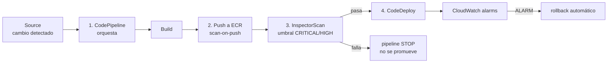

# CI/CD Pipeline Security

> [!abstract] Qué es este archivo
> Acá el foco no es la aplicación: es **el pipeline**. Cuatro piezas:
> **escaneo de seguridad** (InspectorScan + ECR), **entrega de artefactos entre cuentas** (tools account),
> **despliegue multi-región** (secuencial vs paralelo) y **rollback automático** con CodeDeploy.
>
> Cae en **Tarea 2.1** (CI/CD), **Tarea 2.3** (controles de seguridad) y **Tarea 3.2** (mejorar la seguridad).

> [!quote] La idea que ordena todo
> **El pipeline es un perímetro de seguridad, no solo un transporte de artefactos.**
> Si el escaneo vive en el pipeline (y no en el build), **nadie lo puede saltear**.

---

## Resumen en una frase

> El escaneo va en la **etapa de build** como **gate independiente** (InspectorScan + ECR), el pipeline vive en una
> **tools account** con roles cross-account y una **KMS key**, los despliegues multi-región son **secuenciales por
> default**, y el rollback lo disparan **alarmas de CloudWatch** o **umbrales de salud**.

---

## 1. Dónde va el escaneo

> **Regla:** el escaneo pertenece a la **etapa de build**, **después de compilar** y **antes de promover** el
> artefacto a deployment.

```
Source → Build (compilar) → [ SCAN ] → Deploy
                              ▲
                        acá se bloquea
```

**Dos mecanismos relevantes:**

| Mecanismo | Dónde actúa | Quién lo configura |
| --- | --- | --- |
| **InspectorScan** (acción nativa de CodePipeline) | **Etapa dedicada** del pipeline, sobre código **o** imágenes | **Platform team** (nivel pipeline) |
| **ECR image scanning** | **Al hacer push** de la imagen al repositorio | Configuración del repositorio ECR |

---

## 2. InspectorScan en CodePipeline

> **Qué es:** una **acción nativa** de CodePipeline que escanea **código fuente o imágenes de contenedor** como
> una **etapa dedicada** del pipeline.

### Dos modos

| Modo | Qué analiza |
| --- | --- |
| **SourceCodeScan** | **Código fuente** de la aplicación y **dependency manifests** (busca vulnerabilidades conocidas en las dependencias) |
| **ECRImageScan** | **Imágenes de contenedor** almacenadas en **Amazon ECR** |

### Umbrales y efecto

- El **umbral de vulnerabilidad se configura directamente en la acción**: por ejemplo,
  *"fallar si existe cualquier hallazgo **CRITICAL** o **HIGH**"*.
- Si los hallazgos **superan el umbral**, el pipeline **se detiene** y el artefacto **no se promueve** a la etapa
  de deployment.

### Salida: SBOM

La acción produce un **Software Bill of Materials (SBOM)** como **artefacto de salida**: un **inventario completo
de dependencias** y su **estado de vulnerabilidad**.

> **SBOM ≠ resultado del scan.** El SBOM es el **inventario**; el **pass/fail** lo decide el **umbral**.

### Por qué es un gate que no se puede saltear

> [!important] La clave de diseño
> Como **InspectorScan es una etapa standalone del pipeline**, funciona como **security gate independiente de la
> configuración del build**.
>
> - Los equipos de desarrollo **no necesitan modificar su proceso de build**.
> - El escaneo lo **impone el platform team a nivel de pipeline**.
> - **No se puede evitar** cambiando el **buildspec** ni la configuración del **build project**.

---

## 3. ECR image scanning

> Para workloads de contenedores: **scan-on-push** evalúa las **capas de la imagen** cuando una imagen recién
> construida se **pushea** al repositorio.

| Tipo | Qué hace |
| --- | --- |
| **Basic scanning** | **Búsqueda en la base de CVEs** (*CVE database lookup*) |
| **Enhanced scanning** | Potenciado por **Amazon Inspector**: cubre **paquetes del sistema operativo** y **paquetes de lenguajes de programación** |

**Lógica del pipeline:** después del push, **chequea los resultados del scan**. Si los hallazgos **superan el
umbral configurado**, la imagen **no se promueve** a deployment.

> [!tip] Diferencia que se pregunta
> **Basic** = lookup de CVEs, sin Inspector. **Enhanced** = **Inspector**, OS + librerías de lenguajes.
> Si el escenario pide **cobertura de dependencias de aplicación**, la respuesta es **enhanced**.

---

## 4. El flujo completo (los 4 pasos)



| # | Componente | Qué hace (y qué **no** hace) |
| --- | --- | --- |
| **1** | **CodePipeline** | **Orquesta** todo el workflow. **No** construye, **no** escanea, **no** despliega. Define la **secuencia de etapas** (build, scan, deploy) y dispara cada una **en orden** cuando detecta un cambio en el source. Si una etapa falla, **detiene** el workflow e impide las siguientes |
| **2** | **ECR scanning** | Evalúa las **capas de la imagen** en el **push**. Basic (CVEs) o enhanced (Inspector). El pipeline **chequea el resultado** después del push |
| **3** | **InspectorScan** | Escanea la **imagen pusheada en ECR**. Evalúa **paquetes del SO** y **liberías de lenguajes** por vulnerabilidades conocidas. Umbral configurado en la **acción**. Si pasa → **avanza**; si no → **stops** en esa etapa |
| **4** | **CodeDeploy** | **Despliega** la imagen en el compute target. Administra la **estrategia** (canary, blue/green, rolling) y **monitorea la salud con alarmas de CloudWatch**. Si las alarmas indican errores (**5xx elevados**, **picos de latencia**), **revierte el tráfico** a la versión anterior **sin intervención manual** |

---

## 5. Cross-account pipeline architecture

> **Contexto del curso:** la arquitectura de la e-commerce ponía **CodePipeline en una cuenta de shared services**
> y desplegaba a cuentas de **development** y **production** separadas usando **roles IAM cross-account**.
> Esta sección formaliza ese patrón a medida que la organización escala.

### Tools account pattern

| Cuenta | Qué contiene |
| --- | --- |
| **Tools account** | **Toda** la infraestructura de CI/CD: **CodePipeline**, **CodeBuild projects**, **artifact buckets (S3)** y las **KMS keys** que los cifran |
| **Target accounts** (dev, staging, prod) | **Solo deployment targets**: compute, bases de datos e infraestructura de aplicación |

### Los tres beneficios

| Beneficio | Cómo se logra |
| --- | --- |
| **Least privilege** | Los equipos de desarrollo **pueden disparar pipelines** pero **no** modificar definiciones de pipeline ni acceder **directamente** a credenciales de producción |
| **Audit trail** | Toda la actividad del pipeline queda **contenida en los CloudTrail logs de una sola cuenta** |
| **Artifact integrity** | **Una sola KMS key** cifra los artefactos. Las target accounts tienen **permiso de decrypt** pero **no** pueden **crear ni modificar** artefactos |

### Cómo se autoriza el despliegue

1. El pipeline **asume un rol de deployment en la target account**.
2. La **trust policy** del rol en la target especifica **exactamente qué pipeline** puede desplegar:
   **por cuenta y por role ARN**.

> [!important] La frase de examen
> **"Especificar exactamente qué pipeline puede desplegar" = trust policy con account + role ARN del pipeline.**
> No es "cualquier rol de la cuenta", ni "cualquier pipeline de la organización".

---

## 6. Multi-Region deployment

Cuando la organización atiende clientes en **varias regiones**, el pipeline debe llevar **los mismos artefactos**
a varios lugares. Dos patrones:

| | **Sequential** | **Parallel** |
| --- | --- | --- |
| **Cómo** | Despliega **en una región primero** (normalmente la **primary**), **valida salud**, y **después** a las demás | Despliega en **todas las regiones a la vez** |
| **Si falla** | Las demás regiones **no se ven afectadas** | El artefacto problemático **afecta a todas** |
| **Velocidad** | Más lento | **Más rápido** |
| **Riesgo** | **Bajo**: limita el **blast radius** | **Alto** |
| **Cuándo** | **Default recomendado** | Solo si el artefacto ya fue **validado en pre-producción** y **la velocidad de consistencia global** es la prioridad |

### Cómo viajan los artefactos

> **S3 cross-Region replication** sobre el **artifact bucket** del pipeline. La **deployment action de cada
> región** toma el artefacto desde su **copia local**.

---

## 7. Deployment strategies (la vista de CodeDeploy)

> Ya viste las estrategias a alto nivel en [[CI-CD Deployment Models]]. Acá importa **cómo las ejecuta
> CodeDeploy** y **cuándo hace rollback**.

| Estrategia | Cómo ejecuta | Trade-off |
| --- | --- | --- |
| **Blue/green** | Dos entornos idénticos. La versión nueva va al **inactivo (green)**. El tráfico pasa de blue a green, **todo de una o gradual**. Si hay problemas, **vuelve a blue al instante** | Hay que **mantener dos entornos completos** durante la transición |
| **Canary** | Un **% chico de tráfico** (ej. **10 %**) va primero a la versión nueva. Si las **alarmas de CloudWatch** siguen sanas por un período, pasa **el resto**. Si se disparan, **solo el tráfico canary** se ve afectado | **La estrategia de menor riesgo** para producción crítica |
| **Rolling** | Actualiza **instancias o tasks en lotes**. Cada lote se reemplaza, se **verifica salud**, y sigue el próximo. Si un lote falla, **se detiene** | **No** necesita entorno duplicado, pero el **rollback requiere redesplegar** la versión anterior (**más lento** que un traffic shift) |

---

## 8. Rollback automático en CodeDeploy

> **Dos mecanismos:**

### 8.1 Alarmas de CloudWatch

- Una o más **alarmas** se **asocian a un deployment group**.
- Si **cualquier** alarma entra en estado **ALARM** durante el deployment → **CodeDeploy hace rollback
  automáticamente**.
- Objetivos típicos de alarma: **tasa de errores 5xx**, **umbrales de latencia**, **picos de CPU**.

### 8.2 Umbrales de salud del deployment

- CodeDeploy **trackea cuántas instancias o tasks** recibieron el deployment **exitosamente**.
- Si el **porcentaje de fallos supera el minimum healthy threshold** configurado → **rollback automático**, **sin
  intervención humana**.

### 8.3 La combinación ganadora

> **Canary + rollback por alarma** es lo efectivo para producción:
> un **% chico** de tráfico llega a la versión nueva → si ese tráfico **dispara una alarma de error rate**,
> CodeDeploy hace rollback **antes de que la mayoría de los usuarios** vea el código nuevo.

---

## 9. Traducción del contenido

### 9.1 Pipeline security scanning

Esta lección aborda **el pipeline de despliegue en sí**, incluido cómo **integrar escaneo de seguridad**,
**administrar la entrega de artefactos entre cuentas**, **desplegar entre regiones** y **automatizar el rollback**
cuando los despliegues fallan.

El **escaneo de seguridad pertenece a la etapa de build**: después de que el código se compila y **antes de que
los artefactos se promuevan a deployment**. Dos mecanismos de escaneo son relevantes para esta arquitectura.

**Amazon Inspector scanning en CodePipeline.** CodePipeline provee una **acción nativa InspectorScan** que
escanea **código fuente o imágenes de contenedor** como una **etapa dedicada** del pipeline. La acción opera en
dos modos: **SourceCodeScan**, que analiza el **código fuente de la aplicación y los dependency manifests** en
busca de **vulnerabilidades conocidas**; y **ECRImageScan**, que evalúa **imágenes de contenedor almacenadas en
Amazon ECR**.

Configurás los **umbrales de vulnerabilidad directamente en la acción** — por ejemplo, *"fallar si existe
cualquier hallazgo de severidad CRITICAL o HIGH"*. Si los hallazgos **superan el umbral**, el pipeline **se
detiene** y el artefacto **no se promueve** a la etapa de deployment. La acción produce un **Software Bill of
Materials (SBOM)** como **artefacto de salida**, que da un **inventario completo de dependencias** y su **estado
de vulnerabilidad**.

Como la acción InspectorScan es una **etapa standalone** del pipeline, funciona como un **security gate
independiente de la configuración del build**. Los equipos de desarrollo **no necesitan modificar su proceso de
build**: el escaneo lo **impone el platform team a nivel de pipeline**. Esa separación significa que **el escaneo
no se puede evitar** con cambios al **buildspec** o a la configuración del **build project**.

**ECR image scanning.** Para workloads de contenedores, **ECR scan-on-push** evalúa las **capas de la imagen**
cuando una imagen recién construida se **pushea** al repositorio. ECR soporta **basic scanning** (búsqueda en la
base de CVEs) y **enhanced scanning** (potenciado por **Inspector**, cubriendo **paquetes del sistema operativo y
de lenguajes de programación**). La **lógica del pipeline chequea los resultados del scan después del push**. Si
los hallazgos **superan el umbral configurado**, la imagen **no se promueve** a deployment.

**1: CodePipeline inicia el workflow.** AWS CodePipeline es el **servicio de orquestación** que administra todo el
workflow de CI/CD. **No construye, no escanea ni despliega** nada por sí mismo. Define la **secuencia de etapas**
—build, scan, deploy— y **dispara cada una en orden** cuando detecta un cambio en el source. CodePipeline
**coordina** los otros servicios del diagrama, asegurando que **cada paso se complete con éxito antes de que
empiece el siguiente**. Si **cualquier etapa falla** (por ejemplo, un escaneo de vulnerabilidades supera su
umbral), CodePipeline **detiene el workflow** y **evita que corran las etapas siguientes**.

**2: ECR image scanning.** (Mismo detalle que arriba: scan-on-push, basic vs enhanced, chequeo posterior al
push, no se promueve si supera el umbral.)

**3: Amazon Inspector scan.** Amazon Inspector escanea la **imagen de contenedor que se pusheó a ECR** en el paso
anterior. Evalúa las **capas de la imagen** por **vulnerabilidades de software conocidas** en **paquetes del
sistema operativo** y **librerías de lenguajes de programación**. El **umbral de severidad se configura en la
acción del pipeline** — por ejemplo, fallar si existe cualquier hallazgo **CRITICAL o HIGH**. Si los hallazgos
superan ese umbral, CodePipeline **detiene el workflow en esa etapa** y la imagen **no se promueve** a deployment.
Si el scan **pasa**, CodePipeline **avanza a la etapa siguiente** y **dispara CodeDeploy**.

**4: AWS CodeDeploy deployment.** AWS CodeDeploy **automatiza el despliegue** de la imagen de contenedor en el
**compute environment target**. Administra la **estrategia de despliegue** —como **canary, blue/green o
rolling**— y **monitorea la salud del deployment** usando **alarmas de CloudWatch**. Si las alarmas indican
errores (por ejemplo, **tasas de 5xx elevadas** o **picos de latencia**), CodeDeploy **revierte el tráfico
automáticamente** a la versión anterior **sin requerir intervención manual**.

### 9.2 Cross-account pipeline architecture

Antes en el curso, la arquitectura de la empresa de e-commerce ponía **CodePipeline en una cuenta de shared
services**, desplegando código de aplicación a cuentas separadas de **development** y **production** usando
**roles IAM cross-account**. Esta sección trata **cómo ese patrón se formaliza a medida que la organización
escala**: específicamente, **cómo estructurar qué cuenta es dueña de la infraestructura del pipeline**, **cómo se
mueven los artefactos de forma segura entre cuentas** y **cómo las target accounts autorizan despliegues desde el
pipeline**.

**Tools account pattern.** Una **tools account dedicada** aloja **toda** la infraestructura de CI/CD:
**CodePipeline**, **CodeBuild projects**, **artifact buckets (S3)** y las **KMS keys** que los cifran. Las
**target accounts** (development, staging, production) contienen **solo deployment targets**: recursos de
compute, bases de datos e infraestructura de aplicación.

Esa separación provee:

- **Least privilege:** los equipos de desarrollo **pueden disparar pipelines** pero **no** pueden modificar
  definiciones de pipeline ni **acceder directamente a credenciales de producción**.
- **Audit trail:** toda la actividad del pipeline queda **contenida en los CloudTrail logs de una cuenta**.
- **Artifact integrity:** **una sola KMS key** cifra los artefactos. Las target accounts tienen **permisos de
  decrypt** pero **no pueden crear ni modificar artefactos**.

El despliegue cross-account funciona **mediante roles IAM**. El pipeline **asume un rol de deployment en la target
account** para ejecutar el despliegue. Configurás la **trust policy** del rol de la target para especificar
**exactamente qué pipeline** (por **cuenta y role ARN**) puede desplegar.

**Multi-Region deployment patterns.** Cuando una organización atiende clientes en varias regiones, el pipeline
necesita desplegar **los mismos artefactos** a múltiples ubicaciones. Existen **dos patrones**.

- **Sequential multi-Region:** el pipeline despliega **primero en una región** (típicamente la **primary**),
  **valida la salud** y **después despliega en las demás**. Si el despliegue falla en la primera región, **las
  otras quedan sin afectar**. Este enfoque **limita el blast radius** y es el **default recomendado**.
- **Parallel multi-Region:** el pipeline despliega en **todas las regiones simultáneamente**. Es **más rápido
  pero más riesgoso**: un artefacto problemático **afecta a todas las regiones a la vez**. Solo es apropiado
  cuando el artefacto **ya fue validado en una etapa de pre-producción** y **la velocidad de consistencia global
  es la prioridad**.

La **replicación de artefactos entre regiones** usa **S3 cross-Region replication** sobre el **artifact bucket**
del pipeline. La **deployment action de cada región** toma el artefacto desde su **copia local**.

### 9.3 Deployment strategies and rollback

Antes se presentaron las estrategias de despliegue a alto nivel. Esta sección cubre **cómo CodeDeploy ejecuta**
esas estrategias y **determina cuándo hacer rollback**.

- **Blue/green:** mantiene **dos entornos idénticos**. La versión nueva se despliega al entorno **inactivo
  (green)**. El tráfico pasa de blue a green, **todo de una o gradualmente**. Si hay problemas, el tráfico
  **vuelve a blue al instante**. **Trade-off:** hay que mantener **dos entornos completos** durante la transición.
- **Canary:** enruta un **porcentaje chico de tráfico** (por ejemplo, **10 %**) primero a la versión nueva. Si las
  **alarmas de CloudWatch** se mantienen sanas durante un **período definido**, pasa **el resto del tráfico**. Si
  las alarmas se disparan, **solo el tráfico canary se ve afectado**: **la mayoría de los usuarios nunca ve el
  problema**. Es la **estrategia de menor riesgo** para workloads críticos de producción.
- **Rolling:** actualiza **instancias o tasks en lotes**. Cada lote se reemplaza con la versión nueva, se
  **verifica la salud** y después **procede el lote siguiente**. Si un lote falla, **el deployment se detiene**.
  **Trade-off:** **no** se necesita entorno duplicado, pero el **rollback requiere redesplegar** la versión
  anterior (**más lento** que un traffic shift).

**CodeDeploy automated rollback.** CodeDeploy soporta rollback automático por **dos mecanismos**:

- **CloudWatch alarms:** una o más alarmas se **asocian a un deployment group**. Si **cualquier alarma** entra en
  estado **ALARM** durante el deployment, CodeDeploy **hace rollback automáticamente**. Objetivos típicos:
  **tasa de errores 5xx**, **umbrales de latencia** o **picos de utilización de CPU**.
- **Deployment health thresholds:** CodeDeploy **trackea cuántas instancias o tasks** recibieron el deployment
  **exitosamente**. Si el **porcentaje de fallos supera el minimum healthy threshold** configurado, **hace
  rollback automáticamente sin intervención humana**.

La combinación de **canary routing + rollback por alarmas** es **efectiva para workloads de producción**: un
**porcentaje chico** de tráfico llega a la versión nueva; si ese tráfico **dispara una alarma de tasa de error**,
CodeDeploy **hace rollback antes de que la mayoría de los usuarios** se exponga al código nuevo.

---

## 10. Para el examen (SAP-C02)

> [!important] Lo que hay que retener
> 1. El escaneo va en la **etapa de build**: **después de compilar**, **antes de promover**.
> 2. **InspectorScan** = **acción nativa** de CodePipeline, **etapa standalone**, **independiente del build** →
>    **no se saltea** cambiando el **buildspec**.
> 3. Dos modos: **SourceCodeScan** (código + dependency manifests) y **ECRImageScan** (imágenes en ECR).
> 4. **Umbral configurado en la acción** (ej. fallar con **CRITICAL o HIGH**); si se supera, **el pipeline se
>    detiene** y **no hay promoción**.
> 5. **SBOM** = artefacto de salida con el **inventario de dependencias** (no es el veredicto del scan).
> 6. **ECR**: **basic** = lookup de CVEs; **enhanced** = **Inspector**, OS + paquetes de lenguajes.
> 7. **CodePipeline solo orquesta**: no construye, no escanea, no despliega. Si una etapa falla, **frena** las
>    siguientes.
> 8. **CodeDeploy**: ejecuta **canary / blue-green / rolling** y **monitorea con alarmas**.
> 9. **Tools account**: pipeline + CodeBuild + artifact S3 + **KMS key**; targets **solo** deployment targets.
> 10. Beneficios: **least privilege**, **audit trail en un solo CloudTrail**, **artifact integrity** (targets solo
>     decrypt).
> 11. Autorización: **trust policy** de la target con **cuenta + role ARN del pipeline**.
> 12. **Multi-región**: **sequential** = default (limita blast radius); **parallel** = solo con artefacto ya
>     validado y velocidad como prioridad.
> 13. Artefactos entre regiones: **S3 cross-Region replication**; cada región **tira de su copia local**.
> 14. **Rollback**: **cualquier alarma en ALARM** durante el deployment **o** superar el **minimum healthy
>     threshold** → automático.
> 15. **Canary + alarmas** = la combinación de **menor riesgo** en producción.

> [!warning] Trampas típicas
> - "El escaneo va en la etapa de deploy" → **mal**: va en **build**, antes de promover.
> - "El equipo puede saltear el scan tocando el buildspec" → **mal**: es **etapa independiente** del pipeline.
> - "ECR basic scanning usa Inspector" → **mal**: Inspector es **enhanced**.
> - "CodePipeline compila y escanea" → **mal**: solo **orquesta**.
> - "Parallel multi-región es el default recomendado" → **mal**: el default es **sequential**.
> - "Las target accounts crean los artefactos" → **mal**: solo **decrypt**; no crean ni modifican.
> - "Cualquier rol de la cuenta puede asumir el rol de deployment" → **mal**: la **trust policy** fija **cuenta +
>   role ARN**.
> - "El SBOM decide si el artefacto pasa" → **mal**: lo decide el **umbral**; el SBOM es el **inventario**.
> - "Rollback de canary afecta a todos los usuarios" → **mal**: afecta **solo al tráfico canary**.

---

## 🔗 Relacionado

- [[AWS Solutions Architect Advanced - Designing a Multi-Account Architecture]] — índice del módulo
- [[CI-CD Deployment Models]] — las estrategias (in-place, rolling, immutable, blue/green) desde el diseño
- [[CloudFormation StackSets]] — despliegue consistente multi-cuenta/multi-región
- [[AWS Organizations and IAM Identity Center]] — las cuentas y los roles cross-account
- [[2.1 Diseñar una estrategia de implementación para cumplir con los requisitos empresariales]] — CI/CD y cambios
- [[2.3 Determinar los controles de seguridad en función de los requisitos]] — escaneo y mínimo privilegio
- [[3.2 Estrategia para mejorar la seguridad]] — automatizar detección y corrección
- [[Definicion servicios]] — CodePipeline, CodeBuild, Inspector, ECR, CodeDeploy, KMS
