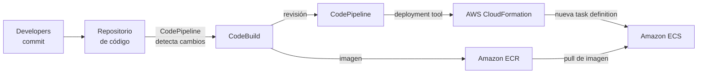

# CloudFormation StackSets

> [!abstract] Qué es este archivo
> **CloudFormation** modela infraestructura como código (template → stack). **StackSets** llevan eso a escala
> empresarial: **un template, una operación, muchas cuentas y muchas regiones**.
>
> Es la pieza que hace viable la gobernanza multi-cuenta: estandariza despliegues, aplica configuraciones
> consistentes y baja drásticamente la sobrecarga operativa. Cae en **Tarea 1.4** (entorno multi-cuenta) y
> **Tarea 2.1** (IaC / CI/CD).

> [!quote] La idea que ordena todo
> **Un stack es un despliegue. Un stack set es una política de despliegue.**

---

## Resumen en una frase

> **StackSets = CloudFormation + alcance multi-cuenta y multi-región**, con una **administrator account** que
> define el template, cuentas **target** que reciben los stacks, y un **modelo de permisos** (self-managed o
> service-managed) que resuelve la confianza entre ambas.

---

## 1. Repaso: CloudFormation

| Concepto | Definición |
| --- | --- |
| **Template** | Archivo de texto **YAML o JSON** que describe los recursos y sus propiedades. Se puede guardar con cualquier extensión (`.yaml`, `.json`, `.template`, `.txt`) |
| **Stack** | Los recursos relacionados, administrados **como una sola unidad**. Creás/actualizás/borrás la colección creando/actualizando/borrás el stack |
| **Change set** | **Resumen de los cambios propuestos** antes de aplicarlos, para ver el impacto en los recursos en ejecución |

**Qué resuelve:** no tener que crear y configurar cada recurso a mano ni averiguar **qué depende de qué**.
CloudFormation provisiona y configura por vos, en el **orden correcto**.

**Ejemplo de template:** una instancia **EC2** con su **instance type**, **AMI ID**, **block device mappings** y
**key pair**.
**Ejemplo de stack:** un template con **Auto Scaling group + ELB + instancia RDS** → al enviar el template se
provisionan los tres recursos.

---

## 2. Change sets: el seguro antes de romper producción

> **Qué son:** un **summary de los cambios propuestos**. Sirven para ver **cómo impacta** un cambio en los
> recursos que ya están corriendo, **especialmente en recursos críticos**, antes de implementarlo.

**El ejemplo de la lectura (RDS):** si cambiás el **nombre** de una instancia RDS, CloudFormation **crea una base
nueva y borra la vieja**. **Perdés los datos** de la anterior salvo que hayas hecho backup. Con un **change set**
ves que el cambio **reemplaza** la base **antes** de actualizar el stack, y planificás en consecuencia.

> [!important] Regla de examen
> **Change set = preview.** No aplica nada. Es el mecanismo para detectar **replacement** (y pérdida de datos)
> antes del update.

---

## 3. CI/CD con CloudFormation

**Continuous delivery:** construir y testear los cambios **automáticamente** antes de promover el template a los
stacks de producción.

### Flujo del diagrama



### CI/CD para despliegues de infraestructura

Workflow típico:

1. Enviás un **template actualizado** al repositorio.
2. Se construye **automáticamente un test stack**.
3. Lo **probás**.
4. Decidís si **promovés los cambios a producción**.

**Cadena de trabajo de IT Ops del diagrama:** escribir **infra code** → construir **AMIs** → **validar
templates** → **automatizar el deployment** → **desplegar infraestructura** con CloudFormation → **prod**.

---

## 4. El problema sin StackSets

> **Sin StackSets:** si necesitás el **mismo stack** en varias cuentas, tenés que **crear y ejecutar cada stack
> por separado dentro de cada cuenta**.

Con 2 regiones × 5 cuentas, son **10 despliegues manuales**… y eso es un ejemplo chico. Cada cuenta nueva
multiplica el trabajo y la probabilidad de **deriva** (drift) entre entornos.

---

## 5. StackSets

> **Qué hacen:** **crear, actualizar o borrar stacks en múltiples cuentas y regiones con una sola operación**.

| Rol | Qué hace |
| --- | --- |
| **Administrator account** | Cuenta donde **se crea el stack set** y desde donde se administra (hay que loguearse en **esa** cuenta para gestionarlo). Define y administra el **template** |
| **Target account** | Cuenta donde se **crean, actualizan o borran** los stacks del stack set |

**Requisito de confianza:** antes de usar un stack set para crear stacks en una cuenta target, tenés que
**establecer una relación de confianza** entre la **administrator** y las **target accounts**.

### Cómo se ve

```
                 ┌──────────────────────┐
                 │  Administrator acct  │
                 │  (un template)       │
                 └──────────┬───────────┘
                            │ 1 operación
        ┌───────────────────┼───────────────────┐
        ▼                   ▼                   ▼
   Región A             Región B            Región C
   ┌─────────┐          ┌─────────┐         ┌─────────┐
   │ Cuenta 1│          │ Cuenta 1│         │ Cuenta 1│
   │ Cuenta 2│          │ Cuenta 2│         │ Cuenta 2│
   └─────────┘          └─────────┘         └─────────┘
```

> [!note] Alineado con Organizations
> StackSets se vuelve especialmente valioso con **AWS Organizations**: estandariza configuraciones en **todo el
> footprint** y simplifica gobernanza y compliance.

---

## 6. Modelo de permisos

### Self-managed vs service-managed

| | **Self-managed** | **Service-managed** |
| --- | --- | --- |
| **Quién crea los roles IAM** | **Vos** | **CloudFormation StackSets** |
| **Requisito** | Permiso para **crear un IAM role** en la cuenta destino | Cuentas **administradas por AWS Organizations** |
| **Alcance** | **Cualquier** cuenta de AWS donde puedas crear el rol | Solo **cuentas de la organización** |
| **Auto-deploy a cuentas nuevas** | ❌ No | ✅ **Sí**: deployments automáticos a cuentas que se **agregan en el futuro** |
| **Cuándo elegirlo** | Sin Organizations, o cuentas fuera de la org | Org con Organizations (caso típico de empresa) |

> [!important] La diferencia que más se pregunta
> **Service-managed = Organizations + roles automáticos + auto-enrollment de cuentas nuevas.**
> **Self-managed = roles a mano + funciona en cualquier cuenta, incluso fuera de Organizations.**

---

## 7. Crear y desplegar un stack set

Al crear el stack set especificás **el template** y **los parámetros y capabilities** que requiere.

**Pasos (en orden):**

1. **Elegir el template** a desplegar.
2. **Asegurar que existan** los recursos dependientes.
3. **Crear el stack** (configurar **tags**, **deployment location**, **regiones** y opciones necesarias).
4. **Monitorear** la creación.

**Dos controles de la operación:**

| Control | Qué define |
| --- | --- |
| **Concurrency** | **Cuántas cuentas** se operan **a la vez** (*Maximum Concurrent Accounts*) |
| **Failure tolerance** | **Cuántos deployments fallidos** se aceptan **antes de abortar** |

---

## 8. Operaciones y preferencias

Después de definir el stack set podés **crear, actualizar o borrar** stacks en las cuentas y regiones target.

**Preferencias de operación:**

| Preferencia | Qué controla |
| --- | --- |
| **Region order** | El **orden de las regiones** en que se ejecuta la operación |
| **Failure tolerance** | El umbral de fallos **a partir del cual se detiene** la operación |
| **Maximum concurrent accounts** | Cuántas cuentas se procesan **en paralelo** |

> [!warning] Stack set = **recurso regional**
> Si creás un stack set **en una región**, **no lo ves ni lo modificás desde otras regiones**. Esto es distinto de
> los **stack instances**, que sí viven en las regiones target.

---

## 9. Best practices

### 9.1 Definir el template

- Definí el template que querés **estandarizar** en múltiples cuentas y regiones.
- **Cuidado con los recursos globales** (IAM roles, buckets S3): **no deben tener conflictos de nombre** cuando se
  crean en **más de una región de la misma cuenta**.
- **Un stack set tiene un único template y un único set de parámetros** → el **mismo stack** se crea en **todas**
  las cuentas asociadas. Escribí templates **granulares** para equilibrar **control y estandarización**.
- **Guardá el template en un bucket de Amazon S3**.

### 9.2 Crear / agregar stacks

- **Verificá** que agregar stack instances al stack set inicial **funciona**, antes de agregar **grandes
  cantidades**.
- Elegí las **rollout options** según el caso:

| Objetivo | Configuración |
| --- | --- |
| **Conservador** | **Maximum Concurrent Accounts = 1**, **Failure Tolerance = 0**, la **región de menor impacto primero** en **Region Order**, **empezar con una sola región** |
| **Más rápido** | Subir **Maximum Concurrent Accounts** y **Failure Tolerance** según necesidad |

- Las operaciones **dependen de la cantidad de stack instances** y pueden **tardar bastante**.

### 9.3 Actualizar stacks

- **Por default, actualizar el stack set actualiza TODAS las stack instances**: 20 cuentas × 2 regiones = **40
  stack instances** actualizadas de una.
- Con **muchas instancias**, **actualizá selectivamente unas pocas cuentas de test** antes de tocar todo.
- Para **control granular** sobre stacks individuales dentro del stack set: **creá varios stack sets**.

---

## 10. Traducción del contenido

### 10.1 AWS CloudFormation

AWS CloudFormation es un servicio que te ayuda a **modelar y configurar tus recursos de AWS** para pasar **menos
tiempo administrándolos** y más tiempo enfocándote en las aplicaciones que corren en AWS. Creás un **template**
que describe todos los recursos que querés, y CloudFormation se encarga de **provisionarlos y configurarlos**.
No hace falta crear y configurar cada recurso individualmente ni averiguar **qué depende de qué**: CloudFormation
lo maneja.

**Conceptos clave.** Cuando usás CloudFormation trabajás con **templates** y **stacks**. Creás templates para
describir tus recursos y sus propiedades. Cada vez que creás un stack, CloudFormation provisiona los recursos
descritos en el template.

**Templates.** Un template es un archivo de texto en **YAML o JSON**. Podés guardarlo con cualquier extensión:
`.yaml`, `.json`, `.template` o `.txt`. CloudFormation los usa como **blueprints** para construir tus recursos.
Por ejemplo, en un template podés describir una instancia **EC2**: **instance type**, **AMI ID**, **block device
mappings** y **key pair name**. Cuando creás un stack, especificás un template y CloudFormation crea lo que
describiste.

**Stacks.** Administrás recursos relacionados como **una sola unidad** llamada stack. Creás, actualizás y borrás
una colección de recursos creando, actualizando y borrando stacks. Todos los recursos del stack están definidos
por su template. Si el template incluye un **Auto Scaling group**, un **ELB** y una **instancia RDS**, al enviar
el template se provisionan **todos** esos recursos.

**Change sets.** Si necesitás cambiar recursos en ejecución, **actualizás el stack**. Antes de hacer cambios podés
generar un **change set**: un **resumen de los cambios propuestos**, que te deja ver **cómo impactarían** los
recursos en ejecución, **especialmente los críticos**, antes de implementarlos. Ejemplo: si cambiás el **nombre**
de una instancia RDS, CloudFormation **crea una base nueva y borra la vieja**; **perdés los datos** salvo que
hayas hecho backup. Con un change set ves que el cambio **hará que la base se reemplace** y podés planificar
antes de actualizar el stack.

### 10.2 CI/CD con AWS CloudFormation

Podés usar **continuous delivery** para **construir y testear automáticamente** los cambios antes de promover tus
templates de CloudFormation a los stacks de producción. Así hacés cambios de infraestructura **rápido y de forma
confiable**.

**Arquitectura del diagrama:** los **developers** envían código a un **repositorio**. **CodePipeline** hace
**polling** del repositorio para detectar cambios y envía la **code revision** a **CodeBuild**. CodeBuild
**construye una imagen de contenedor** y la **pushea a Amazon ECR**. CodePipeline usa **CloudFormation como
deployment tool**: CloudFormation crea una **nueva task definition** y **actualiza Amazon ECS**. **ECS** toma el
contenedor nuevo desde **ECR**.

**CI/CD para despliegues de infraestructura:** podés crear un workflow que **construya automáticamente un test
stack** cuando enviás un template actualizado al repositorio. Después de que CloudFormation construye el test
stack, lo **probás** y decidís si **promovés los cambios a un stack de producción**.

### 10.3 CloudFormation StackSets

CloudFormation StackSets **extienden** CloudFormation permitiéndote **desplegar stacks en múltiples cuentas y
regiones desde una sola operación**. Para arquitectos que administran entornos multi-cuenta, dan **gestión
centralizada de infraestructura como código**, asegurando despliegues **consistentes** y **reduciendo
significativamente la sobrecarga operativa**. Es especialmente valioso para organizaciones que implementan **AWS
Organizations**, porque **simplifica gobernanza y compliance** al hacer cumplir **configuraciones estandarizadas**
en todo el footprint.

**Sin StackSets:** si necesitás desplegar el mismo stack en varias cuentas, tenés que **crear y correr cada stack
por separado dentro de cada cuenta**.

**Con StackSets:** podés **crear, actualizar o borrar stacks en múltiples cuentas y regiones con una sola
operación**. Usando una **administrator account**, definís y administrás un template y lo usás como base para
provisionar stacks en las **target accounts** seleccionadas, en las regiones especificadas.

- **Administrator account:** la cuenta en la que **creás los stack sets**. Administrás el stack set **logueándote
  con la cuenta administradora en la que se creó**.
- **Target account:** la cuenta en la que **creás, actualizás o borrás** uno o más stacks del stack set. Antes de
  usar el stack set para crear stacks en una target, tenés que **establecer una relación de confianza** entre la
  administrator y las target accounts.

### 10.4 Modelo de permisos

Los stack sets se crean con permisos **self-managed** o **service-managed**.

**Self-managed:** vos creás los **roles IAM** que StackSets necesita para desplegar entre cuentas y regiones. Esos
roles son necesarios para **establecer una relación de confianza** entre la cuenta desde la que administrás el
stack set y la cuenta donde desplegás las stack instances. Con este modelo, StackSets puede desplegar en
**cualquier cuenta de AWS** en la que tengas permisos para **crear un IAM role**.

**Service-managed:** podés desplegar stack instances en **cuentas administradas por AWS Organizations**. **No
tenés que crear los roles IAM**: StackSets los **crea por vos**. Además, podés habilitar **deployments
automáticos** a cuentas que se **agreguen a la organización en el futuro**.

### 10.5 Crear y desplegar un stack set

Con un stack set podés crear stacks en cuentas y regiones usando **un solo template**. Todos los recursos de cada
stack están definidos por el template del stack set. Al crearlo especificás **el template** y **los parámetros y
capabilities** que requiere. Los pasos, en orden: **elegir un template** → **asegurar que existan los recursos
dependientes** → **crear el stack** → **monitorear** la creación. Al crear el stack configurás **tags**,
**deployment location**, **regiones** y **opciones**.

- **Concurrency:** especificás **en cuántas cuentas** se realiza la operación.
- **Failure tolerance:** especificás **cuántos deployments fallidos** se aceptan **antes de que el deployment
  abandone**.

**Operaciones del stack set.** Después de definir el stack set podés **crear, actualizar o borrar** stacks en las
target accounts y regiones. Al hacerlo podés especificar **operation preferences**: el **orden de las regiones**,
la **failure tolerance** a partir de la cual se detienen las operaciones, y el **número de cuentas** en las que se
opera **concurrentemente**.

Un stack set es un **recurso regional**: si lo creás en una región, **no podés verlo ni cambiarlo en otras
regiones**.

### 10.6 Best practices

**Definir el template**

- Definí el template que querés estandarizar en múltiples cuentas y regiones.
- Al crearlo, asegurate de que los **recursos globales** (IAM roles, buckets S3) **no tengan conflictos de
  nombre** cuando se crean en **más de una región de la misma cuenta**.
- Un stack set tiene **un único template y un único parameter set**. El **mismo stack** se crea en **todas las
  cuentas** asociadas. Escribí templates **suficientemente granulares** para lograr un buen equilibrio entre
  **control y estandarización**.
- Recomendación: **guardá el template en un bucket S3**.

**Crear o agregar stacks**

- Verificá que **agregar stack instances al stack set inicial funciona** antes de agregar **grandes cantidades**.
- Elegí las **deployment (rollout) options** que sirvan a tu caso:
  - **Más conservador:** **Maximum Concurrent Accounts = 1**, **Failure Tolerance = 0**, la **región de menor
    impacto primero** en **Region Order**, y **empezá con una región**.
  - **Más rápido:** subí **Maximum Concurrent Accounts** y **Failure Tolerance** según necesidad.
- Las operaciones dependen de **cuántas stack instances** haya y pueden **llevar tiempo considerable**.

**Actualizar stacks**

- **Por default, actualizar el stack set actualiza todas las stack instances.** Si tenés **20 cuentas en dos
  regiones**, hay **40 stack instances** y se actualizan **todas** al actualizar el stack set.
- Con **muchas stack instances**, para **probar la versión actualizada del template**, actualizá
  **selectivamente** las instancias en **unas pocas cuentas de test** antes de actualizar todo.
- Para **control más granular** sobre stacks individuales dentro del stack set, **creá múltiples stack sets**.

---

## 11. Para el examen (SAP-C02)

> [!important] Lo que hay que retener
> 1. **Template** (YAML/JSON) → **stack** (recursos como una unidad) → **stack set** (multi-cuenta + multi-región).
> 2. **Change set = preview del impacto**; detecta **replacement** (ej. renombrar RDS → base nueva + pérdida de
>    datos).
> 3. **StackSets**: **una operación** para **crear, actualizar o borrar** stacks en **cuentas y regiones**.
> 4. **Administrator account** define el template; **target accounts** reciben los stacks; hace falta **trust
>    relationship**.
> 5. **Self-managed** = vos creás los **IAM roles**; sirve en **cualquier cuenta**.
> 6. **Service-managed** = requiere **Organizations**; **StackSets crea los roles**; permite **auto-deploy a
>    cuentas nuevas**.
> 7. **Stack set es un recurso regional**: no se ve ni se modifica desde otra región.
> 8. **Un template + un parameter set** por stack set → **mismo stack en todas las cuentas**.
> 9. **Concurrency = Maximum Concurrent Accounts** · **Failure tolerance = fallos antes de abortar**.
> 10. **Rollout conservador**: 1 cuenta concurrente, tolerancia 0, región de menor impacto primero, una región.
> 11. **Update por default toca TODAS las stack instances** (20 cuentas × 2 regiones = 40).
> 12. **Nombres de recursos globales** (IAM, S3) deben ser únicos entre regiones de la misma cuenta.
> 13. **Template en S3** y **templates granulares**; para control por stack, **varios stack sets**.
> 14. **CI/CD**: test stack automático → probar → promover a producción (CodePipeline + CodeBuild + CFN).

> [!warning] Trampas típicas
> - "StackSets despliega en cualquier cuenta sin relación de confianza" → **mal**: hace falta **trust
>   relationship**.
> - "Service-managed funciona en cuentas fuera de Organizations" → **mal**: solo cuentas de la **organización**.
> - "Self-managed crea los roles automáticamente" → **mal**: los creás **vos**.
> - "Un stack set se administra desde cualquier región" → **mal**: es un **recurso regional**.
> - "Actualizar el stack set actualiza solo lo que cambió" → **mal**: por default actualiza **todas** las stack
>   instances.
> - "El change set aplica los cambios" → **mal**: solo **muestra** el impacto.
> - "Un stack set puede tener varios templates" → **mal**: **un template y un parameter set**.

---

## 🔗 Relacionado

- [[AWS Solutions Architect Advanced - Designing a Multi-Account Architecture]] — índice del módulo
- [[AWS Organizations and IAM Identity Center]] — Organizations es el requisito de **service-managed**
- [[AWS Control Tower]] — su enrollment usa **stack sets** con *automatic deployments* (trusted access)
- [[CI-CD Deployment Models]] — cómo se despliega lo que StackSets distribuye
- [[1.4 Diseñar un entorno de AWS de varias cuentas]] — tarea del examen (gobernanza multi-cuenta)
- [[2.1 Diseñar una estrategia de implementación para cumplir con los requisitos empresariales]] — IaC y CI/CD
- [[Definicion servicios]] — CloudFormation, CodePipeline, CodeBuild, ECR, ECS
