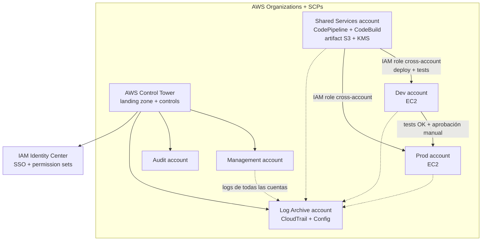

# Finished Architecture

> [!abstract] Qué es este archivo
> **La arquitectura final del caso**: la e-commerce *born in the cloud* que necesitaba pipeline automatizado a
> **Dev y Prod en cuentas separadas**. Acá se juntan **todas** las piezas del módulo:
> Control Tower, IAM Identity Center, shared services + CodePipeline, CloudFormation StackSets, SCPs, Log Archive,
> Account Factory y control de costos.
>
> Es la nota para **repasar antes del examen**: cada decisión tiene su **alternativa descartada** y su **porqué**.

> [!quote] La frase que resume el diseño
> **"Segura, automatizada y multi-cuenta, para que los desarrolladores vayan rápido sin perder el control."**

---

## Resumen en una frase

> Control Tower + IAM Identity Center como base, una **shared services account** con **CodePipeline** desplegando
> cross-account a **Dev** y **Prod**, **CloudFormation StackSets** para infraestructura consistente, **SCPs** como
> red de seguridad, **CloudTrail centralizado en Log Archive**, **Account Factory** para escalar y **tags +
> budgets** para los costos.

---

## 1. El requisito (de dónde viene todo)

| Requisito del cliente | Cómo lo resuelve la arquitectura |
| --- | --- |
| Multi-cuenta **segura y automatizada** | **Control Tower** (landing zone) + **SCPs** |
| Separación real **Dev / Prod** | **Cuentas separadas** + pipeline cross-account |
| Identidad y gobernanza **centralizadas** | **IAM Identity Center** + **Organizations** |
| Pipeline **end-to-end** con testing | **CodePipeline** en shared services → tests en Dev → **aprobación manual** → Prod |
| **PCI + GDPR** demostrables | **CloudTrail en Log Archive**, alertas, guardrails, auditoría |
| Costos **por equipo y entorno** | Cuentas separadas + **cost allocation tags** + **budget alerts** |
| Escalar sin rediseñar | **Account Factory** aplica controles y accesos automáticamente |

> Recordá: esta arquitectura nace de [[Gathering the customer REquirements]].

---

## 2. La arquitectura completa



### Las cuentas, una por una

| Cuenta | Rol en la arquitectura |
| --- | --- |
| **Management** | Donde se lanza **Control Tower**. No corre workloads |
| **Audit** | Acceso restringido de **seguridad y compliance** a las demás cuentas |
| **Log Archive** | **CloudTrail + AWS Config** de **todas** las cuentas: el **audit trail** |
| **Shared Services** | **CI/CD**: CodePipeline, CodeBuild, artefactos (S3), KMS |
| **Dev** | Despliegue **y tests** del pipeline |
| **Prod** | Despliegue **solo con aprobación manual** |

> **Patrón:** pipeline y artefactos viven en **una cuenta distinta** de las de deploy. Es el **tools account
> pattern** de [[CI-CD Pipeline Security]] aplicado al caso.

---

## 3. Decisiones de diseño (y qué se descartó)

| Decisión | Se eligió | Se consideró | Por qué ganó |
| --- | --- | --- | --- |
| **Base multi-cuenta** | **AWS Control Tower** | Setup manual con **AWS Organizations** | Da **mucho más out of the box**: crea las cuentas core de **logging y seguridad** y aplica **guardrails desde el día uno**. "Ahorra una tonelada de tiempo" frente a construir todo desde cero |
| **Identidad** | **IAM Identity Center** | — | Es el **default de Control Tower**: evita **usuarios IAM por cuenta**, da **SSO** en todas las cuentas y **permisos a escala** |
| **CI/CD** | **AWS CodePipeline** | **Jenkins** (que el equipo ya conocía) | La **integración nativa** con los otros servicios de AWS pesó más que la familiaridad |
| **IaC** | **CloudFormation + StackSets** | **Terraform** | Misma razón: **integración nativa** con el resto de servicios AWS |
| **Guardrails** | **SCPs** a nivel de organización | — | Red de seguridad: **nadie** puede romper compliance por accidente |
| **Observabilidad** | **Dashboards de Control Tower + métricas de CloudWatch** | — | Visibilidad nativa + métricas adicionales |
| **Auditoría** | **CloudTrail en Log Archive** | — | Toda acción de todas las cuentas queda registrada en **una** cuenta |
| **Escalabilidad** | **Account Factory** | — | Cuentas nuevas con **controles y accesos ya aplicados** |
| **Costos** | **Tags de asignación + budget alerts** | — | Seguimiento **por entorno** y **guardrails financieros** |

> [!important] Cómo leer esta tabla en el examen
> Cuando la pregunta ofrece **"nativo de AWS" vs "herramienta que el equipo ya usa"**, y no hay un requisito
> explícito de portabilidad o de lock-in avoidance, la respuesta suele ser la **nativa**: menos integración a
> mano, menos mantenimiento, menos superficie de error.
> **Ojo:** si el requisito es **multi-cloud** o **IaC agnóstico**, ahí sí gana Terraform.

---

## 4. Pipeline y flujo de despliegue

```
Developer push
      │
      ▼
CodePipeline (shared services)  ── IAM role cross-account ──►  Dev account
      │                                                          │
      │                                                    corre TODOS los tests
      │                                                          │
      │                                          ┌───────────────┴───────────────┐
      │                                       falla                           pasa
      │                                          │                               │
      │                                     se detiene                 APROBACIÓN MANUAL
      │                                                                       │
      └──────────────── IAM role cross-account ──────────────────────────►  Prod account
```

| Paso | Qué pasa |
| --- | --- |
| **1. Push** | El developer empuja código al repositorio |
| **2. Trigger** | Se dispara el pipeline **en la shared services account** |
| **3. Deploy a Dev** | El pipeline asume un **rol cross-account** y despliega en **Dev** |
| **4. Tests** | Corre **todos los tests en la cuenta de desarrollo** |
| **5. Gate** | **Solo si pasan**, el cambio **puede promoverse** a producción |
| **6. Aprobación manual** | **Miembros autorizados** aprueban (monitoreo y gobernanza) |
| **7. Deploy a Prod** | Se despliega en **Prod** con un **rol cross-account** |

> [!important] Dos ideas que el examen premia
> 1. Los tests corren **en Dev**, no en Prod.
> 2. El paso a producción **no es automático**: hay **manual approval** explícito. Automatización **con control**.

---

## 5. Seguridad

| Capa | Control |
| --- | --- |
| **Organización** | **SCPs** que, por ejemplo, **impiden deshabilitar CloudTrail** o **modificar security groups core** |
| **Identidad** | **IAM Identity Center**: SSO, sin usuarios IAM replicados |
| **Cuentas** | **Separación Dev/Prod** + **Control Tower controls** |
| **Pipeline** | **Roles IAM cross-account** con permisos acotados por cuenta |
| **Auditoría** | **CloudTrail** de **todas** las cuentas → **Log Archive** |
| **Detección** | **Alertas automatizadas** para eventos relevantes de seguridad |

> **La lógica de las SCPs acá:** no son "permisos que se dan", son **el techo que nadie puede pasar**. Actúan como
> **red de seguridad** contra errores accidentales que rompan compliance.

---

## 6. Operación y observabilidad

- **Dashboards de Control Tower** → estado de cuentas y controls.
- **Métricas de CloudWatch** adicionales → salud operativa.
- **CloudTrail en Log Archive** → **audit trail** completo de **todas** las cuentas.
- **Alertas automatizadas** → eventos de seguridad relevantes.

> Es exactamente lo que el cliente pedía: **"demostrable"**, no solo configurado. Ver [[AWS Control Tower]] §6.

---

## 7. Escalabilidad

> **"Agregar equipos o entornos nuevos es cuestión de usar Account Factory."**

Al crear una cuenta con **Account Factory**:
- Se aplican **todos los security controls**.
- Se aplican **los access patterns** ya definidos.
- No hay que reconfigurar nada a mano.

**Por qué importa:** el costo marginal de un equipo nuevo es **casi cero** en términos de gobernanza, que era el
requisito 8 del relevamiento.

---

## 8. Costos

| Mecanismo | Para qué |
| --- | --- |
| **Cuentas separadas Dev / Prod** | **Trackear el gasto por entorno** de forma natural |
| **Cost allocation tags** | Atribuir costos a **equipos** y **entornos** |
| **Budget alerts** | **Guardrails financieros**: avisar antes de pasarse |

---

## 9. Fase dos (mejoras identificadas)

| Mejora | Qué resuelve |
| --- | --- |
| **Automated security scanning en el pipeline** | Que ningún artefacto con vulnerabilidades críticas llegue a deploy |
| **Infrastructure compliance checks** | Validar que la infraestructura desplegada cumpla las políticas |
| **Cross-Region disaster recovery** | Continuidad ante la caída de una región completa |

> [!tip] Conexión con el módulo
> Esas tres mejoras **ya las estudiaste**: la primera es [[CI-CD Pipeline Security]] (InspectorScan + ECR), y las
> otras dos son territorio de **Tarea 1.3 / 2.2** (resiliencia y continuidad) y **Tarea 3.2** (compliance
> automatizado con AWS Config). El examen suele plantear el caso "fase uno ya funciona, ¿qué agregás?".

---

## 10. Traducción del contenido

### 10.1 Video (transcripción)

Ahora que compartí nuestro **proceso de relevamiento de requisitos** y aprendiste más sobre las opciones de AWS,
te voy a contar la **arquitectura multi-cuenta** que diseñé para esta empresa de comercio electrónico. Estoy
entusiasmada con este diseño porque **no solo resuelve sus necesidades inmediatas de despliegues automatizados**,
sino que también **provee una base sólida para su crecimiento futuro**.

Empecemos por la **base**. Estamos implementando **AWS Control Tower** para **establecer y gobernar** nuestra
estructura multi-cuenta. **Consideré un setup manual usando AWS Organizations**, pero **Control Tower nos da mucho
más out of the box**. **Configura automáticamente las cuentas core para logging y seguridad**. Además provee
**guardrails que hacen cumplir las best practices de seguridad desde el día uno**. Créeme, **eso ahorra muchísimo
tiempo** comparado con construir todo desde cero.

Para **gestión de identidades** usamos **AWS IAM Identity Center**. **Control Tower usa IAM Identity Center por
default**, y por una buena razón: **evita que administren usuarios IAM en cada cuenta por separado**, les da
**single sign-on en todas las cuentas de AWS** y hace **mucho más fácil administrar permisos a escala**.

La **estructura de cuentas** es bastante directa. Cuando trabajás con Control Tower, **siempre arrancás con tres
cuentas core**: la **management account** desde la que lanzás Control Tower, la **audit account** y la **log
archive account**. También creamos una **shared services account** para alojar nuestra **infraestructura de
CI/CD**, y acá se pone interesante.

Estamos construyendo nuestro **pipeline en AWS CodePipeline**, alojado en la **shared services account**. El
pipeline puede **desplegar a través de los límites de cuenta** gracias a un uso inteligente de **roles IAM y
permisos cross-account**, así que podrá **desplegar a instancias EC2 en las cuentas de desarrollo y producción**.
Este ejemplo muestra la **cuenta de dev**; la **cuenta de producción** tendría una configuración similar.

**Al principio pensé en usar Jenkins**, que ellos conocen, pero la **integración nativa de CodePipeline con otros
servicios de AWS** tuvo más sentido para su caso de uso.

Para **infraestructura como código** usamos **CloudFormation con StackSets**. Esto es notable porque nos permite
**desplegar infraestructura consistente en múltiples cuentas**. Cuando un equipo de desarrollo necesita un
**entorno nuevo**, StackSets asegura que **obtenga exactamente la misma configuración cada vez**. También
**consideramos Terraform**, pero **la integración nativa entre CloudFormation y los otros servicios de AWS ganó**.

La **seguridad está entretejida en todo el diseño**. Usamos **Service Control Policies (SCPs) a nivel de
organización** para hacer cumplir **guardrails**. Por ejemplo, tenemos **SCPs que impiden que alguien deshabilite
CloudTrail o modifique los security groups core**. Esas políticas actúan como **red de seguridad**, asegurando que
**nadie pueda romper los requisitos de compliance por accidente**.

El **proceso de despliegue está totalmente automatizado pero controlado**. Cuando los developers **pushean código
al repositorio**, se **dispara el pipeline en la shared services account**. El pipeline **corre todos los tests en
la cuenta de desarrollo primero**. **Solo después de pasar esos tests** los cambios **pueden promoverse a
producción**, y eso **requiere aprobación manual de miembros autorizados del equipo** para **monitoreo y
gobernanza**.

Estamos aprovechando los **dashboards integrados de AWS Control Tower** junto con **métricas adicionales de
CloudWatch**. **Cada acción en todas las cuentas se loguea en CloudTrail en la Log Archive account**, dándonos el
**audit trail** que necesitaban. También configuramos **alertas automatizadas** para **cualquier evento relevante
de seguridad**.

Algo que me gusta mucho de este diseño es su **escalabilidad**. Cuando necesitan **agregar nuevos equipos de
desarrollo o nuevos entornos**, es **cuestión de usar Account Factory para crear cuentas nuevas**. **Todos los
controles de seguridad y los patrones de acceso se aplican automáticamente**.

La **gestión de costos** fue otra consideración clave. Al **separar desarrollo y producción en cuentas
diferentes**, pueden **trackear el gasto por entorno** fácilmente. También implementamos **cost allocation tags** y
**budget alerts** para ayudar a los equipos a **mantenerse dentro de sus guardrails financieros**.

Lo mejor de esta arquitectura es que **les da espacio para crecer**. Pueden **agregar más equipos, más entornos o
aplicaciones completamente nuevas**, y **la base que construimos va a soportar todo eso manteniendo seguridad y
gobernanza**.

Mirando hacia adelante, ya **identificamos algunas mejoras posibles para la fase dos**: podríamos **agregar
escaneo de seguridad automatizado en el pipeline**, **implementar checks de compliance de infraestructura**, o
incluso **configurar disaster recovery cross-region**. Pero por ahora, este diseño les da **exactamente lo que
necesitan**: una estructura multi-cuenta **segura y automatizada** que **deja a sus developers moverse rápido**
manteniendo **todo bajo control**.

### 10.2 Architecture recap (lista literal)

- Implementar **AWS Control Tower** para establecer y gobernar la estructura multi-cuenta.
- Usar **AWS IAM Identity Center** para gestión de identidades. Funciona **en tándem** con Control Tower.
- Crear una **shared services account** para alojar la infraestructura de CI/CD, usando **AWS CodePipeline**
  alojado ahí. El pipeline puede desplegar **cross-account** usando **roles IAM y permisos cross-account**.
- Para código de infraestructura, usar **AWS CloudFormation con StackSets** para desplegar **infraestructura
  consistente** en múltiples cuentas.
- Usar **Service Control Policies (SCPs)** a nivel organizacional para hacer cumplir guardrails.
- Usar los **dashboards integrados de Control Tower** junto con **métricas adicionales de CloudWatch**, con
  acciones logueadas a **CloudTrail en la Log Archive account**.
- Para escalabilidad, implementar **Account Factory** para crear cuentas nuevas con **todos los controles de
  seguridad y patrones de acceso aplicados automáticamente**.
- Usar **cost allocation tags** y **budget alerts** para mantener a los equipos dentro de sus **guardrails
  financieros**.

---

## 11. Para el examen (SAP-C02)

> [!important] Lo que hay que retener
> 1. **Control Tower > setup manual** cuando no hay restricción: da cuentas core y guardrails **desde el día uno**.
> 2. **IAM Identity Center** es el default de Control Tower: **SSO**, sin usuarios IAM por cuenta.
> 3. **Tres cuentas core**: management, audit, **log archive**. Más **shared services** para CI/CD.
> 4. **Pipeline en shared services**, no en management ni en prod: despliega **cross-account con IAM roles**.
> 5. **CodePipeline > Jenkins** por **integración nativa**; **CloudFormation + StackSets > Terraform** por lo
>    mismo (salvo requisito multi-cloud/agnóstico).
> 6. **StackSets** = **misma configuración** para cada entorno nuevo.
> 7. **SCPs** como **red de seguridad** (ej.: prohibir deshabilitar **CloudTrail**, tocar **security groups core**).
> 8. **Tests en Dev**; **Prod requiere aprobación manual**. Automatización con **gates**.
> 9. **CloudTrail de todas las cuentas → Log Archive** = audit trail **demostrable**.
> 10. **Account Factory** = escalar equipos/entornos **aplicando controles automáticamente**.
> 11. **Costos**: cuentas separadas por entorno + **tags** + **budget alerts**.
> 12. **Fase dos**: security scanning, compliance checks, **cross-Region DR**.

> [!warning] Trampas típicas
> - "El pipeline va en la management account" → **mal**: va en **shared services**.
> - "Prod se despliega automáticamente al pasar los tests" → **mal**: hace falta **aprobación manual**.
> - "Los tests se corren en Prod para validar antes de Dev" → **mal**: **Dev primero**.
> - "Los logs se centralizan en la management account" → **mal**: **Log Archive**.
> - "Con SCPs se otorgan permisos" → **mal**: **limitan**; nunca otorgan.
> - "Account Factory solo crea la cuenta, los controles se aplican a mano" → **mal**: se aplican
>   **automáticamente**.
> - "Se eligió Terraform" → **mal**: **CloudFormation + StackSets** (Terraform se consideró y se descartó).
> - "Jenkins quedó en la solución" → **mal**: se evaluó y se eligió **CodePipeline**.

---

## 🔗 Relacionado

- [[AWS Solutions Architect Advanced - Designing a Multi-Account Architecture]] — índice del módulo
- [[Gathering the customer REquirements]] — los requisitos que esta arquitectura resuelve
- [[Multi-Account Access Solutions]] — base de los roles cross-account
- [[AWS Organizations and IAM Identity Center]] — SCPs e identidad
- [[AWS Control Tower]] — la landing zone que sostiene todo
- [[CI-CD Deployment Models]] — estrategias de despliegue
- [[CloudFormation StackSets]] — infraestructura consistente multi-cuenta
- [[CI-CD Pipeline Security]] — la "fase dos" ya estudiada
- [[1.4 Diseñar un entorno de AWS de varias cuentas]] · [[2.1 Diseñar una estrategia de implementación para cumplir con los requisitos empresariales]] — tareas del examen
- [[Definicion servicios]] — servicios usados en el diseño
