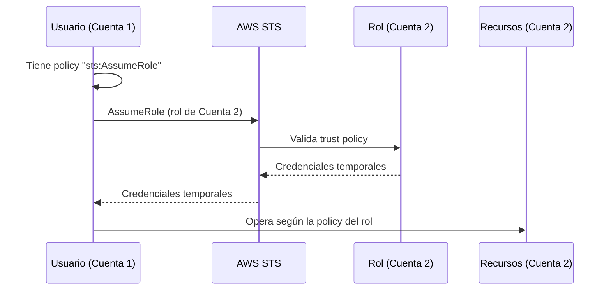

# Multi-Account Access Solutions

> [!abstract] Qué es este archivo
> Sesión de **fundamentos** del módulo multi-cuenta: por qué el modelo "un usuario por cuenta" no escala y
> cómo **IAM roles + cross-account permissions** resuelven el acceso, la auditoría y los casos de uso
> compartidos (logs centralizados y recursos estandarizados).

> [!quote] La analogía del módulo
> Tener un usuario y contraseña por cada cuenta es como tener **una llave distinta para cada habitación de la casa**:
> funciona, pero es incómodo, te olvidás cuál abre qué puerta y, peor, podés perder una.
> Un **IAM role** es la llave maestra que se **programa** para abrir solo las habitaciones que corresponde.

---

## Resumen en una frase

> A medida que crecen las cuentas, el acceso se centraliza con **IAM roles y trust policies**, no duplicando
> usuarios y políticas; y esa misma mecánica habilita **auditoría, logs centralizados y recursos compartidos**.

---

## 1. El problema: crecer en cuentas sin cross-account access

Escenario típico: la empresa usa **varias cuentas AWS** para sus entornos de aplicación.

| Paso del modelo "sin cross-account" | Qué implica |
| --- | --- |
| 1. Crear un **usuario en cada cuenta** | Un `IAM user` por cuenta, por persona |
| 2. **Duplicar** las IAM policies en cada cuenta | Misma política copiada N veces para "estandarizar" |
| 3. Cada usuario **inicia sesión con credenciales distintas** | Contraseñas separadas por cuenta |

**Por qué no sirve:**

- **Overhead administrativo:** los administradores crean usuarios y actualizan políticas **cuenta por cuenta**.
- **No escala:** con muchas cuentas el mantenimiento se vuelve inmanejable.
- **Riesgo de seguridad:** los desarrolladores acumulan contraseñas de varias cuentas.
- **Deriva de configuración:** políticas duplicadas se desincronizan con el tiempo.

> [!note] Dato técnico que explica todo
> **Las IAM policies solo aplican a security principals de la misma cuenta.** Sin un mecanismo de
> cross-account, no hay forma de que un usuario de la cuenta A reciba permisos sobre recursos de la cuenta B.
> De ahí la duplicación.

---

## 2. Solución 1 — Sin permisos cross-account

Sirve para **pocas cuentas**, pero es el antipatrón cuando el footprint crece.

```
Cuenta Dev                          Cuenta Prod
├── IAM user (Ana)                  ├── IAM user (Ana)
├── IAM user (Luis)                 ├── IAM user (Luis)
└── policies duplicadas             └── policies duplicadas
        ↑                                   ↑
        └──── Ana y Luis tienen 2 passwords ┘
```

**Cómo se arma (proceso válido, pero limitado):**

1. Crear un **IAM group** con los permisos que la gente necesita.
2. Agregar **IAM users** a los grupos correspondientes.
3. Repetir grupos, usuarios y permisos **en cada cuenta**.

**Veredicto:** ineficiente y **no escala** para la administración.

---

## 3. Solución 2 — Con permisos cross-account (IAM roles)

Acá está el patrón correcto. En lugar de un usuario por cuenta, hay **un rol por cuenta** que otras cuentas
pueden **asumir**.

### Cómo funciona



1. En la **cuenta destino** se crea un **IAM role**.
2. La **IAM policy** del rol define **qué acciones permite**.
3. La **trust policy** del rol define **qué cuenta (o principal) puede asumirlo**.
4. En la **cuenta origen**, el usuario recibe permiso `sts:AssumeRole`.
5. El usuario **asume el rol** ("switch role") y accede a los recursos de la otra cuenta **sin volver a loguearse**.

> [!important] Las dos políticas del rol (no confundirlas)
> - **Trust policy (relación de confianza):** *¿quién puede asumir este rol?* → cuenta/origen.
> - **Permission policy (política de permisos):** *¿qué puede hacer quien lo asume?* → acciones/recursos.
>
> Si el examen dice "revocar acceso rápido", la respuesta suele ser **modificar la trust policy**.

### Ventajas

| Ventaja | Detalle |
| --- | --- |
| **Gestión de usuarios centralizada** | Los usuarios viven en **una** cuenta |
| **Control de acceso simplificado** | Los permisos se administran por **rol** |
| **Roles actualizables en todas las cuentas** | Un cambio de rol se propaga, sin duplicar políticas |
| **Mejor seguridad** | **No hay múltiples juegos de credenciales**; se usan credenciales temporales |
| **Revocación rápida** | Se corta cambiando la trust policy |

---

## 4. Auditoría de acceso multi-cuenta

Escenario: **varias cuentas de producción**, cada una con su equipo, y **un auditor** que debe revisarlas todas.

| Enfoque malo | Enfoque correcto |
| --- | --- |
| Crear un `security auditor` user **en cada cuenta** | Crear un **rol con permisos de auditoría en cada cuenta** |
| Credenciales del auditor repartidas por N cuentas | Dar a la **cuenta del auditor** permiso para **asumir** esos roles |
| Revocar = tocar N usuarios | Revocar = **modificar la trust policy** del rol |

**Beneficios:** roles **estandarizados** entre cuentas, el auditor hace *switch role* solo cuando lo necesita,
y la postura de seguridad mejora porque el acceso se corta desde un único punto.

---

## 5. Casos de uso de multi-cuenta

### 5.1 Centralized log account (logs centralizados)

> Analogía: una **biblioteca central** donde se guardan los libros (logs) de todas las sucursales; catalogar,
> proteger y analizar es mucho más fácil en un solo lugar.

| Elemento | Rol |
| --- | --- |
| **Cuenta de logging dedicada** | Contiene el **corporate logging bucket** |
| **Otras cuentas** | Envían sus **AWS CloudTrail** y **AWS Config** logs al bucket central |
| **Auditores / analistas** | Reciben acceso **solo a la cuenta de logging** |

**Por qué importa:**

- **Aísla los logs** cruzando el límite de cuenta: si comprometen una cuenta de aplicación, los logs siguen intactos.
- El acceso a la información queda **controlado en la cuenta de logging**.
- Se audita el cumplimiento de **múltiples cuentas** **sin credenciales en producción**.

> [!tip] Patrón de examen
> "Logs que deben sobrevivir al compromiso de una cuenta" → **cuenta separada de logging** + envío desde las demás.

### 5.2 Centralized resource protection (recursos estandarizados)

| Elemento | Rol |
| --- | --- |
| **AWS Service Catalog** | Portfolios con plantillas de recursos estandarizados |
| **Cuenta publicadora dedicada** | Fuente central de esos recursos |
| **Cuentas consumidoras** (ej. sales, retail) | Seleccionan y despliegan productos del catálogo |

**Qué se comparte típicamente:** **AMIs** para instancias EC2 y **snapshots** para volúmenes EBS.

**Por qué importa:** consistencia entre cuentas, control centralizado del despliegue y actualizaciones
simples de los recursos aprobados.

---

## 6. Traducción del contenido

### 6.1 Video (transcripción)

A medida que las organizaciones crecen y nuestra infraestructura en la nube se expande, es común encontrarse
**haciendo malabares con múltiples cuentas de AWS**. Pero, ¿cómo hacerlo de manera eficiente y cómo equilibrar
la necesidad de **agilidad** con la necesidad de **gobernanza**? En este módulo aprenderás sobre la
**administración multi-cuenta de AWS** y descubrirás cómo construir una infraestructura **escalable, segura y
compatible con las normas**.

Imaginemos que tu empresa usa múltiples cuentas de AWS para sus entornos de aplicación. En este ejemplo, se
crea **un usuario separado en cada cuenta** con **políticas duplicadas** entre cuentas para estandarizar. En
muchos casos, esta no es la forma más eficiente. Los administradores deben crear todos esos usuarios y
**actualizar las políticas de IAM en cada cuenta por separado**; a medida que creces, esto se convierte en
**mucha sobrecarga** cuando tenés muchas cuentas, y tus desarrolladores tienen que **recordar sus contraseñas
para las distintas cuentas**, lo que puede generar **riesgos de seguridad**.

Esto es como tener **una llave diferente para cada habitación de tu casa**. Claro que funciona, pero es
**incómodo y propenso a errores**: podés olvidar qué llave abre qué puerta o, peor, **perder una llave**. Así
que, aunque este método puede funcionar para **pocas cuentas**, puede volverse **inmanejable rápidamente** a
medida que crece tu huella en AWS.

Ahora veamos una solución más eficiente: **permisos entre cuentas usando roles de IAM**. Imaginá que, en lugar
de tener llaves distintas para cada habitación, tuvieras **una llave maestra de nivel superior que pudiera
programarse para acceder a habitaciones específicas según tus necesidades**. Eso es esencialmente lo que los
roles de IAM permiten hacer en AWS.

En este escenario, una **política de IAM determina qué acciones permite el rol y qué cuenta puede asumirlo**.
Al usuario se le conceden **permisos para asumir el rol**; luego el usuario puede asumirlo —también conocido
como **cambio de rol (switching roles)**— para acceder a recursos de otra cuenta.

Este enfoque ofrece varias ventajas: la **gestión de usuarios está centralizada** y se administra en una sola
cuenta; el **control de acceso se simplifica**; los permisos se gestionan mediante **roles que se pueden
actualizar fácilmente entre cuentas**; y la **seguridad es mejor** porque los usuarios **no necesitan gestionar
múltiples conjuntos de credenciales**.

Exploremos otro escenario donde el acceso entre cuentas se destaca: la **auditoría de seguridad entre múltiples
cuentas**. Imaginá que tenés varias cuentas de producción, cada una administrada por equipos distintos. Un
auditor necesita acceso para auditar todas tus cuentas de producción. En lugar de crear un **usuario auditor de
seguridad en cada cuenta**, podés crear un **rol con permisos de auditoría en cada cuenta** y darle a la
**cuenta del auditor** permiso para asumir esos roles. El auditor ahora puede cambiar de rol fácilmente para
auditar las cuentas específicas que necesite. Estos roles pueden **estandarizarse entre cuentas** y, si alguna
vez necesitás hacerlo, podés **revocar el acceso rápidamente modificando la trust policy del rol**, lo que
mejora tu postura de seguridad.

Veamos nuestro primer caso de uso: **gestión centralizada de logs**. Pensalo como una **biblioteca central**
donde se almacenan y administran todos los libros —o, en nuestro caso, los logs de distintas sucursales—. Esta
centralización facilita **catalogar, proteger y analizar** la información. En este escenario tenemos una
**cuenta de logging dedicada** con un **bucket corporativo de logging**. Otras cuentas envían sus logs de
**CloudTrail** y **Config** a este bucket central. Esta configuración **aumenta la seguridad de los logs al
aislarlos a través de los límites de cuenta**. Podés controlar el acceso a la cuenta de logging para proteger
la información que contiene. Y cuando alguien necesita auditar o analizar esos logs, le das acceso **a esta
única cuenta de logging** y puede verificar el cumplimiento en múltiples cuentas **sin necesitar credenciales
de las cuentas de producción**.

Este caso de uso se centra en la **protección centralizada de recursos**. En este ejemplo tenés **portfolios
configurados en AWS Service Catalog**. Estos portfolios contienen plantillas para recursos estandarizados, como
**AMIs para instancias EC2** y **snapshots para volúmenes EBS**. Configurás una **cuenta publicadora dedicada**,
y esta actúa como **fuente central** de recursos estandarizados de AWS. Otras cuentas, como las de **ventas y
retail**, pueden acceder a estos recursos compartidos para **seleccionar y desplegar productos**, pero vos
mantenés el **control centralizado sobre el despliegue de recursos**. Esto asegura **consistencia entre cuentas**
y **simplifica la gestión y las actualizaciones de recursos**.

### 6.2 Texto de soporte (lectura del módulo)

**Soluciones de acceso multi-cuenta**

Supongamos que una empresa usa múltiples cuentas de AWS para sus entornos de aplicación. Los desarrolladores
deben recordar sus contraseñas para esas distintas cuentas de AWS para poder realizar las mismas operaciones en
cada una. Esto es ineficiente. Para evitarlo, hay que usar **soluciones multi-cuenta**.

**Solución 1: sin permisos entre cuentas**

Para admitir múltiples usuarios en tu cuenta de AWS, debés **delegar permisos** que permitan a otras personas
realizar solo las acciones que querés habilitar. Para eso, creá un **grupo de IAM** con los permisos que esas
personas necesitan y agregá **usuarios de IAM** a los grupos necesarios a medida que los creás. Este proceso
sirve para configurar grupos, usuarios y permisos para toda tu cuenta de AWS.

Sin embargo, **las políticas de IAM solo se aplican a los security principals de la misma cuenta**. Sin un
mecanismo que permita a un usuario de una cuenta recibir permisos sobre recursos de otra cuenta, **debés crear
un usuario dentro de cada cuenta** para administrarla y luego **duplicar las políticas de IAM** asignadas a ese
usuario en cada cuenta. Esto es ineficiente y **no escala bien** para la administración.

*Pasos del diagrama:*
1. **Cuentas de AWS:** se crea un usuario en cada cuenta.
2. Se **duplican y adjuntan** las políticas de IAM a los usuarios respectivos en ambas cuentas.
3. Los usuarios deben **iniciar sesión en cada cuenta específica con credenciales distintas**. No hay permisos
   entre cuentas.

**Solución 2: con permisos entre cuentas**

Con **permisos entre cuentas** compartís recursos de una cuenta con usuarios de otra. Al configurar el acceso
entre cuentas de esta manera, **no necesitás crear usuarios de IAM individuales en cada cuenta**. Además, los
usuarios **no tienen que cerrar sesión en una cuenta e iniciar sesión en otra** para acceder a recursos de
cuentas distintas.

*Pasos del diagrama:*
1. **Políticas de IAM:** una política de IAM determina qué acciones permite el rol y qué cuenta puede asumirlo.
2. El usuario de la **Cuenta 1** recibe permisos de `assume role` mediante una política de IAM.
3. El usuario **asume el rol** en la **Cuenta 2**.

**Auditoría de acceso multi-cuenta**

En esta solución de auditoría con acceso entre cuentas **no hace falta crear un usuario auditor dentro de cada
cuenta auditada**. Creá un **rol en cada cuenta** con una política de permisos de auditoría adecuada adjunta.
Luego, otorgá a la **cuenta del auditor de seguridad** los permisos para **cambiar/asumir** cada rol en cada
cuenta.

**Casos de uso multi-cuenta**

Examinemos dos enfoques de acceso multi-cuenta: **cuenta de logs centralizada** y **protección centralizada de
recursos**.

---

## 7. Comparativa rápida

| Criterio | Sin cross-account | Con cross-account (IAM roles) |
| --- | --- | --- |
| Usuarios | Uno por cuenta | Centralizados en una cuenta |
| Políticas | Duplicadas por cuenta | Definidas una vez por rol |
| Credenciales | Múltiples contraseñas | **Credenciales temporales** vía STS |
| Escala | Mala | Buena |
| Revocación | Cuenta por cuenta | Cambiar la **trust policy** |
| Auditoría | Auditor en cada cuenta | Auditor asume roles estándar |
| Riesgo | Alto (contraseñas dispersas) | Bajo (sin credenciales permanentes) |

---

## 8. Para el examen (SAP-C02)

> [!important] Lo que hay que retener
> 1. **IAM policies son intra-cuenta.** El cross-account se resuelve con **roles + trust policy**, no copiando políticas.
> 2. **Trust policy** = quién puede asumir; **permission policy** = qué puede hacer. Confundirlas es el error clásico.
> 3. **Credenciales temporales** (STS) siempre ganan a usuarios con contraseña.
> 4. **Revocar acceso rápido** = modificar la **trust policy** del rol.
> 5. **Logs centralizados** en una **cuenta dedicada** aíslan la evidencia de un compromiso en cuentas de aplicación.
> 6. **Service Catalog** es el patrón para distribuir recursos aprobados (AMIs, snapshots) desde una **cuenta publicadora**.
> 7. Multi-cuenta resuelve a la vez **agilidad** (autonomía por cuenta) y **gobernanza** (control central).

---

## Relacionado

- [[Gathering the customer REquirements]] — el caso del cliente que pide justamente esto
- [[AWS Solutions Architect Advanced - Designing a Multi-Account Architecture]] *(índice del módulo)*
- Siguiente paso del módulo: **AWS Control Tower**, **IAM Identity Center** y **CI/CD**
