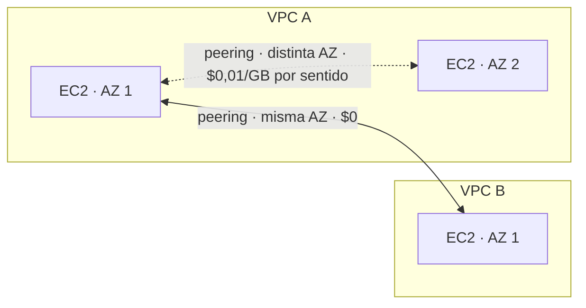

# Architecting for Cost - Networking

> [!abstract] Qué es este archivo
> Lección de costos de **red**. Mientras compute y storage se llevan la atención, **el data transfer puede pegarle
> fuerte a la factura y de formas inesperadas**.
>
> Cubre **cómo se cobra el tránsito según dirección, origen y destino** (dentro de una AZ, entre AZs, entre
> Regiones y entre VPCs), el caso de **Amazon S3**, el **pricing de Elastic Load Balancing** con las **LCU**,
> las **Elastic IP** y las **instancias C5n** como opción de **red mejorada**.

> [!quote] La idea que hay que retener
> **El data transfer no se cobra “por usar la red”: se cobra por cruzar un límite.**
> La fuente abre con esto: *“los cargos por transferencia de datos varían según **la dirección**, **el origen** y
> **el destino**”*. Antes de optimizar, hay que saber **qué límite se está cruzando**.

---

## Resumen en una frase

> El costo de red se controla **sabiendo qué cruza cada límite** —**AZ**, **Región** o **VPC**— y **eligiendo
> rutas y endpoints que no lo crucen** (private IPv4, misma AZ, mismos servicios “free”), más **medir las LCU**
> de los balanceadores y **no dejar IPs públicas ociosas**.

---

## 1. El modelo mental: dirección, origen y destino

La fuente define el costo de transferencia con **tres variables**:

| Variable | Qué cambia |
| --- | --- |
| **Dirección** | **In** (hacia AWS) vs. **out** (desde AWS) |
| **Origen** | Servicio, AZ, Región, VPC de donde sale |
| **Destino** | Servicio, AZ, Región, VPC a donde llega |

> [!important] La regla base de AWS
> **Entrar a AWS desde internet es gratis**; **salir cuesta**. Casi todo lo que sigue son **excepciones o
> recargos** a esa regla: **IPs públicas**, **cruce de AZ**, **cruce de Región**, **cruce de VPC** y
> **aceleradores**.

La figura de la lección muestra **dos Regiones conectadas por internet**, cada una con **dos AZ** y una **VPC
que abarca esas AZ**.

---

## 2. Data transfer en la infraestructura global

### 2.1 Dentro de la misma Availability Zone

#### Gratis

| Servicio | Detalle |
| --- | --- |
| **Amazon EC2** | Entre instancias |
| **Amazon RDS** | — |
| **Amazon Redshift** | — |
| **Amazon ElastiCache** | Instancias |
| **Elastic network interfaces** | ENIs |

> **Condición literal:** el tráfico entre estos servicios **en la misma AZ es gratis**, salvo que se acceda a
> ellos **a través de endpoints de AWS PrivateLink**, que **generan los cargos estándar de PrivateLink**.

#### IPv4 e IPv6 públicas

| Tipo | Cómo se cobra |
| --- | --- |
| **IPv4** | El data transfer **in y out** de una **IP pública o Elastic IPv4** se cobra **en cada dirección** |
| **IPv6** | El data transfer **in y out** de una **dirección IPv6 en una VPC distinta** se cobra **en cada dirección** |

#### IPv4 privada

**No hay cargo** por data transfer **dentro de la misma AZ usando una dirección IPv4 privada**.

> [!important] La palanca más barata
> **Misma AZ + IP privada = $0**. Es la combinación que hay que buscar por defecto entre capas que se hablan
> mucho (app ↔ caché, app ↔ DB). Cruzar la AZ “por resiliencia” tiene **precio por GB en ambos sentidos**.

### 2.2 Entre Availability Zones de la misma Región

#### Gratis (ciertos servicios)

| Servicio |
| --- |
| **Amazon S3** |
| **Amazon S3 Glacier** |
| **Amazon DynamoDB** |
| **Amazon SES** |
| **Amazon SQS** |
| **Amazon Kinesis** |
| **Amazon ECR** |
| **Amazon SNS** |
| **Amazon SimpleDB** |

> **Misma condición:** **PrivateLink** cobra aparte.

#### Otros servicios

**El data transfer in y out dentro de la misma Región se cobra en cada dirección.**

**Ejemplo literal:** **1 GB** transferido entre **instancias EC2 en distintas AZ de la misma Región** cuesta
**$0,01 out + $0,01 in**.

> [!tip] Por qué S3/DynamoDB/SQS salen “gratis”
> Son servicios **regionales**: la fuente no obliga a elegir una AZ, y AWS no te cobra el cruce entre AZs por
> usarlos. La consecuencia de diseño: **sacar el estado compartido a un servicio regional** elimina el costo
> cross-AZ que sí pagarías con instancias.

### 2.3 Entre Regiones

**Mismo costo que el data transfer a internet.**

| Regla | Detalle |
| --- | --- |
| **Dirección** | **Solo se paga lo que sale** de la Región; **entrar no cuesta** |
| **Precio** | **Varía según la Región de origen** |

**Ejemplo literal:** **1 GB** entre **instancias EC2 en Regiones distintas** = **$0,02 out** y **$0 in**.

> [!warning] La asimetría que confunde
> La misma GB puede costar **$0 (in)**, **$0,01 (cross-AZ, por sentido)** o **$0,02 (cross-Region, por salida)**.
> En el examen, lo primero es **identificar el límite**; recién después se estima el número.

### 2.4 Entre VPCs

| Camino | Costo |
| --- | --- |
| **VPC peering, misma AZ** | **Gratis** |
| **VPC peering, distintas AZ** | **$0,01/GB en cada dirección** (**total $0,02/GB**) |
| **VPC peering, distintas Regiones** | Se cobra **el data transfer out de la Región de origen** |

> [!important] Peering no es un atajo gratis
> El peering **evita el internet gateway**, pero **no evita el cargo por cruzar AZ o Región**. La decisión de
> diseño sigue siendo **colocar los recursos que más se hablan en la misma AZ**.

---

## 3. Amazon S3

| Aspecto | Detalle |
| --- | --- |
| **Salida a internet** | **Pricing escalonado (tiered) por GB** transferido out, **según la Región** |
| **Salida a otras Regiones** | El **precio por GB varía según la Región del bucket de origen** |
| **S3 Transfer Acceleration** | **Costo extra por GB** según la **AWS Edge location** usada para acelerar |
| **Entrada desde internet** | **Sin costo** |

> [!tip] Cómo leer el pricing escalonado
> Los primeros GB del mes suelen costar más por unidad y el precio baja por tramos. La fuente **no da los
> tramos**: solo dice que es **tiered** y **por Región**. Para el examen alcanza con saber **que baja por volumen
> y que depende de la Región**.

---

## 4. Elastic Load Balancing

**Qué hace:** distribuye automáticamente el tráfico entrante entre **múltiples targets y virtual appliances** en
**una o más AZ**.

### 4.1 Los tres tipos y cómo se cobran

| Tipo | Unidad de cobro | Dimensiones |
| --- | --- | --- |
| **Application Load Balancer (ALB)** | **Por Región**: **hora o fracción** + **LCU por hora** | **4**: nuevas conexiones/s · conexiones activas/min · GB procesados (HTTP/S) · reglas procesadas y request rate |
| **Network Load Balancer (NLB)** | **Por Región**: **hora o fracción** + **LCU-hora** | **3**: nuevas conexiones o flows · conexiones o flows activos · bytes procesados |
| **Classic Load Balancer (CLB)** | **Por hora** + **por GB procesado** | — |

> **Regla común a ALB y NLB:** *“se cobra **solo la dimensión de LCU con mayor uso**”*. No se suman las
> dimensiones: **se toma la más alta**.

### 4.2 Qué es una LCU en ALB

**Una LCU mide las dimensiones sobre las que el ALB procesa el tráfico, promediadas en una hora.**

| Dimensión | Definición literal |
| --- | --- |
| **New connections** | **Conexiones nuevas establecidas por segundo** |
| **Active connections** | **Conexiones activas por minuto** |
| **Processed bytes** | **Bytes procesados por el balanceador en GB**, para requests y responses HTTP(S) |
| **Rule evaluations** | **Producto de la cantidad de reglas procesadas por el balanceador y el request rate** |

**El mayor valor de las cuatro dimensiones es el que se aplica a la factura.**

### 4.3 Ejemplo de cálculo (literal)

| Dato | Valor |
| --- | --- |
| **Balanceadores** | **1** |
| **LCU** | **20** |
| **Precio por LCU-hora** | **$0,008** |
| **Horas por mes** | **730** |

**Cálculo:** `1 balanceador × 20 LCU × 0,008 por LCU-hora × 730 horas = 116,80 USD` de **cargos mensuales por
uso de LCU de ALB**.

> **Vigencia declarada en la fuente:** *“Pricing as of **March 2023**”*.

> [!note] Ampliación (no está en la fuente)
> El ejemplo **solo** calcula la parte de **LCU**; no incluye el **cargo por hora** del balanceador ni los GB
> procesados como ítem separado (en ALB ya van dentro de la LCU). El total real de la factura es **mayor** que
> los **116,80 USD**.

---

## 5. Elastic IP addresses

**Qué es:** una **dirección IPv4 estática** pensada para **dynamic cloud computing**. Se **asigna a la cuenta**
y **es tuya hasta que la liberás**. Permite **enmascarar la falla** de una instancia **remapeando rápido** la IP a
otra instancia de la cuenta.

### 5.1 Cuándo NO genera cargos

| Condición (las tres) |
| --- |
| La **Elastic IP está asociada a una instancia EC2** |
| La **instancia está running** |
| La instancia tiene **una sola Elastic IP** asociada |

### 5.2 Cuándo SÍ genera cargos

| Condición (cualquiera) |
| --- |
| **Más de una Elastic IP** asociada a una instancia EC2 |
| La **Elastic IP no está asociada** a ninguna instancia EC2 |

> [!warning] Dato de la fuente que conviene contrastar
> La regla **“EIP asociada a instancia running = gratis”** es la que **enseña la lección** y se transcribe
> literal. **AWS cambió su modelo de pricing de IPv4 públicas** (desde 2024 cobra **todas** las IPv4 públicas,
> incluidas las asociadas a instancias en ejecución). Para el examen, **responder con la regla de la fuente**;
> para una factura real, **verificar el pricing vigente**. Queda en §10.

> [!tip] La EIP como anti-patrón de costo
> Una EIP **desasociada** es **pura pérdida**: no presta servicio y **se factura**. El control es el mismo que
> con los volúmenes EBS huérfanos: **inventariar y liberar**.

---

## 6. Instancias compute optimized con red mejorada (C5n)

**Qué son:** variantes de **C5** con **performance de red significativamente mayor en todos los tamaños**.

| Dato | Valor |
| --- | --- |
| **Bandwidth en tamaños chicos** | **25 Gbps** de pico |
| **Bandwidth en el tamaño más grande** | **100 Gbps** |
| **Memoria** | **33 % más** que C5 |
| **Tamaños** | **6**: **2, 4, 8, 16, 36 y 72 vCPU** |
| **Modelos de compra** | **On-Demand**, **Reserved**, **Spot**, **Dedicated Instances** y **Dedicated Hosts** |

**Para qué:** aplicaciones que **aprovechan mejor throughput de red y packet rate**.

> [!important] Cuándo la red es el cuello de botella
> Si una carga está limitada por **ancho de banda** (transferencias grandes, clusters, appliances de red),
> **subir de tamaño dentro de la misma familia no siempre alcanza**: las variantes **`n`** existen justamente
> para eso, con **más red por vCPU** y **algo más de memoria**.

---

## 7. Self-check de la lección

> **Pregunta:** ¿qué **tiene un cargo asociado al data transfer *in***? **(elegir 1)**

| Opción | Veredicto | Por qué |
| --- | --- | --- |
| **A. Data transfer de internet a Amazon EC2** | ❌ | **Entrar desde internet es gratis** (§1 y §3) |
| **B. AWS Direct Connect** | ❌ | Se paga **port hour** y **data transfer out**; la **entrada** no se cobra por GB |
| **C. AWS Snowball Edge** | ❌ | Se paga el **dispositivo y el job**, no un cargo **por GB entrante** |
| **D. Data transfer entre servicios AWS en la misma AZ usando una **IP pública IPv4** | ✅ | La fuente dice que **in y out** de una **IP pública/Elastic IPv4** **se cobran en cada dirección** |

> **Respuesta: D.**

> [!note] Sobre la fuente
> El self-check **no trae rationale oficial** ni “Correct!”. La justificación es **propia**, basada en §2.1.
> El distractor fino es **D**: el tráfico **entre servicios de la misma AZ es gratis solo con IP privada**;
> **con IP pública vuelve a costar**.

---

## 8. Traducción del contenido

### 8.1 Introducción

Aunque los costos de **compute** y **storage** suelen llevarse la mayor atención, **el data transfer de red puede
impactar significativamente la factura de AWS**, a veces **de formas inesperadas**. **Entender y optimizar los
costos de red es crucial** para construir **arquitecturas cloud costo-efectivas**.

En esta lección te enfocás en **entender el modelo de pricing de red de AWS** y en explorar **estrategias para
optimizar tus costos de red manteniendo performance y confiabilidad**. Examinás **cómo varían los cargos de data
transfer entre servicios de AWS, Availability Zones y Regiones**.

### 8.2 Data transfer en la infraestructura global de AWS

Al considerar los costos de data transfer, es importante **cómo se posicionan los servicios dentro de la
infraestructura global de AWS**. Los cargos **varían según la dirección de la transferencia, el origen y el
destino**.

**Data transfer dentro de una Availability Zone**

Para conocer los cargos que podés incurrir al transferir datos **entre distintos servicios de AWS dentro de una
AZ**:

**Free**

El data transfer entre estos servicios **en la misma AZ es gratis** (*los servicios accedidos a través de
endpoints de AWS PrivateLink **incurrirán en los cargos estándar de PrivateLink**):

- **Amazon EC2**
- **Amazon RDS**
- **Amazon Redshift**
- **instancias de Amazon ElastiCache**
- **Elastic network interfaces**

**Public IPv4 and IPv6**

**IPv4:** el data transfer **in y out** de una **dirección IPv4 pública o Elastic** se cobra **en cada
dirección**.

**IPv6:** el data transfer **in y out** de una **dirección IPv6 en una VPC diferente** se cobra **en cada
dirección**.

**Private IPv4**

**No hay cargo** por data transfer **dentro de la misma AZ usando una dirección IPv4 privada**.

**Data transfer entre Availability Zones de la misma Región**

**Podrías incurrir en algunos costos** al transferir datos **entre servicios dentro de una AZ de la misma
Región**.

**Free**

La transferencia entre estos servicios **en la misma Región es gratis** (*PrivateLink cobra aparte*):

- **Amazon S3**
- **Amazon S3 Glacier**
- **Amazon DynamoDB**
- **Amazon SES**
- **Amazon SQS**
- **Amazon Kinesis**
- **Amazon ECR**
- **Amazon SNS**
- **Amazon SimpleDB**

**Other services**

Para **otros servicios**, el data transfer **in y out dentro de la misma Región se cobra en cada dirección**.

> **Figura:** **1 GB** transferido entre **instancias EC2 en distintas AZ dentro de la misma Región** se cobra
> **$0,01 out** y **$0,01 in**.

**Data transfer entre Regiones**

El data transfer **entre Regiones tiene el mismo costo que el data transfer hacia internet**.

- **Solo pagás el data transfer que sale** de una Región; **no hay costo por el que entra** a una Región.
- El **precio por GB varía según la Región desde la que se transfiere**.

> **Figura:** **1 GB** entre **instancias EC2 en Regiones distintas** se cobra **$0,02 out** y **$0 in**.

**Data transfer entre VPCs**

- El data transfer por **VPC peering dentro de la misma AZ** de una Región es **gratis**.
- El data transfer por **VPC peering entre distintas AZ** de una Región se cobra **$0,01/GB en cada dirección**
  (**total $0,02/GB**).
- El data transfer por **VPC peering entre distintas Regiones** se cobra **por el data transfer out de la Región
  de origen**.

### 8.3 Amazon S3

- **Amazon S3** sigue el **pricing escalonado estándar por GB** transferido **out a internet**, **según la
  Región**.
- El **precio por GB** transferido out **desde S3 a servicios de otras Regiones** **varía según la Región del
  bucket de origen**.
- **S3 Transfer Acceleration** está disponible **por un costo adicional por GB**, según la **AWS Edge location**
  usada para acelerar la transferencia.
- **No hay costo por transferir datos *hacia* Amazon S3 desde internet**.

### 8.4 Elastic Load Balancing

**Elastic Load Balancing** distribuye automáticamente el **tráfico entrante** de la aplicación entre **múltiples
targets y virtual appliances** en **una o más AZ**.

**Application Load Balancers**

Los **Application Load Balancers** se cobran **por Región**:

- **Por hora o fracción de hora**.
- **Load Balancer Capacity Units (LCU) por hora**. Cada **LCU** tiene **cuatro dimensiones**:
  - **nuevas conexiones establecidas por segundo**
  - **conexiones activas por minuto**
  - **GB procesados** para requests y responses **HTTP(S)**
  - **reglas procesadas y request rate**
- Se cobra **solo la dimensión de LCU con mayor uso**.

**Network Load Balancers**

Los **Network Load Balancers** se cobran **por Región**:

- **Por hora o fracción de hora**.
- **Por LCU-hora**. Cada **LCU-hora** tiene **tres dimensiones**:
  - **nuevas conexiones o flows**
  - **conexiones o flows activos**
  - **bytes procesados**
- Se cobra **solo la dimensión de LCU con mayor uso**.

**Classic Load Balancers**

Los **Classic Load Balancers** se cobran **por hora** y **por GB procesado**.

**Cálculo de LCU de Application Load Balancer**

Una **LCU** mide las dimensiones sobre las que el ALB procesa el tráfico (**promediadas en una hora**):

- **New connections:** cantidad de **conexiones nuevas establecidas por segundo**.
- **Active connections:** cantidad de **conexiones activas por minuto**.
- **Processed bytes:** cantidad de **bytes procesados por el balanceador en GB**, para requests y responses
  **HTTP(S)**.
- **Rule evaluations:** **producto** de la **cantidad de reglas procesadas** por el balanceador y el **request
  rate**.

**El mayor valor de las cuatro dimensiones de LCU es el que se aplica a tu factura.**

**Aplicando el costo de cada LCU**

**Detalle del cálculo:** `1 balanceador de carga × 20 LCU × 0,008 de precio por LCU-hora × 730 horas por mes =
116,80 USD` de **cargos mensuales por uso de LCU de Application Load Balancer**.

**Pricing as of March 2023.**

### 8.5 Elastic IP addresses

Una **Elastic IP address** es una **dirección IPv4 estática** diseñada para **dynamic cloud computing**. Se
**asigna a tu cuenta de AWS** y **es tuya hasta que la liberás**. Usando una Elastic IP podés **enmascarar la
falla** de una instancia u otro servicio **remapeando rápidamente la dirección** a otra instancia de tu cuenta.
**Podés o no incurrir en cargos** por una Elastic IP.

**Una Elastic IP NO genera cargos si:**

- La dirección **está asignada a una instancia EC2**.
- La instancia **asociada está running**.
- La instancia tiene **una sola Elastic IP** asociada.

**Una Elastic IP SÍ genera cargos si:**

- **Más de una Elastic IP** está asociada a una instancia EC2.
- La **Elastic IP no está asociada** a una instancia EC2.

### 8.6 Instancias compute-optimized

Las **instancias C5n** son **variantes de C5** con **performance de red significativamente mayor en todos los
tamaños**, desde **25 Gbps** de ancho de banda pico en los tamaños chicos hasta **100 Gbps** en el tamaño más
grande. Además, tienen **33 % más de memoria** que las C5. Las **C5n** son ideales para aplicaciones que
**aprovechan mejor el throughput de red y la performance de packet rate**.

Las **C5n** están disponibles en **6 tamaños**, con **2, 4, 8, 16, 36 y 72 vCPU**, y se pueden comprar como
**On-Demand**, **Reserved**, **Spot**, **Dedicated Instances** o **Dedicated Hosts**.

### 8.7 Self-check

**Pregunta:** ¿qué **tiene un cargo asociado al data transfer *in***? **(Elegir 1.)**

A. Data transfer de internet a Amazon EC2
B. AWS Direct Connect
C. AWS Snowball Edge
D. Data transfer entre servicios de AWS en la misma Availability Zone usando una dirección IPv4 pública

---

## 9. Para el examen (SAP-C02)

> Esta sección es **interpretación propia**: cruza la lección con [[Guia AWS]].

### 9.1 A qué tareas responde

| Concepto | Tarea |
| --- | --- |
| **Costo de data transfer por AZ/Región/VPC** | **1.5** Costos y visibilidad · **2.6** Optimización para metas |
| **S3 y Transfer Acceleration** | **1.5** · **3.5** Oportunidades de optimización |
| **ELB y LCU** | **1.5** · **3.5** |
| **Elastic IP ociosas** | **3.5** · **3.1** Excelencia operativa |
| **Instancias con red mejorada** | **2.6** · **3.5** |

### 9.2 Diez puntos para llevarse

1. **Tres variables**: **dirección**, **origen** y **destino**.
2. **In a AWS desde internet = $0**; **out = con cargo**.
3. **Misma AZ + IPv4 privada = $0** (EC2, RDS, Redshift, ElastiCache, ENIs).
4. **IP pública o Elastic IPv4** → **se cobra en cada dirección**, incluso dentro de la AZ.
5. **Entre AZs**: **$0,01/GB out + $0,01/GB in** para EC2; **S3, S3 Glacier, DynamoDB, SES, SQS, Kinesis, ECR,
   SNS y SimpleDB** son **gratis**.
6. **Entre Regiones**: **solo out**, **mismo precio que internet**, **varía por Región de origen**.
7. **VPC peering**: **misma AZ gratis**; **distintas AZ $0,01/GB por sentido**; **distintas Regiones** → **out de
   la Región origen**.
8. **S3**: **egress escalonado por Región**, **sin costo de entrada**; **Transfer Acceleration** **cobra extra por
   GB** según **edge location**.
9. **ALB = hora + LCU (4 dimensiones)**; **NLB = hora + LCU-hora (3)**; **CLB = hora + GB**. **Se cobra la
   dimensión más alta**, no la suma.
10. **EIP**: **gratis** solo si **está asociada a una instancia running y es la única**; **EIP suelta u ociosas
    de más = cargo**. **C5n**: **25→100 Gbps**, **+33 % memoria**, **6 tamaños**.

### 9.3 Trampas típicas

| Trampa | Por qué es falsa |
| --- | --- |
| “Todo el tráfico dentro de una AZ es gratis” | **Solo con IP privada**; **IPv4 pública se cobra en ambos sentidos** |
| “Entre AZs dentro de la Región no se paga” | **EC2 paga $0,01/GB por sentido**; solo **ciertos servicios** son gratis |
| “Entrar a AWS desde internet cuesta” | **Entrar es gratis**; **salir** es lo que cuesta |
| “Cross-Region se cobra en ambos sentidos” | **Solo out**; **in = $0** |
| “VPC peering es gratis porque no usa internet” | **Cruce de AZ o de Región se cobra igual** |
| “S3 Transfer Acceleration es solo performance” | **Tiene costo extra por GB** |
| “Se suman las dimensiones de LCU” | Se cobra **solo la mayor** |
| “NLB y ALB tienen las mismas dimensiones” | **ALB 4**, **NLB 3** |
| “Una EIP siempre es gratis si está asociada” | **Solo si es la única y la instancia está running** (según la fuente; ver §5) |
| “Más vCPU siempre da más red” | La red **no escala igual**; para eso están las **variantes `n`** |

> [!note] Ampliación (no está en la fuente)
> Tres atajos para el examen:
> **“¿Cruza AZ?”** → **$0,01/GB por sentido** salvo servicios regionales ·
> **“¿Cruza Región?”** → **out de la Región origen, precio de internet** ·
> **“¿Misma AZ con IP privada?”** → **$0**.

---

## 10. Registro de integración

| Fecha | Qué llegó | Dónde se integró |
| --- | --- | --- |
| 26/10/2026 | Lección completa: data transfer por AZ/Región/VPC, S3, ELB/LCU, Elastic IP, C5n y self-check | Nota completa (secciones 1–9) |

**Discrepancias y vacíos registrados (no corregidos):**

1. **Título de la subsección “entre AZs”.** La fuente escribe *“You might incur some costs while transferring
   data among services **within an Availability Zone** in the same Region”*, pero el contenido es sobre
   **tráfico entre Availability Zones**. Se transcribe literal y se interpreta en §2.2.
2. **Errores de tipeo en la lectura.** El texto dice *“transferred in and out**within** the same Region is
   charged**in** each direction”* (falta espacio) y *“1 load balancers”*. Se conserva el sentido, sin inventar
   texto.
3. **Elastic IP “gratis si está asociada”.** Es la regla de la lección y se transcribe literal, pero **AWS
   modificó el pricing de IPv4 públicas**: hoy **toda IPv4 pública tiene cargo por hora**, esté asociada o no.
   Para el examen, vale la regla de la fuente; para factura real, **verificar pricing vigente**. Se marca en
   §5.1.
4. **Precio del ejemplo de ALB sin fecha completa.** La fuente aclara **“Pricing as of March 2023”** y **solo**
   calcula LCU; **no incluye** el cargo por hora del balanceador. Se aclara en §4.3.
5. **$0,02 out en el ejemplo cross-Region.** Es el valor de la figura y **no coincide** con el rango típico de
   egress a internet (que suele ser mayor). Se transcribe **literal** y se usa solo como **ejemplo didáctico**.
6. **Self-check sin rationale.** No llegó explicación oficial; la justificación de §7 es **propia**.
7. **Imágenes no disponibles.** La lectura referencia **seis** capturas (`G6MCKPARH3.png`, `QTGKKRUEBC.png`,
   `VW4ERQ8ZHT.png`, `PWPSUHVB9K.png`, `3KHDUT7CNF.png`) que **no están en el vault**.

**Decisiones de transcripción:**

- Se conservan **data transfer**, **LCU**, **LCU-hour**, **peering**, **edge location**, **egress** y **packet
  rate**.
- Los **números** se transcriben literales: **$0,01**, **$0,02**, **$0,008**, **730 h**, **116,80 USD**,
  **25 Gbps**, **100 Gbps**, **33 %**, **2/4/8/16/36/72 vCPU**.
- Los **cinco** servicios “free” intra-AZ y los **nueve** servicios “free” cross-AZ se listan **completos**.
- **No se agregaron** tarifas por Región ni tramos de S3 que la fuente no da.

---

## 🔗 Relacionado

- [[AWS Solutions Architect Advanced - Implementing Observability and Management Controls]] — índice del módulo
- [[Architecting for Cost - Compute]] — lección anterior: familias, rightsizing, Fleet y Auto Scaling
- [[Cost Optimization]] — los 5 pilares: derechosizing, elasticidad, pricing, storage y mejora continua
- [[Cost Management Tools]] — Cost Explorer, CUR, Budgets y tagging
- [[Cloud Cost Management]] — marco de financial management
- [[1.5 Determinar las estrategias de optimización de costos y visibilidad]]
- [[2.6 Determinar una estrategia de optimización de costos para cumplir las metas]]
- [[3.5 Identificar oportunidades de optimización de costos]]
- [[3.1 Estrategia para mejorar la excelencia operativa general]]
- [[Guia AWS]] — pesos y tareas oficiales del SAP-C02
