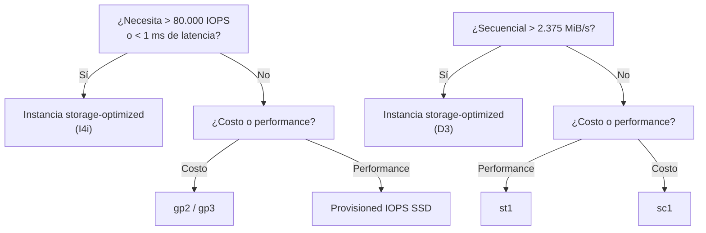

# Architecting for Cost - Storage

> [!abstract] Qué es este archivo
> Lección de costos de **almacenamiento**, con foco en **Amazon S3** y **Amazon EBS**. El problema que ataca es
> simple: **el storage crece solo** y, si nadie lo gobierna, **se come el presupuesto**.
>
> Cubre el **portafolio de storage** (objeto, archivo, bloque, backup y transferencia), los **tipos de volumen
> EBS** y su **price/performance**, los **snapshots incrementales** y **Data Lifecycle Manager**, el **redimensionado
> elástico**, las **S3 storage classes** y la diferencia entre **Lifecycle Configurations** e
> **Intelligent-Tiering**.

> [!quote] La idea que hay que retener
> **No se paga por “tener datos”: se paga por la clase y la configuración con la que están guardados.**
> La lección lo enmarca así: la clave está en **entender las opciones** y aplicar **gestión inteligente del ciclo
> de vida** para **maximizar la eficiencia de costo sin comprometer performance ni accesibilidad**.

---

## Resumen en una frase

> Optimizar storage es **elegir el servicio y la clase correctos según el patrón de acceso**, **automatizar el
> ciclo de vida** (snapshots, backups y transiciones) y **no provisionar más capacidad ni más IOPS de los que la
> aplicación realmente usa**.

---

## 1. El portafolio: cinco categorías de storage

La fuente plantea un escenario: en **Example Corp.** hay que **elegir las opciones y configuraciones** que cumplan
**requisitos y presupuesto**, eligiendo entre **object**, **file**, **block**, **backup** y **transferencia/migración**.

| Categoría | Servicio | Definición literal de la fuente |
| --- | --- | --- |
| **Object storage** | **Amazon S3** | Object storage **built to store and retrieve any amount of data from anywhere** |
| **File storage** | **Amazon EFS** | **Scalable, elastic, cloud-native NFS** file system |
| | **Amazon FSx for Windows File Server** | Fully managed file storage **built on Windows Server** |
| | **Amazon FSx for Lustre** | Fully managed **high-performance** file system **integrated with Amazon S3** |
| **Block storage** | **Amazon EBS** | **Easy-to-use, high-performance block storage at any scale** |
| **Backup** | **AWS Backup** | **Centrally managed**, automatiza backups **across AWS services** |
| **Data transfer and edge computing** | **AWS Storage Gateway** | **Hybrid cloud storage** con **acceso on-premises** a **virtually any amount of cloud storage** |
| | **AWS DataSync** | Transfiere datos **to and from AWS** **up to 10 times faster** |
| | **AWS Transfer Family** | Transferencia de archivos **simple y seamless** a **Amazon S3** usando **SFTP, FTPS y FTP** |
| | **AWS Snowmobile** | Migra o transporta **data sets a escala de exabytes** **into and out of AWS** |

> [!important] Cómo se elige la categoría
> **Objeto** cuando el acceso es por **API/HTTP** y no hay semántica de sistema de archivos · **Archivo** cuando
> varias instancias necesitan **el mismo árbol de directorios** (NFS o SMB) · **Bloque** cuando se necesita
> **un disco** para un sistema operativo, una base o una aplicación que hace **I/O de bloque** · **Backup** para
> **politizar la retención** de forma central · **Transferencia** para **mover** datos, no para servirlos.

> [!warning] La migración no es storage operativo
> **Snowmobile** y **DataSync** **mueven** datos; no son la capa donde la aplicación lee y escribe todos los días.
> Confundir **transporte** con **almacenamiento** lleva a diseñar con el servicio equivocado.

---

## 2. Casos de uso y “encontrar la solución correcta”

La fuente enumera las funciones que el storage debe cubrir: **almacenar, acceder, proteger y analizar** datos,
para un **espectro amplio de aplicaciones**.

**Regla de selección:** al elegir un servicio de storage, **identificar los casos de uso y los patrones de acceso**
para obtener la **performance requerida**.

La figura clasifica los casos de uso: **backup and restore**, **active archive**, **data lakes**, **Internet of
Things**, entre otros.

> [!note] Ampliación (no está en la fuente)
> El patrón de acceso es el que decide la clase, no el volumen de datos. Dos data sets del mismo tamaño pueden
> costar **órdenes de magnitud distintos** si uno se lee todos los días y el otro una vez al año.

> [!warning] Párrafo fuera de lugar en la fuente
> Bajo **“Finding the right storage solution”** la lectura compara **bases de datos on-premises sobre EC2** con
> **bases fully managed**, y no servicios de storage. Es un texto **ajeno al tema** (parece pertenecer a una
> lección de bases de datos). Se conserva en §9.3 y se registra en §10.

---

## 3. Amazon EBS: tipos de volumen y price/performance

**Cuándo se recomienda EBS:** cuando los datos deben ser **de acceso rápido** y requieren **persistencia de largo
plazo**. Es especialmente apto para:

- **almacenamiento primario** de **file systems**, **bases de datos** o aplicaciones que necesitan **actualizaciones
  finas y acceso a bloque crudo sin formatear**;
- aplicaciones **database-style** con **lecturas y escrituras aleatorias**;
- aplicaciones **throughput-intensive** con **lecturas y escrituras largas y continuas**.

**Límites:** se pueden **adjuntar múltiples volúmenes** a la misma instancia **dentro de los límites de la cuenta**
(hay un límite de **cantidad de volúmenes** y de **storage total**).

### 3.1 Los cuatro tipos

| # | Tipo | Performance | Ideal para |
| --- | --- | --- | --- |
| **1** | **Cold HDD (sc1)** | **Magnético de bajo costo**, define performance **por throughput, no por IOPS** | **Grandes workloads secuenciales y fríos**; acceso **infrecuente** con ahorro |
| **2** | **Throughput-Optimized HDD (st1)** | **Magnético de bajo costo**, performance **por throughput** | **Grandes workloads secuenciales**: **Amazon EMR**, **ETL**, **data warehouses**, **log processing** |
| **3** | **General-Purpose SSD (gp2/gp3)** | **3 IOPS/GB** de base, con **burst hasta 3.000 IOPS** por **períodos extendidos** | **Boot volumes**, **bases chicas y medianas**, **dev/test** |
| **4** | **Provisioned IOPS SSD (io1/io2)** | Hasta **64.000 IOPS** y **1.000 MB/s** de throughput | Escalar **predeciblemente** a **decenas de miles de IOPS** por instancia EC2 |

> [!important] SSD vs. HDD no es “rápido vs. lento”
> Los **HDD** (sc1/st1) se miden en **throughput** y brillan con **secuencial**. Los **SSD** (gp/io) se miden en
> **IOPS** y brillan con **aleatorio**. Elegir un HDD para una base transaccional es **pagar poco y rendir mal**.

> [!warning] Imprecisión de la fuente: gp2 y gp3 no son iguales
> La lección describe **“General-Purpose SSD”** con **3 IOPS/GB** y **burst a 3.000 IOPS**, que es el
> comportamiento de **gp2**. **gp3** tiene **3.000 IOPS base independientes del tamaño** y throughput base
> propio, y permite **provisionar IOPS extra**. Además, los **máximos de Provisioned IOPS** dependen del tipo
> (**io2 Block Express** supera los **64.000 IOPS**). Se transcribe literal y se registra en §10.

---

## 4. Snapshots incrementales y Data Lifecycle Manager

### 4.1 Qué es un snapshot

**Se pueden tomar snapshots** de datos de **development, test o production** de forma **regular**, para
**restaurar** si falla el **hardware subyacente** o si el volumen se **borra por accidente**.

| Propiedad | Detalle |
| --- | --- |
| **Qué copia** | **Block-level data** hacia **Amazon S3** |
| **Durabilidad** | Los objetos se guardan **redundantemente** y **soportan la pérdida concurrente de datos en dos facilities** |
| **Primer snapshot** | **Copia completa** del estado del disco **en el momento** del snapshot |
| **Snapshots siguientes** | Capturan **solo los deltas** respecto del **anterior** |

### 4.2 Cómo se cobra un snapshot

| Aspecto | Detalle |
| --- | --- |
| **Base del cobro** | **Espacio consumido por los datos en Amazon S3** |
| **Bloques vacíos** | **No se guardan** → el snapshot suele ser **bastante menor** que el volumen |
| **Primer snapshot** | **Copia completa** en S3 |
| **Incrementales** | Solo la **parte modificada** del volumen |
| **Variación de precio** | Según el **tipo de snapshot** y el **storage consumido** |

> [!tip] Por qué el incremental importa para el costo
> Un volumen de **1 TB** con **10 GB** de cambios diarios **no** genera **1 TB por día** de snapshots: genera
> **10 GB por día** (más la base). La retención es la que decide la factura, no el tamaño nominal del volumen.

> [!note] Ampliación (no está en la fuente)
> Al **borrar** un snapshot intermedio, AWS **preserva los bloques** que todavía referencian los snapshots
> posteriores. Por eso borrar “el del medio” **no** libera necesariamente todo su espacio. La fuente no lo
> explica; conviene saberlo al auditar retenciones.

### 4.3 Amazon Data Lifecycle Manager

**Qué hace:** **automatiza la creación, retención y eliminación** de snapshots de volúmenes EBS.

**Tres beneficios literales:**

| Beneficio | Detalle |
| --- | --- |
| **Proteger datos valiosos** | **Enforcing a regular backup schedule** |
| **Retener según auditoría/compliance** | Conservar backups **como exigen auditores o el compliance interno** |
| **Reducir costos de storage** | **Eliminando backups obsoletos** |

**Complemento:** junto con **Amazon EventBridge** y **AWS CloudTrail** (monitoreo), DLM da una **solución de
backup completa para volúmenes EBS** **sin costo adicional**.

> [!warning] “Sin costo adicional” se refiere a DLM
> **Data Lifecycle Manager no cobra por sí mismo**, pero **los snapshots que crea sí se facturan** por GB/mes.
> La frase de la fuente puede leerse como “backups gratis”, y **no lo son**.

---

## 5. Cómo elegir el volumen EBS correcto

**Premisa:** elegir bien los volúmenes da **performance optimizada** y **ahorros significativos**.

### 5.1 Workloads transaccionales

| Requisito | Decisión |
| --- | --- |
| **Más de 80.000 IOPS** | **Instancia storage-optimized** (ej. **I4i**) |
| **Menos de 80.000 IOPS** y **menos de 1 ms** de latencia | **Instancia storage-optimized** (ej. **I4i**) |
| **Menos de 80.000 IOPS** y tolera **latencia de single-digit milliseconds** | **Decidir costo vs. performance** |
| → Si **el costo** manda | **General-Purpose SSD (gp2 o gp3)** |
| → Si **la performance** manda | **Provisioned IOPS SSD** |

> [!important] La instancia también es parte de la decisión
> Por encima de cierto umbral (**80.000 IOPS**) **el volumen solo no alcanza**: hay que elegir una **familia de
> instancia storage-optimized**. El límite real es el **menor** entre lo que da el volumen y lo que da la instancia.

### 5.2 I/O aleatorio y secuencial

| Patrón | Decisión |
| --- | --- |
| **Small random I/O** | **General-Purpose** o **Provisioned IOPS** |
| **Large sequential** con throughput **> 2.375 MiB/s** | **Instancia storage-optimized** (ej. **D3**) |
| **Large sequential** con throughput **≤ 2.375 MiB/s** | **Decidir costo vs. performance** |
| → Si **la performance** manda | **Throughput-Optimized HDD (st1)** |
| → Si **el costo** manda | **Cold HDD (sc1)** |

> [!tip] Los dos números que hay que recordar
> **80.000 IOPS** (umbral transaccional) y **2.375 MiB/s** (umbral secuencial). Por encima de ellos, **la
> respuesta deja de ser un tipo de volumen y pasa a ser una **familia de instancia**.

### 5.3 Redimensionar volúmenes

Con **EBS elastic volumes** se puede **aumentar el tamaño**, **cambiar el tipo** o **ajustar la performance** sin
**desadjuntar** el volumen ni **reiniciar** la instancia, si la instancia lo soporta. La aplicación **sigue
corriendo** mientras el cambio toma efecto.

| Aspecto | Detalle |
| --- | --- |
| **Costo de modificar** | **Ninguno** |
| **Cuándo se cobra la nueva config** | **Cuando el volumen modificado empieza a correr** |

### 5.4 Best practices de EBS (cinco, literales)

1. **Backup de los volúmenes EBS regularmente.**
2. **Recuperar archivos y carpetas desde el backup** para **disaster recovery**.
3. **Usar Amazon CloudWatch** para monitorear **espacio consumido vs. provisionado**.
4. **Taggear los snapshots EBS.**
5. **Usar procesos de lifecycle management.**

---

## 6. Amazon S3

### 6.1 Ventajas que enumera la fuente

| Ventaja | Detalle |
| --- | --- |
| **Crear buckets** | Buckets son los **contenedores fundamentales** de S3 |
| **Almacenar datos** | Cantidad **infinita** de datos y **tantos objetos como se quiera**; cada objeto puede tener **hasta 5 TB**, con **key única asignada por el desarrollador** |
| **Descargar datos** | En cualquier momento, o **permitir que otros** lo hagan |
| **Permisos** | **Otorgar o denegar** acceso para subir/bajar; mecanismos de **autenticación** para proteger los datos |
| **Interfaces estándar** | **REST y SOAP** basados en estándares, compatibles con **cualquier toolkit de internet** |

> [!warning] Imprecisión: 5 TB es el máximo por objeto, no por PUT
> La fuente dice que **cada objeto puede contener hasta 5 TB**. Ese es el **tamaño máximo de un objeto**; una
> **carga individual** (single PUT) está limitada a **5 GB**, y para más hay que usar **multipart upload**. La
> fuente no lo menciona; se registra como ampliación.

### 6.2 Storage classes

**Dos grupos** según la figura y el texto.

**Acceso general y acceso poco frecuente:**

| Clase | Para qué |
| --- | --- |
| **S3 Standard** | Datos de **acceso frecuente** |
| **S3 Intelligent-Tiering** | **Ahorro automático** para datos con **patrón de acceso desconocido o cambiante** |
| **S3 Standard-IA** | Datos de **acceso menos frecuente** |
| **S3 One Zone-IA** | Datos de **acceso menos frecuente**, en **una sola AZ** |

**Archivo:**

| Clase | Para qué |
| --- | --- |
| **S3 Glacier Instant Retrieval** | Datos de **archivo** que necesitan **acceso inmediato** |
| **S3 Glacier Flexible Retrieval** (antes **S3 Glacier**) | Datos de **largo plazo** **raramente accedidos** que **no** requieren acceso inmediato |
| **S3 Glacier Deep Archive** | **Archivo de largo plazo** y **preservación digital** |

> [!important] El eje real es **frecuencia + latencia de recuperación**
> **Standard → IA → Glacier IR → Glacier Flexible → Deep Archive** baja el costo de almacenamiento y **sube** el
> costo/tiempo de recuperación. **One Zone-IA** agrega el eje **resiliencia**: una sola AZ.

### 6.3 S3 Intelligent-Tiering

**Qué es:** una **storage class** diseñada para **optimizar costos automáticamente** cuando **cambian los patrones
de acceso**, **sin afectar performance** ni agregar **overhead operativo**.

**Tres access tiers:**

| Tier | Para qué |
| --- | --- |
| **Frequent access** | Acceso **frecuente** |
| **Infrequent access** | **Menor costo**, acceso **infrecuente** |
| **Rarely accessed** | **Costo muy bajo**, datos **raramente accedidos** |

> [!note] Ampliación (no está en la fuente)
> **Intelligent-Tiering** cobra una **tarifa de monitoreo por objeto**. Para objetos **muy chicos** esa tarifa
> puede **superar** el ahorro. La fuente **no menciona** ese costo; conviene tenerlo presente al comparar con
> **Lifecycle**.

### 6.4 Tech Talk: Lifecycle Configurations vs. Intelligent-Tiering

**Transcripción (1 min 18 s):** las dos capacidades **se parecen** y **confunden**.

| Criterio | **Intelligent-Tiering** | **Lifecycle Configurations** |
| --- | --- | --- |
| **Naturaleza** | **Storage tier** **y** **managed service** | **Reglas configuradas manualmente** |
| **Quién mueve los objetos** | **AWS**, automáticamente | **Vos**, definiendo las reglas |
| **Criterio de movimiento** | **Último acceso**, en un **schedule definido** | **Timeline y acciones** que se especifican |
| **Esfuerzo** | **Elegir la clase y nada más** | **Configurar** cada regla |
| **Costo extra** | No se menciona en la fuente | **Sin fee adicional** (según la fuente) |
| **Granularidad** | **Menor**: decide el servicio | **Mayor**: control fino sobre **qué** se mueve y **cuándo** |

**Definición literal del transcript:** *“Lifecycle Configurations son **un conjunto de reglas que definen acciones
que S3 aplica a un grupo de objetos específicos**”*.

> [!important] La frase que resuelve la duda
> **Intelligent-Tiering = managed service**: AWS **observa** y **mueve**. **Lifecycle = reglas propias**: vos
> **decidís** el movimiento y el plazo. Si el requisito es **“sin overhead operativo”**, gana IT; si es
> **“control granular del timeline”**, gana Lifecycle.

---

## 7. Self-check de la lección

> **Pregunta:** ¿qué afirmaciones describen **correctamente** los **snapshots de Amazon EBS**? **(elegir 2)**

| Opción | Veredicto | Por qué |
| --- | --- | --- |
| **A. Son copias point-in-time de volúmenes EBS almacenadas en Amazon S3** | ✅ | La fuente: *“Snapshots copy **block-level data to Amazon S3**”* y son **copia completa del estado del disco en el momento** del primer snapshot |
| **B. Son backups incrementales que solo guardan los bloques cambiados desde el último snapshot** | ✅ | *“All subsequent snapshots will capture **only the deltas** compared to the previous snapshot”* |
| **C. AWS crea snapshots automáticamente de todos los volúmenes a diario** | ❌ | **No hay automatización por defecto**: la creación automática requiere **Data Lifecycle Manager** (o scripts/EventBridge) |
| **D. Se guardan localmente en la instancia EC2 para recuperación rápida** | ❌ | Se guardan en **Amazon S3**, **no** en la instancia |
| **E. Solo se pueden restaurar en volúmenes de la misma Availability Zone** | ❌ | El snapshot es **regional**; se restaura en **cualquier AZ de esa Región** (creando un volumen nuevo) |

> **Respuesta: A y B.**

> [!note] Sobre la fuente
> El self-check **no trae rationale oficial**. La justificación es **propia**, basada en §4. La opción **E** es la
> trampa fina: el **volumen** vive en una AZ, pero el **snapshot** no queda atado a esa AZ.

---

## 8. Para el examen (SAP-C02)

> Esta sección es **interpretación propia**: cruza la lección con [[Guia AWS]].

### 8.1 A qué tareas responde

| Concepto | Tarea |
| --- | --- |
| **Elección de servicio de storage** | **1.5** Costos y visibilidad · **2.6** Optimización para metas |
| **Tipo de volumen EBS y price/performance** | **1.5** · **3.5** Oportunidades de optimización |
| **Snapshots y DLM** | **1.5** · **3.1** Excelencia operativa |
| **S3 storage classes** | **1.5** · **3.5** |
| **Intelligent-Tiering vs. Lifecycle** | **1.5** · **3.5** |

### 8.2 Diez puntos para llevarse

1. **Cinco categorías**: **objeto (S3)**, **archivo (EFS/FSx)**, **bloque (EBS)**, **backup (AWS Backup)** y
   **transferencia (Storage Gateway, DataSync, Transfer Family, Snowmobile)**.
2. **Objeto hasta 5 TB**; **key única asignada por el desarrollador**; **REST y SOAP**.
3. **EBS**: **sc1** (frío, secuencial), **st1** (throughput), **gp2/gp3** (balanceado), **io1/io2** (IOPS
   provisionadas).
4. **gp “base” 3 IOPS/GB y burst a 3.000** es la descripción de **gp2**; **gp3** desacopla IOPS del tamaño.
5. **Primer snapshot completo**, **siguientes incrementales**; se guardan en **S3** y **no** ocupan espacio por
   bloques vacíos.
6. **DLM** automatiza **creación, retención y borrado**; **no cobra**, pero **los snapshots sí**.
7. **Umbrales**: **> 80.000 IOPS** o **< 1 ms** → **instancia storage-optimized (I4i)**; **> 2.375 MiB/s**
   secuencial → **D3**.
8. **Elastic volumes**: cambiar tamaño/tipo/performance **sin detach ni reboot**; **modificar no cuesta**.
9. **Clases S3**: **Standard · Intelligent-Tiering · Standard-IA · One Zone-IA · Glacier IR · Glacier Flexible ·
   Deep Archive**.
10. **Intelligent-Tiering** mueve **solo**, por **último acceso**; **Lifecycle** son **reglas manuales** con
    **control granular** y **sin fee**.

### 8.3 Trampas típicas

| Trampa | Por qué es falsa |
| --- | --- |
| “Los snapshots se guardan en el volumen” | Van a **Amazon S3** |
| “Cada snapshot es completo” | Solo el **primero**; el resto es **incremental** |
| “AWS hace snapshots diarios por defecto” | **No**: hay que configurar **DLM** o automatizar |
| “Un snapshot se restaura solo en su AZ” | Se restaura en **cualquier AZ de la Región** |
| “Standard-IA es para acceso frecuente” | Es para **acceso infrecuente**; Standard es el frecuente |
| “Deep Archive da acceso inmediato” | **Instant Retrieval** es la clase con acceso inmediato; **Deep Archive** es la más fría |
| “Intelligent-Tiering necesita reglas de lifecycle” | Es **managed**: mueve **solo** |
| “Lifecycle cobra una fee” | Según la fuente, **no** |
| “sc1 es más rápido que st1” | **sc1** prioriza **costo**; **st1**, **throughput** |
| “Modificar un volumen cuesta” | **No cuesta**; se cobra la **nueva configuración** desde que corre |

> [!note] Ampliación (no está en la fuente)
> Tres atajos:
> **“¿Acceso desconocido o cambiante?”** → **Intelligent-Tiering** ·
> **“¿Timeline exacto y control por reglas?”** → **Lifecycle** ·
> **“¿Necesito el disco en otra AZ?”** → el **snapshot** se restaura ahí, **no** se mueve el volumen.

---

## 9. Traducción del contenido

### 9.1 Introducción

Los costos de **storage** pueden **acumularse rápido** y volverse **una porción significativa del gasto** en la
nube, **especialmente cuando los volúmenes de datos crecen exponencialmente**. La clave para **gestionar estos
costos** está en **entender las distintas opciones de storage** que ofrece AWS e **implementar una gestión
inteligente del ciclo de vida de los datos**.

En esta lección explorás **cómo optimizar los costos de storage** en el **portafolio de AWS**, con foco en **S3 y
EBS**. Aprendés a **ajustar las soluciones de storage a tus necesidades reales**, **implementar políticas
efectivas de ciclo de vida** y **aprovechar el tiering** para **maximizar la eficiencia de costo sin comprometer
performance ni accesibilidad de los datos**.

### 9.2 Escenario: elegir el storage adecuado

Imaginá que estás en **Example Corp.** y necesitás **elegir las opciones y configuraciones de storage** que
cumplan tus **requisitos y presupuesto**.

Podés elegir entre **object storage**, **file storage** y **block storage**, más **opciones de backup y migración
de datos**, para **construir la base de tu entorno de IT en la nube**.

**Object storage**

**Amazon S3** — Object storage **construido para almacenar y recuperar cualquier cantidad de datos desde cualquier
lugar**.

**File storage**

- **Amazon Elastic File System** — file system **NFS escalable, elástico y cloud-native**.
- **Amazon FSx for Windows File Server** — file storage **fully managed** construido sobre **Windows Server**.
- **Amazon FSx for Lustre** — file system **fully managed de alto rendimiento**, **integrado con Amazon S3**.

**Block storage**

**Amazon Elastic Block Store** — block storage **fácil de usar y de alto rendimiento**, **a cualquier escala**.

**Backup**

**AWS Backup** — backups **gestionados centralmente** y **automatizados** a través de **servicios de AWS**.

**Data transfer and edge computing**

- **AWS Storage Gateway** — **hybrid cloud storage** que da **acceso on-premises** a **prácticamente cualquier
  cantidad de cloud storage**.
- **AWS DataSync** — transfiere datos **hacia y desde AWS** **hasta 10 veces más rápido**.
- **AWS Transfer Family** — transferencia de archivos **simple y seamless** a **Amazon S3** usando **SFTP, FTPS y
  FTP**.
- **AWS Snowmobile** — migra o transporta **data sets de escala de exabytes** **hacia y desde AWS**.

### 9.3 Casos de uso de storage

Necesitás soluciones de storage para **almacenar, acceder, proteger y analizar** tus datos, para **apoyar un
espectro amplio de aplicaciones**. Al **seleccionar un servicio de storage** para tu workload, **identificá los
casos de uso y los patrones de acceso**, para **obtener la performance requerida**.

> **Figura:** los casos de uso de storage son **backup and restore**, **active archive**, **data lakes**,
> **Internet of Things**, entre otros.

**Encontrar la solución de storage correcta**

Hay muchas **diferencias** al comparar **bases de datos on-premises alojadas en Amazon EC2** con **bases de datos
fully managed de AWS**. Para muchas organizaciones, **esta decisión aparece cuando su solución actual no cumple
sus necesidades**. Ambas —**bases sobre EC2** y **bases fully managed**— ofrecen **flexibilidad, escalabilidad y
durabilidad**, que suelen ser **difíciles de lograr en data centers on-premises**.

AWS ofrece un **portafolio amplio de servicios de storage** **confiables, escalables y seguros** para
**almacenar, acceder, proteger y analizar** tus datos. Eso **facilita ajustar tus métodos de storage**.

Al **mover tus datos a la nube**, es importante que **entiendas el tipo de caso de uso** en el que trabajás y **el
tipo de datos** que estás moviendo.

> **Figura:** servicios de AWS que soportan **distintos casos de uso de storage**.

### 9.4 Tipos de volumen y price/performance

**Amazon EBS** se recomienda cuando **los datos deben ser de acceso rápido** y **requieren persistencia de largo
plazo**. Los volúmenes EBS son **especialmente aptos** como **almacenamiento primario** de **file systems, bases
de datos** o **cualquier aplicación que requiera actualizaciones finas y acceso a block-level storage crudo y sin
formatear**. Es apto tanto para **aplicaciones database-style** que dependen de **lecturas y escrituras
aleatorias**, como para **aplicaciones throughput-intensive** que hacen **lecturas y escrituras largas y
continuas**.

Podés **adjuntar múltiples volúmenes** a la **misma instancia** **dentro de los límites** especificados por tu
**cuenta de AWS**. Tu cuenta tiene un **límite** en la **cantidad de volúmenes EBS** y en el **storage total**
disponible.

**1: Cold HDD volumes**

Proveen **storage magnético de bajo costo** que **define performance en términos de throughput, no de IOPS**. Son
ideales para **workloads grandes, secuenciales y de datos fríos**. Si necesitás **acceso infrecuente** y querés
**ahorrar**, dan **block storage barato**.

**2: Throughput-Optimized HDD**

Proveen **storage magnético de bajo costo** que **define performance por throughput, no por IOPS**. Son ideales
para **workloads grandes y secuenciales** como **Amazon EMR**, **ETL**, **data warehouses** y **procesamiento de
logs**.

**3: General-Purpose SSD volumes**

Ofrecen **performance base de 3 IOPS/GB**, con **capacidad de burst a 3.000 IOPS** por **períodos extendidos**.
Son ideales para **un rango amplio de casos**: **boot volumes**, **bases chicas y medianas**, **entornos de
desarrollo y test**.

**4: Provisioned IOPS SSD**

Soportan hasta **64.000 IOPS** y **1.000 MB/s** de throughput. Esto permite **escalar de forma predecible** a
**decenas de miles de IOPS por instancia EC2**.

### 9.5 Snapshots incrementales de Amazon EBS

Podés **tomar snapshots** de cualquier dato que tengas en **development, test o production** de forma **regular**.
**Amazon EBS** permite **tomar snapshots de tus volúmenes** para que puedan **restaurarse** si **falla el hardware
subyacente** o si **el volumen se borra por accidente**.

Los **snapshots copian block-level data a Amazon S3**. Los objetos se **almacenan redundantly** y **soportan la
pérdida concurrente de datos en dos facilities**. El **primer snapshot** es una **copia completa** del **estado del
disco en el momento** en que se tomó. **Todos los snapshots posteriores** capturan **solo los deltas** respecto
del **anterior**.

**Pricing de snapshots de Amazon EBS**

El **storage de snapshots** se basa en **el espacio consumido por los datos en Amazon S3**. Como **Amazon EBS no
guarda bloques vacíos**, es **probable que el tamaño del snapshot sea considerablemente menor** que el tamaño del
volumen. Para el **primer snapshot** de un volumen, **Amazon EBS guarda una copia completa** de tus datos en
**Amazon S3**. Para **cada snapshot incremental**, **solo se guarda la parte modificada** del volumen. El
**pricing** varía según **el tipo de snapshot** y **el storage consumido**.

**Amazon Data Lifecycle Manager**

Podés usar **Amazon Data Lifecycle Manager** para **automatizar la creación, retención y eliminación** de
snapshots tomados para **backup de tus volúmenes EBS**. Automatizar la **gestión de snapshots** ayuda a:

- **Proteger datos valiosos** **enforcing a regular backup schedule**.
- **Retener backups** **como lo requieran auditores o el compliance interno**.
- **Reducir costos de storage eliminando backups obsoletos**.

Combinado con las **features de monitoreo de Amazon EventBridge y AWS CloudTrail**, **Amazon Data Lifecycle
Manager** provee una **solución de backup completa** para volúmenes EBS **sin costo adicional**.

### 9.6 Elegir un tipo de volumen Amazon EBS

**Elegir los volúmenes correctos** puede llevar a **performance optimizada** y **ahorros significativos**.

**Elegir un volumen EBS para workloads transaccionales**

Si tu workload requiere **más de 80.000 IOPS**, considerá usar un **tipo de instancia storage-optimized** como
**I4i**. Si requiere **menos de 80.000 IOPS** y necesita **menos de 1 milisegundo de latencia**, también considerá
una **I4i**. Si requiere **menos de 80.000 IOPS** y **tolera latencia de single-digit milliseconds**, entonces
tenés que **determinar si el costo o la performance son más importantes** desde una **perspectiva global**. Si **el
costo es más crucial**, un **General-Purpose SSD (gp2 o gp3)** es mejor solución. Si **la performance es más
importante**, un **Provisioned IOPS SSD** es la mejor solución.

**Elegir un volumen EBS para requisitos de I/O aleatorio**

Si tu workload de throughput consiste en **requisitos de I/O aleatorio pequeños**, un **General-Purpose** o un
**Provisioned IOPS** pueden ser la mejor solución. Si tu workload tiene **requisitos de I/O secuencial grande** con
**throughput agregado mayor a 2.375 MiB/s**, considerá un **tipo de instancia storage-optimized** como **D3**. Si
tiene **requisitos de I/O secuencial grande** con **throughput agregado menor o igual a 2.375 MiB/s**, tenés que
**determinar si el costo o la performance son más importantes**. Si **la performance es más crucial**, usar
**Throughput-Optimized HDD (st1)** es mejor. Si **el costo es más crucial**, usar **Cold HDD (sc1)** es la mejor
solución.

**Redimensionar volúmenes EBS**

Con **Amazon EBS elastic volumes** podés **aumentar el tamaño del volumen**, **cambiar el tipo** o **ajustar la
performance** de tus volúmenes EBS. Si tu instancia soporta **elastic volumes**, podés hacerlo **sin desadjuntar el
volumen ni reiniciar la instancia**. Eso te permite **seguir usando tu aplicación** mientras los cambios **toman
efecto**.

**No hay cargo por modificar la configuración de un volumen.** Se te cobra **la nueva configuración** **después de
que el volumen modificado empieza a correr**.

**Best practices de Amazon EBS**

- **Backup de tus volúmenes EBS regularmente.**
- **Recuperar archivos y carpetas desde el backup** de volúmenes EBS para **disaster recovery**.
- **Usar Amazon CloudWatch** para **monitorear el espacio consumido vs. el provisionado**.
- **Taggear los snapshots EBS.**
- **Usar procesos de lifecycle management.**

### 9.7 Amazon S3

**Amazon S3** tiene **varias features** para **organizar y gestionar tus datos** de formas que soporten **casos de
uso específicos**, **habiliten eficiencias de costo**, **hagan cumplir seguridad** y **cumplan requisitos de
compliance**.

**Ventajas de usar Amazon S3:**

- **Crear buckets** — crear y nombrar un bucket que **almacena datos**. Los buckets son los **contenedores
  fundamentales** de S3 para **storage de datos**.
- **Almacenar datos** — almacenar **cantidad infinita de datos** y **subir tantos objetos como quieras** a un
  bucket. Cada objeto puede contener **hasta 5 TB** y se **almacena y recupera** usando una **key única asignada
  por el desarrollador**.
- **Descargar datos** — descargar tus datos **en cualquier momento**, o **permitir que otros lo hagan**.
- **Permisos** — **otorgar o denegar acceso** a otros que quieran **subir o descargar** datos del bucket. Los
  **mecanismos de autenticación** ayudan a **mantener los datos seguros** frente a **accesos no autorizados**.
- **Interfaces estándar** — usar **interfaces REST y SOAP** basadas en **estándares**, diseñadas para funcionar
  con **cualquier toolkit de desarrollo de internet**.

**Storage classes de Amazon S3**

Con **Amazon S3** podés almacenar datos en un **rango de storage classes** **purpose-built** para **casos de uso
específicos**. Las clases están construidas para **dar el menor costo de storage** para **distintos patrones de
acceso**.

Las clases incluyen **S3 Standard** para **datos de acceso frecuente**, **S3 Intelligent-Tiering** para **ahorro
automático** con **patrones desconocidos o cambiantes**, **S3 Standard-Infrequent Access (S3 Standard-IA)** y
**S3 One Zone-Infrequent Access (S3 One Zone-IA)** para **datos de acceso menos frecuente**.

Usá **S3 Glacier Instant Retrieval** para **datos de archivo que necesitan acceso inmediato**, **S3 Glacier
Flexible Retrieval** (antes **S3 Glacier**) para **datos de largo plazo raramente accedidos que no requieren
acceso inmediato**, y **Amazon S3 Glacier Deep Archive** para **archivo de largo plazo y preservación digital**.

**S3 Intelligent-Tiering**

**S3 Intelligent-Tiering** es una **storage class** de Amazon S3 **diseñada para clientes que quieren optimizar
costos de storage automáticamente** cuando **cambian los patrones de acceso**, **sin afectar performance ni
overhead operativo**.

Podés almacenar objetos en **tres access tiers**: uno **optimizado para acceso frecuente**, otro **de menor costo
optimizado para acceso infrecuente**, y otro **de costo muy bajo optimizado para datos raramente accedidos**.

**Tech Talk: S3 Lifecycle Configurations vs. Intelligent Tiering**

**Transcripción**

Parece que hay **similitudes** entre **S3 Lifecycle Configurations** e **Intelligent Tiering**. Pueden ser **un
poco confusas** porque **proveen capacidades similares**. **Intelligent Tiering** es **una especie de managed
service**, ¿verdad? **Exacto**. Intelligent Tiering es **técnicamente tanto una storage tier como un managed
service**. Con **Intelligent Tiering**, **AWS monitorea tus objetos** y **proactivamente los mueve a tiers de
menor frecuencia** en un **schedule definido**, **basado en cuándo fueron accedidos por última vez**. Todo esto se
hace **sin que tengas que hacer nada**, aparte de **elegir Intelligent Tiering**. Entonces, **¿cómo definirías S3
Lifecycle Configurations?** Es una **buena pregunta**. **S3 Lifecycle Configurations** nos dan **control aún más
granular** sobre **el movimiento de nuestros objetos** y **el timeline involucrado** en ese movimiento. Y como
esto es **algo que configurás manualmente vos** en lugar de un **managed service** como Intelligent Tiering,
**no hay un fee adicional**. Pero **me estoy adelantando**. Me preguntaste **cómo lo definiría**. Así que
**simplemente diría que Lifecycle Configurations son un conjunto de reglas que definen acciones que S3 aplica a un
grupo de objetos específicos**. **Gracias, eso aclara bastante.**

**Duración del video: 1 minuto 18 segundos.**

### 9.8 Self-check

**Pregunta:** ¿qué afirmaciones describen **con precisión** los **snapshots de Amazon EBS**? **(Elegir 2.)**

A. Los snapshots EBS son **copias point-in-time** de volúmenes EBS **almacenadas en Amazon S3**.
B. Los snapshots EBS son **backups incrementales** que **guardan solo los bloques modificados** desde el último
snapshot.
C. **AWS crea snapshots EBS automáticamente** para **todos los volúmenes** **a diario**.
D. Los snapshots EBS se **almacenan localmente en la instancia EC2** para **recuperación más rápida**.
E. Los snapshots EBS **solo pueden restaurarse a volúmenes de la misma Availability Zone**.

---

## 10. Registro de integración

| Fecha | Qué llegó | Dónde se integró |
| --- | --- | --- |
| 26/10/2026 | Lección completa: portafolio de storage, tipos EBS, snapshots/DLM, S3 classes y self-check | Nota completa (secciones 1–9) |

**Discrepancias y vacíos registrados (no corregidos):**

1. **“Finding the right storage solution” habla de bases de datos.** El apartado compara **bases on-premises sobre
   EC2** con **bases fully managed**, tema **ajeno** al storage. Se transcribe literal en §9.3 y se marca en §2.
2. **gp2 y gp3 tratados como uno solo.** La descripción **3 IOPS/GB + burst a 3.000** corresponde a **gp2**;
   **gp3** tiene **3.000 IOPS base** y **throughput/IOPS provisionables**. Se aclara en §3 y se registra.
3. **Máximos de Provisioned IOPS.** La fuente dice **hasta 64.000 IOPS y 1.000 MB/s** sin distinguir **io1/io2**;
   **io2 Block Express** supera esos valores. Se transcribe literal, con la aclaración.
4. **“Data Lifecycle Manager … at no additional cost”.** DLM **no cobra**, pero **los snapshots sí**. La frase
   puede leerse como “backups gratis”; se advierte en §4.3.
5. **5 TB por objeto.** Es el **máximo de un objeto**; el **single PUT** llega a **5 GB**. No está en la fuente;
   se agrega como ampliación en §6.1.
6. **Fee de Intelligent-Tiering.** La fuente **no menciona** la **tarifa de monitoreo por objeto**; se agrega como
   ampliación en §6.3.
7. **Self-check sin rationale.** No llegó explicación oficial; la justificación de §7 es **propia**.
8. **Imágenes no disponibles.** La lectura referencia **ocho** capturas (`SNW5K6M83W.png`, `NDWMJ1EREX.png`,
   `FV6T5KT1XB.jpeg`, `TBBFTS8W1T.png`, `P698M29VR1.jpeg`, `KU66ZZDPDK.png`, `EZ4XKHGWXD.png`,
   `1AUYH235XK.jpeg`) que **no están en el vault**.

**Decisiones de transcripción:**

- Se conservan **object / file / block storage**, **snapshot**, **incremental**, **elastic volumes**, **storage
  class**, **Intelligent-Tiering**, **Lifecycle** y **burst**.
- Los **números** se transcriben literales: **5 TB**, **3 IOPS/GB**, **3.000 IOPS**, **64.000 IOPS**,
  **1.000 MB/s**, **80.000 IOPS**, **1 ms**, **2.375 MiB/s**, **10×** (DataSync), **1:18** (video).
- Los **nombres de clase** se transcriben completos, incluida la nota **“formerly S3 Glacier”**.
- **No se agregaron** precios por GB ni tiempos de recuperación que la fuente no da.

---

## 🔗 Relacionado

- [[AWS Solutions Architect Advanced - Implementing Observability and Management Controls]] — índice del módulo
- [[Architecting for Cost - Networking]] — lección anterior: data transfer, LCU y Elastic IP
- [[Architecting for Cost - Compute]] — familias EC2, rightsizing, Fleet y Auto Scaling
- [[Cost Optimization]] — los 5 pilares, con el pilar de **storage** y los escenarios S3
- [[Cost Management Tools]] — Cost Explorer, CUR, Budgets y tagging
- [[Cloud Cost Management]] — marco de financial management
- [[1.5 Determinar las estrategias de optimización de costos y visibilidad]]
- [[2.6 Determinar una estrategia de optimización de costos para cumplir las metas]]
- [[3.5 Identificar oportunidades de optimización de costos]]
- [[3.1 Estrategia para mejorar la excelencia operativa general]]
- [[Guia AWS]] — pesos y tareas oficiales del SAP-C02
