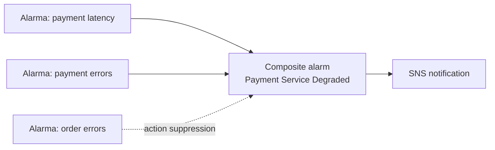

# Designing Observability Solutions

> [!abstract] Qué es este archivo
> Primera lección **de observabilidad pura** del módulo (el título del curso, por fin, coincide con el contenido).
> Las anteriores usaron **alarmas de CloudWatch** y **reglas de Config** como **controles detective**; esta sube
> un nivel: **cómo diseñar la arquitectura de monitoreo** para que el equipo pueda responder **dónde, por qué y
> cómo** cuando algo se comporta raro.
>
> Cubre los **tres pilares** (métricas, logs, trazas), **métricas estándar y custom** de CloudWatch, el
> **embedded metric format**, **Logs Insights**, **anomaly detection**, **composite alarms** y el **ciclo cerrado
> monitoreo → acción**.

> [!quote] La idea que hay que retener
> **Observar no es recolectar: es poder responder.**
> La lección lo plantea como pregunta: *“cuando algo en tu arquitectura se comporta de forma inesperada, ¿puede tu
> equipo identificar rápido **dónde, por qué y cómo responder**?”*. Los tres pilares existen porque **ninguno
> solo alcanza**.

---

## Resumen en una frase

> Una arquitectura observable **combina métricas, logs y trazas** para **detectar** (métricas), **explicar**
> (logs) y **localizar** (trazas), y **cierra el ciclo** con **alarmas que disparan acciones** automáticas y una
> **alarma de seguimiento** que confirma la recuperación.

---

## 1. Los tres pilares

| Pilar | Qué es | Pregunta que responde | Herramienta AWS |
| --- | --- | --- | --- |
| **Metrics** | **Mediciones numéricas** recolectadas a **intervalos regulares** | **“¿Cuánto?”** y **“¿qué tan rápido?”** | **Amazon CloudWatch** |
| **Logs** | **Registros con timestamp** de **eventos discretos** | **“¿Qué pasó?”** | **CloudWatch Logs** + **Logs Insights** |
| **Traces** | **Recorrido de un request** a través de **múltiples servicios** | **“¿Dónde se fue el tiempo?”** | **AWS X-Ray** |

**Ejemplos de cada uno:**

| Pilar | Ejemplos literales |
| --- | --- |
| **Metrics** | **CPU utilization**, **request count**, **error rate**, **latency percentiles** |
| **Logs** | **Mensajes de error** de aplicación, **registros de API calls**, **cambios de estado de conexión** |
| **Traces** | **API Gateway → Lambda → DynamoDB** y **cualquier llamada downstream** |

> [!important] La división de trabajo
> **Métricas** detectan **tendencias** y **disparan respuestas automáticas**; son **livianas de guardar** y
> **rápidas de consultar**, pero **no explican por qué**. **Logs** dan el **detalle para diagnosticar la causa
> raíz**, pero son **verbosos** y necesitan **herramientas de consulta**. **Trazas** muestran **la contribución de
> latencia de cada servicio**, o sea **dónde** está el problema.

> [!tip] Cómo se pregunta en el examen
> **“Detectar un umbral”** → métricas · **“entender el error exacto”** → logs · **“saber qué servicio demora”** →
> trazas. Si la opción ofrece **una sola** fuente para un problema que pide **causa raíz**, es **distractor**.

---

## 2. CloudWatch metrics

### 2.1 Dos categorías

| Categoría | Origen | Configuración | Resolución |
| --- | --- | --- | --- |
| **Standard metrics** | **Automáticas** de los servicios AWS | **Ninguna** | **1 o 5 minutos**, según el servicio |
| **Custom metrics** | **Mediciones propias** de la aplicación | **PutMetricData**, **CloudWatch agent** o **embedded metric format** | Hasta **1 segundo** para workloads sensibles al tiempo |

**Ejemplos de standard metrics:**

| Servicio | Métricas que publica |
| --- | --- |
| **Amazon EC2** | **CPU**, **network**, **disk** |
| **Application Load Balancer** | **Request count**, **latency**, **HTTP error codes** |

> [!important] “Standard” no significa “suficiente”
> Las estándar cubren **infraestructura**, pero **no** el **significado de negocio** (carritos abandonados,
> pedidos fallidos, latencia de una operación propia). Para eso están las **custom**, y publicarlas **cuesta**
> (por métrica y por resolución).

### 2.2 Embedded metric format (EMF)

**Qué es:** un formato que permite **generar custom metrics de forma asíncrona** **en forma de logs** escritos a
**CloudWatch Logs**.

| Paso | Qué pasa |
| --- | --- |
| **1. La aplicación emite JSON estructurado** | Escribe un **objeto JSON** con **valores de métricas** junto con **contexto de log**. Puede hacerlo una **función Lambda**, una **task de ECS** o una **aplicación EC2 con el CloudWatch agent** |
| **2. CloudWatch extrae las métricas automáticamente** | **CloudWatch Logs reconoce** el formato y **extrae los valores numéricos como métricas**. **No hace falta** una llamada aparte a **PutMetricData**; de **una sola salida** se obtienen **el log estructurado y la métrica** |
| **3. Las métricas aparecen en los dashboards** | Las métricas extraídas quedan disponibles para **alarmas**, **dashboards** y **anomaly detection**; soportan **dimensions**, **units** y **high-resolution reporting** |

**Por qué importa (literal):** *“el embedded metric format **elimina la necesidad de mantener dos caminos de
telemetría separados**. Tu aplicación emite **una línea de log estructurada** y obtiene **logs buscables y métricas
visualizables**.”*

> [!warning] EMF no es “gratis”
> La fuente dice que **elimina el doble camino**, no que **elimine el costo**. Las **custom metrics** que se
> extraen **se facturan como tales**, y el **log** también **se almacena y se factura**. La ventaja es
> **operativa** (una sola emisión) y de **consistencia**, no de precio cero.

---

## 3. CloudWatch Logs Insights

**Qué es:** un **servicio de consulta interactivo** para datos de **CloudWatch Logs**.

| Característica | Detalle |
| --- | --- |
| **Lenguaje** | **Query language purpose-built** |
| **Capacidades** | **Filtering**, **aggregation** y **pattern matching** sobre **millones de entradas** |
| **Índices/schema** | **No** hay que predefinirlos |
| **Logs JSON** | **Descubre campos automáticamente** y los hace consultables |
| **Logs no estructurados** | **Parsea patrones comunes** y ofrece **sintaxis de extracción basada en glob** |

### 3.1 Patrones de consulta comunes

1. **Filtrar por error level y ventana de tiempo** para **aislar fallas durante un incidente**.
2. **Agregar request counts por status code** para **identificar picos de error rate**.
3. **Extraer latency percentiles agrupados por operación de API** para **encontrar endpoints lentos**.
4. **Correlacionar entradas de log entre múltiples log groups** para **trazar el camino de un request**.

### 3.2 Costo y automatización

| Aspecto | Detalle |
| --- | --- |
| **Alcance del escaneo** | **Solo** los **log groups** y **rangos de tiempo** que se especifican |
| **Costo** | **Escala con el volumen de datos escaneado** |
| **Consultas frecuentes** | Se pueden **guardar** y **programar como Contributor Insights rules** para **monitoreo continuo** |

> [!important] “Sin índices” no es “sin costo”
> La ventaja es **no administrar índices ni schema**. El **costo** sigue dependiendo de **cuántos GB se escanean**:
> una consulta sobre **30 días** de un log group enorme **cuesta más** que la misma sobre **1 hora**. Acotar
> **tiempo** y **log group** es la palanca.

---

## 4. Anomaly detection

**Qué hace:** aplica **machine learning** a los datos de métricas.

| Aspecto | Detalle |
| --- | --- |
| **Modelo** | Construye un modelo del **comportamiento esperado** analizando **hasta dos semanas** de patrones históricos |
| **Datos incompletos** | Se puede **habilitar aunque la métrica no tenga dos semanas completas** |
| **Estacionalidad** | El modelo contempla **hourly**, **daily** y **weekly** |
| **Umbral** | Genera una **banda de umbral dinámica** alrededor del valor esperado |
| **Anomalía** | Si el valor real **sale de la banda**, CloudWatch lo trata como **anomalía** |
| **Acción** | Se **adjunta a una alarma** para **notificaciones automáticas** o **remediación** |

**Cuándo brilla:** métricas con **patrones predecibles que varían por hora del día**. El ejemplo literal: una
aplicación web con **más tráfico en horario laboral** tiene un **“normal” distinto a las 3 AM y a las 3 PM**; los
**umbrales estáticos no capturan esa variación** y la detección **se ajusta sola**.

> [!warning] La trampa del “modelo mágico”
> La detección de anomalías **no adivina intención**: aprende **patrones**. Una métrica **errática sin
> estacionalidad** (o un cambio de comportamiento **permanente**, como un rediseño) puede generar **ruido** hasta
> que el modelo se reentrena. Para series **planas y conocidas**, un **umbral estático** sigue siendo **más simple
> y barato**.

> [!note] Ampliación (no está en la fuente)
> La **banda** se calcula con un **anomaly detection band** (modelo estadístico) y se configura como **threshold
> de la alarma**. La fuente describe el efecto pero **no** el detalle de configuración.

---

## 5. Composite alarms

**Qué hace:** evalúa **los estados de múltiples child alarms** con **lógica booleana** (**AND**, **OR**, **NOT**)
y **dispara solo** cuando se cumple **una combinación específica** de condiciones.

### 5.1 El problema que resuelve

En una **arquitectura de microservicios**, **una falla upstream se propaga** y genera **decenas de alarmas
individuales**. Ejemplo literal:

> Si **payment service** se cae, **order service**, **notification service** y **reporting service** **generan
> alarmas de error**. Sin composite alarms, **el on-call recibe una inundación de notificaciones** y tiene que
> **identificar manualmente la causa raíz**.

### 5.2 La solución

**Definición de la alarma compuesta:**

> **“Disparar solo cuando la alarma de latencia de payment AND la alarma de error rate de payment estén ambas en
> ALARM.”**

**Supresión de acciones:** las alarmas de los **servicios downstream** pueden usar **action suppression** para
**pausar notificaciones** cuando la **composite alarm upstream está activa**. Eso **evita alertas redundantes** por
**fallas en cascada**.

**La figura:** tres alarmas individuales (**payment latency**, **payment errors**, **order errors**) alimentan una
**composite alarm** llamada **“Payment Service Degraded”**; la compuesta dispara una **notificación SNS**; la alarma
**order errors** usa la compuesta como **suppressor**, que **pausa sus notificaciones** mientras el problema de
payment está activo.

> [!important] No es solo “agrupar”
> Una composite alarm **no** es un **dashboard de alarmas**: aplica **lógica booleana** y **decide** si el
> **estado compuesto** es ALARM. Además habilita la **supresión**, que es lo que **realmente baja el ruido**.

---

## 6. Conectar monitoreo con acción

**Premisa:** la arquitectura de monitoreo **no termina en la recolección**. El valor está en **conectar
observaciones con respuestas automáticas**.

**Destinos de las acciones de una alarma:**

- **SNS topics**
- **Funciones Lambda**
- **Runbooks de Systems Manager Automation**

### 6.1 El ciclo cerrado

| Paso | Qué ocurre |
| --- | --- |
| **1** | La **métrica cruza el umbral** |
| **2** | **La alarma dispara** |
| **3** | La **notificación SNS** dispara una **función Lambda** o un **runbook de SSM** |
| **4** | Se ejecuta **remediación automatizada**: **scale out**, **restart service**, **isolate resource** |
| **5** | Una **alarma de seguimiento** **confirma la recuperación** |

**Beneficio:** **reduce el mean time to recovery (MTTR)**. El equipo investiga **fallas complejas** mientras los
**problemas rutinarios se resuelven solos**.

> [!tip] El paso que se olvida
> Muchos diseños automatizan la **remediación** pero **no** la **verificación**. La **alarma de seguimiento** es
> la que cierra el ciclo: sin ella, el sistema “hizo algo” y **nadie sabe si funcionó**.

---

## 7. Key takeaways (literales)

1. **Metrics, logs y traces dan vistas complementarias.** Diseñá tu stack de observabilidad para **recolectar los
   tres**.
2. Usá el **embedded metric format** para **publicar métricas y logs desde una sola salida estructurada**.
3. Usá **CloudWatch Logs Insights** para **investigación on-demand** **sin dashboards ni índices preconfigurados**.
4. Usá **anomaly detection** para **métricas con patrones estacionales predecibles** donde los **umbrales
   estáticos no alcanzan**.
5. Usá **composite alarms** para **reducir el ruido de alertas** y **exponer la causa raíz real** en arquitecturas
   de microservicios.

> [!note] La lección no trae Knowledge Check
> A diferencia de las anteriores, **no hay self-check** ni rationale. Se transcriben los **cinco key takeaways**
> como cierre oficial.

### 7.1 Repaso propio (no está en la fuente)

> [!note] Ampliación (no está en la fuente)
> Cinco preguntas para verificar que la lección quedó:

| # | Pregunta | Respuesta |
| --- | --- | --- |
| **1** | ¿Qué pilar responde **“por qué”** y cuál **“dónde se fue el tiempo”**? | **Logs** el **por qué**; **trazas** el **dónde** |
| **2** | ¿Qué formato permite obtener **log + métrica** de **una sola línea**? | **Embedded metric format (EMF)** |
| **3** | ¿Logs Insights necesita **crear índices**? | **No**; descubre campos **automáticamente** |
| **4** | ¿Cuánta historia usa **anomaly detection** y qué pasa si no la hay? | Hasta **dos semanas**; se puede **habilitar igual** |
| **5** | ¿Qué dos cosas aporta una **composite alarm**? | **Lógica booleana** entre child alarms y **supresión** de ruido |

---

## 8. Traducción del contenido

### 8.1 Los tres pilares de la observabilidad

En módulos anteriores usaste **alarmas de CloudWatch** para **seguir umbrales de costo** y **reglas de Config**
para **detectar desvíos de compliance**. Esos son **controles detective**. La **observabilidad va más allá**.
Responde la pregunta: **cuando algo en tu arquitectura se comporta de forma inesperada, ¿puede tu equipo
identificar rápido dónde, por qué y cómo responder?** Esta lección cubre **cómo diseñar arquitecturas de monitoreo**
que le den a tu equipo de operaciones **esa capacidad**.

La **observabilidad efectiva** combina **tres tipos de datos**. Cada uno da **una lente distinta** sobre el
comportamiento del sistema, y **ningún tipo solo alcanza**.

**Metrics**

Las **métricas** son **mediciones numéricas** recolectadas a **intervalos regulares**. Responden preguntas de
**“cuánto”** y **“qué tan rápido”**. **CPU utilization**, **request count**, **error rate** y **latency
percentiles** son todas métricas. **CloudWatch** recolecta **métricas de infraestructura automáticamente** y
acepta **métricas custom de aplicación** a través de la **API PutMetricData** o del **embedded metric format**.

Las métricas **sobresalen en detectar tendencias** y **disparar respuestas automatizadas**. Son **livianas de
almacenar** y **rápidas de consultar**. Sin embargo, **las métricas solas no pueden explicar por qué** un sistema
se comporta de cierta manera.

**Logs**

Los **logs** son **registros con timestamp de eventos discretos**. Responden preguntas de **“qué pasó”**. Los
**mensajes de error de aplicación**, los **registros de API calls** y los **cambios de estado de conexión** son
todas entradas de log. **CloudWatch Logs** almacena datos de log de **instancias EC2**, **funciones Lambda**,
**contenedores ECS** y otras fuentes en **log groups**.

Los logs **dan el detalle necesario para diagnosticar causas raíz**. Son **verbosos** y requieren
**herramientas de consulta** para **extraer significado a escala**. **CloudWatch Logs Insights** provee un
**lenguaje de consulta interactivo** para ese propósito.

**Traces**

Las **trazas** siguen **un solo request** mientras **viaja a través de múltiples servicios**. Responden preguntas
de **“dónde se fue el tiempo”**. Una traza captura **el camino completo** desde un **request de API Gateway** a
través de **Lambda**, **DynamoDB** y **cualquier llamada downstream**.

Las trazas **revelan las contribuciones de latencia de cada servicio** en una **arquitectura distribuida**.
**Identifican qué componente causa la lentitud**. **AWS X-Ray** recolecta y **visualiza** datos de traza. **La
próxima lección cubre tracing en detalle**.

### 8.2 CloudWatch metrics

**CloudWatch** recolecta **dos categorías de métricas**.

1. **Standard metrics** llegan **automáticamente de los servicios de AWS**. **EC2** publica métricas de **CPU,
   red y disco**. **Application Load Balancer** publica **request count, latencia y códigos de error HTTP**. Estas
   métricas **no requieren configuración**. Usan un **período de reporte de 1 o 5 minutos**, según el servicio.
2. **Custom metrics** capturan **mediciones específicas de la aplicación**. Las publicás a través de la **API
   PutMetricData**, del **CloudWatch agent** o del **embedded metric format**. Las métricas custom pueden
   reportar a **resolución de un segundo** para **workloads sensibles al tiempo**.

El **embedded metric format** de CloudWatch permite **generar métricas custom de forma asíncrona** en forma de
**logs escritos a CloudWatch Logs**.

**1: La aplicación emite JSON estructurado**

Tu aplicación escribe un **objeto JSON** que incluye **valores de métricas** junto con **contexto de log**. Una
**función Lambda**, una **task de ECS** o una **aplicación EC2 que usa el CloudWatch agent** pueden emitir este
formato.

**2: CloudWatch extrae las métricas automáticamente**

**CloudWatch Logs** reconoce el **embedded metric format** y **extrae los valores numéricos como métricas**. **No
se necesita una llamada separada a la API PutMetricData**. Obtenés **tanto la entrada de log estructurada como la
métrica publicable** de **una sola salida**.

**3: Las métricas aparecen en los dashboards de CloudWatch**

Las métricas extraídas están disponibles para **alarmas, dashboards y anomaly detection**. Soportan
**dimensions**, **units** y **high-resolution reporting**.

**Por qué importan las embedded metrics:** el **embedded metric format elimina la necesidad de mantener dos
caminos de telemetría separados**. Tu aplicación emite **una línea de log estructurada** y obtiene **logs
buscables y métricas visualizables**.

### 8.3 CloudWatch Logs Insights

**CloudWatch Logs Insights** es un **servicio de consulta interactivo** para datos de **CloudWatch Logs**. Usa un
**lenguaje de consulta purpose-built** que soporta **filtering, aggregation y pattern matching** a través de
**millones de entradas de log**.

**No necesitás predefinir índices ni schema.** Logs Insights **descubre automáticamente los campos** en logs
estructurados como **JSON** y los hace **consultables**. Para **logs no estructurados**, **parsea patrones
comunes** y provee una **sintaxis de extracción basada en glob**.

**Patrones de consulta comunes:**

- **Filtrar por error level y ventana de tiempo** para **aislar fallas durante un incidente**.
- **Agregar request counts por status code** para **identificar picos de error rate**.
- **Extraer latency percentiles agrupados por operación de API** para **encontrar endpoints lentos**.
- **Correlacionar entradas de log entre múltiples log groups** para **trazar el camino de un request**.

Las consultas de **Logs Insights** **escanean solo los log groups y rangos de tiempo** que especificás. El
**costo escala con el volumen de datos escaneado**. Para **consultas que se ejecutan con frecuencia**, podés
**guardarlas** y **programarlas como reglas de Contributor Insights** para **monitoreo continuo**.

### 8.4 Anomaly detection

**CloudWatch anomaly detection** aplica **machine learning** a tus **datos de métricas**. Construye un **modelo
del comportamiento esperado** analizando **hasta dos semanas** de **patrones históricos de la métrica**. Podés
**habilitar anomaly detection aunque una métrica no tenga dos semanas completas de datos**. El modelo contempla
**estacionalidad horaria, diaria y semanal**.

Después de que **el modelo entrena**, anomaly detection genera una **banda de umbral dinámica** alrededor del
**valor esperado**. Si **el valor real de la métrica sale de la banda**, CloudWatch lo trata como **una anomalía**.
**Adjuntás anomaly detection a una alarma** para **recibir notificaciones automáticas** o **disparar remediación**.

Anomaly detection es **particularmente efectiva** para **métricas con patrones predecibles que varían según la
hora del día**. Una **aplicación web que recibe más tráfico en horario laboral** tiene un **“normal” distinto a
las 3 AM que a las 3 PM**. Los **umbrales estáticos no pueden capturar esa variación**. La **detección de
anomalías se ajusta automáticamente**.

### 8.5 Composite Alarms

Una **composite alarm** evalúa **los estados de múltiples child alarms** usando **lógica booleana** (**AND, OR,
NOT**). **Dispara solo cuando una combinación específica de condiciones es verdadera**.

**Por qué importan las composite alarms:** en una **arquitectura de microservicios**, **una sola falla upstream
se propaga** en **decenas de alarmas individuales**. Si **tu payment service se cae**, **order service**,
**notification service** y **reporting service** **generan alarmas de error**. **Sin composite alarms**, el
**ingeniero on-call recibe una inundación de notificaciones** y debe **identificar manualmente la causa raíz**.

Una **composite alarm** resuelve esto **definiendo**: **disparar esta alarma solo cuando la alarma de latencia de
payment AND la alarma de error rate de payment estén ambas en estado ALARM**. Las **alarmas de servicios
downstream** pueden usar **action suppression** para **pausar notificaciones** cuando la **composite alarm upstream
está activa**. Eso **evita que el on-call reciba alertas redundantes** por **fallas en cascada**.

> **Figura:** diagrama de una **arquitectura de composite alarm**. **Tres alarmas individuales** de CloudWatch
> —**payment latency**, **payment errors** y **order errors**— alimentan una **composite alarm** etiquetada
> **Payment Service Degraded**. La **composite alarm dispara una notificación SNS**. La **alarma order errors**
> usa la **composite alarm como suppressor**, lo que **pausa sus notificaciones** cuando **el problema de payment
> está activo**.

### 8.6 Conectar monitoreo con acción

Una **arquitectura de monitoreo no está completa en la recolección de datos**. El **valor** viene de **conectar
observaciones con respuestas automatizadas**. Las **alarmas de CloudWatch** disparan acciones a través de **SNS
topics**, **funciones Lambda** y **runbooks de Systems Manager Automation**.

En **módulos anteriores** aprendiste que **los runbooks de SSM Automation ejecutan remediación de múltiples
pasos**. En un **contexto de observabilidad**, el **flujo** es: **la métrica cruza el umbral → la alarma dispara
→ la notificación SNS dispara una función Lambda o un runbook de SSM → se ejecuta remediación automatizada (scale
out, restart service, isolate resource) → una alarma de seguimiento confirma la recuperación**.

Este **patrón de ciclo cerrado** **reduce el mean time to recovery**. El **equipo de operaciones investiga fallas
complejas** mientras **los problemas rutinarios se resuelven automáticamente**.

### 8.7 Key takeaways

Repasá los siguientes **puntos clave**:

- **Metrics, logs y traces** proveen **vistas complementarias**. Diseñá tu **stack de observabilidad** para
  **recolectar los tres**.
- Usá el **embedded metric format** para **publicar métricas y logs desde una sola salida estructurada**.
- Usá **CloudWatch Logs Insights** para **investigación on-demand** **sin dashboards ni índices preconfigurados**.
- Usá **anomaly detection** para **métricas con patrones estacionales predecibles** donde **los umbrales estáticos
  son insuficientes**.
- Usá **composite alarms** para **reducir el ruido de alertas** y **exponer la causa raíz real** en
  **arquitecturas de microservicios**.

---

## 9. Para el examen (SAP-C02)

> Esta sección es **interpretación propia**: cruza la lección con [[Guia AWS]].

**A qué tareas responde**

| Concepto | Tarea |
| --- | --- |
| **Diseño de observabilidad (3 pilares)** | **3.1** Excelencia operativa · **1.2 / 2.3** controles |
| **Métricas estándar/custom y EMF** | **3.1** · **1.5** visibilidad de costos (costo de métricas) |
| **Logs Insights** | **3.1** |
| **Anomaly detection** | **3.1** · **3.5** optimización (evitar falsos positivos) |
| **Composite alarms y supresión** | **3.1** · **2.3** |
| **Ciclo cerrado de remediación** | **3.1** · **1.2** |

> [!important] Lo que hay que retener
>
> 1. **Tres pilares**: **métricas** (cuánto/qué tan rápido), **logs** (qué pasó), **trazas** (dónde se fue el
>    tiempo).
> 2. **Standard metrics**: automáticas, **sin configuración**, período de **1 o 5 minutos**.
> 3. **Custom metrics**: **PutMetricData**, **CloudWatch agent** o **EMF**; hasta **1 segundo** de resolución.
> 4. **EMF**: **JSON estructurado** → CloudWatch **extrae métricas** → disponibles para **alarmas, dashboards y
>    anomalías**; **sin PutMetricData** aparte.
> 5. **Logs Insights**: **sin índices ni schema**; **JSON auto-descubierto**; **glob** para no estructurados.
> 6. **Costo de Logs Insights** = **volumen escaneado**; se acota por **log group** y **rango de tiempo**.
> 7. **Anomaly detection**: **ML**, **hasta 2 semanas**, **hourly/daily/weekly**, **banda dinámica**, se adjunta a
>    **alarma**.
> 8. **Composite alarms**: **AND/OR/NOT** sobre **child alarms**; **action suppression** para cascadas.
> 9. **Ciclo cerrado**: **métrica → alarma → SNS → Lambda/SSM → remediación → alarma de seguimiento**.
> 10. **MTTR**: la observabilidad bien diseñada **lo reduce** porque **automatiza lo rutinario**.

> [!warning] Trampas típicas
> Las que más se repiten en el examen.
>
> | Trampa | Por qué es falsa |
> | --- | --- |
> | “Las métricas explican la causa raíz” | **Detectan tendencias**; el detalle está en **logs** |
> | “Los logs son numéricos” | Son **eventos con timestamp**; las numéricas son **métricas** |
> | “Las trazas muestran CPU agregada” | Siguen **un request** y **la latencia por servicio** |
> | “Las standard metrics requieren agente” | **Llegan solas**; el agente es para **custom/OS** |
> | “EMF necesita llamar a PutMetricData” | **No**: CloudWatch **extrae** la métrica del **log** |
> | “Logs Insights exige índices” | **No** requiere **índices ni schema** |
> | “Anomaly detection necesita 2 semanas completas” | Se puede **habilitar sin** la historia completa |
> | “Un umbral estático cubre estacionalidad” | **No** captura el **3 AM vs. 3 PM** |
> | “Composite alarm solo agrupa notificaciones” | Evalúa **lógica booleana** y habilita **supresión** |
> | “La remediación automática cierra el ciclo” | Falta la **alarma de seguimiento** que **confirma** la recuperación |
> | “Observabilidad = tener logs” | Son **tres** pilares; **uno solo no alcanza** |

> [!note] Ampliación (no está en la fuente)
> Tres atajos:
> **“¿Por qué falló?”** → **logs** ·
> **“¿Dónde se demora?”** → **trazas** ·
> **“¿Demasiadas alarmas en cascada?”** → **composite alarm + suppression**.

---

## Relacionado

- [[AWS Solutions Architect Advanced - Implementing Observability and Management Controls]] *(índice del módulo)*
- [[Architecting for Cost - Databases]] — lección anterior: reservas, caché y global tables
- [[Detective Controls]] — Config, GuardDuty y Security Hub: los controles que **detectan**
- [[Cloud Governance Pillars]] — inventario y compliance de configuración
- [[Cost Optimization]] — el uso de **anomaly detection** desde el lado de costos
- [[3.1 Estrategia para mejorar la excelencia operativa general]] — la tarea que esta lección cubre
- [[1.2 Prescribir controles de seguridad]] · [[2.3 Determinar los controles de seguridad en función de los requisitos]]
- [[Guia AWS]] — pesos y tareas oficiales del SAP-C02

---

## Registro de integración

| Fecha | Qué llegó | Dónde se integró |
| --- | --- | --- |
| 26/10/2026 | Lección completa: 3 pilares, métricas/EMF, Logs Insights, anomaly detection, composite alarms y ciclo cerrado | Nota completa (secciones 1–9) |
| 27/10/2026 | Estandarización de formato: Traducción antes de Examen, Examen en callouts, Registro como anexo al final | Secciones 8–10 y cierre |

**Discrepancias y vacíos registrados (no corregidos):**

1. **La lección no trae Knowledge Check.** Termina en **cinco key takeaways**. No hay rationale oficial; el
   **repaso de §7.1 es propio** y está marcado como ampliación.
2. **“The next lesson covers tracing in detail”.** La fuente **anuncia una lección de trazas**. Si no llega,
   **X-Ray** queda solo presentado, sin el detalle prometido. Se registra como **expectativa pendiente**.
3. **Typo en la leyenda de la figura.** El texto dice **“iagram of a composite alarm architecture”** (falta la
   **d**). Se transcribe el contenido, no el typo.
4. **EMF y costo.** La fuente afirma que **elimina el doble camino de telemetría**, no que **elimine el costo**;
   se aclara en §2.2 para evitar la lectura de “métricas gratis”.
5. **“Up to two weeks” de historia.** La fuente dice **hasta dos semanas**, y a la vez que **se puede habilitar
   sin** la historia completa. Ambas frases conviven; se transcriben y se explican en §4.
6. **Contributor Insights.** La fuente dice que las consultas se pueden **programar como reglas de Contributor
   Insights**; se transcribe literal, sin agregar límites ni formato.
7. **Imágenes no disponibles.** La lectura referencia **una** captura (`ZGVJS561SY.png`) que **no está en el
   vault**.

**Decisiones de transcripción:**

- Se conservan **observability**, **metrics**, **logs**, **traces**, **embedded metric format**,
  **Logs Insights**, **anomaly detection**, **composite alarm**, **child alarm**, **action suppression**,
  **Contributor Insights**, **MTTR** y **runbook**.
- Los **números** se transcriben literales: **dos semanas**, **1 o 5 minutos**, **1 segundo**, **3 AM / 3 PM**,
  **AND/OR/NOT**.
- Los **nombres de servicios y APIs** se conservan exactos: **CloudWatch**, **PutMetricData**,
  **CloudWatch agent**, **X-Ray**, **SNS**, **Systems Manager Automation**.
- **No se agregaron** cuotas, precios ni métricas que la fuente no da.
