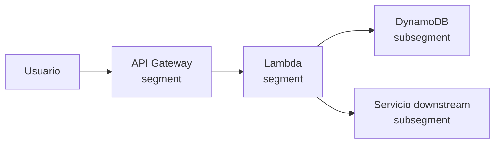

# Distributed Tracing for Microservices

> [!abstract] Qué es este archivo
> Segunda lección de **observabilidad** y la que profundiza el **tercer pilar**: las **trazas**. La anterior
> presentó el concepto; esta baja a **cómo se instrumenta** (**X-Ray SDK** vs. **ADOT**), **cómo se lee** el
> **trace map** y **cómo se controla el costo** con **sampling rules**.
>
> Cierra el módulo con la idea de que, en microservicios, **sin trazas localizar latencia o errores es
> adivinanza**.

> [!quote] La idea que hay que retener
> **Las métricas avisan que algo anda mal; los logs dicen qué pasó; las trazas dicen dónde.**
> La lección lo formula así: *“Metrics tell you something is wrong. Logs tell you what happened. Traces tell you
> **where time was spent** across services.”*

---

## Resumen en una frase

> Una traza es **el camino completo de un request** con **tiempos por servicio**; se instrumenta con **X-Ray SDK**
> (nativo AWS) o **ADOT** (estándar abierto), se investiga **del mapa al nodo, al histograma y a la traza**, y se
> abarata con **sampling rules** que mezclan **reservoir** y **fixed rate**.

---

## 1. Cómo funciona AWS X-Ray

### 1.1 El problema

En una **arquitectura de microservicios**, **un solo request de usuario puede atravesar decenas de servicios**.
Sin **tracing**, identificar **qué servicio introduce latencia o errores** requiere **adivinar**.

**Herramientas:** **AWS X-Ray** y **OpenTelemetry** proveen la **instrumentación** para **seguir requests a través
de límites de servicios**.

### 1.2 Qué recolecta X-Ray

| Concepto | Definición |
| --- | --- |
| **Qué recolecta** | **Datos sobre los requests** que sirve la aplicación |
| **Qué registra** | **El tiempo que tarda un request en cada servicio** por el que pasa |
| **Cómo lo guarda** | Como una **traza** |

### 1.3 Anatomía de una traza

**Una traza representa el camino end-to-end de un único request.**

| Elemento | Qué representa |
| --- | --- |
| **Segment** | **Uno por servicio** |
| **Subsegment** | **Uno por llamada downstream dentro de un servicio** |

**Cada segment registra:** **start time**, **end time** y **metadata** como **HTTP status codes** y **mensajes de
error**.

> [!important] Segment vs. subsegment
> El **segment** marca **la unidad de trabajo de un servicio** (cuánto tardó ese servicio en total). El
> **subsegment** desglosa **cada dependencia** dentro de ese servicio (la query, la llamada HTTP, el SDK). Sin
> subsegments, se sabe **qué servicio** está lento, pero **no qué parte** de él.

> [!note] Ampliación (no está en la fuente)
> En X-Ray, los **tres estados** de un nodo se corresponden con **error** (**4xx**), **fault** (**5xx**) y
> **throttle** (**429**). La lección solo los pinta como **amarillo (errors)** y **rojo (faults)**; el detalle de
> códigos **no está en la fuente**.

---

## 2. Opciones de instrumentación

Hay **dos caminos** para enviar datos de traza a X-Ray.

| Criterio | **X-Ray SDK** | **ADOT** (AWS Distro for OpenTelemetry) |
| --- | --- | --- |
| **Naturaleza** | Librería **AWS-native** | **Distribución de AWS** del proyecto **open-source OpenTelemetry** |
| **Lenguajes** | **Java, Python, Node.js, .NET, Go y Ruby** | **SDKs**, **agentes de auto-instrumentación** y **collectors** **testeados y soportados por AWS** |
| **Qué captura** | **Requests entrantes**, **llamadas HTTP salientes** y **llamadas al SDK de AWS** | **Trazas** de **frameworks y librerías comunes** |
| **Formato** | **Segment y subsegment propios de X-Ray** | **Formato vendor-neutral** de OpenTelemetry |
| **Integración con servicios** | **Lambda**, **API Gateway** y otros se habilitan **con un setting**, sin tocar código | **Agentes** se **adjuntan en runtime**, **sin cambios de código** |
| **Destinos** | **X-Ray** | **X-Ray**, **CloudWatch** o **plataformas third-party** |
| **Cuándo usarlo** | App **exclusivamente en AWS** y se busca **la integración más simple** | **Neutralidad de vendor**, **múltiples destinos** o **portabilidad** del estándar |

> [!important] La decisión en una frase
> **Todo AWS y lo más simple → X-Ray SDK.** **Multi-cloud, varios backends o estándar abierto → ADOT.**
> El **costo de cambiar de opinión** es mayor si se instrumentó con el SDK propietario.

> [!tip] “Instrumentar una vez”
> Con **OpenTelemetry** se instrumenta **una sola vez** y el **ADOT Collector** decide **a dónde exportar**. Eso
> permite **probar un backend nuevo** sin **re-instrumentar** la aplicación.

> [!note] Ampliación (no está en la fuente)
> La **auto-instrumentación** de ADOT depende del **lenguaje y del framework**: en algunos casos es **una variable
> de entorno o un agente**, y en otros requiere **un wrapper**. La fuente la presenta como **sin cambios de
> código**, que es el caso ideal, no una garantía universal.

---

## 3. X-Ray trace map

**Qué es:** una **representación visual de la arquitectura** de la aplicación **basada en datos reales de trazas**,
no en un diagrama estático.

| Elemento del mapa | Significado |
| --- | --- |
| **Nodo** | **Un servicio** |
| **Edge (arista)** | **Una llamada entre servicios** |

### 3.1 Qué muestra

| Dato | Cómo se ve |
| --- | --- |
| **Latency distribution** | **Cuánto tardan los requests en cada nodo** |
| **Error and fault rates** | **Indicadores de color**: **verde** = healthy, **amarillo** = errors, **rojo** = faults |
| **Request volume** | **Grosor de la arista** entre nodos |
| **Downstream dependencies** | **Servicios AWS** como **DynamoDB**, **S3** y **endpoints HTTP externos** |

> [!important] Por qué el mapa vale más que un diagrama
> Un diagrama de arquitectura dice **cómo debería ser**; el **trace map** dice **cómo se comporta**. Si una
> dependencia **no aparece** en el mapa, **no se está llamando** (o **no está instrumentada**), y eso ya es
> información.

---

## 4. Usar trazas para investigar

### 4.1 El flujo de investigación

| Paso | Qué se hace |
| --- | --- |
| **1. Mapa** | Ante un reporte de **lentitud**, el **trace map** muestra **qué servicio aporta más latencia** |
| **2. Nodo** | Se selecciona **el nodo lento** y se ve su **latencia histogram** para **entender la distribución** |
| **3. Historia** | **Pocos requests extremadamente lentos (P99 outliers)** cuentan **otra historia** que **respuestas uniformemente lentas** |
| **4. Traza** | Desde el mapa se **drillea a trazas individuales** y se examina **el camino completo del request** |

**En cada subsegment** se ve **exactamente dónde se fue el tiempo**: **esperando una query de base de datos**,
**llamando a un servicio downstream** o **ejecutando lógica de aplicación**.

**Lo que reemplaza:** este flujo **mapa → nodo → histograma → traza individual** sustituye el proceso **manual** de
**correlacionar timestamps entre archivos de log de servicios separados**.

> [!important] P99 no es promedio
> Un **promedio sano** puede esconder que **el 1 % peor** tarda **10 veces más**. La lección lo señala: **outliers
> P99** y **lentitud uniforme** son **diagnósticos distintos** y llevan a **acciones distintas**.

---

## 5. Sampling

**Por qué existe:** **trazar cada request genera volumen de datos y costo significativos**. El **sampling**
controla **cuántos requests se trazan**.

### 5.1 Los dos parámetros de una sampling rule

| Parámetro | Definición literal | Default |
| --- | --- | --- |
| **Reservoir** | **Cantidad fija de requests a trazar por segundo**; **garantiza un mínimo** de trazas **independientemente del volumen** de tráfico | **1 request por segundo** |
| **Fixed rate** | **Porcentaje de requests adicionales**, **por encima del reservoir**, que **también se trazan** | **5 %** |

> [!important] Cómo se combinan
> El **reservoir** es un **piso garantizado**; el **fixed rate** es un **porcentaje adicional**. En **poco
> tráfico**, manda el **reservoir**; en **mucho tráfico**, el **fixed rate** domina el volumen. Por eso el
> sampling **no colapsa** ni en un extremo ni en el otro.

### 5.2 Reglas y prioridades

- Se crean **múltiples sampling rules** con **distintas prioridades**.
- Las reglas pueden matchear por **service name**, **HTTP method**, **URL path** o **custom attributes**.
- **Endpoints críticos** (**payment processing**, **authentication**) pueden usar **una tasa más alta** que
  **health checks**.

### 5.3 Tasa alta vs. tasa baja

| | **Higher sampling rate** | **Lower sampling rate** |
| --- | --- | --- |
| **Ventajas** | **Imagen más completa** del comportamiento · mejor para **fallas intermitentes** que afectan a **un pequeño porcentaje** · **requerido para P99 preciso** | **Menor costo** · **overhead mínimo** · **suficiente** para **problemas sistémicos** que afectan a **muchos requests** |
| **Tradeoffs** | **Mayor costo de X-Ray** · **más datos** almacenados y procesados · **posible impacto de performance** por **overhead de instrumentación** en servicios de **alto throughput** | **Fallas intermitentes pueden no capturarse** · **percentiles de latencia menos precisos** con **menos puntos** · **errores raros pueden no observarse** |
| **Cuándo** | **Servicios críticos**, **payment paths**, **deployments nuevos** con **alta visibilidad** | **Endpoints de alto volumen y baja criticidad**: **health checks**, **static content**, **batch internos** |

> [!tip] La regla de asignación
> **Criticidad alta + volumen bajo → tasa alta.** **Criticidad baja + volumen alto → tasa baja.** El error es
> aplicar la **misma tasa a todo**: se paga de más en lo irrelevante y se queda corto en **lo que importa**.

---

## 6. Key takeaways (literales)

1. Una **traza sigue un único request** a través de **todos los servicios que toca**, **vinculando datos de
   timing** mediante un **trace ID compartido**.
2. Usá el **X-Ray SDK** para **la integración AWS-native más simple**. Usá **ADOT** para **instrumentación
   vendor-neutral** y **telemetría multi-destino**.
3. El **trace map** visualiza **dependencias entre servicios, latencia y error rates** **basado en datos reales de
   requests**, no en **diagramas estáticos de arquitectura**.
4. Configurá **sampling rules** para **balancear costo y necesidades de observabilidad**. Usá **tasas más altas**
   para **caminos críticos** y **más bajas** para **endpoints de alto volumen y bajo riesgo**.

> [!note] La lección no trae Knowledge Check
> Como la anterior, **cierra con key takeaways** y **no incluye self-check** ni rationale.

### 6.1 Repaso propio (no está en la fuente)

> [!note] Ampliación (no está en la fuente)
> Cinco preguntas de control:

| # | Pregunta | Respuesta |
| --- | --- | --- |
| **1** | ¿Qué diferencia hay entre **segment** y **subsegment**? | **Segment** = **servicio**; **subsegment** = **llamada downstream dentro** del servicio |
| **2** | ¿Cuándo elegir **ADOT** sobre el SDK? | Cuando se necesita **neutralidad de vendor**, **varios destinos** o **portabilidad** |
| **3** | ¿Qué muestra el **grosor de una arista**? | El **request volume** entre dos nodos |
| **4** | ¿Qué garantiza el **reservoir**? | Un **mínimo de trazas por segundo** (default **1**) |
| **5** | ¿Por qué una tasa baja **rompe** el P99? | Con **menos puntos**, los **percentiles** son **menos precisos** |

---

## 7. Para el examen (SAP-C02)

> Esta sección es **interpretación propia**: cruza la lección con [[Guia AWS]].

### 7.1 A qué tareas responde

| Concepto | Tarea |
| --- | --- |
| **Instrumentación de trazas (SDK vs. ADOT)** | **3.1** Excelencia operativa · **2.3** controles |
| **Trace map y diagnóstico de latencia** | **3.1** |
| **Sampling y costo** | **3.1** · **1.5** visibilidad de costos |
| **OpenTelemetry y portabilidad** | **3.1** |
| **Análisis de errores por servicio** | **3.1** · **1.2** |

### 7.2 Diez puntos para llevarse

1. **Traza** = **camino end-to-end** de **un request**, unida por un **trace ID**.
2. **Segment** por **servicio**; **subsegment** por **llamada downstream**; ambos con **start**, **end** y
   **metadata** (HTTP status, errores).
3. **X-Ray** registra **el tiempo por servicio** y lo **guarda como traza**.
4. **X-Ray SDK**: **Java, Python, Node.js, .NET, Go, Ruby**; captura **incoming**, **HTTP out** y **AWS SDK calls**.
5. **Lambda/API Gateway** habilitan trazas **con un setting**, no con código.
6. **ADOT** = **OpenTelemetry** con **SDKs, agentes y collectors** soportados por AWS; **exporta a X-Ray,
   CloudWatch o third-party**.
7. **Trace map**: **nodos** = servicios, **edges** = llamadas; **latencia**, **errores (amarillo)**,
   **faults (rojo)**, **volumen por grosor** y **dependencias downstream**.
8. **Investigación**: **mapa → nodo → histograma → traza**; **P99 outliers ≠ lentitud uniforme**.
9. **Sampling**: **reservoir** (default **1/s**) + **fixed rate** (default **5 %**); **reglas con prioridad** por
   **servicio, método, path o atributos**.
10. **Tasa alta** = **crítico/intermitente/P99**; **tasa baja** = **alto volumen y baja criticidad**.

### 7.3 Trampas típicas

| Trampa | Por qué es falsa |
| --- | --- |
| “Las trazas muestran métricas de CPU” | Muestran **el camino y los tiempos por servicio** |
| “Un segment es una llamada downstream” | Eso es un **subsegment**; el segment es **el servicio** |
| “X-Ray SDK es multi-cloud” | Es **AWS-native**; para neutralidad está **ADOT** |
| “ADOT solo exporta a X-Ray” | Exporta a **X-Ray, CloudWatch o third-party** |
| “El trace map es un diagrama de arquitectura” | Se construye con **datos reales de trazas** |
| “Amarillo = fault” | **Amarillo = error**; **rojo = fault** |
| “El reservoir es un porcentaje” | Es una **cantidad fija por segundo** |
| “El fixed rate reemplaza al reservoir” | Es **adicional, por encima** del reservoir |
| “Más sampling siempre es mejor” | **Sube costo y overhead**; el óptimo depende de **criticidad y volumen** |
| “P99 alto y promedio alto son lo mismo” | **Outliers** vs. **lentitud uniforme** llevan a **acciones distintas** |

> [!note] Ampliación (no está en la fuente)
> Tres atajos:
> **“¿Todo AWS y rápido?”** → **X-Ray SDK** ·
> **“¿Varios backends o portabilidad?”** → **ADOT** ·
> **“¿Bajar costo de trazas?”** → **sampling rules** (bajar **fixed rate**, no el **reservoir** de los paths
> críticos).

---

## 8. Traducción del contenido

### 8.1 Cómo funciona AWS X-Ray

La lección anterior cubrió **métricas, logs y el concepto de trazas**. Las **métricas** te dicen que **algo está
mal**. Los **logs** te dicen **qué pasó**. Las **trazas** te dicen **dónde se gastó el tiempo** a través de los
servicios. En una **arquitectura de microservicios**, **un solo request de usuario puede viajar por decenas de
servicios**. **Sin tracing**, identificar **qué servicio introduce latencia o errores** requiere **adivinar**.
**AWS X-Ray** y **OpenTelemetry** proveen **la instrumentación** para **seguir requests a través de los límites
de servicios**.

**AWS X-Ray** recolecta **datos sobre los requests que sirve tu aplicación**. **Registra el tiempo que tarda un
request en cada servicio** por el que pasa y **guarda estos datos como una traza**.

Una **traza** representa **el camino end-to-end de un único request**. Contiene **segments** (**uno por
servicio**) y **subsegments** (**uno por cada llamada downstream dentro de un servicio**). Cada **segment**
registra **hora de inicio, hora de fin y metadata** como **códigos de estado HTTP y mensajes de error**.

### 8.2 Opciones de instrumentación

Tenés **dos enfoques** para **instrumentar tu aplicación** y **enviar datos de traza a X-Ray**.

**X-Ray SDK**

El **X-Ray SDK** es una **librería AWS-native** disponible para **Java, Python, Node.js, .NET, Go y Ruby**. Agregás
el **SDK** al **código de tu aplicación** y **automáticamente captura requests entrantes, llamadas HTTP salientes
y llamadas al SDK de AWS**.

El **X-Ray SDK** se **integra directamente con servicios de AWS**. Las **funciones Lambda**, **API Gateway** y
otros servicios pueden **habilitar X-Ray tracing con un setting de configuración** en lugar de **cambios de
código**. El SDK usa **formatos de segment y subsegment específicos de X-Ray**.

Usá el **X-Ray SDK** cuando tu aplicación **corre exclusivamente en AWS** y necesitás **el camino de integración
más simple** con los servicios de AWS.

**AWS Distro for OpenTelemetry (ADOT)**

**ADOT** es la **distribución de AWS** del **proyecto open-source OpenTelemetry**. Provee **SDKs, agentes de
auto-instrumentación y collectors** **testeados y soportados por AWS**.

**OpenTelemetry** usa un **formato de datos vendor-neutral**. **Instrumentás tu aplicación una vez**, y el **ADOT
Collector** puede **exportar datos de traza a X-Ray, Amazon CloudWatch o plataformas de observabilidad
third-party**. Esta **flexibilidad** es valiosa cuando los equipos **usan múltiples herramientas de monitoreo** o
**planean cambiar de backend en el futuro**.

Los **agentes de auto-instrumentación de ADOT** se **adjuntan a tu aplicación en runtime** **sin cambios de
código**. Capturan **datos de traza de frameworks y librerías comunes** automáticamente.

Usá **ADOT** cuando necesitás **instrumentación vendor-neutral**, querés **enviar telemetría a múltiples
destinos** o preferís **el estándar OpenTelemetry por portabilidad**.

### 8.3 X-Ray trace map

El **trace map** de X-Ray provee una **representación visual de la arquitectura** de tu aplicación **basada en
datos reales de trazas**. Cada **nodo** del mapa representa **un servicio**. Las **aristas** entre nodos
representan **llamadas entre servicios**.

> **Figura:** nodos del **trace map** en la consola de X-Ray con **client node**, **ECS Container node** y
> **nodos de tablas DynamoDB**.

El mapa muestra:

- **Latency distribution** por servicio, **cuánto tardan los requests en cada nodo**.
- **Error and fault rates** como **indicadores de color** en cada nodo (**verde = healthy**, **amarillo = errors**,
  **rojo = faults**).
- **Request volume** reflejado en el **grosor de las aristas**.
- **Downstream dependencies**, incluidos **servicios AWS como DynamoDB, S3** y **endpoints HTTP externos**.

> **Figura:** pestaña **Metrics** mostrando **latency, requests y faults**.

### 8.4 Usar trazas para investigar

Cuando un **usuario reporta lentitud**, el **trace map** te muestra **qué servicio contribuye más latencia**.
Seleccionás **el nodo lento** y ves su **latencia histogram** para **entender la distribución**. **Pocos requests
extremadamente lentos (P99 outliers)** cuentan **una historia distinta** que **respuestas uniformemente lentas**.

Desde el **trace map** **drilleás a trazas individuales** para **examinar el camino completo del request**. Cada
**subsegment** muestra **exactamente dónde se gastó el tiempo**: **esperando una query de base de datos**,
**llamando a un servicio downstream** o **ejecutando lógica de aplicación**.

Este **flujo de investigación** **de mapa a nodo, a histograma y a traza individual** **reemplaza el proceso
manual** de **correlacionar timestamps entre archivos de log separados de servicios separados**.

**Trace Sampling**

**Trazar cada request genera un volumen de datos y un costo significativos.** El **sampling** controla **cuántos
requests se trazan**.

Las **sampling rules** de X-Ray definen **dos parámetros**:

- **Reservoir:** una **cantidad fija de requests a trazar por segundo**. **Garantiza un mínimo** de trazas
  **independientemente del volumen de tráfico**. El **reservoir default es un request por segundo**.
- **Fixed rate:** un **porcentaje de requests adicionales**, **más allá del reservoir**, que **también se trazan**.
  El **fixed rate default es cinco por ciento**.

Creás **múltiples sampling rules** con **distintas prioridades**. Las reglas pueden **matchear por nombre de
servicio, método HTTP, URL path o atributos custom**. Los **endpoints críticos** (**payment processing**,
**authentication**) pueden usar **una tasa de sampling más alta** que **los endpoints de health check**.

Elegí cada pestaña para **comparar los tradeoffs** entre **tasas de sampling más altas y más bajas**.

**Higher sampling rate**

**Ventajas:** **imagen más completa del comportamiento del sistema**. Mejor para **diagnosticar problemas
intermitentes** que afectan a **un pequeño porcentaje de requests**. **Requerido para mediciones de latencia P99
precisas**.

**Tradeoffs:** **mayores costos de X-Ray**. **Más datos almacenados y procesados**. **Posible impacto de
performance** por **overhead de instrumentación adicional** en **servicios de alto throughput**.

**Cuándo usarla:** **servicios críticos**, **payment paths**, **deployments nuevos** donde **necesitás alta
visibilidad**.

**Lower sampling rate**

**Ventajas:** **menor costo**. **Overhead de performance mínimo**. **Suficiente para identificar problemas
sistémicos** que afectan a **muchos requests**.

**Tradeoffs:** **las fallas intermitentes pueden no capturarse**. **Los percentiles de latencia son menos
precisos** con **menos puntos de datos**. **Condiciones de error raras pueden quedar sin observar**.

**Cuándo usarla:** **endpoints de alto volumen y baja criticidad**, como **health checks**, **contenido estático**
o **procesos batch internos**.

### 8.5 Key takeaways

Repasá los **puntos clave**:

- Una **traza sigue un único request** a través de **todos los servicios que toca**, **vinculando datos de timing
  mediante un trace ID compartido**.
- Usá el **X-Ray SDK** para **la integración AWS-native más simple**. Usá **ADOT** para **instrumentación
  vendor-neutral** y **telemetría multi-destino**.
- El **trace map visualiza dependencias entre servicios, latencia y error rates** **basado en datos reales de
  requests** en lugar de **diagramas estáticos de arquitectura**.
- Configurá **sampling rules** para **balancear costo contra necesidades de observabilidad**. Usá **tasas más
  altas** para **caminos críticos** y **más bajas** para **endpoints de alto volumen y bajo riesgo**.

---

## 9. Registro de integración

| Fecha | Qué llegó | Dónde se integró |
| --- | --- | --- |
| 26/10/2026 | Lección completa: X-Ray, SDK vs. ADOT, trace map, investigación y sampling | Nota completa (secciones 1–8) |

**Discrepancias y vacíos registrados (no corregidos):**

1. **La lección no trae Knowledge Check.** Cierra con **cuatro key takeaways**; no hay rationale oficial. El
   **repaso de §6.1 es propio** y está marcado como ampliación.
2. **“Segments (one per service)”.** Es una **simplificación**: un segment corresponde a **un recurso de cómputo
   o servicio instrumentado**; un **servicio puede tener varios segments** en el tiempo. Se transcribe literal.
3. **Amarillo/rojo sin definición.** La fuente dice **amarillo = errors** y **rojo = faults**, pero **no define**
   qué códigos son cada uno. Se agrega la equivalencia **4xx/5xx/429** como **ampliación** en §1.3, no como
   fuente.
4. **ADOT “sin cambios de código”.** Se transcribe literal, pero la **auto-instrumentación depende del lenguaje y
   framework** y puede requerir wrapper o variable de entorno. Se aclara en §2.
5. **Defaults de sampling.** La fuente da **reservoir = 1/s** y **fixed rate = 5 %**; se transcriben como
   **defaults**, no como valores fijos de una regla nueva.
6. **“Required for accurate P99”.** Es una afirmación **fuerte** de la fuente: sin sampling suficiente, el P99
   **pierde precisión**. Se registra como criterio de diseño, no como garantía matemática.
7. **Imágenes no disponibles.** La lectura referencia **dos** capturas (`5U8SV1HJ9E.png`, `WS8F4HS3Z5.png`) que
   **no están en el vault**.

**Decisiones de transcripción:**

- Se conservan **trace**, **segment**, **subsegment**, **trace map**, **sampling**, **reservoir**,
  **fixed rate**, **P99 outliers**, **vendor-neutral** y **auto-instrumentation**.
- Los **números** se transcriben literales: **1 request por segundo**, **5 %**, **P99**, **4xx/5xx** solo en la
  ampliación marcada.
- Los **lenguajes del SDK** se listan completos: **Java, Python, Node.js, .NET, Go y Ruby**.
- Los **destinos de ADOT** se conservan exactos: **X-Ray**, **CloudWatch**, **third-party**.
- **No se agregaron** cuotas, precios ni tasas que la fuente no da.

---

## 🔗 Relacionado

- [[AWS Solutions Architect Advanced - Implementing Observability and Management Controls]] — índice del módulo
- [[Designing Observability Solutions]] — los tres pilares, EMF, Logs Insights y composite alarms
- [[Detective Controls]] — Config, GuardDuty y Security Hub
- [[3.1 Estrategia para mejorar la excelencia operativa general]] — la tarea que este bloque cubre
- [[1.2 Prescribir controles de seguridad]] · [[2.3 Determinar los controles de seguridad en función de los requisitos]]
- [[Guia AWS]] — pesos y tareas oficiales del SAP-C02
