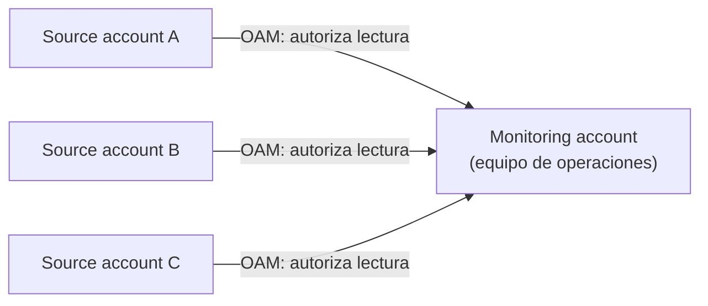

# Multi-Account Observability

> [!abstract] Qué es este archivo
> Cuarta lección del bloque de observabilidad y la que responde **dónde se mira todo junto**. Las tres anteriores
> resolvían **qué** medir (pilares), **cómo** seguir un request (trazas) y **cómo** comprometer confiabilidad
> (SLOs); esta resuelve **el problema de la escala organizacional**: decenas de cuentas, cada una con sus propias
> métricas, logs y trazas.
>
> Cubre **CloudWatch cross-account observability** (monitoring account + source accounts vía **OAM**), la
> **agregación de logs** (subscription filters en streaming vs. export a S3 en batch), **Container Insights** con
> sus **tres niveles** de granularidad y **cuatro decisiones de diseño** para entornos grandes.

> [!quote] La idea que hay que retener
> **Sin estrategia centralizada, el equipo pierde el incidente cambiando de consola.**
> La lección lo abre así: *“Without a centralized strategy, an operations team navigating dozens of accounts during
> an incident **loses time switching between consoles and correlating data manually**.”*

---

## Resumen en una frase

> **Una cuenta de monitoreo** lee métricas, logs y trazas de hasta **100.000 cuentas fuente** vía **OAM**; los
> **subscription filters** mueven logs en **near real time** a **Kinesis/Lambda** para operación y los **export
> tasks a S3** los guardan para **compliance**; **Container Insights** agrega a nivel **cluster, servicio y
> task/contenedor**.

---

## 1. CloudWatch cross-account observability

### 1.1 El problema que resuelve

En un entorno **multi-cuenta**, **cada workload account genera sus propias métricas, logs y trazas**. Sin una
**estrategia centralizada**, el equipo de operaciones que navega **decenas de cuentas** durante un incidente
**pierde tiempo cambiando de consola** y **correlacionando datos a mano**.

**Qué habilita:** **agregar** datos de observabilidad entre cuentas para **investigar desde un solo lugar**.

### 1.2 Los dos roles de cuenta

| Rol | Qué es | Qué puede hacer |
| --- | --- | --- |
| **Monitoring account** | **La cuenta central** donde trabaja el equipo de operaciones | **Consultar y visualizar** métricas, logs y trazas de **todas las source accounts vinculadas** **como si pertenecieran a la propia monitoring account** |
| **Source accounts** | Las **cuentas de workload individuales** que **generan** los datos | **Autorizan** a la monitoring account a **leer sus datos** a través de **Observability Access Manager (OAM)** |

> [!important] La dirección del permiso
> **La source account autoriza; la monitoring account consulta.** No es un “pull” unilateral de la cuenta central:
> cada cuenta de workload **decide** exponer sus datos. Eso es lo que hace la solución compatible con
> **separación de cuentas por equipo, ambiente o unidad de negocio**.

### 1.3 Límites (literales)

| Límite | Valor |
| --- | --- |
| **Monitoring accounts a las que se puede vincular una source account** | **Hasta 5** |
| **Source accounts que puede vincular una monitoring account** | **Hasta 100.000** |

> [!important] Por qué el 5 existe
> El límite bajo del lado de la **source** permite que **una misma cuenta de workload** sea observada por **varios
> equipos** (por ejemplo, operaciones central, seguridad y el equipo dueño del servicio) **sin duplicar datos**.
> El límite alto del lado de la **monitoring** es lo que hace viable una **Organization grande** en una sola
> consola.

> [!note] Ampliación (no está en la fuente)
> El acceso es de **lectura**: la monitoring account **consulta y visualiza**, no **modifica** los datos de la
> source account. La lección dice “query and visualize”; no describe operaciones de escritura.

---

## 2. Agregación de logs entre cuentas

**Aclaración de alcance:** cross-account observability cubre **consulta en tiempo real** entre cuentas. Para
**retención de largo plazo y archivo**, el mecanismo es otro: los **subscription filters**.

### 2.1 Qué es un subscription filter

| Aspecto | Detalle |
| --- | --- |
| **Dónde se adjunta** | A un **log group** de **CloudWatch Logs** |
| **Qué hace** | **Entrega los log events que matchean** a un **destination** en **near real time** |
| **Destinos** | **Kinesis Data Stream**, **Kinesis Data Firehose** o **función Lambda** |
| **Formato de entrega** | Los eventos van **Base64-encoded** y **comprimidos** antes de la entrega |

> [!important] Tres destinos, tres patrones
> **Kinesis Data Stream** = **buffer propio** con consumidores a medida. **Firehose** = **entrega gestionada** a
> un destino final. **Lambda** = **procesamiento evento por evento**. Elegir mal acá define **cuánto código**
> hay que escribir después.

### 2.2 Real-Time Streaming vs. Batch Archival

#### Real-Time Streaming

**Cómo funciona:** los subscription filters **streamean** los log events a un **Kinesis Data Stream centralizado**
**a medida que llegan**. Una **aplicación consumidora** en la **central logging account** **lee del stream**,
**parsea los eventos** y los **escribe en un destino** como **Amazon OpenSearch Service** o **Amazon S3**.

**Cuándo usarlo:**

| Necesidad | Por qué encaja |
| --- | --- |
| **Actuar sobre los eventos de inmediato** | **Security alerts**, **fraud detection** |
| **Alimentar un SIEM centralizado** | El stream es el punto de ingesta único |
| **Construir un pipeline de analítica en tiempo real** | Los datos están disponibles al llegar |

#### Batch Archival

**Cómo funciona:** **CloudWatch Logs exporta** los datos a **Amazon S3** **en forma programada**. Se configura un
**export task** que especifica **un log group**, **un rango de tiempo** y **un bucket S3 de destino**.

**Para qué sirve:** **almacenamiento de largo plazo**, **archivo por compliance** y **análisis con Amazon Athena**.

**Cuándo usarlo:**

| Necesidad | Detalle |
| --- | --- |
| **Cumplir retención por compliance** | El ejemplo de la fuente es **retención de logs de auditoría por 7 años** |
| **Reducir costo de storage** | Mover logs viejos a **S3 Intelligent-Tiering** o **Glacier** |
| **Analítica periódica sobre datos históricos** | **Sin requisito de tiempo real** |

### 2.3 Comparación

| Criterio | **Real-Time Streaming** | **Batch Archival** |
| --- | --- | --- |
| **Latencia** | **Near real time** | **Diferida** (según el schedule) |
| **Mecanismo** | **Subscription filter** | **Export task** |
| **Destino típico** | **Kinesis Data Stream** → consumidor → **OpenSearch / S3** | **S3** directo |
| **Quién lo usa** | **Equipo de operaciones / seguridad** | **Compliance y auditoría** |
| **Pregunta que responde** | **“¿Qué está pasando ahora?”** | **“¿Qué pasó y hay que poder probarlo en 7 años?”** |
| **Costo dominante** | **Ingesta + procesamiento + storage activo** | **Storage de bajo costo** |

> [!important] No es “uno u otro”
> La lección de diseño lo dice explícito: **son pipelines separados**, con **retención y políticas de acceso
> distintas**. Intentar resolver compliance con el pipeline operativo **encarece** el análisis en caliente;
> resolver operación con export batch **llega tarde** al incidente.

> [!note] Ampliación (no está en la fuente)
> **Firehose** puede entregar **directo** a **S3, OpenSearch Service o Redshift** sin escribir una aplicación
> consumidora. La fuente describe el patrón con **Kinesis Data Stream + consumidor propio**; el patrón con
> **Firehose** es más corto, pero **menos flexible** para transformar o enrutar por contenido.

---

## 3. Container Insights

**Qué es:** recolecta, **agrega** y **resume** **métricas e información de diagnóstico** de workloads
**contenedorizados** que corren en **Amazon ECS** y **Amazon EKS**.

**Tres niveles de granularidad.**

### 3.1 Nivel cluster

| Métrica | Detalle |
| --- | --- |
| **CPU** | **Reserva** total y **utilización** total |
| **Memoria** | **Reserva** total y **utilización** total |
| **Conteo** | **Tasks** o **nodes** en ejecución |

**Para qué:** **capacity planning** — ¿el cluster se acerca a sus límites? ¿hay que **agregar nodos** o **subir la
capacidad de tasks**?

### 3.2 Nivel servicio

| Métrica | Detalle |
| --- | --- |
| **CPU y memoria** | **Utilización por servicio** |
| **Task count** | Cantidad de tasks del servicio |
| **Deployment status** | Estado del deployment |

**Para qué:** identificar **qué servicio específico** consume **recursos excesivos** o **está fallando durante un
incidente**. Es el nivel que separa **“el cluster está mal”** de **“este servicio está mal”**.

### 3.3 Nivel task y contenedor

| Métrica | Detalle |
| --- | --- |
| **Uso de recursos** | De **tasks individuales** y de **los contenedores dentro de ellas** |
| **Enhanced observability** | Extiende a **CPU, memoria, red y storage por contenedor** |

**Para qué:** diagnosticar si **una instancia de contenedor específica** es el origen del problema y **confirmar
que los resource limits están bien dimensionados**.

### 3.4 La escalera de granularidad

| Nivel | Pregunta | Acción típica |
| --- | --- | --- |
| **Cluster** | **¿Se queda sin capacidad?** | Agregar nodos / subir tasks |
| **Servicio** | **¿Quién consume de más o falla?** | Rightsize del servicio, revisar deploy |
| **Task / contenedor** | **¿Es este contenedor?** | Ajustar **limits**, reiniciar, aislar |

> [!important] Bajar de nivel cuesta
> Container Insights **cobra como custom metrics**. Mirar **todo** al nivel **contenedor** da el detalle máximo y
> la factura máxima; el diseño sensato es **cluster y servicio siempre**, **contenedor cuando se investiga**.

> [!note] Ampliación (no está en la fuente)
> La **enhanced observability** de EKS no es automática: requiere desplegar el **CloudWatch agent** (u observability
> add-on) con la configuración correspondiente. La fuente la presenta como una **extensión** del nivel task, sin
> detallar el requisito de instalación.

---

## 4. Diseñar para escala multi-cuenta

### 4.1 Las cuatro decisiones

| # | Decisión | Recomendación literal |
| --- | --- | --- |
| **1** | **Alinear monitoring accounts con los límites organizacionales** | Una sola monitoring account por **AWS Organization** es común en organizaciones **chicas**; las **grandes** pueden usar **una por ambiente** (**development, staging, production**) o **una por unidad de negocio** |
| **2** | **Subscription filters a nivel de cuenta** | En lugar de adjuntar un filtro a **cada log group**, los **account-level subscription filters** aplican a **todos los log groups** de la cuenta que **matcheen un patrón**; **reduce el overhead** cuando se crean log groups nuevos |
| **3** | **Separar dashboards operativos de archivo de compliance** | **Cross-account observability** sirve al **equipo de operaciones** en incidentes; **S3 archival** sirve a **compliance y auditoría**; diseñar **pipelines separados** con **retención y políticas de acceso distintas** |
| **4** | **Taggear los datos de Container Insights para cost allocation** | Las métricas de Container Insights **se cobran como custom metrics**; con **cost allocation tags** se identifica **qué equipos o aplicaciones** generan **el mayor costo** |

### 4.2 Por qué el punto 2 es el que más se olvida

Un **subscription filter por log group** funciona el día uno y se **rompe silenciosamente** el día que alguien
crea un log group nuevo y **no** lo agrega: **hay logs que nunca llegan al pipeline central**. El **account-level
filter** invierte la lógica — **cobertura por default, exclusión explícita** — y eso es lo que sostiene el
crecimiento.

> [!important] El criterio de escala
> En multi-cuenta, **todo lo que se configura por recurso** se convierte en **deuda operativa**: crece con el
> número de cuentas y de recursos. Lo que se configura **por cuenta** o **por Organization** escala.

### 4.3 Cost allocation no es un detalle

Container Insights **no es gratis**: sus métricas **son custom metrics**, y en un entorno con **decenas de
clusters** el costo puede superar al de los workloads que observa. **Taggear** convierte una línea de factura
opaca en **una conversación por equipo**.

> [!note] Ampliación (no está en la fuente)
> La fuente **no da precios**. El orden de magnitud y la mecánica de cobro de **custom metrics** están en la nota
> [[Designing Observability Solutions]]; acá se registra solo **el principio de asignación**.

---

## 5. Key takeaways (literales)

1. **CloudWatch cross-account observability** usa **una monitoring account** y **source accounts** vinculadas a
   través de **Observability Access Manager**. Los equipos de operaciones **consultan métricas, logs y trazas de
   todas las cuentas desde una sola consola**.
2. Los **subscription filters** **streamean log events en near real time** a **Kinesis Data Streams**,
   **Kinesis Data Firehose** o **Lambda** para **procesamiento centralizado**. Usá **export a S3** para **archivo
   batch** y **retención por compliance**.
3. **Container Insights** recolecta métricas en **cluster, servicio y task** para **ECS y EKS**. La **enhanced
   observability** extiende la visibilidad a **contenedores individuales**.
4. Diseñá **pipelines separados** para **monitoreo operativo** y **archivo de compliance**. Cada uno tiene
   **requisitos distintos de latencia, retención y acceso**.

> [!note] La lección no trae Knowledge Check
> Cierra con **cuatro key takeaways**, sin self-check ni rationale.

### 5.1 Repaso propio (no está en la fuente)

> [!note] Ampliación (no está en la fuente)
> Seis preguntas de control:

| # | Pregunta | Respuesta |
| --- | --- | --- |
| **1** | ¿Quién autoriza el acceso, la monitoring o la source? | La **source** autoriza vía **OAM** |
| **2** | ¿Cuántas monitoring accounts puede tener una source? | **Hasta 5** |
| **3** | ¿Cuántas source accounts puede ver una monitoring? | **Hasta 100.000** |
| **4** | ¿Qué transporte usarías para alimentar un SIEM? | **Kinesis Data Stream** vía **subscription filter** |
| **5** | ¿Qué tres niveles da Container Insights? | **Cluster**, **servicio**, **task/contenedor** |
| **6** | ¿Por qué importa taggear Container Insights? | Sus métricas son **custom metrics** → **costo asignable** |

---

## 6. Para el examen (SAP-C02)

> Esta sección es **interpretación propia**: cruza la lección con [[Guia AWS]].

### 6.1 A qué tareas responde

| Concepto | Tarea |
| --- | --- |
| **Monitoring account + source accounts (OAM)** | **1.4** diseño multi-cuenta · **3.1** excelencia operativa |
| **Dashboards y consulta centralizada** | **3.1** |
| **Subscription filters y export a S3** | **3.1** · **1.4** · **2.3** controles de logging |
| **Container Insights (cluster/servicio/task)** | **3.1** · **2.6 / 3.5** costo de observabilidad |
| **Separar operación de compliance** | **1.4** · **2.3** |
| **Tags para cost allocation** | **1.5** visibilidad de costos |

### 6.2 Diez puntos para llevarse

1. **Monitoring account** = cuenta central de operaciones; **source accounts** = workloads.
2. La **source** **autoriza** la lectura; el mecanismo es **Observability Access Manager (OAM)**.
3. Límites: **5** monitoring accounts por source; **100.000** source accounts por monitoring.
4. La monitoring account ve los datos **como si fueran propios** (métricas, logs y trazas).
5. **Subscription filter** = adjunto a un **log group**, entrega **near real time** a **Kinesis Data Stream**,
   **Kinesis Data Firehose** o **Lambda**.
6. Los eventos se entregan **Base64-encoded** y **comprimidos**.
7. **Streaming** resuelve **acción inmediata / SIEM / analítica en tiempo real**; **export a S3** resuelve
   **compliance, retención y Athena**.
8. **Export task** = **log group + rango de tiempo + bucket S3**.
9. **Container Insights**: **ECS y EKS**; **cluster** (reserva/utilización, tasks/nodes), **servicio** (CPU/memoria,
   task count, deployment status), **task/contenedor** (**enhanced observability**).
10. **Cuatro decisiones de diseño**: alinear monitoring accounts con la org · filtros **a nivel cuenta** ·
    **pipelines separados** · **tags** para cost allocation.

### 6.3 Trampas típicas

| Trampa | Por qué es falsa |
| --- | --- |
| “La monitoring account toma los datos sin permiso” | La **source** debe **autorizar** vía **OAM** |
| “Una source account puede vincularse a cuentas ilimitadas” | Máximo **5** monitoring accounts |
| “Cross-account observability archiva logs a S3” | Sirve para **consulta**; el archivo es **export task** |
| “Subscription filter escribe directo en S3” | Va a **Kinesis o Lambda**; a S3 se llega **por export task** o **por el consumidor/Firehose** |
| “Los logs se entregan en texto plano” | Van **Base64-encoded** y **comprimidos** |
| “Batch archival sirve para alertar en vivo” | Es **diferido**; para eso está el **streaming** |
| “Un filtro por log group escala solo” | Los log groups nuevos **quedan sin filtro**; usar **account-level** |
| “Container Insights solo da métricas de cluster” | Da **tres niveles**, hasta **contenedor** |
| “Container Insights es gratis” | Se cobra como **custom metrics** |
| “Compliance y operación comparten el mismo pipeline” | Necesitan **retención y acceso distintos** |
| “Una sola monitoring account es siempre lo correcto” | Es común en orgs **chicas**; las grandes usan **por ambiente o unidad** |

> [!note] Ampliación (no está en la fuente)
> Tres atajos:
> **“¿Ver todo desde un lugar?”** → **monitoring account + OAM** ·
> **“¿Alertar/ingestar ya?”** → **subscription filter → Kinesis** ·
> **“¿Guardar 7 años?”** → **export task → S3**.

---

## 7. Traducción del contenido

### 7.1 Observabilidad cross-account de CloudWatch

En un entorno **multi-cuenta de AWS**, **cada workload account genera sus propias métricas, logs y trazas**.
**Sin una estrategia centralizada**, un **equipo de operaciones que navega decenas de cuentas durante un
incidente pierde tiempo cambiando entre consolas y correlacionando datos manualmente**. Esta lección cubre **cómo
agregar datos de observabilidad entre cuentas** para que tu equipo pueda **investigar desde una única ubicación**.

La **observabilidad cross-account de CloudWatch** usa **dos roles de cuenta**: una **monitoring account** y
**source accounts**.

- **Monitoring account:** la **cuenta central** donde **trabaja tu equipo de operaciones**. Puede **consultar y
  visualizar métricas, logs y trazas** de **todas las source accounts vinculadas** **como si pertenecieran a la
  monitoring account misma**.
- **Source accounts:** las **cuentas de workload individuales** que **generan datos de observabilidad**. Cada
  source account **autoriza a la monitoring account a leer sus datos** a través de **Observability Access Manager
  (OAM)**.

Una **source account puede vincularse a hasta cinco monitoring accounts**. Una **monitoring account puede
vincularse a hasta 100.000 source accounts**.

### 7.2 Agregación de logs cross-account

La **observabilidad cross-account de CloudWatch** maneja **consultas en tiempo real entre cuentas**. Para
**retención de logs de largo plazo y archivo**, los **subscription filters** proveen un **enfoque de streaming**.

Un **subscription filter** se **adjunta a un log group de CloudWatch Logs** y **entrega log events que matchean**
a un **destination** en **near real time**. El **destination** puede ser un **Kinesis Data Stream**, un **Kinesis
Data Firehose** o una **función Lambda**. Los **log events** se **codifican en Base64** y se **comprimen** antes
de la entrega.

Las siguientes pestañas comparan **los dos enfoques** de agregación de logs cross-account y **cuándo usar cada
uno**.

**Real-Time Streaming**

Los **subscription filters** **streamean log events** a un **Kinesis Data Stream centralizado** **a medida que
llegan**. Una **aplicación consumidora** en la **central logging account** **lee del stream**, **parsea los
eventos** y los **escribe en un destino** como **Amazon OpenSearch Service** o **Amazon S3**.

Usá **real-time streaming** cuando necesites: **actuar sobre los log events de inmediato** (**security alerts**,
**fraud detection**), **alimentar los logs a un SIEM centralizado** o **construir un pipeline de analítica en
tiempo real** a partir de datos de logs.

**Batch Archival**

**CloudWatch Logs** **exporta datos de logs a Amazon S3** **en forma programada**. Configurás un **export task**
que especifica **un log group**, **un rango de tiempo** y **un bucket S3 de destino**. Los **datos exportados**
están disponibles para **almacenamiento de largo plazo**, **archivo por compliance** y **análisis con Amazon
Athena**.

Usá **batch archival** cuando necesites: **cumplir requisitos de retención por compliance** (por ejemplo,
**retención de logs de auditoría por 7 años**), **reducir costos de storage moviendo logs más viejos a S3
Intelligent-Tiering o Glacier** o **correr analítica periódica sobre datos históricos de logs sin requisitos de
tiempo real**.

### 7.3 Container Insights

**Container Insights** recolecta, **agrega** y **resume** **métricas e información de diagnóstico** para
**workloads contenedorizados** que corren en **Amazon ECS** y **Amazon EKS**. Captura datos en **tres niveles de
granularidad**.

**Cluster level**

Las **métricas a nivel de cluster** muestran **la salud general y la utilización de recursos del cluster ECS o
EKS completo**. Las métricas incluyen **reserva y utilización totales de CPU**, **reserva y utilización totales de
memoria** y **la cantidad de tasks o nodes en ejecución**.

Usá las **métricas de cluster** para **capacity planning**: **¿el cluster se está acercando a sus límites de
recursos? ¿deberías agregar más nodos o aumentar la capacidad de tasks?**

**Service level**

Las **métricas a nivel de servicio** muestran **el performance de servicios ECS individuales o de deployments de
Kubernetes**. Las métricas incluyen **utilización de CPU y memoria por servicio**, **task count** y **deployment
status**.

Usá las **métricas de servicio** para **identificar qué servicio específico está consumiendo recursos excesivos o
experimentando fallas durante un incidente**.

**Task and container level**

Las **métricas a nivel de task y de contenedor** muestran **el uso de recursos de tasks individuales en ejecución
y de los contenedores dentro de ellas**. La **enhanced observability de Container Insights** extiende esto a
**métricas de CPU, memoria, red y storage por contenedor**.

Usá las **métricas de task y contenedor** para **diagnosticar si una instancia de contenedor específica es el
origen de un problema de performance** y para **confirmar que los resource limits están dimensionados
correctamente** para tu workload.

### 7.4 Diseñar para escala multi-cuenta

Al **diseñar una estrategia de observabilidad** para un **entorno multi-cuenta grande**, considerá lo siguiente:

**Alinear monitoring accounts con los límites organizacionales.**

**Una sola monitoring account por AWS Organization** es común en **organizaciones más chicas**. Las
**organizaciones más grandes** pueden usar **una monitoring account por ambiente** (**development, staging,
production**) o **una por unidad de negocio**.

**Usar subscription filters a nivel de cuenta para cobertura de logs completa.**

En lugar de **adjuntar un subscription filter a cada log group individual**, los **subscription filters a nivel
de cuenta** **aplican a todos los log groups de una cuenta que matcheen un patrón especificado**. Esto **reduce el
overhead de configuración** a medida que **se crean nuevos log groups**.

**Separar dashboards operativos de archivo de compliance.**

La **observabilidad cross-account en tiempo real** sirve a **tu equipo de operaciones durante incidentes**. El
**archivo en S3** sirve a **tus equipos de compliance y auditoría**. Diseñá estos como **pipelines separados** con
**retención y políticas de acceso distintas**.

**Taggear los datos de Container Insights para asignación de costos.**

Las **métricas de Container Insights se cobran como custom metrics**. En **entornos multi-cuenta**, aplicá **cost
allocation tags** para **identificar qué equipos o aplicaciones están generando los mayores costos de Container
Insights**.

### 7.5 Key takeaways

Repasá los **puntos clave**:

- La **observabilidad cross-account de CloudWatch** usa **una monitoring account** y **source accounts**
  **vinculadas a través de Observability Access Manager**. Los **equipos de operaciones consultan métricas, logs
  y trazas** de **todas las cuentas desde una sola consola**.
- Los **subscription filters streamean log events en near real time** a **Kinesis Data Streams**, **Kinesis Data
  Firehose** o **Lambda** para **procesamiento centralizado**. Usá **export a S3** para **archivo batch** y
  **retención por compliance**.
- **Container Insights** recolecta **métricas a nivel de cluster, servicio y task** para **ECS y EKS**. La
  **enhanced observability** **extiende la visibilidad a contenedores individuales**.
- Diseñá **pipelines separados** para **monitoreo operativo** y **archivo de compliance**. Cada uno tiene
  **requisitos distintos de latencia, retención y acceso**.

---

## 8. Registro de integración

| Fecha | Qué llegó | Dónde se integró |
| --- | --- | --- |
| 26/10/2026 | Lección completa: OAM, subscription filters vs. export, Container Insights y diseño a escala | Nota completa (secciones 1–7) |

**Discrepancias y vacíos registrados (no corregidos):**

1. **La lección no trae Knowledge Check.** Cierra con **cuatro key takeaways**; no hay rationale oficial. El
   **repaso de §5.1 es propio**.
2. **“A source account can link to up to five monitoring accounts”.** Se transcribe literal, pero la fuente **no
   aclara** si **5** es un límite duro o un default de cuota ajustable. Queda como **dato de examen**, no como
   configuración que se pueda ampliar.
3. **“Kinesis Data Firehose”.** Se conserva el **nombre que usa la fuente**; el servicio se llama hoy **Amazon Data
   Firehose**. La renombración **no está en la fuente**.
4. **“Base64-encoded and compressed”.** Literal. La fuente **no dice qué compresión** (gzip) ni el formato de
   envelope; se agregó **solo** la mecánica de destinos como ampliación, no el formato.
5. **“Exports log data to Amazon S3 on a scheduled basis”.** Es una **imprecisión**: el **export task** de
   CloudWatch Logs es una **operación puntual** que hay que **disparar** (o programar por fuera, por ejemplo con
   **EventBridge**). Se transcribe literal y se aclara acá.
6. **Límites de export no informados.** La fuente **no menciona** límites de **ventana por export** ni de
   **exports concurrentes**. No se agregan cifras en la nota.
7. **“As if they belong to the monitoring account itself”.** Literal. La **monitoring account** **no
   administra** los recursos de las source; el acceso es de **consulta**.
8. **“Enhanced observability” de Container Insights.** La fuente la presenta como **extensión del nivel task**;
   **no detalla** que requiere **desplegar el agente** correspondiente. Se aclara en §3.4 (ampliación).
9. **Precios ausentes.** La lección afirma que Container Insights **se cobra como custom metrics** y **no da
   tarifas**; no se agregaron.
10. **Sin figuras.** A diferencia de las lecciones anteriores, esta **no referencia capturas**; todo el material
    de **OAM** y **Container Insights** se describe en texto.

**Decisiones de transcripción:**

- Se conservan **monitoring account**, **source accounts**, **Observability Access Manager**, **OAM**,
  **subscription filter**, **export task**, **near real time**, **Base64-encoded**, **Container Insights**,
  **enhanced observability**, **cluster / service / task / container level**, **cost allocation tags**.
- Los **números** se transcriben literales: **5 monitoring accounts**, **100.000 source accounts**, **7 años**,
  **tres niveles**.
- **No se agregaron** cuotas, precios ni límites de export que la fuente no da.

---

## 🔗 Relacionado

- [[AWS Solutions Architect Advanced - Implementing Observability and Management Controls]] — índice del módulo
- [[Synthetic Monitoring and Service-Level Objectives]] — lección anterior: canaries, RUM y SLOs
- [[Designing Observability Solutions]] — los tres pilares, EMF, Logs Insights y composite alarms
- [[Distributed Tracing for Microservices]] — X-Ray, ADOT y sampling
- [[Detective Controls]] — Config, GuardDuty y Security Hub como consumidores de logs
- [[3.1 Estrategia para mejorar la excelencia operativa general]] — la tarea principal de este bloque
- [[1.4 Diseñar un entorno de AWS de varias cuentas]] — el marco multi-cuenta donde aplica OAM
- [[1.5 Determinar las estrategias de optimización de costos y visibilidad]] · [[2.3 Determinar los controles de seguridad en función de los requisitos]]
- [[Guia AWS]] — pesos y tareas oficiales del SAP-C02
