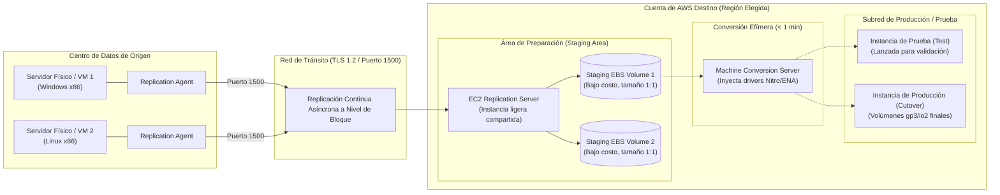
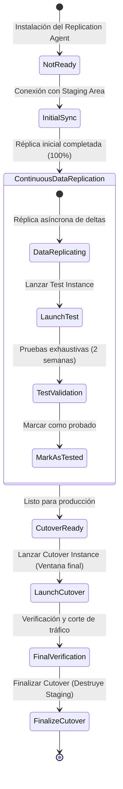

# AWS Application Migration Service

> [!abstract] Qué es este archivo
> Octava lección del módulo **Migration and Modernization**. Analiza en profundidad **AWS Application Migration Service (MGN)**,
> el servicio estándar y preferido de AWS para ejecutar migraciones masivas de tipo **Rehost (*Lift and Shift*)**
> hacia Amazon EC2 con mínima disrupción y costo optimizado.
>
> Detalla la mecánica técnica del **AWS Replication Agent** (instalación no disruptiva sin reinicio), la arquitectura del
> **área de preparación (*Staging Area*)** con instancias EC2 ligeras y volúmenes EBS de bajo costo, la función del
> **Machine Conversion Server** (que adapta los discos al hipervisor de AWS en **menos de 1 minuto** de forma paralela),
> las configuraciones de lanzamiento (*Launch settings*) y el protocolo riguroso de pruebas no destructivas
> (*Test instances*) previas al corte definitivo (*Cutover*).
> Alineado directamente con la tarea **4.2 del Dominio 4 del examen SAP-C02**.

> [!quote] La idea que ordena todo
> **“El secreto de una migración sin caída no es apagar y copiar: es replicar bloques en segundo plano a un área de bajo costo y probar en subredes aisladas mientras producción sigue viva.”**
> AWS MGN mantiene la replicación asíncrona continua desde el origen mientras se lanzan y destruyen instancias de prueba en AWS; cuando llega el día del cutover, solo se sincronizan los deltas finales, reduciendo la ventana de inactividad a minutos.

---

## Resumen en una frase

> La solución estándar de **Rehost automatizado** de AWS que replica servidores físicos y virtuales a nivel de bloque
> de forma asíncrona hacia un **Staging Area** de bajo costo mediante un agente ligero sin reinicios, adaptando los discos
> con un **Machine Conversion Server en $< 1\text{ min}$** y permitiendo pruebas exhaustivas sin interrumpir el origen
> antes del cutover.

---

## 1. Qué es AWS MGN: El estándar para Rehost (Lift and Shift)

Cuando una organización necesita migrar rápidamente decenas o cientos de servidores heterogéneos hacia AWS para cumplir fechas límite agresivas (cierre de data centers, vencimiento de hosting) y decide **no realizar modernizaciones de arquitectura por adelantado**, la herramienta oficial recomendada es **AWS Application Migration Service (MGN)**:

### 1.1 Características fundamentales de AWS MGN
- **Replicación a nivel de bloque (*Block-level*):** Clona el almacenamiento sector por sector, haciéndolo completamente agnóstico a la aplicación que corra encima (bases de datos, software propietario, servidores web o ERPs).
- **Asíncrona y no disruptiva:** Los cambios en el disco de origen se replican en segundo plano sin penalizar el rendimiento del servidor en producción.
- **Soporte de sistemas operativos:** Compatible con cualquier sistema operativo **x86 de 32 o 64 bits de Windows y Linux** que permita la instalación del agente.
- **Reemplazo tecnológico:** AWS MGN es el sucesor oficial de **CloudEndure Migration** y de las herramientas heredadas como **VM Import/Export** para casos masivos.

---

## 2. La arquitectura técnica: Agente, Staging Area y Machine Conversion Server

El funcionamiento interno de AWS MGN desacopla el almacenamiento temporal del cómputo productivo para minimizar los costos durante la fase de sincronización:

### 2.1 El AWS Replication Agent (Agente de Origen)
- Se descarga e instala en cada máquina física o virtual que se desea migrar.
- **Instalación sin reinicio (*No reboot*):** No requiere reiniciar el servidor de origen al instalarse, evitando ventanas de mantenimiento para iniciar la replicación.
- **Bajo impacto de recursos:** Consume un porcentaje marginal de CPU y memoria; captura las escrituras a nivel de bloque y las transmite a través de la red hacia el Staging Area.
- **Requisitos de red:**
  - Comunicación HTTPS saliente por el puerto **TCP 443** hacia el plano de control de AWS Application Migration Service.
  - Comunicación continua de datos por el puerto **TCP 1500** hacia las instancias Replication Server en el Staging Area.

### 2.2 El Staging Area (Área de Preparación de Bajo Costo)
Cuando el agente se conecta a la consola de MGN, el servicio emite llamadas a la API de AWS para aprovisionar automáticamente un entorno de preparación en la cuenta del cliente:
- **EC2 Replication Servers:** Instancias EC2 ligeras y económicas (por ejemplo, familias `t3.small` o `m5.large` según el throughput) dedicadas exclusivamente a recibir bloques por el puerto 1500 y escribirlos en los volúmenes de staging.
- **Concurrencia eficiente:** Un solo Replication Server puede gestionar la replicación simultánea de **múltiples máquinas de origen**, reduciendo costos.
- **Staging EBS Volumes:** Cada disco físico o partición de origen se mapea a un volumen Amazon EBS idéntico en tamaño pero de bajo costo (típicamente `st1` o `sc1` para discos duros o `gp2/gp3` para SSDs pequeños).
- **Aislamiento total:** El Staging Area no ejecuta las aplicaciones del cliente; solo sostiene los datos sincronizados.

### 2.3 El Machine Conversion Server (Servidor de Conversión)
Cuando el arquitecto ordena el lanzamiento de una instancia de prueba (*Test*) o de corte (*Cutover*), AWS MGN realiza una adaptación automática de la imagen del disco:
- Levanta de forma efímera un **Machine Conversion Server** en la subred de staging.
- **Qué hace:** Modifica los controladores de almacenamiento y de red del sistema operativo original (inyecta controladores para el hipervisor de AWS, como **AWS Nitro**, controladores **ENA** y controladores **NVMe**), y reconfigura el cargador de arranque (*bootloader*).
- **Tiempo de conversión literal:** El proceso de conversión toma **menos de un minuto ($< 1\text{ minuto}$)**, independientemente del tamaño del disco de la máquina de origen.
- **Ejecución paralela:** Si se lanzan 50 instancias de una ola a la vez, MGN convierte todas las máquinas en paralelo simultáneamente.

---

## 3. El ciclo de vida de la migración: Launch Settings, Test y Cutover

El proceso operativo en la consola de AWS MGN se divide en fases ordenadas:

### 3.1 Configuraciones de Lanzamiento (Launch Settings)
En la consola de MGN se configuran dos plantillas para cada servidor:
1. **General Launch Settings:** Determina si se despliega en subredes privadas o públicas, y si se instalan automáticamente los agentes de **AWS Systems Manager (SSM)** mediante post-launch actions.
2. **EC2 Launch Template:** Especifica los parámetros definitivos de computación: tipo de instancia EC2 de destino (por ejemplo, `c6i.xlarge` o `m6i.2xlarge`), subred destino (VPC productiva), Security Groups, IAM Instance Profile, tipo de volumen EBS final (`gp3` o `io2`) y tags de gobernanza.

### 3.2 La regla de oro: "Test, test, and test some more"
La fuente enfatiza que el éxito del corte reside en las pruebas tempranas:
- **Al menos 2 semanas antes de la fecha de corte (*cutover*):** Se deben comenzar a lanzar instancias de prueba (*Test instances*) para servidores individuales.
- **Validación del workload completo:** Una vez validados los servidores unitarios, se lanza la ola completa de la aplicación para comprobar la comunicación entre capas (Frontend, Middleware, Base de Datos).
- **Cero impacto en la réplica:** Lanzar instancias de prueba **NO detiene ni interrumpe la replicación continua** desde el centro de datos local. Los servidores de producción on-premises siguen operando normalmente mientras los ingenieros prueban en AWS.

### 3.3 El Cutover Definitivo (Corte de Tráfico)
1. Se establece la ventana de mantenimiento final (por ejemplo, fin de semana fuera de pico).
2. Se detienen los servicios que escriben datos en la máquina local para congelar el estado.
3. Se espera unos minutos a que el agente replique los últimos bloques residuales (logrando **RPO cero o de pocos segundos**).
4. Se lanza la **Cutover Instance** desde la consola de MGN.
5. El Machine Conversion Server adapta los discos ($< 1\text{ min}$) y aprovisiona las instancias EC2 definitivas con volúmenes EBS de producción de alto rendimiento.
6. Se conmutan los registros de DNS (mediante **Amazon Route 53** o balanceadores ALB).
7. Se ejecuta la acción **Finalize Cutover**: AWS MGN elimina automáticamente los servidores de replicación y volúmenes temporales del Staging Area, deteniendo costos residuales.

---

## 4. Comparativa técnica: AWS MGN vs. AWS DRS vs. AWS Transform

| Dimensión | AWS Application Migration Service (MGN) | AWS Elastic Disaster Recovery (DRS) | AWS Transform for VMware |
| --- | --- | --- | --- |
| **Propósito Principal** | **Migración definitiva (Rehost)** hacia Amazon EC2. | **Continuidad de negocio y Disaster Recovery (DR)** continuo. | **Modernización y migración asistida por IA agéntica**. |
| **Mecanismo Base** | Replicación continua a nivel de bloque (motor CloudEndure). | Replicación continua a nivel de bloque (motor CloudEndure). | Modelos de IA + integración con MGN y Discovery Service. |
| **Ciclo de Vida** | Termina al ejecutar **Finalize Cutover** (se borra el staging). | Permanece **activo indefinidamente** replicando cambios 24/7. | Acompaña el proyecto desde el assessment hasta el cutover. |
| **Failback a On-Premises** | No nativo (diseñado para migración unidireccional de ida). | **Sí (Failback bidireccional nativo)** para regresar cargas al data center tras un desastre. | No (enfocado en modernización en AWS). |
| **Conversión de Redes** | Manual (el arquitecto diseña las VPCs y subredes en el Launch Template). | Manual (diseña la VPC de recuperación). | **Automática** (la IA traduce dvSwitches y NSX a VPCs y Security Groups). |

---

## 5. Traducción del contenido

> [!info] Sección de referencia (opcional)
> Esto es la **traducción fiel** de la transcripción del video y las lecturas oficiales provistas por AWS Skill Builder, para verificar que no se perdió ningún detalle del material oficial. No hace falta leerla para estudiar: lo conceptual y accionable está consolidado en las secciones 1 a 4 y se sintetiza en la sección 7 para el examen.

### 5.1 Transcripción del video: Introducción a AWS Application Migration Service (Transcripción íntegra)

> *"Bien. Ya tienen establecida su base en la nube y están listos para comenzar a migrar aplicaciones. Y supongamos que para su primera migración hacen un **lift and shift directo sin mucha modernización por adelantado**. Están buscando algo **rápido, seguro y mínimamente disruptivo**. El servicio Application Migration Service puede ayudarlos con este tipo de rehosts directos.*
>
> *Configura una **replicación continua de servidores** hacia objetivos de replicación en la nube. Y estos objetivos no están destinados a la producción: son **instancias EC2 y volúmenes EBS de bajo costo**. Así, por ejemplo, cada disco de origen se mapea a un volumen EBS de tamaño idéntico. Cuando estén listos, pueden **lanzar instancias de prueba o de producción desde el área de preparación (*staging area*) en la nube**.*
>
> *Esto les da tiempo para hacer los tres pasos más importantes antes de cortar su aplicación, que son: **probar, probar y probar un poco más**. Al menos un par de semanas antes de que planeen salir en vivo, comiencen a lanzar instancias de prueba de servidores individuales para asegurarse de que se vean bien, y luego pasen a despliegues de prueba de la carga de trabajo completa. Encuentren cualquier borde afilado mientras todavía haya tiempo para solucionarlo antes del lanzamiento.*
>
> *Y mientras están probando, **todavía hay replicación continua desde el origen**. Así que su área de preparación está actualizada y lista para lanzar instancias y volúmenes de producción cuando ustedes estén listos."*
>
> *(Duración del video: 1 minuto, 30 segundos).*

---

### 5.2 Lectura oficial: Migraciones con Application Migration Service (MGN)

> *"La implementación comienza instalando el **AWS Replication Agent** en las máquinas de origen seleccionadas. La instalación **no requiere un reinicio**, ni afecta el rendimiento del sistema de manera perceptible. El AWS Replication Agent se conecta a la consola de Application Migration Service, que luego emite una llamada a la API a la Región de AWS de destino seleccionada para crear un **área de preparación (*staging area*)** en la cuenta del cliente designada para recibir los datos replicados de la máquina de origen.*
>
> *El área de preparación consta de instancias EC2 ligeras que actúan como **Replication Servers** y volúmenes de almacenamiento **Amazon Elastic Block Store (Amazon EBS) de bajo costo**. Cada disco de origen se mapea a un volumen EBS de bajo costo de tamaño idéntico en el área de preparación. Los servidores de replicación reciben datos del AWS Replication Agent que se ejecuta en la máquina de origen y escriben estos datos en los volúmenes EBS de staging. **Un Replication Server puede manejar múltiples máquinas de origen que se replican simultáneamente**.*
>
> *Después de que todos los discos de origen se hayan replicado en el área de preparación, el AWS Replication Agent continúa rastreando y replicando cualquier cambio en los discos de origen. Application Migration Service realiza una **replicación de datos continua, asíncrona y a nivel de bloque**, lo que permite la replicación de cualquier aplicación que se ejecute en sistemas operativos Windows y Linux basados en x86 compatibles que permitan la instalación del agente.*
>
> *Pueden configurar las **opciones de lanzamiento (*Launch settings*)** en la consola de AWS Application Migration Service. Las opciones de lanzamiento determinan cómo se lanzarán las instancias de prueba (*Test*) y de corte (*Cutover*) en AWS. Cuando se lanza la instancia de prueba o de corte, Application Migration Service inicia un **Machine Conversion Server temporal** para convertir el disco para que arranque y se ejecute en AWS. El proceso de conversión **normalmente toma menos de un minuto**, independientemente del tamaño de la máquina, y se ejecuta en todas las máquinas lanzadas **en paralelo**."*

---

## 6. Cierre conceptual: Cuadro de componentes y fases de MGN

| Componente / Concepto | Ubicación | Función Técnica | Características Clave |
| --- | --- | --- | --- |
| **AWS Replication Agent** | Servidores de Origen (On-Premises / Otras nubes). | Captura escrituras a nivel de bloque y las transmite a AWS. | Instalación **sin reinicio** (*no reboot*), mínimo uso de CPU/RAM, puertos 443 (control) y 1500 (datos). |
| **Replication Server** | AWS (Staging Area). | Instancia EC2 ligera que recibe bloques y los escribe en EBS. | Un solo servidor gestiona **múltiples máquinas de origen en paralelo**. |
| **Staging EBS Volumes** | AWS (Staging Area). | Almacenamiento temporal de bajo costo que refleja los discos de origen. | Mapeo 1:1 en tamaño con los discos de origen; costo mínimo. |
| **Machine Conversion Server** | AWS (Staging Area). | Servidor efímero que adapta el disco para el hipervisor de AWS. | Modifica drivers (Nitro, ENA, NVMe); tarda **menos de 1 minuto** por máquina. |
| **Launch Settings** | Consola de AWS MGN. | Plantilla que define el tipo de instancia EC2, VPC, subredes y SGs finales. | Aplica para instancias de Test y Cutover. |
| **Test Instances** | AWS (Subred de Pruebas). | Instancias creadas para validar funcionalidad y rendimiento. | Se lanzan **sin interrumpir la replicación continua** desde el origen. |
| **Cutover Instances** | AWS (VPC de Producción). | Instancias definitivas con volúmenes EBS optimizados (`gp3`/`io2`). | Lanzamiento final tras sincronizar deltas; corte de tráfico con RPO de segundos. |

---

## 7. Para el examen (SAP-C02)

> [!important] Lo que hay que retener
> 1. **AWS MGN es la solución estándar para Rehost.** Para cualquier pregunta que requiera mover servidores físicos o virtuales (on-premises u otras nubes) a Amazon EC2 de forma rápida y con mínima disrupción, la respuesta es **AWS Application Migration Service**.
> 2. **Instalación no disruptiva del agente.** El *AWS Replication Agent* **no requiere reiniciar** el servidor de origen al instalarse, lo que permite iniciar la replicación inmediatamente sin coordinar ventanas de mantenimiento.
> 3. **Puertos de red obligatorios.**
>    - **TCP 443 saliente:** Hacia el endpoint del servicio MGN para gestión y control.
>    - **TCP 1500 saliente:** Hacia las instancias *Replication Server* en el Staging Area para la transmisión continua de datos.
> 4. **Ahorro de costos mediante Staging Area.** MGN no aprovisiona instancias EC2 productivas de gran tamaño durante la replicación continua; utiliza instancias EC2 ligeras y volúmenes EBS económicos, reduciendo drásticamente el costo previo al cutover.
> 5. **Machine Conversion Server ($< 1\text{ minuto}$).** Convierte automáticamente los discos para que arranquen en EC2 (drivers Nitro/ENA/NVMe y bootloader) en menos de 60 segundos por máquina, ejecutándose en paralelo para toda la ola.
> 6. **Pruebas no destructivas continuas.** Las instancias de prueba (*Test instances*) se pueden lanzar, auditar y destruir tantas veces como sea necesario en VPCs aisladas; **la replicación de bloques desde el origen nunca se detiene ni se reinicia**.
> 7. **RPO mínimo en el Cutover.** Debido a la replicación asíncrona continua, el RPO durante el corte final se reduce típicamente a **segundos**, ya que solo se deben transferir los últimos cambios registrados tras detener las escrituras en el origen.
> 8. **Concurrencia de Replication Servers.** Un único servidor de replicación en staging puede atender la ingesta de datos de múltiples máquinas origen a la vez.
> 9. **MGN vs. AWS DRS.** MGN se utiliza para **migraciones puntuales de ida** (finaliza con el cutover y se borra el staging). AWS Elastic Disaster Recovery (DRS) se utiliza para **protección continua de desastres con capacidad de failback bidireccional**.
> 10. **Alineación con el caso de Utilities.** Resuelve directamente el requisito de *"Migration of a large VMware environment to AWS with a minimum of disruption"* para los servidores de cómputo y distribución.

> [!warning] Trampa clásica del examen
> **Escenario:** Una compañía necesita migrar 100 servidores de aplicaciones de misión crítica desde un data center local a Amazon EC2. La gerencia exige que la instalación del software de migración no requiera ventanas de inactividad de las aplicaciones y que las pruebas previas al corte definitivo no afecten la disponibilidad del entorno on-premises ni detengan la sincronización de datos.
> **La trampa:** Seleccionar una opción basada en crear imágenes OVA/VMDK manuales y subirlas con VM Import/Export, o detener el servidor local para clonar el disco.
> **Por qué falla:** Exportar e importar imágenes VMDK requiere detener las aplicaciones o genera desincronización de datos acumulados durante la carga de red, además de consumir horas de transferencia manual.
> **La solución correcta:** Desplegar el **AWS Replication Agent** de **AWS Application Migration Service (MGN)** en los servidores de origen. La instalación no requiere reinicio (*no reboot*), la replicación de bloques opera de forma continua en segundo plano hacia el Staging Area, y permite lanzar instancias de prueba (*Test instances*) en AWS sin interrumpir la operación local ni detener la replicación.

---

## Relacionado

- [[AWS Solutions Architect Advanced - Migration and Modernization]] *(índice del módulo)*
- [[AWS Transform for VMware]] — lección 07 del módulo (orquestación con IA agéntica sobre MGN)
- [[AWS Transform Overview]] — lección 06 del módulo (agentes de IA)
- [[Migration Tools]] — lección 05 del módulo (Control Tower y AWS DataSync)
- [[The Migration Process]] — lección 04 del módulo (fase Mobilize, 7 Rs y workflow de migración)
- [[Preparing for Migration]] — lección 03 del módulo (preparación organizativa y evaluación)
- [[Gathering the Customer Requirements - Migration]] — lección 02 del módulo (caso Utilities: cero disrupción)
- [[Course Overview - Migration and Modernization]] — lección 01 del módulo (hoja de ruta)
- [[4.2 Determinar el enfoque de migración óptimo para las cargas de trabajo existentes]] — tarea de examen 4.2
- [[4.3 Determinar una nueva arquitectura para las cargas de trabajo existentes]] — tarea de examen 4.3

Siguiente paso del módulo: **Lección 09**.

---

## Registro de integración

| Fecha | Cambio | Motivo / Detalle |
| --- | --- | --- |
| 2026-10-29 | Creación de la nota inicial | Alta de la octava lección del módulo *Migration and Modernization*. Se estructura el servicio AWS Application Migration Service (MGN): arquitectura de Replication Agent (sin reboot), Staging Area (EC2 ligero y EBS 1:1), Machine Conversion Server (< 1 min de conversión), Launch Settings, pruebas no destructivas sin detener la réplica y protocolo de Cutover para el examen SAP-C02. |
