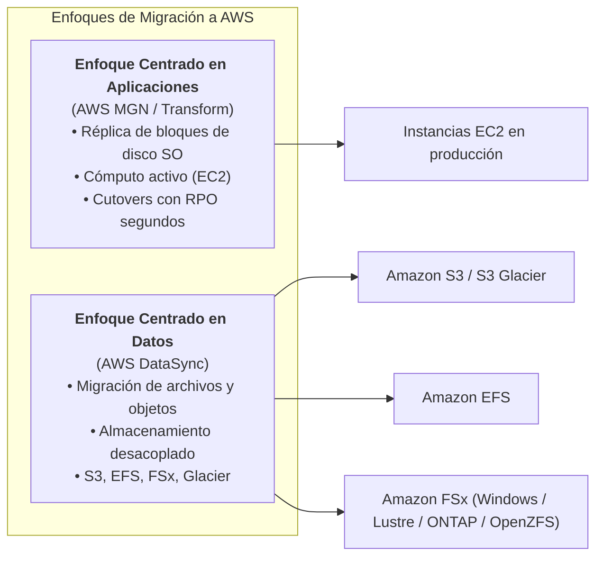
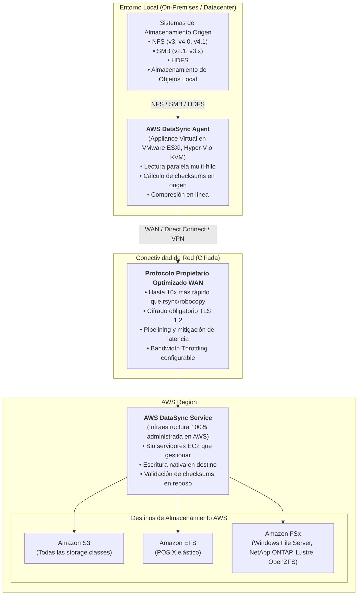

# AWS DataSync

> [!abstract] Qué es este archivo
> Guía técnica exhaustiva sobre **AWS DataSync** como servicio acelerado de transferencia y sincronización de datos online para proyectos de migración masiva y archivado a escala. Explora su arquitectura basada en agente virtual local, el protocolo propietario optimizado para WAN ($10\times$ más rápido que herramientas tradicionales), el cifrado obligatorio en tránsito con **TLS 1.2**, la validación automática de integridad mediante sumas de verificación (*checksums*), y los criterios de decisión frente a **AWS Snowball Edge**, **AWS Storage Gateway** y **AWS Application Migration Service (MGN)** en el **Dominio 4 (Aceleración de la migración y la modernización)** del examen SAP-C02.

> [!quote] La idea que ordena todo
> Mientras que los servicios de migración de cómputo (como AWS MGN) mueven servidores y sistemas operativos completos a nivel de bloques para ejecutar instancias vivas, **AWS DataSync es una solución puramente data-centric**: mueve terabytes o petabytes de archivos y objetos no estructurados de forma automatizada, preservando metadatos y ACLs, validando la integridad archivo por archivo y permitiendo enviar datos fríos directamente a almacenamiento de bajo costo como Amazon S3 Glacier Deep Archive para retirar infraestructura local obsoleta.

---

## Resumen en una frase

> **AWS DataSync** es un servicio administrado online que acelera hasta $10\times$ la transferencia masiva de archivos y objetos entre almacenamiento local (NFS, SMB, HDFS, Object) y la nube de AWS (**Amazon S3**, **Amazon EFS**, **Amazon FSx**), eliminando scripts manuales, cifrando en tránsito con **TLS 1.2**, validando la integridad automáticamente mediante *checksums* y preservando metadatos y permisos POSIX/ACLs.

---

## 1. Naturaleza y propósito de AWS DataSync: migración orientada a datos

Las migraciones corporativas no solo consisten en trasladar aplicaciones y servidores en producción; con frecuencia, el mayor volumen de infraestructura física on-premises corresponde a sistemas de almacenamiento compartido (**NAS**, servidores de archivos **NFS/SMB**, clústeres **HDFS** o repositorios de objetos) que albergan décadas de información histórica.

### Migración centrada en datos vs. centrada en aplicaciones

- **Servicios Application-Centric (p. ej. AWS Application Migration Service - MGN):** Diseñados para replicar servidores completos (disco raíz de arranque, sistema operativo, dependencias de software) mediante agentes de nivel de bloque para poner en marcha instancias EC2 de producción minimizando la ventana de inactividad (*cutover*).
- **Servicios Data-Centric (p. ej. AWS DataSync):** Diseñados específicamente para mover grandes volúmenes de datos no estructurados desde repositorios de almacenamiento compartidos hacia el almacenamiento nativo de AWS, sin requerir la migración ni el levantamiento de los sistemas operativos que originalmente servían esos archivos.

### El caso de uso crítico: archivado de datos fríos y retiro de sistemas legados

En las organizaciones empresariales, una proporción masiva de los datos almacenados en arrays SAN/NAS locales corresponde a **datos fríos (*cold data*)**: información que rara vez o nunca se consulta pero que debe conservarse obligatoriamente por normativas legales, cumplimiento regulatorio corporativo, retención fiscal o requerimientos de auditoría judicial (*discovery orders*).

1. **Liberación inmediata de capacidad local:** Migrar datos fríos hacia la nube libera almacenamiento primario de alto costo on-premises, postergando o cancelando compras de hardware de almacenamiento.
2. **Retiro de sistemas legados (*Retire strategy*):** Permite descomisionar servidores de archivos antiguos, licencias de software asociadas y racks de centros de datos, consolidando los datos en almacenamiento administrado de costo ultra-bajo.
3. **Destino directo a niveles de archivo profundo:** AWS DataSync puede escribir directamente en clases de almacenamiento como **Amazon S3 Standard**, **S3 Standard-Infrequent Access (S3 Standard-IA)**, **S3 Intelligent-Tiering**, o directamente en **Amazon S3 Glacier Flexible Archive** y **Amazon S3 Glacier Deep Archive** (mediante reglas de ciclo de vida de S3 Lifecycle o configuración de destino), reduciendo el costo de retención a fracciones de centavo por gigabyte al mes.

---

## 2. Arquitectura y protocolo optimizado de aceleración WAN

Tradicionalmente, mover terabytes o petabytes de archivos a través de una red WAN o enlaces directos utilizando herramientas basadas en código abierto como `rsync`, `robocopy` o comandos `aws s3 cp` presentaba graves problemas operativos: saturación de un único hilo de CPU, lentitud extrema al recorrer directorios con millones de archivos pequeños, degradación por latencia de red, falta de reanudación automática ante microcortes y necesidad de desarrollar scripts manuales complejos para verificar la integridad.

AWS DataSync resuelve estos cuellos de botella implementando una arquitectura distribuida de alto rendimiento:

### Componentes de la solución

| Componente | Ubicación | Función técnica |
| --- | --- | --- |
| **DataSync Agent** | On-premises (VM) o AWS (EC2) | Appliance virtual desplegado en hipervisores locales (**VMware ESXi**, **Microsoft Hyper-V**, **Linux KVM**) o como instancia EC2. Se conecta al almacenamiento local mediante NFS, SMB u Object, lee la metadata y los datos, ejecuta compresión en tránsito y establece la conexión segura hacia AWS. |
| **DataSync Cloud Service** | AWS (Completamente administrado) | Infraestructura serverless gestionada por AWS en la nube. Recibe el tráfico del agente, interactúa nativamente con las APIs de almacenamiento de AWS (**S3**, **EFS**, **FSx**), ensambla los objetos/archivos y valida su integridad. |
| **DataSync Task** | AWS Console / CLI / API | Definición de una tarea de sincronización que vincula una **Ubicación de Origen (Source Location)** con una **Ubicación de Destino (Destination Location)**, estableciendo opciones de transferencia, filtros de inclusión/exclusión, programación horaria y límites de ancho de banda. |

### El protocolo de red acelerado

> DataSync utiliza un protocolo de red propietario diseñado específicamente por AWS para superar las limitaciones inherentes del protocolo TCP estándar sobre enlaces de larga distancia (WAN) con alta latencia y pérdida de paquetes.

- **Aceleración hasta $10\times$:** Supera radicalmente a herramientas tradicionales gracias a:
  - **Transferencia multi-hilo masiva (*Multi-threaded transfers*):** Segmenta archivos grandes y transfiere múltiples archivos pequeños en paralelo saturando eficientemente el canal disponible.
  - **Pipeline y procesamiento en streaming:** No espera la confirmación secuencial bloque a bloque; canaliza las peticiones de datos de forma continua.
  - **Compresión en línea (*Inline compression*):** Reduce el volumen neto de bytes transmitidos por el enlace de red antes del envío.
  - **Recuperación automática de desconexiones:** Reanuda transferencias interrumpidas exactamente desde el último punto validado sin retransmitir conjuntos completos de datos.

### Seguridad y conectividad de red

1. **Cifrado en tránsito obligatorio con TLS 1.2:** Toda la comunicación entre el DataSync Agent y el servicio AWS DataSync viaja estrictamente cifrada mediante **TLS 1.2**.
2. **Opciones de endpoints para cumplir normativas:**
   - **Public Endpoints:** Conexión a través de direcciones IP públicas de AWS (el tráfico sigue estando cifrado con TLS 1.2).
   - **FIPS Endpoints:** Para cargas reguladas por el gobierno de EE.UU. que requieren módulos criptográficos con certificación FIPS 140-2.
   - **VPC Endpoints (AWS PrivateLink):** Permite que el DataSync Agent se comunique con AWS DataSync a través de interfaces de red elásticas privadas (ENI) en una VPC designada. Al combinar esto con **AWS Direct Connect** o **AWS Site-to-Site VPN**, el tráfico de migración **nunca toca la Internet pública**, satisfaciendo los requisitos de aislamiento más estrictos.

---

## 3. Capacidades operativas: integridad, metadatos y control de red

Para que una migración masiva de almacenamiento sea viable a nivel corporativo, no basta con mover datos rápidamente: se debe garantizar que ningún bit se haya corrompido, que los permisos de seguridad existentes no se pierdan y que la transferencia no asfixie la red de la empresa.

### Validación automática de integridad de datos

Uno de los mayores dolores de cabeza en migraciones manuales es el scripting de verificaciones de hash (`md5sum`, `sha256sum`). DataSync automatiza este proceso de extremo a extremo:
- **Cálculo de *checksum* en origen:** El DataSync Agent calcula sumas de verificación criptográficas a medida que lee los archivos del almacenamiento local.
- **Validación en tránsito y en reposo:** Al llegar a AWS, el servicio DataSync vuelve a calcular y comparar los *checksums* al escribir en el destino final (S3, EFS o FSx).
- **Modos de verificación:**
  - *Verify only data transferred (predeterminado):* Comprueba únicamente los archivos modificados o añadidos en la tarea actual.
  - *Verify all data in destination:* Comprueba la integridad exhaustiva de todo el repositorio de origen contra el destino.

### Preservación de metadatos y listas de control de acceso (ACLs)

Cuando se migran repositorios corporativos de archivos, perder la propiedad, los permisos o las marcas de tiempo puede inutilizar las aplicaciones consumidoras o violar normativas de auditoría. DataSync preserva fielmente los atributos según el sistema de archivos:

| Sistema de archivos | Protocolo | Metadatos y permisos preservados por DataSync |
| --- | --- | --- |
| **Linux / Unix** | NFS v3, v4.0, v4.1 | Permisos POSIX estándar, UID (User ID), GID (Group ID), marcas de tiempo de modificación (`mtime`), marcas de tiempo de acceso (`atime`), enlaces simbólicos (*symlinks*), atributos extendidos. |
| **Windows / Active Directory** | SMB v2.1, v3.x | Listas de control de acceso discrecionales (**DACLs**), listas de control de acceso del sistema (**SACLs**), identificadores de seguridad (**SIDs**), atributos de archivo de Windows (ReadOnly, Hidden, System, Archive), marcas de tiempo exactas. |
| **Almacenamiento de Objetos** | S3 API / Compatible | Metadatos definidos por el usuario, etiquetas de objeto (*object tags*), tipo MIME. |

### Control de ancho de banda y automatización

- **Limitación de ancho de banda (*Bandwidth Throttling*):** Permite asignar un límite estricto de consumo de red (en MiB/s o GiB/s) durante las horas pico de producción (p. ej., 08:00 a 18:00) para no degradar los enlaces compartidos, y desactivar o aumentar la cuota durante la noche o los fines de semana. Puede modificarse dinámicamente sobre una tarea en ejecución sin cancelarla.
- **Programación de tareas (*Task Scheduling*):** Incluye un motor de programación integrado que ejecuta tareas de forma periódica (cada hora, diaria, semanal, o mediante expresiones cron) para mantener sincronizados los cambios incrementales antes del corte definitivo.
- **Monitoreo y observabilidad:** Emite métricas operativas detalladas hacia **Amazon CloudWatch** (bytes transferidos, archivos transferidos, velocidad de transferencia, errores de verificación) y envía registros de eventos a **CloudWatch Logs** y alertas mediante **Amazon EventBridge**.

---

## 4. Matriz de decisión de migración de almacenamiento (SAP-C02)

En el examen SAP-C02, una de las habilidades evaluadas con mayor frecuencia en el Dominio 4 es la selección de la herramienta correcta de transferencia de almacenamiento. La siguiente matriz resume los criterios arquitectónicos clave:

| Escenario y Requerimiento | Servicio Recomendado | Criterio de Selección para el Examen |
| --- | --- | --- |
| **Migración online continua/programada de TB a PB sobre red existente (WAN/Direct Connect)** | **AWS DataSync** | Protocolo optimizado hasta $10\times$, cifrado TLS 1.2 nativo, validación automática de *checksums*, soporte de NFS, SMB, HDFS hacia S3, EFS, FSx. |
| **Migración masiva de decenas de TB o PB donde el ancho de banda de red es insuficiente o costoso** | **AWS Snowball Edge** (Storage Optimized) | Transferencia física/offline mediante appliances reforzados enviados por correo seguro; ideal si el cálculo de tiempo por red superaría semanas o meses. |
| **Carga de trabajo que requiere mantener acceso local de baja latencia con caché y respaldo en S3** | **AWS Storage Gateway** (File Gateway / Volume Gateway) | No es una herramienta de migración masiva única, sino un puente híbrido que ofrece almacenamiento en caché local con persistencia en AWS. |
| **Rehost completo de servidores y sistemas operativos (VMware/Hyper-V/físicos a EC2)** | **AWS Application Migration Service (MGN)** | Replicación continua a nivel de bloque para lanzar instancias EC2 vivas minimizando el downtime; no es para mover carpetas compartidas a S3/EFS. |
| **Intercambio B2B de archivos seguro con clientes y socios externos mediante SFTP/FTPS/FTP/AS2** | **AWS Transfer Family** | Servidores administrados de protocolos de transferencia tradicionales que almacenan directamente en Amazon S3 o Amazon EFS sin gestionar servidores SFTP. |
| **Sincronización manual ocasional de pequeños volúmenes o scripts Ad-hoc** | **AWS CLI (`aws s3 sync`)** | Solo apto para volúmenes pequeños; carece de protocolo WAN acelerado, falla o se degrada con millones de archivos y no ofrece throttling dinámico ni preservación completa de ACLs de Windows. |

---

## 5. Traducción del contenido

> [!info] Sección de referencia (opcional)
> Esto es la **traducción fiel** de las fuentes originales provistas en el curso de AWS Skill Builder. Su propósito es servir como material de verificación y consulta textual precisa de las explicaciones y lineamientos del instructor.

### 5.1 Video principal: Introduction to AWS DataSync (transcripción)

Por último, pero ciertamente no menos importante, está **AWS DataSync**. Es un servicio de almacenamiento diseñado para mover de forma rápida y segura grandes cantidades de datos entre el almacenamiento local y el almacenamiento compartido en AWS.

A menudo eso significa mover hacia **Amazon S3**, pero también podría ser hacia **Amazon EFS** o **Amazon FSx**.

Muchos de los ejemplos que hemos cubierto hasta ahora han estado muy centrados en las aplicaciones: mover aplicaciones de producción y datos en vivo a la nube. Este es un servicio mucho más **centrado en los datos**, y existen varios casos de uso en una gran migración donde esto puede resultar sumamente útil.

Un ejemplo claro es **migrar y archivar datos fríos (*cold data*)**. Si su entorno es como el de la gran mayoría de las organizaciones, es probable que tenga una enorme cantidad de datos que rara vez o nunca se consultan. Tiene que conservarlos por razones de cumplimiento normativo, por motivos legales, o simplemente porque algún directivo importante insiste en que deben conservarse. Sin embargo, usted sabe por las estadísticas reales de uso que nadie está utilizando esa información.

Por lo tanto, parte de su plan general de migración puede consistir en tomar estos datos fríos y enviarlos a un lugar frío: enviarlos a **S3 Glacier Deep Archive** o a alguna de las otras clases de almacenamiento a largo plazo que ofrece Amazon S3.

Esto es especialmente útil si está buscando **retirar algunos sistemas legados (*retire legacy systems*)**, pero reteniendo sus datos en un almacenamiento de costo ultra-bajo en caso de que reciba una orden de requerimiento judicial (*discovery order*) u otra necesidad futura para acceder a ellos.

*(Duración del video: 1 minuto, 31 segundos)*

### 5.2 Lectura oficial: AWS DataSync (arquitectura y beneficios)

Las tareas manuales relacionadas con la transferencia de datos pueden ralentizar las migraciones y sobrecargar las operaciones de TI. **AWS DataSync** le ayuda a mover grandes cantidades de datos entre el almacenamiento on-premises y **Amazon S3**, **Amazon EFS** o **Amazon FSx for Windows File Server**. De forma predeterminada, los datos se cifran en tránsito utilizando **TLS 1.2**. DataSync gestiona automáticamente muchas de estas tareas operativas, incluyendo la creación de scripts de copia, la programación y el monitoreo de transferencias, la validación de la integridad de los datos y la optimización del uso de la red.

Puede reducir la infraestructura de almacenamiento local trasladando almacenes de datos basados en **Server Message Block (SMB)** y repositorios de contenido desde servidores de archivos y cabinas de almacenamiento conectado en red (**NAS**) hacia Amazon S3 y Amazon EFS para casos de uso de analítica, archivado o respaldo (*backup*).

DataSync se implementa como un único **agente de software** que puede conectarse a múltiples sistemas de archivos compartidos y ejecutar múltiples tareas de forma simultánea. El agente de software se implementa típicamente on-premises a través de una instancia virtual para gestionar la transferencia de datos a través de la red de área amplia (**WAN**) hacia AWS. Del lado de AWS, el agente se conecta a la infraestructura del servicio DataSync. Debido a que DataSync es un servicio completamente administrado, los clientes no tienen que configurar ni mantener ninguna infraestructura en la nube. La configuración de DataSync se administra directamente desde la consola de AWS o mediante la interfaz de línea de comandos (**AWS CLI**).

**Beneficios que ofrece AWS DataSync:**
- Despliegue de un agente on-premises (appliance virtual).
- Transferencia de datos sobre la WAN utilizando un protocolo diseñado a medida (*purpose-built protocol*).
- Capacidad de escribir o leer datos directamente desde los servicios de almacenamiento de AWS.
- Administración integral desde la Consola de Administración de AWS o la CLI de AWS.

---

## 6. Cierre conceptual: quién hace qué en la transferencia y migración de datos

| Necesidad del Negocio | Herramienta AWS | Mecanismo y Comportamiento |
| --- | --- | --- |
| **Archivado masivo de datos fríos (retención legal/fiscal)** | **AWS DataSync + Amazon S3 Glacier Deep Archive** | El agente lee del NAS local vía NFS/SMB, transmite a través de WAN acelerada y deposita los datos directamente en S3 con transición inmediata o directa a Glacier Deep Archive a costo mínimo. |
| **Migración de servidores de archivos departamentales Windows** | **AWS DataSync + Amazon FSx for Windows File Server** | Conexión directa a recursos SMB locales, preservando intactas las **DACLs**, atributos y metadatos de **Active Directory** en el nuevo sistema de archivos FSx. |
| **Migración de almacenamiento compartido para servidores Linux** | **AWS DataSync + Amazon EFS** | Conexión a exportaciones NFS locales y copia hacia Amazon EFS conservando permisos POSIX, UID, GID y marcas temporales. |
| **Replicación periódica continua entre datacenters y AWS** | **AWS DataSync (Programación de Tareas)** | Sincronización diferencial incremental ejecutada según expresiones cron, transfiriendo únicamente los archivos nuevos o modificados con verificación de *checksums*. |
| **Protección del ancho de banda productivo durante el día** | **Bandwidth Throttling de DataSync** | Modificación en caliente del límite máximo de ancho de banda asignado a la tarea para no saturar enlaces VPN o Direct Connect compartidos con tráfico transaccional. |

---

## 7. Para el examen (SAP-C02)

> [!important] Lo que hay que retener
> 1. **Enfoque puramente Data-Centric:** DataSync migra archivos y objetos desacoplados, a diferencia de AWS MGN que migra servidores completos con sus sistemas operativos a nivel de bloques.
> 2. **Archivado de Cold Data y retiro de sistemas legados:** Es el patrón arquitectónico clave para cumplir requerimientos de retención legal (*discovery orders*) a costo mínimo enviando datos fríos a **S3 Glacier Deep Archive** y apagando cabinas NAS costosas.
> 3. **Protocolo propietario acelerado WAN:** Diseñado para ser hasta **$10\times$** más rápido que utilidades estándar (`rsync`, `robocopy`), mediante transferencias multi-hilo, compresión en línea y optimización para alta latencia.
> 4. **Cifrado en tránsito obligatorio:** Utiliza siempre **TLS 1.2** de forma predeterminada para todos los flujos de datos entre el agente y el servicio AWS.
> 5. **Validación automática de integridad:** Calcula sumas de verificación (*checksums*) en el origen y las corrobora en el destino al escribir, **sin requerir scripts manuales** de verificación (`md5sum`/`sha256sum`).
> 6. **Preservación total de metadatos:** Mantiene permisos POSIX (UID, GID, mtime) en sistemas NFS hacia Amazon EFS, y **ACLs/DACLs/SIDs** de Windows en sistemas SMB hacia **Amazon FSx for Windows File Server**.
> 7. **Despliegue del Agente:** Se implementa como una máquina virtual on-premises (**VMware ESXi, Hyper-V, KVM**); del lado de AWS es un servicio 100% serverless sin instancias EC2 que mantener.
> 8. **Privacidad de red con VPC Endpoints:** Soporta **AWS PrivateLink** para que el tráfico del agente ingrese a través de ENIs privadas en una VPC, garantizando que los datos sobre Direct Connect o VPN nunca viajen por Internet pública.
> 9. **Bandwidth Throttling:** Permite establecer límites dinámicos de velocidad durante el horario laboral para evitar la degradación de las operaciones corporativas sobre enlaces compartidos.
> 10. **DataSync vs. Snowball Edge:** Si el volumen de datos (TB/PB) saturaría el enlace o tardaría semanas/meses en transferirse según el ancho de banda disponible, se debe optar por **AWS Snowball Edge** (offline). Si el enlace de red es adecuado y se requiere sincronización continua/incremental, la respuesta es **AWS DataSync** (online).

> [!warning] Trampa clásica del examen
> **Escenario:** Una compañía necesita migrar 150 TB de datos no estructurados desde un servidor de archivos local basado en SMB (con permisos de acceso muy estrictos basados en Active Directory) hacia AWS. El equipo de infraestructura propone escribir un script en Python ejecutado en una instancia EC2 que monte el recurso SMB a través de VPN y use `robocopy` o el AWS CLI para transferir los datos, programando un script adicional con funciones hash para verificar que no haya archivos corruptos.
>
> **La trampa:** Creer que automatizar `robocopy` o scripts propios en una instancia EC2 es una solución "personalizada y económica". Esta opción introduce una carga operativa inmensa, riesgo de pérdida de ACLs de Windows, saturación del enlace de red por falta de control de ancho de banda y degradación severa si existen millones de archivos pequeños.
>
> **La respuesta correcta:** Implementar el **DataSync Agent** localmente como máquina virtual, configurar una tarea de transferencia de **AWS DataSync** con destino a **Amazon FSx for Windows File Server** (o Amazon S3), activar la preservación automática de **ACLs/metadatos de Windows**, habilitar el **Bandwidth Throttling** para proteger el ancho de banda diurno y apoyarse en la **validación automática de sumas de verificación (*checksums*)** nativa de DataSync sin scripts adicionales.

---

## Relacionado

- [[Migration Tools]] — lección 05 donde se introdujo AWS DataSync junto a Control Tower
- [[The Migration Process]] — lección 04: fase Mobilize y la estrategia de retiro (*Retire*) de datos y aplicaciones
- [[AWS Application Migration Service]] — lección 08: contraste entre migración de servidores (MGN) y migración de datos (DataSync)
- [[Course Overview - Migration and Modernization]] — visión general de herramientas de migración y modernización
- [[AWS Solutions Architect Advanced - Migration and Modernization]] *(índice del módulo)*
- Siguiente paso del módulo: **lección 10 del módulo de migración y modernización**

---

## Registro de integración

| Fecha | Tipo de cambio | Detalle de la modificación |
| --- | --- | --- |
| 2026-10-29 | Creación de nota canónica | Alta de la novena lección del módulo *Migration and Modernization*. Se estructura de forma exhaustiva el servicio **AWS DataSync** (enfoque centrado en datos vs aplicaciones, archivado de datos fríos hacia S3 Glacier Deep Archive, retiro de sistemas legados, arquitectura del agente virtual on-premise, protocolo acelerado WAN hasta $10\times$, cifrado obligatorio TLS 1.2, PrivateLink VPC Endpoints, validación automática de integridad mediante *checksums*, preservación de ACLs de Windows y metadatos POSIX, limitación dinámica de ancho de banda y matriz de decisión frente a Snowball Edge, MGN y Storage Gateway para el examen SAP-C02). |
