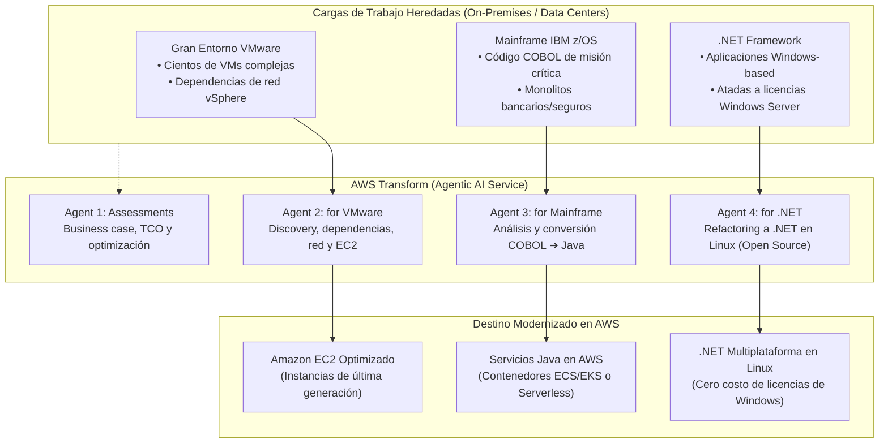

# AWS Transform Overview

> [!abstract] Qué es este archivo
> Sexta lección del módulo **Migration and Modernization**. Presenta **AWS Transform**, un servicio basado en
> **IA agéntica (*agentic AI*)** diseñado para modernizar y migrar a escala empresarial cargas de trabajo complejas
> y heredadas: **entornos VMware**, **aplicaciones mainframe (IBM z/OS y COBOL)** y **aplicaciones .NET Framework**.
>
> Analiza sus **cuatro agentes de IA especializados** (*Assessments*, *for VMware*, *for Mainframe* y *for .NET*),
> detallando cómo automatizan la evaluación financiera, el mapeo de dependencias, la conversión de red, la
> refactorización de código COBOL a Java y la portabilidad de .NET Framework sobre Windows hacia .NET multiplataforma
> sobre Linux para eliminar licencias propietarias, reduciendo cronogramas de modernización de años a meses.
> Alineado con las tareas **4.3 y 4.4 del Dominio 4 del examen SAP-C02**.

> [!quote] La idea que ordena todo
> **“La deuda técnica de décadas en mainframes, entornos VMware y aplicaciones .NET ya no requiere reescrituras manuales de años: los agentes de IA especializados automatizan el análisis, la conversión de red y la refactorización de código hacia plataformas abiertas en la nube.”**
> AWS Transform ataca los tres mayores cuellos de botella de la modernización: dependencias complejas de virtualización, lenguajes legados no mantenibles (COBOL) y ataduras a licencias de sistemas operativos propietarios (Windows Server).

---

## Resumen en una frase

> Un servicio pionero de **IA agéntica** que despliega cuatro agentes especializados (**Assessments**, **VMware**,
> **Mainframe** y **.NET**) para acelerar la migración masiva y la modernización profunda hacia AWS, automatizando
> el análisis de TCO, el mapeo de dependencias y conversión de red en VMware, la traducción de COBOL a Java en
> IBM z/OS, y la portabilidad de .NET Framework a Linux para recortar costos de licencias.

---

## 1. Qué es AWS Transform: Modernización acelerada con Agentic AI

Tradicionalmente, modernizar cargas monolíticas empresariales implicaba proyectos de varios años con alto riesgo de fracaso, equipos especializados escasos (programadores COBOL, expertos en migraciones masivas de vSphere) y costos exorbitantes.

**AWS Transform** capitaliza más de 19 años de experiencia de AWS en migraciones empresariales e introduce una arquitectura basada en **agentes de inteligencia artificial especializados (*agentic AI*)**. Estos agentes colaboran de forma autónoma con los arquitectos y desarrolladores para ejecutar tareas complejas que antes requerían meses de análisis manual:

---

## 2. Los cuatro agentes especializados de AWS Transform

El servicio estructura sus capacidades en cuatro agentes autónomos orientados a problemas concretos:

| Agente de AWS Transform | Alcance y Carga Objetivo | Tareas Automatizadas por la IA | Resultado de Destino | Beneficio Clave de Negocio |
| --- | --- | --- | --- | --- |
| **AWS Transform assessments** | Entorno de TI completo on-premises o multi-cloud. | Análisis de telemetría de infraestructura, detección de oportunidades de rendimiento y dimensionamiento (*right-sizing*), y modelado financiero detallado. | **Business Case de migración** basado en datos reales con proyección de ahorros. | Justificación cuantitativa para la alta dirección y comités de auditoría. |
| **AWS Transform for VMware** | Entornos virtualizados VMware vSphere a escala empresarial. | Descubrimiento automatizado de aplicaciones, mapeo de dependencias entre VMs, **conversión de configuraciones de red**, planificación de migración y optimización de instancias EC2 de destino. | Migración guiada y fluida hacia **Amazon EC2**. | Acelera la salida de centros de datos VMware reduciendo la fricción manual en redes y almacenamiento. |
| **AWS Transform for mainframe** | Aplicaciones en mainframes **IBM z/OS**. | Análisis exhaustivo de bases de código legadas, descomposición de flujos de trabajo, y **conversión automatizada de código COBOL a Java**. | Cargas refactorizadas para correr en entornos cloud estándar. | Reduce los cronogramas de modernización de **años a meses**; elimina el riesgo de falta de talento en COBOL. |
| **AWS Transform for .NET** | Aplicaciones .NET Framework heredadas sobre **Windows Server**. | Análisis de código fuente, mapeo de librerías y dependencias, y **refactorización automatizada hacia .NET multiplataforma (.NET Core / 6 / 8)**. | Aplicaciones .NET ejecutándose nativamente sobre **Linux** (EC2, ECS o EKS). | **Eliminación del costo de licencias de Windows Server**, mayor rendimiento, menor huella de memoria y seguridad reforzada. |

---

## 3. Desglose técnico de cada agente

### 3.1 AWS Transform assessments
- **Construcción del Business Case:** Modela escenarios de costos y rendimiento sin requerir semanas de consultoría externa.
- **Identificación de oportunidades:** Cruza patrones de uso reales para identificar qué cargas obtienen el mayor retorno con Rehost, cuáles deben migrar a bases de datos administradas y cuáles tienen sobredimensionamiento de cómputo.
- **Planificación financiera confiable:** Ofrece cifras claras de ahorro proyectado (TCO) para sustentar la aprobación de patrocinadores ejecutivos.

### 3.2 AWS Transform for VMware
- **El desafío de VMware:** En entornos empresariales masivos, las dependencias complejas de vSphere (dvSwitches, port groups, VLANs locales y almacenamiento vSAN/NFS) suelen bloquear los proyectos de migración a EC2.
- **La solución agéntica:** El agente no solo orquesta la replicación de servidores; **convierte de forma inteligente las redes virtuales y políticas de VMware hacia VPCs, subredes, tablas de enrutamiento y Security Groups de AWS**, optimizando los tipos de instancia EC2 para no sobrepagar por capacidad no utilizada.

### 3.3 AWS Transform for mainframe (COBOL a Java)
- **El dilema del Mainframe:** El hardware mainframe de IBM z/OS es costoso de mantener, cerrado y atado a desarrolladores de lenguajes heredados en vías de jubilación.
- **Conversión automatizada de código:** El agente descompone la lógica de negocio de los programas COBOL y la refactoriza hacia **código Java moderno, legible y mantenible**, listo para integrarse en pipelines de CI/CD y arquitecturas basadas en contenedores.
- **Experiencia web unificada:** Facilita la colaboración interactiva entre desarrolladores de mainframe tradicionales y desarrolladores cloud modernos.

### 3.4 AWS Transform for .NET (Windows a Linux)
- **El peso de las licencias de Windows:** Cada instancia EC2 que corre Windows Server incorpora un recargo de licenciamiento por hora de computación frente a instancias equivalentes sobre Linux.
- **Modernización multiplataforma:** El agente analiza el código de **.NET Framework (versiones 3.5/4.x)**, detecta APIs no compatibles, sugiere y aplica automáticamente drop-in replacements hacia **.NET moderno (.NET 6/8)** y genera proyectos listos para ejecutarse sobre distribuciones Linux (Amazon Linux 2023, Ubuntu, contenedores Alpine).
- **Impacto directo:** Reducción drástica de costos recurrentes de licencias y mejora en densidad de ejecución y velocidad de arranque de contenedores.

---

## 4. Conexión directa con el caso del cliente (Energy & Utilities)

En la Lección 02, la empresa de energía y servicios públicos planteó:
1. **Un gran entorno VMware masivo de misión crítica:** Resuelto con **AWS Transform for VMware** para mapear dependencias y convertir redes sin disrupción.
2. **Aplicaciones monolíticas legadas que necesitan modernización urgente:** Abordado mediante **AWS Transform for .NET** (para sus sistemas de facturación o telemetría en Windows) y **AWS Transform assessments** para documentar y auditar la justificación técnica ante los auditores trimestrales.
3. **Liberar horas de ingeniería para innovar:** Al delegar las tareas tediosas de portabilidad de código y conversión de red a agentes de IA, el equipo interno puede enfocarse en nuevas capacidades de servicio para los clientes.

---

## 5. Traducción del contenido

> [!info] Sección de referencia (opcional)
> Esto es la **traducción fiel** de la lectura oficial provista por AWS Skill Builder, para verificar que no se perdió ningún detalle del material oficial. No hace falta leerla para estudiar: lo conceptual y accionable está consolidado en las secciones 1 a 4 y se sintetiza en la sección 7 para el examen.

### 5.1 Lectura oficial: Visión general de AWS Transform (Traducción íntegra)

> *"Ahora, echemos un vistazo a **AWS Transform**, que puede ayudarles a migrar y modernizar cargas de trabajo mucho más rápido de lo que antes era posible.*
>
> ***AWS Transform** es un **servicio de IA agéntica (*agentic AI*)** para la modernización y migración a escala empresarial de cargas de trabajo **.NET, mainframe y VMware**. Construido sobre **19 años de experiencia en migraciones**, despliega **agentes de IA especializados** para automatizar tareas complejas como evaluaciones, refactorización y planificación de la transformación, reduciendo drásticamente los cronogramas de los proyectos.*
>
> *El servicio AWS Transform cuenta con cuatro agentes disponibles:*
>
> #### *AWS Transform assessments*
> *AWS Transform assessment les ayuda a construir un **caso de negocio (*business case*)** para la migración a AWS. Analiza su entorno de TI y ofrece información basada en datos y recomendaciones accionables. Descubran oportunidades de optimización de costos y rendimiento mientras obtienen un **modelado financiero detallado** que les ayuda a planificar con confianza su migración y maximizar los ahorros potenciales.*
>
> #### *AWS Transform for VMware*
> *AWS Transform for VMware les ayuda a **migrar entornos VMware a escala empresarial hacia Amazon EC2**. Al combinar automatización inteligente y agentes de IA expertos en el dominio, agiliza el descubrimiento de aplicaciones y el mapeo de dependencias. El agente también gestiona la planificación de la migración, la **conversión de red**, la migración de servidores y la **optimización de instancias Amazon EC2**.*
>
> #### *AWS Transform for mainframe*
> *AWS Transform for mainframe les ayuda a modernizar aplicaciones **IBM z/OS** y **convertir código COBOL a Java**. Agiliza las fases centrales de modernización, desde el análisis inicial y la planificación hasta la refactorización de código y la migración, **reduciendo los plazos de modernización de años a meses**. Una experiencia web unificada hace posible la colaboración entre equipos, ayudándoles a modernizar con mayor velocidad, confianza y control.*
>
> #### *AWS Transform for .NET*
> *AWS Transform for .NET es un agente para **migrar aplicaciones .NET basadas en Windows hacia Linux**. Acelera la modernización a gran escala desde **.NET Framework hacia .NET multiplataforma** al encargarse de las tediosas tareas de portabilidad de .NET, como el análisis de código, el mapeo de dependencias y la refactorización. Con el agente, pueden ejecutar proyectos más grandes y complejos con consistencia, **eliminar las dependencias de licencias de Windows para reducir costos** y mejorar la calidad del código, el rendimiento y la seguridad."*

---

## 6. Cierre conceptual: Cuadro de agentes y casos de uso

| Carga de Trabajo Legada | Desafío Tradicional | Agente de AWS Transform | Resultado Técnico y Económico |
| --- | --- | --- | --- |
| **Planificación y TCO Corporativo** | Semanas de recopilación manual de datos y conjeturas financieras para la dirección. | **AWS Transform assessments** | Business case cuantitativo automatizado con modelado de costos y análisis de rendimiento. |
| **Granja masiva VMware vSphere** | Mapeo manual de dependencias de red, VLANs y sobredimensionamiento de instancias en EC2. | **AWS Transform for VMware** | Mapeo automatizado de dependencias, conversión de redes hacia VPCs y sizing óptimo en Amazon EC2. |
| **Monolitos bancarios en IBM z/OS** | Escasez crítica de desarrolladores COBOL, acoplamiento extremo y cronogramas de años. | **AWS Transform for mainframe** | Conversión automatizada de COBOL a Java moderno, reduciendo los plazos de modernización a meses. |
| **Sistemas .NET sobre Windows Server** | Elevado costo recurrente de licencias de Microsoft y lentitud de contenedores Windows. | **AWS Transform for .NET** | Portabilidad de .NET Framework a .NET Core/6/8 sobre Linux, eliminando el 100 % del costo de licencias de Windows. |

---

## 7. Para el examen (SAP-C02)

> [!important] Lo que hay que retener
> 1. **Definición de AWS Transform.** Es un servicio de **IA agéntica** que despliega agentes especializados para acelerar la migración y modernización de cargas complejas (.NET, mainframe, VMware y assessments).
> 2. **Modernización de Mainframe (COBOL a Java).** Para preguntas de modernización de mainframes IBM z/OS donde se exige eliminar la dependencia de hardware especializado y lenguaje heredado, la solución automatizada es **AWS Transform for mainframe** (convierte COBOL a Java).
> 3. **Optimización de Costos en .NET (Windows a Linux).** La vía canónica de AWS para reducir costos en aplicaciones .NET heredadas es portar **.NET Framework a .NET multiplataforma sobre Linux**. **AWS Transform for .NET** automatiza el análisis y refactorización de código, eliminando el costo de las licencias de Windows Server.
> 4. **Migración inteligente de VMware.** A diferencia del simple Rehost manual, **AWS Transform for VMware** automatiza el descubrimiento de dependencias, la conversión de configuraciones de red hacia VPCs y la selección óptima de instancias EC2.
> 5. **Evaluación basada en IA (Assessments).** Proporciona modelado financiero y recomendaciones de optimización basadas en datos para construir el caso de negocio (*business case*) ante auditores y ejecutivos.
> 6. **Reducción de cronogramas.** La propuesta de valor central de los agentes de IA de modernización es comprimir proyectos de transformación legacy que tradicionalmente tomaban años a una escala de meses.
> 7. **Soporte cruzado de equipos.** El agente de mainframe ofrece una experiencia web unificada que permite a desarrolladores legados (COBOL/zOS) colaborar con ingenieros de nube modernos (Java/DevOps).
> 8. **Relación con las 7 Rs.**
>    - VMware hacia EC2: **Rehost / Replatform** inteligente.
>    - Mainframe COBOL a Java: **Refactor / Rearchitect**.
>    - .NET Framework a .NET en Linux: **Replatform / Refactor** para eliminar licencias.
> 9. **Independencia de licencias de SO.** Migrar de Windows a Linux no solo reduce costos de licenciamiento de Microsoft; habilita el uso de arquitecturas de contenedores basadas en Linux más ligeras, de arranque más rápido y compatibles con procesadores **AWS Graviton** basados en ARM.
> 10. **Alineación con el caso de Utilities.** Resuelve directamente los requisitos de modernización sin disrupción para cargas masivas VMware y aplicaciones monolíticas heredadas.

> [!warning] Trampa clásica del examen
> **Escenario:** Una compañía de seguros ejecuta un sistema de suscripción crítico en .NET Framework sobre 80 servidores Windows Server en su centro de datos. La directiva exige reducir drásticamente los costos de licenciamiento de sistemas operativos y optimizar el rendimiento sin reescribir toda la lógica de negocio desde cero en otro lenguaje.
> **La trampa:** Seleccionar una opción que proponga hacer Rehost de las máquinas virtuales Windows hacia Amazon EC2 con licencias incluidas (License Included) o con licencias BYOL en Dedicated Hosts.
> **Por qué falla:** Mantener las aplicaciones sobre Windows Server perpetúa el costo del licenciamiento de Microsoft y no elimina la dependencia del sistema operativo subyacente.
> **La solución correcta:** Utilizar **AWS Transform for .NET** (o el asistente de portabilidad de AWS) para automatizar el análisis de código y refactorizar la aplicación desde **.NET Framework hacia .NET multiplataforma**, desplegándola sobre instancias **Amazon EC2 o contenedores Amazon ECS/EKS con Linux**. Esto elimina por completo el costo de las licencias de Windows Server y maximiza el rendimiento.

---

## Relacionado

- [[AWS Solutions Architect Advanced - Migration and Modernization]] *(índice del módulo)*
- [[Migration Tools]] — lección 05 del módulo (Control Tower y AWS DataSync)
- [[The Migration Process]] — lección 04 del módulo (fase Mobilize, 7 Rs y workflow de migración)
- [[Preparing for Migration]] — lección 03 del módulo (preparación y evaluación organizativa)
- [[Gathering the Customer Requirements - Migration]] — lección 02 del módulo (caso Utilities: VMware y modernización)
- [[Course Overview - Migration and Modernization]] — lección 01 del módulo (hoja de ruta)
- [[Architecting for Cost - Compute]] — optimización de costos en cómputo y licencias
- [[4.2 Determinar el enfoque de migración óptimo para las cargas de trabajo existentes]] — tarea de examen 4.2
- [[4.3 Determinar una nueva arquitectura para las cargas de trabajo existentes]] — tarea de examen 4.3
- [[4.4 Determinar oportunidades de modernización y mejoras]] — tarea de examen 4.4

Siguiente paso del módulo: **Lección 07**.

---

## Registro de integración

| Fecha | Cambio | Motivo / Detalle |
| --- | --- | --- |
| 2026-10-29 | Creación de la nota inicial | Alta de la sexta lección del módulo *Migration and Modernization*. Se estructura el servicio de IA agéntica AWS Transform y sus 4 agentes especializados (Assessments, for VMware, for Mainframe [COBOL a Java], for .NET [Windows a Linux]), conectando con el caso de Utilities y detallando las estrategias de examen SAP-C02 para optimización de licencias y modernización acelerada. |
