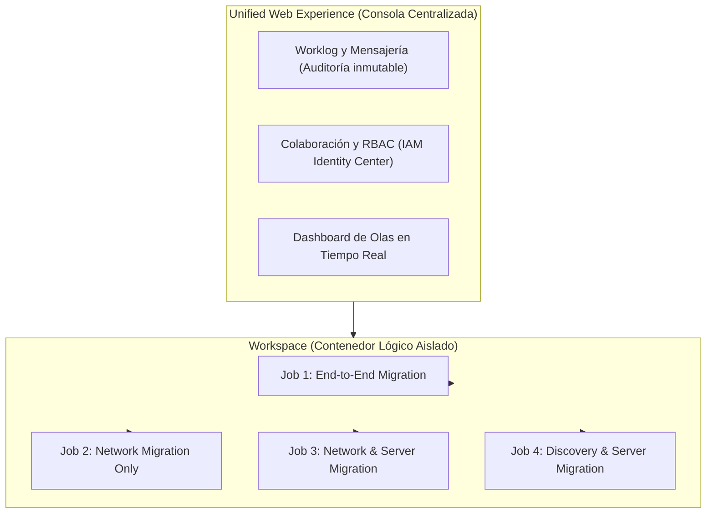
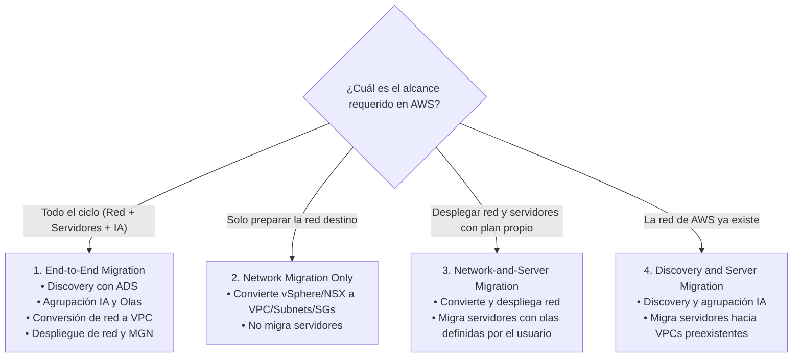
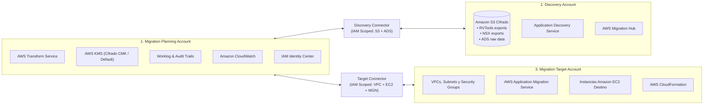
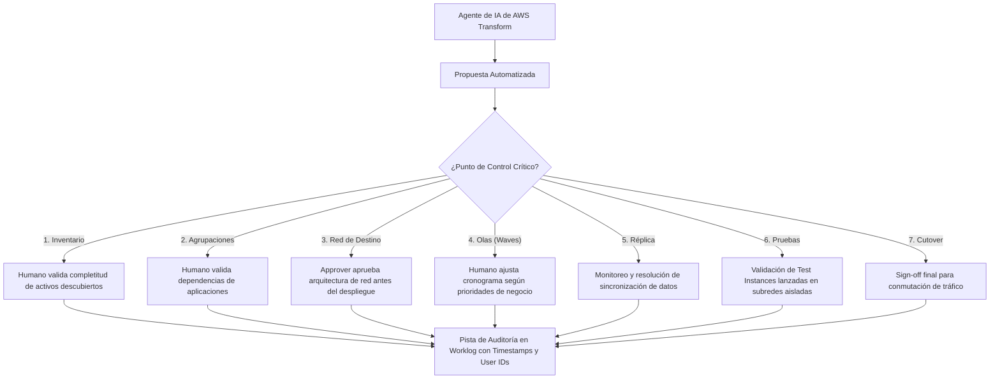

# AWS Transform for VMware

> [!abstract] Qué es este archivo
> Séptima lección del módulo **Migration and Modernization**. Analiza en profundidad el agente especializado
> **AWS Transform for VMware**, diseñado para resolver los dos mayores desafíos de migración desde vSphere:
> la **conversión automatizada de redes complejas de VMware hacia constructos de AWS (VPCs, subredes y Security Groups)**
> y la **orquestación de olas de migración (*migration waves*) conscientes de dependencias**.
>
> Detalla sus constructos centrales (**Workspaces**, **Jobs**, **Unified Web Experience**), los **cuatro tipos de jobs**,
> el modelo de **control de acceso basado en roles (RBAC con 4 perfiles)**, la **arquitectura de segregación en tres cuentas**
> (*Planning*, *Discovery* y *Target* conectadas mediante *Connectors* de menor privilegio), el marco de supervisión humana
> **Human-in-the-Loop (HITL)** y la integración nativa con **AWS Application Migration Service (MGN)** y **MAP 2.0**.
> Alineado con las tareas **4.2 y 4.3 del Dominio 4 del examen SAP-C02**.

> [!quote] La idea que ordena todo
> **“La inteligencia artificial acelera el mapeo de dependencias y la traducción de redes, pero el control humano gobierna las decisiones críticas.”**
> La arquitectura de tres cuentas de AWS Transform aísla estrictamente las actividades de descubrimiento del entorno de destino de producción, mientras que el marco HITL exige aprobación humana explícita antes de desplegar redes o ejecutar el cutover definitivo.

---

## Resumen en una frase

> Una plataforma agéntica que automatiza la migración masiva de **VMware a Amazon EC2** traduciendo redes vSphere/NSX
> a VPCs y orquestando réplicas con **AWS MGN**, operando bajo una **arquitectura segura de tres cuentas** (*Planning*,
> *Discovery* y *Target*), cuatro tipos de jobs, gobierno RBAC vía **IAM Identity Center** y un marco **Human-in-the-Loop**
> con registro auditable en el Worklog.

---

## 1. Los dos desafíos críticos de VMware y la solución agéntica

La migración tradicional de grandes granjas VMware vSphere hacia AWS suele estancarse en dos barreras de alta complejidad:
1. **Traducción de configuraciones de red:** Los entornos VMware utilizan constructos propietarios como *Distributed Virtual Switches (dvSwitches)*, *Port Groups*, políticas de aislamiento de red y topologías de **VMware NSX** que no tienen equivalencia uno a uno directa con las redes de AWS. Mapearlos manualmente a **VPCs, subredes públicas/privadas, tablas de enrutamiento y Security Groups** toma meses y genera riesgos de incompatibilidad.
2. **Orquestación de dependencias entre servidores:** Las aplicaciones empresariales rara vez corren aisladas. Si una base de datos se migra en una ola distinta a su servidor de aplicaciones, la latencia o la pérdida de conectividad puede tumbar el servicio productivo.

**AWS Transform for VMware** combina modelos de **IA/ML** con herramientas probadas (**AWS Application Discovery Service** y **AWS Application Migration Service - MGN**) para automatizar la traducción de red y agrupar servidores en **olas de migración conscientes de dependencias (*dependency-aware waves*)**, manteniendo supervisión humana (*Human-in-the-Loop*) en los puntos de decisión críticos.

---

## 2. Los constructos centrales: Workspaces, Jobs y Experiencia Web Unificada

El servicio organiza los proyectos de transformación a través de tres piezas modulares:

### 2.1 Workspace (Espacio de Trabajo)
- Actúa como el contenedor lógico y bloque de construcción de un proyecto de migración.
- Proporciona **aislamiento completo** para los datos recolectados, permisos, artefactos y actividades operativas.
- Permite a una corporación ejecutar múltiples proyectos de migración concurrentes con diferentes equipos, cuentas y requerimientos sin interferencia cruzada.

### 2.2 Unified Web Experience (Experiencia Web Unificada)
- Proporciona una interfaz web única que guía a los arquitectos desde la fase de descubrimiento hasta el corte (*cutover*).
- Elimina la necesidad de alternar entre múltiples consolas de AWS (**Organizations**, **Discovery Service**, **MGN**, **CloudFormation**).
- Incluye herramientas de comunicación integradas: registro de eventos (*worklogs*) y mensajería para resolver bloqueos entre equipos con marcas de tiempo auditables.

### 2.3 Control de Acceso Basado en Roles (RBAC con IAM Identity Center)
Para cumplir con el principio de menor privilegio, el acceso al workspace se gestiona mediante cuatro roles estandarizados:

| Rol de Workspace | Permisos y Alcance Operativo | Qué NO puede hacer |
| --- | --- | --- |
| **Administrator** | Control total sobre el workspace: gestión de usuarios, roles, conectores entre cuentas, jobs y artefactos. | N/A (máximo privilegio). |
| **Approver** | Permisos de Contributor más la facultad exclusiva de **aprobar acciones críticas** (aprobación de arquitectura de red, fusiones y lanzamientos a producción). | No administra usuarios ni borra workspaces. |
| **Contributor** | Lectura, chat, ejecución e interacción con los jobs y agentes de IA. | **No puede aprobar** despliegues ni acciones críticas. |
| **View only** | Acceso de solo lectura: visualizar el progreso del workspace y descargar artefactos generados. | No realiza cambios ni ejecuta jobs. |

---

## 3. Los cuatro tipos de trabajo de migración (Migration Job Types)

AWS Transform for VMware permite seleccionar entre cuatro modalidades de trabajo según la madurez y necesidades del cliente:

| Job Type | Descubrimiento y Olas IA | Conversión y Despliegue de Red | Replicación de Servidores (MGN) | Cuándo se elige en el examen |
| --- | --- | --- | --- | --- |
| **End-to-end migration** | **Sí (Automático)** | **Sí (Automático)** | **Sí (Automático)** | Migración integral desde cero donde no existe infraestructura previa en AWS y se desea que la IA mapee dependencias y construya la red. |
| **Network migration only** | No | **Sí (Exclusivo)** | No | Cuando el equipo de redes necesita validar y desplegar la topología de VPCs y Security Groups antes de planificar los servidores. |
| **Network-and-server migration** | No (Trae su propio plan) | **Sí (Automático)** | **Sí (Automático)** | Clientes que ya tienen un plan de olas definido manualmente por el negocio y solo necesitan convertir la red y migrar servidores. |
| **Discovery and server migration** | **Sí (Automático)** | **No** (Usa red existente) | **Sí (Automático)** | La Landing Zone y las VPCs corporativas **ya existen**; la IA mapea dependencias y mueve los servidores a esas redes preexistentes. |

---

## 4. La arquitectura de segregación en tres cuentas (Three-Account Architecture)

Para garantizar aislamiento de seguridad y evitar que las herramientas de descubrimiento afecten los entornos de destino, AWS Transform opera mediante un modelo de **tres cuentas de AWS**:

### 4.1 Rol y responsabilidades de cada cuenta
1. **Migration Planning Account (Cuenta de Planificación):**
   - Aloja el servicio **AWS Transform**, la consola web y los agentes de IA.
   - Cifra todos los datos almacenados mediante **AWS KMS** (clave administrada por AWS o CMK del cliente).
   - Registra auditorías en el Worklog y telemetría de eventos en **Amazon CloudWatch**.
   - Gestiona usuarios y perfiles RBAC a través de **IAM Identity Center** dentro de la organización de **AWS Organizations**.
2. **Discovery Account (Cuenta de Descubrimiento):**
   - Almacena de forma segura los datos recolectados del entorno VMware on-premises: buckets S3 cifrados con exports de **RVTools**, configuraciones de **VMware NSX** y datos de **Application Discovery Service**.
   - Contiene el conector *Discovery Account Connector*, con permisos estrictos de lectura y análisis sin facultades para provisionar infraestructura.
3. **Migration Target Account (Cuenta de Destino de Migración):**
   - Es la cuenta donde se aprovisionan los recursos finales: VPCs, subredes, Security Groups e instancias Amazon EC2.
   - El conector *Target Account Connector* gestiona operaciones de **AWS CloudFormation** y **AWS Application Migration Service (MGN)**.
   - **Garantía de seguridad:** El aislamiento físico entre la cuenta de descubrimiento y la de destino asegura que ningún script o dato de descubrimiento pueda impactar de forma inadvertida los entornos productivos de destino.

> [!important] Aprobación explícita de Connectors
> Los conectores no se enlazan de forma silenciosa. Exigen que un **administrador inicie sesión en la consola de la cuenta respectiva (Discovery o Target)** y apruebe explícitamente el enlace de confianza (*trust relationship*) generado por AWS Transform.

---

## 5. El marco Human-in-the-Loop (HITL) y gobernanza de auditoría

A pesar del alto grado de automatización que proveen los agentes de IA, AWS Transform implementa un marco **Human-in-the-Loop (HITL)** para someter a revisión humana las decisiones que conllevan riesgo para el negocio:

### 5.1 Las 7 Decisiones HITL Obligatorias
1. **Validación del inventario descubierto:** Confirmar que no faltan servidores ni almacenamiento.
2. **Validación de agrupaciones de aplicaciones:** Verificar que los grupos sugeridos por la IA coincidan con la lógica de negocio.
3. **Aprobación de la arquitectura de red final:** El rol *Approver* debe autorizar los VPCs, subredes y Security Groups antes de que CloudFormation los cree.
4. **Actualización de planes de olas:** Ajustar fechas y prioridades según calendarios corporativos (cierres contables, picos de venta).
5. **Monitoreo de estado de replicación:** Supervisar la réplica continua de bloques y resolver incidencias de sincronización.
6. **Validación de instancias de prueba (*Test Instances*):** Comprobar que las VMs lanzadas en subredes de prueba operan correctamente antes de tocar producción.
7. **Confirmación y sign-off del cutover:** Aprobación ejecutiva para iniciar el corte de tráfico definitivo.

---

## 6. Integración con Application Migration Service (MGN) y MAP 2.0

La ejecución real del traslado de servidores se delega en **AWS Application Migration Service (MGN)**, potenciado por AWS Transform:
- **Preparación automatizada de olas:** MGN inicia la réplica de bloques sincronizada para todos los servidores que componen una ola específica.
- **Recomendaciones inteligentes de Right-Sizing:** La IA ajusta el tamaño de las instancias EC2 en función de la telemetría histórica de consumo real (CPU, RAM, IOPS) recolectada en la fase de descubrimiento.
- **Etiquetado automático para MAP 2.0 (*Migration Acceleration Program*):** Aplica automáticamente los tags requeridos por AWS para certificar el consumo y acreditar los subsidios y créditos financieros del programa MAP.
- **Automatización posterior al lanzamiento (*Post-launch automation*):** Despliega agentes de **AWS Systems Manager (SSM)** para inicializar backups, parches y monitoreo en las instancias recién creadas.

---

## 7. Traducción del contenido

> [!info] Sección de referencia (opcional)
> Esto es la **traducción fiel** de la transcripción de la demostración práctica y de los textos oficiales de Skill Builder. Lo accionable para el examen se encuentra estructurado en las secciones 1 a 6 y se sintetiza en la sección 9.

### 7.1 Transcripción de la demostración: Crear un Job en AWS Transform for VMware

> *"Bienvenidos a esta demostración sobre cómo crear un job en **AWS Transform for VMware**.*
>
> *Para comenzar, configuremos **AWS IAM Identity Center**. En la consola de administración de AWS, en la barra de búsqueda, ingresen 'IAM Identity Center' y elíjanlo de la lista. Primero, habiliten este servicio en su Región de AWS seleccionando **Enable**. En la página de habilitación con **AWS Organizations**, elijan **Enable**. Aparece un banner de éxito indicando que crearon exitosamente la instancia de cuenta de IAM Identity Center. En el panel de control, pueden configurar asignaciones de usuarios y grupos de aplicaciones y configurar la autenticación multifactor (MFA).*
>
> *Ahora, habiliten **AWS Transform**. Naveguen al servicio AWS Transform. En la consola de administración de AWS, busquen 'AWS Transform' y elíjanlo. En la consola de AWS Transform, elijan **Get started**. Para la **clave de cifrado (*Encryption key*)**, pueden elegir entre usar una clave administrada por defecto o una clave personalizada. Para esta demostración, elijan **Default AWS managed key**. Luego, elijan **Enable AWS Transform**.*
>
> *Después de habilitar Transform, pueden gestionar el acceso de los usuarios. Elijan **Manage users**. En la página de usuarios y grupos, elijan **Assign user and groups**, seleccionen **Add and assign new users** y elijan **Next**. Ingresen el nombre de usuario, nombre, apellido y dirección de correo electrónico, y confírmenla. Elijan **Next**, revisen los detalles y seleccionen **Add**. Después de que el usuario esté autenticado y confirmado, en el menú de navegación, elijan **Settings**. Luego, elijan el ícono junto a la **URL de la aplicación web** para copiar la URL. Peguen la URL en una nueva ventana del navegador.*
>
> *A continuación, en la página de la aplicación web, ingresen el nombre de usuario y la contraseña del nuevo usuario. En el espacio de trabajo de AWS Transform, **elijan su tipo de migración**. Para esta demostración, elijan **Migrate VMware applications to Amazon EC2**. Pueden elegir entre varios tipos de trabajos diferentes. Para esta demostración, elijan **End-to-End Migration**. En el cuadro de texto, ingresen '1'. Para confirmar los detalles del trabajo, en el cuadro de texto ingresen 'Yes'. Luego, para crear su trabajo de migración de VMware, elijan **Create job**. En el panel Job Plan, pueden ver cómo se inicia el plan de trabajo.*
>
> *Ahora, exploren las opciones de administración de colaboradores. Elijan la pestaña **Collaboration**. Pueden invitar a otros usuarios con diferentes roles (**Administrator, Contributor, Approver, View only**). Elijan el menú junto al usuario al que desean cambiar los roles y elijan el rol correspondiente.*
>
> *A continuación, **conecten una cuenta de descubrimiento (*discovery account*)** que contendrá sus datos locales. Debido a que este es un espacio de trabajo nuevo, creen una nueva cuenta de descubrimiento. En el panel Job Plan, elijan **Create or select connectors**. Luego, en el cuadro de texto, ingresen el ID de la cuenta de AWS que desean utilizar. Para el cifrado, elijan **Use a default Amazon S3 managed key (SSE-S3)**. Recibirán un enlace de verificación. Elijan **Copy verification link**.*
>
> *Inicien sesión en la consola de la **cuenta de descubrimiento**. Para aprobar la cuenta, en la página de solicitud de creación del conector de AWS Transform, elijan **Approve**. Aparece un cuadro de diálogo de estado de configuración del conector que confirma que la configuración de la conexión está completa. Después de aprobar la cuenta de descubrimiento, regresen a la consola de AWS Transform y elijan **Send to AWS Transform**. Gracias por su participación."*

---

## 8. Cierre conceptual: Cuadro de roles, job types y arquitectura de cuentas

| Dimensión | Componente | Función y Comportamiento Técnico |
| --- | --- | --- |
| **Segregación de Cuentas** | **Migration Planning Account** | Aloja AWS Transform, KMS, IAM Identity Center, Worklog y CloudWatch. |
| **Segregación de Cuentas** | **Discovery Account** | Almacena datos de RVTools, NSX y ADS en S3 cifrado; aislada de la producción de destino. |
| **Segregación de Cuentas** | **Migration Target Account** | Despliega VPCs, subredes, CloudFormation y réplica de servidores con AWS MGN. |
| **Gobernanza RBAC** | **Administrator** | Control total de workspaces, jobs y gestión de usuarios. |
| **Gobernanza RBAC** | **Approver** | Autoriza hitos críticos: arquitectura de red, fusiones de planes y cutover. |
| **Gobernanza RBAC** | **Contributor** | Ejecuta jobs, analiza datos e interactúa con agentes de IA sin facultades de aprobación. |
| **Gobernanza RBAC** | **View only** | Auditoría y visualización de progreso y artefactos sin permisos de modificación. |
| **Job Type** | **End-to-end migration** | Ciclo completo: Discovery + Olas IA + Red vSphere/NSX a VPC + Réplica con MGN. |
| **Job Type** | **Network migration only** | Convierte y despliega únicamente la infraestructura de red en AWS (sin servidores). |
| **Job Type** | **Network & server migration** | Despliega red y servidores, permitiendo que el usuario aporte su propio plan de olas. |
| **Job Type** | **Discovery & server migration** | Mapeo de dependencias y migración de servidores directamente hacia redes AWS preexistentes. |

---

## 9. Para el examen (SAP-C02)

> [!important] Lo que hay que retener
> 1. **Los dos retos que resuelve AWS Transform for VMware.** (1) La traducción automatizada de topologías de red VMware (dvSwitches, port groups, NSX) a constructos de VPC, y (2) la orquestación de olas de migración conscientes de dependencias.
> 2. **Arquitectura de Tres Cuentas obligatoria.** Para cumplir con las directivas de seguridad enterprise, se segregan tres cuentas: **Planning Account** (Transform/IAM/KMS), **Discovery Account** (datos de inventario S3/ADS) y **Target Account** (despliegue de VPCs/EC2/MGN).
> 3. **Conectores aprobados explícitamente.** Los *Connectors* entre cuentas operan bajo mínimo privilegio y exigen la aprobación manual de un administrador autenticado en la cuenta de destino/descubrimiento.
> 4. **Cuándo usar cada Job Type:**
>    - Si no hay nada en AWS: **End-to-end migration**.
>    - Si las VPCs y subredes ya están diseñadas y listas: **Discovery and server migration**.
>    - Si solo se requiere preparar la red: **Network migration only**.
>    - Si el negocio impone su propio calendario de olas: **Network-and-server migration**.
> 5. **El rol de Approver en el framework HITL.** Ni los administradores comunes ni los contribuyentes aprueban cambios de arquitectura de red sin el rol explícito de **Approver**; garantiza separación de funciones (*separation of duties*).
> 6. **Pistas de auditoría inmutables (Worklog).** Cada decisión, comentario, asignación de olas y aprobación humana queda registrada con marca temporal de microsegundos y usuario en el **AWS Transform Worklog**, integrable con **Amazon CloudWatch**.
> 7. **Compatibilidad con RVTools y NSX.** En entornos desconectados u offline con restricciones de red, AWS Transform puede ingerir inventarios generados por **RVTools** y configuraciones exportadas de **VMware NSX** mediante buckets S3 cifrados.
> 8. **Etiquetado automático para MAP 2.0.** La integración con Application Migration Service aplica automáticamente los tags requeridos para acceder a los beneficios financieros del *Migration Acceleration Program*.
> 9. **Pruebas no destructivas previas al Cutover.** En el flujo HITL, es obligatorio lanzar y validar instancias de prueba (*Test Instances*) en subredes aisladas antes de autorizar la conmutación definitiva de tráfico.
> 10. **Aislamiento por Workspace.** Múltiples unidades de negocio o aplicaciones reguladas pueden coexistir en la misma organización mediante workspaces independientes que aíslan completamente datos, roles y artefactos.

> [!warning] Trampa clásica del examen
> **Escenario:** Una compañía necesita migrar 300 máquinas virtuales desde un clúster VMware vSphere hacia AWS. La empresa ya cuenta con una Landing Zone de AWS Control Tower completamente desplegada, con VPCs, subredes y tablas de enrutamiento ya aprovisionadas y auditadas por el equipo de redes. El arquitecto propone ejecutar un trabajo de tipo *End-to-End Migration* en AWS Transform for VMware.
> **La trampa:** Seleccionar *End-to-End Migration*.
> **Por qué falla:** El trabajo *End-to-End* incluye la fase de conversión y despliegue automático de redes (creando nuevas VPCs y subredes), lo que sobrescribiría o duplicaría innecesariamente la topología de red existente aprobada por gobernanza.
> **La solución correcta:** Seleccionar el job type **Discovery and server migration**. Esta opción aprovecha el descubrimiento y la agrupación inteligente de dependencias por IA, pero ejecuta la replicación de servidores directamente sobre la infraestructura de red de AWS preexistente.

---

## Relacionado

- [[AWS Solutions Architect Advanced - Migration and Modernization]] *(índice del módulo)*
- [[AWS Transform Overview]] — lección 06 del módulo (visión general de IA agéntica)
- [[Migration Tools]] — lección 05 del módulo (Control Tower y AWS DataSync)
- [[The Migration Process]] — lección 04 del módulo (fase Mobilize, 7 Rs y workflow de migración)
- [[Preparing for Migration]] — lección 03 del módulo (preparación y evaluación organizativa)
- [[Gathering the Customer Requirements - Migration]] — lección 02 del módulo (caso Utilities: gran entorno VMware)
- [[AWS Organizations and IAM Identity Center]] — gobierno de identidades y SSO
- [[4.2 Determinar el enfoque de migración óptimo para las cargas de trabajo existentes]] — tarea de examen 4.2
- [[4.3 Determinar una nueva arquitectura para las cargas de trabajo existentes]] — tarea de examen 4.3

Siguiente paso del módulo: **Lección 08**.

---

## Registro de integración

| Fecha | Cambio | Motivo / Detalle |
| --- | --- | --- |
| 2026-10-29 | Creación de la nota inicial | Alta de la séptima lección del módulo *Migration and Modernization*. Se estructura el agente AWS Transform for VMware: los constructos centrales (Workspaces, Jobs, Unified Web Experience), los 4 tipos de jobs de migración, el modelo RBAC con IAM Identity Center, la arquitectura de segregación en 3 cuentas (Planning, Discovery, Target), el framework Human-in-the-Loop (HITL) con sus 7 puntos de control y la transcripción completa de la demostración práctica para el examen SAP-C02. |
