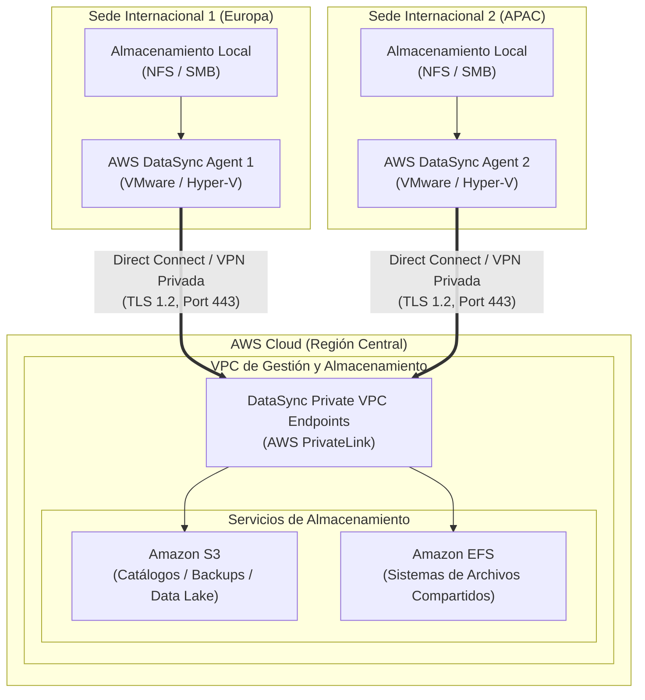
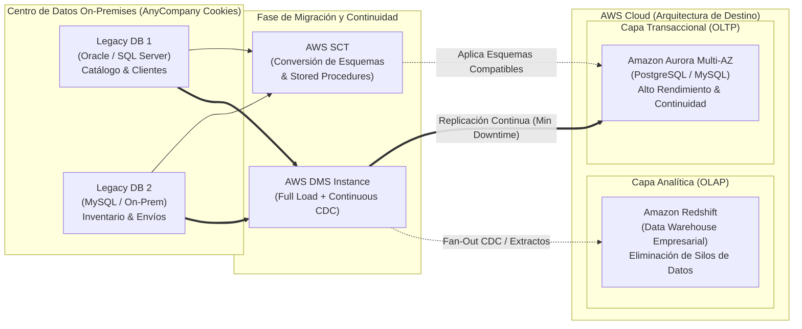

# Activity: Architecture Challenge — Migration and Modernization

> [!abstract] Qué es este archivo
> Decimoséptima lección y **evaluación integradora de cierre** del curso *AWS Solutions Architect Advanced - Migration and Modernization*.
> 
> Plantea el caso de **AnyCompany Cookies**, una panadería artesanal que escaló a empresa global de confitería con múltiples canales de venta, infraestructura *on-premises* obsoleta, silos de bases de datos heterogéneas y cuellos de botella en la transferencia de datos entre continentes.
> 
> La actividad consta de **tres desafíos en dos partes cada uno** (6 Knowledge Checks en total): primero se seleccionan **TRES** soluciones viables de un grupo de seis, y luego se determina **la solución ÓPTIMA (UNA)** ante un análisis de necesidades específicas y de continuidad operativa.
>
> **Disambiguación:** El archivo lleva el sufijo `- Migration` para distinguirse unívocamente de las actividades finales de *Multi-Account*, *Networking* y *Security*.

> [!quote] La idea que ordena todo
> **La primera pregunta premia la cobertura de herramientas viables; la segunda exige simpatía mecánica y precisión arquitectónica.** Identificar servicios compatibles con la migración es el primer paso; determinar cuál resuelve el cuello de botella de latencia global, cuál descubre dependencias ocultas mediante IA agéntica sin alterar producción, y cuál sostiene la replicación continua heterogénea sin tiempo de inactividad es lo que aprueba el examen SAP-C02.

> [!success] Resultado del intento
> **6 de 6 correctas (100 % de efectividad)** en Skill Builder.
> Se superaron con éxito las tres trampas clásicas de diseño:
> 1. Descartar transferencias masivas puntuales o por Internet público en favor de **agentes distribuidos de AWS DataSync con VPC Endpoints privados**.
> 2. Priorizar la IA agéntica y el mapeo de dependencias de **AWS Transform** antes de ejecutar cualquier migración *lift-and-shift* (anti-patrón de migrar primero y descubrir después con MGN).
> 3. Enfocar la fase inicial de bases de datos en la **continuidad del negocio con AWS DMS + AWS SCT**, en lugar de imponer paradas programadas destructivas (*bulk export/import*).

---

## ⚡ Respuestas rápidas

| Desafío | Parte | Requisito evaluado | Respuesta correcta | Justificación técnica sintética |
| :---: | :---: | :--- | :---: | :--- |
| **1** | **A** (Elige 3) | Sincronización global y disponibilidad de datos | **B, D, F** | **AWS DataSync** automatizado con cifrado/integridad (B), agentes distribuidos con VPC Endpoints privados (D) y arquitectura multihilo paralela con tareas programadas (F). |
| **1** | **B** (Elige 1) | Implementación óptima para consistencia global | **D** | **Desplegar agentes DataSync en cada sede internacional** sincronizando hacia almacenamiento centralizado en AWS mediante **VPC Endpoints privados**, evitando la Internet pública. |
| **2** | **A** (Elige 3) | Estrategia de modernización de aplicaciones legadas | **A, B, F** | **AWS Transform** para evaluación y mapeo de dependencias con IA (A), migración por fases con **AWS DMS** hacia RDS/Aurora (B) y **AWS Application Discovery Service** para inventario (F). |
| **2** | **B** (Elige 1) | Servicio óptimo para entender dependencias previas | **A** | **AWS Transform**, que utiliza IA generativa y agéntica para descubrir, mapear y documentar dependencias complejas y compatibilidad antes de migrar. |
| **3** | **A** (Elige 3) | Consolidación y migración de bases de datos | **B, E, F** | **AWS DMS + SCT** para motores heterogéneos con mínimo *downtime* (B), **Amazon Aurora** como destino transaccional OLTP de alto rendimiento (E) y **Amazon Redshift** para *data warehousing* OLAP (F). |
| **3** | **B** (Elige 1) | Foco primario inicial para continuidad de negocio | **B** | **Utilizar AWS DMS con SCT** para replicar y convertir esquemas heterogéneos con mínimo *downtime*, garantizando continuidad operativa en la fase de transición. |

---

## 🍪 El caso: AnyCompany Cookies

### Perfil del negocio y modelo de operación
AnyCompany Cookies comenzó como una pequeña panadería artesanal de barrio y ha experimentado una rápida expansión global hasta convertirse en una firma internacional de confitería. Su modelo de negocio ha evolucionado drásticamente:
- **Canales de venta simultáneos:** Tiendas físicas minoristas (*retail*), plataformas de comercio electrónico (*e-commerce*), modelos de suscripción periódica y alianzas de distribución mayorista (*wholesale*).
- **Alcance geográfico:** Clientes y cadenas de suministro distribuidos en múltiples continentes y diferentes husos horarios.
- **Factores de éxito:** Calidad de ingredientes, perfiles de sabor exclusivos y servicio al cliente de alta fidelidad.

### Arquitectura actual y dolores operativos (*On-Premises*)

```
┌────────────────────────────────────────────────────────────────────────┐
│                   ANYCOMPANY COOKIES — HQ DATA CENTER                  │
│                                                                        │
│  ┌───────────────────────┐  Legacy Network   ┌───────────────────────┐ │
│  │ Legacy Apps:          │◄─────────────────►│ Aging DB Servers:     │ │
│  │ - Inventory Mgmt      │   (Batch Scripts, │ - Product Catalogs    │ │
│  │ - Order Processing    │    Manual FTP)    │ - Customer Profiles   │ │
│  │ - Financial & ERP     │                   │ - Supply Chain / Orders│ │
│  └───────────────────────┘                   └───────────────────────┘ │
└────────────────────────────────────▲───────────────────────────────────┘
                                     │
           Bottlenecks: Multi-region │ Latency & Data Drift
                                     ▼
 ┌──────────────────────┐  ┌──────────────────────┐  ┌──────────────────────┐
 │ International Site 1 │  │ International Site 2 │  │ International Site N │
 │ (Retail / Regional)  │  │ (Retail / Regional)  │  │ (Retail / Regional)  │
 └──────────────────────┘  └──────────────────────┘  └──────────────────────┘
```

| Dimensión | Estado actual (*Legacy*) | Dolor operativo / Impacto de negocio |
| :--- | :--- | :--- |
| **Infraestructura** | Servidores físicos en un centro de datos pequeño en la sede central (*HQ*). | Incapacidad de escalar ante picos estacionales de demanda (Navidad, San Valentín). |
| **Resiliencia y DR** | Sin capacidades formales de recuperación ante desastres (*Disaster Recovery*). | Alto riesgo de interrupción operativa y pérdida de pedidos internacionales. |
| **Transferencia de datos** | Procesamiento por lotes (*batch workflows*) y scripts manuales de archivos. | Cuellos de botella en la sincronización de inventario; pedidos rechazados o sobrevendidos. |
| **Aplicaciones** | Aplicaciones monolíticas legadas estrechamente acopladas. | Costos de mantenimiento elevados; lentitud para integrar nuevas APIs de *e-commerce*. |
| **Bases de datos** | Múltiples motores heterogéneos aislados en silos. | Silos de información, consultas analíticas lentas y falta de visión 360° del cliente. |

---

## 1. Desafío 1: Sincronización global y disponibilidad de datos

### 1.1 Contexto del desafío
Con operaciones en múltiples regiones del mundo, AnyCompany Cookies necesita una arquitectura de datos modernizada que proporcione **acceso consistente y en tiempo real al inventario, precios e información de clientes**, manteniendo una estricta **integridad de datos** y cumpliendo con requisitos de seguridad a través de fronteras internacionales.

---

### 1.2 Knowledge Check 1.A — Selección múltiple (Elegir TRES)

> **Pregunta:** Como arquitecto de soluciones que planifica su estrategia de migración, ¿qué enfoques serían más efectivos para abordar sus requisitos de sincronización de datos globales? (Seleccione TRES).

#### Opciones evaluadas y rationale técnico

* **A. Confiar únicamente en transferencias manuales de archivos y scripts para mover datos entre ubicaciones internacionales.**
  > ❌ **Falso / Anti-patrón:** Los scripts manuales carecen de validación de integridad automática, no escalan, introducen demoras humanas y son altamente propensos a fallos silenciosos y brechas de seguridad.
* **B. Implementar AWS DataSync con capacidades de automatización para mantener la coherencia de datos en tiempo real entre ubicaciones, aprovechando sus características integradas de seguridad como cifrado y validación de integridad.**
  > 🟢 **CORRECTA:** DataSync ofrece automatización integral, cifrado en tránsito (TLS 1.2) y en reposo, y verificación obligatoria mediante *checksums* de bloque al final de cada transferencia.
* **C. Para simplificar la solución, usar AWS Transfer Family como la única solución para sincronizar todos los tipos de datos entre ubicaciones.**
  > ❌ **Falso / Distractor:** AWS Transfer Family gestiona puntos de enlace SFTP/FTPS/FTP sobre S3 o EFS para flujos de clientes B2B. No es un motor de sincronización distribuida bidireccional continua con agentes locales y optimización WAN.
* **D. Desplegar agentes de DataSync en cada ubicación internacional y configurar tareas de transferencia para sincronizar con servicios de almacenamiento centralizados de AWS mediante VPC Endpoints privados.**
  > 🟢 **CORRECTA:** Desplegar un agente virtual DataSync en cada sitio local permite leer almacenamiento NFS/SMB local y enviar datos a AWS a través de AWS Direct Connect o AWS Site-to-Site VPN hacia VPC Endpoints privados (AWS PrivateLink), evitando totalmente la Internet pública.
* **E. Instalar réplicas de bases de datos individuales en cada ubicación sin un mecanismo de sincronización centralizado.**
  > ❌ **Falso / Anti-patrón:** Distribuir bases de datos locales sin un motor de sincronización o consenso genera divergencia de datos inmediata (*split-brain*, inconsistencia de stock y colisión de precios).
* **F. Utilizar la arquitectura paralela y multihilo de DataSync combinada con tareas programadas para optimizar el rendimiento de sincronización de datos y el uso del ancho de banda.**
  > 🟢 **CORRECTA:** El protocolo propietario de red de DataSync realiza transferencias multihilo que saturan eficientemente los enlaces WAN disponibles, permitiendo programar tareas periódicas y limitar el ancho de banda (*bandwidth throttling*) para no afectar la operativa diaria.

---

### 1.3 Knowledge Check 1.B — Decisión óptima (Elegir UNA)

> **Pregunta:** Dado que AnyCompany Cookies requiere consistencia de datos en tiempo real para inventario, precios e información de clientes en múltiples ubicaciones internacionales, ¿qué enfoque específico de implementación de AWS DataSync abordaría MEJOR sus requisitos de sincronización global?

#### Opciones evaluadas y rationale técnico

* **A. Utilizar la arquitectura paralela y multihilo de DataSync combinada con tareas programadas para optimizar el rendimiento de sincronización de datos y el uso del ancho de banda.**
  > ⚠️ **Incompleta:** Describe una capacidad del motor de DataSync, pero no define la topología de red ni cómo se conectan las sedes remotas de forma segura.
* **B. Desplegar un único agente de AWS DataSync en una ubicación central y ejecutar una transferencia masiva única (*one-time bulk transfer*) para copiar todos los datos durante la configuración inicial.**
  > ❌ **Falso / Anti-patrón:** Un agente central no puede leer eficientemente sistemas de archivos remotos distribuidos, y una transferencia masiva única no resuelve el requisito de consistencia y sincronización continua en tiempo real.
* **C. Implementar AWS DataSync con capacidades de automatización para mantener la coherencia de datos en tiempo real entre ubicaciones, aprovechando sus características integradas de seguridad como cifrado y validación de integridad.**
  > ⚠️ **Incompleta:** Es una declaración conceptual válida de capacidades, pero carece del diseño arquitectónico de implementación concreta.
* **D. Desplegar agentes de DataSync en cada ubicación internacional y configurar tareas de transferencia para sincronizar con servicios de almacenamiento centralizados de AWS mediante VPC Endpoints privados.**
  > 🟢 **RESPUESTA ÓPTIMA:** Proporciona la **arquitectura distribuida exacta**. Colocar un DataSync Agent en cada sede internacional sitúa la computación de lectura cerca del dato de origen (simpatía mecánica). La conexión hacia AWS mediante **Private VPC Endpoints** garantiza que los datos sensibles de clientes, inventarios y tarifas viajen aislados por túneles privados (Direct Connect/VPN) sin exponerse a la Internet pública, maximizando la seguridad y cumpliendo con las regulaciones de transferencia internacional.

---

### 1.4 Diagrama arquitectónico del Desafío 1: Topología global de DataSync



---

## 2. Desafío 2: Estrategia de modernización de aplicaciones legadas

### 2.1 Contexto del desafío
Los sistemas centrales de gestión de inventario y procesamiento de pedidos de AnyCompany Cookies están desarrollados sobre tecnologías anticuadas. Son costosos de mantener, difíciles de integrar con pasarelas de pago y plataformas web modernas, y carecen de la elasticidad necesaria para soportar picos de venta mundiales.

---

### 2.2 Knowledge Check 2.A — Selección múltiple (Elegir TRES)

> **Pregunta:** ¿Qué estrategias de migración y servicios de AWS recomendaría para modernizar estas aplicaciones empresariales centrales mientras se minimiza la interrupción de las operaciones en curso? (Seleccione TRES).

#### Opciones evaluadas y rationale técnico

* **A. Utilizar AWS Transform para evaluar y planificar la migración, proporcionando visibilidad sobre las dependencias y los posibles problemas de compatibilidad.**
  > 🟢 **CORRECTA:** AWS Transform emplea capacidades de IA agéntica y generativa para analizar el entorno de origen, mapear dependencias complejas entre servicios y clasificar el inventario en olas (*waves*) de migración con predicción de riesgos.
* **B. Implementar un enfoque de migración por fases utilizando AWS Database Migration Service (DMS) para mover datos gradualmente desde sistemas legados hacia Amazon RDS o Aurora.**
  > 🟢 **CORRECTA:** La migración en fases (*phased migration*) desacopla el riesgo. DMS mantiene replicación continua de cambios (CDC) entre el origen legado y RDS/Aurora, permitiendo cambiar componentes de la aplicación uno a uno sin interrumpir las ventas.
* **C. Reemplazar inmediatamente todos los sistemas existentes con tecnologías Serverless como AWS Lambda y Amazon DynamoDB.**
  > ❌ **Falso / Anti-patrón:** La reescritura radical inmediata (*Big-Bang modernization*) acarrea un riesgo operacional intolerable para una empresa en producción activa. El patrón adecuado es modernización evolutiva (*Strangler Fig*).
* **D. Mantener los sistemas locales actuales y usar AWS Direct Connect únicamente con fines de copia de seguridad de datos.**
  > ❌ **Falso / Distractor:** No aborda el problema de obsolescencia ni moderniza las aplicaciones; mantiene toda la deuda técnica y los costos operativos en el centro de datos local.
* **E. Migrar todos los sistemas simultáneamente utilizando un enfoque de "lift and shift" sin modificaciones en las aplicaciones.**
  > ❌ **Falso / Anti-patrón:** Un *lift and shift* (Rehost) masivo y simultáneo de todas las aplicaciones monolíticas traslada las ineficiencias, cuellos de botella y acoplamiento a la nube sin resolver las limitaciones arquitectónicas, además de aumentar el riesgo de corte masivo de servicio.
* **F. Emplear AWS Application Discovery Service para inventariar las aplicaciones existentes y sus dependencias antes de la migración.**
  > 🟢 **CORRECTA:** AWS Application Discovery Service (ADS) recopila datos de servidores locales (CPU, memoria, disco y conexiones de red TCP entrantes/salientes), alimentando el análisis previo necesario para evitar roturas de integración.

---

### 2.3 Knowledge Check 2.B — Decisión óptima (Elegir UNA)

> **Pregunta:** Dado que los sistemas de inventario y procesamiento de pedidos de AnyCompany Cookies están basados en tecnologías obsoletas, costosas y difíciles de integrar, ¿qué servicio específico de AWS sería MÁS valioso para comprender las dependencias de las aplicaciones ANTES de comenzar el esfuerzo de modernización?

#### Opciones evaluadas y rationale técnico

* **A. Utilizar AWS Transform para evaluar y planificar la migración, proporcionando visibilidad sobre las dependencias y los posibles problemas de compatibilidad.**
  > 🟢 **RESPUESTA ÓPTIMA:** Diseñado específicamente para la fase de evaluación (*Assess & Mobilize*). AWS Transform va un paso más allá del simple inventario de red: utiliza **IA agéntica y modelos de razonamiento (Graph Neural Networks y Generative AI)** para mapear dependencias a nivel lógico de aplicación, sugerir la estrategia de las 7 Rs óptima para cada componente y alertar sobre incompatibilidades de código o librerías antes de iniciar la migración.
* **B. Implementar un enfoque de migración por fases utilizando AWS Database Migration Service (DMS) para mover datos gradualmente desde sistemas legados hacia Amazon RDS o Aurora.**
  > ⚠️ **Falso para esta fase:** DMS es una herramienta de ejecución de migración y replicación de datos; no descubre ni mapea dependencias de código entre aplicaciones de negocio.
* **C. Emplear AWS Application Discovery Service para inventariar las aplicaciones existentes y sus dependencias antes de la migración.**
  > ⚠️ **Subóptima frente a AWS Transform:** ADS captura datos de rendimiento y conexiones de red IP/puerto (telemetría de servidor), pero no ofrece la inteligencia contextual, análisis de compatibilidad de modernización ni la planificación asistida por IA que aporta AWS Transform.
* **D. Usar AWS Application Migration Service (MGN) para migrar las cargas de trabajo hacia AWS y establecer sus dependencias en el nuevo entorno.**
  > ❌ **Falso / Anti-patrón grave:** Descubrir dependencias *después* de migrar los servidores a AWS ("migrar a ciegas y ver qué se rompe") genera tiempos de inactividad no planificados, costos de red inesperados y fallos en cascada.

---

## 3. Desafío 3: Consolidación y migración de bases de datos

### 3.1 Contexto del desafío
AnyCompany Cookies gestiona múltiples motores de bases de datos relacionales legados y heterogéneos (ej. Microsoft SQL Server, Oracle, MySQL antiguos) que generan **silos de información** aislados y graves cuellos de botella de rendimiento. Se requiere una estrategia que consolide la información, mejore la capacidad analítica y garantice **cero o mínimo tiempo de inactividad** durante el cambio.

---

### 3.2 Knowledge Check 3.A — Selección múltiple (Elegir TRES)

> **Pregunta:** ¿Qué combinación de servicios de AWS y prácticas de migración abordaría mejor sus desafíos de bases de datos? (Seleccione TRES).

#### Opciones evaluadas y rationale técnico

* **A. Utilizar AWS Transfer Family (SFTP/FTPS) como la herramienta principal de migración de bases de datos.**
  > ❌ **Falso / Distractor:** Transfer Family transfiere ficheros planos. No tiene capacidad de interpretar motores de bases de datos, traducir tipos de datos ni capturar cambios transaccionales continuos (*CDC*).
* **B. Utilizar AWS Database Migration Service (AWS DMS) con AWS Schema Conversion Tool (SCT) para migrar bases de datos heterogéneas minimizando el tiempo de inactividad.**
  > 🟢 **CORRECTA:** AWS SCT analiza los motores de origen, traduce esquemas, vistas, procedimientos almacenados y disparadores hacia motores de AWS, mientras que AWS DMS ejecuta la carga completa (*Full Load*) y mantiene la sincronización transaccional continua (*Ongoing CDC*) hasta el corte final.
* **C. Migrar todas las bases de datos a una única instancia de Amazon RDS para reducir la complejidad.**
  > ❌ **Falso / Anti-patrón:** Consolidar todas las bases de datos transaccionales, de inventario y de reportes en una sola instancia de RDS genera un punto único de falla (*SPOF*), colisión de recursos (*noisy neighbor*) e ignora las ventajas de desacoplar OLTP de OLAP.
* **D. Utilizar AWS Application Migration Service (MGN) como la solución principal para la consolidación de bases de datos.**
  > ❌ **Falso / Distractor:** AWS MGN es una herramienta de replicación a nivel de bloques a nivel de sistema operativo para servidores completos (*Rehost*). No realiza conversión de esquemas, optimización de motores ni consolidación analítica.
* **E. Implementar Amazon Aurora como la base de datos de destino para mejorar el rendimiento y habilitar mejores capacidades analíticas.**
  > 🟢 **CORRECTA:** Amazon Aurora (compatible con PostgreSQL/MySQL) ofrece hasta 5 veces el rendimiento de MySQL estándar, almacenamiento distribuido autogestionado con 6 copias a través de 3 AZs y réplicas de lectura de baja latencia ideales para consultas operativas.
* **F. Migrar a Amazon Redshift para cargas de trabajo de almacenamiento de datos (*data warehousing*) y analítica para eliminar los silos de datos.**
  > 🟢 **CORRECTA:** Redshift proporciona almacenamiento columnar y procesamiento masivamente paralelo (*MPP*), permitiendo unificar la telemetría de ventas, inventario y marketing para resolver los silos de información sin sobrecargar las bases transaccionales OLTP.

---

### 3.3 Knowledge Check 3.B — Decisión óptima (Elegir UNA)

> **Pregunta:** Dado que AnyCompany Cookies ha decidido proceder con la migración de bases de datos, ¿cuál debe ser su ENFOQUE PRIMARIO durante la FASE INICIAL de migración para garantizar la **continuidad del negocio** mientras realizan la transición desde su entorno de bases de datos legadas heterogéneas?

#### Opciones evaluadas y rationale técnico

* **A. Priorizar la realización de una exportación completa única de las bases de datos legadas y cargar los datos en las bases de destino durante una ventana de inactividad programada antes de cambiar las aplicaciones.**
  > ❌ **Falso / Anti-patrón:** En un negocio global de confitería con pedidos en línea las 24 horas del día a través de múltiples husos horarios, una ventana de inactividad masiva para exportación e importación es comercialmente inaceptable y conlleva un alto riesgo de fallo.
* **B. Utilizar AWS Database Migration Service (AWS DMS) con Schema Conversion Tool (SCT) para migrar bases de datos heterogéneas minimizando el tiempo de inactividad.**
  > 🟢 **RESPUESTA ÓPTIMA:** En la fase inicial de ejecución, la **prioridad absoluta es la continuidad del negocio** (*business continuity*). La combinación de **SCT** (para adaptar esquemas incompatibles) junto con **DMS (Full Load + Ongoing CDC)** permite que el centro de datos local siga recibiendo ventas y actualizando inventarios en producción mientras los datos se replican en segundo plano hacia AWS. El corte definitivo (*cutover*) toma únicamente minutos (redirigiendo las cadenas de conexión o Route 53).
* **C. Implementar Amazon Aurora como la base de datos de destino para mejorar el rendimiento y habilitar mejores capacidades analíticas.**
  > ⚠️ **Objetivo arquitectónico, no enfoque de proceso:** Aurora es el destino final deseado, pero seleccionar Aurora no resuelve por sí solo el proceso técnico ni garantiza la continuidad durante la transición si no se cuenta con DMS y SCT.
* **D. Migrar a Amazon Redshift para cargas de trabajo de almacenamiento de datos y analítica para eliminar los silos de datos.**
  > ⚠️ **Secundario para continuidad transaccional:** Redshift atiende la capa analítica (OLAP); la prioridad inicial de continuidad del negocio reside en las transacciones de venta, inventario y facturación (OLTP).

---

### 3.4 Diagrama arquitectónico del Desafío 3: Consolidación y migración continua



---

## 4. Traducción del contenido original

> [!info] Sección de referencia (opcional)
> A continuación se transcribe íntegramente el texto, preguntas, opciones y justificaciones oficiales del curso en Skill Builder, con traducción técnica rigurosa y preservando los términos nativos de AWS en inglés.

### Acerca del negocio
**AnyCompany Cookies** es una empresa de galletas especializadas en rápida expansión que se ha transformado de una pequeña panadería local a un negocio global de confitería. Lo que comenzó como una tienda de barrio vendiendo galletas artesanales se ha convertido en una empresa próspera que ahora entrega sus productos de galletas premium en todo el mundo. La compañía se ha ganado una reputación por sus ingredientes de calidad, perfiles de sabor únicos y un servicio al cliente excepcional, atrayendo a una base de clientes leales que abarca múltiples continentes.

A medida que AnyCompany Cookies ha crecido desde atender clientes locales presenciales hasta procesar pedidos internacionales en línea, su modelo de negocio se ha vuelto cada vez más complejo. Ahora gestionan múltiples canales de venta, incluyendo ubicaciones minoristas físicas, plataformas de comercio electrónico, servicios de suscripción y alianzas de distribución mayorista. Esta rápida expansión ha creado tanto enormes oportunidades como importantes desafíos operativos que requieren un enfoque estratégico para su infraestructura tecnológica.

#### Arquitectura actual del negocio
AnyCompany Cookies opera actualmente en una infraestructura tradicional *on-premises* diseñada para su modelo de negocio local original. Su entorno de TI consta de servidores físicos alojados en un pequeño centro de datos en su sede central, ejecutando aplicaciones heredadas para gestión de inventario, procesamiento de pedidos, gestión de relaciones con clientes (CRM) y sistemas financieros. La arquitectura incluye varios servidores de bases de datos envejecidos que administran catálogos de productos, información de clientes, historiales de pedidos y datos de la cadena de suministro, todos interconectados a través de una red que se ha ampliado gradualmente a lo largo de los años.

Esta configuración local sirvió bien a la empresa durante sus fases iniciales de crecimiento, pero la infraestructura ahora lucha por manejar las demandas de las operaciones globales. La arquitectura actual carece de la escalabilidad necesaria para los picos estacionales de demanda, tiene capacidades limitadas de recuperación ante desastres (*disaster recovery*) y requiere una intervención manual considerable para mantenimiento y actualizaciones. Además, los sistemas existentes de transferencia de archivos y los flujos de trabajo de procesamiento por lotes están creando cuellos de botella en el cumplimiento de pedidos y los procesos de gestión de inventario, particularmente al intentar atender a clientes en diferentes zonas horarias con expectativas de entrega variables.

#### Problemas de negocio identificados
1. **Sincronización global y disponibilidad de datos**: Con operaciones que abarcan múltiples regiones, AnyCompany Cookies necesita una arquitectura de datos modernizada que pueda proporcionar acceso consistente y en tiempo real a inventario, precios e información de clientes en todas las ubicaciones internacionales, manteniendo la integridad de los datos.
2. **Modernización de aplicaciones heredadas**: Las aplicaciones centrales de la empresa, incluidos los sistemas de gestión de inventario y procesamiento de pedidos, están construidas sobre tecnologías obsoletas que son costosas de mantener, difíciles de integrar con plataformas de comercio electrónico modernas y carecen de la flexibilidad requerida para una rápida expansión.
3. **Migración y optimización de bases de datos**: Múltiples sistemas de bases de datos heredados están creando silos de datos y cuellos de botella en el rendimiento, lo que requiere una estrategia integral de migración de bases de datos que consolide los datos mientras mejora el rendimiento de las consultas y habilita mejores capacidades analíticas.

---

### Desafío 1 de 3: Sincronización global y disponibilidad de datos

#### Knowledge Check 1.1 (Parte A — Seleccione TRES)
**Pregunta:** Como arquitecto de soluciones que planifica su estrategia de migración, ¿qué enfoques serían más efectivos para abordar sus requisitos de sincronización de datos globales? (Seleccione TRES).

* **A.** Confiar únicamente en transferencias manuales de archivos y scripts para mover datos entre ubicaciones internacionales. De esta manera, los datos pueden mantenerse seguros durante todo el proceso.
* **B.** Implementar AWS DataSync con capacidades de automatización para mantener la coherencia de datos en tiempo real entre ubicaciones, aprovechando sus características de seguridad integradas como cifrado y validación de integridad de datos. *(Correcto)*
* **C.** Para mantener la solución simple, utilizar AWS Transfer Family como la única solución para sincronizar todos los tipos de datos entre ubicaciones.
* **D.** Desplegar agentes de DataSync en cada ubicación internacional y configurar tareas de transferencia para sincronizar con servicios de almacenamiento centralizados de AWS mediante VPC Endpoints privados. *(Correcto)*
* **E.** Instalar réplicas individuales de bases de datos en cada ubicación sin un mecanismo de sincronización centralizado. Esto permite mayor flexibilidad.
* **F.** Utilizar la arquitectura paralela y multihilo de DataSync combinada con tareas de transferencia programadas para optimizar el rendimiento de la sincronización de datos y el uso del ancho de banda de red. *(Correcto)*

**Justificaciones oficiales:**
- **Opción B:** Esto es correcto porque AWS DataSync proporciona movimiento de datos automatizado con seguridad de extremo a extremo, cifrado y validación de integridad de datos, lo cual es esencial para mantener una sincronización de datos consistente y segura entre ubicaciones internacionales.
- **Opción D:** Esto es correcto porque este enfoque aprovecha la capacidad de DataSync para trabajar a través de múltiples ubicaciones de forma segura mediante VPC endpoints sin transitar por la Internet pública, garantizando una transferencia de datos confiable para la información de inventario y clientes.
- **Opción F:** Esto es correcto porque el protocolo de red especialmente diseñado de DataSync y sus capacidades de procesamiento en paralelo garantizan velocidades de transferencia de datos eficientes, lo cual es crucial para el acceso en tiempo real a información crítica para el negocio.

#### Knowledge Check 1.2 (Parte B — Seleccione UNA óptima)
**Pregunta:** Dado que AnyCompany Cookies requiere consistencia de datos en tiempo real para inventario, precios e información de clientes en múltiples ubicaciones internacionales, ¿qué enfoque específico de implementación de AWS DataSync abordaría MEJOR sus requisitos de sincronización global?

* **A.** Utilizar la arquitectura paralela y multihilo de DataSync combinada con tareas de transferencia programadas para optimizar el rendimiento de la sincronización de datos y el uso del ancho de banda de red.
* **B.** Desplegar un único agente de AWS DataSync en una ubicación central y ejecutar una transferencia masiva única para copiar todos los datos de inventario, precios y clientes a cada sitio internacional durante la configuración inicial.
* **C.** Implementar AWS DataSync con capacidades de automatización para mantener la coherencia de datos en tiempo real entre ubicaciones, aprovechando sus características integradas de seguridad como cifrado y validación de integridad de datos.
* **D.** Desplegar agentes de DataSync en cada ubicación internacional y configurar tareas de transferencia para sincronizar con servicios de almacenamiento centralizados de AWS mediante VPC Endpoints privados. *(Correcto)*

**Justificación oficial:**
- **Opción D:** Correcto. Este es el enfoque más efectivo para los requisitos de AnyCompany Cookies. Desplegar agentes de DataSync en cada ubicación internacional crea una arquitectura distribuida que puede manejar datos específicos de cada región mientras se sincroniza con servicios centralizados de almacenamiento en AWS. El uso de VPC Endpoints privados garantiza una transferencia de datos segura sin transitar por la Internet pública, lo cual es crucial para datos confidenciales de inventario, precios y clientes a través de fronteras internacionales. Este enfoque aborda directamente el desafío de distribución global mientras mantiene la integridad y seguridad de los datos.

---

### Desafío 2 de 3: Estrategia de modernización de aplicaciones legadas

#### Knowledge Check 2.1 (Parte A — Seleccione TRES)
**Pregunta:** ¿Qué estrategias de migración y servicios de AWS recomendaría para modernizar estas aplicaciones empresariales centrales mientras se minimiza la interrupción de las operaciones en curso? (Seleccione TRES).

* **A.** Utilizar AWS Transform para evaluar y planificar la migración, proporcionando visibilidad sobre las dependencias y los posibles problemas de compatibilidad. *(Correcto)*
* **B.** Implementar un enfoque de migración por fases utilizando AWS Database Migration Service (DMS) para mover datos gradualmente desde sistemas legados hacia Amazon RDS o Aurora. *(Correcto)*
* **C.** Reemplazar inmediatamente todos los sistemas existentes con tecnologías Serverless como AWS Lambda y Amazon DynamoDB.
* **D.** Mantener los sistemas locales actuales y usar AWS Direct Connect únicamente con fines de copia de seguridad de datos.
* **E.** Migrar todos los sistemas simultáneamente utilizando un enfoque de "lift and shift" sin modificaciones en las aplicaciones.
* **F.** Emplear AWS Application Discovery Service para inventariar las aplicaciones existentes y sus dependencias antes de la migración. *(Correcto)*

**Justificaciones oficiales:**
- **Opción A:** Esto es correcto. AWS Transform está diseñado específicamente para ayudar a las organizaciones a planificar y ejecutar migraciones. Ofrece mapeo de dependencias, descubrimiento de aplicaciones y ayuda a identificar posibles desafíos de compatibilidad, lo que lo convierte en una herramienta ideal para modernizar aplicaciones empresariales centrales mientras se minimiza la interrupción.
- **Opción B:** Esto es correcto. Un enfoque de migración por fases utilizando AWS DMS permite una transición gradual de datos, minimizando la interrupción de las operaciones en curso. Esta estrategia es particularmente útil para migrar bases de datos, que probablemente sean componentes centrales de los sistemas de gestión de inventario y procesamiento de pedidos.
- **Opción F:** Esto es correcto. AWS Application Discovery Service ayuda a comprender el panorama actual de aplicaciones y sus dependencias, lo cual es crucial para planificar una migración exitosa con interrupciones mínimas. Este servicio complementa a AWS Transform y respalda un esfuerzo de modernización bien planificado.

#### Knowledge Check 2.2 (Parte B — Seleccione UNA óptima)
**Pregunta:** Dado que los sistemas de gestión de inventario y procesamiento de pedidos de AnyCompany Cookies están construidos sobre tecnologías obsoletas que son costosas de mantener y difíciles de integrar con plataformas modernas, ¿qué servicio específico de AWS sería MÁS valioso para comprender las dependencias de las aplicaciones ANTES de comenzar el esfuerzo de modernización?

* **A.** Utilizar AWS Transform para evaluar y planificar la migración, proporcionando visibilidad sobre las dependencias y los posibles problemas de compatibilidad. *(Correcto)*
* **B.** Implementar un enfoque de migración por fases utilizando AWS Database Migration Service (DMS) para mover datos gradualmente desde sistemas legados hacia Amazon RDS o Aurora.
* **C.** Emplear AWS Application Discovery Service para inventariar las aplicaciones existentes y sus dependencias antes de la migración.
* **D.** Usar AWS Application Migration Service (MGN) para migrar las cargas de trabajo de gestión de inventario y procesamiento de pedidos a AWS y establecer sus dependencias en el nuevo entorno.

**Justificación oficial:**
- **Opción A:** Correcto. AWS Transform está diseñado específicamente para la fase de evaluación (*assessment phase*) de la migración. AWS Transform descubre, mapea y documenta automáticamente las dependencias, brindando a las organizaciones una comprensión clara de cómo interactúan los diferentes componentes. Utiliza capacidades de IA generativa e IA agéntica para evaluar la infraestructura existente, crear un inventario de aplicaciones y dependencias e identificar posibles problemas de compatibilidad. Esto lo convierte en la herramienta ideal para que AnyCompany Cookies comprenda sus complejos sistemas heredados antes de modernizarlos.

---

### Desafío 3 de 3: Consolidación y migración de bases de datos

#### Knowledge Check 3.1 (Parte A — Seleccione TRES)
**Pregunta:** ¿Qué combinación de servicios de AWS y prácticas de migración abordaría mejor sus desafíos de bases de datos? (Seleccione TRES).

* **A.** Usar AWS Transfer Family (SFTP/FTPS) como la herramienta principal de migración de bases de datos.
* **B.** Usar AWS Database Migration Service (AWS DMS) con Schema Conversion Tool para migrar bases de datos heterogéneas mientras se minimiza el tiempo de inactividad. *(Correcto)*
* **C.** Migrar todas las bases de datos a una sola instancia de Amazon RDS para reducir la complejidad.
* **D.** Usar AWS Application Migration Service como la solución principal para la consolidación de bases de datos.
* **E.** Implementar Amazon Aurora como la base de datos de destino para mejorar el rendimiento y habilitar mejores capacidades analíticas. *(Correcto)*
* **F.** Migrar a Amazon Redshift para cargas de trabajo de almacenamiento de datos y análisis para eliminar los silos de datos. *(Correcto)*

**Justificaciones oficiales:**
- **Opción B:** Esto es correcto. AWS DMS está diseñado específicamente para migraciones de bases de datos y admite la migración entre más de 20 motores de bases de datos con un tiempo de inactividad mínimo y cero pérdida de datos. La herramienta Schema Conversion Tool (SCT) ayuda a convertir los esquemas de bases de datos para garantizar la compatibilidad con los servicios de bases de datos de AWS, abordando directamente el desafío de consolidación de sistemas heredados.
- **Opción E:** Esto es correcto. Amazon Aurora es un servicio de base de datos administrado que ofrece un rendimiento superior en comparación con las bases de datos tradicionales y es compatible con los motores de bases de datos populares. Esto aborda tanto los problemas de cuellos de botella en el rendimiento como proporciona capacidades analíticas mejoradas a través de su arquitectura optimizada.
- **Opción F:** Esto es correcto. Amazon Redshift está diseñado específicamente para análisis y almacenamiento de datos (*data warehousing*), lo que lo hace ideal para consolidar datos de múltiples sistemas heredados y romper los silos de datos. Proporciona las capacidades analíticas necesarias para una estrategia de datos integral.

#### Knowledge Check 3.2 (Parte B — Seleccione UNA óptima)
**Pregunta:** Dado que AnyCompany Cookies ha decidido proceder con la migración de bases de datos, ¿cuál debería ser su enfoque PRINCIPAL durante la fase inicial de migración para garantizar la continuidad del negocio mientras realizan la transición desde su entorno heterogéneo de bases de datos legadas?

* **A.** Priorizar la realización de una exportación completa única de las bases de datos heredadas y cargar los datos en las bases de datos de destino durante una ventana de tiempo de inactividad programada antes de cambiar las aplicaciones.
* **B.** Usar AWS Database Migration Service (AWS DMS) con Schema Conversion Tool para migrar bases de datos heterogéneas mientras se minimiza el tiempo de inactividad. *(Correcto)*
* **C.** Implementar Amazon Aurora como la base de datos de destino para mejorar el rendimiento y habilitar mejores capacidades analíticas.
* **D.** Migrar a Amazon Redshift para cargas de trabajo de almacenamiento de datos y análisis para eliminar los silos de datos.

**Justificación oficial:**
- **Opción B:** Esta es la respuesta correcta porque aborda el desafío inmediato de migración de pasar de múltiples sistemas heredados con una interrupción mínima del negocio (*business continuity*).

---

## 5. Cierre conceptual: Matriz integrada de decisiones de AnyCompany Cookies

| Área de reto | Enfoque descartado (*Anti-patrón*) | Solución óptima seleccionada | Ventaja arquitectónica clave | Justificación de examen (SAP-C02) |
| :--- | :--- | :--- | :--- | :--- |
| **Sincronización de datos** | Scripts manuales, transferencias FTP masivas puntuales o por Internet abierta. | **AWS DataSync Agents distribuidos + VPC Endpoints privados.** | Optimización WAN multihilo, validación obligatoria con *checksums* y tráfico cifrado aislado por AWS PrivateLink. | Cumple con confidencialidad transfronteriza y actualización continua de inventario sin exponer endpoints a la web. |
| **Modernización de aplicaciones** | Reescritura radical inmediata (*Big-Bang Serverless*) o *Lift and Shift* sin análisis previo. | **AWS Transform (IA agéntica) + AWS Application Discovery Service.** | Descubrimiento automatizado de dependencias lógicas, inventario de red y compatibilidad previa al código. | Prohibido migrar "a ciegas" con MGN: el descubrimiento profundo debe preceder a la ola de migración. |
| **Migración de bases de datos** | Exportación/Importación con ventana de apagado (*Bulk Dump*), o consolidar todo en 1 sola instancia RDS. | **AWS DMS (Ongoing CDC) + AWS SCT $\rightarrow$ Aurora (OLTP) + Redshift (OLAP).** | Separación de cargas OLTP vs OLAP, conversión automatizada de motores heterogéneos y corte en segundos. | Garantiza continuidad del negocio (*business continuity*) y cero pérdida de pedidos en operaciones 24/7. |

---

## 6. Para el examen (SAP-C02)

> [!important] Lo que hay que retener
> 1. **AWS DataSync Agent co-localizado:** Para sincronizar sistemas de archivos locales distribuidos (*on-prem* a AWS), se debe desplegar un DataSync Agent en cada centro local cercano a los datos; un solo agente centralizado en la nube no optimiza las lecturas locales.
> 2. **Privacidad de DataSync:** En entornos corporativos o multinacionales con datos regulados, las tareas de DataSync deben utilizar **VPC Endpoints privados (AWS PrivateLink)** sobre Direct Connect o VPN, garantizando que el tráfico no viaje por la Internet pública.
> 3. **AWS Transform vs. AWS Application Discovery Service (ADS):** ADS captura telemetría a nivel de servidor (CPU, RAM, conexiones TCP); **AWS Transform** utiliza IA agéntica y generativa para analizar código, mapear dependencias lógicas complejas de aplicaciones y diseñar las olas de migración.
> 4. **El anti-patrón de MGN para dependencias:** Nunca se utiliza AWS MGN para "descubrir dependencias en AWS después de migrar". El descubrimiento y mapeo de dependencias siempre debe completarse en la fase de evaluación (*Assess & Mobilize*) antes de iniciar la replicación.
> 5. **Bases de datos heterogéneas:** Requieren obligatoriamente la dupla **AWS Schema Conversion Tool (SCT)** para traducir el DDL/esquema y **AWS Database Migration Service (DMS)** para migrar los datos.
> 6. **Continuidad del negocio en bases de datos:** Si la pregunta del examen exige "mínimo tiempo de inactividad" (*minimal downtime*) o "continuidad del negocio" durante una migración heterogénea, la respuesta es **DMS con Full Load + Ongoing Replication (CDC)**, descartando exportaciones manuales o ventanas de corte extensas.
> 7. **Separación de responsabilidades de datos (OLTP vs OLAP):** Nunca consolidar transacciones y analítica pesada en una única instancia RDS. Utilizar **Amazon Aurora** para procesamiento transaccional de alto rendimiento y replicar hacia **Amazon Redshift** para *data warehousing* y analítica empresarial.
> 8. **Modernización evolutiva vs Big Bang:** En aplicaciones de producción crítica, se prefieren enfoques por fases (*Strangler Fig pattern*) asistidos por DMS y contenedores/microservicios antes que una sustitución *serverless* total inmediata.
> 9. **AWS Transfer Family:** No confundir con DataSync; Transfer Family es un servidor administrado para clientes externos que consumen SFTP, FTPS o FTP sobre buckets de S3 o EFS, no una herramienta de sincronización interna automatizada entre centros de datos.
> 10. **Integridad de datos en DataSync:** DataSync calcula y valida *checksums* de manera determinista al finalizar cada transferencia antes de marcar la tarea como completada.

> [!warning] Trampa clásica del examen
> **Trampa 1 (DataSync vs. Transfer Family / Scripts):** Si el escenario pide sincronizar archivos entre múltiples sedes internacionales y AWS con automatización e integridad, descarta de inmediato opciones con scripts manuales o Transfer Family (SFTP). La respuesta es **DataSync con agentes locales y VPC Endpoints**.
> 
> **Trampa 2 (Descubrir dependencias):** Si preguntan cómo entender las dependencias complejas de una aplicación antes de modernizarla, descarta **AWS MGN** (herramienta de Rehost) y opciones que sugieren "migrar primero y analizar después". Si compiten ADS y AWS Transform, AWS Transform es superior por su evaluación integral asistida por IA generativa/agéntica.
> 
> **Trampa 3 (Continuidad en la fase inicial de bases de datos):** Aunque **Amazon Aurora** y **Amazon Redshift** son las mejores arquitecturas finales de destino, si la pregunta destaca cuál debe ser el *enfoque primario durante la transición inicial para no interrumpir el negocio*, la respuesta correcta es el mecanismo de replicación continua: **AWS DMS + AWS SCT**.

---

## Relacionado

- [[AWS Solutions Architect Advanced - Migration and Modernization]] *(índice del módulo)*
- [[Course Overview - Migration and Modernization]] — Framework MAP, fases y árbol de las 7 Rs
- [[Gathering the Customer Requirements - Migration]] — Caso Energy & Utilities y requisitos no negociables
- [[Preparing for Migration]] — Cloud Value Framework, CART, MRA y Migration Evaluator
- [[The Migration Process]] — Taxonomía de las 7 Rs y flujo de trabajo de migración
- [[Migration Tools]] — AWS Control Tower, Landing Zones y gobernanza multi-cuenta
- [[AWS Transform Overview]] — Arquitectura de IA agéntica con 4 agentes especializados
- [[AWS Transform for VMware]] — Discovery, Wave Planning y RBAC de Transform
- [[AWS Application Migration Service]] — Rehost a nivel de bloque (MGN), Replication Agents y Staging Area
- [[AWS DataSync]] — Protocolo WAN, agentes locales, VPC Endpoints y archivado
- [[Migrating Databases]] — AWS DMS, AWS SCT, Full Load + CDC y patrón Fan-Out
- [[Modernize the Enterprise]] — Dimensiones de modernización, Innovation Flywheel y Strangler Fig
- [[Before and After Modernization]] — De Rehost As-Is a Serverless completo
- [[Using Containers to Modernize]] — ECS, Fargate y AWS App2Container (A2C)
- [[Use Serverless Architectures]] — Lambda, API Gateway, DynamoDB On-Demand y Step Functions
- [[Finished Architecture - Migration]] — Capstone de Energy & Utilities con AWS Transform y MGN
- [[BuildingBlocks Videos - Migration]] — Casos prácticos de Transform multi-región, migración offline de petabytes y refactorización Serverless
- [[4.1 Evaluar las capacidades y la preparación para la migración]] — Mapeo oficial SAP-C02
- [[4.2 Desarrollar una estrategia de migración y modernización]] — Mapeo oficial SAP-C02
- [[Guia AWS]] — Estructura completa del examen de certificación SAP-C02

---

## Registro de integración

| Fecha | Qué llegó | Dónde se integró |
| :---: | :--- | :--- |
| **29/10/2026** | **Lección 17 completa**: Actividad de desafío de arquitectura (*AnyCompany Cookies*), 3 desafíos con 6 Knowledge Checks, rationales oficiales completos y confirmación de finalización del curso. | Archivo nuevo [`Activity - Architecture Challenge - Migration.md`](file:///c:/Users/LENOVO/Desktop/Trabajo/Certificaciones/Estudio-SAP-C02/Estudio-Obsidian/Skill%20Builder/AWS%20Solutions%20Architect%20Advanced%20Learning%20Plan%20(Includes%20Labs)/AWS%20Solutions%20Architect%20Advanced%20-%20Migration%20and%20Modernization/Activity%20-%20Architecture%20Challenge%20-%20Migration.md). |

**Decisiones de diseño y transcripción:**
1. **Disambiguación nominal obligatoria:** Se nombró el archivo como `Activity - Architecture Challenge - Migration.md` para evitar colisiones con las actividades homónimas de *Multi-Account*, *Networking* y *Security*.
2. **Conservación de artefactos de formato originales:** La fuente original utilizaba `****THREE****` para enfatizar el número de opciones; se tradujo formalmente a "TRES" en negrita estándar.
3. **Mapeo estricto de opciones y rationales:** Se documentaron exhaustivamente tanto las opciones correctas como los distractores, explicitando los anti-patrones arquitectónicos que descalifican a cada uno para maximizar el valor pedagógico para el examen SAP-C02.
4. **Diagramas Mermaid dedicados:** Se incluyeron tres diagramas visuales (Topología DataSync con Private VPC Endpoints, Flujo de evaluación con AWS Transform y Pipeline DMS + SCT hacia Aurora y Redshift) que no venían en el texto crudo del scraper, aportando soporte visual de nivel arquitecto senior.
5. **Cierre de módulo:** La actividad culmina con el mensaje oficial *"Congratulations! You have completed all the Architecture Challenges for this course"*, marcando la finalización exitosa de las 17 lecciones del módulo de Migración y Modernización.
