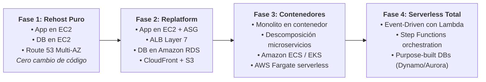
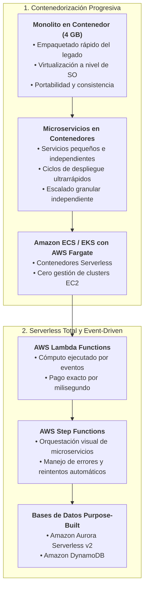

# Before and After Modernization

> [!abstract] Qué es este archivo
> Guía técnica exhaustiva sobre la evolución progresiva de una arquitectura empresarial desde una migración inicial básica *as-is* (**Rehost / Lift-and-Shift**) hacia arquitecturas optimizadas (**Replatform**) y la posterior adopción de **contenedores (Amazon ECS/EKS con AWS Fargate)** y entornos **Serverless (AWS Lambda y AWS Step Functions)**. Analiza las compensaciones operativas, de resiliencia y de costo entre alojar bases de datos auto-administradas en **Amazon EC2** frente a servicios administrados como **Amazon RDS Multi-AZ**, balanceo elástico con **ALB**, distribución de borde con **Amazon CloudFront** y descarga estática en **Amazon S3** para el **Dominio 4 (Aceleración de la migración y la modernización)** del examen SAP-C02.

> [!quote] La idea que ordena todo
> La modernización no es una decisión binaria de todo o nada (*all-or-nothing*), sino un camino evolutivo por etapas: primero aseguras una salida rápida del datacenter trasladando tus servidores tal cual (**Rehost**); luego reduces drásticamente la sobrecarga operativa adoptando servicios administrados sin reescribir código (**Replatform** con RDS, ALB, ASG y CloudFront); y finalmente incrementas la agilidad y granularidad técnica empaquetando monolitos en contenedores e iterando hacia microservicios y flujos serverless orquestados.

---

## Resumen en una frase

> La modernización por fases permite a las organizaciones capturar valor inmediato mediante un **Rehost** inicial, optimizar la resiliencia y eliminar tareas de administración mediante un **Replatform** con **Amazon RDS**, **Auto Scaling**, **ALB** y **Amazon CloudFront**, para posteriormente evolucionar de forma iterativa hacia **contenedores en AWS Fargate** y arquitecturas **Serverless con AWS Lambda y Step Functions**.

---

## 1. El espectro evolutivo de la modernización de cargas de trabajo

El camino hacia la madurez en la nube (*Cloud Maturity Journey*) se compone de cuatro estadios bien diferenciados. Intentar saltar directamente del primer al último estadio en una migración masiva suele provocar parálisis de entrega y altos riesgos de disponibilidad.



### Matriz comparativa de las cuatro fases de madurez

| Criterio Arquitectónico | Fase 1: Rehost As-Is | Fase 2: Replatform Inicial | Fase 3: Contenedores | Fase 4: Serverless Total |
| --- | --- | --- | --- | --- |
| **Cómputo de la App** | Instancias fijas Amazon EC2 | Amazon EC2 en Auto Scaling Groups (ASG) | Contenedores en Amazon ECS / EKS (AWS Fargate) | Funciones efímeras en AWS Lambda |
| **Capa de Base de Datos** | Motor auto-administrado en Amazon EC2 (EBS) | Amazon RDS / Aurora administrado (Multi-AZ) | Amazon RDS / Aurora o bases NoSQL dedicadas | Amazon Aurora Serverless v2 / Amazon DynamoDB |
| **Balanceo y Tráfico** | Amazon Route 53 (DNS round-robin / failover) | Application Load Balancer (ALB) Layer 7 | ALB / AWS App Mesh / ECS Service Connect | Amazon API Gateway / ALB |
| **Contenido Estático** | Servido directamente por la instancia EC2 | Amazon S3 + distribución global Amazon CloudFront | Amazon S3 + CloudFront | Amazon S3 + CloudFront |
| **Sobrecarga Operativa** | **Muy alta:** Parches de SO, backups manuales de DB | **Media:** AWS gestiona parches de DB y failover | **Baja:** Sin administración de servidores en Fargate | **Mínima:** Cero servidores; pago estrictamente por ejecución |
| **Cambios en Código** | **0%:** Cero modificaciones de código | **$< 5\%$:** Solo cambiar endpoints de DB y paths S3 | **Bajo:** Containerfile y variables de entorno | **Alto:** Refactorización a funciones desacopladas |

---

## 2. Antes de la modernización: el patrón Rehost As-Is (Lift-and-Shift)

En una migración de tipo Rehost puro (*Lift and Shift*), la arquitectura física del centro de datos local se replica de forma espejo en instancias **Amazon EC2**, sin descomponer servicios ni alterar los motores de base de datos.

```mermaid
flowchart TD
    Users["Usuarios / Clientes"] --> R53["<b>Amazon Route 53</b><br>(DNS Routing / Health Checks)"]

    subgraph AWSCloud["AWS Region"]
        subgraph AZA["Availability Zone A"]
            EC2AppA["Instancia Amazon EC2<br>(Servidor Web/App)"]
            EC2DBA["Instancia Amazon EC2<br>(Base de Datos Primaria)"]
            EC2AppA <--> EC2DBA
        end

        subgraph AZB["Availability Zone B"]
            EC2AppB["Instancia Amazon EC2<br>(Servidor Web/App Standby)"]
            EC2DBB["Instancia Amazon EC2<br>(Base de Datos Standby)"]
            EC2AppB <--> EC2DBB
        end
        
        EC2DBA -.->|Replicación auto-administrada<br>(Log shipping, AlwaysOn, Data Guard)| EC2DBB
    end

    R53 -->|DNS Resolution| EC2AppA
    R53 -.->|DNS Failover| EC2AppB
```

### Características de la arquitectura Rehost

- **Implementación rápida y sin fricción de código:** Permite cumplir con plazos inflexibles de cierre de centros de datos (*datacenter exit*), aprovechando herramientas como **AWS Application Migration Service (MGN)**.
- **Resiliencia inicial mediante Multi-AZ:** Para evitar puntos únicos de falla, se despliega un par duplicado de instancias EC2 en una segunda Zona de Disponibilidad (**Availability Zone B**), utilizando **Amazon Route 53** para dividir el tráfico o gestionar una conmutación por error basada en DNS (*DNS failover*).
- **La deuda técnica acumulada:**
  - Los ingenieros deben seguir aplicando parches de seguridad a los sistemas operativos y al motor de base de datos.
  - La replicación de base de datos entre AZs (como SQL Server AlwaysOn o Oracle Data Guard) debe ser configurada, mantenida y probada manualmente por el equipo de DBAs.
  - El escalado ante picos de demanda no es automático; requiere redimensionar instancias manualmente (*vertical scaling*) o aprovisionar nuevas instancias EC2 preconfiguradas.

---

## 3. La solución modernizada: Rehost + Replatform con mínimo cambio de código

La fase de **Replatform** representa el "punto dulce" (*sweet spot*) de la migración: introduce optimizaciones arquitectónicas de gran impacto adoptando servicios completamente administrados por AWS, **sin requerir la deconstrucción ni reescritura del código de la aplicación**.

```mermaid
flowchart TD
    Users["Usuarios Globales"] --> CF["<b>Amazon CloudFront</b><br>(CDN / Edge Caching)"]
    
    CF -->|Contenido Estático<br>(Imágenes, JS, CSS, Media)| S3["<b>Amazon S3</b><br>(Almacenamiento de Objetos)"]
    CF -->|Peticiones Dinámicas / API| ALB["<b>Application Load Balancer (ALB)</b><br>(Health Checks Capa 7 / SSL Offloading)"]

    subgraph VPC["Amazon VPC"]
        subgraph PublicSubnets["Subredes Públicas (Multi-AZ)"]
            ALB
        end

        subgraph PrivateAppSubnets["Subredes Privadas de Aplicación"]
            subgraph ASG["<b>Auto Scaling Group (ASG)</b>"]
                EC2A["Instancia EC2 (App)<br>AZ-A"]
                EC2B["Instancia EC2 (App)<br>AZ-B"]
            end
        end

        subgraph PrivateDBSubnets["Subredes Privadas de Datos (DB Subnet Group)"]
            subgraph RDS["<b>Amazon RDS Multi-AZ</b>"]
                RDSPri[("Instancia Primaria (Escritura/Lectura)<br>AZ-A")]
                RDSSec[("Instancia Standby (Réplica Síncrona)<br>AZ-B")]
                RDSPri == Réplica Síncrona a nivel de bloques ==> RDSSec
            end
        end
    end

    ALB --> EC2A
    ALB --> EC2B
    EC2A --> RDSPri
    EC2B --> RDSPri
```

### Optimizaciones técnicas clave incorporadas

1. **Replatform de la base de datos a Amazon RDS Multi-AZ:**
   - La base de datos abandona las instancias EC2 y se aloja en **Amazon RDS** (MySQL, PostgreSQL, MariaDB, SQL Server u Oracle).
   - **Tolerancia a fallos automática:** AWS provisiona y mantiene automáticamente una réplica en espera (*standby*) síncrona en una segunda Zona de Disponibilidad. Ante una falla de hardware o caída de la AZ primaria, RDS ejecuta una conmutación por error automática (*failover*) en **menos de 60 a 120 segundos**, redirigiendo el registro CNAME de la base de datos sin intervención humana.
   - **Gestión delegada:** Respaldos automatizados continuos (*Automated Backups*) con recuperación puntual en el tiempo (*Point-in-Time Recovery - PITR*), parches automáticos de software y monitoreo continuo de métricas.
2. **Escalado elástico y alta disponibilidad con ASG y ALB:**
   - Las instancias EC2 de aplicación se agrupan dentro de un **Auto Scaling Group (ASG)** distribuido en múltiples AZs, que aumenta o reduce la cantidad de servidores según métricas de CPU, memoria o peticiones por segundo.
   - Un **Application Load Balancer (ALB)** distribuye el tráfico entrante de manera uniforme, realiza comprobaciones de estado de Capa 7 (*health checks*) continuas y sustituye automáticamente las instancias degradadas.
3. **Descarga de contenido estático y aceleración perimetral:**
   - Los activos web estáticos (imágenes, scripts, CSS, videos) se extraen del disco de los servidores de aplicación y se alojan en un bucket privado de **Amazon S3**.
   - **Amazon CloudFront** cachea el contenido estático y las respuestas dinámicas en cientos de puntos de presencia (*Edge Locations*) mundiales, reduciendo drásticamente la latencia para los usuarios finales y liberando a las instancias EC2 para procesar únicamente lógica transaccional.

---

## 4. El camino hacia la madurez en la nube: Contenedores y Serverless

Una vez asegurada la estabilidad de la carga en producción mediante Replatform, las organizaciones pueden iniciar una transformación técnica más profunda (*Refactor / Rearchitect*) de forma iterativa y sin sobresaltos.



### De contenedor monolítico a microservicios en AWS Fargate

- **El contenedor "grueso" (*Fat Container*):** Como primer paso en el camino de la contenedorización, no es necesario rediseñar el código; se puede empaquetar una aplicación monolítica tradicional en un único contenedor grande (p. ej. de 4 GB de memoria con almacenamiento persistente montado vía **Amazon EFS**). Esto ya aporta portabilidad, estandarización de entornos entre desarrollo y producción, y aceleración del pipeline CI/CD.
- **Descomposición en microservicios:** Posteriormente, se extraen módulos funcionales individuales (usando herramientas como **AWS App2Container** o **AWS Microservice Extractor for .NET**) para convertirlos en microservicios ligeros con ciclos de vida independientes.
- **Serverless Containers con AWS Fargate:** Al orquestar los contenedores en **Amazon ECS** o **Amazon EKS** mediante el motor de lanzamiento **AWS Fargate**, los equipos se desentienden por completo de aprovisionar instancias EC2, gestionar capacidad de clústeres, parchear el kernel de Linux o configurar agentes de ECS.

### Entornos totalmente Serverless

- **AWS Lambda + AWS Step Functions:** Los servicios transaccionales se refactorizan en funciones serverless pequeñas y orientadas a eventos (**AWS Lambda**) que se ejecutan únicamente cuando se reciben peticiones. La coordinación de flujos de negocio complejos (con ramificaciones, reintentos y compensación de transacciones bajo el patrón *Saga*) se delega en **AWS Step Functions**.
- **Máxima automatización y costo marginal cero en reposo:** Cuando la aplicación no recibe tráfico, el consumo de cómputo desciende a cero, garantizando la mayor eficiencia financiera posible dentro del **Innovation Flywheel**.

---

## 5. Traducción del contenido

> [!info] Sección de referencia (opcional)
> Esto es la **traducción fiel** de las fuentes originales provistas en el curso de AWS Skill Builder. Su propósito es servir como material de verificación y consulta textual precisa de las explicaciones y lineamientos del instructor.

### 5.1 Video principal: Before and After Modernization (transcripción)

A continuación, se muestra un ejemplo de una migración básica de tipo *lift and shift*. Usted tiene un servidor de aplicaciones y una base de datos en las instalaciones locales, y los re-hospeda (**Rehost**). De este modo, ahora tiene la aplicación y la base de datos en instancias EC2 en la nube. No se requirió ninguna reescritura de código y ya está obteniendo beneficios en seguridad y escalabilidad.

Añada otro par de instancias en una Zona de Disponibilidad (**AZ**) diferente y ahora tendrá una resiliencia mucho mejor, y **Route 53** puede dividir el tráfico entre las instancias por usted.

Aquí tiene la misma aplicación con cierto nivel de **modernización**. Usted re-hospedó la aplicación en EC2 tal como lo hacía antes, pero también replataformó (**Replatform**) la base de datos a un servicio administrado: **Amazon RDS**. Ha automatizado el escalado y el balanceo de carga con grupos de auto-escalado (**Auto Scaling Groups**) y un balanceador de carga (**Load Balancer**). Y ha añadido una distribución de **CloudFront** para acercar parte de estos datos a sus usuarios. Está aprovechando una mayor parte de lo que la nube tiene para ofrecer, pero sigue minimizando los cambios en la aplicación.

¿Cuáles son algunas optimizaciones adicionales que podría considerar en el futuro? Quizás su objetivo a largo plazo sea trasladar esta carga de trabajo a **contenedores**, para obtener los múltiples beneficios de la virtualización a nivel de sistema operativo en lugar de virtualización a nivel de hardware. Y tal vez, al principio, eso signifique meter una aplicación heredada en un único contenedor con estado de 4 GB con almacenamiento dedicado. Eso está perfectamente bien: es un proceso iterativo.

Más adelante, puede pensar en descomponer ese monolito en microservicios más pequeños y obtener realmente todos los beneficios de los contenedores, como ciclos de desarrollo mucho más rápidos y una escalabilidad significativamente mejor.

Y a medida que aumente su madurez en la nube, tal vez ejecute algunas de estas cargas de trabajo en contenedores sin servidores utilizando **AWS Fargate**. O migre algunas cargas de trabajo para ejecutarlas en entornos completamente sin servidor utilizando **AWS Lambda** orquestado por **AWS Step Functions**.

E independientemente del patrón que elija, su objetivo siempre será automatizar en todos los lugares donde sea posible.

*(Duración del video: 2 minutos, 17 segundos)*

### 5.2 Lectura oficial: Ejemplos de opciones optimizadas (Optimized Option Examples)

Como primer paso, evalúe el catálogo de aplicaciones y determine los patrones de migración. Los enfoques de migración se pueden combinar y optimizar mediante la automatización.

Otras opciones a considerar son:
- **Contenedorización (*Containerization*):** Mover aplicaciones a contenedores ofrece muchos beneficios, como verá en la siguiente sección.
- **Emplear microservicios (*Employ microservices*):** Las arquitecturas de microservicios hacen que las aplicaciones sean más fáciles de escalar y más rápidas de desarrollar. Permiten la innovación y aceleran el tiempo de comercialización (*time-to-market*) de nuevas funciones.
- **Serverless (Sin servidor):** Los servicios de cómputo sin servidor, como **AWS Lambda**, le permiten ejecutar código sin aprovisionar ni administrar servidores.
- **Mayor automatización (*More automation*):** Los servicios de AWS, como el balanceo elástico de carga (**Elastic Load Balancing**) y **Amazon EC2 Auto Scaling**, pueden escalar automáticamente el consumo de servicios para satisfacer la demanda.

#### Antes de la modernización: migrar tal cual (migrate as-is)
Esta solución muestra una migración básica de tipo *lift-and-shift*. El proceso de migración re-hospeda los servidores en la nube de AWS, dejando los servidores de aplicaciones y de bases de datos tal cual estaban.
*(Diagrama: Cuatro instancias EC2 ejecutan aplicaciones y Route 53 gestiona el DNS).*
Al migrar aplicaciones y servicios existentes a instancias EC2, los clientes obtienen los beneficios de una computación confiable y escalable en una red segura, sin tener que reescribir ni reconfigurar las aplicaciones.

#### Solución modernizada (Modernized solution)
Esta solución muestra un enfoque básico de modernización. El proceso de migración combina el re-hospedaje (**Rehost**) y la replataforma (**Replatform**) con cambios mínimos:
- **Rehost:** Migrar los servidores existentes a instancias de Amazon Elastic Compute Cloud (**Amazon EC2**).
- **Replatform:** Mover la infraestructura de base de datos a **Amazon Relational Database Service (Amazon RDS)**.
- **Cambios en la infraestructura:** Añadir **Amazon CloudFront** y **Elastic Load Balancing** para proporcionar escalabilidad y resiliencia a las aplicaciones y servidores re-hospedados, y **Amazon S3** para alojar archivos estáticos.

Al migrar aplicaciones y servicios existentes a instancias Amazon EC2, los clientes obtienen los beneficios de una computación confiable y escalable en una red segura, sin tener que deconstruir sus aplicaciones, lo cual es requerido a menudo por la refactorización (**Refactor**).

---

## 6. Cierre conceptual: quién hace qué en cada etapa de modernización

| Requerimiento del Negocio | Estadio de la Solución | Servicios AWS Empleados | Beneficio Técnico Inmediato |
| --- | --- | --- | --- |
| **Salida veloz del datacenter sin tocar código** | **Fase 1: Rehost As-Is** | **AWS Application Migration Service (MGN)**, **Amazon EC2**, **Amazon Route 53** | Migración no disruptiva de bloques; resiliencia básica Multi-AZ mediante DNS. |
| **Eliminar tareas de parches y failover manual en bases de datos** | **Fase 2: Replatform** | **Amazon RDS Multi-AZ** (o **Amazon Aurora**) | Réplica síncrona en standby; conmutación automática en $< 60-120\text{ s}$; backups automatizados. |
| **Absorber picos de demanda elásticos sin intervención humana** | **Fase 2: Replatform** | **Auto Scaling Groups (ASG)** + **Application Load Balancer (ALB)** | Health checks capa 7 y escalabilidad horizontal dinámica basada en métricas. |
| **Acelerar la entrega web global y liberar CPU de los servidores** | **Fase 2: Replatform** | **Amazon CloudFront** + **Amazon S3** | Almacenamiento desacoplado de assets estáticos y edge caching de baja latencia. |
| **Estandarizar entornos de ejecución y portabilidad sin reescribir la app** | **Fase 3: Contenedores** | **AWS App2Container (A2C)**, **Amazon ECS / EKS**, **Amazon EFS** | Empaquetado del monolito (contenedor de 4 GB) con aislamiento a nivel de SO. |
| **Operar contenedores sin gestionar servidores ni clusters de cómputo** | **Fase 3: Contenedores Serverless** | **AWS Fargate** | Aprovisionamiento elástico a nivel de tarea de contenedor; cero parches de host EC2. |
| **Eliminar costos de cómputo en reposo y optimizar flujos complejos** | **Fase 4: Serverless Total** | **AWS Lambda** + **AWS Step Functions** | Ejecución dirigida por eventos, facturación por milisegundo y orquestación con máquinas de estado. |

---

## 7. Para el examen (SAP-C02)

> [!important] Lo que hay que retener
> 1. **La secuencia recomendada de migración:** La mejor práctica prescrita por AWS es **Rehost/Replatform primero** para salir del datacenter y capturar resiliencia básica, y **Refactor/Modernize después** de forma iterativa para no retrasar el negocio.
> 2. **Amazon RDS vs. EC2 self-managed:** RDS proporciona alta disponibilidad Multi-AZ con réplica síncrona y conmutación automática por error en **$< 60-120\text{ segundos}$**, eliminando parches de sistema operativo y configuración manual de replicación.
> 3. **Application Load Balancer (ALB) sobre Route 53 directo:** Route 53 con múltiples registros A distribuye tráfico a nivel de DNS pero sufre de retrasos por propagación de TTL de caché del cliente; ALB reacciona en segundos ante fallos de instancias mediante health checks continuos en capa 7.
> 4. **Descarga de activos a Amazon S3 + CloudFront:** Alojar imágenes, CSS y scripts en S3 con CloudFront reduce drásticamente el consumo de red y CPU en las instancias EC2 del backend, disminuyendo la cantidad de instancias necesarias en el ASG.
> 5. **El concepto de contenedor monolítico inicial:** El camino a los contenedores no exige descomponer en microservicios el primer día; empaquetar un monolito en un contenedor grande (ej. 4 GB con EFS) es un paso intermedio válido y respaldado por AWS.
> 6. **AWS Fargate como motor serverless de contenedores:** Elimina la necesidad de aprovisionar instancias EC2, configurar Auto Scaling de clúster o actualizar agentes de contenedor en ECS o EKS.
> 7. **AWS Step Functions para orquestación de microservicios:** Es el servicio estándar para coordinar flujos de trabajo basados en Lambda (Standard Workflows para ejecuciones largas y auditoría paso a paso; Express Workflows para procesamiento masivo de alta velocidad hasta 100.000 ejecuciones/s).
> 8. **Herramientas de aceleración de modernización:** **AWS App2Container (A2C)** genera automáticamente Dockerfiles, definiciones de tareas ECS y manifiestos de Kubernetes para aplicaciones Java y .NET existentes en EC2 o VMware.
> 9. **Bases de datos purpose-built en la fase moderna:** Reemplazar bases relacionales sobrecargadas por **Amazon DynamoDB** (para transacciones clave-valor $< 10\text{ ms}$), **Amazon ElastiCache** (caché en memoria Redis/Memcached) y **Amazon Aurora Serverless v2**.
> 10. **Automatización total transversal:** Toda modernización exitosa debe respaldarse en plantillas declarativas de infraestructura (**AWS CloudFormation / AWS CDK**) y pipelines de CI/CD automatizados.

> [!warning] Trampa clásica del examen
> **Escenario:** Una compañía de retail necesita migrar urgentemente su plataforma de comercio electrónico monolítica (Java/MySQL) hacia AWS en menos de 3 meses debido al vencimiento inminente del contrato de su centro de datos. El equipo de arquitectos recomienda reescribir toda la aplicación desde cero a microservicios basados en AWS Lambda, Amazon DynamoDB y AWS Step Functions para "modernizarse de una sola vez".
>
> **La trampa:** Elegir una reescritura total (*Refactor*) cuando existe un plazo de entrega urgente de 3 meses provocará inevitablemente que se sobrepase el cronograma, se incremente el riesgo de incidentes en producción y se incurra en costos de penalización en el centro de datos local.
>
> **La respuesta correcta:** Adoptar un enfoque por fases. En la **Fase 1 (inmediata)**, realizar un **Rehost de los servidores de aplicación a Amazon EC2** y un **Replatform de la base de datos a Amazon RDS MySQL Multi-AZ**, añadiendo **Auto Scaling**, un **Application Load Balancer** y **Amazon CloudFront con S3** para contenido estático. Esto cumple el plazo de los 3 meses con cambios mínimos de código. En la **Fase 2 (posterior)**, iniciar la modernización progresiva descomponiendo módulos en microservicios sobre **AWS Fargate** o **AWS Lambda** mediante el patrón **Strangler Fig**.

---

## Relacionado

- [[Modernize the Enterprise]] — lección 11: las dimensiones de la modernización (Arquitectura, Organización, Infraestructura) y el Innovation Flywheel
- [[The Migration Process]] — lección 04: taxonomía de las 7 Rs (Rehost, Replatform, Refactor) y el Application Migration Workflow
- [[AWS Application Migration Service]] — lección 08: la herramienta estándar para ejecutar la fase inicial de Rehost as-is
- [[Migrating Databases]] — lección 10: migración de bases de datos a Amazon RDS y Amazon Aurora con AWS DMS y SCT
- [[AWS Solutions Architect Advanced - Migration and Modernization]] *(índice del módulo)*
- Siguiente paso del módulo: **lección 13 del módulo de migración y modernización**

---

## Registro de integración

| Fecha | Tipo de cambio | Detalle de la modificación |
| --- | --- | --- |
| 2026-10-29 | Creación de nota canónica | Alta de la duodécima lección del módulo *Migration and Modernization*. Se estructura de forma exhaustiva la evolución técnica **Before and After Modernization** (las 4 fases: Rehost As-Is con EC2 y Route 53; Replatform con Amazon RDS Multi-AZ, ALB, Auto Scaling Groups y CloudFront/S3; Contenedorización progresiva desde monolitos en Fargate hacia microservicios; y Serverless integral con AWS Lambda, Step Functions y bases purpose-built para el examen SAP-C02). |
