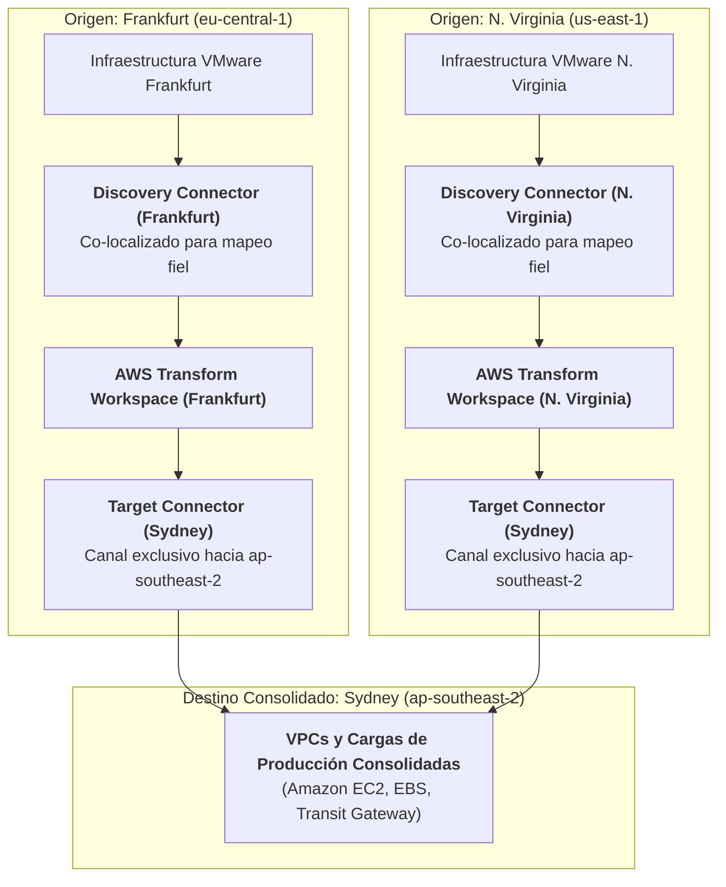
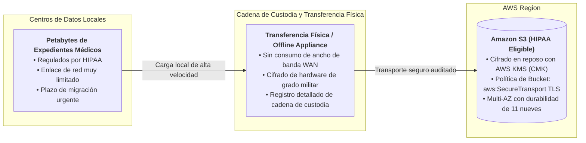
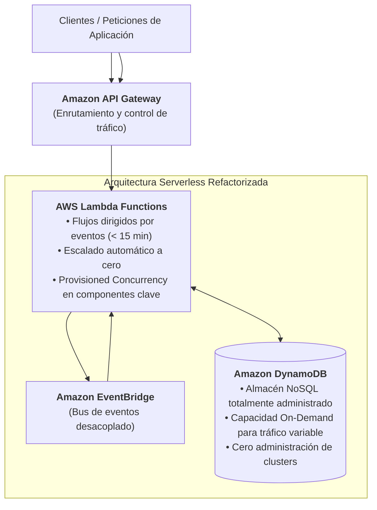

# BuildingBlocks Videos - Migration

> [!abstract] Qué es este archivo
> Decimosexta lección del módulo de migración y modernización. Presenta tres debates técnicos de arquitectura (*BuildingBlocks*) entre Melissa y Joe donde se resuelven dilemas de diseño de alta complejidad para el examen SAP-C02:
> 1. **Caso 1 (Large Enterprise Migration):** Consolidación multi-región de infraestructura VMware desde Frankfurt y Virginia hacia Sydney utilizando **AWS Transform for VMware**, evaluando la topología de **Workspaces y Connectors** para respetar la residencia de datos y maximizar el mapeo de dependencias por IA.
> 2. **Caso 2 (Moving Petabyte-Scale Data):** Migración de petabytes de registros médicos regulados por **HIPAA** con ancho de banda de red limitado y plazos estrictos, comparando **AWS DataSync**, **AWS Direct Connect** y transferencias físicas/offline hacia **Amazon S3** con cifrado **AWS KMS** y cadena de custodia auditada.
> 3. **Caso 3 (Modernizing Legacy Applications):** Modernización de un monolito de software altamente acoplado con sobrecarga operativa, evaluando el árbol de decisión entre **Rehost (AWS MGN)**, **Replatform (EC2 + ElastiCache)**, **Contenedores (ECS/EKS)** y **Serverless Refactor (AWS Lambda + Amazon DynamoDB + Amazon EventBridge)** para cargas de trabajo dirigidas por eventos con duración $< 15\text{ minutos}$.

> [!quote] La idea que ordena todo
> Los problemas reales de migración y modernización exigen **simpatía mecánica (*mechanical sympathy*)**: no forzar una herramienta por popularidad, sino alinear exactamente la tecnología con las restricciones del problema. Si mueves petabytes con enlaces lentos, la física de la red descarta DataSync y exige transferencia física; si consolidas VMware multi-región, la precisión de la IA exige co-localizar los conectores de descubrimiento con las fuentes; y si un monolito ejecuta tareas breves de $< 15\text{ minutos}$ con cargas variables, el refactor serverless elimina la sobrecarga operativa de clústeres y servidores.

---

## Resumen en una frase

> Las tres discusiones técnicas demuestran que la arquitectura óptima depende de las restricciones: **AWS Transform** requiere un workspace y conectores independientes por cada región de origen VMware; los **petabytes con ancho de banda limitado** exigen transferencia física hacia **Amazon S3** con **KMS** y **TLS** obligatorio; y los monolitos con flujos de trabajo variables de $< 15\text{ minutos}$ se modernizan óptimamente mediante **Refactor Serverless** con **AWS Lambda**, **Amazon DynamoDB** y **Amazon EventBridge**.

---

## 1. Caso 1: Migración multi-región de VMware y consolidación con AWS Transform

Una empresa multinacional de manufactura opera dos entornos VMware on-premises: uno en **Frankfurt** (`eu-central-1`) y otro en **Northern Virginia** (`us-east-1`). Debido a su expansión comercial en Asia-Pacífico (APAC), deciden consolidar toda su infraestructura en la región de AWS en **Sydney** (`ap-southeast-2`).

### Opciones evaluadas y la justificación del diseño

| Opción de Arquitectura | Evaluación Técnica de Melissa y Joe | Decisión |
| --- | --- | --- |
| **Opción A: Workspace único en us-east-1 con conectores hacia Sydney** | Consolida la gestión en un solo panel, pero **falla técnicamente**: el *Discovery Connector* debe estar co-localizado con la infraestructura VMware de origen. Mezclar los flujos de datos en un solo workspace degrada los modelos de IA de planificación de olas y viola los requisitos estrictos de residencia de datos durante la migración. | ❌ **Rechazada** |
| **Opción B: Workspaces separados (Frankfurt y Virginia) compartiendo un único Target Connector** | Resuelve el descubrimiento local, pero hacer que múltiples conectores de descubrimiento compartan un único conector de destino introduce colisiones, complica la automatización y entrelaza la planificación de olas entre continentes. | ❌ **Rechazada** |
| **Opción C: Workspaces independientes en cada región con sus propios Discovery y Target Connectors** | **Arquitectura recomendada y mejor práctica:** Proximidad física de descubrimiento para precisión de dependencias, aislamiento total de flujos de datos por cumplimiento legal, y planificación de olas (*wave planning*) y automatización completamente independientes para cada sede geográfica. | ✅ **Aprobada** |

---

## 2. Caso 2: Transferencia masiva a escala de Petabytes con ancho de banda limitado

Un proveedor de servicios de salud (*Healthcare Provider*) necesita migrar **petabytes** de expedientes médicos y registros de pacientes desde múltiples centros de datos locales hacia AWS.

### El principio de simpatía mecánica (*Mechanical Sympathy*)

Cuando el volumen de datos es masivo y el ancho de banda es un recurso escaso, calcular matemáticamente el tiempo de transferencia es indispensable para el examen:

$$\text{Tiempo} = \frac{\text{Volumen de Datos}}{\text{Ancho de Banda Efectivo}}$$

- **Por qué falla AWS DataSync:** Aunque DataSync acelera el protocolo WAN hasta $10\times$, transferir múltiples petabytes sobre un enlace WAN limitado tardaría **muchos meses**, violando el cronograma del negocio.
- **Por qué falla AWS Direct Connect:** Contratar y aprovisionar un circuito dedicado de Direct Connect toma semanas o meses de despliegue con las empresas de telecomunicaciones; aun disponiendo del enlace, el tiempo físico de transmisión de petabytes sigue superando la ventana permitida.
- **La solución aprobada (Transferencia Física hacia Amazon S3):**
  - Elimina la dependencia del ancho de banda de red mediante dispositivos de transferencia física (familia **AWS Snowball Edge** o terminales físicos de transferencia de partners autorizados).
  - **Seguridad y cumplimiento HIPAA:** El destino es **Amazon S3**, servicio certificado como elegible para HIPAA.
  - **Cifrado en reposo:** Claves maestras administradas por el cliente en **AWS KMS (CMK)** con rotación anual.
  - **Cifrado en tránsito obligatorio:** Política de bucket de S3 con condición explícita `aws:SecureTransport: true`, denegando cualquier petición que no use HTTPS/TLS.
  - **Auditoría ininterrumpida:** Registro exhaustivo de la cadena de custodia física (*chain of custody log*) y validación de sumas de verificación (*checksums*).

---

## 3. Caso 3: Modernización integral de un monolito (Rehost vs. Replatform vs. Serverless Refactor)

Un proveedor de software independiente (*ISV*) opera una aplicación monolítica central en hardware propio. La aplicación está altamente acoplada, sufre problemas crónicos de escalabilidad ante tráfico impredecible y el equipo de operaciones gasta la mayor parte de su tiempo en tareas de mantenimiento de servidores.

### El árbol de decisión de modernización

1. **¿Por qué NO Rehost (AWS MGN + Amazon RDS)?**
   - Llevaría el monolito rápidamente a instancias EC2, pero **no resuelve la falta de elasticidad** ni reduce sustancialmente la carga del equipo de operaciones, que seguiría manteniendo servidores.
2. **¿Por qué NO Replatform (EC2 + Amazon ElastiCache)?**
   - Añadir clústeres de caché sobre EC2 mejora el rendimiento pero **contradice el pilar de Eficiencia de Rendimiento del Well-Architected Framework** (*democratizar tecnologías avanzadas*), ya que administrar clústeres de ElastiCache y servidores EC2 incrementa la sobrecarga operativa.
3. **¿Por qué NO Contenedores (Amazon ECS / EKS)?**
   - Aunque los contenedores aportan aislamiento, gestionar clústeres de ECS o EKS (incluso con Fargate) requiere esfuerzo operativo de orquestación innecesario dado el perfil del cliente.
4. **La solución aprobada (Serverless Refactor / Rearchitect):**
   - **Perfil del workload:** Procesos de corta duración basados en eventos, todos con duración inferior a los **15 minutos**.
   - **Tolerancia a Cold Starts:** La aplicación general no es sensible a la latencia; para los pocos componentes críticos que lo requieran, se habilita **Provisioned Concurrency**.
   - **Cómputo:** **AWS Lambda** proporciona escalabilidad elástica instantánea y pago estrictamente por uso (*pay-for-value*).
   - **Persistencia NoSQL:** **Amazon DynamoDB** absorbe el tráfico altamente variable sin requerir aprovisionamiento de capacidad mediante su modo **On-Demand**.
   - **Comunicación desacoplada:** **Amazon EventBridge** gestiona la coreografía de eventos entre los componentes desacoplados sin dependencias punto a punto.

---

## 4. Traducción del contenido

> [!info] Sección de referencia (opcional)
> Esto es la **traducción fiel** de las fuentes originales provistas en el curso de AWS Skill Builder. Su propósito es servir como material de verificación y consulta textual precisa de las explicaciones y lineamientos del instructor.

### 4.1 Video 1: Gran migración empresarial (Large Enterprise Migration)

**Melissa:** Estaba conversando con esta empresa de manufactura sobre el uso de **AWS Transform for VMware**. Tienen infraestructura de VMware distribuida entre Frankfurt y el norte de Virginia, pero necesitan consolidar todo en Sídney.

**Joe:** Interesante. ¿Mencionaron por qué necesitan consolidar en Sídney?

**Melissa:** Sí, están expandiendo sus operaciones en la región Asia-Pacífico (APAC) y quieren optimizar para su creciente base de clientes allí. Tienen requisitos estrictos de **residencia de datos** durante el proceso de migración y quieren aprovechar las capacidades impulsadas por inteligencia artificial de AWS Transform for VMware para el **mapeo de dependencias** y la **planificación de olas (*wave planning*)**. Permíteme mostrar su arquitectura. Podríamos configurar un único espacio de trabajo (*workspace*) en `us-east-1` y apuntar los conectores de descubrimiento y de destino hacia Sídney. Eso les daría un único lugar para administrar todo.

**Joe:** Ese enfoque no funcionaría bien con la arquitectura de AWS Transform for VMware. El **conector de descubrimiento (*discovery connector*)** debe estar **co-localizado con la infraestructura VMware de origen** para lograr un mapeo de dependencias preciso. Además, consolidar todos los flujos de datos a través de un único espacio de trabajo podría afectar negativamente las capacidades de planificación de olas impulsadas por IA.

**Melissa:** Buen punto. Bueno, ¿qué tal si creamos espacios de trabajo separados en Frankfurt y en el norte de Virginia, pero utilizamos un único conector de destino que apunte a Sídney? De esa manera estaríamos más cerca de la infraestructura de origen.

**Joe:** Eso es mejor para el descubrimiento, pero tener múltiples conectores de descubrimiento compartiendo un solo conector de destino podría complicar nuestra planificación de olas y nuestra estrategia de automatización. Necesitamos una **separación limpia** para una modernización efectiva.

**Melissa:** Ya veo. Entonces deberíamos crear un espacio de trabajo en Frankfurt con su propio conector de descubrimiento y otro en el norte de Virginia para la infraestructura de Estados Unidos; y que **cada espacio de trabajo tenga su propio conector de destino apuntando a Sídney**.

**Joe:** Esa parece una excelente idea. Y se alinea con las mejores prácticas para AWS Transform for VMware: mantenemos la proximidad con la infraestructura de origen para un mapeo preciso de dependencias, mantenemos los flujos de datos separados para cumplir con la normativa y permitimos la planificación independiente de olas para cada ubicación. Las capacidades de modernización impulsadas por IA pueden funcionar de manera óptima con esta configuración.

**Melissa:** Sí, y podemos rastrear el progreso de la modernización y gestionar las estrategias de automatización por separado para cada ubicación. Excelente. ¿Deberíamos recomendar este enfoque al cliente?

**Joe:** Definitivamente. Les brinda la ruta más eficiente tanto para la migración como para la modernización y cumple con todos los requisitos.

*(Duración del video: 2 minutos, 42 segundos)*

### 4.2 Video 2: Mover datos a escala de petabytes a AWS (Moving Petabyte-Scale Data to AWS)

**Joe:** Melissa, estaba hablando con este proveedor de atención médica sobre su desafío de migración de datos. Déjame presentarlo: necesitan mover **petabytes de registros de pacientes** desde múltiples centros de datos hacia AWS, pero su ancho de banda de red es realmente limitado.

**Melissa:** Vaya, es una enorme cantidad de datos. ¿Cuáles fueron sus requisitos clave?

**Joe:** Bueno, lo principal es que tienen petabytes de datos, tienen un ancho de banda de red limitado y, al ser datos de atención médica, requieren **cifrado en tránsito y un registro detallado de la cadena de custodia**.

**Melissa:** Mi primer pensamiento sería usar **AWS DataSync** para manejar esto. Está diseñado para transferencias de datos a gran escala y gestiona el cifrado automáticamente. Pero dijiste que su ancho de banda de red era limitado. ¿De qué tan limitado estamos hablando?

**Joe:** Sí, consideré eso también, pero honestamente, incluso con las optimizaciones de DataSync, dijeron que tardaría **meses en transferirse a través de Internet**, por lo que no cumple con sus necesidades de cronograma.

**Melissa:** De acuerdo, entonces debemos evitar la Internet pública. ¿Qué tal configurar un circuito dedicado de **AWS Direct Connect** que les dé un ancho de banda alto y constante?

**Joe:** Es una idea interesante, pero hay un par de problemas: primero, los circuitos de Direct Connect tardan tiempo en aprovisionarse. Y segundo, incluso con Direct Connect, seguimos hablando de mover petabytes de datos. Mirando el pilar de eficiencia de rendimiento del Well-Architected Framework, queremos considerar la **simpatía mecánica (*mechanical sympathy*)**: utilizar el enfoque tecnológico que mejor se alinee con los objetivos de la carga de trabajo.

**Melissa:** Eso tiene sentido. Debe haber una mejor solución para esta escala de transferencia de datos.

**Joe:** Creo que este podría ser un buen caso para utilizar terminales físicos de transferencia de datos (*AWS Data Transfer Terminal / physical appliances*). Esto les proporciona la conexión de alta velocidad a la nube de AWS que necesitan, y mantendrán el control físico sobre cualquier hardware que lleven al sitio asociado. Y mientras el servicio de destino sea elegible para **HIPAA**, como **Amazon S3**, eso satisface sus requisitos de cumplimiento.

**Melissa:** Sí, eso funciona. Y S3 también es una buena opción para el servicio de destino desde una perspectiva de seguridad: admite claves administradas por el cliente (**AWS KMS**) para el cifrado y pueden configurar una política de bucket para exigir transporte seguro mediante **TLS**.

**Joe:** Parece que encontramos nuestra solución. ¿Deberíamos recomendar este enfoque?

**Melissa:** Definitivamente. Cumple con todos sus requisitos: maneja la escala de petabytes, no está restringido por el ancho de banda de red, proporciona cifrado y transporte seguro, y les brinda el camino más rápido para llevar sus datos a AWS.

*(Duración del video: 2 minutos, 35 segundos)*

### 4.3 Video 3: Modernización de aplicaciones legadas en AWS (Modernizing Legacy Applications on AWS)

**Melissa:** Joe, acabo de reunirme con ese proveedor de software que busca modernizar su aplicación monolítica. Quieren moverla a AWS, pero también hacerla más elástica y reducir su sobrecarga operativa.

**Joe:** Interesante. ¿Y cómo es su configuración actual?

**Melissa:** Es un típico **monolito**: todo estrechamente acoplado ejecutándose en su propio hardware. Están lidiando con problemas de escalabilidad y su equipo de operaciones pasa demasiado tiempo simplemente manteniendo las cosas funcionando.

**Joe:** Parece que un **Rehost** podría ser la forma más rápida de llevarlos a AWS. Podríamos usar **AWS Application Migration Service** para mover todo tal cual a EC2 y luego quizás considerar el uso de **Amazon RDS** para su capa de base de datos.

**Melissa:** Eso los llevaría a la nube más rápido, pero realmente no aborda sus requisitos de elasticidad. Además, mencionaron específicamente que querían desacoplar funciones clave y utilizar **serverless** donde tenga sentido.

**Joe:** Buen punto. ¿Qué tal una replataforma (**Replatform**) entonces? Podríamos mantener la aplicación principal en EC2, pero con redes mejoradas y quizás **Amazon ElastiCache** para mejorar el rendimiento.

**Melissa:** Veo hacia dónde vas, pero mirando el pilar de eficiencia de rendimiento del Well-Architected Framework, deberíamos pensar en democratizar las tecnologías avanzadas. Quieren reducir la sobrecarga operativa, y administrar clústeres de caché todavía agrega carga de administración.

**Joe:** Es cierto. Y mencionaron que querían usar **NoSQL** para sus cargas de trabajo variables. Parece que tal vez estén listos para un enfoque de modernización más integral.

**Melissa:** Creo que tienes razón: estamos ante una estrategia de **Refactor / Rearchitect**. Podríamos ayudarlos a identificar qué componentes se beneficiarían más de ser desacoplados.

**Joe:** Antes de saltar a servicios específicos, ¿deberíamos considerar **contenedores**? ¿Qué sabemos sobre las características de sus cargas de trabajo y la experiencia del equipo?

**Melissa:** Esa es una buena pregunta. Mencionaron que la mayoría de sus procesos son **flujos de trabajo cortos, dirigidos por eventos y de menos de 15 minutos**, y quieren una sobrecarga operativa mínima. Si bien los contenedores les darían más control, administrar clústeres de **Amazon ECS o EKS** aún requeriría un esfuerzo operativo que están tratando de evitar.

**Joe:** ¿Y qué hay de los arranques en frío (*cold starts*)? ¿Algún componente sensible a la latencia que debamos considerar?

**Melissa:** Sus cargas de trabajo principales no son sensibles a la latencia y están de acuerdo con la compensación del arranque en frío de **AWS Lambda** a cambio de los beneficios operativos. Para los pocos componentes que sean sensibles a la latencia, podríamos usar **Provisioned Concurrency**.

**Joe:** Eso tiene sentido. Lambda les daría escalado automático y precios reales de pago por uso, y **Amazon DynamoDB** sería perfecto para esas cargas de trabajo variables que mencionaron: está totalmente administrado y escala automáticamente. Podríamos usar **Amazon EventBridge** para manejar la comunicación entre los componentes.

**Melissa:** Eso suena genial. Pasarán mucho menos tiempo en el trabajo pesado no diferenciado (*undifferentiated heavy lifting*), y el equipo de operaciones podrá concentrarse en el valor del negocio en lugar de administrar infraestructura.

**Joe:** Totalmente. Y con serverless, solo pagan por lo que usan. Además, el escalado automático significa una mejor elasticidad. ¿Recomendamos este enfoque?

**Melissa:** Definitivamente. Cumple con todos sus requisitos: elasticidad mejorada, reducción de la sobrecarga operativa y soporte para cargas de trabajo variables con NoSQL. Preparemos una propuesta detallada.

*(Duración del video: 3 minutos, 24 segundos)*

---

## 5. Cierre conceptual: matriz de patrones de decisión arquitectónica

| Caso de Estudio | Requisito / Restricción Crítica | Alternativa Rechazada y Por Qué | Solución Aprobada y Justificación |
| --- | --- | --- | --- |
| **Caso 1: VMware Multi-Región a Sydney** | Consolidar sedes en Frankfurt y Virginia hacia Sydney con estricta residencia de datos y wave planning con IA. | **Workspace único en Virginia:** Discovery Connector no estaría co-localizado con el origen en Frankfurt, degradando el modelo de IA y violando la residencia de datos. | **Workspaces independientes en Frankfurt y Virginia con Discovery y Target Connectors propios hacia Sydney:** Garantiza aislamiento legal, precisión de dependencias y wave planning local. |
| **Caso 2: Petabytes Médicos con Ancho de Banda Limitado** | Mover petabytes con ancho de banda reducido bajo HIPAA, con cronograma urgente y cadena de custodia. | **AWS DataSync / Direct Connect:** Aunque DataSync acelera WAN, transferir petabytes sobre enlaces limitados tomaría meses; aprovisionar Direct Connect demora semanas. | **Transferencia Física (Appliance Offline) a Amazon S3:** Supera el cuello de botella de red; S3 soporta HIPAA, cifrado KMS (CMK) y política de transporte obligatorio con TLS (`aws:SecureTransport`). |
| **Caso 3: Modernización de Monolito Acoplado** | ISV busca elasticidad máxima, eliminar sobrecarga de administración, flujos dirigidos por eventos $< 15\text{ min}$ y NoSQL. | **Rehost con MGN o Contenedores ECS/EKS:** Rehost no aporta elasticidad; gestionar clústeres de contenedores o ElastiCache introduce sobrecarga operativa no deseada. | **Refactor Serverless (AWS Lambda + DynamoDB + EventBridge):** Flujos atómicos efímeros $< 15\text{ min}$, Provisioned Concurrency para componentes críticos y cero gestión de infraestructura. |

---

## 6. Para el examen (SAP-C02)

> [!important] Lo que hay que retener
> 1. **Co-localización de Discovery Connectors en AWS Transform:** En migraciones multi-sede o multi-región, el *Discovery Connector* **siempre debe residir en la misma región/red de origen** de la infraestructura VMware para no degradar los algoritmos de IA ni violar la residencia de datos.
> 2. **Workspaces independientes por región:** Cada región de origen debe tener su propio *Workspace* y su propio *Target Connector* apuntando a la región de destino para mantener la separación de gobernanza y permitir una planificación de olas independiente.
> 3. **El principio de Mechanical Sympathy en transferencias:** Elegir la herramienta según las leyes físicas de la red. Si el tiempo de transferencia por red ($T = \text{Data} / \text{Bandwidth}$) excede la ventana del proyecto, la respuesta **nunca es DataSync ni Direct Connect**: es **transferencia física offline (Snowball Edge)**.
> 4. **Requisitos de seguridad HIPAA en Amazon S3:** Para almacenar datos médicos regulados por HIPAA, el bucket de S3 debe aplicar **cifrado en reposo con Customer Managed Keys (AWS KMS CMK)** y denegar explícitamente el tráfico no cifrado mediante la condición `"aws:SecureTransport": "false"`.
> 5. **Cadena de custodia para datos físicos:** Las transferencias mediante dispositivos físicos de la familia Snow proporcionan un registro auditable e inmutable de la cadena de custodia (*chain of custody*), indispensable en auditorías de salud y gubernamentales.
> 6. **Criterio de decisión Serverless vs. Contenedores:** Si los procesos son asíncronos, dirigidos por eventos, tienen una duración inferior a **15 minutos** y el cliente exige **mínima sobrecarga operativa**, la solución correcta es **AWS Lambda**, descartando la administración de clústeres de Amazon ECS/EKS.
> 7. **Mitigación selectiva de Cold Starts:** En arquitecturas serverless donde la mayoría de los módulos tolera arranques en frío pero existen unos pocos componentes sensibles a la latencia, la respuesta arquitectónica óptima es habilitar **Provisioned Concurrency** solo en las funciones críticas.
> 8. **Amazon DynamoDB para cargas variables y NoSQL:** El modo de capacidad **On-Demand** de DynamoDB es la opción estándar para absorber tráfico impredecible sin sobreaprovisionar ni gestionar particiones manualmente.
> 9. **Amazon EventBridge para coreografía desacoplada:** Es el bus de eventos serverless que reemplaza la comunicación síncrona HTTP entre microservicios, permitiendo enrutamiento basado en contenido y entrega confiable.
> 10. **Democratización de tecnologías avanzadas:** Pilar de Eficiencia de Rendimiento del Well-Architected Framework: delegar la administración en servicios completamente administrados (Serverless/Managed Services) para que el equipo de ingeniería se enfoque en la lógica de negocio y no en tareas pesadas no diferenciadas.

> [!warning] Trampa clásica del examen
> **Escenario:** Una compañía farmacéutica regulada necesita migrar 4 PB de datos de investigación genómica desde sus laboratorios locales hacia AWS en un plazo perentorio de 6 semanas. Disponen de una conexión a Internet de 100 Mbps y están evaluando solicitar un enlace de AWS Direct Connect de 1 Gbps para transferir los datos usando scripts acelerados de AWS DataSync.
>
> **La trampa:** Asumir que aprovisionar AWS Direct Connect y configurar AWS DataSync resolverá el problema dentro del plazo de 6 semanas. Un circuito Direct Connect tarda habitualmente entre 3 y 8 semanas solo en aprovisionarse; además, transferir 4 PB a través de un enlace de 1 Gbps saturado al 100% de eficiencia teórica tardaría matemáticamente más de 12 meses ($\approx 370\text{ días}$).
>
> **La respuesta correcta:** Utilizar dispositivos físicos **AWS Snowball Edge Storage Optimized** (o soluciones de terminales de transferencia física de partners de AWS). Los dispositivos se envían al laboratorio, se cargan a través de la red local a 10/25 Gbps en días, se envían por correo seguro con cadena de custodia auditada y se ingieren directamente en **Amazon S3** con cifrado **AWS KMS**, completando la migración en menos de 2 a 3 semanas sin tocar el ancho de banda WAN.

---

## Relacionado

- [[AWS Transform for VMware]] — lección 07: constructos de Workspaces, Discovery Connectors y Target Connectors
- [[AWS DataSync]] — lección 09: transferencia acelerada online y sus límites de ancho de banda
- [[Use Serverless Architectures]] — lección 14: arquitectura modular con API Gateway, Lambda, DynamoDB y EventBridge
- [[Before and After Modernization]] — lección 12: evolución técnica de Rehost a Replatform y Serverless
- [[AWS Solutions Architect Advanced - Migration and Modernization]] *(índice del módulo)*
- Siguiente paso del módulo: **lección 17 del módulo de migración y modernización**

---

## Registro de integración

| Fecha | Tipo de cambio | Detalle de la modificación |
| --- | --- | --- |
| 2026-10-29 | Creación de nota canónica (BuildingBlocks) | Alta de la decimosexta lección del módulo *Migration and Modernization*. Se estructura exhaustivamente la nota de debate **BuildingBlocks Videos - Migration** cubriendo tres casos clave: (1) Consolidación VMware multi-región con AWS Transform y topología de Workspaces/Connectors, (2) Transferencia de petabytes médicos con ancho de banda limitado hacia Amazon S3 bajo HIPAA y simpatía mecánica, y (3) Modernización de monolito acoplado evaluando Rehost vs. Replatform vs. Serverless Refactor (Lambda, DynamoDB, EventBridge) para el examen SAP-C02. |
