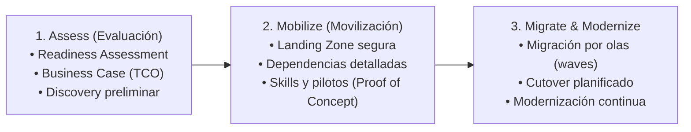
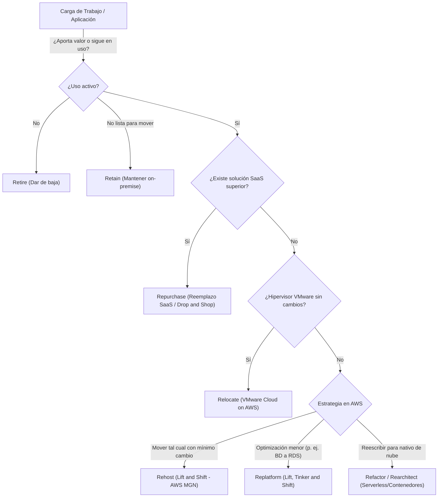

# Course Overview - Migration and Modernization

> [!abstract] Qué es este archivo
> Primera lección del módulo **Migration and Modernization**. No enseña un servicio en profundidad: es el
> **mapa estratégico y hoja de ruta del curso**.
>
> Define los **seis objetivos centrales de aprendizaje**, el encuadre en dos fases temporales (**Migrar** primero,
> **Modernizar** después), el marco de las **7 Rs de migración**, y anticipa las herramientas clave de descubrimiento,
> migración masiva y bases de datos (**AWS DMS**, **AWS MGN**, **SCT**, **DataSync** y **Snow Family**).
> Alineado directamente con el **Dominio 4 del examen SAP-C02 (20 % del temario)**.

> [!quote] La idea que ordena todo
> **“Migrar no es solo trasladar máquinas virtuales a la nube: es clasificar cada carga en la R correcta y planificar la modernización para no transportar deuda técnica al nuevo entorno.”**
> Una migración exitosa sigue fases disciplinadas (*Assess, Mobilize, Migrate & Modernize*) y entiende que el *Lift and Shift* (Rehost) es solo el primer paso de un proceso continuo de optimización.

---

## Resumen en una frase

> Una hoja de ruta integral de **seis objetivos** para llevar cargas empresariales a AWS: desde las mejores prácticas
> y fases de migración, pasando por la taxonomía de las **7 Rs** y la migración de bases de datos con **AWS DMS**,
> hasta la modernización y optimización operativa continua en la nube.

---

## 1. El encuadre del curso: los dos tiempos (Migrar y Modernizar)

El curso distingue claramente dos etapas que no deben confundirse, aunque a menudo se ejecutan en olas concurrentes:

| Dimensión | Migración (*Migrate*) | Modernización (*Modernize*) |
| --- | --- | --- |
| **Objetivo principal** | Trasladar cargas de trabajo existentes fuera de centros de datos on-premises u otros entornos hacia AWS con el menor riesgo posible. | Transformar la arquitectura, el modelo de despliegue y la operación para explotar los beneficios nativos de la nube. |
| **Patrón típico** | *Lift and Shift* (Rehost) o *Lift, Tinker and Shift* (Replatform). | Refactorización de monolitos a microservicios, adopción de contenedores (ECS/EKS) y computación sin servidor (*serverless* con Lambda). |
| **Drivers de negocio** | Vencimiento de contratos de centros de datos, reducción de CAPEX, consolidación de infraestructura y continuidad operativa. | Aceleración del *Time-to-Market*, escalabilidad elástica desacoplada, reducción de costos operacionales (OPEX) e innovación con servicios administrados. |
| **Herramientas representativas** | AWS Application Migration Service (MGN), AWS Database Migration Service (DMS), AWS DataSync, AWS Snowball Edge. | AWS App2Container (A2C), AWS Microservice Extractor for .NET, AWS Schema Conversion Tool (SCT), AWS Lambda, Amazon DynamoDB, Amazon Aurora. |

> [!warning] La trampa de pretender modernizar todo antes de migrar
> En proyectos reales y preguntas del examen SAP-C02, intentar refactorizar (*Refactor*) todas las aplicaciones durante la fase de salida de un data center con fecha límite fija suele derivar en retrasos severos y sobrecostos. La buena práctica recomendada por AWS suele ser **Rehost/Replatform primero** para cumplir el hito de migración, y **Modernizar después** de forma incremental y segura.

---

## 2. Los seis objetivos del curso (desglose exhaustivo)

La fuente compromete **seis objetivos de aprendizaje concretos**. Cada uno de ellos mapea a capacidades que evalúa el examen SAP-C02:

| # | Objetivo declarado por la fuente | Qué exige en la arquitectura | Servicios y herramientas clave |
| --- | --- | --- | --- |
| **1** | **Describe key migration practices for success** | Establecer gobernanza, un *Cloud Center of Excellence* (CCoE), automatización de landing zones y seguridad transversal desde el día cero. | AWS Control Tower, AWS Organizations, Well-Architected Framework (Migration Lens). |
| **2** | **List the migration process phases** | Comprender y articular las fases formales del framework de adopción y aceleración de AWS (*Assess*, *Mobilize*, *Migrate & Modernize*). | AWS Cloud Adoption Framework (AWS CAF), Migration Acceleration Program (MAP). |
| **3** | **Define the role of AWS services that accelerate your migration** | Seleccionar la herramienta óptima según el tipo de datos (bloques, archivos, objetos, bases de datos) y el ancho de banda de red disponible. | AWS Application Discovery Service, Migration Evaluator, AWS Migration Hub, AWS DataSync, AWS Snow Family. |
| **4** | **Describe the 7 Rs of migration** | Clasificar aplicaciones en la estrategia correcta según el valor de negocio, complejidad y urgencia temporal. | Taxonomía de las 7 Rs: Rehost, Replatform, Refactor, Repurchase, Relocate, Retain, Retire. |
| **5** | **Migrate databases to the AWS Cloud using AWS DMS** | Planificar migraciones homogéneas y heterogéneas con mínima ventana de inactividad utilizando replicación continua (CDC). | AWS Database Migration Service (DMS), AWS Schema Conversion Tool (SCT). |
| **6** | **Optimize applications and operations after migrating to the cloud** | Ajustar el dimensionamiento (*right-sizing*), automatizar operaciones, implementar observabilidad y modernizar componentes desacoplados. | AWS Compute Optimizer, Amazon CloudWatch, AWS Systems Manager, Amazon EventBridge. |

---

## 3. Las tres fases del proceso de migración (Framework MAP)

El marco metodológico estándar promovido por AWS (y referenciado en las preguntas de arquitectura de gran escala) estructura todo viaje de migración en tres fases iterativas:

### 3.1 Fase 1: Assess (Evaluación)
- **Propósito:** Evaluar la preparación de la organización para la nube (*Cloud Readiness Assessment*) y construir el caso de negocio (*Business Case*).
- **Entregables:** Análisis de Costo Total de Propiedad (**TCO**) comparando infraestructura on-premises actual contra costos proyectados en AWS.
- **Herramientas:** **Migration Evaluator** (antes *TSO Logic*) para modelado financiero y licenciamiento; **AWS Migration Hub** para consolidación.

### 3.2 Fase 2: Mobilize (Movilización)
- **Propósito:** Abordar las brechas detectadas en la fase de evaluación, construir la base operativa (*Landing Zone*), mapear dependencias a fondo y realizar pruebas piloto.
- **Entregables:** Landing Zone gobernada con múltiples cuentas, conectividad híbrida validada (Direct Connect / Site-to-Site VPN), modelo de seguridad y cumplimiento implementado, y planes de migración detallados por olas (*migration waves*).
- **Herramientas:** **AWS Application Discovery Service** (agentes para dependencias de red profundas y métricas de rendimiento), **AWS Control Tower**, **AWS Systems Manager**.

### 3.3 Fase 3: Migrate & Modernize (Migración y Modernización)
- **Propósito:** Ejecución a escala de las migraciones diseñadas, siguiendo fábricas de migración automatizadas (*Migration Factories*), y posterior evolución arquitectónica.
- **Entregables:** Cargas operativas en AWS, corte (*cutover*) con ventana mínima de caída, y adopción de patrones nativos de nube.
- **Herramientas:** **AWS Application Migration Service (MGN)** para servidores en bloque, **AWS DMS** para bases de datos transaccionales, **AWS DataSync** para almacenamiento masivo de archivos/objetos.

---

## 4. El espectro de las 7 Rs de migración (Visión de examen)

La taxonomía de las **7 Rs** es una de las herramientas de decisión más evaluadas en el examen SAP-C02. Permite categorizar cada aplicación del inventario según su destino:

| Estrategia (R) | Descripción técnica | Esfuerzo / Tiempo | Cuándo se elige en el examen |
| --- | --- | --- | --- |
| **Rehost** (*Lift and Shift*) | Migración a nivel de bloques de SO y almacenamiento hacia instancias Amazon EC2 sin alterar la configuración del sistema. | Mínimo / Rápido | Cuando hay **fechas límite agresivas** de cierre de data center y se busca velocidad con mínimo riesgo. |
| **Replatform** (*Lift, Tinker & Shift*) | Se introducen optimizaciones específicas en servicios administrados sin modificar la lógica central del código (p. ej., migrar MySQL on-premises a Amazon RDS MySQL, o empaquetar aplicaciones en contenedores). | Medio | Para reducir la carga de administración de infraestructura sin asumir el costo y riesgo de reescribir código. |
| **Refactor / Rearchitect** | Rediseño y reescritura de la aplicación utilizando paradigmas nativos de nube (microservicios, serverless con AWS Lambda, colas SQS, DynamoDB). | Alto / Mayor retorno | Cuando la aplicación requiere **escalabilidad extrema**, agilidad de nuevas features o eliminación de costos de licencias propietarias heredadas. |
| **Repurchase** (*Drop and Shop*) | Descarte de la aplicación desarrollada a medida o licenciada para adoptar un producto SaaS estándar (p. ej., migrar un CRM heredado a una solución SaaS de AWS Marketplace o Salesforce). | Variable | Cuando mantener software propio no genera ventaja competitiva frente a una solución comercial probada. |
| **Relocate** | Traslado de instancias y cargas a nivel de hipervisor sin modificar configuraciones de red ni formatos de VM (específicamente mediante VMware vSphere). | Muy bajo | Clientes con inversión profunda en VMware vSphere que desean mover VMs a **VMware Cloud on AWS** sin conversión de imágenes. |
| **Retain** | Mantener la aplicación en su entorno on-premises actual. | Cero en la nube | Cargas con dependencias de hardware especializado heredado, requisitos regulatorios estrictos de soberanía no homologados, o migraciones diferidas. |
| **Retire** | Desmantelar y dar de baja componentes, servidores o servicios que han quedado obsoletos y ya no se utilizan. | Ahorro inmediato | Típicamente entre un 10 % y 20 % del inventario descubierto en un análisis de cartera resulta ser prescindible. |

---

## 5. Audiencia, prerrequisitos y estándar de profundidad

La fuente declara los siguientes lineamientos de perfil:
- **Audiencia:** Solutions Architects con al menos 2 años de experiencia profesional en el rol.
- **Prerrequisitos:** Comprensión de nivel *Solutions Architect - Associate (SAA)*, capacidad de evaluar requerimientos y realizar recomendaciones arquitectónicas para despliegues en AWS, y experiencia práctica mínima de 2 años diseñando soluciones en la nube.

> [!note] Implicancia para el examen SAP-C02
> Para el nivel Professional, las preguntas del Dominio 4 nunca preguntan *"¿Qué significa DMS?"* o *"¿Qué es Rehost?"*.
> Las preguntas plantean dilemas de alta complejidad:
> * Cómo estructurar el ancho de banda para transferir 500 TB con ventanas de conexión limitadas (elección de **AWS Snowball Edge** vs. **AWS DataSync** con Direct Connect y rate limiting).
> * Cómo realizar una migración de base de datos heterogénea (Oracle a Aurora PostgreSQL) con **AWS SCT** y **AWS DMS** usando captura de datos modificados (**CDC**) para garantizar un downtime inferior a 15 minutos.
> * Cómo automatizar la conversión masiva de servidores usando **AWS Application Migration Service (MGN)** y post-launch scripts de Systems Manager para instalar agentes y parches.

---

## 6. Traducción del contenido

> [!info] Sección de referencia (opcional)
> Esto es la **traducción fiel** de las fuentes originales provistas por AWS Skill Builder, para verificar que no se perdió ningún detalle del material oficial. No hace falta leerla para estudiar: lo conceptual y accionable está consolidado en las secciones 1 a 5 y se sintetiza en la sección 8 para el examen.

### 6.1 Resumen y detalles del curso (fuente original traducida)

#### Resumen del curso
Este curso incluye instrucción grabada, así como contenido multimedia e interactivo. Se proporciona un desafío de actividad (*activity challenge*) para ayudarte a evaluar y reforzar tus conocimientos actuales y posteriores a la capacitación.

Este curso explora cómo migrar y modernizar tus cargas de trabajo. Aprenderás sobre diferentes estrategias para la migración y qué servicios de AWS pueden ayudarte con esas estrategias. También aprenderás a modernizar y optimizar aplicaciones para aprovechar al máximo la nube de AWS.

---

#### Detalles del curso

**Objetivos del curso:**
En este curso, aprenderás a:
- Describir las prácticas clave de migración para el éxito.
- Enumerar las fases del proceso de migración.
- Definir el rol de los servicios de AWS que aceleran tu migración.
- Describir las 7 Rs de la migración.
- Migrar bases de datos a la nube de AWS utilizando AWS DMS.
- Optimizar aplicaciones y operaciones después de migrar a la nube.

**Audiencia destinataria:**
Este curso está destinado a:
- Un arquitecto de soluciones que haya estado en el puesto durante 2 años o más.

**Requisitos previos:**
Recomendamos que los asistentes a este curso cumplan con los siguientes requisitos previos:
- Haber tomado o comprender la información del plan de aprendizaje Solutions Architect - Associate o haber aprobado el examen de certificación Solutions Architect - Associate.
- La capacidad de evaluar los requisitos de aplicaciones en la nube y realizar recomendaciones arquitectónicas para el despliegue de aplicaciones en AWS.
- Dos o más años de experiencia en el uso de servicios de AWS para diseñar e implementar soluciones en la nube.

---

## 7. Cierre conceptual: Cuadro de herramientas y decisiones

| Requisito / Escenario | Herramienta de AWS | Mecanismo y razón de elección |
| --- | --- | --- |
| **Descubrir servidores y dependencias on-premise** | **AWS Application Discovery Service** | Utiliza agentes (*Discovery Agent*) para análisis profundo de procesos y conexiones de red TCP/IP, o una appliance virtual (*Discovery Connector*) para VMware sin agentes. |
| **Construir el caso de negocio y TCO preliminar** | **Migration Evaluator** | Modela costos on-premise contra opciones de computación en AWS, identificando patrones de right-sizing y optimización de licencias. |
| **Consolidar el seguimiento de múltiples migraciones** | **AWS Migration Hub** | Tablero centralizado que agrega el estado de progreso de herramientas como MGN, DMS y soluciones de terceros. |
| **Migrar servidores y VMs en bloque a EC2** | **AWS Application Migration Service (MGN)** | Replicación a nivel de bloque continuo y no disruptivo, permitiendo pruebas previas al cutover sin afectar la producción on-premise. |
| **Migrar bases de datos relacionales o NoSQL** | **AWS Database Migration Service (DMS)** | Replicación continua con Change Data Capture (CDC) para corte casi instantáneo; homogéneo o heterogéneo. |
| **Conversión de esquemas heterogéneos de bases de datos** | **AWS Schema Conversion Tool (SCT)** | Convierte automáticamente esquemas, vistas, triggers y procedimientos almacenados (ej. Oracle a Aurora PostgreSQL). |
| **Transferencia masiva de almacenamiento en red** | **AWS DataSync** | Transferencia acelerada online de datos de archivos y objetos (NFS, SMB, HDFS, S3) con validación de integridad y cifrado. |
| **Transferencia masiva de petabytes sin ancho de banda** | **AWS Snowball Edge / Snowmobile** | Dispositivos físicos de almacenamiento robusto para transferencia de datos offline cuando la conexión de red es inviable o tardaría meses. |
| **Contenerizar aplicaciones legadas sin tocar código** | **AWS App2Container (A2C)** | Herramienta CLI que analiza y transforma aplicaciones Java y .NET en imágenes de contenedores listas para ECS o EKS. |

---

## 8. Para el examen (SAP-C02)

> [!important] Lo que hay que retener
> 1. **Framework MAP en 3 fases.** El viaje a la nube consta de **Assess** (TCO/preparación), **Mobilize** (Landing Zone, seguridad, dependencias y pilotos) y **Migrate & Modernize** (migración por olas y optimización).
> 2. **Las 7 Rs.** Memorizar el criterio de asignación: **Rehost** (velocidad máxima/mínimo cambio), **Replatform** (servicios administrados como RDS sin modificar código), **Refactor** (máximo beneficio nativo/microservicios), **Repurchase** (reemplazo por SaaS), **Relocate** (VMware a VMware Cloud on AWS), **Retain** (no mover aún), **Retire** (dar de baja).
> 3. **AWS MGN es el estándar actual de Rehost.** Reemplaza formalmente a las herramientas legadas (como CloudEndure) para replicación continua a nivel de bloque de sistemas operativos Linux y Windows hacia Amazon EC2.
> 4. **AWS DMS para RPO/RTO mínimos.** DMS mantiene la fuente y el destino sincronizados mediante CDC (*Change Data Capture*) hasta el instante exacto del cutover, reduciendo la ventana de inactividad de la base de datos a minutos.
> 5. **AWS SCT acompaña a DMS en migraciones heterogéneas.** DMS no convierte código PL/SQL ni esquemas complejos; esa tarea le corresponde a AWS Schema Conversion Tool (SCT).
> 6. **Discovery: Agent vs. Agentless.** Para dependencias de red de red fina (qué proceso habla con qué puerto en otro servidor), se requiere el **Application Discovery Service Agent**. El conector sin agente (*Discovery Connector*) solo extrae métricas a nivel de hipervisor VMware.
> 7. **Evaluación económica: Migration Evaluator.** Es la herramienta oficial recomendada para calcular el TCO y proponer el dimensionamiento óptimo de instancias (*right-sizing*) antes de iniciar la migración.
> 8. **DataSync vs. Snow Family.** Si la ventana de tiempo calculada para transferir por la red supera las semanas o satura el enlace Direct Connect/VPN, la respuesta de examen favorece **AWS Snowball Edge** (offline) complementado con DataSync para el delta final.
> 9. **Gobernanza previa al despliegue masivo.** En preguntas de gran escala, nunca se inicia la migración de servidores sin antes haber establecido una **Landing Zone** multi-cuenta (AWS Control Tower / AWS Organizations).
> 10. **Modernización post-migración.** Tras el Rehost inicial, el camino de optimización natural avanza hacia bases de datos administradas (RDS/Aurora), contenedores (ECS/EKS) y desacoplamiento con colas (SQS) y eventos (EventBridge).

> [!warning] Trampa clásica del examen
> **Escenario:** Una compañía necesita migrar 200 servidores y su base de datos Oracle a AWS en menos de 3 meses debido al vencimiento perentorio del contrato de su centro de datos. El equipo directivo exige modernizar las aplicaciones hacia una arquitectura sin servidor (*serverless*) con AWS Lambda y DynamoDB.
> **La trampa:** Seleccionar una opción que proponga reescribir la aplicación hacia microservicios y Lambda de inmediato (**Refactor**).
> **La solución correcta:** Ejecutar **Rehost** para los servidores de aplicación utilizando **AWS Application Migration Service (MGN)** y **Replatform** para la base de datos (hacia Amazon RDS for Oracle o Aurora usando AWS DMS/SCT), cumpliendo la fecha límite de salida del data center. Posteriormente, planificar la refactorización incremental a arquitecturas serverless en una fase de modernización post-migración.

---

## Relacionado

- [[AWS Solutions Architect Advanced - Migration and Modernization]] *(índice del módulo)*
- [[Guia AWS]] — guía oficial del examen SAP-C02 (Dominio 4: Aceleración de la migración y la modernización de cargas de trabajo)
- [[AWS Solutions Architect Advanced - Operational Resilience]] — módulo previo: resiliencia, RTO/RPO y continuidad
- [[AWS Solutions Architect Advanced - Optimizing Hybrid Architectures]] — conectividad de red híbrida requerida para la transferencia
- [[AWS Solutions Architect Advanced - Designing Advanced Network Architectures]] — arquitectura de VPCs y enrutamiento en la nube de destino
- [[AWS Solutions Architect Advanced - Designing a Multi-Account Architecture]] — gobernanza y landing zones para la migración
- [[4.1 Seleccionar las cargas de trabajo y los procesos existentes para una posible migración]] — tarea de examen 4.1
- [[4.2 Determinar el enfoque de migración óptimo para las cargas de trabajo existentes]] — tarea de examen 4.2
- [[4.3 Determinar una nueva arquitectura para las cargas de trabajo existentes]] — tarea de examen 4.3
- [[4.4 Determinar oportunidades de modernización y mejoras]] — tarea de examen 4.4

Siguiente paso del módulo: **Lección 02**.

---

## Registro de integración

| Fecha | Cambio | Motivo / Detalle |
| --- | --- | --- |
| 2026-10-29 | Creación de la nota inicial | Alta de la primera lección del módulo *Migration and Modernization*. Se estructura el mapa conceptual del curso, los 6 objetivos oficiales, las fases del framework MAP, la taxonomía completa de las 7 Rs y las directrices de examen para el Dominio 4 (SAP-C02). |
