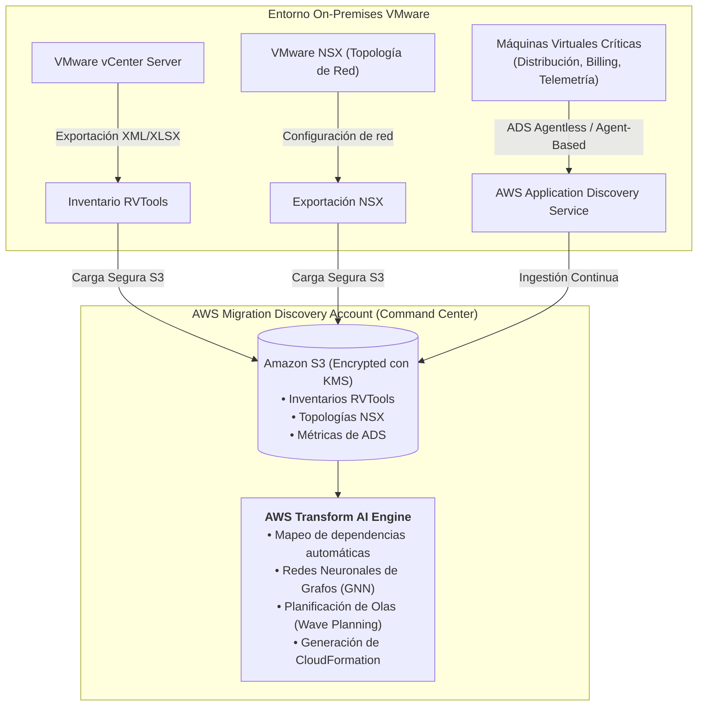
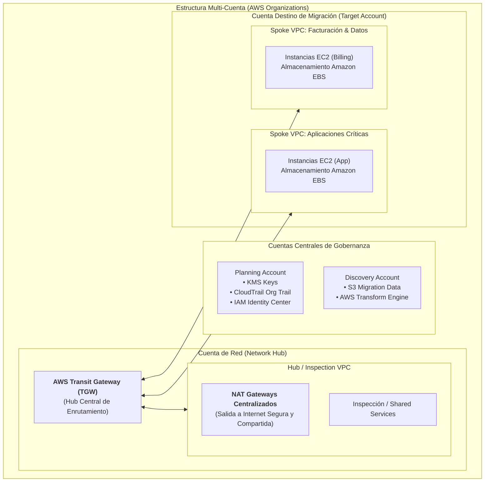

# Finished Architecture - Migration

> [!abstract] Qué es este archivo
> Decimoquinta lección del módulo de migración y modernización y **capstone de arquitectura**. Cierra el caso empresarial presentado en la lección 02 para la compañía de energía y servicios públicos (*Energy & Utilities*), integrando todos los componentes del curso en una **arquitectura de migración masiva automatizada y gobernada**. Despliega **AWS Transform for VMware** con modelos de inteligencia artificial (*Graph Neural Networks*) para descubrimiento y planificación de olas, **AWS Application Migration Service (MGN)** como motor de ejecución de Rehost a nivel de bloque, topología de red **Hub-and-Spoke con AWS Transit Gateway**, NAT Gateways centralizados, gobernanza multi-cuenta con **AWS Organizations**, auditoría inmutable con **AWS CloudTrail**, y cifrado integral con **AWS KMS** para el **Dominio 4 (Aceleración de la migración y la modernización)** del examen SAP-C02.

> [!quote] La idea que ordena todo
> En migraciones empresariales altamente complejas y reguladas, la arquitectura divide responsabilidades de forma impecable: **AWS Transform** actúa como el director de orquesta que mapea dependencias complejas mediante inteligencia artificial y planifica olas óptimas; **AWS Application Migration Service (MGN)** opera como la orquesta que replica bloques de datos de forma asíncrona hacia Amazon EC2 y EBS; y una topología **Hub-and-Spoke con Transit Gateway** centraliza la seguridad, los servicios compartidos y la salida a Internet, garantizando el cumplimiento de más de 200 controles regulatorios sin interrumpir los sistemas críticos de distribución de energía.

---

## Resumen en una frase

> La arquitectura final de migración para el sector Utilities combina el descubrimiento multi-modal y la planificación de olas basada en IA de **AWS Transform for VMware**, la replicación continua a nivel de bloque de **AWS MGN**, y una red **Hub-and-Spoke con AWS Transit Gateway** y NAT Gateways centralizados en una estructura multi-cuenta gobernada por **AWS Organizations**, **AWS KMS** y **AWS CloudTrail**.

---

## 1. El desafío empresarial de Energy & Utilities y la respuesta arquitectónica

En la lección 02 ([[Gathering the Customer Requirements - Migration]]), la empresa de energía y servicios públicos planteó cuatro requerimientos estrictos derivados de su infraestructura crítica (control de distribución eléctrica en tiempo real, facturación masiva y telemetría de red) y su entorno regulatorio severo con auditorías trimestrales y más de 200 controles de seguridad.

La arquitectura final diseñada por Joe resuelve formalmente cada uno de estos requerimientos:

| # | Requisito de Negocio (Lección 02) | Desafío Técnico Asociado | Solución Arquitectónica Final Implementada |
| --- | --- | --- | --- |
| **REQ-1** | **Migración de entorno VMware masivo con mínima disrupción** | Cargas de distribución de energía con tolerancia cero a latencia y caída de servicio. Imposibilidad de instalar agentes en todos los servidores. | Descubrimiento híbrido con **RVTools** y **Application Discovery Service (agentless)**; orquestación y mapeo de dependencias con IA en **AWS Transform**; replicación continua a nivel de bloque mediante **AWS MGN** hacia Amazon EBS. |
| **REQ-2** | **Optimización de costos y transición de CAPEX a OPEX** | Ciclo vicioso de gasto de ingeniería en mantenimiento físico; riesgo de sobreaprovisionamiento en la nube. | *Right-sizing* automático de instancias Amazon EC2 guiado por AWS Transform desde el día cero; centralización de **NAT Gateways en la VPC Hub** compartida para reducir costos de red. |
| **REQ-3** | **Cumplimiento regulatorio demostrable y auditable** | Auditorías trimestrales obligatorias; necesidad de documentar y registrar cada cambio de infraestructura y acceso a datos. | Estructura multi-cuenta segregada en **AWS Organizations**; registro inmutable de llamadas API con **AWS CloudTrail** organizacional; cifrado integral en tránsito (TLS 1.2) y en reposo con **AWS KMS**. |
| **REQ-4** | **Posicionamiento para modernización futura** | Monolitos legados difíciles de mantener que impiden adoptar nuevas tecnologías ágiles. | Creación automatizada de infraestructura de red en **AWS CloudFormation** que replica el entorno local para un corte seguro, habilitando la posterior descomposición en contenedores (**Amazon ECS/EKS**) y serverless (**AWS Lambda**). |

> [!note] Cierre de la duda abierta de la Lección 02
> Esta arquitectura final cierra formalmente la **Duda #1** registrada en el índice del módulo: las propuestas de solución de Joe para las tarjetas interactivas de requisitos corresponden exactamente a la combinación de **AWS Transform for VMware + AWS MGN + Transit Gateway Hub-and-Spoke + AWS Organizations/KMS/CloudTrail**.

---

## 2. Fase de descubrimiento y comando: IA agéntica y Graph Neural Networks

En una infraestructura de energía con miles de máquinas virtuales y sistemas SCADA/telemetría, mapear qué servidores se comunican entre sí es una de las tareas más lentas y propensas a errores.

### Flexibilidad en el descubrimiento: Agentless vs. Agent-Based

- **El imperativo del sector utilities:** En entornos de misión crítica de energía, los contratos de soporte y las normativas impiden frecuentemente instalar software de terceros o agentes en servidores de control operativo.
- **La solución híbrida implementada:**
  - **RVTools y VMware NSX:** Recopilación pasiva sin tocar sistemas operativos invitados.
  - **Application Discovery Service (Agentless Collector):** Se despliega como una máquina virtual OVA en vCenter que consulta métricas de uso de CPU, memoria y disco sin agentes.
  - **Application Discovery Service (Agent-Based):** Desplegado de forma selectiva solo en servidores donde está permitido para capturar conexiones de red TCP/UDP entrantes y salientes.

### Planificación de olas con Redes Neuronales de Grafos (GNN)

- AWS Transform almacena todos los datos en buckets de **Amazon S3** cifrados con **AWS KMS** dentro de la **AWS Migration Discovery Account**, que opera como el "Centro de Comando" de la migración.
- **Mapeo de dependencias mediante IA:** Utiliza **Graph Neural Networks (GNN)** para analizar los patrones de comunicación y agrupar automáticamente las cargas de trabajo en **olas de migración (*migration waves*)** óptimas.
- Identifica prerequisitos críticos: librerías compartidas, servidores de base de datos compartidos y servicios de autenticación que deben migrarse antes que las aplicaciones dependientes para garantizar cero fallos de comunicación en el corte.

---

## 3. Topología de red y seguridad: Hub-and-Spoke con Transit Gateway y Multi-Cuenta

La elección del diseño de red fue una de las decisiones arquitectónicas centrales analizadas por Joe:

### ¿Por qué Hub-and-Spoke con Transit Gateway en lugar de un modelo aislado?

AWS Transform ofreció dos modelos de arquitectura de red de destino:
1. **Modelo Aislado (*Isolated Model*):** Cada VPC de aplicación está completamente aislada sin interconexión entre VPCs.
2. **Modelo Hub-and-Spoke (*Hub-and-Spoke Model*):** Las VPCs de aplicaciones (Spokes) se interconectan mediante un **AWS Transit Gateway (TGW)** central.

**La justificación de Joe para elegir Hub-and-Spoke:**
- La empresa de servicios públicos necesita **gestión centralizada y servicios compartidos** (servidores de autenticación Active Directory, servidores de parches, telemetría y monitoreo).
- Permite centralizar los **NAT Gateways en la VPC Hub**, logrando dos objetivos:
  - **Optimización drástica de costos:** No se provisionan NAT Gateways redundantes (\$0.045/hora cada uno) en cada VPC individual.
  - **Seguridad e inspección unificada:** Todo el tráfico saliente hacia Internet atraviesa un punto único de control donde se pueden aplicar firewalls y políticas de filtrado estrictas.
- **Automatización de red con CloudFormation:** AWS Transform genera automáticamente plantillas de **AWS CloudFormation** que crean la topología de red en AWS reflejando fielmente el entorno on-premises (subredes, tablas de enrutamiento y grupos de seguridad), eliminando el error humano.

### Marco de gobernanza y cumplimiento de más de 200 controles

- **AWS Organizations:** Aislamiento y segregación estricta de límites de blast radius mediante Service Control Policies (SCPs) preventivas.
- **AWS IAM Identity Center:** Directorio federado que centraliza el acceso de los administradores y operadores mediante RBAC en todas las cuentas desde un único panel.
- **AWS CloudTrail Organizacional:** Registra de manera inmutable cada llamada de API en todas las regiones y cuentas, entregando los registros en un bucket S3 protegido para satisfacer a los auditores trimestrales.
- **AWS KMS (Key Management Service):** Todas las claves maestras administradas por el cliente (CMKs) cifran los discos EBS de las instancias migradas y los buckets de S3 que alojan la telemetría y los artefactos de migración.

---

## 4. Motor de ejecución y replicación: AWS Transform como director y AWS MGN como orquesta

La ejecución de la migración materializa la sincronización de las máquinas virtuales hacia la nube sin afectar la operación local:

```mermaid
flowchart LR
    subgraph LocalDC["Centro de Datos On-Premises"]
        SourceVMs["Máquinas Virtuales VMware<br>(Discos vmdk en SAN/NAS)"]
        RepAgent["<b>AWS Replication Agent</b><br>(Replicación continua de bloques)"]
        SourceVMs --> RepAgent
    end

    subgraph DirectConnect["Conectividad Segura"]
        DX["AWS Direct Connect / VPN<br>(Cifrado TLS 1.2 / Puerto 1500)"]
    end

    subgraph TargetAWS["Cuenta Destino (Target Account)"]
        subgraph Staging["Staging Area de Bajo Costo"]
            RepServer["Instancia EC2 Replication Server"]
            StagingEBS["Volúmenes EBS de Bajo Costo (1:1)"]
            RepServer --> StagingEBS
        end
        
        ConvServer["Machine Conversion Server<br>(Inyección drivers Nitro < 1 min)"]
        
        subgraph ProductionTarget["Producción Target (VPC Spoke)"]
            TargetEC2["<b>Instancia Amazon EC2 Final</b><br>(Right-sized según métricas)"]
            TargetEBS["Volumen Amazon EBS (gp3 / io2)"]
            TargetEC2 --- TargetEBS
        end
    end

    RepAgent -->|TCP 1500| DX
    DX --> RepServer
    StagingEBS --> ConvServer
    ConvServer --> TargetEC2
```

### La relación técnica entre AWS Transform y AWS MGN

- **AWS Transform (El Director):** Utiliza los planes de olas generados por IA para determinar qué lote de servidores debe replicarse, en qué orden y con qué configuraciones de lanzamiento (*Launch Settings*).
- **AWS Application Migration Service (La Orquesta):** Realiza el trabajo mecánico de transferencia continua de bloques mediante el **AWS Replication Agent**.
- **Right-Sizing desde el día cero:** En lugar de replicar las especificaciones de hardware sobredimensionadas locales (donde las VMs locales tenían 32 GB de RAM asignadas pero solo usaban 4 GB), AWS Transform analiza la utilización real capturada en la fase de descubrimiento y recomienda instancias EC2 de tamaño óptimo (*Right-sized EC2*), ahorrando costos de cómputo inmediatos.

---

## 5. Traducción del contenido

> [!info] Sección de referencia (opcional)
> Esto es la **traducción fiel** de las fuentes originales provistas en el curso de AWS Skill Builder. Su propósito es servir como material de verificación y consulta textual precisa de las explicaciones y lineamientos del instructor.

### 5.1 Video principal: Finished Architecture (transcripción)

Permítanme guiarlos a través de la arquitectura de migración que hemos diseñado para nuestro cliente de energía y servicios públicos (*energy and utilities*). ¿Y saben qué es lo que más me gusta de esta solución? Que aprovecha **AWS Transform for VMware** para hacer que una migración muy compleja sea mucho más manejable.

Comencemos con el **descubrimiento (*discovery*)**. Lo primero que estamos haciendo es obtener una imagen clara de su entorno VMware. AWS Transform nos ofrece múltiples formas de hacerlo. Podemos usar **RVTools** para la recopilación básica del inventario, o para los clientes que ejecutan **NSX**, tenemos opciones de importación disponibles.

También estamos configurando **AWS Application Discovery Service** con opciones basadas en agentes (*agent-based*) y sin agentes (*agentless*). Esta flexibilidad es clave aquí porque, en los entornos de servicios públicos, a menudo no se pueden instalar agentes en todos los servidores.

Y luego, todos estos datos de descubrimiento se almacenan de forma segura en buckets de **Amazon S3** dentro de lo que llamamos la **AWS Migration Discovery Account**. Piense en ella como nuestro centro de comando de la migración. Aquí es donde AWS Transform hace su magia utilizando inteligencia artificial para mapear todas esas complicadas dependencias entre aplicaciones. ¿Saben cómo en las migraciones tradicionales uno podía pasar semanas enteras intentando averiguar qué aplicaciones se comunican entre sí? La inteligencia artificial ahora se encarga de eso por nosotros.

Ahora, para el **diseño de la red (*network design*)**, tuvimos que tomar una decisión interesante. AWS Transform nos ofreció dos modelos. Elegimos un **modelo Hub-and-Spoke utilizando AWS Transit Gateway**. ¿Por qué? Bueno, porque nos proporciona administración centralizada y servicios compartidos, lo cual es perfecto para una empresa de servicios públicos que necesita mantener un control estricto sobre su infraestructura. La alternativa era un modelo aislado (*isolated model*), pero dada su necesidad de operaciones integradas, el modelo Hub-and-Spoke tenía mucho más sentido.

Ahora bien, en cuanto a **seguridad y cumplimiento normativo (*security and compliance*)**, aquí es donde se pone realmente bueno. Estamos usando **AWS Organizations** para establecer una estructura adecuada de múltiples cuentas. Todo está cifrado mediante **AWS KMS**. **AWS CloudTrail** captura cada llamada a la API con fines de auditoría. Y **AWS IAM Identity Center** nos proporciona una gestión de acceso centralizada en todas las cuentas. Recuerden aquellos requisitos regulatorios de los que hablamos: esta configuración los aborda todos.

Y la migración real es donde AWS Transform se luce a lo grande. Está orquestando todo a través de **AWS Application Migration Service (MGN)**. Piense en él como el director de una orquesta. Está coordinando la replicación de servidores hacia instancias EC2, gestionando la planificación de las olas (*wave planning*) y manejando todas las dependencias complejas que descubrimos anteriormente.

Y aquí hay un detalle genial sobre la planificación de olas: AWS Transform utiliza **redes neuronales de grafos (*graph neural networks*)** para analizar esas dependencias de aplicaciones que descubrimos, y sugiere automáticamente olas de migración óptimas. Así que se acabaron las largas noches frente a pizarras blancas intentando descifrar qué mover primero. Por ejemplo, en esta migración, sabemos que existen varias dependencias de código, librerías y marcos de trabajo que deben estar en su lugar antes de que las aplicaciones puedan migrar.

Ahora, en cuanto al **almacenamiento**, estamos utilizando **Amazon EBS** para las máquinas virtuales migradas. El **AWS Replication Agent** trabaja en conjunto con Application Migration Service para gestionar toda la transferencia de datos. Y recuerden: todos esos artefactos de migración, mapas de dependencias y planes de olas se almacenan de forma segura en buckets de S3 tanto en la cuenta de descubrimiento como en las cuentas de destino.

Una cosa que realmente aprecio de esta arquitectura es cómo maneja las redes: AWS Transform crea automáticamente plantillas de **AWS CloudFormation** que configuran la infraestructura de red de destino. Refleja su entorno de origen con gran fidelidad para minimizar cualquier dolor de cabeza en la red después de la migración. Los **NAT Gateways** están configurados en la VPC Hub, lo que ayuda a optimizar costos mientras se mantiene la seguridad.

Y hablando de optimización, aquí no nos limitamos a hacer un simple *lift-and-shift*. AWS Transform nos está ayudando a **dimensionar correctamente (*right size*)** nuestras instancias EC2 desde el principio. Se acabó el sobreaprovisionar solo para estar seguros.

Y debido a que estamos utilizando servicios administrados de AWS siempre que es posible, su equipo puede concentrarse en la innovación en lugar de en la gestión de la infraestructura. Porque no se trata solo de llevar sus cargas de trabajo a la nube; se trata de prepararlas para una **futura modernización**. Una vez que estas cargas de trabajo estén en AWS, podrán comenzar a aprovechar las características nativas de la nube, implementar una mejor automatización y explorar nuevos servicios a medida que estén disponibles.

Esta arquitectura les proporciona exactamente lo que necesitaban: una ruta de migración cuidadosamente controlada que mantiene sus requisitos de seguridad y cumplimiento normativo mientras los prepara para la innovación futura. Y lo mejor de todo es que hemos automatizado una parte tan grande del trabajo complejo que su equipo puede concentrarse en lo que realmente importa: mantener su infraestructura crítica funcionando sin problemas y mantener esas luces encendidas.

*(Duración del video: 5 minutos, 19 segundos)*

### 5.2 Lectura oficial: Resumen de la arquitectura (Architecture recap)

- Utilizar **AWS Transform** para planificar cada paso de la migración.
- Implementar una estructura de cuentas segura utilizando **AWS Organizations**. Cifrar los datos con **AWS KMS** y auditar las acciones de los usuarios con **AWS CloudTrail**.
- Utilizar **AWS Application Migration Service** para coordinar la migración y gestionar las dependencias.
- Proporcionar almacenamiento para las cargas de trabajo migradas utilizando **Amazon EBS**.
- Desplegar una infraestructura de red con **AWS CloudFormation** que coincida lo más estrechamente posible con la infraestructura local.
- Identificar oportunidades para una modernización adicional una vez completada la migración.

---

## 6. Cierre conceptual: mapa de responsabilidades de la arquitectura final

| Capa Arquitectónica | Servicio o Mecanismo AWS | Justificación en el Caso de Utilities |
| --- | --- | --- |
| **Descubrimiento Flexible** | **RVTools + NSX Import + ADS Agentless/Agent** | Ingestión multi-modal sin violar restricciones de seguridad que impiden instalar agentes en servidores SCADA/distribución. |
| **Centro de Mando e IA** | **AWS Transform + Discovery Account (S3 + KMS)** | Uso de Graph Neural Networks (GNN) para resolver dependencias y planificar olas de corte automáticamente. |
| **Topología de Red Centralizada** | **AWS Transit Gateway (Hub-and-Spoke)** | Proporciona interconexión para servicios compartidos e inspección de tráfico; centraliza NAT Gateways para optimizar costos de red. |
| **Gobernanza y Auditoría** | **AWS Organizations + CloudTrail + IAM Identity Center** | Aislamiento multi-cuenta con SCPs preventivas; trazabilidad inmutable de APIs para auditorías trimestrales obligatorias. |
| **Protección Criptográfica** | **AWS KMS (Customer Managed Keys - CMK)** | Cifrado obligatorio en reposo para todos los volúmenes EBS migrados y buckets S3 que alojan artefactos y telemetría. |
| **Motor de Rehost Asíncrono** | **AWS Application Migration Service (MGN)** | Replicación continua a nivel de bloque con Staging Area de bajo costo, garantizando RPO de segundos en el corte. |
| **Optimización de Cómputo** | **Right-Sizing guiado por IA en Amazon EC2** | Elimina el sobredimensionamiento heredado de VMware basándose en el consumo real de CPU y memoria. |
| **Automatización de Despliegue** | **AWS CloudFormation** | Generación declarativa de subredes, tablas de rutas y SGs idénticos a la red on-premise para evitar errores post-migración. |

---

## 7. Para el examen (SAP-C02)

> [!important] Lo que hay que retener
> 1. **El tándem AWS Transform + AWS MGN:** AWS Transform es el planificador inteligente basado en IA (dependencias y olas), mientras que AWS MGN es el ejecutor operativo de la replicación de bloques hacia EC2/EBS.
> 2. **Descubrimiento sin agentes (Agentless):** En entornos altamente regulados o de misión crítica (Utilities/Salud/Banca) donde los agentes están prohibidos, la combinación de **RVTools**, **exportaciones de VMware NSX** y el **Application Discovery Service Agentless Connector (OVA)** es la respuesta correcta de examen.
> 3. **Redes Neuronales de Grafos (GNN) en Wave Planning:** AWS Transform utiliza algoritmos de grafos para identificar dependencias ocultas entre bibliotecas, servicios compartidos y bases de datos, evitando que una aplicación migre antes que sus componentes base.
> 4. **Transit Gateway Hub-and-Spoke vs. Red Aislada:** El modelo Hub-and-Spoke es la opción recomendada cuando la organización requiere servicios compartidos (AD, monitoreo, seguridad) y control centralizado del tráfico.
> 5. **Centralización de NAT Gateways para ahorro de costos:** Alojar NAT Gateways en la VPC Hub y enrutar el tráfico de salida de las Spokes a través de Transit Gateway reduce drásticamente el costo fijo por hora de NAT Gateways individuales.
> 6. **CloudFormation para paridad de red:** AWS Transform automatiza la generación de plantillas CloudFormation para desplegar la red destino reflejando exactamente las subredes y SGs locales, eliminando la configuración manual post-migración.
> 7. **Right-Sizing desde el día cero:** No realizar Rehost 1:1 de especificaciones de hardware locales; utilizar las métricas de utilización real recopiladas por Discovery Service para seleccionar tipos de instancias EC2 más pequeñas y eficientes.
> 8. **Auditoría inmutable para cumplimiento regulatorio:** Desplegar **AWS CloudTrail Organizational Trail** con entrega en una cuenta centralizada de logs protegida por SCPs para satisfacer auditorías trimestrales externas.
> 9. **Cifrado exhaustivo con AWS KMS:** Utilizar Customer Managed Keys (CMKs) con rotación automática anual para cifrar volúmenes EBS, snapshots y buckets S3 que contienen artefactos de migración.
> 10. **Migrar primero, Modernizar después:** El caso de Utilities demuestra que para infraestructuras críticas masivas, la estrategia ganadora es Rehost seguro y no disruptivo con servicios administrados primero, y modernización a contenedores/serverless en fases posteriores.

> [!warning] Trampa clásica del examen
> **Escenario:** Una compañía de servicios públicos debe migrar 500 máquinas virtuales VMware a AWS bajo un estricto marco regulatorio con auditorías trimestrales. Los equipos de seguridad prohíben la instalación de cualquier software o agente de terceros en los servidores de producción. El equipo de arquitectura propone contratar un equipo de consultores externos para auditar manualmente cada servidor, dibujar las dependencias en hojas de cálculo y escribir scripts personalizados en Python para recrear las redes en AWS.
>
> **La trampa:** Confiar en consultoría manual para descubrir dependencias y crear redes artesanales en un entorno de 500 VMs reguladas introduce meses de retraso, errores humanos en el corte de dependencias cruzadas y carece de documentación auditable para los entes reguladores.
>
> **La respuesta correcta:** Utilizar **AWS Transform for VMware** con descubrimiento sin agentes (**RVTools**, importación de **VMware NSX** y **Application Discovery Service Agentless**). Almacenar los datos en la **AWS Migration Discovery Account**, dejar que la IA mapee las dependencias y organice las olas de migración automáticamente, generar la infraestructura de red de forma declarativa y reproducible mediante **AWS CloudFormation**, y ejecutar la replicación coordinada a través de **AWS Application Migration Service (MGN)** con cifrado KMS y auditoría en **AWS CloudTrail**.

---

## Relacionado

- [[Gathering the Customer Requirements - Migration]] — lección 02: caso Energy & Utilities y los cuatro requisitos de negocio originales
- [[AWS Transform Overview]] — lección 06: visión general de los 4 agentes de IA de AWS Transform
- [[AWS Transform for VMware]] — lección 07: arquitectura de 3 cuentas, tipos de jobs y marco Human-in-the-Loop (HITL)
- [[AWS Application Migration Service]] — lección 08: motor troncal de replicación a nivel de bloque y Staging Area
- [[AWS Solutions Architect Advanced - Migration and Modernization]] *(índice del módulo)*
- Siguiente paso del módulo: **lección 16 del módulo de migración y modernización**

---

## Registro de integración

| Fecha | Tipo de cambio | Detalle de la modificación |
| --- | --- | --- |
| 2026-10-29 | Creación de nota canónica (Capstone) | Alta de la decimoquinta lección del módulo *Migration and Modernization*. Se estructura exhaustivamente la nota capstone **Finished Architecture - Migration** (caso Energy & Utilities: resolución formal de los 4 requisitos de la lección 02, descubrimiento sin agentes con RVTools/NSX/ADS, mapeo de dependencias con IA y Graph Neural Networks en AWS Transform, arquitectura de red Hub-and-Spoke con Transit Gateway y NAT Gateways centralizados, gobernanza multi-cuenta con Organizations, KMS y CloudTrail, ejecución con AWS MGN y right-sizing para el examen SAP-C02). Cierre de la Duda #1 del módulo. |
