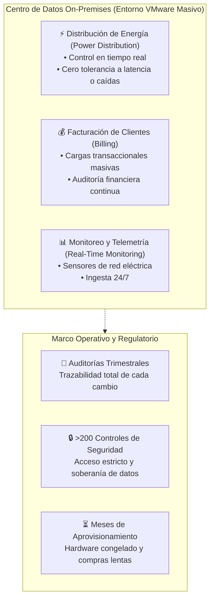
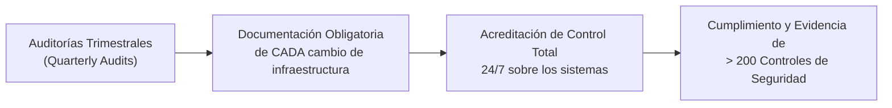
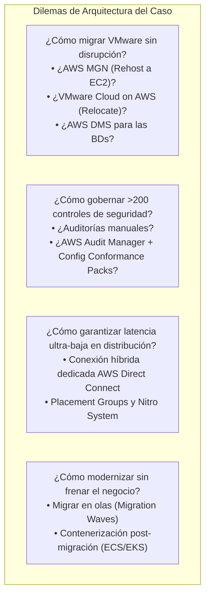

# Gathering the Customer Requirements - Migration

> [!abstract] Qué es este archivo
> Segunda lección del módulo y **presentación del caso de estudio troncal**. Una gran empresa de energía y servicios
> públicos (*Energy & Utilities*) decide dar el salto hacia AWS y migrar una infraestructura on-premises masiva
> basada en **VMware**.
>
> Sus cargas son de misión crítica extrema: **distribución eléctrica en tiempo real**, **facturación de clientes (billing)**
> y **monitoreo operativo continuo**. El escenario plantea un marco de **estricto cumplimiento regulatorio**
> (auditorías trimestrales, más de 200 controles de seguridad, soberanía de datos), ciclos de compras que demoran meses,
> y la necesidad de frenar el desgaste del personal para habilitar la **modernización futura** sin interrumpir
> el suministro eléctrico.
>
> Video: **3 minutos 16 segundos**. Instructor: **Joe**.

> [!quote] La idea que ordena todo
> **“No se trata solo de mantener las luces encendidas: se trata de demostrar ante los auditores que se tiene el control total para mantenerlas encendidas en todo momento.”** (*“It's not just about turning the lights on, it's about proving that they can keep them on.”* — Joe).
> En sectores altamente regulados con infraestructura crítica, la migración a la nube debe garantizar que la observabilidad, la gobernanza y la inmutabilidad de los registros de cambio sean incluso superiores a las del entorno físico local.

---

## Resumen en una frase

> Una compañía de servicios públicos de energía debe migrar su masiva infraestructura **VMware** on-premises
> a AWS con **mínima disrupción** para sistemas críticos de distribución eléctrica y facturación, garantizando
> **auditorías trimestrales con más de 200 controles de seguridad**, optimizando costos operativos y de personal,
> y sentando las bases para la **modernización futura** de sus aplicaciones legadas.

---

## 1. El cliente: Servicios públicos e infraestructura de misión crítica

El sector de **Energy & Utilities** tradicionalmente ha mantenido su infraestructura en centros de datos propios debido a temores de latencia, seguridad y mandatos regulatorios. Sin embargo, los costos crecientes y la rigidez del hardware forzaron a la compañía a liderar un cambio estratégico.

### 1.1 Las tres cargas de trabajo críticas
1. **Control de distribución de energía (*Power Distribution*):**
   - Regula el flujo físico de electricidad hacia usuarios residenciales e industriales.
   - **Tolerancia cero a caídas:** Una degradación en latencia o una pérdida de conectividad puede provocar fallas en subestaciones o apagones en el mundo real.
2. **Facturación de clientes (*Customer Billing*):**
   - Procesa millones de transacciones de consumo y pagos recurrentes.
   - Requiere consistencia estricta en las bases de datos y respaldo financiero auditable.
3. **Monitoreo en tiempo real (*Real-Time Monitoring*):**
   - Supervisa de forma ininterrumpida la integridad de la red, voltajes y telemetría de activos físicos de campo.

---

## 2. Los cuatro dolores de negocio del liderazgo (CTO)

Durante las sesiones de relevamiento con el equipo directivo, el CTO y los arquitectos destacaron cuatro problemas estructurales que asfixian su operación:

| Dolor de negocio | Impacto operativo real | Oportunidad con la migración a AWS |
| --- | --- | --- |
| **Trampa de mantenimiento vs. Innovación** | El equipo técnico consume el 100 % de su jornada en "mantener los sistemas vivos", reparar hardware y aplicar parches manuales. Cero tiempo para innovación. | Descargar el mantenimiento de infraestructura física hacia AWS para reasignar a los ingenieros al desarrollo de nuevas funcionalidades para los clientes. |
| **Procesos de aprovisionamiento lentos (meses)** | Cada vez que el negocio requiere mayor capacidad de cómputo o almacenamiento, el ciclo de licitación, compra, envío e instalación toma varios meses. | Provisión elástica bajo demanda en minutos mediante Amazon EC2, EBS y Auto Scaling. |
| **Costo total de propiedad (TCO) desbordado** | No solo el costo directo de servidores y licencias de virtualización: el verdadero costo reside en las horas de ingeniería desperdiciadas en tareas rutinarias. | Optimización de CAPEX a OPEX, pagando únicamente por los recursos utilizados (*pay-as-you-go*) y eliminando hardware ocioso. |
| **Deuda técnica y modernización postergada** | Aplicaciones monolíticas legadas que necesitan modernizarse con urgencia, pero que no pueden tocarse por el riesgo de interrumpir el servicio. | Estrategia de migración por fases: aterrizar de forma segura (*Rehost/Replatform*) y habilitar fábricas de modernización posterior. |

---

## 3. Seguridad, soberanía y marco regulatorio extremo

El aspecto que más llamó la atención de los arquitectos de AWS fue la presión del entorno regulatorio del sector de utilities:

- **Documentación exhaustiva de cambios:** Cada modificación en la infraestructura debe generar una pista de auditoría inmutable que detalle *quién*, *cuándo* y *qué* se alteró.
- **Más de 200 controles de seguridad:** El arquitecto de seguridad del cliente enfatizó la sobrecarga de mantener, certificar y documentar manualmente más de 200 controles de seguridad corporativos y federales.
- **Monitoreo de toda interacción:** Registro obligatorio de cada acceso a los sistemas, llamadas a APIs y transferencias de datos.
- **Soberanía y residencia de datos:** Estricto aislamiento geográfico para garantizar que los datos de la red eléctrica nacional permanezcan dentro de los límites jurisdiccionales requeridos.

---

## 4. Los cuatro requisitos de arquitectura

La fuente formaliza los requisitos del cliente en cuatro pilares concretos:

| # | Requisito de Arquitectura | Desafío técnico asociado | Respuesta arquitectónica en AWS |
| --- | --- | --- | --- |
| **1** | **Migration of a large VMware environment to AWS with a minimum of disruption** | Mover cientos de máquinas virtuales que controlan distribución y facturación sin interrumpir la operación continua ni generar latencia inaceptable. | Replicación continua a nivel de bloque en segundo plano con **AWS Application Migration Service (MGN)** o migración sin cambios de hipervisor hacia **VMware Cloud on AWS**, con pruebas no destructivas antes del corte definitivo (*cutover*). |
| **2** | **Cost optimization** | Reducir el gasto masivo en infraestructura física y liberar tiempo de ingeniería eliminando el trabajo pesado no diferenciado (*undifferentiated heavy lifting*). | Dimensionamiento inicial optimizado (*right-sizing*) con **Migration Evaluator**, instancias EC2 de generación actual, Savings Plans y eliminación de licencias de virtualización propietarias. |
| **3** | **Regulatory compliance** | Aprobar auditorías trimestrales demostrando control absoluto e inmutable sobre más de 200 controles de seguridad. | Gobernanza multi-cuenta con **AWS Organizations** y **AWS Control Tower**, auditoría centralizada con **AWS CloudTrail**, paquetes de reglas de cumplimiento automatizado con **AWS Config Conformance Packs** y recolección de evidencia para auditores con **AWS Audit Manager**. |
| **4** | **Positioning for future modernization** | La arquitectura de destino no debe ser un callejón sin salida; debe permitir la transición hacia contenedores y microservicios. | Despliegue sobre VPCs modulares, subredes segregadas, adopción de balanceadores ALB/NLB, y preparación para contenerizar con **AWS App2Container** o modernizar bases de datos con **AWS DMS** y Aurora. |

---

## 5. Anticipo de soluciones arquitectónicas en AWS (Flashcards de Joe)

En el material interactivo, Joe invita a plantear soluciones para los requisitos antes de revelar las propuestas finales en las sesiones posteriores del curso:

> [!note] Registro técnico sobre las Flashcards de Joe
> Al igual que en módulos anteriores, el interactivo de Skill Builder plantea la reflexión sobre qué servicios seleccionar para cada uno de los cuatro requisitos. El detalle fino de las herramientas seleccionadas y la arquitectura final se irá confirmando y validando en las lecciones siguientes de servicios y en el capstone (*Finished Architecture*).

---

## 6. Traducción del contenido

> [!info] Sección de referencia (opcional)
> Esto es la **traducción fiel** de la transcripción y los textos del interactivo provistos por AWS Skill Builder. Lo que se estudia y evalúa en el examen está analizado en las secciones 1 a 5 y sintetizado en la sección 8.

### 6.1 Transcripción del video: Resumen de negocio y requisitos (Joe)

**Transcripción:**

> *"Hola a todos. Hoy quiero compartir una sesión de relevamiento de requisitos realmente interesante que tuve con una **empresa de energía y servicios públicos** (*energy and utilities company*). ¿Saben cómo las empresas de servicios públicos suelen mantener todo on-premises? Bueno, esta está lista para hacer un cambio y su situación resalta algunos desafíos muy interesantes.*
>
> *Pasamos varias horas con su equipo de liderazgo y, de entrada, fueron muy sinceros sobre sus principales puntos de dolor. Tienen esta **masiva infraestructura on-premises** que se está volviendo cada vez más costosa de mantener, y estamos hablando de **sistemas críticos que controlan la distribución de energía, la facturación de clientes y el monitoreo en tiempo real**. Así que no es exactamente el tipo de cosas que deseas migrar sin un plan sólido.*
>
> *Lo que realmente me llamó la atención fue el **entorno regulatorio**. Cada vez que realizan un cambio de infraestructura, necesitan documentar todo, y me refiero a absolutamente todo. Tienen **auditores que revisan sus sistemas trimestralmente**, y necesitan demostrar que mantienen un **control completo sobre su infraestructura en todo momento**. No se trata solo de encender las luces; se trata de **demostrar que pueden mantenerlas encendidas**.*
>
> *El CTO compartió algo muy interesante: su equipo pasa tanto tiempo manteniendo los sistemas existentes que **no pueden enfocarse en la innovación**. Tienen estas aplicaciones heredadas que necesitan desesperadamente una modernización, pero están atrapados en este ciclo de mantener las cosas funcionando. Y con su configuración actual, **escalar es una pesadilla**: cada vez que necesitan más capacidad, es un proceso de adquisición y despliegue que dura meses.*
>
> *El costo es definitivamente un factor, pero aquí está lo interesante: no se trata solo de reducir los costos de infraestructura, están mirando el panorama general. Cada hora que su equipo pasa administrando infraestructura física es una hora que no están dedicando a mejorar sus servicios o implementar nuevas capacidades que sus clientes desean.*
>
> *La seguridad surgió repetidamente en nuestras discusiones. Necesitan mantener **controles de acceso estrictos, monitorear cada interacción del sistema y garantizar la soberanía completa de los datos**. Uno de sus arquitectos de seguridad mencionó que tienen **más de 200 controles de seguridad que necesitan mantener y documentar**, y eso representa una enorme sobrecarga operativa.*
>
> *El rendimiento también es fundamental para ellos; estamos hablando de sistemas que controlan la distribución real de energía. **Cualquier latencia o tiempo de inactividad podría tener graves consecuencias en el mundo real**, por lo que cuando hablan de migración, necesitan certeza absoluta de que el rendimiento no se verá comprometido.*
>
> *Por lo tanto, sus requisitos realmente se redujeron a unos pocos puntos clave:
> 1. Necesitan una forma de **migrar sus cargas de trabajo VMware manteniendo sus estándares de seguridad y cumplimiento**.
> 2. Necesitan **mantener sus sistemas críticos funcionando sin problemas durante toda la migración**.
> 3. Necesitan hacer todo esto mientras **se preparan para la modernización futura**.*
>
> *Afortunadamente, sus requisitos se alinean muy bien con algunas nuevas capacidades que AWS ha desarrollado. Así que en nuestra próxima sesión, les mostraré cómo abordamos estos requisitos con una estrategia de migración integral."*
>
> *(Duración del video: 3 minutos, 16 segundos).*

---

### 6.2 Requisitos de arquitectura (Texto oficial)

- **Migration of a large VMware environment to AWS with a minimum of disruption** (Migración de un gran entorno VMware a AWS con un mínimo de disrupción).
- **Cost optimization** (Optimización de costos).
- **Regulatory compliance** (Cumplimiento regulatorio).
- **Positioning for future modernization** (Posicionamiento para la modernización futura).

> *“It's not just about keeping the lights on. It's about proving they can keep them on.”*
> **— Joe**

---

## 7. Cierre conceptual: Cuadro de alineación de requisitos

| Requisito del caso | Restricción clave | Mecanismo canónico en AWS |
| --- | --- | --- |
| **Migrar entorno VMware sin disrupción** | Cargas de distribución eléctrica y facturación no toleran ventanas largas de parada ni pérdida de estado. | **AWS Application Migration Service (MGN)** con replicación continua a nivel de bloque en segundo plano, pruebas en subredes aisladas y cutover en minutos. Alternativamente, **VMware Cloud on AWS** si se exige cero conversión de VMs. |
| **Gobernanza y auditorías trimestrales** | Acreditar cumplimiento continuo de $> 200$ controles de seguridad ante auditores externos. | **AWS Organizations** con SCPs + **AWS Control Tower** para landing zone estandarizada + **AWS Config Conformance Packs** + recolección automática de pruebas en **AWS Audit Manager**. |
| **Trazabilidad inmutable de cambios** | Documentar absolutamente cada llamada a API y cambio de infraestructura. | **AWS CloudTrail** multi-región y multi-cuenta con validación de integridad de archivos de log (*Log File Validation*) y almacenamiento en buckets S3 protegidos con **S3 Object Lock** (WORM). |
| **Rendimiento de distribución en tiempo real** | Cero impacto en latencia para telemetría y SCADA. | Conectividad híbrida redundante con **AWS Direct Connect** dedicada, interfaces de red mejoradas (ENA) y optimización de instancias EC2 con cómputo Nitro. |
| **Posicionamiento para modernización futura** | Monolitos legados que deben desacoplarse después de la salida del data center. | Arquitectura modular en AWS: landing zone multi-cuenta, microsegmentación de VPCs, y habilitación de **AWS App2Container** y **AWS DMS** para bases de datos. |

---

## 8. Para el examen (SAP-C02)

> [!important] Lo que hay que retener
> 1. **Entorno VMware masivo hacia AWS.** En el examen SAP-C02 existen dos caminos principales:
>    - **Rehost hacia Amazon EC2:** utilizando **AWS Application Migration Service (MGN)** (convierte los discos virtuales VMDK a volúmenes EBS de forma continua y automatizada).
>    - **Relocate hacia VMware Cloud on AWS:** cuando el requisito exige mantener herramientas de VMware (vCenter, NSX, vSAN) sin alterar la arquitectura operativa existente.
> 2. **Corte con mínima disrupción (*Minimum Disruption Cutover*).** Para cumplir con RTOs y RPOs de minutos en sistemas críticos, la replicación de bloques de AWS MGN opera de forma continua y asíncrona sobre la red mientras la VM on-premises sigue atendiendo tráfico en producción.
> 3. **Pruebas no disruptivas previas al cutover.** AWS MGN permite lanzar instancias de prueba (*Test instances*) en VPCs y subredes aisladas para validar funcionamiento y latencia sin afectar la replicación en curso ni la producción local.
> 4. **Cumplimiento masivo de controles (>200 controles).** En lugar de auditorías manuales o scripts artesanales, la mejor práctica de arquitectura en AWS es desplegar **AWS Config Conformance Packs** (paquetes preempaquetados de reglas de Config remediables) e integrar con **AWS Audit Manager** para generar reportes automáticos para auditores.
> 5. **Trazabilidad de cambios de infraestructura.** Cuando los reguladores exigen demostrar "quién modificó qué y cuándo", la solución mandatoria es **AWS CloudTrail**, complementado con **AWS Config** para registrar la historia cronológica de cambios en los recursos.
> 6. **Costo de oportunidad del personal.** En casos de negocio, el ahorro en la nube no es solo el costo directo de servidores: el pilar de Excelencia Operativa y Costos del Well-Architected Framework destaca la reducción de sobrecarga operativa (*undifferentiated heavy lifting*).
> 7. **Soberanía y residencia de datos.** Se resuelve seleccionando la Región de AWS local apropiada y aplicando **Service Control Policies (SCPs)** en AWS Organizations que restrinjan el despliegue a regiones autorizadas (`aws:RequestedRegion`).
> 8. **Conectividad híbrida de alto rendimiento.** Para cargas de servicios públicos con telemetría en tiempo real, la conexión durante y después de la migración exige **AWS Direct Connect** privado redundante, evitando la fluctuación de latencia de Internet.
> 9. **Bases de datos transaccionales de facturación.** Para migrar la base de datos de facturación con mínima parada, se utiliza **AWS Database Migration Service (DMS)** con CDC habilitado (*Change Data Capture*).
> 10. **Modernización post-migración.** La estrategia recomendada ante fechas límite y criticidad extrema es migrar primero (*Rehost*) para garantizar la estabilidad y el cumplimiento regulatorio, y luego iniciar la modernización incremental (*Refactor/Replatform*) hacia contenedores y bases de datos administradas.

> [!warning] Trampa clásica del examen
> **Escenario:** Una compañía de servicios públicos debe migrar 500 máquinas virtuales VMware a AWS garantizando el cumplimiento de estrictas regulaciones gubernamentales y auditorías trimestrales. Los sistemas controlan la red de distribución eléctrica en tiempo real. Un arquitecto sugiere reescribir inmediatamente la capa de control a microservicios sin servidor (*serverless*) con AWS Lambda y Amazon DynamoDB antes de abandonar el data center para maximizar la modernización.
> **La trampa:** Seleccionar la refactorización inmediata (*Refactor*) para "aprovechar la migración".
> **Por qué falla:** Intentar reescribir sistemas de control en tiempo real bajo estrictas regulaciones mientras se mantiene el hardware físico existente eleva drásticamente el riesgo de apagones y fallas regulatorias. La solución correcta de arquitectura es realizar **Rehost con AWS MGN** (o Relocate con VMware Cloud on AWS), validar los 200 controles con AWS Config y Audit Manager, y ejecutar la modernización en una fase posterior mediante fábricas de modernización controladas.

---

## Relacionado

- [[AWS Solutions Architect Advanced - Migration and Modernization]] *(índice del módulo)*
- [[Course Overview - Migration and Modernization]] — lección 01 del módulo (hoja de ruta)
- [[Gathering the Customer Requirements - Resilience]] — caso de la institución financiera en resiliencia
- [[Gathering the Customer Requirements - Hybrid]] — caso de conectividad híbrida
- [[Gathering the Customer Requirements - Security]] — caso de seguridad y segmentación de red
- [[Gathering the customer REquirements]] — caso del módulo Multi-Account
- [[4.1 Seleccionar las cargas de trabajo y los procesos existentes para una posible migración]] — tarea de examen 4.1
- [[4.2 Determinar el enfoque de migración óptimo para las cargas de trabajo existentes]] — tarea de examen 4.2
- [[4.3 Determinar una nueva arquitectura para las cargas de trabajo existentes]] — tarea de examen 4.3
- [[4.4 Determinar oportunidades de modernización y mejoras]] — tarea de examen 4.4

Siguiente paso del módulo: **Lección 03**.

---

## Registro de integración

| Fecha | Cambio | Motivo / Detalle |
| --- | --- | --- |
| 2026-10-29 | Creación de la nota inicial | Alta de la segunda lección del módulo *Migration and Modernization*. Se registra el caso de estudio de la empresa de energía y servicios públicos, sus 3 cargas críticas (distribución, facturación, telemetría), los 4 requisitos de arquitectura, el marco de 200+ controles y auditorías trimestrales, y la matriz de preparación para el examen SAP-C02. |
