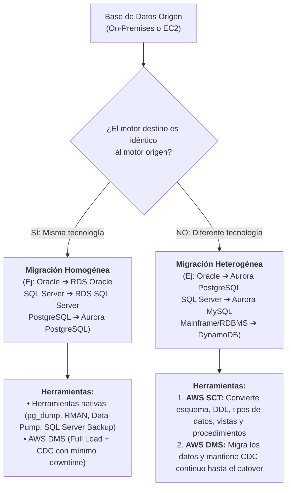
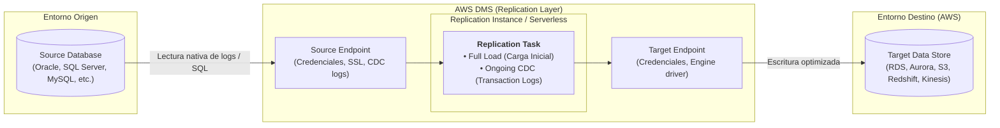
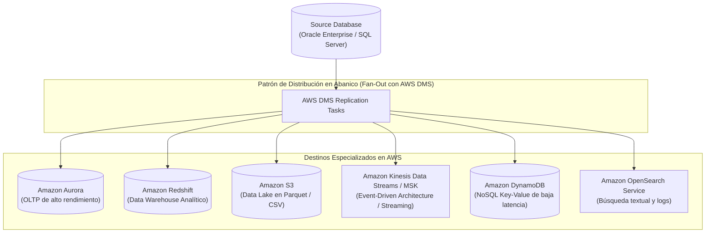
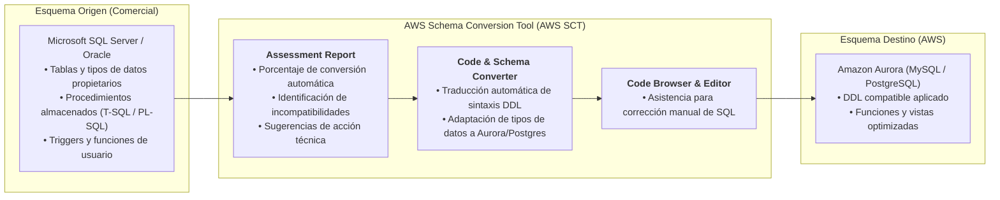

# Migrating Databases

> [!abstract] Qué es este archivo
> Guía técnica exhaustiva sobre la migración y modernización de bases de datos hacia AWS utilizando **AWS Database Migration Service (AWS DMS)** y **AWS Schema Conversion Tool (AWS SCT)**. Analiza las diferencias arquitectónicas entre migraciones homogéneas y heterogéneas, los modos de replicación (*Full Load*, *CDC continuo*, y *CDC-only* en combinación con **AWS Snowball Edge**), el patrón de distribución en abanico (*Fan-Out*) hacia destinos relacionales y no relacionales (**Amazon S3**, **Kinesis Data Streams**, **Amazon Redshift**, **DynamoDB**), y las limitaciones críticas de DMS respecto a índices secundarios, claves foráneas y procedimientos almacenados para el **Dominio 4 (Aceleración de la migración y la modernización)** del examen SAP-C02.

> [!quote] La idea que ordena todo
> Migrar una base de datos a la nube requiere dos disciplinas distintas: **trasladar la estructura (el esquema)** y **trasladar los datos (el estado)**. Si los motores son distintos (heterogéneos), **AWS SCT** convierte primero el esquema, los tipos de datos y los procedimientos almacenados; luego, **AWS DMS** asume la replicación de los datos mediante carga inicial y captura de cambios continuos (**CDC**) leyendo los transaction logs nativos del motor sin interrumpir las operaciones productivas.

---

## Resumen en una frase

> **AWS DMS** replica y sincroniza datos relacionales y no relacionales de forma continua y con mínima inactividad mediante lectura de logs nativos (**CDC**), complementándose con **AWS SCT** para la conversión previa de esquemas, tipos de datos y código de base de datos en migraciones heterogéneas.

---

## 1. Estrategias de migración de bases de datos: homogéneas vs. heterogéneas

Al plantear la migración de una base de datos hacia AWS, el Solutions Architect debe categorizar la carga de trabajo según la compatibilidad entre el motor de origen y el de destino:

### Migraciones homogéneas

- **Definición:** El motor de base de datos de origen y el de destino son idénticos o compatibles a nivel de protocolo (p. ej., Microsoft SQL Server on-premises hacia Amazon RDS for SQL Server; Oracle Database en VMware hacia Amazon RDS for Oracle; o PostgreSQL local hacia Amazon Aurora PostgreSQL-Compatible Edition).
- **Ventajas:** No requiere transformación de tipos de datos, reescritura de procedimientos almacenados ni alteración de sintaxis SQL.
- **Herramientas aplicables:** Se pueden emplear herramientas nativas del motor (Oracle Data Pump / RMAN, SQL Server Native Backup `.bak` restaurado vía S3, `pg_dump`/`pg_restore`, `mysqldump`) o utilizar **AWS DMS** para lograr una conmutación (*cutover*) casi instantánea mediante replicación continua de cambios.

### Migraciones heterogéneas

- **Definición:** El motor de base de datos de origen difiere sustancialmente del destino (p. ej., migrar de motores comerciales licenciados como Oracle Database o Microsoft SQL Server hacia motores de código abierto o diseñados para la nube como **Amazon Aurora**, **Amazon RDS for PostgreSQL**, o repositorios NoSQL como **Amazon DynamoDB**).
- **El desafío técnico:** Las estructuras de esquema, los dialectos SQL (PL/SQL vs. PL/pgSQL vs. T-SQL), los tipos de datos internos (p. ej., `CLOB`/`BLOB` de Oracle vs. `BYTEA`/`TEXT` de Postgres), las secuencias, triggers y claves foráneas son incompatibles.
- **Solución estándar:** Requiere un flujo en dos fases desacopladas:
  1. **Conversión del esquema y código:** Ejecutada mediante **AWS Schema Conversion Tool (AWS SCT)**.
  2. **Migración y sincronización de datos:** Ejecutada mediante **AWS Database Migration Service (AWS DMS)**.

---

## 2. Arquitectura y mecánica operativa de AWS Database Migration Service (AWS DMS)

AWS DMS es un servicio administrado que despliega un motor de replicación en la nube para mover datos entre almacenes de origen y destino sin detener el tráfico productivo.

### Componentes fundamentales de AWS DMS

1. **Replication Instance:** Servidor EC2 administrado por AWS que ejecuta el software de replicación de DMS, consume memoria y almacenamiento para retener en caché los logs de transacciones durante la transferencia. También existe la modalidad **AWS DMS Serverless**, que auto-escala la capacidad de procesamiento de replicación en unidades DCU (*DMS Capacity Units*) sin requerir el dimensionamiento manual de instancias.
2. **Endpoints:** Conectores que encapsulan los parámetros de conexión, tipos de motor, credenciales de autenticación, certificados SSL/TLS y configuraciones avanzadas para la base de datos de origen (*Source Endpoint*) y la de destino (*Target Endpoint*).
3. **Replication Tasks:** La unidad de ejecución que realiza el trabajo real de migración. Define las reglas de mapeo de esquemas/tablas, filtros de columnas, transformaciones de nombres y el tipo de replicación.

### Modos de replicación de una tarea DMS

| Modo de Tarea | Mecánica Operativa | Cuándo Utilizarlo en el Examen |
| --- | --- | --- |
| **Full Load** | Extrae todos los datos de las tablas seleccionadas en el origen y los inserta en el destino. No captura transacciones que ocurran durante la carga. | Migraciones estáticas donde se puede detener la base de datos de origen durante una ventana de mantenimiento prolongada. |
| **Full Load + Ongoing Replication (CDC)** | Realiza la carga inicial masiva y, al mismo tiempo, lee los logs de transacciones en el origen para aplicar continuamente los cambios (*Change Data Capture*) al destino. | **Patrón estándar para cero pérdida de datos y mínimo downtime.** La aplicación de producción sigue operando normalmente hasta el momento del *cutover*. |
| **Replicate Data Changes Only (CDC Only)** | No realiza carga inicial de datos; comienza inmediatamente a capturar y aplicar los cambios desde un punto de control (*checkpoint*) específico en el log. | **Patrón híbrido con AWS Snowball Edge o backups nativos:** Para bases de datos gigantescas (decenas de TBs) donde la carga inicial por red saturaría el enlace; se envía la copia masiva física en Snowball y DMS captura solo los cambios ocurridos durante el tránsito. |

### Regla de oro del examen: qué crea DMS y qué NO crea

> [!important] Limitación crítica de AWS DMS en la creación de esquemas
> Durante la fase de carga inicial (*Full Load*), **AWS DMS crea únicamente las tablas y sus claves primarias (Primary Keys)** si no existen en el destino.
> 
> **AWS DMS NO CREA:**
> - Claves foráneas (*Foreign Keys* / restricciones de integridad referencial).
> - Índices secundarios (*Secondary Indexes*).
> - Triggers y disparadores.
> - Procedimientos almacenados (*Stored Procedures*) y funciones.
> - Vistas (*Views*).
> - Valores predeterminados complejos (*Default constraints*).
>
> **La mejor práctica arquitectónica:**
> 1. Crear el esquema completo en el destino previamente (usando scripts DDL nativos en migraciones homogéneas o **AWS SCT** en heterogéneas).
> 2. **Deshabilitar o posponer los índices secundarios y claves foráneas** durante la carga inicial (*Full Load*) para maximizar la velocidad de ingestión.
> 3. Habilitar los índices secundarios y las claves foráneas una vez finalizado el *Full Load*, antes de iniciar o completar la sincronización CDC final.

---

## 3. Patrones avanzados de DMS: Fan-Out y destinos no relacionales

AWS DMS no está limitado a migraciones 1:1 entre bases de datos relacionales tradicionales; soporta arquitecturas modernas de desacoplamiento y analítica en tiempo real.

### Patrón Fan-Out (Distribución a múltiples destinos)

A partir de una única base de datos transaccional monolítica (p. ej. Oracle), DMS permite segregar los datos hacia múltiples destinos según el caso de uso:
- Las transacciones operativas van a **Amazon Aurora**.
- El historial analítico va directamente a **Amazon Redshift**.
- La telemetría y cambios de clientes se emiten hacia **Amazon Kinesis Data Streams** o **Amazon MSK (Apache Kafka)** para alimentar microservicios desacoplados basados en eventos.
- Los archivos raw se almacenan en **Amazon S3** para alimentar un Data Lake gobernado por AWS Lake Formation.

### Migración de bases de datos intra-cloud (EC2 a Amazon RDS)

DMS también se emplea intensamente para migrar bases de datos que ya están en AWS pero corren sobre cómputo auto-administrado (**Amazon EC2**) hacia bases de datos administradas (**Amazon RDS** o **Amazon Aurora**):
- **Soporte de Oracle Database:**
  - *Bases auto-administradas (On-Premises o EC2):* Compatible con versiones 10.2 y superiores (10.x), 11g, 12.2, 18c y 19c en todas las ediciones: **Enterprise Edition**, **Standard Edition**, **Express Edition** y **Personal Edition**.
  - *Amazon RDS for Oracle administrado:* Compatible con versiones 11g (11.2.0.4 y posteriores), 12.2, 18c y 19c.

---

## 4. Modernización de esquemas con AWS Schema Conversion Tool (AWS SCT)

**AWS SCT** es una aplicación cliente de escritorio basada en proyectos que automatiza la conversión de código de base de datos entre motores no compatibles.

### Capacidades principales de AWS SCT

1. **Assessment Reports (Reportes de Evaluación):** Analiza el esquema de origen antes de mover un solo byte de datos. Genera un reporte ejecutivo que desglosa el porcentaje de código que puede convertirse automáticamente (a menudo $>80-90\%$) y resalta detalladamente los bloques que requieren intervención humana, proponiendo soluciones alternativas equivalentes.
2. **Conversión de Procedimientos Almacenados y Triggers:** Traduce la lógica de negocio embebida en PL/SQL (Oracle) o T-SQL (SQL Server) al dialecto correspondiente en PostgreSQL o MySQL.
3. **Conversión de código de aplicación embebido:** SCT incluye un analizador que puede escanear el código fuente de aplicaciones (Java, C#, C++) para identificar y reescribir sentencias SQL incrustadas incompatibles.
4. **SCT Data Extractors para Data Warehouses masivos:** Para sistemas OLAP gigantescos (Teradata, Oracle Exadata, IBM Netezza), SCT despliega *extractors* distribuidos que leen los datos en paralelo, los comprimen, los cifran y los cargan directamente en **Amazon S3** o **Amazon Redshift**, optimizando las claves de distribución (*Distribution Keys*) y de ordenamiento (*Sort Keys*).
5. **Cumplimiento y seguridad gubernamental:** Soporta conexiones SSL/TLS, integración con estándares criptográficos **FIPS 140-2** y cumplimiento de **FedRAMP** para entornos altamente regulados.

---

## 5. Traducción del contenido

> [!info] Sección de referencia (opcional)
> Esto es la **traducción fiel** de las fuentes originales provistas en el curso de AWS Skill Builder. Su propósito es servir como material de verificación y consulta textual precisa de las explicaciones y lineamientos del instructor.

### 5.1 Video principal: Introduction to migrating Databases (transcripción)

Hasta ahora, hemos hablado mucho sobre la migración de aplicaciones y datos. En este próximo tema, nos centraremos específicamente en un tipo fundamental de migración: **la migración de bases de datos**.

Al igual que con otras partes de sus cargas de trabajo, usted desea migrar bases de datos a AWS de manera rápida y segura, con un mínimo de disrupción para las operaciones del negocio. Pero también debe pensar a futuro sobre cuáles serán las necesidades de sus aplicaciones una vez que las refactorice para aprovechar al máximo la nube. Las **bases de datos diseñadas para fines específicos (*purpose-built cloud-based databases*)** son igualmente importantes de considerar.

Comencemos con la parte de migración. El **AWS Database Migration Service**, o **DMS** para abreviar, le ayuda a migrar bases de datos de forma segura mediante replicación. La gran mayoría de los motores de bases de datos más populares son compatibles como fuentes: relacionales, no relacionales o almacenes de datos (*data warehouses*), comerciales o de código abierto.

También existe una larga lista de destinos compatibles a los que DMS puede migrar, según su estrategia. Esto podría ser un *lift and shift* directo hacia un motor de base de datos idéntico, o podría estar migrando desde un motor heredado hacia un servicio de base de datos administrado en la nube. A continuación veremos algunos ejemplos.

Esta es la base de datos de origen que desea migrar. La base de datos de destino es el destino final: será la base de datos viva para producción después de conmutar sus aplicaciones. Por lo tanto, lo primero que hace es configurar una **instancia de replicación (*replication instance*)**. DMS va a replicar el contenido de la base de datos de origen en esta instancia de replicación. Tener una instancia de replicación le permite realizar pruebas antes de cambiar sus aplicaciones de producción para que utilicen la base de datos de destino.

Puede realizar una **replicación única (*one-time replication*)**, o puede utilizar la **replicación continua (*continuous replication*)** para mantener actualizada el área de ensayo, de modo que pueda programar el corte (*cutover*) en el momento que más le convenga.

También puede configurar DMS para **replicar únicamente los cambios y no toda la fuente (*replicate changes only*)**. Esto puede parecer una opción extraña al principio, pero respalda una estrategia en la que usted no desea replicar toda la fuente a través de la red porque quizás la base de datos de origen es extremadamente grande y está utilizando otro método, como **AWS Snowball Edge**, para mover el grueso de los datos. De esta forma, utilizará la replicación continua con DMS para capturar los cambios incrementales mientras el dispositivo físico está en tránsito.

Cuando esté listo, puede iniciar la replicación creando una **tarea (*task*)**. Las tareas realizan el trabajo real de replicación y preparación. Puede migrar toda la base de datos en una sola tarea, o puede utilizar múltiples tareas y hacer que el origen de cada tarea sea solo una parte de la base de datos, como una tabla o una vista.

He aquí un par de razones por las que podría utilizar múltiples tareas: tal vez tenga una tabla gigantesca y quiera utilizar filtrado para distribuirla a través de múltiples tareas en paralelo, o tal vez desee utilizar diferentes destinos para diferentes tareas. Hablaremos de eso más adelante.

En este ejemplo, usted creó la instancia de replicación. También es una opción en DMS realizar una **migración serverless (AWS DMS Serverless)**, donde crea un proyecto de migración, define las fuentes de datos, y AWS administra el área de replicación por usted.

Este ejemplo muestra una **distribución en abanico (*fan out*)** donde los datos de su base de datos Oracle van hacia diferentes destinos de AWS. Ya mencionamos que DMS admite una amplia variedad de bases de datos de destino como **Aurora** o **Redshift**, pero espere un momento: algunos de estos destinos ni siquiera son bases de datos. Así es: DMS puede migrar datos a otros tipos de servicios de AWS como **Amazon S3** o **Amazon Kinesis Data Streams**.

Hemos hablado mucho sobre migrar bases de datos desde entornos locales a AWS, pero también puede utilizar DMS para migraciones dentro de la nube. En este ejemplo, hay una base de datos Oracle ejecutándose en una instancia EC2, y DMS está migrando esa base de datos a un servicio administrado: en este ejemplo, **Amazon RDS for Oracle**. Este es un ejemplo de una **migración homogénea (*homogeneous migration*)**. El motor de base de datos de origen y destino es el mismo, por lo que DMS puede utilizar herramientas nativas tanto como sea posible.

Mencionamos que DMS puede migrar a un destino diferente al de origen. Esto se denomina **migración heterogénea (*heterogeneous migration*)** y es más compleja. Si todo lo que intentara hacer fuera copiar los datos directamente, se encontraría con problemas, por decirlo suavemente. En este ejemplo, DMS va a migrar datos desde Microsoft SQL Server hacia Amazon Aurora, que tiene un esquema completamente diferente.

¿Cómo se maneja eso? Puede utilizar el **AWS Schema Conversion Tool (AWS SCT)** para convertir su esquema de base de datos existente de un motor de base de datos a otro. SCT convertirá automáticamente el esquema de origen a un formato compatible con su destino. Si el esquema de origen no se puede convertir automáticamente, SCT ofrecerá sugerencias sobre lo que puede hacer para crear un esquema equivalente en su base de datos de destino.

Aquí hay un ejemplo de la interfaz de SCT. Está basada en proyectos. El título le muestra que se trata de SQL Server hacia Aurora, al igual que en el ejemplo anterior. Y aquí hay una lista de los problemas que encontró que requieren resolución manual, junto con las sugerencias que ofrece para resolverlos. Una vez que todos estos problemas hayan sido abordados, podrá comenzar a migrar los datos.

*(Duración del video: 5 minutos, 53 segundos)*

### 5.2 Lectura oficial: AWS Database Migration Service (AWS DMS)

Una solución que puede discutir con su gerente de implementación es utilizar **AWS DMS**. AWS DMS le ayuda a migrar bases de datos de manera conveniente y segura. Puede migrar sus datos hacia y desde la mayoría de las bases de datos comerciales y de código abierto más utilizadas. AWS DMS admite casi todos los motores de bases de datos más populares de la actualidad como fuentes de datos y proporciona una amplia cobertura de motores de destino.

#### Configuración de AWS DMS

En su nivel básico, AWS DMS es un servidor en la nube de AWS que ejecuta software de replicación. Usted crea una conexión de origen y de destino para indicarle a AWS DMS desde dónde extraer los datos y hacia dónde cargarlos. Luego programa una tarea que se ejecuta en este servidor para mover sus datos.

AWS DMS crea las tablas y las claves primarias asociadas si no existen en el destino. Puede precrear las tablas de destino usted mismo si lo prefiere, o puede utilizar **AWS Schema Conversion Tool (AWS SCT)** para crear algunas o todas las tablas de destino, índices, vistas, disparadores, etc.

Una tarea de AWS DMS es donde ocurre todo el trabajo. Usted especifica qué tablas (o vistas) y esquemas utilizar para su migración, así como cualquier procesamiento especial, como requisitos de registro (*logging*), datos de tablas de control y manejo de errores. Al crear una tarea de migración, debe tener en cuenta lo siguiente:
- Antes de poder crear una tarea, asegúrese de crear un endpoint de origen, un endpoint de destino y una instancia de replicación.
- Puede especificar múltiples configuraciones para adaptar su tarea de migración mediante la Consola, la CLI de AWS o la API de DMS (manejo de errores, control tables, etc.).
- Tras crear la tarea, puede ejecutarla de inmediato o posponer su inicio.
- Puede monitorear, detener o reiniciar tareas utilizando la consola, la CLI o la API de DMS.
- Puede crear una tarea que capture cambios continuos en el almacén de datos de origen (**Change Data Capture - CDC**) mientras migra sus datos o después de completar la carga inicial (*Full Load*). AWS DMS utiliza este proceso recopilando cambios de los logs de transacciones de la base de datos utilizando la API nativa del motor.

#### Fan out: Destinos de migración

AWS DMS dispone de múltiples destinos. Además de las bases de datos relacionales, incluye:
- Aurora compatible con MySQL / Aurora compatible con PostgreSQL / Aurora Serverless
- Amazon Redshift
- Amazon S3
- Amazon DynamoDB
- Amazon OpenSearch Service
- Amazon Kinesis Data Streams
- Amazon DocumentDB (con compatibilidad con MongoDB)
- Amazon Neptune
- Apache Kafka (Amazon MSK y Apache Kafka auto-administrado)

### 5.3 Lectura oficial: Migrating a Database to Amazon RDS from Amazon EC2

También puede utilizar AWS DMS para migrar desde bases de datos que se ejecutan en instancias EC2. Puede migrar datos desde una o muchas bases de datos Oracle utilizando AWS DMS hacia cualquiera de los destinos compatibles.

AWS DMS admite las siguientes ediciones de Oracle Database:
- Oracle Enterprise Edition
- Oracle Standard Edition
- Oracle Express Edition
- Oracle Personal Edition

Para bases de datos Oracle auto-administradas (on-premises o en EC2), AWS DMS admite todas las ediciones de Oracle para versiones **10.2 y posteriores (versiones 10.x), 11g y hasta 12.2, 18c y 19c**. Para bases de datos Amazon RDS for Oracle administradas por AWS, admite todas las ediciones para versiones **11g (versiones 11.2.0.4 y posteriores) y hasta 12.2, 18c y 19c**.

### 5.4 Lectura oficial: AWS Schema Conversion Tool (AWS SCT)

Puede utilizar AWS SCT para convertir el esquema de una base de datos de origen (auto-administrada on-premises o en Amazon EC2) hacia cualquier base de datos compatible alojada en AWS. Proporciona una interfaz gráfica de usuario basada en proyectos.

Para migraciones heterogéneas, donde los motores difieren (p. ej. SQL Server hacia Amazon Aurora), la estructura del esquema, los tipos de datos y el código son muy diferentes, por lo que la conversión es obligatoria.

AWS SCT convierte esquemas de bases de datos comerciales y almacenes de datos hacia motores de código abierto o servicios nativos de AWS como **Amazon Aurora** y **Amazon DynamoDB**. El esquema convertido es apto para Amazon RDS (MySQL, MariaDB, Oracle, SQL Server, PostgreSQL), clusters de Amazon Aurora, clusters de Amazon Redshift, bases de datos en Amazon EC2 o archivos en buckets de Amazon S3. Soporta **FIPS** y cumplimiento de **FedRAMP**.

**Casos de uso de AWS SCT:**
- Crear reportes de evaluación (*Assessment Reports*) para migraciones homogéneas y heterogéneas.
- Convertir esquemas de bases de datos relacionales (OLTP).
- Convertir esquemas de almacenes de datos (*data warehouses* - OLAP).
- Convertir código de aplicación embebido (consultas SQL en código fuente).
- Utilizar el explorador de código (*code browser*) que resalta dónde se requieren ediciones manuales.
- Proporcionar conexiones seguras con SSL a las bases de datos.
- Sustitución de servicios / modernización de ETL hacia **AWS Glue**.
- Migrar datos a data warehouses utilizando los **AWS SCT Data Extractors**.
- Optimizar esquemas en Amazon Redshift (claves de distribución y ordenamiento).

---

## 6. Cierre conceptual: quién hace qué en la migración de bases de datos

| Necesidad de la Migración | Herramienta AWS | Mecanismo y Comportamiento |
| --- | --- | --- |
| **Conversión de esquema entre motores distintos (heterogéneo)** | **AWS SCT (Schema Conversion Tool)** | Analiza DDL, procedimientos almacenados y triggers en origen comercial (Oracle/SQL Server) y genera scripts compatibles con Aurora/Postgres/MySQL. |
| **Replicación continua de datos con mínimo downtime** | **AWS DMS (Full Load + CDC)** | Extrae datos iniciales e intercepta logs transaccionales del motor nativo para replicar escrituras en tiempo real hasta el momento del *cutover*. |
| **Migración masiva de base de datos $>10\text{ TB}$ con ancho de banda limitado** | **AWS Snowball Edge + AWS DMS (CDC Only)** | Se realiza backup masivo físico en Snowball Edge; durante el transporte por correo, DMS captura y encola transacciones (*CDC only*) para sincronizarlas al cargar la base. |
| **Migración analítica desde Teradata/Netezza a Redshift** | **AWS SCT Data Extractors + Amazon Redshift** | Agentes de extracción distribuidos descargan datos masivos en paralelo hacia Amazon S3 y cargan automáticamente en Redshift. |
| **Emisión de cambios transaccionales a arquitecturas Event-Driven** | **AWS DMS Fan-Out a Amazon Kinesis / MSK** | DMS lee transacciones del ERP relacional y las publica como streams de eventos JSON hacia Kinesis Data Streams o Apache Kafka sin tocar el código fuente. |

---

## 7. Para el examen (SAP-C02)

> [!important] Lo que hay que retener
> 1. **Dúo inseparable para migraciones heterogéneas:** En cualquier migración donde cambie el motor (ej. Oracle a Aurora PostgreSQL), la respuesta arquitectónica correcta es **AWS SCT para convertir el esquema** seguido de **AWS DMS para replicar los datos**.
> 2. **DMS solo crea tablas y Primary Keys:** Durante el *Full Load*, DMS no crea índices secundarios, restricciones de clave foránea, triggers ni procedimientos almacenados. Estos deben ser pre-creados en el destino o generados vía SCT.
> 3. **Estrategia de índices para Full Load veloz:** En cargas iniciales masivas con DMS, los **índices secundarios y claves foráneas deben desactivarse** en el destino antes de cargar y reconstruirse una vez finalizada la carga inicial para evitar ralentizaciones extremas.
> 4. **Patrón Snowball Edge + DMS (CDC Only):** Para bases de datos gigantescas con ancho de banda limitado, se envía la carga inicial físicamente en **AWS Snowball Edge** (o backup nativo) y se configura DMS en modo **CDC Only** para capturar los cambios incrementales ocurridos durante el tránsito físico.
> 5. **Change Data Capture (CDC) no invasivo:** DMS lee los registros de transacciones (*transaction logs*) a través de las APIs nativas del motor (Oracle Redo Logs, SQL Server Transaction Logs, MySQL Binary Logs), minimizando el impacto de CPU/E-S en el servidor de origen.
> 6. **Opciones de cómputo en DMS:** Se puede aprovisionar una **Replication Instance** dedicada (con Multi-AZ para alta disponibilidad) o utilizar **AWS DMS Serverless** para auto-escalar unidades DCU según la variabilidad del tráfico transaccional.
> 7. **SCT Assessment Report:** Antes de autorizar una migración heterogénea, se debe ejecutar el reporte de evaluación de SCT para obtener la métrica exacta de viabilidad y el plan de acción para código PL/SQL / T-SQL manual.
> 8. **Patrón Fan-Out de DMS:** Un único origen de base de datos puede replicarse simultáneamente hacia múltiples destinos heterogéneos (**Aurora**, **Redshift**, **S3 Data Lake**, **Amazon Kinesis Data Streams**).
> 9. **SCT Data Extractors:** Herramienta específica para descargar terabytes o petabytes de almacenes de datos heredados (Teradata, Netezza, Greenplum) hacia Amazon S3 y Redshift de forma distribuida.
> 10. **Soporte de versiones Oracle en DMS:** Para bases auto-administradas admite versiones 10.2+ en todas las ediciones (Enterprise, Standard, Express, Personal); para Amazon RDS for Oracle admite versiones 11.2.0.4+.

> [!warning] Trampa clásica del examen
> **Escenario:** Una compañía necesita migrar una base de datos crítica de Microsoft SQL Server on-premises (con cientos de procedimientos almacenados complejos, triggers y tablas de más de 8 TB con millones de registros) hacia Amazon Aurora PostgreSQL con una ventana de corte (*cutover*) inferior a 15 minutos. El equipo de DBA propone iniciar inmediatamente una tarea de AWS DMS con la opción de replicación continua, dejando que DMS cree las tablas y los índices automáticamente en Aurora.
>
> **La trampa:** Si confías en que DMS realice la migración por sí solo, la migración **fallará estrepitosamente**: DMS no convierte sintaxis T-SQL a PL/pgSQL, no traduce tipos de datos propietarios incompatibles y no creará los procedimientos almacenados, vistas, triggers ni índices secundarios. Además, la carga inicial tardará demasiado si los índices secundarios compiten por E/S.
>
> **La respuesta correcta:** Ejecutar primero **AWS Schema Conversion Tool (AWS SCT)** para analizar el esquema, generar el *Assessment Report*, convertir los objetos DDL y reescribir los procedimientos almacenados a PostgreSQL. Aplicar el esquema en Aurora **sin índices secundarios ni claves foráneas**. Luego, ejecutar **AWS DMS (Full Load + CDC)**. Una vez finalizada la carga inicial, reconstruir los índices secundarios y las claves foráneas en Aurora, dejar que el CDC sincronice el desfase temporal (*lag*), y finalmente cambiar la cadena de conexión de las aplicaciones con un corte de DNS de pocos minutos.

---

## Relacionado

- [[Course Overview - Migration and Modernization]] — lección 01 del módulo (objetivo explícito de migración de bases de datos con DMS)
- [[AWS DataSync]] — lección 09: migración de almacenamiento no estructurado (archivos/objetos) vs bases de datos estructuradas con DMS
- [[AWS Application Migration Service]] — lección 08: migración de servidores y sistemas operativos a nivel de bloque (EC2) vs replicación de bases de datos
- [[The Migration Process]] — lección 04: estrategias 7 Rs (Replatform / Refactor de bases de datos a Aurora)
- [[AWS Solutions Architect Advanced - Migration and Modernization]] *(índice del módulo)*
- Siguiente paso del módulo: **lección 11 del módulo de migración y modernización**

---

## Registro de integración

| Fecha | Tipo de cambio | Detalle de la modificación |
| --- | --- | --- |
| 2026-10-29 | Creación de nota canónica | Alta de la décima lección del módulo *Migration and Modernization*. Se estructura de forma exhaustiva el servicio **AWS Database Migration Service (AWS DMS)** y la herramienta **AWS Schema Conversion Tool (AWS SCT)** (comparativa homogénea vs heterogénea, modos Full Load, CDC continuo y CDC-only con Snowball Edge, limitaciones críticas de DMS en esquemas/índices, patrón Fan-Out a S3/Kinesis/Redshift/DynamoDB, versiones soportadas de Oracle y reporte de evaluación de SCT para el examen SAP-C02). |
