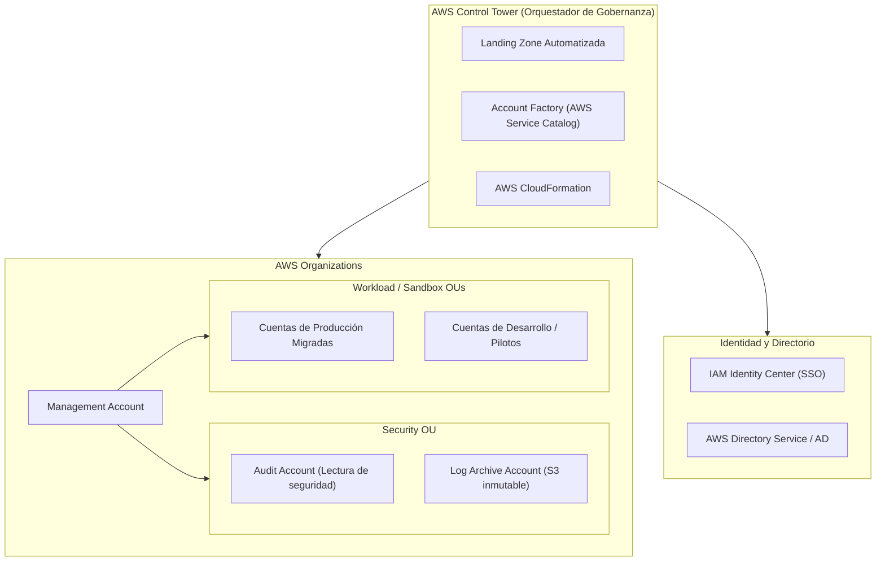
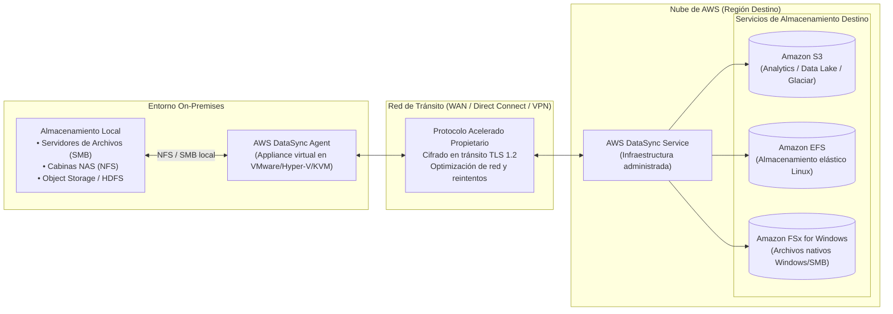

# Migration Tools

> [!abstract] Qué es este archivo
> Quinta lección del módulo **Migration and Modernization**. Analiza las herramientas esenciales de AWS
> para dos momentos críticos de la migración:
> 1. **La base de gobernanza previa al cómputo:** cómo **AWS Control Tower** automatiza el despliegue de una
>    **Landing Zone** multi-cuenta segura, la regla de la **Home Region**, el alcance global de los controles
>    preventivos (**SCPs**) y el alcance regional de los controles detectives (**AWS Config**).
> 2. **La transferencia masiva acelerada de almacenamiento:** cómo **AWS DataSync** reemplaza scripts manuales
>    de copia para mover terabytes de datos de almacenamiento en red (**NFS**, **SMB**) hacia **Amazon S3**,
>    **Amazon EFS** y **Amazon FSx for Windows File Server** con cifrado **TLS 1.2** y validación automática de integridad.
> Alineado con las tareas **4.2 y 4.3 del Dominio 4 del examen SAP-C02**.

> [!quote] La idea que ordena todo
> **“No se provisiona cómputo en la nube sin una Landing Zone gobernada, y no se transfieren terabytes de almacenamiento sobre la WAN con scripts manuales cuando existe un protocolo acelerado y validado.”**
> Control Tower garantiza que cada cuenta nueva nazca con las políticas corporativas embebidas desde el día cero, mientras que DataSync optimiza el enlace de red y valida cada archivo transferido con sumas de verificación (*checksums*) automáticas.

---

## Resumen en una frase

> Una guía técnica que establece la gobernanza multi-cuenta previa a la migración mediante **AWS Control Tower**
> (diferenciando controles preventivos globales de controles detectives regionales) y automatiza la migración masiva
> online de datos desde almacenamiento **NFS/SMB** on-premises hacia **Amazon S3, EFS y FSx** mediante el agente
> y protocolo optimizado de **AWS DataSync**.

---

## 1. La base de gobernanza previa al cómputo: Landing Zone con AWS Control Tower

Antes de migrar la primera máquina virtual o provisionar instancias Amazon EC2, el arquitecto debe resolver preguntas estructurales de gobernanza:
- *¿Cuántas cuentas de AWS se necesitan y cómo se organizan?*
- *¿Cómo se estructuran los permisos y la autenticación federada?*
- *¿Cómo se garantiza que las cuentas cumplan con las directivas corporativas de seguridad sin frenar a los desarrolladores?*

### 1.1 La regla técnica de Regiones en AWS Control Tower
Al crear una Landing Zone con Control Tower, se define una **Home AWS Region**:
- **Home AWS Region:** La región donde se accede a la consola y donde se aprovisionan recursos centrales compartidos (como el catálogo de Service Catalog y plantillas base de CloudFormation).
- **Recursos Globales:** Las Unidades Organizativas (OUs), las cuentas de AWS y la estructura de Organizations son globales.
- **Diferencia crítica en el alcance de los controles:**
  - **Controles preventivos (*Preventive Controls* - SCPs):** Operan a nivel de AWS Organizations y tienen **alcance GLOBAL** (bloquean acciones no autorizadas en cualquier región del mundo, por ejemplo impedir la desactivación de CloudTrail o el uso de regiones no autorizadas).
  - **Controles detectives (*Detective Controls* - AWS Config Rules):** Solo operan y auditan en las **Regiones de AWS donde AWS Control Tower está habilitado y soportado**.

> [!important] Regla de examen sobre Control Tower y Regiones
> Las Service Control Policies (**SCPs**) protegen de forma global e instantánea todas las cuentas bajo la OU. En contraste, las reglas de **AWS Config** desplegadas por Control Tower solo detectan y alertan deriva de configuración en las regiones gobernadas por la Landing Zone.

---

## 2. Transferencia masiva online acelerada: AWS DataSync

El traslado manual de almacenamiento de archivos (mediante herramientas tradicionales como `rsync`, `robocopy`, `scp` o scripts de cron) genera una sobrecarga operativa inmensa, satura los enlaces de red, carece de validación robusta y sufre fallas ante interrupciones de la WAN.

**AWS DataSync** es un servicio administrado diseñado específicamente para automatizar, acelerar y validar la transferencia masiva de datos entre almacenamiento local y AWS:

### 2.1 Componentes y Arquitectura de DataSync
1. **AWS DataSync Agent:**
   - Se despliega on-premises como una máquina virtual (*appliance*) en hipervisores compatibles (**VMware ESXi**, **Microsoft Hyper-V**, **Linux KVM**) o sobre Amazon EC2 para transferencias entre regiones.
   - Se conecta directamente a los sistemas de almacenamiento locales utilizando protocolos estándar (**NFS v3/v4.1** o **SMB 2.1/3.0**).
2. **Protocolo de red acelerado propietario:**
   - Utiliza un protocolo optimizado para redes de área amplia (WAN) que supera ampliamente los límites de rendimiento de TCP tradicional en enlaces con alta latencia. Puede transferir **hasta 10 veces más rápido ($10\times$)** que las herramientas de código abierto tradicionales.
   - Cifra todos los datos en tránsito de forma obligatoria mediante **TLS 1.2**.
3. **Servicio administrado en AWS (*Serverless*):**
   - No requiere aprovisionar ni administrar instancias EC2 en AWS para recibir los datos; el servicio DataSync en la nube se conecta de forma nativa a los destinos de almacenamiento.
4. **Validación de integridad automática:**
   - Realiza sumas de verificación (*checksums*) de los datos en tránsito y al finalizar la transferencia contra el almacenamiento de origen y destino, garantizando que no existan archivos corruptos ni metadatos perdidos (permisos POSIX, marcas de tiempo, ACLs de Windows).
5. **Control de ancho de banda y programación:**
   - Permite definir límites de consumo de red (*bandwidth throttling*) para no saturar enlaces corporativos de Direct Connect o Internet durante el horario laboral, y programar ejecuciones periódicas (*scheduling*).

---

## 3. Matriz comparativa de transferencia y migración de datos hacia AWS

En las preguntas del examen SAP-C02, elegir entre DataSync, Snowball, Storage Gateway o Transfer Family es un escenario clásico:

| Servicio | Tipo de Transferencia | Protocolo Fuente | Destino en AWS | Cuándo se elige en el examen |
| --- | --- | --- | --- | --- |
| **AWS DataSync** | **Online masiva acelerada** (continua o programada). | NFS, SMB, HDFS, Object storage. | Amazon S3, Amazon EFS, Amazon FSx (Windows, Lustre, OpenZFS, NetApp ONTAP). | Migración online rápida de terabytes/petabytes de **archivos y directorios NAS/SMB** con conectividad de red disponible (Direct Connect/VPN). |
| **AWS Snowball Edge** | **Offline física masiva** (dispositivo físico transportable). | Bloques, S3 compatible, NFS. | Amazon S3, Amazon EBS. | Transferencias de decenas o cientos de terabytes donde **el ancho de banda de red es insuficiente** o la transferencia tardaría semanas/meses. |
| **AWS Storage Gateway** | **Híbrida continua** (File, Volume, Tape). | NFS, SMB, iSCSI, VTL. | Amazon S3, Amazon EBS, S3 Glacier Flexible/Deep Archive. | Casos donde las aplicaciones on-premises **necesitan seguir accediendo** al almacenamiento local con caché en la nube (no es una herramienta de migración puntual). |
| **AWS Transfer Family** | **Online segura de archivos vía protocolos estándar**. | SFTP, FTPS, FTP, AS2. | Amazon S3, Amazon EFS. | Migración o integración de flujos de intercambio de archivos B2B que exigen específicamente clientes **SFTP/FTPS**. |

---

## 4. Traducción del contenido

> [!info] Sección de referencia (opcional)
> Esto es la **traducción fiel** de la transcripción y lecturas oficiales provistas por AWS Skill Builder, para verificar que no se perdió ningún detalle del material oficial. No hace falta leerla para estudiar: lo conceptual y accionable está consolidado en las secciones 1 a 3 y se sintetiza en la sección 6 para el examen.

### 4.1 Transcripción del video: Introducción a las herramientas de migración (Transcripción íntegra)

> *"Una vez que comprenden bien el proceso de migración, lo siguiente en lo que deben pensar es en las herramientas. ¿Qué herramientas están disponibles en AWS para ayudar en la migración y en qué fase del proceso son más útiles? Vamos a profundizar.*
>
> *Lo siguiente en lo que están pensando es en aprovisionar una **zona de aterrizaje (*landing zone*)** en la nube para las aplicaciones que van a migrar, y hay mucho que considerar antes de comenzar a aprovisionar recursos como instancias EC2: ¿Qué tipo de estructura desean para la administración y la gobernanza? ¿Cómo se organizarán sus equipos y qué nivel de permisos necesitarán? ¿Cuántas cuentas de AWS necesitarán? ¿Y cómo se autenticarán sus constructores? Desean asegurarse de comenzar con el pie derecho en materia de seguridad y gobernanza, pero también deben tener en cuenta la escalabilidad a medida que crecen.*
>
> *Control Tower puede ayudar con todo eso. Como han aprendido, es un **orquestador de otros servicios** que les ayuda a configurar un entorno de AWS de múltiples cuentas seguro basado en nuestra experiencia trabajando con clientes. Utilícenlo para establecer una base sólida de seguridad y gobernanza sin frenar la innovación que están tratando de acelerar."*
>
> *(Duración del video: 1 minuto, 14 segundos).*

---

### 4.2 Lecturas oficiales: AWS Control Tower y AWS DataSync

#### Soluciones de AWS Control Tower
Si son una organización con múltiples cuentas de AWS y equipos, la configuración y el gobierno de la nube pueden ser complejos y consumir mucho tiempo, frenando la misma innovación que intentan acelerar. AWS Control Tower proporciona una forma de configurar y gobernar un nuevo entorno de AWS multi-cuenta seguro basado en mejores prácticas establecidas trabajando con miles de empresas. Con AWS Control Tower, los constructores pueden aprovisionar nuevas cuentas de AWS en pocos clics con la tranquilidad de saber que cumplen con las políticas corporativas.

Control Tower orquesta:
- El servicio Control Tower con CloudFormation y Service Catalog (Account Factory).
- AWS Organizations con Security OU (que contiene las cuentas Log Archive y Audit) y Sandbox OU (que contiene cuentas aprovisionadas).
- Configuraciones de IAM Identity Center y Directory Service.

**Nota sobre regiones:**
Cuando crean una landing zone, la Región que utilizan para acceder a la consola se convierte en su **Home AWS Region** para AWS Control Tower. Durante el proceso de creación, algunos recursos se aprovisionan en la Home Region. Otros recursos, como las Unidades Organizativas (OUs) y las cuentas de AWS, son globales. Actualmente, **todos los controles preventivos funcionan globalmente**. Los **controles detectives, sin embargo, solo funcionan en las Regiones donde AWS Control Tower está soportado**.

#### AWS DataSync
Las tareas manuales relacionadas con las transferencias de datos pueden ralentizar las migraciones y sobrecargar las operaciones de TI. **AWS DataSync** les ayuda a mover grandes cantidades de datos entre almacenamiento on-premises y **Amazon S3, Amazon EFS o FSx for Windows File Server**. De forma predeterminada, los datos se cifran en tránsito utilizando **TLS 1.2**. DataSync maneja automáticamente muchas de estas tareas, incluida la creación de scripts de copia, la programación y el monitoreo de transferencias, la validación de datos y la optimización del uso de la red.

Pueden reducir la infraestructura de almacenamiento local trasladando almacenes de datos basados en **Server Message Block (SMB)** y repositorios de contenido desde servidores de archivos y cabinas **Network-Attached Storage (NAS)** hacia Amazon S3 y Amazon EFS para análisis, archivado o casos de uso de respaldo.

DataSync se implementa como un **único agente de software** que puede conectarse a múltiples sistemas de archivos compartidos y ejecutar múltiples tareas. El agente de software se implementa típicamente en las instalaciones a través de una instancia virtual para manejar la transferencia de datos a través de la red de área amplia (WAN) a AWS. En el lado de AWS, el agente se conecta a la infraestructura del servicio DataSync. Debido a que DataSync es un servicio, no hay infraestructura que los clientes deban configurar o mantener en la nube. La configuración de DataSync se administra directamente desde la consola.

**Beneficios de AWS DataSync:**
- Desplegar un agente on-premises.
- Transferir datos sobre la WAN utilizando un protocolo diseñado específicamente para este propósito.
- Escribir o leer datos de los servicios de almacenamiento de AWS.
- Administrar desde la consola o la AWS CLI.

---

## 5. Cierre conceptual: Cuadro de herramientas y funciones

| Necesidad Arquitectónica | Herramienta de AWS | Mecanismo y Características Clave |
| --- | --- | --- |
| **Gobernanza multi-cuenta y creación de Landing Zone** | **AWS Control Tower** | Orquesta Organizations, Service Catalog y CloudFormation. Despliega OUs de seguridad y auditoría; aplica SCPs globales y reglas de Config. |
| **Provisión autoservicio gobernada de cuentas** | **Account Factory (Service Catalog)** | Permite a los equipos solicitar nuevas cuentas preconfiguradas y conformes con las políticas corporativas en pocos clics. |
| **Migración masiva de almacenamiento NAS (NFS)** | **AWS DataSync** | Agente virtual on-premise lee NFS y transmite datos acelerados y cifrados con TLS 1.2 hacia **Amazon EFS** o **Amazon S3**. |
| **Migración de servidores de archivos Windows (SMB)** | **AWS DataSync** | Conecta a recursos compartidos SMB preservando metadatos y listas de control de acceso (ACLs) hacia **FSx for Windows File Server** o **Amazon S3**. |
| **Garantía de no corrupción de datos transferidos** | **Integridad Automática de DataSync** | Sumas de verificación (*checksums*) en tránsito y en reposo comparando origen y destino sin scripts de verificación manuales. |
| **Protección contra saturación de enlace Direct Connect** | **Bandwidth Throttling de DataSync** | Limita el ancho de banda consumido por las tareas durante el horario productivo y programa ejecuciones completas fuera de pico. |

---

## 6. Para el examen (SAP-C02)

> [!important] Lo que hay que retener
> 1. **Gobernanza antes que cómputo.** En cualquier escenario de migración enterprise, antes de desplegar instancias EC2 se debe establecer la Landing Zone multi-cuenta con **AWS Control Tower**.
> 2. **Control Tower: Home Region vs. Alcance de Controles.**
>    - La **Home Region** aloja la configuración central.
>    - Los **controles preventivos (SCPs)** tienen efecto **GLOBAL** en todas las regiones de AWS.
>    - Los **controles detectives (AWS Config)** solo evalúan recursos en las **regiones gobernadas soportadas por Control Tower**.
> 3. **AWS DataSync para migración de almacenamiento online.** Es la solución por excelencia para mover grandes volúmenes de datos desde servidores **NFS y SMB** hacia **Amazon S3, Amazon EFS y Amazon FSx for Windows File Server**.
> 4. **Cifrado en tránsito predeterminado.** DataSync cifra obligatoriamente en tránsito utilizando **TLS 1.2** sobre la WAN o Direct Connect.
> 5. **Validación automática de integridad de datos.** DataSync valida la integridad de cada archivo mediante checksums; **no se requieren scripts personalizados de validación** (`md5sum`, `sha256sum` o `diff`).
> 6. **Protocolo acelerado de DataSync.** Utiliza un protocolo propietario diseñado para WAN que supera hasta por **$10\times$** la velocidad de herramientas de copia estándar como `rsync` o `robocopy`.
> 7. **Despliegue del Agente de DataSync.** Se implementa como una máquina virtual on-premises (**VMware ESXi, Hyper-V, KVM**); del lado de AWS es un servicio totalmente administrado sin servidores EC2 que gestionar.
> 8. **Preservación de metadatos de archivos.** DataSync preserva permisos POSIX, marcas de tiempo de modificación, atributos y ACLs de Windows al transferir hacia EFS o FSx for Windows.
> 9. **Optimización de red (Bandwidth Limiting).** Soporta limitación de tasa de transferencia para evitar la saturación de enlaces compartidos de **AWS Direct Connect** o **Site-to-Site VPN**.
> 10. **DataSync vs. Snowball Edge.** Si el volumen de datos a transferir por la red tardaría más tiempo del permitido por el cronograma de migración (p. ej. petabytes con enlace limitado de 1 Gbps), la respuesta correcta es **AWS Snowball Edge** (físico/offline). Si hay ancho de banda suficiente, **DataSync** es la respuesta online automatizada.

> [!warning] Trampa clásica del examen
> **Escenario:** Una empresa necesita migrar 150 TB de datos de archivos almacenados en servidores de almacenamiento NAS on-premises (compartidos por SMB con permisos y ACLs complejas de Windows) hacia AWS en menos de 2 semanas. La empresa cuenta con un enlace dedicado AWS Direct Connect de 10 Gbps. Un ingeniero sugiere desarrollar scripts basados en `robocopy` sobre instancias EC2 intermedias montando las unidades de red.
> **La trampa:** Seleccionar la opción de scripts manuales de `robocopy` o herramientas tradicionales sobre EC2.
> **Por qué falla:** Los scripts tradicionales son lentos, propensos a errores ante microcortes de red, requieren aprovisionar y pagar infraestructura intermedia de cómputo, y exigen scripts adicionales para verificar la integridad de los 150 TB de datos.
> **La solución correcta:** Desplegar el **agente de AWS DataSync** on-premises, configurar tareas de transferencia hacia **Amazon FSx for Windows File Server** (o Amazon S3) con cifrado TLS 1.2 nativo, preservación automática de ACLs/metadatos y validación de integridad automática de extremo a extremo sin intermediarios.

---

## Relacionado

- [[AWS Solutions Architect Advanced - Migration and Modernization]] *(índice del módulo)*
- [[The Migration Process]] — lección 04 del módulo (fase Mobilize, 7 Rs y workflow en 6 pasos)
- [[Preparing for Migration]] — lección 03 del módulo (preparación organizativa y evaluación)
- [[Gathering the Customer Requirements - Migration]] — lección 02 del módulo (caso Utilities)
- [[AWS Control Tower]] — arquitectura detallada de Control Tower y guardrails
- [[AWS Organizations and IAM Identity Center]] — separación de funciones y SSO
- [[Architecting for Cost - Storage]] — optimización de almacenamiento en S3 y EFS
- [[4.2 Determinar el enfoque de migración óptimo para las cargas de trabajo existentes]] — tarea de examen 4.2
- [[4.3 Determinar una nueva arquitectura para las cargas de trabajo existentes]] — tarea de examen 4.3

Siguiente paso del módulo: **Lección 06**.

---

## Registro de integración

| Fecha | Cambio | Motivo / Detalle |
| --- | --- | --- |
| 2026-10-29 | Creación de la nota inicial | Alta de la quinta lección del módulo *Migration and Modernization*. Se estructura el rol de AWS Control Tower (Landing Zone, regla de Home Region, preventivos globales vs detectives regionales) y la mecánica técnica completa de AWS DataSync (agente on-premise, protocolo acelerado, cifrado TLS 1.2, destinos S3/EFS/FSx, preservación de ACLs y validación de integridad para el examen SAP-C02). |
