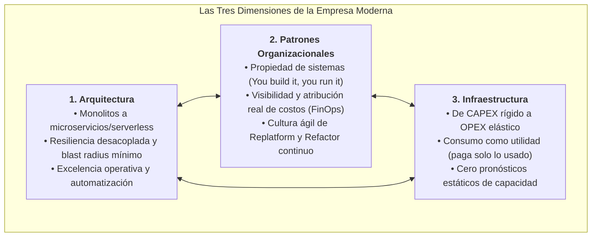
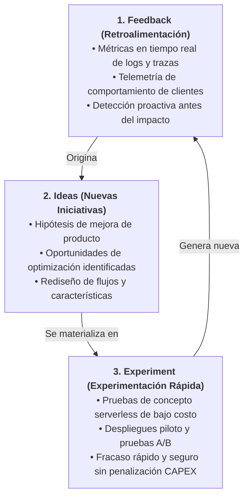
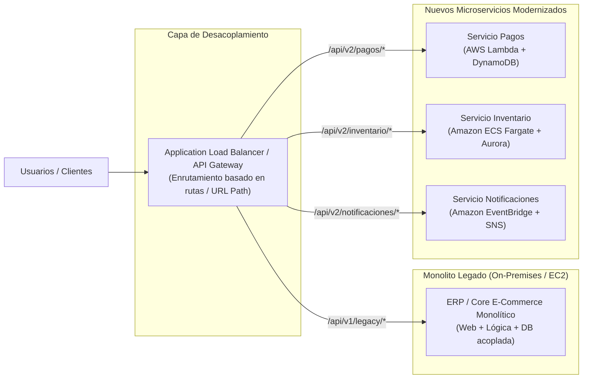

# Modernize the Enterprise

> [!abstract] Qué es este archivo
> Guía técnica y metodológica sobre los fundamentos de la modernización empresarial en AWS y la dinámica del **Innovation Flywheel** (Volante de la Innovación). Analiza las tres dimensiones indivisibles de la transformación (**Arquitectura**, **Patrones Organizacionales** e **Infraestructura**), el paso de modelos de gasto de capital (**CAPEX**) a modelos de consumo por demanda (**OPEX**), la descomposición de monolitos en servicios desacoplados y la retroalimentación continua para acelerar el tiempo de comercialización (*Time-to-Market*) en el marco del **Dominio 4 (Aceleración de la migración y la modernización)** del examen SAP-C02.

> [!quote] La idea que ordena todo
> La modernización no es un evento técnico aislado que le ocurre al departamento de TI, sino una transformación cultural y multidimensional de toda la empresa: cuando la **arquitectura** desacopla monolitos en microservicios, los **patrones organizacionales** asignan propiedad directa y visibilidad de costos a los equipos (*You build it, you run it*), y la **infraestructura** se consume como una utilidad elástica por demanda, los ahorros operativos generados financian directamente nuevos experimentos en un ciclo virtuoso continuo (**Innovation Flywheel**).

---

## Resumen en una frase

> La modernización empresarial es un proceso progresivo que transforma simultáneamente la **arquitectura** (hacia servicios pequeños y enfocados), los **patrones organizacionales** (propiedad de sistemas y optimización ágil de costos) y la **infraestructura** (consumo elástico por demanda), impulsando el **Innovation Flywheel** donde la telemetría y la reducción de costos retroalimentan la experimentación rápida.

---

## 1. Las tres dimensiones de la modernización empresarial

Tradicionalmente, las organizaciones abordan la nube como un simple centro de datos alternativo (*Data Center Extension*), realizando un Rehost masivo sin alterar sus modelos de gobierno ni sus dependencias de software. Sin embargo, los máximos beneficios de agilidad, resiliencia y optimización de costos solo se desbloquean al alinear tres ejes fundamentales:

### Arquitectura

- **De monolitos rígidos a servicios enfocados:** Sustituye instancias gigantescas y bases de datos centralizadas de un solo punto de falla por microservicios desacoplados, contenedores ligeros (**Amazon ECS/EKS**) y computación sin servidor (**AWS Lambda**).
- **Aislamiento del radio de impacto (*Blast Radius*):** Cada componente opera de manera autónoma con sus propios almacenes de datos y APIs versionadas; la caída o degradación de un microservicio no arrastra al resto de la plataforma.
- **Resiliencia y excelencia operativa:** Maximiza el tiempo de actividad mediante escalabilidad horizontal elástica, autocuración (*self-healing*) y despliegues sin interrupción.

### Patrones organizacionales

- **Transparencia y responsabilidad de costos (*FinOps*):** Identifica con precisión milimétrica qué unidad de negocio consume qué recursos mediante etiquetas de asignación de costos (*Cost Allocation Tags*) y presupuestos de **AWS Budgets**. Los propietarios de los sistemas tienen visibilidad y autoridad para optimizar su gasto.
- **Equipos de dos pizzas (*Two-Pizza Teams*):** Descentraliza la toma de decisiones en células pequeñas, multidisciplinarias y autónomas que son dueñas del ciclo de vida completo de su servicio (*"You build it, you run it"*).
- **Disposición al cambio ágil:** Los equipos están habilitados y facultados para realizar *Replatform* y *Refactor* de forma continua a medida que evolucionan las demandas de los clientes, abandonando ciclos de release semestrales.

### Infraestructura

- **Infraestructura como consumo (Utilidad):** Abandona el concepto de la infraestructura como un activo de capital inmovilizado (**CAPEX**) que requiere amortizaciones a 3-5 años; se adopta como un servicio operativo (**OPEX**) consumible bajo demanda.
- **Eliminación del dimensionamiento predictivo (*Capacity Guessing*):** En el datacenter local, los arquitectos debían pronosticar la demanda a 3 años comprando servidores de sobra para picos estacionales. En AWS, la infraestructura se expande y contrae automáticamente mediante **Amazon EC2 Auto Scaling** y servicios serverless según las necesidades reales del negocio.

### Contraste estructural: Empresa Tradicional vs. Empresa Moderna

| Atributo | Organización Tradicional (On-Premises / Legacy) | Empresa Moderna en la Nube (AWS) |
| --- | --- | --- |
| **Modelo Financiero** | **CAPEX:** Grandes inversiones de capital por adelantado con depreciación a varios años. | **OPEX:** Pago por uso elástico según consumo exacto sin compromisos iniciales forzados. |
| **Dimensionamiento** | Pronósticos rígidos y sobreaprovisionamiento masivo para picos anuales. | Escalabilidad automática (*Auto Scaling*) y serverless ajustados a la demanda en tiempo real. |
| **Topología de Carga** | Servidores e instancias monolíticas gigantescas con alto acoplamiento. | Servicios pequeños, enfocados, serverless y basados en eventos. |
| **Estructura de Equipos** | Silos funcionales aislados (Desarrollo, Operaciones, DBAs, Seguridad). | Células ágiles multidisciplinarias y orientadas a producto (*DevOps / DevSecOps*). |
| **Gestión de Fallos** | Esfuerzos titánicos en prevención que cuando fallan causan caídas globales. | Aislamiento de fallos (*Blast radius reduction*), autocuración y tolerancia a fallos nativa. |
| **Ciclos de Entrega** | Despliegues masivos trimestrales o anuales con ventanas nocturnas de alto riesgo. | Despliegues continuos diarios automatizados (CI/CD) mediante *Canary* y *Blue/Green*. |

---

## 2. El volante de innovación (Innovation Flywheel)

El **Innovation Flywheel** es el modelo operativo iterativo mediante el cual las organizaciones incrementan exponencialmente su velocidad de entrega al mercado y maximizan el retorno de valor de sus cargas de trabajo.

### Los cuatro aceleradores del ciclo de innovación

1. **Rastrear métricas (*Track metrics*):**
   - Recopilación, ingestión y análisis unificado de logs, métricas y telemetría de usuario final en tiempo real (**Amazon CloudWatch Logs**, **CloudWatch RUM**, **AWS X-Ray**).
   - El objetivo es resolver anomalías y cuellos de botella antes de que afecten negativamente la experiencia del usuario o el negocio.
   - Cuanto más eficiente y automatizado sea el circuito de telemetría, más rápido podrá responder la organización a las tendencias de sus usuarios.
2. **Ajuste continuo de aplicaciones (*Fine-tune applications*):**
   - La optimización de software no es un proyecto cerrado, sino un proceso iterativo permanente.
   - Monitoreo proactivo de extremo a extremo que permite detectar degradaciones de rendimiento, cuellos de botella en bases de datos o ineficiencias de costo en microservicios, disparando mejoras continuas en el código y en la infraestructura.
3. **Llegada acelerada al mercado (*Go to market*):**
   - Las empresas que llevan ideas a producción con mayor frecuencia son más competitivas y capturan mayores cuotas de mercado.
   - La reducción de los tiempos de desarrollo y despliegue (de meses a horas) mediante pipelines de entrega continua (**AWS CodePipeline**, **CodeBuild**) minimiza el riesgo operativo de cada cambio.
4. **Financiamiento de la experimentación (*Fund experimentation and new ideas*):**
   - Al optimizar la infraestructura existente (mediante right-sizing, apagado de instancias inactivas, uso de Graviton, Spot instances y serverless), las organizaciones **liberan presupuesto operativo recurrente**.
   - Este capital recuperado se reinvierte directamente en financiar nuevas pruebas de concepto y experimentos de negocio sin requerir aumentos en el presupuesto global de TI.

---

## 3. Patrones de modernización técnica en AWS para el Solutions Architect

Para implementar con éxito la visión de modernización empresarial en escenarios reales del examen SAP-C02, el Solutions Architect debe dominar patrones técnicos específicos:

### Patrón Strangler Fig (Higuera Estranguladora)

- **El problema:** Intentar reescribir un sistema monolítico crítico desde cero mediante un enfoque masivo (*Big Bang*) conlleva una tasa altísima de fracaso, sobrecostos y riesgos operativos inaceptables.
- **La solución:** Utilizar un **Application Load Balancer (ALB)** o **Amazon API Gateway** frente al monolito existente. A medida que se desarrollan nuevas capacidades o se extraen módulos específicos, el balanceador redirige selectivamente las rutas de URL hacia los nuevos microservicios serverless o en contenedores, manteniendo el resto del tráfico en el monolito.
- Con el tiempo, todas las funciones se trasladan a microservicios y el monolito se desmantela por completo sin ninguna caída del servicio.

### Adopción de arquitecturas orientadas a eventos (Event-Driven Architecture)

- El desacoplamiento moderno se logra reemplazando llamadas síncronas HTTP punto a punto (que crean dependencias en cascada y fragilidad de red) por intermediarios asíncronos administrados:
  - **Amazon EventBridge:** Enrutador de eventos serverless que conecta aplicaciones mediante reglas y esquemas declarativos.
  - **Amazon SQS:** Colas de mensajes que absorben ráfagas de tráfico y protegen a los servicios aguas abajo.
  - **Amazon SNS:** Notificaciones masivas de distribución (*fan-out*) a múltiples consumidores.

---

## 4. Traducción del contenido

> [!info] Sección de referencia (opcional)
> Esto es la **traducción fiel** de las fuentes originales provistas en el curso de AWS Skill Builder. Su propósito es servir como material de verificación y consulta textual precisa de las explicaciones y lineamientos del instructor.

### 4.1 Lectura oficial: Beneficios de la modernización empresarial (Enterprise modernization benefits)

La modernización es el proceso de transformar progresivamente las aplicaciones para que los clientes puedan obtener los beneficios de operar en la nube. La modernización no es simplemente algo que le ocurre a su departamento de TI; es una oportunidad para considerar el cambio cultural necesario para modernizar toda su empresa.

¿A qué nos referimos cuando hablamos de una empresa moderna? A continuación se detallan sus tres componentes:

#### 1: Arquitectura
Maximiza la resiliencia, la eficiencia de ingeniería y la agilidad empresarial con excelencia operativa. Cambia instancias monolíticas grandes por servicios pequeños y enfocados para optimizar costos.

#### 2: Patrones organizacionales
Identifica con precisión el uso y el costo de los sistemas, y brinda a los propietarios de los sistemas la oportunidad de optimizar sus recursos y reducir costos. Capaz y dispuesta a replataformar (*replatform*) y refactorizar (*refactor*) aplicaciones a medida que cambia la demanda.

#### 3: Infraestructura
Considera la infraestructura como un recurso consumido, no como un recurso de capital. Paga únicamente por los recursos de cómputo que consume. Aumenta o disminuye el uso según los requisitos comerciales, no mediante pronósticos elaborados.

La combinación de aplicaciones e infraestructura mejora la calidad de los procesos empresariales y proporciona alta disponibilidad y agilidad. Modernizar las aplicaciones como parte de la migración a AWS es un enfoque multidimensional. Es la combinación de esfuerzos a través de la infraestructura, los patrones organizacionales y la arquitectura lo que impulsa los máximos beneficios de la transformación digital.

**Los beneficios de la modernización empresarial incluyen:**
- Aumento del tiempo de actividad (*uptime*) y simplificación de los procesos para la aplicación de correcciones.
- Mejora de los tiempos de respuesta y de la experiencia de los clientes.
- Reducción del esfuerzo de soporte al disminuir la dependencia de sistemas envejecidos que son costosos de ejecutar y difíciles de mantener.

### 4.2 Lectura oficial: El volante de innovación (Innovation flywheel)

El **volante de la innovación (*innovation flywheel*)** ilustra cómo las empresas pueden operar y optimizar de manera iterativa.

Las empresas que aumentan su velocidad de innovación y se mantienen competitivas deben modernizar sus aplicaciones para su negocio. También deben maximizar el valor a medida que modernizan sus aplicaciones.

Para aumentar la velocidad y la agilidad, las empresas deben:
- **Rastrear métricas (*Track metrics*):** Las empresas pueden recopilar y monitorear archivos de registro (*log files*) y analizar la retroalimentación. El objetivo es resolver los problemas antes de que afecten al negocio. Cuanto más eficientemente recopilen y analicen los comentarios las empresas, más fácilmente podrán reaccionar ante sus clientes.
- **Ajustar aplicaciones (*Fine-tune applications*):** Las empresas mejoran mediante el monitoreo proactivo de sus aplicaciones de extremo a extremo. Las aplicaciones deben evolucionar continuamente. Este es un proceso iterativo.
- **Ir al mercado (*Go to market*):** Las empresas que llevan regularmente nuevas ideas al mercado son más exitosas.
- **Financiar la experimentación y nuevas ideas (*Fund experimentation and new ideas*):** Al reducir los costos, las empresas pueden invertir más en innovación.

*(Proceso circular: La retroalimentación [Feedback] conduce a ideas [Ideas], las cuales conducen a experimentos [Experiment], los cuales a su vez generan nueva retroalimentación [Feedback]).*

---

## 5. Cierre conceptual: pilares de la transformación y servicios aceleradores

| Dimensión de Modernización | Desafío o Práctica Tradicional | Enfoque de la Empresa Moderna | Servicios AWS Habilitadores |
| --- | --- | --- | --- |
| **Arquitectura** | Monolitos altamente acoplados en grandes servidores físicos o virtuales. | Microservicios desacoplados, funciones serverless y arquitecturas reactivas por eventos. | **AWS Lambda**, **Amazon ECS/EKS**, **Amazon EventBridge**, **API Gateway**. |
| **Patrones Organizacionales** | Silos jerárquicos de TI; desentendimiento de costos; aversión a modificar sistemas legados. | Células ágiles de producto; responsabilidad directa de costos (*FinOps*); evolución ágil continua. | **AWS Budgets**, **Cost Allocation Tags**, **AWS Organizations**, **IAM Identity Center**. |
| **Infraestructura** | Inversiones millonarias en CAPEX; hardware inmovilizado; capacidad predictiva sobredimensionada. | Consumo elástico por demanda (OPEX); escalado automático en tiempo real; pago estricto por uso. | **Amazon EC2 Auto Scaling**, **AWS Fargate**, **Amazon Aurora Serverless**, **AWS Savings Plans**. |
| **Innovation Flywheel** | Pruebas de concepto lentas y costosas; despliegues manuales; ignorancia de métricas de usuario. | Ciclos iterativos de feedback continuo; CI/CD automatizado; reinversión de ahorros en innovación. | **Amazon CloudWatch (RUM/Synthetics)**, **AWS X-Ray**, **AWS CodePipeline**, **AWS CDK**. |

---

## 6. Para el examen (SAP-C02)

> [!important] Lo que hay que retener
> 1. **Modernización tridimensional obligatoria:** Para alcanzar la máxima agilidad y optimización de costos en AWS, la transformación debe ocurrir simultáneamente en **Arquitectura**, **Patrones Organizacionales** e **Infraestructura**.
> 2. **Infraestructura como utilidad (OPEX vs. CAPEX):** La empresa moderna elimina el sobreaprovisionamiento predictivo de servidores y paga estrictamente por los recursos consumidos mediante escalabilidad elástica.
> 3. **Arquitectura desacoplada y Blast Radius:** Sustituir servidores monolíticos por servicios pequeños y especializados reduce el costo de ejecución y confina los fallos para que nunca derriben la plataforma completa.
> 4. **Patrón Strangler Fig para migración segura:** Es el patrón arquitectónico predilecto para modernizar monolitos legados de forma incremental mediante **Application Load Balancer** o **API Gateway**, evitando los riesgos de reescrituras globales *Big Bang*.
> 5. **El Innovation Flywheel:** Proceso iterativo continuo: **Feedback $\rightarrow$ Ideas $\rightarrow$ Experiment $\rightarrow$ Feedback**. La telemetría guía las ideas, las ideas generan experimentos y los experimentos arrojan nueva telemetría.
> 6. **Financiamiento de la innovación mediante ahorro operativo:** Reducir el gasto de cómputo y almacenamiento (right-sizing, serverless, Graviton) libera presupuesto directo para financiar nuevos experimentos y prototipos de negocio.
> 7. **Monitoreo proactivo antes del impacto:** Recopilar y analizar logs y métricas continuamente (**CloudWatch**, **X-Ray**) para detectar anomalías antes de que degraden a los usuarios finales.
> 8. **Time-to-Market acelerado:** La velocidad de lanzamiento de características es el factor diferenciador competitivo más crítico; se sustenta en pipelines de despliegue continuo automatizado con pruebas A/B y despliegues canary.
> 9. **Cultura organizativa "You build it, you run it":** Los equipos de producto son dueños directos del rendimiento, la resiliencia y el costo de sus servicios en la nube.
> 10. **Alineación con el Well-Architected Framework:** La modernización empresarial materializa los pilares de **Excelencia Operativa**, **Optimización de Costos**, **Fiabilidad** y **Eficiencia de Rendimiento**.

> [!warning] Trampa clásica del examen
> **Escenario:** La dirección de una corporación financiera desea modernizar su sistema central de transacciones monolítico (ejecutado en servidores locales con bases de datos heredadas) para acelerar la innovación y recortar costos. Un consultor recomienda suspender el desarrollo de nuevas funciones de negocio durante 18 meses para reescribir completamente todo el software a microservicios serverless en una sola entrega masiva (*Big Bang*).
>
> **La trampa:** Asumir que una reescritura total congelando el negocio es la forma "limpia y definitiva" de modernizar. En el examen SAP-C02, este enfoque se considera de altísimo riesgo operacional, introduce parálisis competitiva en el mercado y viola los principios del *Innovation Flywheel*.
>
> **La respuesta correcta:** Adoptar un enfoque de **modernización progresiva e iterativa**. Implementar el patrón **Strangler Fig** colocando un **Application Load Balancer** o **Amazon API Gateway** frente al monolito actual; extraer y reescribir funciones individuales de forma modular como microservicios serverless (Lambda/Fargate); enrutar el tráfico de forma incremental; medir la telemetría con **CloudWatch** y **X-Ray**; y utilizar los ahorros de infraestructura obtenidos en cada iteración para autofinanciar la siguiente fase de modernización.

---

## Relacionado

- [[The Migration Process]] — lección 04: estrategias de las 7 Rs (diferencia entre Rehost inicial y modernización progresiva con Refactor)
- [[Preparing for Migration]] — lección 03: Cloud Value Framework y alineación de liderazgo
- [[AWS Transform Overview]] — lección 06: aceleración de la modernización asistida por agentes de inteligencia artificial
- [[Migrating Databases]] — lección 10: modernización de bases de datos de motores comerciales a nativos de la nube (Aurora/DynamoDB)
- [[AWS Solutions Architect Advanced - Migration and Modernization]] *(índice del módulo)*
- Siguiente paso del módulo: **lección 12 del módulo de migración y modernización**

---

## Registro de integración

| Fecha | Tipo de cambio | Detalle de la modificación |
| --- | --- | --- |
| 2026-10-29 | Creación de nota canónica | Alta de la undécima lección del módulo *Migration and Modernization*. Se estructuran los principios fundamentales de **Modernize the Enterprise** (las 3 dimensiones: Arquitectura, Patrones Organizacionales e Infraestructura; transición de CAPEX a OPEX; el ciclo iterativo del **Innovation Flywheel**; patrones de desacoplamiento como el Strangler Fig y arquitecturas Event-Driven; y el financiamiento de la innovación mediante la optimización de costos para el examen SAP-C02). |
