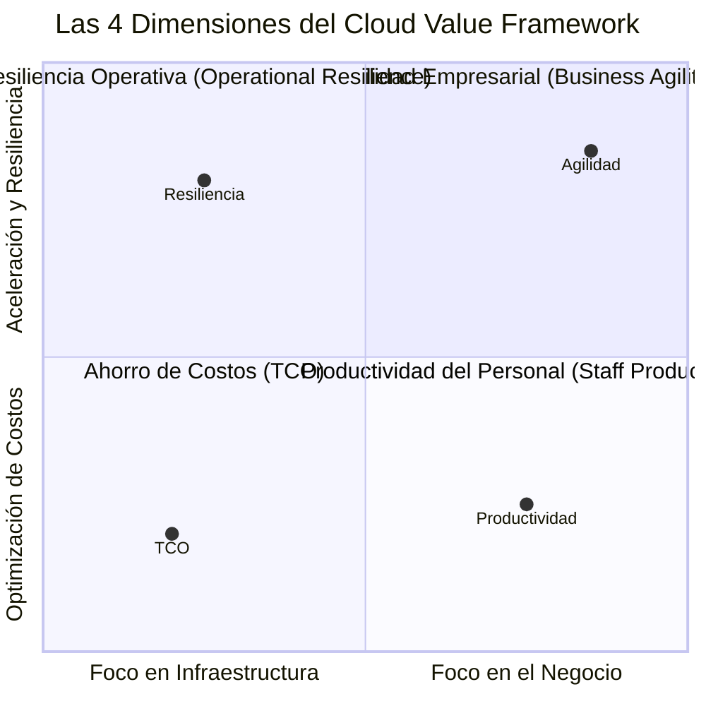
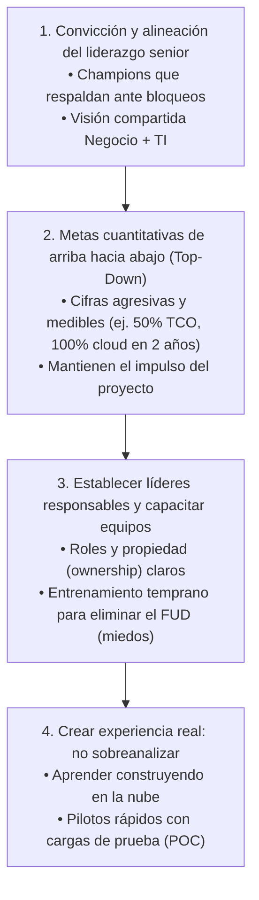
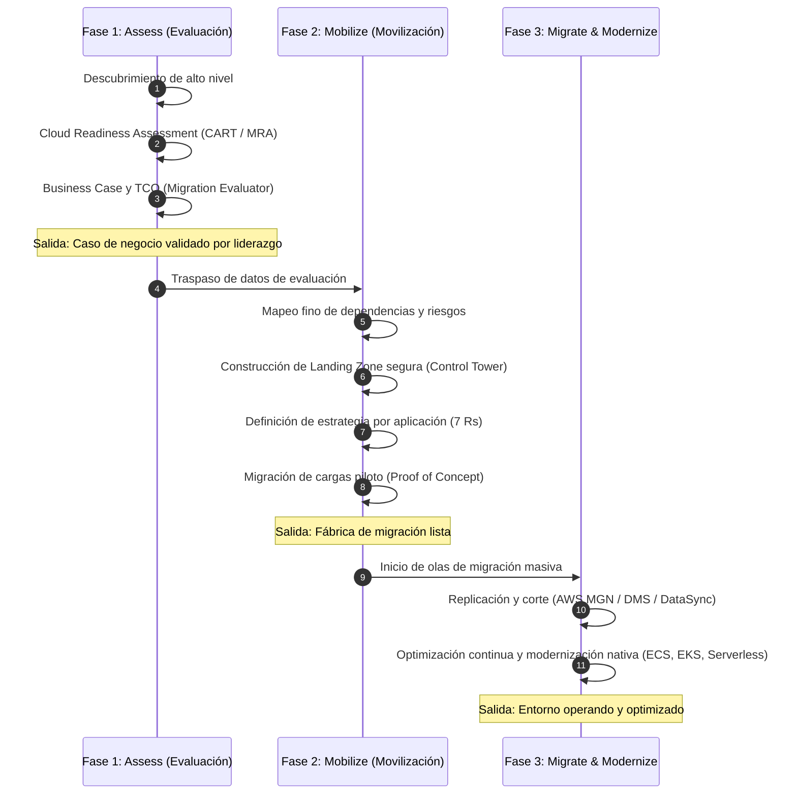
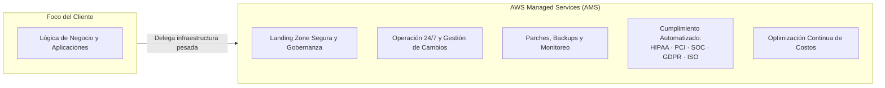

# Preparing for Migration

> [!abstract] Qué es este archivo
> Tercera lección del módulo **Migration and Modernization**. Aborda la fase inicial y más crítica de cualquier
> migración masiva a AWS: la **preparación y evaluación organizacional (*Assess*)**.
>
> Explora el **Cloud Value Framework** (las cuatro dimensiones medibles: TCO, productividad, resiliencia y agilidad),
> los **cuatro hábitos de clientes exitosos** de Andy Jassy, las **tres fases del proceso de migración a escala**
> (*Assess, Mobilize, Migrate & Modernize*), las herramientas clave de diagnóstico (**CART**, **MRA**, **Migration Evaluator**)
> y la delegación de operaciones de infraestructura a través de **AWS Managed Services (AMS)** y la red de socios MSP.
> Alineado con las tareas **4.1 y 4.2 del Dominio 4 del examen SAP-C02**.

> [!quote] La idea que ordena todo
> **“Las mejores migraciones comienzan con las preparaciones más robustas: no se migra porque sea genial estar en la nube, sino para demostrar valor de negocio con métricas cuantificables de punta a punta.”**
> Sin patrocinio ejecutivo activo (*champions* en el liderazgo), metas *top-down* numéricas y capacitación temprana del personal, los proyectos de migración colapsan ante el primer obstáculo operativo.

---

## Resumen en una frase

> Una preparación de migración exitosa exige articular un caso de negocio cuantitativo basado en las **cuatro dimensiones
> de valor** (reducción de TCO, productividad, resiliencia y agilidad empresarial), aplicar los **cuatro hábitos del liderazgo**,
> estructurar el viaje en **tres fases metodológicas (Assess, Mobilize, Migrate & Modernize)** apoyadas en herramientas
> como **CART, MRA y Migration Evaluator**, y considerar la aceleración operativa mediante **AWS Managed Services (AMS)**.

---

## 1. El marco de valor de la nube (Cloud Value Framework): cuatro dimensiones cuantificables

Para justificar una migración ante la alta dirección, el arquitecto debe definir **drivers de negocio concretos** e identificar **Key Performance Indicators (KPIs)** medibles. AWS clasifica los beneficios en cuatro pilares:

| Dimensión de Valor | Qué mide | Métricas y casos de éxito de la fuente | Meta típica de diseño (Target) |
| --- | --- | --- | --- |
| **Cost Savings (TCO)** | Ahorro y evasión de costos de infraestructura física: precio unitario, emparejamiento de oferta y demanda con base de costos elástica, y transparencia en el modelo operativo. | Transición de CAPEX a OPEX. Eliminación de hardware ocioso provisto para picos de demanda. | **Reducción de $\ge 50\,\%$ en el Costo Total de Propiedad (TCO)**. |
| **Staff Productivity** | Eficiencia funcional del equipo de TI. Al eliminar el trabajo pesado no diferenciado (*undifferentiated heavy lifting*) como cablear racks o gestionar data centers, el personal se concentra en la innovación. | Mejoras comprobadas del **30\,\% al 50\,\% en productividad laboral** tras grandes migraciones, aprovechando los más de 200 servicios nativos. | **Ahorro de $> 500\text{ horas/año}$** en tareas de configuración manual de servidores. |
| **Operational Resilience** | Reducción del perfil de riesgo corporativo y del costo de mitigación. Disminución de caídas no planificadas y mejora de SLAs de disponibilidad. | Clientes globales aprovechan el modelo multi-AZ y multi-región. Caso de éxito citado: **GE Oil & Gas logró una reducción del 98\,\% en incidentes P0/P1** con mejor rendimiento. | Cargas críticas distribuidas en múltiples AZs y Regiones con **disaster recovery robusto**. |
| **Business Agility** | Capacidad de reaccionar rápidamente a cambios de mercado, lanzar productos en semanas en vez de meses, expandirse a nuevos territorios y facilitar fusiones y adquisiciones (M&A). | Modelo DevOps, automatización de infraestructura como código (IaC), CI/CD y despliegues sin fricción. | **Ciclos de construcción y despliegue 5 veces más rápidos ($5\times$)**. |

---

## 2. Los cuatro hábitos de éxito de Andy Jassy y mejores prácticas previas

En su keynote de AWS re:Invent, Andy Jassy identificó cuatro prácticas comunes en organizaciones que migran exitosamente a escala:

### 2.1 Buenas prácticas de preparación indispensables
1. **Entender el porqué estratégico:** El área de TI y el negocio deben coincidir en la visión de futuro; si el equipo no entiende por qué se migra, la inercia frena el proyecto.
2. **Definir un modelo de gobernanza claro:** Establecer antes de abrir el acceso a los usuarios cómo se organizan las cuentas (**AWS Organizations / Control Tower**), quién tiene acceso, principio de menor privilegio (*least privilege*) y separación de funciones.
3. **Entrenar al personal desde el día cero:** Capacitar a los ingenieros antes de tomar decisiones de arquitectura organizacional. El conocimiento temprano disipa el **FUD** (*Fear, Uncertainty, and Doubt*) y transforma la resistencia interna en evangelización.
4. **Rediseñar procesos y operaciones:** No replicar los procesos burocráticos on-premises en la nube. Adaptar las operaciones a herramientas modernas de automatización y observabilidad.
5. **Conocer el inventario real de activos:** Mapear servidores, aplicaciones y dependencias antes de migrar para evitar sorpresas o caídas de red ocultas (mediante herramientas como **AWS Application Discovery Service**).

---

## 3. Las tres fases del proceso de migración a escala (MAP)

El framework de migración a escala de AWS estructura todo el programa de transformación en tres fases consecutivas:

---

## 4. El kit de herramientas de la fase Assess: CART, MRA y Migration Evaluator

Durante la fase **Assess**, el objetivo es responder con datos objetivos a la pregunta: *¿Está la organización lista para la nube y cuánto dinero y tiempo ahorrará?*. AWS dispone de tres herramientas complementarias:

| Herramienta | Tipo de recurso | Qué hace | Cuándo se utiliza |
| --- | --- | --- | --- |
| **Cloud Adoption Readiness Tool (CART)** | Cuestionario online auto-administrado (16 preguntas sobre los 6 pilares de AWS CAF: Negocio, Personas, Gobernanza, Plataforma, Seguridad, Operaciones). | Genera un reporte visual y recomendaciones de alto nivel sobre el grado de madurez y preparación de la organización para adoptar la nube. | En las **etapas más tempranas** de evaluación para abrir el debate estratégico interno. |
| **Migration Readiness Assessment (MRA)** | Taller presencial/virtual de **1 día de duración** facilitado por **AWS Professional Services** o partners certificados. | Evalúa a fondo la preparación para una migración a gran escala mediante el marco AWS CAF. Identifica brechas específicas (*gaps*) y produce un **plan de acción detallado** para cerrarlas. | Previo a grandes contratos de migración, para estructurar la fase de *Mobilize*. |
| **Migration Evaluator** *(antes TSO Logic)* | Herramienta analítica de modelado financiero y descubrimiento continuo. | Analiza el estado actual on-premises (consumo real de CPU, RAM, almacenamiento y licenciamiento) y genera un **informe detallado de TCO** proyectando costos futuros optimizados en AWS (*right-sizing* y licencias BYOL vs. License Included). | Fundamental para que los líderes senior aprueben y financien el **caso de negocio formal**. |

---

## 5. Aceleración operativa con AWS Managed Services (AMS) y Partners MSP

Cuando una organización carece de experiencia interna en AWS o necesita migrar rápidamente sin esperar meses de curva de aprendizaje, puede apoyarse en servicios gestionados:

### 5.1 Capacidades clave de AWS Managed Services (AMS)
- **Operación en nombre del cliente:** AMS opera la infraestructura de AWS en nombre de la empresa siguiendo un modelo operativo empresarial probado.
- **Landing zone preconfigurada y segura:** Despliega una arquitectura multi-cuenta que cumple de fábrica con marcos regulatorios exigentes: **HIPAA, HITRUST, GDPR, SOC 1/2/3, NIST, ISO 27001 y PCI-DSS**.
- **Automatización de tareas rutinarias:** Gestión de solicitudes de cambio (*change requests*), monitoreo continuo de infraestructura, aplicación de parches de seguridad, gestión de backups y respuesta a incidentes.
- **Diferenciación estratégica:** Libera al personal de TI para que no malgaste tiempo en tareas de infraestructura básica y pueda capacitarse y enfocarse en las aplicaciones de negocio.

### 5.2 Red de socios MSP (AWS Managed Service Providers)
- Más de **100 partners auditados y certificados** por AWS que brindan servicios de ciclo de vida completo para la adopción y operación continua en la nube.
- El cliente puede combinar libremente AMS, partners MSP y sus equipos internos según su modelo de gobernanza.

---

## 6. Traducción del contenido

> [!info] Sección de referencia (opcional)
> Esto es la **traducción fiel** de las fuentes originales provistas por AWS Skill Builder, para verificar que no se perdió ningún detalle del material oficial. No hace falta leerla para estudiar: lo conceptual y accionable está consolidado en las secciones 1 a 5 y se sintetiza en la sección 8 para el examen.

### 6.1 Transcripción del video: Preparación para la migración (Transcripción íntegra)

> *"En este módulo, aprenderán estrategias para migrar cargas de trabajo a la nube basadas en casos de éxito de clientes. AWS ha ayudado a miles de clientes a migrar a la nube, así que permítannos ayudarlos a ustedes también. Este módulo es un poco diferente de otros módulos de este curso: nos enfocaremos un poco más en procesos, buenas prácticas y arquitecturas. Con suerte, estas lecciones aprendidas les ahorrarán tiempo, dinero y canas cuando se les asigne un gran proyecto de migración.*
>
> *Deben comenzar por **definir sus objetivos de negocio**. Hay muchas ventajas en la nube: costo, resiliencia, escalabilidad... entonces, ¿cuáles son los impulsores centrales detrás de la decisión de su empresa de migrar? Este es un paso importante para ganar el apoyo de la alta dirección, y también es un paso importante para ustedes como arquitectos. Les ayuda a identificar **KPIs (indicadores clave de rendimiento)** que desearán rastrear. No están comenzando un gran proyecto de migración solo porque sea genial estar en la nube. Al final del día, necesitan poder demostrar valor en áreas que se alineen con sus objetivos de negocio.*
>
> *Una vez que comprendan sus objetivos de negocio, querrán **establecer metas claras y medibles**. ¿Cuáles son las áreas principales donde buscan victorias? ¿Y cómo miden eso para mostrar valor a su liderazgo? Mucha gente comienza con el costo, y eso es comprensible; después de todo, están dirigiendo un negocio. Así que establecen una meta medible: **50 % de reducción en el TCO**. Excelente. Pero recuerden que hay otros beneficios en la nube que deberían considerar y encontrar una forma de medir. Una de las cosas más importantes que atrae a las empresas a la nube es la **agilidad**: poder moverse más rápido y sentirse más cómodos asumiendo ciertos riesgos. En la nube, pueden pasar de una buena idea a un entorno de prueba en funcionamiento en minutos en lugar de meses. Querrán capturar esas ganancias, así como las otras metas que hayan establecido, como la **resiliencia** y la **productividad**.*
>
> *Como arquitecto o ingeniero de nube, desean ver estas mejoras en las operaciones, pero también desean **mostrar el retorno de la inversión (ROI)** para el liderazgo senior y construir continuamente su caso de negocio. ¿Por qué es eso? Porque el apoyo del liderazgo senior es una de las cosas que ha demostrado tener el impacto más positivo en las migraciones. ¿Han visto libros como 'Los 7 hábitos de la gente altamente efectiva'? Bueno, según las miles de migraciones con las que hemos ayudado a clientes, aquí están algunos de los hábitos de los clientes exitosos: Y definitivamente comienza con los **líderes senior**, quienes no solo están alineados, sino que serán los **campeones (*champions*) de la migración** y los respaldarán cuando se encuentren con bloqueos. Un caso de negocio sólido con metas cuantificables de arriba hacia abajo (*top-down*) ayuda a atraer este nivel de apoyo. También les brinda a sus campeones resultados del mundo real que pueden usar para mantener el impulso.*
>
> *A continuación, deben pensar en su **gente**. Desean que los roles y responsabilidades de todos estén claramente definidos para fomentar la propiedad (*ownership*). Y desean **desarrollar sus habilidades lo antes posible**. Cuanto más afiladas estén sus habilidades de nube, más fluida será la transición. Eso comienza con la capacitación, y ustedes ya han dado el primer paso: ustedes y con suerte el resto de su equipo están aquí capacitándose. Fantástico. Después de la capacitación, viene la **práctica**. Hagan que su gente practique lo antes posible, trabajando con cargas de trabajo de prueba. Como la mayoría de las habilidades, se mejora construyendo en la nube al construir en la nube.*
>
> *Hay **tres fases de alto nivel en el proceso de migración**. Todo lo que hemos cubierto hasta ahora ha estado en la **fase de evaluación (*assess*)**: establecer metas, construir el caso de negocio y preparar a su gente. Todavía hay un poco más en la fase de evaluación que cubriremos a continuación. Y luego viene **movilizar (*mobilize*)**, donde identifican dependencias y riesgos y comienzan a hacer planes detallados para migrar cargas de trabajo específicas. Finalmente, **migrar y modernizar (*migrate and modernize*)**, que no se trata solo de mudarse a la nube, sino también de optimizar sus cargas de trabajo para aprovechar al máximo lo que ofrece la nube. Hablaremos de las tres, comenzando con un poco más sobre la evaluación.*
>
> *AWS tiene una serie de servicios para ayudarlos durante la fase de evaluación. Aquí hay tres que son particularmente útiles:
> 1. El **Cloud Adoption Readiness Tool (CART)** es una herramienta en línea, básicamente un cuestionario que completan y, según eso, genera recomendaciones de alto nivel sobre la preparación para la nube. Esto puede ser muy útil en las primeras etapas de preparación para una migración.
> 2. La **Evaluación de Preparación para la Migración (MRA)** es un taller de un día que pueden realizar con nuestros Servicios Profesionales (*Professional Services*) para evaluar su preparación para una migración a gran escala. Ayuda a identificar dónde están sus brechas y les ayuda a construir un plan de acción sobre cómo cerrarlas.
> 3. El **Migration Evaluator** se enfoca completamente en el caso de negocio. Examina su estado actual y les brinda información detallada sobre el TCO respecto a posibles estados futuros en la nube. Este informe es una de esas cosas que será de gran ayuda para los líderes senior que respaldan su migración."*
>
> *(Duración del video: 5 minutos, 35 segundos).*

---

### 6.2 Lecturas oficiales: Impulsores de negocio y metas cuantificables

#### Comprender los impulsores de negocio
El primer paso para preparar su migración es preguntar "¿por qué?" están migrando. Como arquitecto, deben comprender los impulsores de negocio para identificar KPIs. Adoptar AWS ofrece agilidad, flexibilidad y reducción de costos, pero migrar a escala requiere una transformación organizacional en herramientas, procesos y habilidades.

#### Identificar objetivos claros y medibles
- **Ahorro de costos (TCO):** Ahorro/evasión de costos de infraestructura. Meta de ejemplo: **Reducción de más del 50 % en el TCO**.
- **Productividad del personal:** Mejora de la eficiencia funcional tarea por tarea. Al no gestionar centros de datos, se observan mejoras de productividad de **30 a 50 por ciento**. Meta de ejemplo: **Más de 500 horas al año ahorradas en configuración de servidores**.
- **Resiliencia operativa:** Mejora de SLAs y reducción de caídas no planificadas. Despliegue en múltiples AZs y Regiones. *GE Oil & Gas logró una reducción del 98 por ciento en incidentes P1/P0*. Meta de ejemplo: Cargas críticas ejecutándose en múltiples AZs y Regiones para un DR robusto.
- **Agilidad empresarial:** Despliegue más rápido de nuevas aplicaciones y reducción de errores. Reacción rápida a condiciones de mercado y M&A. Meta de ejemplo: **Construcciones y despliegues 5 veces más rápidos ($5\times$)**.

#### Prácticas clave para el éxito (Andy Jassy)
- Convicción y alineación del liderazgo senior.
- Metas cuantificables *top-down*.
- Establecer líderes responsables y capacitar a los equipos.
- Construir experiencia, no sobreanalizar.
- Prácticas adicionales: entender por qué es importante, definir un modelo de gobernanza claro, capacitar temprano, revisar procesos y operaciones, y conocer los activos actuales mediante herramientas de descubrimiento como **AWS Application Discovery Service**.

#### Fases del proceso de migración
- **1. Assess:** Descubrimiento de alto nivel, preparación para la nube y caso de negocio con datos objetivos.
- **2. Mobilize:** Análisis de dependencias y riesgos, y diseño de la estrategia detallada por aplicación.
- **3. Migrate and Modernize:** Construcción de landing zone segura, migración de recursos y datos, y modernización continua de recursos en AWS.

#### Servicios de AWS para acelerar la migración
- **AWS Managed Services (AMS):** Opera AWS en su nombre. Proporciona una landing zone segura, funciones para cumplir con marcos como HIPAA, HITRUST, GDPR, SOC, NIST, ISO y PCI, optimización continua de costos y gestión diaria de infraestructura (solicitudes de cambio, parches, monitoreo, backups).
- **Servicios de Gestión y Gobernanza de AWS:** Gestión del ciclo de vida de TI de punta a punta.
- **Socios MSP (Managed Service Providers):** Más de 100 socios auditados y certificados para operaciones en la nube.

---

## 7. Cierre conceptual: Cuadro de herramientas de preparación y gobernanza

| Necesidad u Objetivo | Herramienta / Servicio | Mecanismo y fase en que opera |
| --- | --- | --- |
| **Diagnóstico rápido preliminar de madurez cloud** | **Cloud Adoption Readiness Tool (CART)** | Cuestionario online auto-administrado; produce recomendaciones inmediatas en la fase **Assess**. |
| **Identificación formal de brechas operativas y plan de acción** | **Migration Readiness Assessment (MRA)** | Taller intensivo de 1 día con AWS ProServe / Partners bajo framework CAF; genera plan de mitigación en fase **Assess**. |
| **Construcción del caso de negocio formal y TCO financiero** | **Migration Evaluator** | Recolecta telemetría real on-premise y compara costos contra modelos optimizados en AWS para la alta dirección en **Assess**. |
| **Mapeo detallado de inventario, procesos y conexiones TCP** | **AWS Application Discovery Service** | Despliega agentes o conector VMware para descubrir dependencias entre servidores antes de migrar en **Mobilize**. |
| **Landing zone automatizada y gobierno multi-cuenta** | **AWS Control Tower / Organizations** | Establece guardrails preventivos (SCPs) y detectives (Config) antes de recibir las cargas en **Mobilize**. |
| **Operación delegada de infraestructura y cumplimiento regulatorio** | **AWS Managed Services (AMS)** | AWS gestiona parches, backups, cambios y cumplimiento (HIPAA, PCI, SOC, ISO) 24/7 en **Migrate & Modernize**. |

---

## 8. Para el examen (SAP-C02)

> [!important] Lo que hay que retener
> 1. **Framework MAP en 3 Fases.** Identificar la secuencia obligatoria: **Assess** (evaluación, TCO y preparación), **Mobilize** (landing zone, dependencias con Discovery Service, pruebas piloto), **Migrate & Modernize** (fábricas de migración, replicación y modernización continua).
> 2. **El rol de CART vs. MRA.** Si la pregunta plantea una autoevaluación rápida inicial sin intervención externa, la respuesta es **CART**. Si plantea un análisis exhaustivo para identificar brechas con un plan de acción formal respaldado por expertos, es un taller **MRA** (*Migration Readiness Assessment*).
> 3. **Migration Evaluator para Business Case.** Es la herramienta especializada de AWS para modelar el **Costo Total de Propiedad (TCO)**. No realiza migraciones de datos ni traslada VMs; su función exclusiva es financiera y de right-sizing pre-migración.
> 4. **Las cuatro dimensiones del Cloud Value Framework.** Para justificar la inversión ante el CFO/CIO, las métricas deben contemplar: Ahorro de costos (TCO $\ge 50\,\%$), Productividad ($30-50\,\%$, $>500\text{ h/año}$), Resiliencia (reducción de incidentes como el $98\,\%$ de GE) y Agilidad empresarial ($5\times$ más rápido).
> 5. **AWS Managed Services (AMS) para aceleración rápida.** Cuando el cliente exige migrar a gran escala pero su equipo interno no tiene experiencia en AWS y debe cumplir regulaciones complejas (**HIPAA, PCI-DSS, SOC, ISO**), la mejor práctica de arquitectura es adoptar **AMS**.
> 6. **Gobernanza previa al despliegue masivo.** En el examen SAP-C02, nunca se deben lanzar migraciones masivas sin haber establecido previamente el modelo de gobernanza multi-cuenta (cuántas cuentas, quién accede, SCPs y Landing Zone con Control Tower).
> 7. **Descubrimiento antes de la planificación detallada.** Para evitar interrupciones de servicio por dependencias no mapeadas, se utiliza **AWS Application Discovery Service** con agentes instalados en los servidores para capturar conexiones de red activas.
> 8. **Capacitación temprana vs. FUD.** Capacitar a los ingenieros antes de definir la arquitectura final previene el rechazo cultural (*Fear, Uncertainty, and Doubt*) y fomenta la propiedad (*ownership*).
> 9. **Evitar la parálisis por análisis.** La directriz de Andy Jassy destaca que la mejor forma de ganar experiencia es construir entornos de prueba y pilotos en la nube tempranamente (*POCs*), en lugar de demorar meses en planes teóricos abstractos.
> 10. **Metas Top-Down cuantificables.** Los proyectos de migración masiva requieren el patrocinio activo del comité directivo (*champions*) respaldado por objetivos numéricos agresivos y fechas límite claras.

> [!warning] Trampa clásica del examen
> **Escenario:** Una corporación multinacional decide migrar 1.000 servidores VMware a AWS. El equipo de TI carece de experiencia operativa previa en la nube, y la organización debe certificar cumplimiento inmediato de normas **HIPAA y PCI-DSS** en un plazo improrrogable de 6 meses. La dirección busca minimizar la carga operativa diaria de parches, copias de seguridad y administración de infraestructura.
> **La trampa:** Seleccionar una opción que proponga contratar personal nuevo para desarrollar scripts personalizados de automatización de parches con Systems Manager y diseñar landing zones artesanales desde cero.
> **La solución correcta:** Adoptar **AWS Managed Services (AMS)**. AMS proporciona de inmediato una landing zone validada y preconfigurada para el cumplimiento de HIPAA y PCI-DSS, y asume la operación 24/7 de parches, backups, monitoreo y gestión de cambios en nombre del cliente, permitiendo cumplir con el plazo de 6 meses sin fricción.

---

## Relacionado

- [[AWS Solutions Architect Advanced - Migration and Modernization]] *(índice del módulo)*
- [[Course Overview - Migration and Modernization]] — lección 01 del módulo (marco general y 7 Rs)
- [[Gathering the Customer Requirements - Migration]] — lección 02 del módulo (caso Utilities)
- [[AWS Control Tower]] — gobierno y landing zone multi-cuenta para la fase Mobilize
- [[AWS Organizations and IAM Identity Center]] — separación de funciones y gobernanza
- [[Cost Management Tools]] — herramientas de control presupuestario y costos
- [[4.1 Seleccionar las cargas de trabajo y los procesos existentes para una posible migración]] — tarea de examen 4.1
- [[4.2 Determinar el enfoque de migración óptimo para las cargas de trabajo existentes]] — tarea de examen 4.2

Siguiente paso del módulo: **Lección 04**.

---

## Registro de integración

| Fecha | Cambio | Motivo / Detalle |
| --- | --- | --- |
| 2026-10-29 | Creación de la nota inicial | Alta de la tercera lección del módulo *Migration and Modernization*. Se estructura el Cloud Value Framework (TCO, productividad, resiliencia, agilidad), los 4 hábitos de Andy Jassy, las 3 fases del marco MAP (Assess, Mobilize, Migrate & Modernize), la comparativa de herramientas (CART vs MRA vs Migration Evaluator) y el rol de AWS Managed Services (AMS). |
