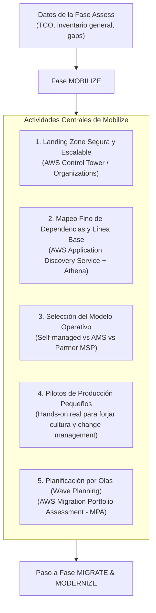
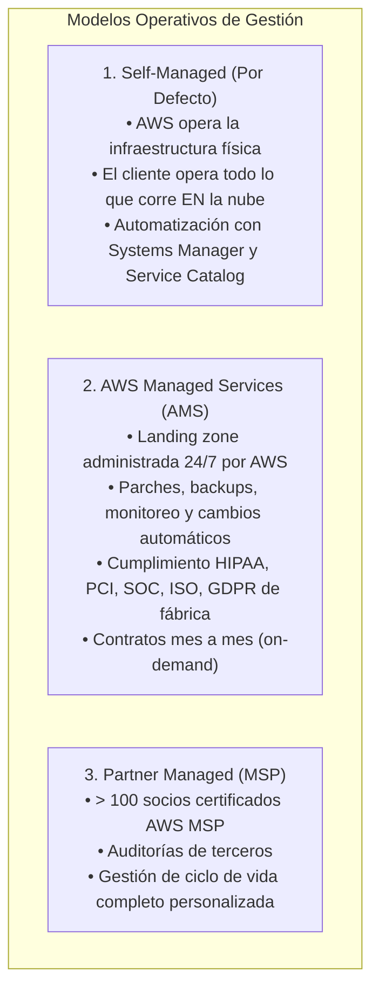
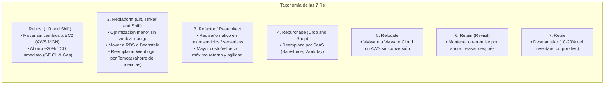
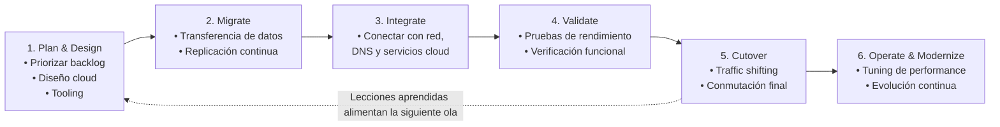

# The Migration Process

> [!abstract] Qué es este archivo
> Cuarta lección del módulo **Migration and Modernization**. Profundiza en la transición desde la fase de evaluación
> (*Assess*) hacia la fase de movilización (**Mobilize**) y la ejecución de **Migrate & Modernize**.
>
> Desarrolla los **tres modelos operativos** (Self-managed, AWS Managed Services y Partner-managed),
> el análisis detallado de la taxonomía de las **7 Rs de migración** (con casos reales de ahorro de licencias y costos como
> GE Oil & Gas y migración de WebLogic a Tomcat), el **flujo iterativo de migración de aplicaciones en 6 pasos**
> (*Plan & Design, Migrate, Integrate, Validate, Cutover, Operate & Modernize*) y las herramientas de planificación
> como **AWS Application Discovery Service**, **MPA tool** y **AWS Application Migration Service (MGN)**.
> Alineado directamente con las tareas **4.2 y 4.3 del Dominio 4 del examen SAP-C02**.

> [!quote] La idea que ordena todo
> **“La migración no es un botón rojo que se presiona de golpe: es una fábrica iterativa que comienza con aplicaciones pequeñas para refinar la cultura y el cambio, y escala hacia las cargas críticas mediante patrones probados.”**
> La movilización exitosa (*Mobilize*) combina el mapeo técnico de dependencias con la selección rigurosa de una de las 7 Rs para cada aplicación, buscando el equilibrio exacto entre velocidad de salida, costo de licencias y modernización futura.

---

## Resumen en una frase

> Una guía operativa que define la fase **Mobilize** para crear una landing zone segura y ganar experiencia con pilotos,
> evalúa los **tres modelos operativos** de gestión, aplica la taxonomía de las **7 Rs** (destacando el ahorro masivo de
> licencias en Replatform y la velocidad de Rehost) y ejecuta el **workflow iterativo de 6 pasos** desde el diseño hasta
> el cutover con traffic shifting y modernización continua.

---

## 1. La fase Mobilize: Crear la base operativa y ganar experiencia real

Tras la fase de evaluación (*Assess*), la fase **Mobilize** transforma los datos preliminares en planes ejecutables a nivel de aplicación individual:

### 1.1 Herramientas clave de la fase Mobilize
- **AWS Migration Portfolio Assessment (MPA tool):** Herramienta utilizada por AWS y partners para análisis de cartera, mapeo de dependencias entre servidores y planificación de olas de migración (*wave planning*).
- **AWS Prescriptive Guidance:** Repositorio oficial de arquitecturas de referencia, guías paso a paso y patrones probados desarrollados por AWS Professional Services.
- **AWS Application Discovery Service:**
  - Registra el tráfico de red entrante y saliente para identificar dependencias ocultas entre servidores.
  - Mide la utilización de CPU, memoria, disco y rendimiento de red (latencia y throughput) para fijar una **línea base de rendimiento (*baseline*)** previa a la migración.
  - Permite realizar análisis avanzados en **Amazon Athena** ejecutando consultas SQL predefinidas sobre las series temporales de telemetría y procesos activos.
- **AWS Control Tower / Landing Zone:** Configuración multi-cuenta gobernada con políticas (*guardrails*) preventivas y detectives obligatorias.
- **AWS Application Migration Service (MGN):** Motor principal de replicación a nivel de bloque para ejecutar migraciones automatizadas de tipo Rehost hacia Amazon EC2.

> [!important] Pilotos de producción en Mobilize
> En la fase *Mobilize*, AWS recomienda no limitarse a mover datos de prueba sintéticos. Es mandatorio migrar **un pequeño conjunto de aplicaciones de producción de bajo riesgo**. Esto valida en condiciones reales la Landing Zone, los procesos de gestión de cambios (*change management*), la conectividad híbrida y la confianza del equipo antes de abordar cargas de misión crítica.

---

## 2. Los tres modelos operativos en la nube (Operating Models)

Durante la movilización, la organización debe decidir cómo operará sus entornos en AWS:

| Modelo Operativo | Responsabilidad del Cliente | Ventaja Principal | Cuándo se elige en el examen |
| --- | --- | --- | --- |
| **Self-Managed** (Autogestionado) | El cliente diseña, aprovisiona, parchea, respalda y monitorea todas las cargas en la nube mediante herramientas nativas (**AWS Systems Manager**, **AWS Service Catalog**, **AWS Config**). | Control total y máxima flexibilidad de configuración. | Equipos internos con **alta madurez técnica** en AWS y procesos DevOps ya consolidados. |
| **AWS Managed Services (AMS)** | El cliente solo se enfoca en sus aplicaciones y lógica de negocio. AWS asume las operaciones de infraestructura 24/7, parches de SO, backups y gestión de cambios. | Reducción radical de riesgo y sobrecarga operativa; cumplimiento normativo inmediato. Contrato flexible **mes a mes**. | Salidas urgentes de data centers donde el personal **carece de experiencia en AWS** y existen mandatos regulatorios estrictos (**HIPAA, PCI-DSS, SOC**). |
| **Partner Managed (MSP)** | Delegada a un socio especializado de la red APN (*AWS Managed Service Provider*), auditado por terceros. | Soporte local, consultoría híbrida y personalización de servicios de ciclo de vida. | Clientes que buscan un proveedor único para aplicaciones de terceros, multi-cloud o soporte regional presencial. |

---

## 3. La taxonomía canónica de las 7 Rs de migración

Una vez recopilados los inventarios y dependencias, cada aplicación se asigna a una de las **7 Rs**:

### 3.1 Detalle técnico y casos reales de la fuente

#### 1. Rehost (*Lift and Shift*)
- **Mecánica:** Mover máquinas virtuales y servidores físicos directamente a instancias Amazon EC2 sin modificar el sistema operativo ni el código.
- **Escalamiento:** En on-premises, los sistemas escalan casi exclusivamente de forma vertical (*stuffing RAM* hasta el límite físico del servidor). En AWS, aunque se puede cambiar a tipos de instancia más grandes, la verdadera eficiencia se logra desacoplando para **escalar horizontalmente** con Auto Scaling.
- **Caso citado en la fuente:** **GE Oil & Gas** demostró que, incluso **sin implementar optimizaciones de nube adicionales**, logró reducir aproximadamente un **30\,\% de sus costos de infraestructura** únicamente mediante Rehost automatizado.
- **Herramienta estándar:** **AWS Application Migration Service (MGN)**.

#### 2. Replatform (*Lift, Tinker and Shift*)
- **Mecánica:** Introducir optimizaciones tangibles en componentes específicos aprovechando servicios administrados de AWS, **sin tocar la lógica central ni la arquitectura del código**.
- **Ejemplos clave:**
  - Migrar bases de datos auto-hospedadas en VM a **Amazon RDS**.
  - Migrar aplicaciones web a plataformas PaaS administradas como **AWS Elastic Beanstalk**.
  - **Ahorro masivo en licencias propietarias (Caso Media Company):** Una gran compañía de medios migró cientos de servidores web on-premises a AWS. En el proceso, reemplazó servidores de aplicaciones comerciales de alto costo de licenciamiento (**Oracle WebLogic**) por contenedores de código abierto equivalentes (**Apache Tomcat**). La empresa ahorró **millones de dólares en costos de licencias**, aumentando drásticamente sus márgenes y agilidad.

#### 3. Refactor / Rearchitect
- **Mecánica:** Rediseñar y reconstruir la aplicación desde sus cimientos utilizando paradigmas nativos de nube: descomposición de monolitos en microservicios, cómputo sin servidor (**AWS Lambda**), mensajería asíncrona (**Amazon SQS/SNS**) y bases de datos NoSQL (**Amazon DynamoDB**).
- **Trade-off:** Es la estrategia que exige **mayor inversión inicial, tiempo y esfuerzo**, pero ofrece el **máximo retorno de inversión (ROI)**, escalabilidad ilimitada y eliminación de costos operativos residuales.

#### 4. Repurchase (*Drop and Shop*)
- **Mecánica:** Abandonar el software propietario heredado o desarrollado internamente para adoptar una solución SaaS estándar del mercado.
- **Ejemplos citados:** Migrar un CRM heredado a **Salesforce.com**, un sistema de RRHH a **Workday**, o un gestor de contenidos a **Drupal**.

#### 5. Relocate
- **Mecánica:** Mover máquinas virtuales a nivel de hipervisor directamente a **VMware Cloud on AWS** sin alterar direcciones IP, configuraciones de vSphere ni convertir formatos de disco.

#### 6. Retain (*Revisit*)
- **Mecánica:** Conservar temporalmente la aplicación en el centro de datos on-premises. Aplica a cargas que requieren una refactorización mayor previa a la migración, dependencias de hardware obsoleto o restricciones legales inmediatas. Se documentan para revisitarlas en etapas posteriores.

#### 7. Retire
- **Mecánica:** Dar de baja y apagar de forma definitiva aplicaciones y servidores en desuso.
- **Impacto directo:** La fuente destaca que **entre el 10\,\% y el 20\,\% del inventario de TI corporativo descubierto en la fase de evaluación resulta ser totalmente innecesario**. Apagar estos sistemas genera ahorro económico inmediato en licencias y hardware, reduce la superficie de ataque que debe protegerse y libera la atención del equipo.

---

## 4. El flujo de migración de aplicaciones en 6 pasos (Application Migration Workflow)

El proceso de mover una aplicación a la nube sigue un flujo iterativo estructurado en seis fases sucesivas:

1. **Plan and Design (Planificar y Diseñar):** Se define y prioriza el backlog de migración, se ajusta el diseño arquitectónico de destino en AWS y se seleccionan las herramientas necesarias.
2. **Migrate (Migrar):** Se ejecuta la transferencia de datos y la replicación del sistema hacia AWS (por ejemplo, replicación continua con AWS MGN o AWS DMS).
3. **Integrate (Integrar):** Se interconecta la aplicación recién replicada con el resto del entorno de AWS (VPCs, balanceadores de carga, servicios de autenticación, DNS y bases de datos).
4. **Validate (Validar):** Se ejecutan pruebas exhaustivas de rendimiento, latencia y verificación de transacciones en subredes aisladas para asegurar que el sistema rinde según lo esperado.
5. **Cutover (Corte y Conmutación):** Se ejecuta la estrategia de desvío de tráfico (*traffic shifting*, por ejemplo con Route 53 o balanceadores ALB) para conmutar los usuarios hacia la aplicación en AWS. Las lecciones aprendidas se retroalimentan inmediatamente al backlog de la siguiente ola.
6. **Operate & Modernize (Operar y Modernizar):** La aplicación entra en su modelo operativo definitivo, donde se ajusta su rendimiento de forma continua (*tuning*) y se preparan optimizaciones futuras (adopción de contenedores, serverless o bases de datos administradas).

---

## 5. Recolección de datos disconexos e institucionales (Dark Data)

La fuente advierte que para tomar decisiones acertadas de migración no basta con exportar la base de datos de gestión de configuración (**CMDB**). Es imperativo capturar información dispersa y no estructurada:

| Tipo de Información | Dónde reside | Riesgo si se ignora |
| --- | --- | --- |
| **Inventario y configuración técnica** | CMDB, hypervisors, scripts locales. | Faltantes de puertos, variables de entorno no documentadas. |
| **Arquitectura real y dependencias** | Diagramas obsoletos, tablas de ruteo. | Caídas en cascada al apagar componentes compartidos. |
| **SLAs, OLAs y rendimiento histórico** | Reportes de monitoreo, contratos de servicio. | Dimensionar instancias EC2 sin cubrir picos estacionales de demanda. |
| **Conocimiento institucional (*Tribal Knowledge*)** | En la cabeza de los ingenieros de campo, canales de Slack, post-its y notas internas. | Procedimientos manuales críticos de reinicio o dependencias de IPs estáticas no registradas formalmente. |

---

## 6. Traducción del contenido

> [!info] Sección de referencia (opcional)
> Esto es la **traducción fiel** de la transcripción y las lecturas oficiales provistas por AWS Skill Builder, para verificar que no se perdió ningún detalle del material oficial. No hace falta leerla para estudiar: lo conceptual y accionable está consolidado en las secciones 1 a 5 y se sintetiza en la sección 8 para el examen.

### 6.1 Transcripción del video: El proceso de migración (Transcripción íntegra)

> *"Después de la fase de evaluación (*assess*), el siguiente paso en una migración es la **fase de movilización (*mobilize*)**. Analizan los datos recopilados en la fase de evaluación y los utilizan para comenzar a hacer **planes detallados a nivel de aplicación** para la migración. Hacen un inventario de qué aplicaciones tienen que migrar, y es posible que descubran que tienen más de las que pensaban al principio. Y seleccionarán qué patrón utilizarán para cada carga de trabajo. A continuación, veremos algunos ejemplos de diferentes patrones.*
>
> *Al igual que con la fase de evaluación, hay varios servicios que proporciona AWS que son útiles en la fase de movilización, los cuales también veremos en breve. Uno de los objetivos de esta fase es **establecer una estrategia para construir una base segura y escalable en AWS**. Pero va más allá de la simple planificación. Recuerden: desean que sus constructores (*builders*) obtengan la mayor **experiencia práctica** posible. Por lo tanto, pueden ir más allá de los datos de prueba y **migrar algunas aplicaciones pequeñas de producción en esta fase** para ayudar a desarrollar los flujos de trabajo y la cultura de su equipo, así como a perfeccionar su proceso de gestión de cambios.*
>
> *Una de las decisiones que tomarán es su **modelo operativo**. El **modelo autogestionado (*self-managed*) es el predeterminado**. AWS es responsable de la nube misma. Ustedes y su equipo son responsables de todo lo que ejecutan en la nube: construir su infraestructura, ejecutar sus cargas de trabajo y adoptar buenas prácticas de seguridad, escalabilidad, gobernanza y todo lo demás que necesiten. Y este no será un proceso totalmente manual. Utilizarán herramientas como **Service Catalog**, **Systems Manager** y otras para agregar automatización y administración.*
>
> *Algunos clientes descubren que necesitan ayuda con eso. Tal vez buscan reducir la administración diaria de la infraestructura, o tal vez necesitan más tiempo y un poco más de ayuda para que su gente desarrolle habilidades y gane experiencia en AWS. Entonces, si esas son preocupaciones que tienen, pueden optar por un **modelo de servicios administrados**. **AWS Management and Governance Services** ofrece una gestión integral del ciclo de vida de TI. Operan una **zona de aterrizaje administrada (*managed landing zone*)** para ustedes con ingenieros de soporte disponibles 24/7 para ayudarlos. Esto reduce su sobrecarga operativa y su riesgo, y le permite a su equipo centrar su atención en las operaciones y en aprender la nube. Los términos son **mes a mes**, porque tal vez no necesiten este nivel de servicio para siempre; es solo algo que necesitan para comenzar. También pueden obtener este servicio de socios de AWS. Hay **más de 100 socios de AWS** que han sido certificados para proporcionar servicios de ciclo de vida completo. Y, por supuesto, pueden usar cualquier combinación de estas opciones para adaptarse mejor a sus necesidades.*
>
> *Última fase: **migración y modernización (*migration and modernization*)**. Así que esto es todo: aquello para lo que han estado trabajando todo el tiempo: mover sus cargas de trabajo de producción a la nube. Y, por supuesto, no lo harán todo a la vez. **Este no es un proceso de presionar el gran botón rojo y agarrarse fuerte**. Es un **proceso cuidadosamente medido y es iterativo**. Comienzan con cargas de trabajo más pequeñas y menos críticas. Migran, integran y prueban, y aprenden más con cada carga de trabajo, de modo que su gente tenga la mayor experiencia posible antes de comenzar a migrar cargas de trabajo críticas.*
>
> *Para cada carga de trabajo que van a migrar, comienzan recopilando todos estos datos desconectados e incompletos. Todo lo que hay que saber, comenzando con las aplicaciones mismas y sus datos de configuración, y luego agregando arquitectura, SLAs, datos de rendimiento histórico y todos los **datos institucionales**. En otras palabras, todos los conocimientos clave que viven en la cabeza de su gente en el campo que trabaja con sus clientes o que están dispersos en años de publicaciones de blog, documentos técnicos, canales de Slack, notas adhesivas y demás. Consíganlo todo. Porque es hora de tomar algunas decisiones importantes sobre cómo se ejecutará esta carga de trabajo en la nube. Esa es la parte de modernización.*
>
> *Las **7 Rs** son las 7 estrategias de migración de aplicaciones más comunes. Comencemos justo en el centro con **Rehost**. Este es el tradicional *lift and shift*, que probablemente sea lo primero que le viene a la mente a la gente cuando piensa en migración. Las aplicaciones se mudan a la nube y se ejecutan en AWS prácticamente de la misma manera que se ejecutaban on-premises, y eso funciona. Pero muchas veces, estas aplicaciones migradas no aprovechan al máximo todo lo que la nube tiene para ofrecer. Por ejemplo, ¿cómo escalan? Tradicionalmente, la mayoría de los servicios escalan verticalmente, lo que significa que cuando crecen y aumenta la demanda de recursos como CPU y memoria, agregan más. Llenan sus servidores de RAM hasta que no queda espacio para más. Y si aún necesitan más recursos, van de compras por más hardware. También pueden hacer ese tipo de cosas en la nube, mover cargas de trabajo a instancias EC2 más grandes, pero en la nube, **generalmente es más eficiente escalar horizontalmente**: iniciar más instancias de un servicio cuando está ocupado y reducirlo cuando las cosas se calman. Hay grandes ganancias en rendimiento y ahorro de costos, pero sus aplicaciones deben ser capaces de admitir ese tipo de patrón.*
>
> *Tal vez, como parte del esfuerzo de migración, decidan hacer **Refactor** en lugar de rehosting, aprovechando la oportunidad para rediseñar su aplicación para que esté más centrada en la nube. Esto puede aportar muchos beneficios y también puede requerir mucho esfuerzo. Tal vez estén buscando algo con un poco menos de esfuerzo, como **Replatforming** donde sea posible. Replatforming significa que, en lugar de *lift and shift*, hacen **lift, tinker and shift**, realizando algunas optimizaciones en la nube, como **migrar bases de datos a Amazon RDS**. O tal vez necesiten mucho menos esfuerzo por adelantado. Tal vez vean la necesidad de optimización en la nube para esta carga de trabajo en el futuro, pero por ahora solo quieren mantenerla como está (**Retain**). O desean retirar cargas de trabajo que no necesitarán en su nueva arquitectura (**Retire**). Eso generalmente requiere el menor esfuerzo. Por lo tanto, esta es una decisión importante y no están usando la misma estrategia para todo. Consideran esto para cada carga de trabajo en función de los recursos que tienen y el potencial retorno de la inversión.*
>
> *Aquí hay un diagrama del **flujo de trabajo de migración de aplicaciones**, y es tal como hablábamos: un proceso iterativo. Planifican, migran, iteran y validan, y programan su estrategia de cambio de tráfico (*traffic shifting*) para realizar el corte (*cutover*) a su aplicación migrada. Y todas las lecciones aprendidas de la migración de esta carga de trabajo son una entrada para el siguiente proceso de planificación para la siguiente carga de trabajo más grande y crítica que van a migrar. Una vez que una carga de trabajo se migra con éxito, pueden cambiar su enfoque a las operaciones y posiblemente a la optimización futura que deseen realizar más adelante."*
>
> *(Duración del video: 7 minutos, 14 segundos).*

---

### 6.2 Lecturas oficiales: Fase Mobilize, modelos operativos y las 7 Rs

#### Utilizar los resultados de la evaluación para planificar y movilizar recursos
El objetivo de la fase de movilización es desarrollar la capacidad fundamental (en la organización y en AWS) con experiencia práctica centrada en la seguridad y la automatización de operaciones. Se consolida una Landing Zone segura y se migra un pequeño conjunto de aplicaciones de producción.
- **AWS Migration Portfolio Assessment (MPA tool):** Herramienta para organizaciones de campo de AWS y APN Partners para análisis, mapeo de dependencias y planificación de olas (*wave planning*).
- **AWS Prescriptive Guidance:** Estrategias y patrones probados por AWS Professional Services.
- **AWS Application Discovery Service:** Mapeo de dependencias de red, baselines de CPU/RAM/disco/red y análisis en Amazon Athena mediante consultas SQL predefinidas.
- **Landing Zone y AWS Control Tower:** Despliegue automatizado de cuentas seguras con políticas corporativas.
- **AWS Application Migration Service (MGN):** Solución automatizada de Rehost.

#### Selección de modelos operativos
- **1. Self-managed:** Herramientas de AWS Management & Governance (Systems Manager, Service Catalog).
- **2. AWS Managed Services (AMS):** Landing zone administrada, cumplimiento (HIPAA, HITRUST, GDPR, SOC, NIST, ISO, PCI), optimización continua y gestión 24/7.
- **3. Partner managed:** Más de 100 socios certificados AWS MSP auditados por terceros.

#### Las 7 Rs de migración
- **Refactor:** Rediseñar hacia la nube (microservicios, serverless). Más costoso, máximo beneficio.
- **Replatform (Lift, tinker and shift):** Optimizaciones menores (p. ej., Amazon RDS, Elastic Beanstalk). *Caso: Gran compañía de medios migró cientos de servidores web de Oracle WebLogic (licencia costosa) a Apache Tomcat (código abierto), ahorrando millones en licencias.*
- **Repurchase:** Traslado a SaaS (Salesforce, Workday, Drupal).
- **Rehost (Lift and shift):** Mover sin cambios a EC2 con herramientas como AWS MGN. *Caso: GE Oil & Gas ahorró 30 % en costos solo con Rehost sin optimizaciones.*
- **Relocate:** Cargas vSphere hacia VMware Cloud on AWS sin cambios de aplicación.
- **Retain (Revisit):** Mantener on-premise temporalmente aplicaciones que requieren gran refactorización.
- **Retire:** Desmantelar componentes obsoletos. *Entre el 10 % y el 20 % del portafolio empresarial ya no es útil y puede apagarse*, impulsando el caso de negocio y reduciendo la superficie de seguridad.

#### Flujo de trabajo de migración de aplicaciones (6 pasos)
1. **Plan and Design:** Backlog, diseño cloud y herramientas.
2. **Migrate:** Ejecución y verificación.
3. **Integrate:** Conexión con infraestructura cloud.
4. **Validate:** Pruebas funcionales y de rendimiento.
5. **Cutover:** Conmutación de tráfico y retroalimentación de lecciones aprendidas.
6. **Operate & Modernize:** Optimización y sintonización continua.

---

## 7. Cierre conceptual: Matriz de selección de las 7 Rs y herramientas

| Estrategia (R) | Esfuerzo de Código | Costo Inicial | Beneficio / ROI | Herramienta Clave de AWS | Caso Típico de Examen |
| --- | --- | --- | --- | --- | --- |
| **Rehost** | Cero | Mínimo | Rápido (ahorro ~30 % TCO) | **AWS Application Migration Service (MGN)** | Salida urgente de data center con fecha límite improrrogable. |
| **Replatform** | Mínimo | Bajo / Medio | Reducción de licencias y carga de BD | **AWS DMS**, **Amazon RDS**, **AWS Elastic Beanstalk** | Reemplazo de WebLogic por Tomcat o bases de datos a RDS sin reescribir la aplicación. |
| **Refactor** | Alto (Reescritura) | Alto | Máxima agilidad, escalabilidad elástica | **AWS Lambda**, **Amazon ECS/EKS**, **DynamoDB** | Monolitos que impiden la innovación y requieren escalabilidad extrema. |
| **Repurchase** | N/A (Reemplazo) | Variable | Reducción total de mantenimiento | **AWS Marketplace**, SaaS externo | Reemplazo de CRM heredado por Salesforce o RRHH por Workday. |
| **Relocate** | Cero | Bajo | Cero conversión de VMs | **VMware Cloud on AWS** | Mantener herramientas vSphere/NSX intactas. |
| **Retain** | Cero | Cero en nube | Aplazamiento justificado | N/A (permanece on-premise) | Aplicaciones con dependencias de hardware especializado no listas para migrar. |
| **Retire** | Cero (Apagado) | Negativo (Ahorro) | Ahorro inmediato del 10–20 % del gasto | **AWS Application Discovery Service** | Servidores huérfanos o sin dueño de negocio comprobado. |

---

## 8. Para el examen (SAP-C02)

> [!important] Lo que hay que retener
> 1. **La secuencia obligatoria de Mobilize.** En la fase *Mobilize*, se construye la **Landing Zone gobernada** (AWS Control Tower), se fija la **línea base de rendimiento** y dependencias con **Application Discovery Service**, y se migran **aplicaciones pequeñas de producción** como prueba piloto real.
> 2. **Replatform para ahorro de licencias.** Cuando una pregunta del examen plantee recortar costos millonarios de licencias comerciales (como **Oracle WebLogic** o WebSphere) sin asumir el costo y riesgo de reescribir código, la respuesta correcta es **Replatform** hacia servidores de código abierto (**Apache Tomcat**) o plataformas administradas (**Amazon RDS / Elastic Beanstalk**).
> 3. **Rehost como paso inicial para grandes carteras.** Para el 70–80 % del inventario corporativo con metas agresivas de tiempo, **Rehost con AWS MGN** es la estrategia predeterminada. Produce un ahorro inmediato de aproximadamente el 30 % en TCO (demostrado por GE Oil & Gas) y permite optimizar/refactorizar más fácilmente una vez que la carga ya corre en AWS.
> 4. **Retire como optimizador de Business Case.** Entre el **10 % y 20 %** de las aplicaciones corporativas son obsoletas y no tienen dueño. En el examen, apagar estas aplicaciones antes de migrar reduce drásticamente los costos de almacenamiento, computación y superficie de ataque.
> 5. **Application Discovery Service con Amazon Athena.** La telemetría capturada por los agentes de Discovery Service se puede consultar directamente en **Amazon Athena** mediante consultas SQL para correlacionar picos de CPU/RAM y mapear dependencias de red entre procesos.
> 6. **AWS MPA tool para Partners.** La herramienta **Migration Portfolio Assessment (MPA)** es utilizada por arquitectos de AWS y APN Partners para la planificación automatizada de olas de migración (*wave planning*).
> 7. **Workflow en 6 pasos y Traffic Shifting.** El cutover exitoso de una aplicación no se hace "en frío": se realiza mediante **estrategias de desvío de tráfico gradual (*traffic shifting*)** con Amazon Route 53 o Application Load Balancers, validando previamente el funcionamiento en subredes aisladas.
> 8. **Escalamiento horizontal vs. vertical.** Las aplicaciones migradas mediante Rehost tienden a mantener el patrón on-premise de escalado vertical; la optimización post-migración mandatoria es adaptarlas a escalado horizontal elástico mediante Auto Scaling Groups.
> 9. **El modelo AMS es flexible (mes a mes).** Los contratos de **AWS Managed Services (AMS)** se estructuran mes a mes, lo que permite a las empresas contratarlos para el arranque crítico de la migración y transicionar a un modelo *Self-managed* a medida que el equipo interno adquiere experiencia.
> 10. **Recolección de Dark Data.** La información crítica para migrar no está solo en la CMDB: reside en la experiencia tácita de los ingenieros de campo, canales de soporte y documentación dispersa.

> [!warning] Trampa clásica del examen
> **Escenario:** Una compañía de servicios financieros ejecuta cientos de aplicaciones Java sobre servidores **Oracle WebLogic** licenciados on-premises. La dirección exige reducir de inmediato los costos de licenciamiento en millones de dólares y acelerar la migración a AWS en un plazo de 4 meses, manteniendo la lógica y el código de las aplicaciones sin cambios.
> **La trampa:** Seleccionar una opción que proponga reescribir el código para descomponerlo en funciones sin servidor con **AWS Lambda** (**Refactor**).
> **Por qué falla:** Una refactorización a microservicios/serverless requiere meses de desarrollo, pruebas extensas y reescritura de código, violando la restricción de plazo de 4 meses y la exigencia de no alterar el código.
> **La solución correcta:** Ejecutar una estrategia de **Replatform**: migrar las aplicaciones Java para ejecutarse sobre contenedores de código abierto **Apache Tomcat** en Amazon EC2 o AWS Elastic Beanstalk. Esto elimina el costo de licencias de WebLogic de inmediato sin modificar la lógica del código de las aplicaciones.

---

## Relacionado

- [[AWS Solutions Architect Advanced - Migration and Modernization]] *(índice del módulo)*
- [[Preparing for Migration]] — lección 03 del módulo (fases MAP, Cloud Value Framework y herramientas de evaluación)
- [[Gathering the Customer Requirements - Migration]] — lección 02 del módulo (caso Utilities y gran entorno VMware)
- [[Course Overview - Migration and Modernization]] — lección 01 del módulo (hoja de ruta y 7 Rs)
- [[AWS Control Tower]] — despliegue de Landing Zone gobernada en la fase Mobilize
- [[AWS Organizations and IAM Identity Center]] — gobierno multi-cuenta
- [[4.1 Seleccionar las cargas de trabajo y los procesos existentes para una posible migración]] — tarea de examen 4.1
- [[4.2 Determinar el enfoque de migración óptimo para las cargas de trabajo existentes]] — tarea de examen 4.2
- [[4.3 Determinar una nueva arquitectura para las cargas de trabajo existentes]] — tarea de examen 4.3

Siguiente paso del módulo: **Lección 05**.

---

## Registro de integración

| Fecha | Cambio | Motivo / Detalle |
| --- | --- | --- |
| 2026-10-29 | Creación de la nota inicial | Alta de la cuarta lección del módulo *Migration and Modernization*. Se estructura la fase Mobilize, los 3 modelos operativos (Self-managed, AMS, Partner MSP), el desglose exhaustivo de las 7 Rs con casos reales (GE Oil & Gas 30% ahorro en Rehost; Media Company ahorro millonario cambiando WebLogic por Tomcat en Replatform; Retire 10-20% del catálogo), el workflow de migración en 6 pasos y la preparación para el examen SAP-C02. |
