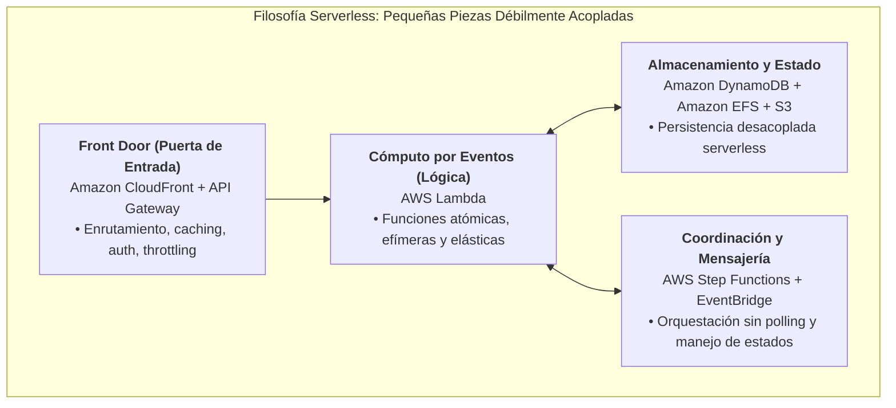
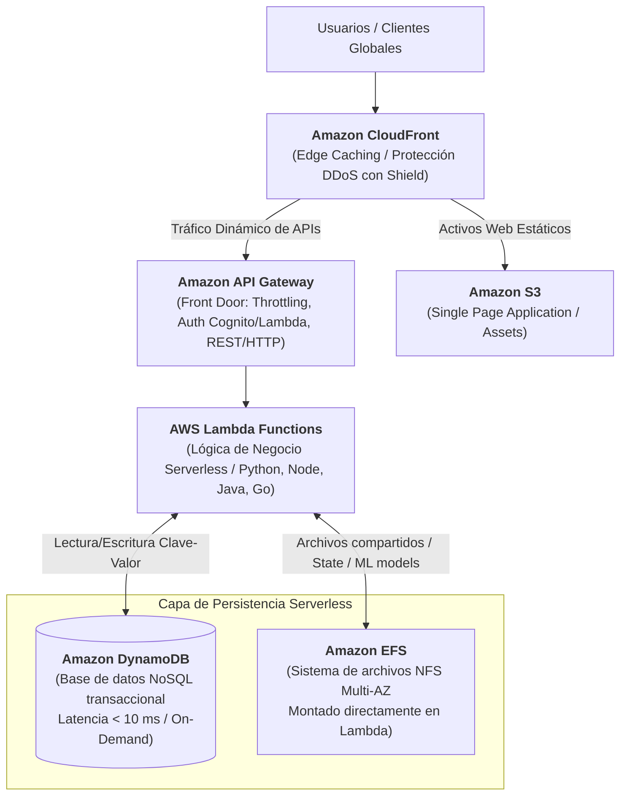
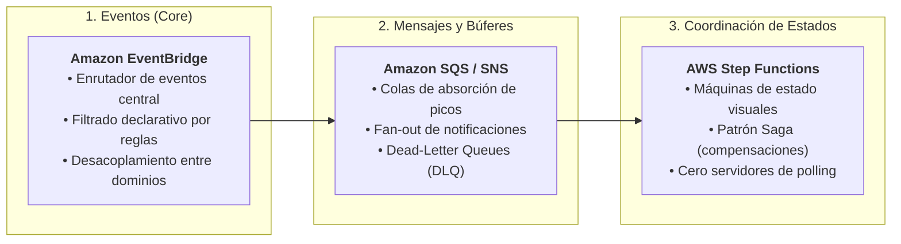
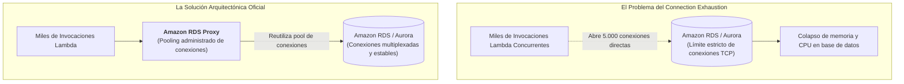

# Use Serverless Architectures

> [!abstract] Qué es este archivo
> Guía técnica exhaustiva sobre el diseño, adopción y optimización de **arquitecturas Serverless (sin servidor)** como el punto culminante de la modernización (*Refactor / Rearchitect*) en AWS. Analiza la filosofía de diseño *"small pieces, loosely joined"*, la arquitectura de referencia modular compuesta por **Amazon CloudFront**, **Amazon API Gateway**, **AWS Lambda**, **Amazon DynamoDB** y **Amazon EFS**, y la orquestación distribuida mediante **AWS Step Functions** y arquitecturas orientadas a eventos (**Amazon EventBridge**, **SQS**, **SNS**) para el **Dominio 4 (Aceleración de la migración y la modernización)** del examen SAP-C02.

> [!quote] La idea que ordena todo
> El paradigma serverless materializa el principio fundamental de internet: **pequeñas piezas, débilmente acopladas (*small pieces, loosely joined*)**. Al eliminar por completo la gestión de servidores, el aprovisionamiento de capacidad y el costo en reposo, cada componente se convierte en un bloque especializado que escala de forma autónoma desde cero hasta decenas de miles de ejecuciones concurrentes, comunicándose mediante eventos y flujos de trabajo orquestados sin crear puntos únicos de falla.

---

## Resumen en una frase

> Las arquitecturas **Serverless** maximizan la agilidad empresarial y minimizan el costo total de propiedad (**TCO**) eliminando la gestión de servidores y el pago en reposo, componiendo aplicaciones modulares donde **Amazon API Gateway** actúa como puerta de entrada, **AWS Lambda** ejecuta la lógica por eventos, **Amazon DynamoDB** y **Amazon EFS** proporcionan persistencia elástica, y **AWS Step Functions** coordina los flujos de trabajo distribuidos.

---

## 1. La filosofía serverless: "Small pieces, loosely joined"

En los sistemas tradicionales, las aplicaciones se conciben como monolitos empaquetados donde la interfaz de usuario, la lógica de negocio, la coordinación de tareas y el acceso a datos residen dentro de los mismos límites de proceso y servidor. En contraste, las arquitecturas serverless adoptan la filosofía modular de la propia web:

### Los tres pilares de valor del modelo Serverless

1. **Aceleración máxima del Time-to-Market:** Los equipos de ingeniería se liberan de gestionar infraestructura (configuración de SO, parches de seguridad, agentes de monitoreo, balanceadores manuales) y concentran el 100% de su tiempo en codificar la lógica de negocio que genera valor competitivo.
2. **Resiliencia y escalabilidad nativas Multi-AZ:** Los servicios serverless de AWS (**Lambda**, **DynamoDB**, **API Gateway**, **S3**, **EventBridge**) operan de forma predeterminada con tolerancia a fallos redundante en múltiples Zonas de Disponibilidad dentro de la región; la alta disponibilidad no requiere configuración ni costos adicionales de hardware duplicado.
3. **Costo proporcional exacto al valor (Cero costo en reposo):** Se elimina el pago por capacidad ociosa (*idle capacity*). Si la aplicación no recibe peticiones durante la noche o los fines de semana, el costo de cómputo es exactamente **\$0 USD**. Las peticiones se facturan al milisegundo de ejecución real consumida.

### Comparativa: Servidores (EC2) vs. Contenedores (ECS/Fargate) vs. Serverless (Lambda)

| Atributo | Servidores Dedicados (Amazon EC2) | Contenedores (Amazon ECS / Fargate) | Serverless (AWS Lambda) |
| --- | --- | --- | --- |
| **Unidad de Despliegue** | Imagen de Máquina (AMI / VM completa) | Imagen de Contenedor (Docker / OCI) | Paquete ZIP de código / Imagen de contenedor OCI ligera |
| **Tiempo de Inicio** | Minutos (arranque de VM) | Segundos (lanzamiento de contenedor) | Milisegundos (*sub-second execution*) |
| **Gestión de Capacidad** | Auto Scaling manual/dinámico de instancias | Aprovisionamiento de vCPU y memoria por tarea | **Automática y transparente:** una invocación = un entorno |
| **Límite de Ejecución** | Indefinido (24/7 continuo) | Indefinido (24/7 continuo) | **Máximo 15 minutos por invocación** |
| **Modelo de Facturación** | Por segundo de instancia encendida | Por segundo de vCPU/RAM reservada | **Por milisegundo de ejecución real** + número de peticiones |
| **Escalado a Cero** | No (mínimo 1 instancia encendida) | No (mínimo 1 tarea en ejecución) | **Sí:** \$0 costo si no hay peticiones |

---

## 2. Anatomía de una arquitectura serverless de referencia

La arquitectura serverless de referencia desacopla de manera rigurosa la capa perimetral, la capa de entrada de APIs, el procesamiento de cómputo y los mecanismos de almacenamiento transaccional y de archivos:

### Componentes de la solución

1. **Amazon CloudFront (Aceleración Perimetral):**
   - Sirve como punto de entrada perimetral global.
   - Cachea respuestas de API y entrega activos estáticos alojados en **Amazon S3** con latencia mínima, bloqueando ataques volumétricos en el borde mediante **AWS Shield Standard** y **AWS WAF**.
2. **Amazon API Gateway (La puerta de entrada a la aplicación):**
   - Actúa como el front door centralizado para gestionar, proteger y monitorizar APIs a cualquier escala (REST APIs y HTTP APIs de baja latencia).
   - Gestiona autenticación y autorización mediante **Amazon Cognito User Pools** o **Lambda Authorizers**.
   - Aplica limitación de tasa (*throttling*) y cuotas por cliente para proteger los backends contra sobrecargas.
3. **AWS Lambda (Cómputo por eventos):**
   - Ejecuta el código en entornos efímeros aislados sin necesidad de gestionar instancias de cómputo.
   - Escala horizontalmente de forma automática: si llegan 5.000 peticiones concurrentes, Lambda aprovisiona 5.000 entornos de ejecución en paralelo.
4. **Amazon DynamoDB (Persistencia NoSQL transaccional):**
   - Almacén de datos serverless de tipo clave-valor y documentos que ofrece tiempos de respuesta consistentes de un solo dígito de milisegundo a cualquier escala.
   - El modo de capacidad **On-Demand** elimina la necesidad de planificar lecturas y escrituras, adaptándose instantáneamente a ráfagas impredecibles de tráfico.
5. **Amazon EFS para AWS Lambda (Almacenamiento de archivos persistente):**
   - Permite que las funciones Lambda dentro de una VPC monten un sistema de archivos elástico y compartido **Amazon EFS** a través de interfaces de red elásticas (ENI).
   - Resuelve casos donde Lambda requiere acceder a grandes modelos de datos (Machine Learning), procesar archivos masivos que superan el límite de disco efímero `/tmp` (hasta 10 GB), o coexistir con aplicaciones legadas que exigen semántica de archivos POSIX.

---

## 3. Coordinación y mensajería en backend: eventos, colas y flujos de trabajo

En una aplicación serverless, los servicios nunca deben comunicarse mediante llamadas síncronas punto a punto fuertemente acopladas. En su lugar, el backend se organiza en torno a tres patrones de comunicación asíncrona:

### Eventos con Amazon EventBridge

- Es el enrutador de eventos (*Event Bus*) serverless por excelencia. Conecta microservicios emitiendo y recibiendo eventos en formato JSON.
- Permite filtrar eventos mediante reglas basadas en el contenido (*content filtering*), enrutando eventos específicos hacia destinos seleccionados (**Lambda**, **SQS**, **Step Functions**, APIs HTTP de terceros) sin que el emisor conozca quién los consume.

### Mensajería con Amazon SQS y Amazon SNS

- **Amazon SQS (Simple Queue Service):** Proporciona colas de mensajes desacopladas que actúan como amortiguador (*buffer*) ante ráfagas de tráfico, protegiendo a los microservicios consumidores de saturaciones de procesamiento.
- **Amazon SNS (Simple Notification Service):** Permite el patrón de distribución en abanico (*Fan-Out*): un solo mensaje publicado en un tópico SNS se retransmite simultáneamente a múltiples colas SQS, funciones Lambda o endpoints HTTP.

### Orquestación de flujos de trabajo con AWS Step Functions

- En lugar de anidar código dentro de una función Lambda para llamar a otra función Lambda (lo que genera costos duplicados y fragilidad operativa), se utiliza **AWS Step Functions**.
- Modela flujos de negocio complejos mediante **máquinas de estado declarativas (ASL - Amazon States Language)**:
  - Manejo nativo de reintentos con retraso exponencial (*exponential backoff*).
  - Captura y bifurcación de errores sin código spaghetti (*Catch / Retry blocks*).
  - Implementación del patrón **Saga**: si un paso falla (p. ej., cobro de tarjeta fallido), Step Functions ejecuta transacciones de compensación automáticas (p. ej., liberar el inventario reservado).
  - Tipos de flujos: **Standard Workflows** (para procesos de larga duración de hasta 1 año, con auditoría paso a paso y semántica *exactly-once*) y **Express Workflows** (para transacciones de alta velocidad de hasta 100.000 ejecuciones/s y duración $\le 5\text{ min}$).

---

## 4. Patrones de optimización y resolución de cuellos de botella en el examen SAP-C02

En el examen SAP-C02, los escenarios serverless evalúan frecuentemente la capacidad de resolver limitaciones técnicas y trampas de arquitectura:

### Mitigación de la sobrecarga de conexiones a bases de datos: Amazon RDS Proxy

- **El problema:** Cada contenedor de ejecución de Lambda que se escala abre su propia conexión TCP hacia la base de datos relacional. Si 3.000 Lambdas se ejecutan concurrentemente, intentarán abrir 3.000 conexiones simultáneas hacia **Amazon RDS**, agotando la memoria del servidor de base de datos y rechazando peticiones.
- **La solución oficial:** Interponer **Amazon RDS Proxy** entre Lambda y RDS. RDS Proxy mantiene un grupo de conexiones (*connection pool*) reutilizable y multiplexa miles de peticiones de Lambda sobre una cantidad reducida y estable de conexiones hacia RDS, mejorando además los tiempos de conmutación por error (*failover*) de RDS en un $66\%$.

### Mitigación de arranques en frío (Cold Starts)

- Cuando una función Lambda no ha sido invocada recientemente o debe escalar ante una ráfaga súbita, AWS debe aprovisionar un nuevo entorno de cómputo y descargar el código/runtime, lo que introduce una latencia inicial (*Cold Start*).
- **Estrategias para el examen:**
  - **Provisioned Concurrency:** Mantiene un número predeterminado de entornos de ejecución de Lambda inicializados y listos para responder en milisegundos de dos dígitos; ideal para APIs interactivas de misión crítica con acuerdos de nivel de servicio (SLA) estrictos.
  - **AWS Lambda SnapStart (para runtimes de Java):** Toma una instantánea de la memoria del entorno inicializado y la reanuda en microsegundos, reduciendo el arranque en frío hasta en un $90\%$.

### El límite de 15 minutos de AWS Lambda

- Las funciones Lambda tienen un tiempo de espera de ejecución (*timeout*) estricto y no configurable superior a **15 minutos**.
- Si una carga de trabajo (p. ej. procesamiento batch pesado, renderizado de video, transcodificación analítica) supera los 15 minutos:
  - **Opción 1:** Migrar esa tarea específica a **AWS Fargate** o **AWS Batch** (sin límite de tiempo de ejecución).
  - **Opción 2:** Descomponer el procesamiento en múltiples pasos pequeños coordinados mediante un bucle de **AWS Step Functions**.

---

## 5. Traducción del contenido

> [!info] Sección de referencia (opcional)
> Esto es la **traducción fiel** de las fuentes originales provistas en el curso de AWS Skill Builder. Su propósito es servir como material de verificación y consulta textual precisa de las explicaciones y lineamientos del instructor.

### 5.1 Lectura oficial: Uso de arquitecturas serverless (Use Serverless Architectures)

Las arquitecturas sin servidor (**serverless**) le ayudan a innovar rápidamente, competir en un mercado global y entregar valor a sus clientes. Al utilizar arquitecturas sin servidor:
- Los equipos pueden entregar productos a los clientes lo más rápidamente posible.
- Las aplicaciones y las infraestructuras son confiables, altamente disponibles y escalables.
- Los equipos pueden reducir el costo total de propiedad y disminuir el riesgo operativo.

### 5.2 Lectura oficial: Ejemplo modernizado serverless (Modernized serverless example)

Esta solución muestra un enfoque de modernización que utiliza una arquitectura sin servidor (**serverless**).

*(Diagrama: Arquitectura con una distribución de CloudFront conectada a un API Gateway, el cual se conecta a AWS Lambda. El almacenamiento es provisto por Amazon EFS y Amazon DynamoDB).*

Las aplicaciones sin servidor siguen las ideas de diseño de Internet y la web: **pequeñas piezas, débilmente unidas (*small pieces, loosely joined*)**. Todas estas aplicaciones son modulares y constan de múltiples servicios de AWS y componentes desarrollados por el cliente.

A menudo comienza con interfaces de programación de aplicaciones (**APIs**), gestionadas por **Amazon API Gateway**, como la puerta de entrada de la aplicación. Frecuentemente, los eventos o los mensajes son el sistema de comunicación en el backend. Los flujos de trabajo (**workflows**) coordinan el sistema de comunicación.

---

## 6. Cierre conceptual: quién hace qué en una arquitectura serverless

| Rol Arquitectónico | Servicio Serverless de AWS | Responsabilidad y Mecanismo Operativo |
| --- | --- | --- |
| **Front Door / Puerta de Entrada** | **Amazon API Gateway** | Expone endpoints REST/HTTP/WebSocket; gestiona rate limiting, autenticación y enrutamiento hacia la lógica backend. |
| **Aceleración y Caching Global** | **Amazon CloudFront** | Distribuye contenido estático desde S3 y protege endpoints con terminación SSL/TLS y mitigación DDoS. |
| **Lógica de Negocio por Eventos** | **AWS Lambda** | Cómputo efímero sin aprovisionar servidores; escala a cero y factura estrictamente por milisegundo de ejecución. |
| **Persistencia Transaccional NoSQL** | **Amazon DynamoDB** | Almacén de clave-valor con latencia de un solo dígito de milisegundo; escala capacidad On-Demand de forma transparente. |
| **Almacenamiento Persistente de Archivos** | **Amazon EFS para Lambda** | Sistema de archivos NFS Multi-AZ montado vía VPC en Lambda para archivos grandes, modelos ML o datos compartidos. |
| **Enrutamiento Central de Eventos** | **Amazon EventBridge** | Bus de eventos desacoplado que filtra y despacha eventos JSON entre microservicios sin dependencias directas. |
| **Búfer y Amortiguación de Picos** | **Amazon SQS** | Cola de mensajes distribuida que almacena peticiones para procesarlas al ritmo que permita el backend. |
| **Orquestación de Flujos de Estado** | **AWS Step Functions** | Coordina secuencias de microservicios, ramificaciones, reintentos y transacciones de compensación (patrón Saga). |
| **Multiplexación de Bases de Datos** | **Amazon RDS Proxy** | Mantiene un pool compartido de conexiones hacia bases relacionales para impedir que miles de Lambdas agoten la BD. |

---

## 7. Para el examen (SAP-C02)

> [!important] Lo que hay que retener
> 1. **La premisa serverless "Small pieces, loosely joined":** La modernización serverless descompone aplicaciones en servicios modulares altamente especializados comunicados mediante APIs y eventos.
> 2. **Cero costo en reposo ($0 cost at idle):** En servicios como **Lambda**, **API Gateway** y **DynamoDB On-Demand**, no existe facturación de capacidad estática ociosa; el cobro se produce estrictamente por solicitud y duración.
> 3. **Límite de ejecución de 15 minutos de AWS Lambda:** Si una tarea requiere más de 15 minutos continuos, la respuesta de examen no es Lambda: es **AWS Fargate**, **AWS Batch** o segmentar la tarea en **AWS Step Functions**.
> 4. **Amazon RDS Proxy para evitar Connection Exhaustion:** Es el componente imprescindible cuando funciones Lambda que escalan a alta concurrencia acceden a bases de datos relacionales (**Amazon RDS** o **Amazon Aurora**).
> 5. **Provisioned Concurrency para eliminar Cold Starts:** Es la solución oficial cuando una API serverless con Lambda tiene acuerdos de nivel de servicio (SLAs) de latencia ultra-baja y no puede tolerar los milisegundos del arranque en frío.
> 6. **Amazon EFS para AWS Lambda:** Se utiliza cuando una función Lambda necesita acceder a almacenamiento compartido persistente con semántica de sistema de archivos POSIX o manejar archivos de datos mayores a los 10 GB de `/tmp`.
> 7. **Orquestación con AWS Step Functions:** Nunca orquestar microservicios haciendo que una Lambda llame a otra Lambda y espere su respuesta; se debe utilizar **Step Functions** para manejar estados, errores y compensaciones (patrón Saga).
> 8. **Desacoplamiento asíncrono con EventBridge y SQS:** Utilizar **Amazon EventBridge** para enrutamiento basado en eventos y **Amazon SQS** para absorber picos repentinos de tráfico sin degradar el backend.
> 9. **Modo On-Demand en Amazon DynamoDB:** Es la configuración recomendada cuando las cargas de trabajo tienen patrones de tráfico impredecibles o picos súbitos sin pronóstico claro.
> 10. **Seguridad con Least Privilege:** Asignar políticas de ejecución mediante **IAM Roles for Lambda** específicas para cada función, evitando roles comodín (*wildcard*) compartidos.

> [!warning] Trampa clásica del examen
> **Escenario:** Una compañía minorista modernizó su sistema de procesamiento de pedidos utilizando **AWS Lambda** conectado directamente a una base de datos **Amazon RDS for PostgreSQL**. Durante las ofertas de fin de año, el tráfico de compras se multiplica por 50; repentinamente, los clientes experimentan errores HTTP 500 y la base de datos RDS se bloquea por saturación de CPU y agotamiento de conexiones de memoria. El equipo propone aumentar la clase de instancia de RDS a la más grande disponible (`db.r6i.32xlarge`).
>
> **La trampa:** Escalar verticalmente la instancia RDS es extremadamente costoso, no resuelve la raíz del problema arquitectónico y las conexiones concurrentes de miles de instancias de Lambda seguirán sobrepasando el límite de conexiones TCP del motor relacional.
>
> **La respuesta correcta:** Implementar **Amazon RDS Proxy** entre las funciones **AWS Lambda** y el clúster de **Amazon RDS**. RDS Proxy multiplexa las miles de conexiones concurrentes efímeras de Lambda sobre un grupo (*pool*) administrado y reducido de conexiones persistentes hacia PostgreSQL, estabilizando la base de datos sin necesidad de sobredimensionar la instancia y absorbiendo la ráfaga de tráfico.

---

## Relacionado

- [[Before and After Modernization]] — lección 12: evolución en cuatro fases desde Rehost hasta contenedores y serverless
- [[Using Containers to Modernize]] — lección 13: cómputo en contenedores con Amazon ECS y AWS Fargate
- [[Modernize the Enterprise]] — lección 11: dimensiones de modernización y el Innovation Flywheel
- [[The Migration Process]] — lección 04: estrategias de las 7 Rs (Refactor / Rearchitect hacia serverless)
- [[AWS Solutions Architect Advanced - Migration and Modernization]] *(índice del módulo)*
- Siguiente paso del módulo: **lección 15 del módulo de migración y modernización**

---

## Registro de integración

| Fecha | Tipo de cambio | Detalle de la modificación |
| --- | --- | --- |
| 2026-10-29 | Creación de nota canónica | Alta de la decimocuarta lección del módulo *Migration and Modernization*. Se estructura exhaustivamente **Use Serverless Architectures** (la filosofía "small pieces, loosely joined", la arquitectura de referencia con CloudFront, API Gateway, Lambda, DynamoDB y Amazon EFS, coordinación con Step Functions y EventBridge, mitigación de cuellos de botella con RDS Proxy y Provisioned Concurrency para el examen SAP-C02). |
