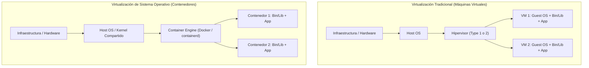
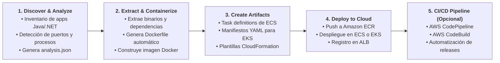

# Using Containers to Modernize

> [!abstract] Qué es este archivo
> Guía técnica exhaustiva sobre el uso de tecnologías de contenedores como palanca fundamental para modernizar aplicaciones legadas y acelerar la entrega de software en AWS. Analiza las ventajas operativas del empaquetado estandarizado OCI/Docker, la arquitectura de referencia con **Amazon Elastic Container Service (Amazon ECS)**, **AWS Fargate**, **Application Load Balancer (ALB)** y **Amazon RDS**, y profundiza en el flujo de trabajo en 5 pasos de **AWS App2Container (A2C)** para transformar aplicaciones **Java** y **.NET** existentes en contenedores sin requerir reescritura de código para el **Dominio 4 (Aceleración de la migración y la modernización)** del examen SAP-C02.

> [!quote] La idea que ordena todo
> La contenedorización es el puente más ágil y seguro entre el mundo legado y el mundo nativo de la nube: en lugar de virtualizar hardware pesado con sistemas operativos completos, virtualiza a nivel del sistema operativo empaquetando el código, el runtime y las librerías en un artefacto inmutable. Con herramientas como **AWS App2Container (A2C)**, una empresa puede tomar un monolito Java o .NET on-premises sin tocar su código fuente, extraer sus dependencias, generar automáticamente su Dockerfile y desplegarlo en **Amazon ECS** o **Amazon EKS** sobre **AWS Fargate** con su propio pipeline de CI/CD.

---

## Resumen en una frase

> La modernización mediante contenedores en AWS estandariza el empaquetado y la entrega de aplicaciones desacoplando el software del hardware subyacente, acelerando el *time-to-market* y permitiendo convertir aplicaciones legadas Java y .NET de forma automatizada hacia **Amazon ECS** o **Amazon EKS** mediante la herramienta de línea de comandos **AWS App2Container (A2C)**.

---

## 1. Por qué los contenedores aceleran la modernización empresarial

La adopción de contenedores representa el paso más eficiente para transformar aplicaciones monolíticas o basadas en servidores en unidades de despliegue ligeras, predecibles y de bajo costo.



### Las cinco ventajas estratégicas de los contenedores

1. **Reutilización de tecnología para aplicaciones existentes y nuevas:** Permite unificar el stack tecnológico. Las aplicaciones migradas y las nuevas aplicaciones nativas de la nube se gestionan con las mismas herramientas de observabilidad, seguridad y despliegue, actualizando las habilidades de los equipos de ingeniería.
2. **Entrega eficiente y aceleración del Time-to-Market:** Al integrarse con prácticas de DevOps y metodologías ágiles, los contenedores reducen drásticamente el tiempo de despliegue de semanas a minutos, permitiendo lanzar características de negocio con alta frecuencia.
3. **Agilidad y portabilidad absoluta (*Build Once, Run Anywhere*):** Al aislar la aplicación del entorno operativo subyacente, se elimina el clásico problema *"en mi máquina funciona pero en producción falla"*. El contenedor se comporta de forma idéntica en el portátil del desarrollador, en el entorno de pruebas (QA) y en producción en AWS.
4. **Empaquetado estandarizado:** Formatos universales (Docker / Open Container Initiative - OCI) que encapsulan el código, las variables de configuración, el entorno de ejecución (*runtime*) y las librerías necesarias en una imagen inmutable versionada en **Amazon Elastic Container Registry (Amazon ECR)**.
5. **Reducción de riesgos mediante Definición como Código:** Los contenedores se configuran y construyen declarativamente mediante archivos como el `Dockerfile`. Esta inmutabilidad permite aplicar auditoría, escaneo continuo de vulnerabilidades y pruebas automatizadas fiables antes del despliegue.

---

## 2. Arquitectura de referencia: aplicación modernizada en Amazon ECS

Al modernizar una aplicación monolítica que previamente residía en instancias EC2 o servidores físicos dedicados, se desacoplan las capas de cómputo, estado y entrega perimetral:

```mermaid
flowchart TD
    Users["Usuarios Globales"] --> CF["<b>Amazon CloudFront</b><br>(Edge Caching / Distribución CDN)"]
    
    CF -->|Contenido Estático<br>(Imágenes, JS, CSS)| S3["<b>Amazon S3</b><br>(Bucket de Almacenamiento Estático)"]
    CF -->|Peticiones Dinámicas| ALB["<b>Application Load Balancer (ALB)</b><br>(Balanceo Capa 7 / Health Checks)"]

    subgraph VPC["Amazon VPC (Multi-AZ)"]
        subgraph PublicSubnets["Subredes Públicas"]
            ALB
        end

        subgraph PrivateAppSubnets["Subredes Privadas (Cómputo en Contenedores)"]
            subgraph ECSCluster["<b>Amazon ECS Cluster</b>"]
                TaskA["<b>ECS Task (Contenedor)</b><br>AZ-A (AWS Fargate)"]
                TaskB["<b>ECS Task (Contenedor)</b><br>AZ-B (AWS Fargate)"]
            end
        end

        subgraph PrivateDataSubnets["Subredes Privadas de Datos"]
            RDS[("<b>Amazon RDS Multi-AZ</b><br>(Base de Datos Replatformed)")]
        end
    end

    ALB --> TaskA
    ALB --> TaskB
    TaskA --> RDS
    TaskB --> RDS
```

### Componentes de la arquitectura contenedorizada

- **Capa de Borde y Entrada:** **Amazon CloudFront** absorbe el tráfico de activos estáticos almacenados en **Amazon S3**, mientras que el **Application Load Balancer (ALB)** enruta las peticiones de API o dinámicas hacia los contenedores mediante comprobaciones de estado avanzadas (*target group health checks*).
- **Capa de Cómputo con Amazon ECS:**
  - El monolito se empaqueta en una imagen de contenedor y se define mediante una **ECS Task Definition** (definiendo CPU, memoria, puertos y roles IAM).
  - Se ejecuta como un **ECS Service** con réplicas distribuidas en múltiples Zonas de Disponibilidad para alta disponibilidad.
  - **AWS Fargate como motor serverless:** Proporciona aislamiento a nivel de hypervisor para cada tarea de contenedor. Elimina la necesidad de administrar instancias EC2 subyacentes, parchear kernels o dimensionar clústeres.
- **Capa de Persistencia Replatformed:** La base de datos no se ejecuta dentro de los contenedores efímeros; se desacopla hacia **Amazon RDS Multi-AZ**, asegurando failover automático en $< 60-120\text{ s}$, copias de seguridad continuas y cero pérdida de transacciones.

---

## 3. Automatización de la contenedorización de aplicaciones legadas: AWS App2Container (A2C)

**AWS App2Container (A2C)** es una herramienta de línea de comandos diseñada específicamente para acelerar la migración y modernización de aplicaciones empresariales existentes sin necesidad de modificar el código fuente.



### Aplicaciones y entornos compatibles

- **Aplicaciones Java:** Ejecutadas sobre servidores de aplicaciones comunes como **Apache Tomcat**, **Spring Boot**, **Red Hat JBoss**, **IBM WebSphere Liberty** y **Oracle WebLogic** ejecutándose en entornos Linux o Windows.
- **Aplicaciones .NET:** Aplicaciones web basadas en **ASP.NET (IIS)** ejecutándose sobre **Windows Server** (versiones 2012 R2 y posteriores), así como aplicaciones **.NET Core** en Linux.

### El flujo de trabajo en 5 pasos de AWS App2Container

| Paso | Comando Representativo | Acción Técnica | Entregable / Artefacto |
| --- | --- | --- | --- |
| **1. Discover and analyze** | `app2container inventory`<br>`app2container analyze --application-id <id>` | Escanea el servidor local (físico, VM o EC2), identifica los procesos de aplicaciones compatibles, mapea dependencias de red, certificados SSL y carpetas de datos. | Archivo declarativo `analysis.json` editable por el arquitecto. |
| **2. Extract and containerize** | `app2container extract --application-id <id>`<br>`app2container containerize --application-id <id>` | Extrae únicamente los artefactos de software necesarios, descarga la imagen base OCI adecuada, genera el `Dockerfile` y compila la imagen de contenedor Docker. | Imagen local de Docker y archivo `Dockerfile`. |
| **3. Create deployment artifacts** | `app2container generate app-deployment --application-id <id>` | Genera los artefactos de infraestructura como código necesarios para registrar y ejecutar el contenedor en el orquestador seleccionado. | Plantillas de **AWS CloudFormation**, Task Definitions de **Amazon ECS** o Manifiestos de **Amazon EKS** (Kubernetes Deployment YAML / Helm Charts). |
| **4. Deploy in the AWS Cloud** | Despliegue mediante CloudFormation / AWS CLI | Sube la imagen construida al repositorio privado en **Amazon ECR**, ejecuta el CloudFormation, aprovisiona la VPC, el ALB y levanta las tareas en ECS o pods en EKS. | Aplicación corriendo en producción sobre **AWS Fargate** o EC2. |
| **5. Create a CI/CD pipeline (Opcional)** | `app2container generate pipeline --application-id <id>` | Diseña un pipeline completo de integración y entrega continua para que los futuros cambios de código desencadenen compilación y despliegue automático. | Pipeline en **AWS CodePipeline** integrado con **AWS CodeBuild** y **Amazon ECR**. |

---

## 4. Matriz de orquestación en AWS: Amazon ECS vs. Amazon EKS

En el examen SAP-C02, elegir entre **Amazon ECS** y **Amazon EKS** para hospedar aplicaciones modernizadas con contenedores depende de la madurez operativa y los requisitos de portabilidad:

| Criterio de Selección | Amazon Elastic Container Service (Amazon ECS) | Amazon Elastic Kubernetes Service (Amazon EKS) |
| --- | --- | --- |
| **Complejidad Operativa** | **Baja:** Diseñado por AWS para ser simple, ligero y sin sobrecarga de control plane. | **Media a Alta:** Requiere conocimientos de conceptos nativos de Kubernetes (Pods, Services, Ingress, CRDs). |
| **Integración con Ecosistema AWS** | Nativa y directa con IAM Roles for Tasks, AWS CloudWatch Logs, ALB/NLB, Secrets Manager y ECS Service Connect. | Soporta integración AWS mediante controladores especializados (AWS Load Balancer Controller, IRSA - IAM Roles for Service Accounts). |
| **Portabilidad Multi-Nube / Híbrida** | Específica de AWS (aunque soporta ECS Anywhere para ejecutar tareas en servidores locales). | **Máxima:** Compatible al 100% con el estándar open source de Kubernetes y herramientas CNCF; compatible con EKS Anywhere. |
| **Modelo de Cómputo Recomendado** | **AWS Fargate** (serverless) o instancias Amazon EC2 administradas mediante Auto Scaling de capacidad. | **AWS Fargate** (para pods serverless) o Managed Node Groups de Amazon EC2. |
| **Almacenamiento Persistente para Contenedores** | **Amazon EFS** (sistemas de archivos compartidos Multi-AZ montados simultáneamente) o volúmenes **Amazon EBS** adjuntos a tareas individuales. | **Amazon EFS** (mediante EFS CSI Driver) o **Amazon EBS** (mediante EBS CSI Driver para Persistent Volumes). |

---

## 5. Traducción del contenido

> [!info] Sección de referencia (opcional)
> Esto es la **traducción fiel** de las fuentes originales provistas en el curso de AWS Skill Builder. Su propósito es servir como material de verificación y consulta textual precisa de las explicaciones y lineamientos del instructor.

### 5.1 Lectura oficial: Ventajas de usar contenedores para modernizar (Using Containers to Modernize)

Un enfoque común para acelerar la entrega de aplicaciones y reducir costos es utilizar la tecnología de contenedores. Los contenedores pueden ser más efectivos, ágiles y entregar aplicaciones con mayor rapidez. Los contenedores ofrecen una serie de ventajas:

#### Utilizar la misma tecnología para aplicaciones existentes
Al contenerizar aplicaciones existentes, los clientes pueden utilizar la misma tecnología para las aplicaciones que migran. Esto permite a los clientes alcanzar un mayor nivel de agilidad al tiempo que actualizan las habilidades de sus equipos con una de las tecnologías más modernas.

#### Entregar aplicaciones eficientemente
Las empresas saben que llevar productos y servicios de software al mercado más rápidamente se traduce en una mayor cuota de mercado. El uso de contenedores puede ayudar a las empresas a modernizar aplicaciones heredadas y crear nuevas aplicaciones nativas de la nube. Cuando se utilizan con prácticas de DevOps y metodologías ágiles, los contenedores proporcionan una opción para los equipos de desarrollo y operaciones que están bajo presión para adaptarse a las crecientes necesidades del negocio. Pueden utilizar contenedores para entregar aplicaciones rápidamente.

#### Mantener las aplicaciones ágiles y portátiles
Las aplicaciones que han sido optimizadas para contenedores son ligeras, eficientes y altamente portátiles. Se comportan exactamente de la misma manera en los entornos de QA y producción que en el entorno de desarrollo, lo que simplifica y acelera el proceso de desarrollo.

#### Proporcionar un empaquetado estandarizado
Los marcos de contenedores, como Docker, proporcionan una forma estandarizada de empaquetar aplicaciones —incluyendo el código, el runtime y las librerías— y ejecutarlas en todo el ciclo de vida del desarrollo de software, independientemente del entorno.

#### Reducir riesgos definiendo y gestionando el código
Los contenedores también pueden considerarse menos riesgosos principalmente porque se pueden definir como código. Los contenedores empaquetan el código con los archivos de configuración para construir el contenedor y las dependencias que necesita para ejecutarse en cualquier entorno. Los contenedores también ayudan a optimizar las pruebas.

### 5.2 Lectura oficial: Ejemplo de solución contenedorizada (Containerized example)

En este ejemplo, una aplicación que anteriormente requería servicios de cómputo y servidores dedicados ahora se ejecuta en un contenedor administrado por **Amazon Elastic Container Service (Amazon ECS)**. Dado que la base de datos se replataformó a **Amazon RDS**, los datos son accesibles para la aplicación. Al utilizar **Amazon CloudFront** y **Elastic Load Balancing**, la aplicación se beneficia de una infraestructura modernizada que la hace escalable y disponible a nivel mundial.

*(Diagrama: Arquitectura con CloudFront, ALB, ECS y Amazon RDS).*

Al contenerizar e implementar aplicaciones en la nube de AWS, los clientes pueden:
- Migrar hacia redes resilientes y seguras.
- Refactorizar y contenerizar para ganar agilidad y ahorros de costos.
- Replataformar componentes críticos, como bases de datos, para obtener aún más ahorro de costos.

### 5.3 Lectura oficial: Contenedorizar aplicaciones existentes con AWS App2Container (Containerize Existing Applications)

**AWS App2Container (A2C)** es una herramienta de línea de comandos que ayuda a los clientes a realizar *lift and shift* de aplicaciones que se ejecutan en un centro de datos local o en máquinas virtuales (VMs). Permite que las aplicaciones se ejecuten en contenedores gestionados por **Amazon Elastic Container Service (Amazon ECS)** o **Amazon Elastic Kubernetes Service (Amazon EKS)**.

Para conocer el flujo de trabajo de AWS App2Container, explore cada uno de los puntos clave:

#### 1: Descubrir y analizar (Discover and analyze)
El primer paso identifica y lista las aplicaciones candidatas (.NET o Java) en el servidor de aplicaciones para contenerizar.

#### 2: Extraer y contenerizar (Extract and containerize)
El siguiente paso extrae los artefactos de la aplicación para su contenedorización y genera un Dockerfile. Luego inicia la compilación del contenedor de la aplicación.

#### 3: Crear artefactos de despliegue (Create deployment artifacts)
A continuación, se generan los artefactos de AWS. Estos son necesarios para implementar los contenedores en Amazon ECS o Amazon EKS.

#### 4: Desplegar en la nube de AWS (Deploy in the AWS Cloud)
El paso final es implementar los contenedores en la nube de AWS.

#### 5: Crear una canalización CI/CD (Opcional) (Create a CI/CD pipeline)
Cree una canalización de CI/CD con **AWS CodePipeline**. Este paso opcional sirve para automatizar la compilación y el despliegue continuo de los contenedores.

---

## 6. Cierre conceptual: quién hace qué en la contenedorización de aplicaciones

| Necesidad de la Modernización | Servicio o Herramienta AWS | Mecanismo y Comportamiento |
| --- | --- | --- |
| **Contenedorización automática de apps Java/.NET existentes sin tocar código** | **AWS App2Container (A2C)** | Escanea procesos en el servidor, extrae artefactos, genera `Dockerfile`, construye la imagen OCI y produce plantillas CloudFormation para ECS/EKS. |
| **Almacenamiento seguro y versionado de imágenes de contenedores** | **Amazon Elastic Container Registry (Amazon ECR)** | Registro privado Docker/OCI con cifrado KMS, escaneo continuo de vulnerabilidades y replicación entre regiones. |
| **Orquestación nativa, simple y sin complejidad de Kubernetes** | **Amazon Elastic Container Service (Amazon ECS)** | Gestiona el ciclo de vida de tareas y servicios con integración profunda en IAM, ALB y CloudWatch. |
| **Orquestación estándar de la industria basada en el ecosistema Kubernetes** | **Amazon Elastic Kubernetes Service (Amazon EKS)** | Clúster Kubernetes certificado por CNCF; ideal si la organización ya utiliza Helm, operadores o busca portabilidad multi-nube. |
| **Ejecución de contenedores sin aprovisionar ni administrar instancias EC2** | **AWS Fargate** | Motor serverless que asigna capacidad exacta de vCPU/RAM por tarea/pod con facturación al segundo y aislamiento a nivel de hypervisor. |
| **Almacenamiento persistente compartido para múltiples contenedores concurrentes** | **Amazon EFS (Elastic File System)** | Sistema de archivos NFS Multi-AZ montable simultáneamente por múltiples tareas de ECS o pods de EKS. |
| **Automatización del ciclo de compilación y despliegue continuo** | **AWS CodePipeline + AWS CodeBuild** | Pipeline generado automáticamente por A2C que detecta commits, ejecuta pruebas, construye la imagen Docker y actualiza el servicio ECS/EKS. |

---

## 7. Para el examen (SAP-C02)

> [!important] Lo que hay que retener
> 1. **AWS App2Container (A2C) es la herramienta oficial de contenedorización:** Diseñada específicamente para modernizar aplicaciones legadas **Java** (Tomcat, Spring Boot, JBoss, WebLogic) y **.NET** (ASP.NET en IIS, .NET Core) hacia contenedores sin modificar su código fuente.
> 2. **El flujo exacto de 5 pasos de A2C:** (1) *Discover and analyze* $\rightarrow$ (2) *Extract and containerize* $\rightarrow$ (3) *Create deployment artifacts* $\rightarrow$ (4) *Deploy in the AWS Cloud* $\rightarrow$ (5) *Create a CI/CD pipeline (opcional)*.
> 3. **Destinos de orquestación de A2C:** Puede generar artefactos de despliegue tanto para **Amazon ECS** (Task Definitions y CloudFormation) como para **Amazon EKS** (Kubernetes Deployment YAML y Helm Charts).
> 4. **AWS Fargate para cero sobrecarga operativa:** Al seleccionar Fargate como tipo de lanzamiento (*Launch Type*), no se administran instancias EC2, escalado de clúster ni parches de sistema operativo host; cada tarea de contenedor se ejecuta en su propia máquina virtual aislada por hypervisor.
> 5. **Persistencia desacoplada para contenedores:** Las aplicaciones contenedorizadas deben ser *stateless* siempre que sea posible; el estado relacional debe ir a **Amazon RDS / Aurora**, el almacenamiento de archivos compartido a **Amazon EFS**, y los activos web a **Amazon S3**.
> 6. **Balanceo de carga de Capa 7 con ALB:** **Application Load Balancer** es el balanceador estándar para contenedores en ECS/EKS gracias a su soporte de enrutamiento basado en rutas/host, integración con *Target Groups* dinámicos y redirección de puertos dinámicos.
> 7. **Seguridad granular con IAM Roles for Tasks:** En Amazon ECS, los permisos de acceso a servicios AWS (S3, DynamoDB, Secrets Manager) se asignan a nivel de tarea (*Task Role*), **nunca** a nivel de la instancia EC2 subyacente.
> 8. **Inmutabilidad y Definición como Código:** Empaquetar aplicaciones en contenedores Docker/OCI garantiza consistencia exacta entre desarrollo, pruebas y producción, eliminando discrepancias de dependencias.
> 9. **Escaneo de vulnerabilidades en Amazon ECR:** ECR proporciona escaneo automatizado básico (Clair) y mejorado (mediante **Amazon Inspector**) para detectar vulnerabilidades en paquetes de sistema operativo y dependencias de lenguaje en las imágenes construidas.
> 10. **A2C para aplicaciones on-premises o en la nube:** Funciona tanto en servidores locales (físicos o máquinas virtuales VMware/Hyper-V) como en instancias Amazon EC2 existentes.

> [!warning] Trampa clásica del examen
> **Escenario:** Una empresa financiera necesita migrar 30 aplicaciones web críticas basadas en Java (alojadas en servidores Tomcat on-premises) hacia AWS. El equipo de desarrollo original ya no está en la empresa y no se dispone del código fuente original ni de tiempo para reescribir las aplicaciones. La directiva exige modernizar las cargas a contenedores administrados sin servidores para reducir el costo operativo y automatizar los despliegues futuros.
>
> **La trampa:** Sugerir una refactorización manual del código fuente a microservicios en AWS Lambda o contratar desarrolladores para escribir manualmente Dockerfiles y manifiestos de Kubernetes desde cero. Ambas opciones conllevan meses de trabajo, riesgo de errores y retrasos severos.
>
> **La respuesta correcta:** Utilizar **AWS App2Container (A2C)** directamente en los servidores on-premises para descubrir, analizar y extraer los artefactos de las aplicaciones Java Tomcat. Generar automáticamente los **Dockerfiles**, las definiciones de tareas para **Amazon ECS** y los templates de CloudFormation configurando el tipo de lanzamiento en **AWS Fargate**. Opcionalmente, generar la canalización automatizada en **AWS CodePipeline** para el ciclo de vida CI/CD sin requerir modificaciones en el código fuente.

---

## Relacionado

- [[Before and After Modernization]] — lección 12: evolución en cuatro fases desde Rehost hasta contenedores y serverless
- [[Modernize the Enterprise]] — lección 11: las tres dimensiones de la modernización (Arquitectura, Organización, Infraestructura)
- [[The Migration Process]] — lección 04: estrategias 7 Rs (Replatform y Refactor)
- [[AWS Application Migration Service]] — lección 08: contraste entre Rehost a nivel de bloque en EC2 vs. modernización a contenedores con A2C
- [[AWS Solutions Architect Advanced - Migration and Modernization]] *(índice del módulo)*
- Siguiente paso del módulo: **lección 14 del módulo de migración y modernización**

---

## Registro de integración

| Fecha | Tipo de cambio | Detalle de la modificación |
| --- | --- | --- |
| 2026-10-29 | Creación de nota canónica | Alta de la decimotercera lección del módulo *Migration and Modernization*. Se estructura exhaustivamente **Using Containers to Modernize** (las 5 ventajas estratégicas del contenedor, arquitectura de referencia con Amazon ECS, AWS Fargate, ALB y RDS, la herramienta **AWS App2Container (A2C)** con su flujo de trabajo en 5 pasos para Java y .NET, matriz comparativa ECS vs. EKS, y estrategias para el examen SAP-C02). |
