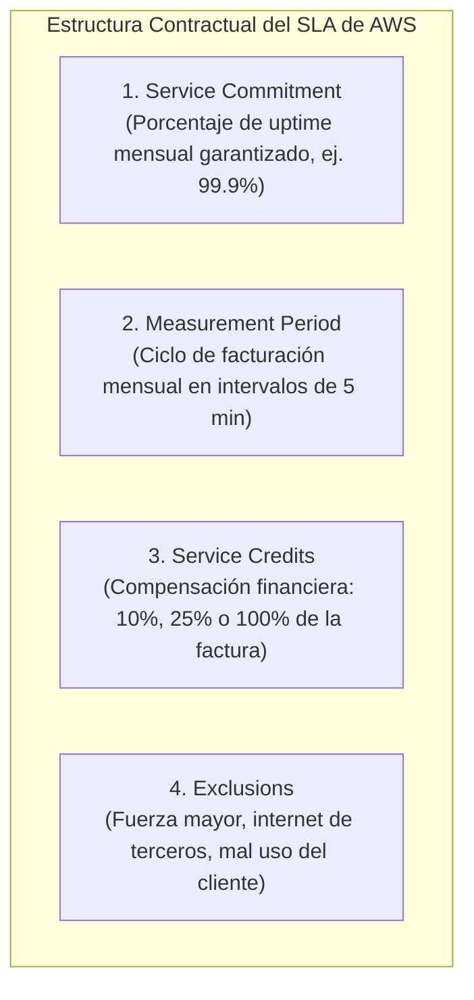
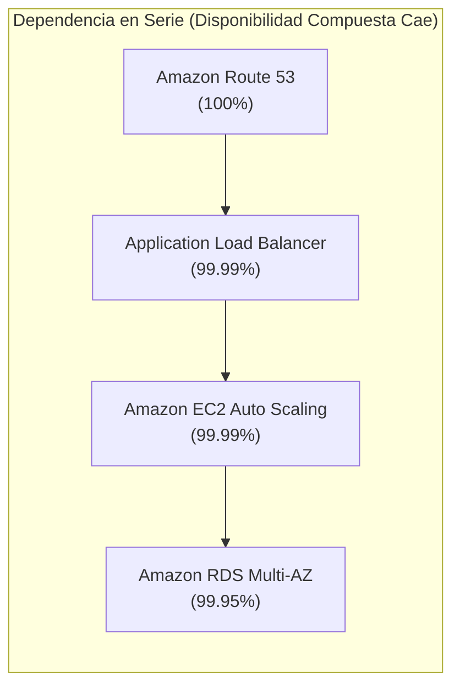
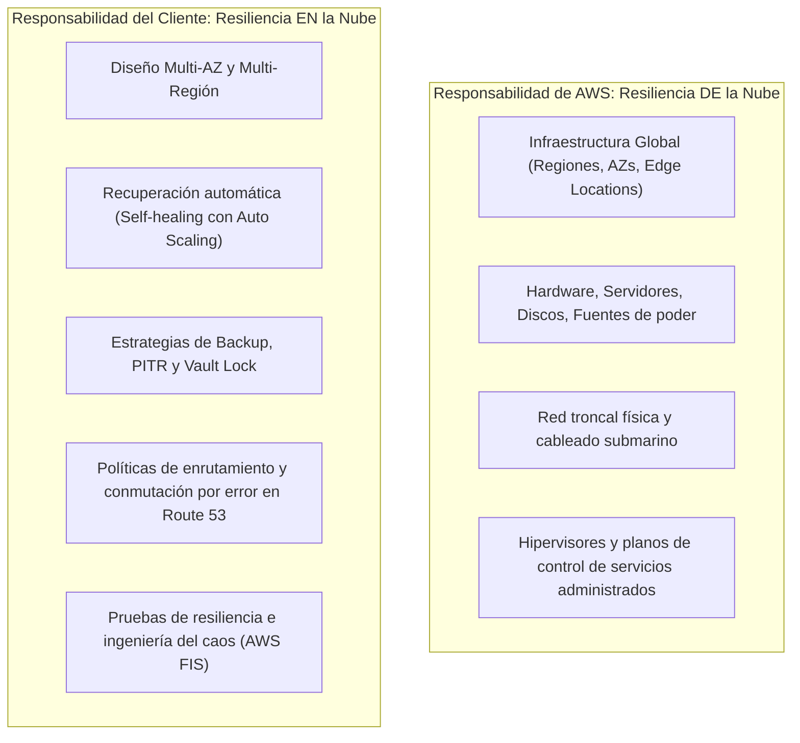

# AWS Service Level Agreements

> [!abstract] Qué es este archivo
> Séptima lección del módulo de resiliencia operativa. Explora los **Acuerdos de Nivel de Servicio (SLAs)** de AWS, sus cuatro
> componentes estructurales (compromiso de servicio, período de medición, créditos de servicio y exclusiones), el cálculo de
> **disponibilidad compuesta** en arquitecturas en serie vs. en paralelo, y la anatomía contractual de SLAs reales (**AWS Backup**
> y **AWS Systems Manager**). Aborda las métricas de intervalos de 5 minutos, el procedimiento de reclamo de créditos de servicio
> y el **modelo de responsabilidad compartida para la resiliencia**.
>
> Lectura profunda + Análisis contractual de SLAs + Fórmulas de disponibilidad + Modelo de responsabilidad compartida.

> [!quote] La idea que ordena todo
> **“La disponibilidad de tu arquitectura está limitada por el eslabón más débil de tus dependencias en serie.”**
> Los SLAs de AWS no son acumulativos por defecto: dos servicios con 99.9% en serie generan una disponibilidad compuesta de
> 99.8%. Superar el SLA individual de un servicio exige diseñar arquitecturas redundantes y tolerantes a fallos (Multi-AZ y
> Multi-Región), recordando que el SLA de AWS solo otorga créditos financieros, no devuelve el tiempo de negocio perdido.

---

## Resumen en una frase

> Los **SLAs de AWS** garantizan porcentajes de tiempo de actividad mensual (**Monthly Uptime Percentage**) medidos en
> intervalos de 5 minutos, compensando incumplimientos mediante **créditos de servicio escalonados (10%, 25%, 100%)**
> solicitados formalmente antes del segundo ciclo de facturación, lo que obliga al arquitecto a diseñar con redundancia
> desacoplada para mitigar la degradación de la **disponibilidad compuesta**.

---

## 1. Qué es un SLA en AWS: Los Cuatro Componentes Estándar

Un **Acuerdo de Nivel de Servicio (SLA)** es un compromiso contractual formal entre AWS y el cliente que define el porcentaje
mínimo de tiempo de actividad y disponibilidad garantizado para cada servicio administrado:

| Componente | Definición Contractual | Detalle Operativo en AWS |
| --- | --- | --- |
| **1. Service Commitment** | Porcentaje de tiempo de actividad (*Monthly Uptime Percentage*) que AWS se compromete a brindar. | Varía por servicio y arquitectura (ej. instancias EC2 en una sola AZ tienen un compromiso menor que desplegadas en múltiples AZs). |
| **2. Measurement Period** | Ventana temporal sobre la cual se promedia la disponibilidad. | Ciclo de facturación mensual, calculado en **intervalos continuos de 5 minutos**. |
| **3. Service Credits** | Créditos en dólares aplicables exclusivamente a facturas futuras del servicio afectado. | Se aplican si el uptime cae por debajo del compromiso; no son reembolsos en efectivo ni transferibles a otras cuentas. |
| **4. Exclusions** | Escenarios donde las caídas no califican para compensación. | Problemas del internet público más allá del punto de demarcación de AWS, suspensiones de cuenta, o arquitecturas que violan la documentación técnica. |

---

## 2. Tipos de SLAs y Disponibilidad Compuesta

### Los Tres Tipos de Acuerdos
* **Customer-level SLA:** Cubre la totalidad de los servicios utilizados por un cliente corporativo particular, detallando responsabilidades, escalamientos y términos contractuales a medida.
* **Service-level SLA:** Contrato idéntico y estandarizado ofrecido a todos los clientes que consumen un servicio específico (el modelo general público de AWS, con más de **300 SLAs publicados**).
* **Multi-level SLA:** Acuerdo dividido en capas que integra diferentes condiciones y precios según el nivel de soporte contratado (ej. planes de soporte Developer, Business, Enterprise).

### El Impacto Arquitectónico: La Ley de la Disponibilidad Compuesta
Cuando una carga de trabajo depende de múltiples servicios de AWS, su disponibilidad general nunca es el promedio simple de sus componentes:

#### Dependencias en Serie (Eslabones en cadena)
Si el componente $B$ necesita estrictamente que el componente $A$ funcione para responder:
$$\text{Disponibilidad Total} = \text{SLA}_1 \times \text{SLA}_2 \times \dots \times \text{SLA}_n$$
* *Ejemplo:* Una app con Route 53 (100%), ALB (99.99%), EC2 (99.99%) y RDS (99.95%):
  $$\text{Disponibilidad} = 1.0 \times 0.9999 \times 0.9999 \times 0.9995 = 99.93\%$$
* **Regla:** La disponibilidad de un sistema en serie es **siempre inferior al SLA del servicio más bajo**.

#### Dependencias en Paralelo (Redundancia activa)
Para elevar la disponibilidad más allá del SLA de un servicio individual, se diseñan caminos redundantes:
$$\text{Disponibilidad Total} = 1 - (1 - \text{SLA}_1) \times (1 - \text{SLA}_2)$$
* *Ejemplo:* Si dos componentes independientes con 99.9% de SLA se colocan en paralelo redundante:
  $$\text{Disponibilidad} = 1 - (0.001 \times 0.001) = 1 - 0.000001 = 99.9999\% \text{ (6 nueves)}$$

---

## 3. Anatomía de un SLA de AWS: AWS Backup y Systems Manager

AWS publica acuerdos formales específicos para cada servicio. Los SLAs de **AWS Backup** y **AWS Systems Manager**
ilustran el estándar de la plataforma:

### Tabla Canónica de Créditos de Servicio (*Service Credits*)
Tanto AWS Backup como las características con costo de Systems Manager utilizan la misma escala de compensación
sobre el ciclo de facturación mensual:

| Porcentaje de Uptime Mensual (*Monthly Uptime Percentage*) | Porcentaje de Crédito de Servicio Otorgado |
| --- | --- |
| **Menor a 99.9%, pero igual o mayor a 99.0%** | **10%** del cargo mensual facturado |
| **Menor a 99.0%, pero igual o mayor a 95.0%** | **25%** del cargo mensual facturado |
| **Menor a 95.0%** | **100%** del cargo mensual facturado |

### Procedimiento Formal de Solicitud de Créditos
Para recibir un crédito de servicio tras una interrupción, el cliente debe cumplir con un protocolo estricto:
1. **Apertura de caso:** Abrir un ticket de tipo facturación en el **AWS Support Center**.
2. **Plazo límite:** La solicitud debe recibirse antes del final del **segundo ciclo de facturación** posterior al mes en que ocurrió el incidente.
3. **Línea de asunto obligatoria:** El asunto del caso debe contener textualmente: `"SLA Credit Request"`.
4. **Información requerida:**
   * Región de AWS y ciclo de facturación afectado.
   * Fechas, horas exactas y porcentaje de disponibilidad de cada intervalo de 5 minutos que falló.
   * Logs de peticiones (*Request logs*) que documenten los errores del corte (con datos confidenciales ofuscados con asteriscos).
   * Para Systems Manager: nombres de APIs afectadas y IDs de recursos afectados.
5. **Condición de emisión:** El monto calculado del crédito debe ser **superior a un dólar (\$1 USD)**.

### Fórmulas Matemáticas de Medición
* **Tasa de Error (*Error Rate*):** Calculada para cada intervalo de 5 minutos:
  $$\text{Error Rate} = \frac{\text{Total de errores 500 y 503 (InternalFailure / ServiceUnavailable)}}{\text{Total de llamadas de API ejecutadas en el intervalo de 5 min}}$$
  *Si en un intervalo de 5 minutos el cliente no realizó ninguna llamada a la API, ese intervalo se considera con 0% de error (100% disponible).*
* **Porcentaje de Tiempo de Actividad Mensual (*Monthly Uptime Percentage*):**
  $$\text{Monthly Uptime Percentage} = 100\% - \text{Promedio de Error Rates de todos los intervalos de 5 min del mes}$$

### Exclusiones Universales de los SLAs de AWS
El compromiso de disponibilidad no cubre caídas originadas por:
1. Factores fuera del control razonable de AWS (fuerza mayor, desastres naturales, fallas en proveedores de internet fuera del punto de demarcación de AWS).
2. Acciones o inacciones voluntarias del cliente (malas configuraciones, sobrecarga de cuotas no solicitadas).
3. Software, hardware o equipos propios del cliente.
4. Incumplimiento de las mejores prácticas y documentación técnica de AWS.
5. Suspensión o terminación de la cuenta por falta de pago o violaciones del contrato de cliente.
6. **Acciones o servicios gratuitos:** Las características y llamadas a APIs gratuitas no son elegibles para créditos.

---

## 4. El Modelo de Responsabilidad Compartida para Resiliencia

El marco de Well-Architected establece una división nítida entre lo que AWS garantiza contractualmente y lo que el
arquitecto debe implementar:

* **AWS es responsable de la Resiliencia DE la Nube:** Proveer infraestructura física tolerante a fallos, redundancia de energía, conectividad de red y los planos de control de las APIs que sustentan los SLAs publicados.
* **El Cliente es responsable de la Resiliencia EN la Nube:** Si un cliente despliega una base de datos en una sola Zona de Disponibilidad y esa AZ sufre un corte eléctrico, **AWS no ha violado su SLA de alta disponibilidad**, porque el cliente eligió una arquitectura de punto único de falla (SPOF). Alcanzar 99.99% o 99.999% de disponibilidad en la aplicación exige arquitecturas **Multi-AZ**, balanceadores de carga y failover regional.

---

## 5. Cierre Conceptual: Matriz de Objetivos de Disponibilidad

| Disponibilidad Requerida | Downtime Máximo al Año | Estrategia de Arquitectura Recomendada | Rol del SLA de AWS |
| --- | --- | --- | --- |
| **99.0% (2 nueves)** | ~3.65 días / año | Despliegue en una sola AZ con backups periódicos en S3. | Cubierto holgadamente por el SLA base de servicios individuales. |
| **99.9% (3 nueves)** | ~8.76 horas / año | Despliegue Multi-AZ activo-pasivo; auto-recuperación de EC2. | Requiere que las dependencias en serie tengan SLAs $\ge 99.95\%$. |
| **99.99% (4 nueves)** | ~52.6 minutos / año | Multi-AZ activo-activo con Auto Scaling; Aurora Multi-AZ; Route 53 failover. | Mitiga caídas de AZ completa; componentes paralelos obligatorios. |
| **99.999% (5 nueves)** | ~5.26 minutos / año | Arquitectura Multi-Región Activo-Activo con DynamoDB Global Tables / Route 53. | La aplicación sobrevive a la pérdida total de una región de AWS. |

---

## 6. Traducción del contenido

> [!info] Sección de referencia (opcional)
> Traducción íntegra de las fuentes de Skill Builder. Se recomienda estudiar las secciones **1 a 5** y revisar los puntos
> clave y trampas de examen en la sección **7**.

### 6.1 AWS Service Level Agreements (Definición y 4 Componentes)

Los **Acuerdos de Nivel de Servicio (SLAs)** son compromisos asumidos por los proveedores de servicios que garantizan un
cierto porcentaje de tiempo de actividad y disponibilidad para sus servicios. Un SLA describe métricas como el tiempo de
actividad, el tiempo de entrega, el tiempo de respuesta y el tiempo de resolución.

Los SLAs de AWS definen los compromisos de servicio y las garantías de disponibilidad que AWS proporciona para sus diversos
servicios. Comprender estos SLAs es crucial para diseñar aplicaciones que cumplan con los requisitos de tiempo de actividad
y fiabilidad de su negocio.

Los SLAs de AWS varían según el servicio, son específicos de cada oferta individual de servicio y normalmente incluyen:
1. **Service Commitment (Compromiso de servicio):** El porcentaje de tiempo de actividad que AWS se compromete a proporcionar.
2. **Measurement Period (Período de medición):** El período de tiempo durante el cual se calcula la disponibilidad.
3. **Service Credits (Créditos de servicio):** Compensación ofrecida si AWS no cumple con el SLA.
4. **Exclusions (Exclusiones):** Condiciones bajo las cuales el SLA no aplica.

### 6.2 Tipos de SLAs y Consideraciones de Carga de Trabajo

* **Customer-level SLA (SLA a nivel de cliente):** Acuerdo que cubre todos los servicios utilizados por un cliente. Cubre detalles específicos de servicios, disposiciones de disponibilidad, responsabilidades, procedimientos de escalamiento y términos de cancelación.
* **Service-level SLA (SLA a nivel de servicio):** Contrato que detalla un servicio idéntico ofrecido a múltiples clientes.
* **Multi-level SLA (SLA multinivel):** Dividido en múltiples niveles que integran varias condiciones en el mismo sistema, adecuado para proveedores con clientes en diferentes rangos de precios o niveles de servicio.

**Factorizar SLAs en la arquitectura de sus cargas de trabajo:**
* Considere los SLAs de todos los servicios de AWS de los que depende su aplicación.
* Reconozca que la disponibilidad general de su aplicación está **limitada por el SLA más bajo entre sus dependencias de servicio**.
* Implemente redundancia y tolerancia a fallos para mejorar la disponibilidad más allá de los SLAs de servicios individuales.

### 6.3 Ejemplos Reales: AWS Backup SLA y AWS Systems Manager SLA

AWS se compromete a ofrecer acuerdos de nivel de servicio y publicar objetivos de nivel de servicio (SLO) para todos los
servicios de pago y de disponibilidad general, con **más de 300 SLAs separados publicados**.

#### AWS Backup SLA y Systems Manager SLA (Estructura Común)
* **Compromiso de Servicio:** AWS utilizará esfuerzos comercialmente razonables para hacer que el servicio esté disponible con un porcentaje de tiempo de actividad mensual de al menos **99.9%** durante cualquier ciclo de facturación mensual.
* **Escala de Créditos de Servicio:**
  * Menos de 99.9% pero $\ge 99.0\% \rightarrow$ **10%** de crédito.
  * Menos de 99.0% pero $\ge 95.0\% \rightarrow$ **25%** de crédito.
  * Menos de 95.0% $\rightarrow$ **100%** de crédito.
* **Aplicación de Créditos:** Se aplican únicamente contra futuros pagos del servicio. No otorgan reembolsos ni pagos en efectivo. Solo se emiten si el monto supera **$1 USD**. No son transferibles a otras cuentas.
* **Procedimiento de Reclamo:**
  * Enviar reclamo abriendo un caso en el AWS Support Center.
  * Debe recibirse antes del final del **segundo ciclo de facturación** posterior al incidente.
  * Asunto obligatorio: `"SLA Credit Request"`.
  * Incluir ciclo, región, fechas/horas de intervalos con disponibilidad $< 100\%$, nombres de APIs afectadas, IDs de recursos y logs de peticiones anonimizados.
* **Exclusiones:** Factores fuera de control razonable (fuerza mayor, internet público), acciones/inacciones del cliente, no seguir la documentación técnica, o suspensión de la cuenta. Las acciones y funciones gratuitas no generan créditos de servicio.
* **Definiciones clave:**
  * *Error Rate:* Errores 500 y 503 (`InternalFailure` / `ServiceUnavailable`) dividido por el total de acciones de API en un intervalo de **5 minutos**.
  * *Monthly Uptime Percentage:* 100% menos el promedio de las tasas de error de cada intervalo de 5 minutos en el ciclo mensual.

### 6.4 Monitoreo, Métricas y Buenas Prácticas

Monitoree constantemente el rendimiento mediante **Amazon CloudWatch, AWS Config y AWS Trusted Advisor**.

**Métricas comunes de SLA:** Disponibilidad del servicio, tasas de error, seguridad, tiempos de respuesta, resultados del negocio y tasas de resolución.

**Mejores prácticas para alcanzar objetivos de disponibilidad:**
* Desplegar cargas de trabajo en múltiples ubicaciones (Multi-AZ / Multi-Region).
* Implementar auto-recuperación (*automated healing*) en todas las capas.
* Probar la resiliencia mediante **ingeniería del caos** (Chaos Engineering).
* Definir objetivos de recuperación claros para el tiempo de inactividad (RTO) y la pérdida de datos (RPO).
* Considerar patrones de redundancia descritos en los Multi-AZ Resilience Patterns de AWS.
* **Recordar el modelo de responsabilidad compartida para la resiliencia:** AWS proporciona SLAs para sus servicios; usted es responsable de diseñar sus aplicaciones para cumplir con sus requisitos específicos de disponibilidad.

---

## 7. Para el examen (SAP-C02)

> [!important] Lo que hay que retener
> 1. **La regla de dependencias en serie:** Si una arquitectura conecta servicios de AWS en cadena secuencial (ej. CloudFront $\rightarrow$ API Gateway $\rightarrow$ Lambda $\rightarrow$ DynamoDB), la disponibilidad total teórica es la **multiplicación de sus SLAs**. Por tanto, la disponibilidad total resultante es **estrictamente menor que la del componente con el menor SLA**.
> 2. **Superar los SLAs mediante paralelismo:** Para diseñar una solución con un SLA superior al que ofrece AWS en un servicio individual, el arquitecto debe incorporar **redundancia en paralelo** (ej. dos regiones activas con Route 53, o Auto Scaling Multi-AZ).
> 3. **Tramos de Service Credits estándar:** 10% de crédito si el uptime cae entre 99.0% y 99.9%; 25% si cae entre 95.0% y 99.0%; y 100% si cae por debajo de 95.0%.
> 4. **Ventana de reclamo de 2 ciclos de facturación:** Para calificar para Service Credits, el cliente debe abrir un caso de soporte antes de que venza el **segundo ciclo de facturación** posterior al mes de la caída, con el asunto `"SLA Credit Request"`.
> 5. **Los créditos no son dinero en efectivo:** Los créditos de servicio no se reembolsan en transferencias bancarias ni cheques; se acreditan contra futuras facturas del servicio afectado en esa misma cuenta (mínimo \$1 USD).
> 6. **Exclusión de servicios gratuitos:** El uso de características o llamadas a APIs gratuitas no computa para el cálculo de Monthly Uptime Percentage ni genera derecho a créditos de servicio.
> 7. **Responsabilidad compartida:** Un fallo de una aplicación debido a la caída de una sola Zona de Disponibilidad no califica como incumplimiento de SLA de AWS si el servicio requería configuración Multi-AZ para gozar de dicha garantía (ej. RDS Single-AZ vs RDS Multi-AZ).

> [!warning] Trampa clásica del examen
> **Escenario:** Un arquitecto diseña una aplicación de comercio electrónico y selecciona tres servicios gestionados de AWS cuyas garantías individuales de SLA publicadas son 99.95%, 99.9% y 99.99%. El cliente requiere un compromiso de disponibilidad global de extremo a extremo de al menos 99.9% para su aplicación conectando los tres servicios en serie.
>
> * **Respuesta trampa:** "La arquitectura cumple con el requerimiento del cliente porque el promedio de los SLAs es 99.94%, lo cual supera el 99.9% requerido."
> * **Por qué falla:** La disponibilidad en serie no se promedia; se multiplica: $0.9995 \times 0.9990 \times 0.9999 \approx 99.84\%$. El sistema resultante estará caído aproximadamente 14 horas al año, incumpliendo el objetivo de 99.9% (máximo 8.76 horas).
> * **La respuesta correcta:** Reconocer que la arquitectura en serie no cumple con el SLA requerido. Para alcanzar el 99.9%, el arquitecto debe desacoplar las capas mediante colas asíncronas (**Amazon SQS**), caché (**Amazon ElastiCache**) o redundancia activa en múltiples zonas de disponibilidad, permitiendo que la aplicación continúe operando ante la degradación temporal de uno de los componentes.

---

## Relacionado

- [[AWS Solutions Architect Advanced - Operational Resilience]] *(índice del módulo)*
- [[Course Overview - Operational Resilience]] — lección 01: encuadre de SLAs, KPIs y métricas de resiliencia
- [[Gathering the Customer Requirements - Resilience]] — lección 02: requisitos de negocio frente a SLOs
- [[Building a Data Protection Strategy]] — lección 03: RTO/RPO y durabilidad 11-9s
- [[Disaster Recovery]] — lección 04: estrategias de recuperación y tiempos de failover
- [[Disaster Recovery Strategies]] — lección 05: SLA de AWS Backup y observabilidad
- [[AWS Systems Manager]] — lección 06: SLA de Systems Manager y gobernanza operativa
- [[2.2 Diseñar una solución para garantizar la continuidad de actividades]] — diseño contra fallas y cumplimiento de RTO/RPO
- [[2.4 Diseñar una estrategia para cumplir con los requisitos de fiabilidad]] — arquitecturas tolerantes a fallos y redundancia
- [[2.5 Diseñar una solución para cumplir con los objetivos de rendimiento]] — SLAs de rendimiento y latencia
- [[3.1 Estrategia para mejorar la excelencia operativa general]] — monitoreo continuo de métricas y acuerdos
- [[Guia AWS]] — pesos y tareas oficiales del SAP-C02
- Siguiente paso del módulo: **Lección 08**.

---

## Registro de integración

| Fecha | Qué llegó | Dónde se integró |
| --- | --- | --- |
| 29/10/2026 | Lección 07 completa: 4 componentes de SLAs, tipos de acuerdos, impacto en arquitectura, SLAs de AWS Backup y Systems Manager, métricas y shared responsibility | Nota completa (`AWS Service Level Agreements.md`), secciones 1 a 7 |

**Discrepancias y vacíos registrados (no corregidos):**
1. **Imagen no descargada:** La referencia visual `assets/images/ZAXZN3ZAAV.jpeg` (diagrama de factorización de SLAs en arquitecturas) no está en el vault local; se suple con un diagrama de flujo Mermaid en la §2 que ilustra la caída de disponibilidad en serie.
2. **Cifras contractuales literales:** Se conservan las cifras exactas de créditos (10%, 25%, 100%), umbrales (99.9%, 99.0%, 95.0%), intervalos de 5 minutos, umbral mínimo de $1 USD y el plazo de reclamación de 2 ciclos de facturación.
