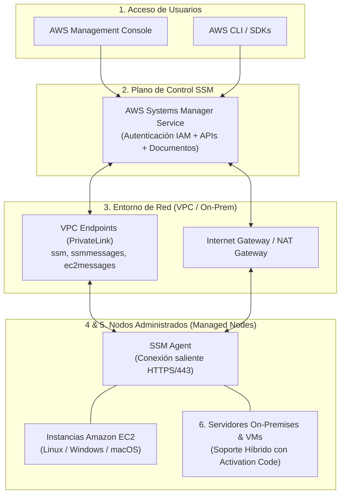
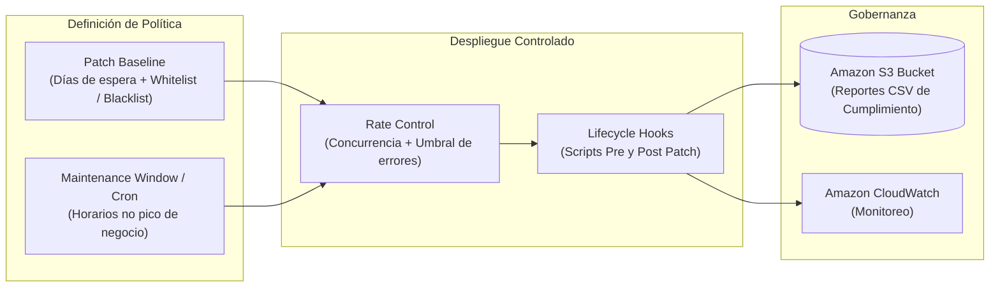

# AWS Systems Manager

> [!abstract] Qué es este archivo
> Sexta lección del módulo de resiliencia operativa. Establece la arquitectura integral de **AWS Systems Manager (SSM)**
> como plano de control centralizado para la administración de nodos, configuración, automatización operativa y gestión de
> parches en entornos **híbridos** (AWS y on-premises). Analiza el funcionamiento del **SSM Agent**, los documentos de
> automatización (**Runbooks** con 20 tipos de acciones y cuotas exactas), y la operación de **Patch Manager** con
> líneas base (*patch baselines*), ventanas de mantenimiento y reportes de cumplimiento a Amazon S3.
>
> Lectura profunda + Arquitectura de 6 componentes + Cuotas de Automation + Mecánica de Patch Manager.

> [!quote] La idea que ordena todo
> **“AWS Systems Manager simplifica la gestión de nodos y mejora la eficiencia operativa sin abrir puertos de entrada.”**
> Al operar mediante un agente ligero que inicia conexiones salientes cifradas hacia el plano de control (HTTPS/443), SSM
> elimina la necesidad de hosts bastión, llaves SSH y puertos RDP abiertos, permitiendo automatizar remediaciones, auditar
> configuraciones y desplegar parches a escala en nubes públicas y datacenters locales.

---

## Resumen en una frase

> **AWS Systems Manager** unifica la gobernanza y la resiliencia operativa de flotas híbridas mediante el **SSM Agent**,
> ejecutando flujos de trabajo declarativos (**Runbooks** en YAML/JSON con **cuotas de 100 ejecuciones simultáneas**),
> almacenamiento seguro de parámetros con **Parameter Store** (KMS), y despliegue automatizado de parches de seguridad
> con **Patch Manager** (con *patch baselines*, ventanas de mantenimiento y reportes CSV en S3).

---

## 1. Arquitectura y Modelo de Comunicación

Systems Manager desacopla la administración de la conectividad de red tradicional mediante seis componentes:

### Los 6 Componentes de la Arquitectura
1. **User access (Acceso de usuarios):** Los administradores y pipelines interactúan con Systems Manager a través de la consola, la AWS CLI o los SDKs, autenticados exclusivamente mediante **políticas de IAM**.
2. **Systems Manager service (Plano de control):** Procesa solicitudes, almacena datos de configuración, valida permisos y coordina las acciones en toda la infraestructura de forma centralizada.
3. **Network environment (Entorno de red):** La Amazon VPC proporciona el aislamiento de red. La comunicación entre los nodos y SSM puede viajar a través de internet (vía NAT/IGW) o mantenerse **100% privada** mediante **VPC Endpoints (AWS PrivateLink)** para `ssm`, `ssmmessages` y `ec2messages`.
4. **Managed resources (Recursos administrados):** Instancias EC2, dispositivos de borde o servidores físicos que han sido registrados como nodos gestionados (*managed instances*).
5. **Agent communication (El SSM Agent):** Software ligero instalado en los nodos. **Inicia siempre la comunicación hacia el servicio** mediante llamadas salientes por el puerto HTTPS 443. Ejecuta las órdenes localmente con privilegios de sistema y reporta los resultados de vuelta a SSM.
6. **Hybrid support (Soporte híbrido):** Los servidores locales, máquinas virtuales (VMware, Hyper-V) y hardware bare-metal se gestionan de forma idéntica a las instancias EC2 instalando el SSM Agent y asociándolos mediante un **código y clave de activación híbrida (*hybrid activation code/id*)**.

> [!important] Cero puertos de entrada requeridos
> Para que Systems Manager funcione, los Security Groups y firewalls locales **no necesitan abrir ningún puerto de
> entrada (inbound)**: ni el puerto 22 (SSH) ni el puerto 3389 (RDP). Toda la comunicación es saliente (outbound) hacia
> los endpoints de Systems Manager por el puerto 443. Esto reduce radicalmente la superficie de ataque de la flota.

---

## 2. Componentes Fundamentales de Systems Manager

| Componente | Rol en la arquitectura | Integración clave |
| --- | --- | --- |
| **Systems Manager Service** | Plano de control central que procesa peticiones y coordina acciones. | Autenticación y autorización estricta con **AWS IAM**. |
| **SSM Agent** | Ejecutor local en cada nodo; recibe instrucciones y reporta estado. | Soporta Amazon Linux, RHEL, Ubuntu, Windows Server, macOS. |
| **Systems Manager API** | Interfaz programática para integración con pipelines CI/CD y scripts. | AWS SDKs y CLI. |
| **Document and automation management** | Repositorio de **SSM Documents** (definiciones en JSON/YAML que declaran qué tareas ejecutar, su secuencia y control de errores). | Tipos de documentos: `Command`, `Automation`, `Policy`. |
| **Resource Assessment (Inventory & Compliance)** | **Inventory** recolecta metadatos del sistema operativo y software instalado; **Compliance** audita esos nodos contra políticas de seguridad. | Detección de deriva (*drift*) y visibilidad de parches instalados. |
| **Parameter Store** | Almacén jerárquico seguro para datos de configuración, cadenas de conexión y secretos. | Cifrado nativo con **AWS KMS** (`SecureString`). |

---

## 3. Systems Manager Automation y Runbooks

**AWS Systems Manager Automation** es una herramienta de gestión de cambios que simplifica tareas de mantenimiento,
despliegue y remediación automática en servicios como **Amazon EC2, RDS, Redshift y S3**.

Una **automatización** consiste en la ejecución de una serie de pasos secuenciales definidos en un **Runbook**.

### Características Técnicas de los Runbooks
* **Formatos soportados:** Escritos en sintaxis declarativa **YAML** o **JSON**.
* **Tipo de documento:** Son documentos de Systems Manager de tipo `Automation`.
* **Estructura interna:** Contienen una sección `mainSteps` donde cada paso ejecuta una acción específica con entradas (*inputs*), comportamientos y salidas (*outputs*).
* **Acciones de automatización:** Soporta **20 tipos de acciones distintas** (ej. `aws:executeAwsApi` para invocar cualquier API de AWS, `aws:runCommand` para ejecutar scripts en nodos, `aws:changeInstanceState` para pausar/reanudar EC2, `aws:executeScript` para Python/PowerShell serverless).
* **Runbooks predefinidos:** AWS provee runbooks estándar para tareas frecuentes (crear AMIs, reiniciar instancias, solucionar problemas de red, aplicar parches).

### Cuotas y Límites de Escalabilidad (Literales de la fuente)

| Concepto de Concurrencia / Cola | Límite por Cuenta de AWS |
| --- | --- |
| **Automatizaciones simultáneas estándar** | **100** automatizaciones en ejecución concurrente. |
| **Capacidad de la cola de automatizaciones** | Hasta **5.000** automatizaciones encoladas. |
| **Automatizaciones con control de tasa (*Rate Control*) simultáneas** | **25** automatizaciones concurrentes. |
| **Límite de la cola de Rate Control** | Hasta **1.000** automatizaciones con control de tasa en cola. |

> [!note] Control de concurrencia y remediación con EventBridge
> Systems Manager Automation permite definir **límites de error (Error Thresholds)** y **concurrencia de objetivos
> (Targets & Concurrency)**. Si una automatización falla en más de $N$ instancias o en más del $X\%$, la ejecución se
> detiene de inmediato. Además, al integrarse con **Amazon EventBridge**, puede actuar como remediador automático de reglas
> no conformes detectadas por **AWS Config**.

---

## 4. Systems Manager Patch Manager

**Patch Manager** automatiza la aplicación de parches de seguridad y actualizaciones del sistema operativo en nodos
administrados en la nube y on-premises.

### Capacidades y Reglas de Patch Manager
1. **Patch Policies (Políticas de parcheo a escala):** Configuración unificada para parchear flotas a través de **múltiples cuentas y regiones de AWS** mediante la integración con **AWS Organizations**.
2. **Custom Patch Baselines (Líneas base personalizadas):** Reglas que definen qué parches se aprueban automáticamente:
   * **Auto-approval delay:** Permite especificar un retraso en días (ej. esperar 7 días tras el lanzamiento oficial de un parche antes de aprobarlo, para verificar su estabilidad).
   * **Listas explícitas:** Listas de parches aprobados explícitamente (*whitelists*) y parches bloqueados/rechazados (*blacklists*).
3. **Foco en Seguridad por defecto:** Por diseño, Patch Manager prioriza actualizaciones de **seguridad y corrección de vulnerabilidades críticas**, en lugar de aplicar indiscriminadamente cualquier actualización menor disponible.
4. **Soporte de Plataformas y la Restricción de Windows Server:**
   * **Sistemas soportados:** Amazon Linux, RHEL, Ubuntu, SUSE, Oracle Linux, CentOS, macOS y Windows Server.
   * **Restricción de aplicaciones Windows:** En **Windows Server**, el soporte para parches de aplicaciones está **estrictamente limitado a actualizaciones de aplicaciones desarrolladas y publicadas por Microsoft** (no actualiza software de terceros en Windows).
5. **Reportes de cumplimiento en Amazon S3:** Genera inventarios detallados del estado de parches de toda la flota y los exporta a un bucket de **Amazon S3 en formato CSV**, cumpliendo con los requisitos de evidencia de auditoría.
6. **Ventanas de mantenimiento (*Maintenance Windows*) y Lifecycle Hooks:** Permite definir horarios específicos de ejecución (expresiones CRON/Rate) y ejecutar scripts personalizados antes (*pre-patch*) y después (*post-patch*) de la actualización mediante SSM Documents.

---

## 5. Cierre Conceptual: Matriz de Capacidades de SSM

| Desafío Operativo | Componente de SSM | Cómo lo Resuelve |
| --- | --- | --- |
| **Acceso a instancias sin bastiones ni llaves SSH** | **Session Manager** | Shell interactivo seguro vía navegador/CLI autenticado por IAM; sin puertos 22/3389 abiertos. |
| **Remediación automática de fallos** | **SSM Automation** | Ejecución de **Runbooks** secuenciales ante eventos de CloudWatch/EventBridge. |
| **Mantenimiento y actualización de software** | **Patch Manager** | *Patch baselines* con días de delay, ventanas de mantenimiento y soporte híbrido. |
| **Auditoría de software instalado y licencias** | **SSM Inventory** | Recolección periódica de metadatos de OS, paquetes y configuraciones. |
| **Gestión centralizada de cadenas y contraseñas** | **Parameter Store** | Almacén jerárquico cifrado con KMS; tipos `String`, `StringList` y `SecureString`. |
| **Auditoría de cumplimiento de parches para auditores** | **Compliance + S3** | Exportación de informes de conformidad de la flota en archivos CSV hacia S3. |

---

## 6. Traducción del contenido

> [!info] Sección de referencia (opcional)
> Traducción íntegra de las fuentes de Skill Builder. Se recomienda estudiar las secciones **1 a 5** y repasar las reglas
> del examen en la sección **7**.

### 6.1 AWS Systems Manager (Arquitectura y los 6 Marcadores)

**AWS Systems Manager simplifica la gestión de nodos y mejora la eficiencia operativa.**

La arquitectura de Systems Manager ofrece capacidades de gestión y automatización a través de componentes integrados que
manejan el control de recursos, la gestión de configuración y la supervisión operativa. Esta arquitectura admite operaciones
continuas mientras mantiene la seguridad y el rendimiento en entornos de AWS y locales (on-premises).

1. **User access (Acceso de usuarios):** Los usuarios se conectan a Systems Manager a través de la AWS Management Console, la AWS CLI o los SDKs para administrar los recursos de su infraestructura.
2. **Systems Manager service (Servicio Systems Manager):** Systems Manager procesa solicitudes y coordina todas las acciones de gestión en su entorno a través de un plano de control central.
3. **Network environment (Entorno de red):** Amazon Virtual Private Cloud (Amazon VPC) proporciona el entorno de red seguro donde sus recursos administrados operan y se comunican con Systems Manager.
4. **Managed resources (Recursos administrados):** Las instancias administradas en AWS Cloud ejecutan el SSM Agent para recibir y realizar tareas de gestión.
5. **Agent communication (Comunicación del agente):** El SSM Agent es un software liviano instalado en sus instancias que les permite comunicarse con Systems Manager, realizando acciones de gestión localmente.
6. **Hybrid support (Soporte híbrido):** Los servidores locales y las máquinas virtuales se pueden administrar a través de Systems Manager cuando se configuran con el SSM Agent.

### 6.2 Componentes de AWS Systems Manager

* **Systems Manager:** Actúa como el plano de control central que procesa solicitudes, almacena datos de configuración y coordina acciones en su entorno. Autentica y autoriza solicitudes según las políticas de IAM.
* **SSM Agent:** Se ejecuta en sus instancias administradas y se comunica con Systems Manager. Recibe comandos, los realiza localmente y reporta los resultados al servicio.
* **Systems Manager API:** Proporciona acceso programático a todas las capacidades de Systems Manager. Le ayuda a integrar Systems Manager con sus herramientas y flujos de trabajo existentes.
* **Document and automation management (Gestión de documentos y automatización):** La herramienta Documentos almacena y administra documentos de AWS Systems Manager (SSM documents), que definen las acciones a realizar en sus recursos. Estos documentos admiten flujos de trabajo de automatización, mantienen la gestión de estado y manejan condiciones de error en sus capacidades de Systems Manager.
* **Resource assessment (Evaluación de recursos):** Las herramientas de Inventory y Compliance trabajan juntas para mantener la visibilidad de su entorno. Inventory recopila y almacena metadatos sobre sus instancias administradas, mientras que Compliance evalúa estos recursos contra políticas definidas para identificar requisitos de configuración y estándares de seguridad.
* **Parameter Store:** Almacena de forma segura datos de configuración y secretos. Se integra con AWS KMS para cifrado y proporciona organización jerárquica de parámetros.

### 6.3 AWS Systems Manager Automation

AWS Systems Manager Automation es una herramienta de gestión de cambios dentro de AWS Systems Manager que ayuda a simplificar
las tareas comunes de mantenimiento, despliegue y remediación para varios servicios de AWS, incluidos Amazon EC2, Amazon RDS,
Amazon Redshift, Amazon S3 y otros. Una **automatización** consiste en todas las tareas que se definen en un runbook y son
ejecutadas por el servicio Automation.

* **Runbooks:**
  * Incluye runbooks predefinidos para tareas comunes como reiniciar instancias EC2 o crear AMIs.
  * Admite la creación de runbooks personalizados utilizando YAML o JSON.
  * Los runbooks son documentos de Systems Manager de tipo `Automation`.
  * Contiene pasos y parámetros que se ejecutan en orden secuencial.
* **Automation Actions (Acciones de automatización):**
  * Cada paso en un runbook está asociado con un tipo de acción específico.
  * Admite **20 tipos de acciones distintas**.
  * Las acciones determinan las entradas, el comportamiento y las salidas de cada paso.
  * Los pasos se definen en la sección `mainSteps` del runbook.
* **Quotas and Limitations (Cuotas y limitaciones):**
  * Cada cuenta de AWS puede ejecutar **100 automatizaciones simultáneas**.
  * Capacidad de cola de **5.000 automatizaciones** por cuenta de AWS.
  * Se pueden ejecutar **25 automatizaciones con control de tasa (rate control)** simultáneamente.
  * Límite de cola de automatizaciones con control de tasa de **1.000**.
* **Control and Monitoring (Control y monitoreo):**
  * Proporciona control granular sobre la concurrencia de la automatización.
  * Permite la especificación de recursos de destino y umbrales de error.
  * El progreso y el estado se pueden monitorear a través de la consola de Systems Manager Automation.
  * Se integra con Amazon EventBridge para una arquitectura orientada a eventos.
* **Scalability (Escalabilidad):**
  * Diseñado para implementar, configurar y administrar recursos de AWS a escala.
  * Admite la ejecución de automatizaciones en múltiples regiones y cuentas de AWS.
  * Cuenta con concurrencia adaptativa para ajustar los límites de automatización.

### 6.4 AWS Systems Manager Patch Manager y su Uso

Patch Manager es una herramienta de nodos dentro de AWS Systems Manager que automatiza el proceso de aplicación de parches en
nodos administrados, tanto con actualizaciones relacionadas con la seguridad como con otros tipos de actualizaciones. Proporciona
una solución centralizada para mantener el cumplimiento de parches en diversos entornos de infraestructura.

Como servicio totalmente administrado, reduce la sobrecarga manual y el error humano, centraliza la gestión en múltiples sistemas
operativos y ofrece programación flexible con ventanas de mantenimiento. Puede parchear instancias EC2, dispositivos de borde,
servidores locales y máquinas virtuales (VMs). **En Windows Server, el soporte de aplicaciones se limita a actualizaciones
para aplicaciones lanzadas por Microsoft.**

* **Patch policies:** Configure operaciones de parcheo en múltiples cuentas y regiones de AWS utilizando una sola política a través de la integración con AWS Organizations.
* **Custom patch baselines:** Defina reglas para la aprobación automática de parches dentro de los días posteriores a su lanzamiento, junto con listas de parches aprobados y rechazados.
* **Multiple patching methods:** Elija entre patch policies, ventanas de mantenimiento u operaciones bajo demanda "Patch now".
* **Compliance reporting:** Genere informes detallados sobre el estado de cumplimiento de parches que se pueden enviar a un bucket de **Amazon S3 en formato CSV**.
* **Cross-platform support:** Parchee sistemas operativos y aplicaciones en Windows Server, varias distribuciones de Linux y macOS.
* **Scheduling flexibility:** Establezca diferentes cronogramas para escanear e instalar parches mediante expresiones personalizadas de CRON o Rate.
* **Lifecycle hooks:** Ejecute scripts personalizados antes y después de las operaciones de parcheo utilizando documentos de Systems Manager.
* **Security focus:** Por defecto, Patch Manager se enfoca en actualizaciones relacionadas con la seguridad en lugar de instalar todos los parches disponibles.
* **Rate control:** Configure la concurrencia y los umbrales de error para minimizar el impacto operativo.

---

## 7. Para el examen (SAP-C02)

> [!important] Lo que hay que retener
> 1. **Cero puertos inbound:** SSM Agent solo requiere llamadas salientes HTTPS al puerto 443 hacia los endpoints de SSM (o hacia VPC Endpoints de PrivateLink: `ssm`, `ssmmessages`, `ec2messages`). No requiere abrir puertos 22 (SSH) ni 3389 (RDP) ni balanceadores/IGWs públicos.
> 2. **Soporte Híbrido con Activation Code:** Para gestionar servidores on-premises o VMs en VMware/Hyper-V, se genera una activación híbrida en SSM (`aws ssm create-activation`), entregando un *Activation Code* y un *Activation ID* que se registran al instalar el SSM Agent. En la consola aparecen con el prefijo `mi-` (*managed instance*).
> 3. **Restricción de Windows en Patch Manager:** En Windows Server, Patch Manager **solo actualiza aplicaciones publicadas por Microsoft**. No gestiona parches de aplicaciones de terceros (para software de terceros en Windows se requieren herramientas adicionales o SSM Run Command custom).
> 4. **Auto-Approval Delay en Patch Baselines:** La mejor práctica recomendada para prevenir que parches inestables rompan producción es configurar una regla de aprobación diferida (ej. *Auto-approve patches 7 days after release*), combinada con listas de rechazo (*Rejected Patches list*).
> 5. **Cuotas duras de Automation:** 100 automatizaciones simultáneas por cuenta, 5.000 en cola; 25 simultáneas para *rate control*, 1.000 en cola de rate control.
> 6. **Reportes de Compliance a S3:** Patch Manager exporta los resultados de cumplimiento de parches de toda la flota hacia Amazon S3 exclusivamente en **formato CSV**.
> 7. **Remediación reactiva:** La combinación canónica para auto-remediación en el examen es: **AWS Config Rule detecta no-cumplimiento $\rightarrow$ Dispara Amazon EventBridge $\rightarrow$ Invoca un Runbook de Systems Manager Automation** (ej. desasociar EIP, habilitar cifrado o detener instancia).

> [!warning] Trampa clásica del examen
> **Escenario:** Una empresa bancaria debe implementar una solución de gestión y despliegue de parches de seguridad para cientos de instancias EC2 y servidores on-premises en su propio centro de datos. Por políticas de seguridad corporativas, ningún servidor debe tener direcciones IP públicas, no se permiten bastiones SSH y el tráfico no debe circular por internet público hacia los servicios de administración.
>
> * **Respuesta trampa:** "Configurar un servidor WSUS en AWS y un servidor Ansible en on-premises conectados por VPN Site-to-Site, abriendo el puerto 22 hacia todas las subredes privadas."
> * **Por qué falla:** Introduce infraestructura pesada innecesaria, requiere abrir puertos SSH (22) violando la seguridad de red y aumenta drásticamente el sobrecosto operativo.
> * **La respuesta correcta:** Desplegar **AWS Systems Manager Patch Manager**. Instalar el **SSM Agent** en las instancias EC2 y en los servidores on-premises (mediante activaciones híbridas). En AWS, configurar **VPC Endpoints (AWS PrivateLink)** para SSM en subredes privadas. Conectar el centro de datos local a la VPC vía **AWS Direct Connect** o **VPN**, permitiendo que los servidores locales alcancen los VPC Endpoints privados de SSM sin tocar internet público y sin abrir ningún puerto de entrada.

---

## Relacionado

- [[AWS Solutions Architect Advanced - Operational Resilience]] *(índice del módulo)*
- [[Course Overview - Operational Resilience]] — lección 01: encuadre de excelencia operativa y resiliencia
- [[Gathering the Customer Requirements - Resilience]] — lección 02: automatización de procedimientos
- [[Building a Data Protection Strategy]] — lección 03: monitoreo y respuesta a incidentes
- [[Disaster Recovery]] — lección 04: estrategias de recuperación
- [[Disaster Recovery Strategies]] — lección 05: AWS Backup y observabilidad
- [[AWS Solutions Architect Advanced - Implementing Observability and Management Controls]] — módulo cerrado de controles y gobernanza
- [[3.1 Estrategia para mejorar la excelencia operativa general]] — tarea central de SSM en Dominio 3
- [[1.2 Prescribir controles de seguridad]] — eliminación de puertos de entrada con SSM
- [[2.3 Determinar los controles de seguridad en función de los requisitos]] — Session Manager vs Bastions
- [[Guia AWS]] — pesos y tareas oficiales del SAP-C02
- Siguiente paso del módulo: **Lección 07**.

---

## Registro de integración

| Fecha | Qué llegó | Dónde se integró |
| --- | --- | --- |
| 29/10/2026 | Lección 06 completa: Arquitectura de Systems Manager (6 marcadores), componentes, Automation (cuotas y runbooks) y Patch Manager (baselines, plataformas y S3 CSV) | Nota completa (`AWS Systems Manager.md`), secciones 1 a 7 |

**Discrepancias y vacíos registrados (no corregidos):**
1. **Imágenes no descargadas:** Las referencias `assets/images/RHZU95U2BB.png` (Automation overview) y `assets/images/QMCHUQCHPB.png` (Patch Manager overview) no están en el vault; se suplen con diagramas Mermaid en §1 y §4.
2. **Vacío previo resuelto:** En el módulo *Implementing Observability and Management Controls*, la sección *Systems Manager governance* había quedado registrada como duda abierta (solo flashcards sin texto); esta lección cierra definitivamente la arquitectura técnica de SSM en el vault.
