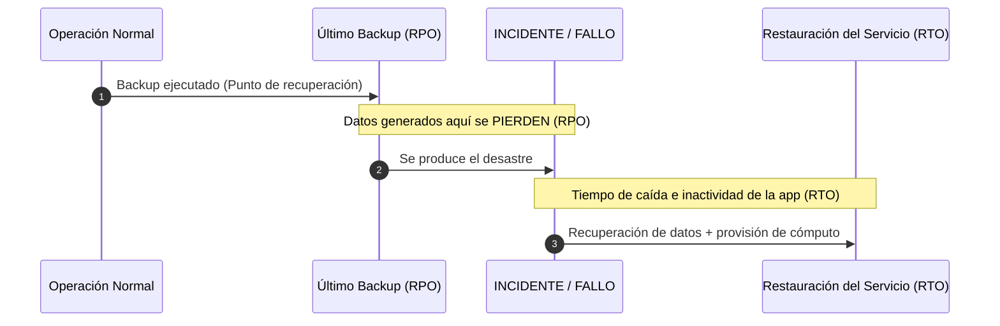
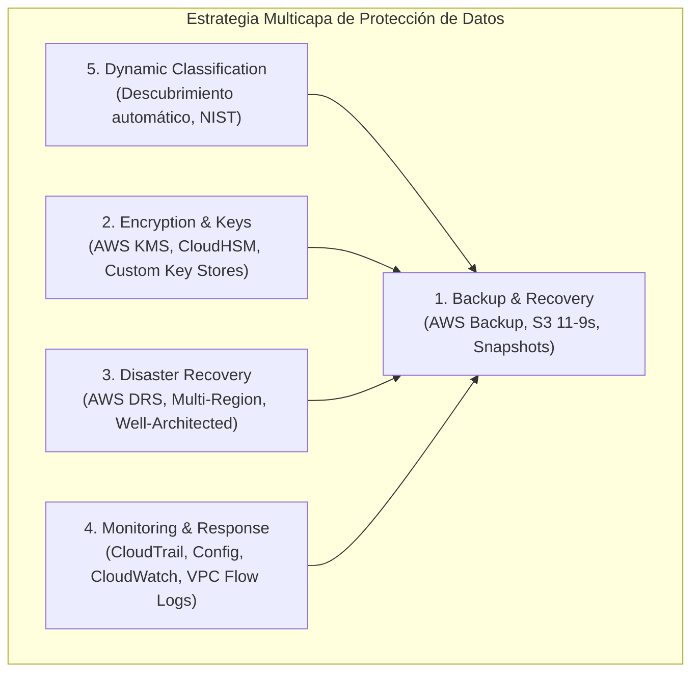
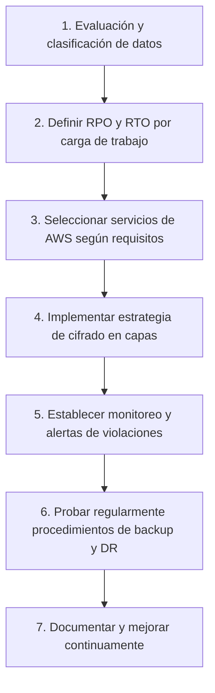

# Building a Data Protection Strategy

> [!abstract] Qué es este archivo
> Tercera lección del módulo de resiliencia operativa. Establece el marco arquitectónico integral para construir una
> **estrategia de protección de datos multicapa** en AWS. Analiza cómo la nube mitiga la complejidad y los costos del
> modelo on-premises, define formalmente **RPO** y **RTO**, y detalla los cinco pilares de protección: arquitectura de
> backup, gestión de claves de cifrado, planificación de DR, monitoreo/respuesta y clasificación dinámica de datos.
>
> Video: **4 minutos 57 segundos** + Lectura profunda + Estrategia de implementación en 7 pasos.

> [!quote] Definición de Resiliencia Operativa de AWS
> **“Operational Resilience is the ability to provide continuous service through people, processes, and technology that are aware of and adaptive to constant change.”**
> *(La resiliencia operativa es la capacidad de brindar un servicio continuo a través de personas, procesos y tecnología conscientes de los cambios constantes y adaptables a ellos).*

---

## Resumen en una frase

> Una estrategia robusta de protección de datos en AWS combina **RPO y RTO** rigurosamente definidos por carga de
> trabajo con un enfoque multicapa: **AWS Backup** centralizado para eliminar scripts manuales, durabilidad de **11 nueves**
> en S3, cifrado granular con **KMS/CloudHSM**, recuperación rápida con **AWS DRS**, auditoría continua con
> **CloudTrail/Config** y **backups inmutables** para blindar los datos contra ransomware.

---

## 1. De On-Premises a AWS: Mitigación de la Complejidad

En entornos locales (on-premises), el backup y la recuperación ante desastres sufren de una complejidad operativa y un
costo financiero elevados:

| Dimensión | Enfoque On-Premises | Enfoque AWS (Cloud) |
| --- | --- | --- |
| **Sistemas de archivos** | Dispares, heterogéneos y aislados (SAN, NAS, cintas). | Interfaces de almacenamiento estandarizadas y unificadas (EBS, EFS, S3). |
| **Cumplimiento normativo** | Complejo de auditar físicamente; múltiples silos normativos. | Controles de gobernanza automatizados, pistas de auditoría centralizadas y políticas IAM/SCP. |
| **Costos y aprovisionamiento** | Alto gasto de capital (CapEx), compra anticipada, demoras de compra y entrega de hardware. | Modelo de pago por uso (OpEx), aprovisionamiento elástico inmediato y sin inversión inicial. |
| **Gestión a escala** | Scripts dispersos, tareas manuales frágiles y propensas a fallos. | **Etiquetado (Tags)**, grupos de recursos y políticas centralizadas a escala empresarial. |
| **Cifrado** | Complejidad de gestión de hardware criptográfico local. | Cifrado en reposo habilitable con un clic/API respaldado por **AWS KMS**. |
| **Agregación de backups** | Software de backup de terceros con servidores de gestión dedicados. | Servicio completamente administrado y centralizado con **AWS Backup**. |

> [!important] La regla de eficiencia: eliminar scripts propios
> Una de las mejores prácticas formales del arquitecto en AWS es **eliminar la dependencia de scripts personalizados**
> para respaldar recursos (EBS, RDS, EC2). Los scripts caseros no escalan, carecen de monitoreo unificado, no garantizan
> inmutabilidad y generan deuda técnica. Se reemplazan siempre por políticas de **AWS Backup**.

---

## 2. Las Dos Métricas Rectoras: RPO vs. RTO

Cualquier diseño de protección de datos y recuperación ante desastres debe calibrarse contra dos métricas temporales
fundamentales:

| Métrica | Definición Literal | Pregunta de diseño | Impacto arquitectónico principal |
| --- | --- | --- | --- |
| **RPO** *(Recovery Point Objective)* | **Cantidad máxima de datos que la organización puede tolerar perder**, medida en tiempo. | *¿Cuánto dato podemos tolerar perder o recrear?* (¿1 min, 5 min, 1 hora, 1 día?). | Determina la **frecuencia de los backups** (ej. snapshots continuos vs. diarios) o el tipo de replicación (síncrona vs. asíncrona). |
| **RTO** *(Recovery Time Objective)* | **Tiempo máximo tolerable para restaurar las operaciones normales** tras una interrupción. | *¿Cuánto tiempo puede estar caído el servicio antes de impactar el negocio?* | Determina la **estrategia de DR** (Backup & Restore vs. Pilot Light vs. Warm Standby vs. Multi-Region Active-Active) y el grado de automatización del cómputo. |

> [!warning] RTO no es solo "restaurar el dato"
> El video enfatiza un matiz clave: **RTO no es el tiempo que tarda en descargarse la copia de seguridad**. El dato
> respaldado debe ser puesto en uso por otros recursos: provisionar instancias EC2, levantar contenedores, adjuntar
> volúmenes EBS, inicializar motores de base de datos y reconectar el tráfico de red. El RTO mide el **downtime total de
> la aplicación de punta a punta**.

---

## 3. Las Cinco Capas de una Estrategia Robusta

Una estrategia completa de protección de datos no se limita a copias de seguridad; comprende cinco capas interconectadas:

### 3.1 Arquitectura de Backup y Recuperación
* **AWS Backup:** Punto único de gestión centralizada de copias de seguridad para servicios nativos de AWS (S3, EBS, RDS, DynamoDB, EFS, EC2, Aurora) y cargas híbridas/on-premises (Storage Gateway). Soporta políticas automatizadas y **replicación cross-region / cross-account**.
* **Amazon S3 y S3 Glacier Deep Archive:** Almacenamiento con durabilidad diseñada de **99.999999999% (11 nueves)**, replicando objetos automáticamente a través de al menos **tres Zonas de Disponibilidad (AZs)** geográficamente dispersas.
* **Amazon EBS Snapshots:** Instantáneas en bloque con respaldo automático en Amazon S3. Operan de forma **incremental** (solo guardan bloques modificados tras el snapshot inicial).
* **Integración multiservicio:** Soluciones que integran cargas nativas en la nube, arquitecturas híbridas y migraciones desde servidores físicos hacia AWS.

### 3.2 Cifrado y Administración de Claves (Key Management)
* **Integración con AWS KMS:** Rotación automática de claves gestionada por AWS (anual), separación estricta de claves por carga/recurso, y **key policies granulares** que desacoplan permisos administrativos (`kms:Put*`, `kms:ScheduleKeyDeletion`) de permisos de uso (`kms:Encrypt`, `kms:Decrypt`, `kms:GenerateDataKey`).
* **AWS CloudHSM:** Módulos de seguridad de hardware (HSM) dedicados y de tenant único dentro de límites validados bajo **FIPS 140-2 Level 3**, para industrias altamente reguladas.
* **Custom Key Stores:** Mecanismo que conecta AWS KMS con clústeres dedicados de CloudHSM. Permite a la organización mantener la custodia total de la generación y almacenamiento del material criptográfico mientras aprovecha la integración nativa y transparente de KMS con más de 100 servicios de AWS.

### 3.3 Planificación de Recuperación ante Desastres (Disaster Recovery)
* **AWS Elastic Disaster Recovery (AWS DRS):** Servicio preferido para minimizar tiempo de inactividad y pérdida de datos (RTO y RPO en el orden de minutos/segundos). Realiza replicación continua a nivel de bloque para servidores físicos, virtuales (VMware, Hyper-V) y basados en la nube (EC2).
* **Estrategias Multi-Región:** Replicación cruzada de datos y mecanismos de conmutación por error (*failover*) automáticos o manuales alineados estrictamente con el RTO/RPO del negocio.
* **Marco AWS Well-Architected:** Alineación estricta con el **Pilar de Fiabilidad (Reliability Pillar)** para garantizar que la arquitectura soporte fallos de componentes individuales o regiones completas.

### 3.4 Monitoreo y Respuesta a Incidentes
* **AWS CloudTrail:** Registro inmutable de llamadas a la API de AWS en todas las cuentas y regiones para auditoría forense, gobernanza y seguridad.
* **AWS Config:** Monitoreo y evaluación continua de la configuración de los recursos contra reglas de cumplimiento (ej. verificar que todos los volúmenes EBS y buckets S3 tengan cifrado y backup activados).
* **Amazon CloudWatch:** Visibilidad en tiempo real mediante métricas, logs, alarmas compuestas y paneles operativos sobre el rendimiento de la infraestructura y eventos de seguridad.
* **VPC Flow Logs:** Registro y análisis de patrones de tráfico IP en interfaces de red (ENI), subredes y VPCs por bloques CIDR para análisis forense de seguridad.

### 3.5 Clasificación Dinámica de Datos y Protección Adaptativa
* **Procesos de fusión de datos (*Data fusion processes*):** Mecanismos automatizados capaces de identificar y clasificar nuevos tipos de datos a medida que se generan o ingieren desde múltiples datasets.
* **Políticas de protección adaptativas:** Reglas dinámicas que ajustan el nivel de respaldo, retención y cifrado en función del nivel de sensibilidad asignado al dato.
* **Alineación con marcos de cumplimiento:** Gobernanza alineada con normativas internacionales y marcos de seguridad como los estándares **NIST**.

---

## 4. Buenas Prácticas y Estrategia de Implementación

### Las 5 Buenas Prácticas Fundamentales
1. **Optimizar para cumplimiento:** Estandarizar la forma en que se ejecuta la protección de datos en toda la organización.
2. **Optimizar para eficiencia:** Suprimir scripts propios y migrar a servicios gestionados (AWS Backup para EBS, RDS, EC2).
3. **Mejorar productividad:** Reutilizar copias de backup para entornos de testing, desarrollo, QA y pipelines de CI/CD.
4. **Endurecer datos contra ransomware:** Implementar **backups inmutables (WORM)** mediante **AWS Backup Vault Lock** o **S3 Object Lock**.
5. **Centralizar control y gobernanza:** Establecer un único punto de visibilidad, políticas y cumplimiento para la recuperación.

### Metodología de Implementación en 7 Pasos
Para construir una arquitectura resiliente, el arquitecto de soluciones debe seguir esta secuencia:

1. **Evaluación de clasificación de datos:** Identificar qué datos son críticos, cuáles intermedios y cuáles prescindibles.
2. **Definir RPO y RTO por carga de trabajo:** Diferenciar objetivos (un sistema transaccional bancario puede exigir RPO < 1 min, mientras un log analítico tolera 24 h).
3. **Seleccionar servicios de AWS adecuados:** Elegir AWS Backup, DRS, S3 Replication, etc., según las métricas acordadas.
4. **Implementar cifrado multicapa:** Aplicar KMS, rotación, políticas de claves y Custom Key Stores si la normativa lo exige.
5. **Establecer monitoreo y alertas:** Configurar CloudWatch, Config Rules y CloudTrail para alertar ante fallos de backup o accesos no autorizados.
6. **Probar regularmente los procedimientos:** Un plan de DR no probado no es un plan; ejecutar simulacros periódicos de restauración.
7. **Documentar y mejorar continuamente:** Ajustar las políticas y capacidades según la evolución del negocio.

---

## 5. Cierre Conceptual: Matriz de Servicios por Capa

| Capa de Protección | Servicios Principales | Aporte Técnico Clave |
| --- | --- | --- |
| **Backup Centralizado** | **AWS Backup** | Políticas basadas en tags, retención automática, cross-region / cross-account copy. |
| **Almacenamiento Duradero** | **Amazon S3 / Glacier** | Durabilidad 11 nueves, replicación multizona ($\ge 3$ AZs), ciclo de vida automático. |
| **Snapshots de Bloque** | **Amazon EBS Snapshots** | Copias de seguridad incrementales almacenadas de forma nativa en S3. |
| **Cifrado Administrado** | **AWS KMS** | Envoltorio de claves, rotación anual, control granular de uso vs. administración. |
| **Hardware Criptográfico** | **AWS CloudHSM** | Tenant único, validación **FIPS 140-2 Nivel 3**, Custom Key Stores para KMS. |
| **Recuperación ante Desastres** | **AWS Elastic Disaster Recovery (DRS)** | Replicación continua a nivel de bloque, failover rápido para servidores físicos/virtuales/EC2. |
| **Auditoría y Configuración** | **AWS CloudTrail + AWS Config** | Pistas de auditoría de API continuas y evaluación de deriva de configuración. |
| **Inmutabilidad Anti-Ransomware** | **AWS Backup Vault Lock** | Bloqueo WORM (*Write Once, Read Many*) en modo cumplimiento legal. |

---

## 6. Traducción del contenido

> [!info] Sección de referencia (opcional)
> Traducción fiel de las fuentes de Skill Builder. Se recomienda estudiar las secciones **1 a 5** y repasar los puntos
> clave y trampas de la sección **7**.

### 6.1 Video principal (transcripción)

En definitiva, bien, podemos tener un buen grado de **complejidad** involucrada con esto si estamos hablando en un sentido
**on-premises**. Podríamos tener diferentes tipos de sistemas de archivos que estamos usando. Podríamos tener que cumplir
con algún nivel de **cumplimiento normativo (compliance)**, todo dependiendo de qué industria estemos hablando. Ese
cumplimiento también puede contribuir a esa complejidad.

Y además, cuando hablamos de soluciones on-premises, el **costo es relativamente más alto** por todas esas razones de
**aprovisionamiento físico**: tener que pagar por adelantado por esos recursos, tener que esperar a que sean adquiridos y
entregados.

Entonces, cuando hablamos de los conceptos generales de **backup y disaster recovery**, los tipos de cosas que **AWS nos
ayuda a mitigar son esa complejidad**, porque ahora tenemos formas de **etiquetar nuestros diferentes recursos** para
categorizarlos, para poder tener básicamente enganches (*hooks*) hacia ellos y grupos para poder gestionarlos mucho más
fácilmente a escala.

Y también hemos visto cómo con muchos de nuestros servicios podemos **programar diferentes tipos de actividades**. Hemos
hablado de programar copias de seguridad, también hemos hablado de poder crear cosas como **políticas de ciclo de vida**
y poner designaciones de tiempo allí, ¿correcto?

También sabemos que con nuestros servicios de AWS podemos aplicar **cifrado muy fácilmente**, por lo general simplemente
seleccionando que nos gustaría usar cifrado en reposo cuando se trata de nuestros servicios de almacenamiento, ¿verdad?
Podemos usar **políticas de control de IAM**, y cuando estamos hablando —y veremos en un momento el caso de AWS Backup—,
debido a que estamos usando un proveedor de servicios en la nube, porque estamos usando lo que veremos más adelante como un
**servicio de backup agregado/centralizado**, facilita la tarea de crear copias de seguridad y de monitorear y registrar la
actividad con backups y recuperación ante desastres.

Y además, ahora que usamos un proveedor de servicios en la nube, la cuestión de los backups y la recuperación ante desastres
puede ser **mucho más simple y mucho más rentable**, porque no estamos lidiando con recursos físicos y podemos aprovechar
la naturaleza de **pago por uso de AWS** y todas las automatizaciones que vienen con ella.

Básicamente estamos trabajando con recursos más virtualizados y, debido a la ubicuidad o al **diseño muy consciente de cómo
se van a integrar y funcionar en la plataforma**, hace que el asunto del backup y disaster recovery sea mucho más fácil de
hacer con **mucho menos sobrecosto operativo (*overhead*)** cuando estamos en la nube.

Entonces, cuando hablamos de cosas como backup y disaster recovery, *¿cómo podemos establecer diferencias comparables entre
los distintos tipos de técnicas que podríamos usar?* Y una de las formas en que podemos hacerlo es **medir esos planes o
medir esas técnicas en términos de lo que se llama RPO y RTO**.

Bien, entonces **RPO (Recovery Point Objective)** significa: *¿cuántos datos podemos permitirnos perder o podemos permitirnos
recrear?* Entonces, cuando decimos el objetivo de punto de recuperación, esto significa: *¿podemos permitirnos perder 1 minuto
de datos? ¿Podemos permitirnos perder 5 minutos de datos? ¿Podemos permitirnos perder los datos de 1 hora?* Y esto va a
determinar principalmente **con qué frecuencia respaldamos nuestros datos**. Entonces, ¿vamos a tomar instantáneas de EBS cada
10 minutos? ¿O vamos a tomar instantáneas de EBS todos los días?

La otra medida que usamos se llama **RTO (Recovery Time Objective)**, y la diferencia entre tiempo de recuperación y punto de
recuperación es que el tiempo de recuperación tiene que ver con **cuánto tiempo nos lleva volver a poner en marcha nuestras
operaciones**. Así que no es solo una cuestión de respaldar los datos en sí: tiene mucho más que ver con el hecho de que esos
datos luego deben ser utilizados por otros recursos. Entonces, *¿cuánto tiempo nos lleva recrearlos o volver a levantarlos?*
Eso es lo que queremos decir con objetivo de tiempo de recuperación: es el **tiempo de inactividad (*downtime*) de nuestra
aplicación o nuestro servicio**, ¿correcto?

Entonces: *¿Cuántos datos podemos permitirnos perder desde una perspectiva temporal? ¿Cuánto tiempo puede estar caída nuestra
infraestructura en términos de una perspectiva temporal?*

*Duración del video: **4 minutos, 57 segundos**.*

### 6.2 Lectura: Building a Robust Data Protection Strategy

Como arquitecto de soluciones, desarrollar una estrategia integral de protección de datos en AWS requiere un enfoque
multicapa que abarque **backup y recuperación, cifrado, monitoreo, disaster recovery y clasificación automatizada de datos**.

Al diseñar estrategias de protección de datos para su arquitectura de AWS, considere las siguientes protecciones básicas:

* **Arquitectura de Backup y Recuperación:** Su estrategia de backup debe definir políticas claras de retención, cronogramas
  de backup y requisitos de cifrado basados en la clasificación de datos.
  * **AWS Backup:** Implemente la gestión centralizada de copias de seguridad en todos los servicios de AWS y cargas de trabajo
    híbridas con políticas de backup automatizadas y replicación entre regiones.
  * **Amazon S3 y S3 Glacier Deep Archive:** Aproveche la durabilidad del **99.999999999% (11 nueves)** con replicación de
    objetos en al menos tres Zonas de Disponibilidad dispersas geográficamente.
  * **Amazon EBS Snapshots:** Utilice instantáneas respaldadas por S3 para copias de seguridad de almacenamiento en bloque con
    capacidades de respaldo incremental.
  * **Integración entre servicios:** Diseñe soluciones que contemplen las necesidades de backup para servicios nativos de la
    nube, arquitecturas híbridas y migraciones de on-premises a AWS.
* **Cifrado y Gestión de Claves:** Implemente una estrategia de cifrado integral:
  * **Integración con AWS KMS:** Aplique cronogramas de rotación automática de claves, implemente claves distintas para
    diferentes recursos y defina políticas de clave granulares que separen los permisos administrativos de los de uso.
  * **AWS CloudHSM:** Para requisitos de seguridad elevados, implemente módulos dedicados de seguridad de hardware dentro de
    límites **FIPS 140-2 Level 3**.
  * **Custom Key Stores:** Conecte CloudHSM a KMS para organizaciones que requieren control sobre la generación del material
    de clave mientras mantienen la integración nativa con los servicios de AWS.
* **Planificación de Disaster Recovery:** Diseñe arquitecturas resilientes con capacidades sólidas de recuperación ante desastres:
  * **AWS Elastic Disaster Recovery:** Minimice el tiempo de inactividad y la pérdida de datos con una recuperación rápida y
    confiable de servidores físicos, virtuales y basados en la nube.
  * **Estrategias multirregión:** Implemente replicación entre regiones y mecanismos de failover alineados con los requisitos de
    RTO y RPO.
  * **Alineación con Well-Architected Framework:** Siga los principios del **Pilar de Fiabilidad** para garantizar que las
    estrategias de DR satisfagan los requisitos del negocio.
* **Monitoreo y Respuesta a Incidentes:** Establezca controles de monitoreo integrales para la detección proactiva de amenazas:
  * **AWS CloudTrail:** Implemente registro integral de llamadas a API para gobernanza, cumplimiento y análisis de seguridad.
  * **AWS Config:** Monitoree y evalúe las configuraciones de recursos de AWS para verificar la postura de seguridad y cumplimiento.
  * **Amazon CloudWatch:** Despliegue soluciones de monitoreo para visibilidad en tiempo real del rendimiento de la infraestructura
    y eventos de seguridad.
  * **VPC Flow Logs:** Analice patrones de tráfico de red por bloques CIDR para monitoreo de seguridad y análisis forense.
* **Clasificación Dinámica de Datos y Protección:** La base de cualquier estrategia de protección de datos comienza con la
  clasificación adecuada de la información. Implemente descubrimiento y clasificación automatizados:
  * **Procesos de fusión de datos:** Construya mecanismos automatizados para identificar y clasificar nuevos tipos de datos a
    medida que se generan a través de diferentes conjuntos de datos.
  * **Políticas de protección adaptativas:** Implemente medidas de protección dinámicas que se ajusten según la clasificación de los
    datos y los niveles de sensibilidad.
  * **Alineación con el cumplimiento:** Asegúrese de que las estrategias de clasificación se alineen con los requisitos
    regulatorios, tales como los marcos de trabajo del **NIST**.

### 6.3 Métricas de Recuperación (RPO y RTO)

RTO y RPO son métricas utilizadas en la planificación de disaster recovery y protección de datos. Son componentes críticos
de un plan de recuperación ante desastres. Deben ser cuidadosamente considerados y establecidos en función de las necesidades y
requisitos específicos del negocio.

* **Recovery Point Objective (RPO):** Es la **cantidad máxima de datos que la organización puede tolerar perder**. Ejemplos de
  RPO incluyen el tiempo entre copias de seguridad de datos para transacciones bancarias y datos financieros empresariales, bases
  de datos de gestión de relaciones con clientes (CRM) y registros de pacientes.
* **Recovery Time Objective (RTO):** Es la **cantidad máxima de tiempo que debería tomar restaurar las operaciones normales tras
  una interrupción o pérdida de datos**. Por ejemplo, un sitio de comercio electrónico podría necesitar estar en línea dentro de
  las 4 horas posteriores a una interrupción, por lo que su RTO es de 4 horas.

### 6.4 Buenas Prácticas y Estrategia de Implementación

**Mejores prácticas para la protección de datos:**
* Optimice para el cumplimiento normativo y estandarice la forma en que se realiza la protección de datos.
* Optimice para la eficiencia para reducir la dependencia de sus propios scripts para proteger los recursos de AWS (EBS, RDS, EC2, etc.).
* Mejore la productividad reutilizando copias para testing, desarrollo, control de calidad (QA) e integración y entrega continuas (CI/CD).
* Endurezca los datos para protegerse contra incidentes de ransomware mediante **backups inmutables**.
* Centralice el control y el cumplimiento normativo para la recuperación.

**Estrategia de implementación (7 pasos):**
1. Comenzar con una evaluación de clasificación de datos.
2. Definir los requisitos de RPO y RTO por carga de trabajo.
3. Seleccionar los servicios adecuados de AWS según estos requisitos.
4. Implementar una estrategia de cifrado en capas.
5. Establecer monitoreo y alertas para violaciones de protección de datos.
6. Probar periódicamente los procedimientos de backup y recuperación.
7. Documentar y mejorar continuamente el enfoque de protección de datos.

---

## 7. Para el examen (SAP-C02)

> [!important] Lo que hay que retener
> 1. **La definición de RTO abarca el cómputo:** El RTO **no concluye** cuando la base de datos o el storage terminan de restaurarse; concluye cuando las aplicaciones de negocio, la red y los usuarios están operando con normalidad.
> 2. **RPO gobierna la frecuencia del backup:** El RPO define cada cuánto tiempo se dispara una instantánea o si se requiere replicación continua/síncrona. Un RPO de 15 minutos descarta snapshots diarios.
> 3. **AWS Backup como estándar enterprise:** En preguntas del SAP-C02, **reemplazar scripts caseros** en Python/Bash (ej. lambdas disparadas por EventBridge para llamar a `CreateSnapshot`) por **AWS Backup** es casi invariablemente la opción correcta por costo, escalabilidad y facilidad de gestión.
> 4. **Durabilidad de S3:** 11 nueves (99.999999999%) garantizada mediante dispersión en un mínimo de **3 Zonas de Disponibilidad (AZs)**. Para desastres regionales completos, se debe requerir **S3 Cross-Region Replication (CRR)**.
> 5. **AWS Elastic Disaster Recovery (DRS):** Es el servicio estándar de AWS para **RTO y RPO mínimos (segundos/minutos)** mediante replicación continua a nivel de bloque para servidores EC2, on-premises o multi-cloud hacia una subred de staging en AWS.
> 6. **KMS vs. CloudHSM vs. Custom Key Stores:**
>    * Usar **KMS** para la gran mayoría de casos (claves administradas por AWS o por el cliente, multi-tenant pero seguro).
>    * Usar **CloudHSM** cuando la regulación exija hardware dedicado de tenant único con certificación **FIPS 140-2 Nivel 3**.
>    * Usar **Custom Key Stores** cuando se requiera la certificación FIPS 140-2 L3 de CloudHSM pero con la integración nativa y transparente de las llamadas de AWS KMS.
> 7. **Separación de privilegios en KMS:** Las políticas de claves (*Key Policies*) deben separar rigurosamente a los administradores (`kms:Create*`, `kms:Put*`, `kms:ScheduleKeyDeletion`) de los consumidores de datos (`kms:Decrypt`, `kms:GenerateDataKey`).
> 8. **Inmutabilidad (WORM) contra ransomware:** Para blindar backups contra eliminación maliciosa, usar **AWS Backup Vault Lock** en **Compliance Mode**. En este modo, nadie (ni siquiera el AWS Account Root User) puede eliminar recovery points antes del período de retención mínimo.

> [!warning] Trampa clásica del examen
> **Escenario:** Un banco necesita migrar una base de datos crítica a AWS. La política de seguridad exige que las claves criptográficas residan en hardware dedicado validado bajo FIPS 140-2 Level 3, pero los equipos de desarrollo insisten en no modificar el código de sus aplicaciones, las cuales usan la API estándar de AWS KMS para cifrado de sobres (*envelope encryption*).
>
> * **Respuesta trampa:** "Desplegar un clúster de AWS CloudHSM y reescribir los microservicios para utilizar las bibliotecas PKCS#11 o JCE de CloudHSM directamente."
> * **Por qué falla:** Requiere reescribir código y cambiar las llamadas de la API de AWS, violando el requisito de desarrollo y agregando sobrecosto masivo.
> * **La respuesta correcta:** Configurar un **AWS KMS Custom Key Store** respaldado por un clúster de **AWS CloudHSM**. Las aplicaciones siguen llamando a la API estándar de AWS KMS sin cambiar una sola línea de código, mientras que las claves maestras se generan y almacenan dentro del hardware FIPS 140-2 Level 3 de CloudHSM.

---

## Relacionado

- [[AWS Solutions Architect Advanced - Operational Resilience]] *(índice del módulo)*
- [[Course Overview - Operational Resilience]] — lección 01: encuadre de RTO/RPO y servicios del curso
- [[Gathering the Customer Requirements - Resilience]] — lección 02: el caso de la institución financiera y el Data Lake
- [[AWS KMS]] — módulo de seguridad: claves simétricas, asimétricas y grants
- [[AWS CloudHSM]] — módulo de seguridad: HSM dedicado y FIPS 140-2 Level 3
- [[2.2 Diseñar una solución para garantizar la continuidad de actividades]] — la tarea del examen que gobierna RTO/RPO y DR
- [[2.4 Diseñar una estrategia para cumplir con los requisitos de fiabilidad]] — fiabilidad y recuperación
- [[1.2 Prescribir controles de seguridad]] — controles de cifrado, KMS y WORM
- [[Guia AWS]] — pesos y tareas oficiales del SAP-C02
- Siguiente paso del módulo: **Lección 04**.

---

## Registro de integración

| Fecha | Qué llegó | Dónde se integró |
| --- | --- | --- |
| 29/10/2026 | Lección 03 completa: Video transcript (4 min 57 s), lectura de 5 pilares, métricas RPO/RTO, mejores prácticas y estrategia en 7 pasos | Nota completa (`Building a Data Protection Strategy.md`), secciones 1 a 7 |

**Discrepancias y vacíos registrados (no corregidos):**
1. **Imagen no descargada:** La referencia visual `assets/images/QXU6QCPBPM.png` (gráfico de RTO y RPO) no está en el vault local; se suple con un diagrama de secuencia Mermaid conceptual completo en la §2.
2. **Definiciones conceptuales del speaker:** En el video, el instructor explica RPO/RTO de forma oral e informal; en la lectura se entrega la definición formal de AWS, las cuales se integran armoniosamente en la tabla de la §2.
