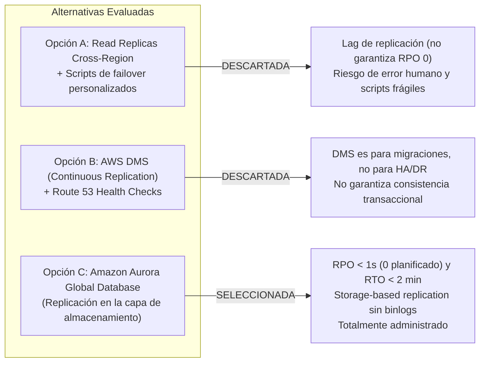
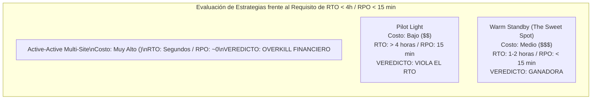

# BuildingBlocks Videos - Resilience

> [!abstract] Qué es este archivo
> Décima lección del módulo de resiliencia operativa. Presenta dos discusiones técnicas de arquitectura (*BuildingBlocks*)
> entre Melissa y Joe, donde se resuelven dilemas de diseño de Disaster Recovery del mundo real:
> 1. **Caso 1:** Recuperación multi-región para una base de datos de carrito de compras e-commerce (comparando réplicas con scripts, AWS DMS y **Amazon Aurora Global Database** para cumplir RPO sub-segundo y RTO $< 2\text{ min}$).
> 2. **Caso 2:** Selección de la estrategia de DR óptima para una carga con **RTO $< 4\text{ horas}$ y RPO $< 15\text{ minutos}$** con presupuesto acotado (evaluando los trade-offs de costo y tiempo entre **Active-Active, Pilot Light y Warm Standby**).
>
> Dos videos técnicos (2 min 34 s y 2 min 54 s) + Matrices de decisión + Desglose de trampas de examen.

> [!quote] La idea que ordena todo
> **“No sobreaprovisiones para emergencias que toleran horas de recuperación, y nunca uses scripts caseros donde AWS ya resolvió la replicación en el almacenamiento.”**
> Para RTOs de minutos y RPO cero en bases de datos transaccionales, **Aurora Global Database** gana por replicar en el storage; pero si el cliente tolera 4 horas de recuperación y busca cuidar costos, **Warm Standby** es el punto dulce exacto entre el sobrecosto de Active-Active y la lentitud de Pilot Light.

---

## Resumen en una frase

> Las dos sesiones técnicas de BuildingBlocks fijan los criterios de diseño del SAP-C02 para DR: para carritos de compras
> con RPO sub-segundo y RTO $< 2\text{ min}$, gana **Aurora Global Database** (eliminando scripts y descartando AWS DMS por
> falta de consistencia); para cargas de misión crítica con **RTO $< 4\text{ h}$ y RPO $< 15\text{ min}$** con control de
> costos, gana **Warm Standby** (la flota reducida encendida escala en 1–2 h, descartando Active-Active por caro y Pilot Light
> por exceder el tiempo de recuperación).

---

## 1. Caso 1: Recuperación de Bases de Datos Multi-Región

Una empresa de comercio electrónico opera la base de datos de su **carrito de compras** sobre **Amazon Aurora MySQL** en una
sola región, pero necesita protección ante desastres regionales:

### Requisitos del Cliente
* **RPO estricto:** Cero pérdida de datos (*zero data loss*) / sub-segundo en fallos imprevistos.
* **RTO agresivo:** Conmutación por error en menos de 2 minutos (**RTO $< 2\text{ minutos}$**).
* **Consistencia transaccional:** Mantener integridad total en los carritos de compra de los usuarios.
* **Alineación con Well-Architected:** Automatización del failover y eliminación del sobrecosto operativo de scripts manuales.

### Análisis Comparativo de Alternativas

| Alternativa Evaluada | Veredicto | Por qué se Descarta o Selecciona |
| --- | --- | --- |
| **Cross-Region Read Replicas + Custom Failover Scripts** | ❌ **Descartada** | La replicación tradicional de MySQL (binlog) tiene retraso (*replication lag*), haciendo imposible garantizar RPO de cero. Además, los scripts caseros de promoción añaden sobrecosto de mantenimiento y alto riesgo de error humano en una crisis. |
| **AWS Database Migration Service (DMS)** | ❌ **Descartada** | DMS está diseñado para **migración de datos y replicación continua heterogénea/homogénea**, no para conmutación por error de alta disponibilidad. No provee las garantías de consistencia transaccional requeridas por un carrito de compras. |
| **Amazon Aurora Global Database** | ✅ **GANADORA** | Diseñado específicamente para este escenario. Su **replicación basada en almacenamiento (*storage-based replication*)** es significativamente más rápida que la replicación lógica por binlogs. Ofrece **RPO $< 1\text{ segundo}$** (RPO $= 0$ en failover planificado) y **RTO $< 2\text{ minutos}$**, completamente administrado sin scripts. |

---

## 2. Caso 2: Selección de la Estrategia de DR Óptima

Una empresa ejecuta una aplicación de misión crítica en una sola región con **Amazon EC2 y Amazon RDS Multi-AZ**. Desea
incorporar una región secundaria para Disaster Recovery, pero debe **minimizar costos**:

### Requisitos del Cliente
* **RTO requerido:** Menor a 4 horas (**RTO $< 4\text{ horas}$**).
* **RPO requerido:** Menor a 15 minutos (**RPO $< 15\text{ minutos}$**).
* **Enrutamiento:** Conmutación por error gestionada con **Amazon Route 53 Failover Routing**.
* **Control presupuestario:** Presupuesto acotado; evitar sobreaprovisionamiento innecesario.

### Análisis de Compensaciones (Trade-Offs)

| Estrategia de DR | Evaluación de Costo | Evaluación de RTO / RPO | Veredicto Técnico |
| --- | --- | --- | --- |
| **Active-Active (Multi-Site)** | **Costos prohibitivos:** Paga el 100% de la capacidad de cómputo en ambas regiones (200% de costo) más cargos masivos de transferencia de datos (*cross-region data transfer*). | RPO cercano a cero y conmutación instantánea. | ❌ **Descartada por Overkill:** El cliente tolera 4 horas de caída; pagar capacidad completa permanente viola el pilar de Optimización de Costos. |
| **Pilot Light** | **Costo mínimo:** Solo paga almacenamiento de bases de datos y volúmenes EBS (instancias EC2 apagadas). | **Viola el RTO:** Levantar los servidores desde cero, restaurar copias de seguridad de bases de datos y escalar la flota para absorber el tráfico productivo **toma más de 4 horas**. | ❌ **Descartada por Incumplimiento:** No llega a tiempo para restaurar el servicio dentro del límite de 4 horas exigido por el negocio. |
| **Warm Standby** | **Costo moderado y justificado:** Corre una versión reducida (*scaled-down*) del entorno en la región secundaria, con replicación asíncrona de base de datos monitoreada. | **Cumple RTO y RPO:** La base replica continuamente ($< 15\text{ min}$) y la flota encendida escala al 100% de capacidad mediante Auto Scaling en **1 a 2 horas** (bien por debajo del tope de 4 horas). | ✅ **GANADORA (Punto Dulce):** Equilibrio perfecto entre cumplimiento de SLAs y optimización de costos sin sobreaprovisionar. |

---

## 3. Cierre Conceptual: Cuadro de Decisiones de Arquitectura

| Escenario y Requisito de Negocio | Decisión Arquitectónica Clave | Justificación para el Examen SAP-C02 |
| --- | --- | --- |
| **Base de datos transaccional con RPO $< 1\text{ s}$ y RTO $< 2\text{ min}$** | **Amazon Aurora Global Database** | Replicación en capa de storage (no binlog), failover automatizado sin scripts caseros. |
| **RPO $= 0$ garantizado en tareas de mantenimiento** | **Aurora Global Database Planned Failover** | Permite que la replicación se sincronice por completo antes del switchover. |
| **RTO $< 4\text{ horas}$, RPO $< 15\text{ min}$ con costo controlado** | **Warm Standby con RDS Read Replica** | La flota reducida encendida tarda solo 1-2 h en escalar; Pilot Light tardaría $> 4\text{ h}$. |
| **Replicación continua de bases heterogéneas** | **AWS DMS** | Solo para migraciones y transformaciones de esquemas; **nunca para HA/DR transaccional**. |

---

## 4. Traducción del contenido

> [!info] Sección de referencia (opcional)
> Traducción fiel y completa de los dos videos técnicos. Se recomienda estudiar las secciones **1 a 3** y repasar las
> reglas de examen en la sección **5**.

### 4.1 Video 1: Cross-Region Database Recovery Solutions (Transcripción)

En este video, Melissa y Joe analizan soluciones de recuperación ante desastres de bases de datos para el sistema de
carrito de compras de un cliente de comercio electrónico. Evalúan varias soluciones potenciales, incluidas réplicas de
lectura entre regiones con scripts de conmutación por error personalizados, Database Migration Service y Aurora Global
Database para determinar la solución óptima.

La solución debe ofrecer replicación en menos de un segundo, capacidades de failover automatizadas que se alineen con el pilar
de fiabilidad de AWS Well-Architected Framework, y replicación basada en almacenamiento que supere los métodos tradicionales,
para satisfacer los estrictos requisitos de integridad de datos y tiempo de recuperación del cliente.

#### Transcripción

**Melissa:** Hola Joe, acabo de regresar de una reunión con una empresa de comercio electrónico. Tienen la base de datos de su
carrito de compras ejecutándose en **Aurora MySQL**, pero están preocupados por la recuperación ante desastres. Déjame abrir la
arquitectura para nosotros aquí. Muy bien, ahí lo tienes.

**Joe:** ¿Cuáles son sus requisitos específicos?

**Melissa:** Necesitan **cero pérdida de datos (zero data loss) y conmutación por error en menos de dos minutos**. Están
realmente preocupados por mantener la **consistencia de las transacciones**, ya que son los datos de su carrito de compras.

**Joe:** Sí, bueno, eso es bastante estricto. ¿Han considerado usar **réplicas de lectura entre regiones (Cross-Region Read
Replicas)**? Podríamos configurar **scripts de conmutación por error personalizados** para gestionar el cambio cuando una
región tenga problemas.

**Melissa:** Yo también pensé en eso, pero hay un par de problemas. Primero, la replicación tradicional entre regiones tiene
cierto retraso (*replication lag*), por lo que realmente **no podemos garantizar un RPO de cero**. Además, mantener scripts de
failover personalizados añade sobrecarga operativa y **aumenta el riesgo de error humano** durante un desastre.

**Joe:** Buen punto. Bueno, ¿qué tal usar **AWS DMS** para replicación continua entre regiones? Podríamos configurar health
checks en Route 53 para redirigir el tráfico automáticamente si falla una región.

**Melissa:** Eso es creativo. Pero **DMS está realmente diseñado para migraciones y replicación continua, no para escenarios de
conmutación por error de alta disponibilidad**. No proporciona las garantías de consistencia que necesitamos para una base de
datos de carrito de compras.

**Joe:** Sí, ya veo a qué te refieres. Mirando el Well-Architected Framework, el pilar de fiabilidad, necesitamos una
conmutación por error automatizada que mantenga la consistencia de los datos. ¿Qué tal **Aurora Global Database**? Está
diseñado específicamente para este caso de uso.

**Melissa:** Lo está. **Aurora Global Database nos brinda esa replicación en menos de un segundo entre regiones con conmutación
por error automatizada.** Está diseñado específicamente para exactamente lo que necesitan: **RPO de menos de un segundo y RTO
típicamente inferior a dos minutos**. Y para una conmutación por error planificada, puedes tener un **RPO de cero** al permitir
que la replicación se ponga al día antes del switchover. Además, es un servicio administrado, por lo que no tenemos que
mantener lógica de failover personalizada.

**Joe:** Correcto. Y dado que está utilizando la **replicación basada en almacenamiento de Aurora (storage-based replication)**,
obtenemos un mejor rendimiento que la replicación tradicional de registros binarios (binlog). El equipo de operaciones
agradecerá no tener que administrar scripts de conmutación por error complejos.

**Melissa:** Definitivamente cumple con todos sus requisitos: pérdida mínima de datos, conmutación por error rápida y sobrecarga
operativa mínima. Además, se alinea perfectamente con el énfasis del pilar de fiabilidad en los procedimientos de recuperación
automatizados.

*Duración del video: **2 minutos, 34 segundos**.*

### 4.2 Video 2: Selecting the Optimal DR Strategy (Transcripción)

En esta discusión técnica, Melissa y Joe exploran estrategias de disaster recovery para la aplicación de misión crítica de un
cliente. El cliente requiere objetivos de tiempo de recuperación específicos de **RTO menor a cuatro horas y RPO menor a 15
minutos**, a la vez que es consciente de los costos. Examinarán varios enfoques de DR, incluidas las configuraciones
activo-activo, pilot light y warm standby.

#### Transcripción

**Melissa:** Hola Joe. Estaba hablando con este cliente sobre sus requisitos de DR. Déjame mostrar la arquitectura aquí. Tienen
esta **aplicación de misión crítica ejecutándose en una sola región con EC2 Multi-AZ y RDS Multi-AZ**. La parte interesante
son sus objetivos de recuperación: necesitan **RTO inferior a cuatro horas y RPO inferior a 15 minutos**. También necesitarán
Route 53 configurado para enrutamiento de conmutación por error entre regiones.

**Joe:** ¿Y cuál es su estrategia de DR actual?

**Melissa:** Eso es justamente: **aún no tienen ninguna**. Quieren agregar una región de DR, pero **mantener los costos bajos**
mientras cumplen con esos objetivos de recuperación.

**Joe:** Bueno, si quieres un gran RPO, mi primer pensamiento sería ir con **activo-activo entre dos regiones**. De esa manera
tendríamos conmutación por error automática y RPO cercano a cero. Pero los costos de transferencia de datos entre regiones
serían significativos.

**Melissa:** Lo consideré. Pero recuerda, **quieren minimizar sus costos**. Ejecutar la capacidad de producción completa en dos
regiones sería excesivo (*overkill*) para sus necesidades. Solo necesitan recuperarse en un plazo de cuatro horas, no
instantáneamente.

**Joe:** Buen punto. Entonces, ¿qué tal un enfoque **Pilot Light**? Podríamos mantener los servicios críticos en ejecución y
restaurar desde copias de seguridad cada 15 minutos para cumplir con el RPO.

**Melissa:** Eso es mejor en términos de costos, pero todavía **me preocupa el RTO**: iniciar todos los componentes de la
aplicación y escalarlos para manejar la carga de producción **podría tomar fácilmente más de cuatro horas**, y restaurar desde
copias de seguridad añade aún más tiempo.

**Joe:** Bueno, sí, es verdad. De acuerdo, entonces necesitamos algo intermedio: más que pilot light, pero menos que
activo-activo.

**Melissa:** Exactamente. Creo que **Warm Standby es el punto óptimo (sweet spot) aquí**. Podemos ejecutar una **versión
reducida del entorno de producción**, configurar la replicación asíncrona de la base de datos con un monitoreo adecuado para
mantener ese objetivo de RPO de 15 minutos teniendo en cuenta la latencia de la red. Y normalmente podemos **escalar a la
capacidad completa en una o dos horas**, muy dentro de su objetivo de RTO de cuatro horas.

**Joe:** Eso tiene sentido. **La infraestructura ya está en funcionamiento, por lo que evitamos largos tiempos de inicio**,
pero no estamos pagando por la capacidad de producción completa en ambas regiones. Y aunque tendremos algunos costos de
transferencia de datos entre regiones para la replicación, sigue siendo más rentable que el activo-activo sincrónico y cumple
con sus requisitos de RPO.

**Melissa:** Correcto. Y mirando el pilar de optimización de costos, esto nos da el **mejor equilibrio entre cumplir con sus
objetivos de recuperación y minimizar sus costos de DR**. Solo necesitaremos asegurarnos de estar monitoreando el retraso de
replicación para mantener la consistencia de los datos.

**Joe:** Perfecto. ¿Recomendamos entonces el enfoque Warm Standby?

**Melissa:** Sí. Creo que esa es nuestra mejor opción aquí. Satisface todos sus requisitos sin sobreaprovisionar.

*Duración del video: **2 minutos, 54 segundos**.*

---

## 5. Para el examen (SAP-C02)

> [!important] Lo que hay que retener
> 1. **Aurora Global Database para RPO/RTO en minutos/segundos:** Si el enunciado pide una base de datos relacional multi-región con **RPO $< 1\text{ segundo}$ y RTO $< 2\text{ minutos}$**, la respuesta casi invariablemente es **Amazon Aurora Global Database**. Utiliza replicación física a nivel del motor de almacenamiento, evitando el cuello de botella del binlog de MySQL.
> 2. **Planned Failover en Aurora Global Database:** En mantenimientos programados, soporta conmutación sin pérdida de datos (**RPO $= 0$**) porque sincroniza la réplica secundaria antes de promoverla a primaria.
> 3. **AWS DMS NO es una solución de Alta Disponibilidad / DR:** En preguntas de certificación, AWS DMS se descarta para conmutación por error en tiempo real de bases de datos de producción; solo se utiliza para migración o replicación continua hacia lagos de datos/data warehouses.
> 4. **Warm Standby como "Sweet Spot" de costos para RTOs de 1 a 4 horas:** Si el cliente tiene un RTO de varias horas (ej. 4 horas) pero no quiere pagar capacidad completa 24/7, **Warm Standby** gana porque la flota reducida encendida (*running*) escala en 1–2 horas mediante Auto Scaling.
> 5. **Por qué Pilot Light falla para RTOs con cómputo pesado:** En Pilot Light, las instancias están detenidas (*stopped*) o no creadas. Si la aplicación tarda horas en bootear, inicializar caché o restaurar bases desde backups, no cumplirá un RTO de 4 horas.
> 6. **Active-Active es "Overkill" si no se requiere RTO cero:** No elijas Active-Active (Multi-site) si el cliente pide "minimizar costos" y tolera horas de recuperación; Active-Active duplica los costos de infraestructura al 200% y genera cargos altos de transferencia de datos (*data transfer OUT* entre regiones).

> [!warning] Trampa clásica del examen
> **Escenario:** Un cliente bancario opera una aplicación transaccional en `us-east-1` sobre Amazon Aurora PostgreSQL. La junta directiva exige que, ante la caída total de la región, el sistema se recupere en `us-west-2` garantizando que no se pierdan transacciones del último segundo y que la conmutación se complete en menos de 2 minutos sin intervención de scripts manuales.
>
> * **Respuesta trampa:** "Crear una réplica de lectura entre regiones de Aurora PostgreSQL en `us-west-2` y utilizar una función AWS Lambda disparada por una alarma de CloudWatch para promover la réplica a clúster independiente."
> * **Por qué falla:** La replicación tradicional entre regiones tiene retraso variable que no garantiza RPO $< 1\text{ s}$, y depender de scripts o funciones Lambda para la promoción añade fragilidad y sobrecosto operativo frente a un desastre.
> * **La respuesta correcta:** Implementar **Amazon Aurora Global Database**. La replicación basada en almacenamiento dedicada replica las transacciones entre regiones en menos de 1 segundo (RPO $< 1\text{ s}$) y la consola o API de Aurora permite un failover gestionado automático en menos de 2 minutos (RTO $< 2\text{ min}$) preservando la consistencia transaccional.

---

## Relacionado

- [[AWS Solutions Architect Advanced - Operational Resilience]] *(índice del módulo)*
- [[Course Overview - Operational Resilience]] — lección 01: encuadre de RTO/RPO y DR
- [[Gathering the Customer Requirements - Resilience]] — lección 02: el caso de negocio
- [[Building a Data Protection Strategy]] — lección 03: marco en 5 capas y AWS DRS
- [[Disaster Recovery]] — lección 04: espectro de estrategias (Pilot Light vs Warm Standby)
- [[Disaster Recovery Strategies]] — lección 05: AWS Backup y replicación cross-region
- [[Finished Architecture - Resilience]] — lección 09: arquitectura capstone del Data Lake
- [[BuildingBlocks Videos]] — videos técnicos del módulo Multi-Account
- [[BuildingBlocks Videos - Networking]] — videos técnicos del módulo de Redes Avanzadas
- [[BuildingBlocks Videos - Security]] — videos técnicos del módulo de Seguridad
- [[BuildingBlocks Videos - Hybrid]] — videos técnicos del módulo Híbrido
- [[2.2 Diseñar una solución para garantizar la continuidad de actividades]] — diseño de DR y selección de estrategias
- [[2.4 Diseñar una estrategia para cumplir con los requisitos de fiabilidad]] — Aurora Global Database y consistencia
- [[1.5 Determinar las estrategias de optimización de costos y visibilidad]] — balance de costos en DR
- [[3.3 Estrategia para mejorar el rendimiento]] — replicación en capa de storage de Aurora
- [[Guia AWS]] — pesos y tareas oficiales del SAP-C02
- Siguiente paso del módulo: **Lección 11**.

---

## Registro de integración

| Fecha | Qué llegó | Dónde se integró |
| --- | --- | --- |
| 29/10/2026 | Lección 10 completa: Dos videos técnicos (Aurora Global Database vs scripts/DMS para RPO < 1s / RTO < 2m; y Warm Standby vs Pilot Light/Active-Active para RTO < 4h) | Nota completa (`BuildingBlocks Videos - Resilience.md`), secciones 1 a 5 |

**Discrepancias y vacíos registrados (no corregidos):**
1. **Sufijo `- Resilience`:** Se aplica el sufijo `- Resilience` para mantener la regla de desambiguación canónica de los módulos cerrados (`BuildingBlocks Videos - Networking`, `BuildingBlocks Videos - Security`, `BuildingBlocks Videos - Hybrid`).
2. **Formato dual de discusión técnica:** La lección no presenta lecturas de servicios aislados, sino dos conversaciones estructuradas de diseño entre Melissa y Joe. Se estructuran como dos casos de estudio con sus tablas de trade-offs en las §1 y §2.
