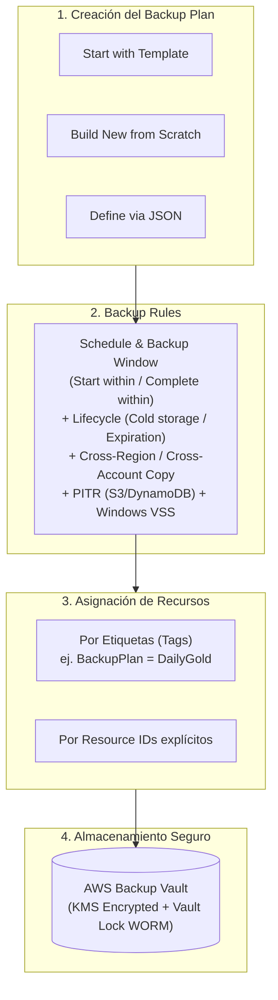
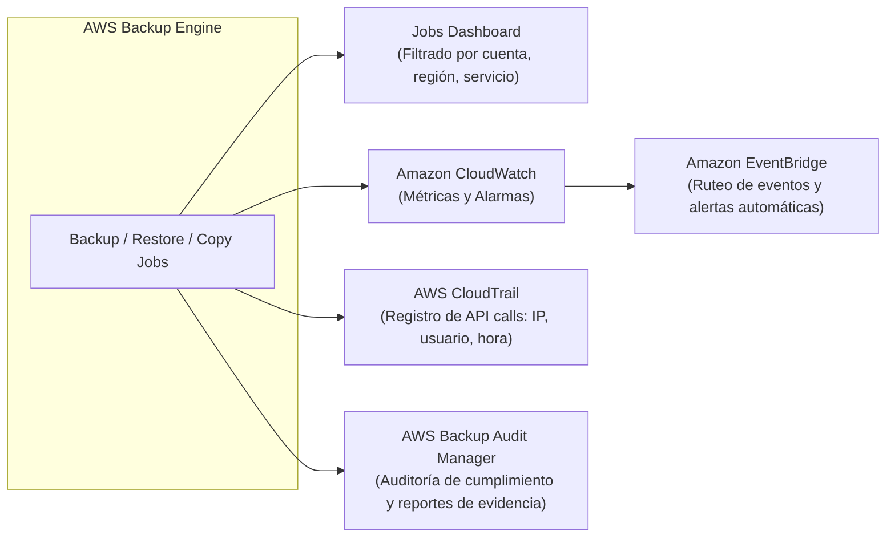

# Disaster Recovery Strategies

> [!abstract] Qué es este archivo
> Quinta lección del módulo de resiliencia operativa. Profundiza en la implementación técnica de estrategias de
> respaldo y recuperación ante desastres utilizando **AWS Backup** como plano de control centralizado. Cubre el marco
> metodológico de 6 preguntas de diseño, la creación de **Backup Plans** (vía consola, plantillas o JSON), asignación
> automatizada por etiquetas, respaldos continuos (**PITR** para S3 y DynamoDB), soporte de **Windows VSS**, observabilidad
> y generación de evidencia con **AWS Backup Audit Manager**, y las reglas críticas de restauración (creación de nuevos
> recursos y la preservación jerárquica en **Amazon EFS**).
>
> Video: **8 minutos 59 segundos** + Guía de configuración en 8 pasos + Reglas de restauración y auditoría.

> [!quote] La idea que ordena todo
> **“Un plan de backup no se programa recurso por recurso: se declara como política centralizada y se aplica automáticamente por etiquetas.”**
> Desacoplar la política del recurso permite gobernar petabytes de datos en múltiples cuentas y regiones, mientras que al
> restaurar, AWS Backup garantiza la no-destrucción del entorno productivo aprovisionando siempre un recurso nuevo.

---

## Resumen en una frase

> **AWS Backup** unifica la estrategia de recuperación mediante **Backup Plans** declarativos (vía plantillas, consola o
> JSON) asignados automáticamente por **Tags**, integrando ventanas de backup, ciclo de vida a cold storage, **PITR**
> para S3/DynamoDB y **Windows VSS**, con auditoría regulatoria continua vía **AWS Backup Audit Manager** y un modelo de
> restauración seguro que genera recursos nuevos (con preservación jerárquica en **Amazon EFS**).

---

## 1. Definición de la Estrategia de Backup: Las 6 Preguntas Clave

Antes de abrir la consola de AWS Backup, el arquitecto de soluciones debe responder a una serie estructurada de seis
preguntas de evaluación sobre cada recurso:

| # | Pregunta de diseño | Aspecto evaluado | Impacto en la configuración |
| --- | --- | --- | --- |
| **1** | **Requisitos organizacionales y de cumplimiento** | *¿Qué marcos normativos (HIPAA, PCI-DSS, SOC) aplican?* | Define si se requiere **Backup Vault Lock** (inmutabilidad WORM) y retención legal. |
| **2** | **Frecuencia requerida de backup** | *¿Con qué periodicidad se deben generar recovery points separados?* | Configura la regla de cronograma (horaria, diaria, semanal, mensual). |
| **3** | **Requisitos de RPO y RTO** | *¿Cuánto dato se tolera perder y cuánto downtime se soporta?* | Define si alcanza con snapshots periódicos o se requiere **PITR continuo**. |
| **4** | **Backups completos vs. incrementales / continuos** | *¿Cómo retienen los datos los respaldos incrementales?* | Selección entre snapshots incrementales en S3 (EBS) o continuo en S3/DynamoDB. |
| **5** | **Requisitos de retención y ciclo de vida** | *¿Cuánto tiempo debe conservarse cada frecuencia?* | Reglas de ciclo de vida: transición a almacenamiento en frío (*cold storage*) y expiración. |
| **6** | **Verificación del cumplimiento** | *¿Cumple la estrategia con la organización y los auditores?* | Adopción de **AWS Backup Audit Manager** para generar reportes automáticos de evidencia. |

---

## 2. Arquitectura y Componentes de AWS Backup

AWS Backup desacopla la definición del plan de los recursos a los que aplica:

### Componentes Principales
* **Backup Plan:** Es la expresión de política que declara el *cuándo, cómo, dónde y por cuánto tiempo* se respaldan los recursos.
* **Backup Rules:** Cada plan contiene una o más reglas que definen:
  * **Cronograma y Frecuencia:** Expresiones cron o basadas en intervalos.
  * **Ventana de Backup (*Backup Window*):** Compuesta por **Start within** (tiempo máximo para iniciar el trabajo de backup) y **Complete within** (tiempo límite para completarlo antes de fallar/alertar).
  * **Ciclo de vida (*Lifecycle*):** Período antes de mover el recovery point a *cold storage* (para ahorrar costos en retenciones largas) y fecha de expiración definitiva.
  * **Copia secundaria (*Copy to Destination*):** Replicación entre regiones (**Cross-Region Replication**) y entre cuentas (**Cross-Account Backup** vía AWS Organizations).
* **Backup Vault:** Contenedor lógico cifrado con **AWS KMS** donde se almacenan y catalogan los puntos de recuperación (*recovery points*). Puede protegerse con **AWS Backup Vault Lock**.

### Tres Vías de Creación de Planes
1. **Start with a template:** Usar plantillas predefinidas provistas por AWS Backup (ej. planes diarios, semanales o mensuales con retenciones estándar).
2. **Build a new plan:** Configurar un plan personalizado desde cero a través de la consola web o la CLI.
3. **Define a plan by using JSON:** Diseñar o modificar la estructura JSON del plan; ideal para automatización con Infrastructure as Code (IaC) en CloudFormation o pipelines de CI/CD.

---

## 3. Opciones Avanzadas de Protección

| Capacidad Avanzada | Servicios Soportados | Mecanismo Técnico |
| --- | --- | --- |
| **Point-in-Time Recovery (PITR)** | **Amazon S3** y **Amazon DynamoDB** | Respaldo continuo que permite restaurar el estado exacto a **cualquier segundo** dentro de la ventana de retención (RPO de segundos). |
| **Windows VSS (Volume Shadow Copy)** | **Amazon EC2 con Windows** (SQL Server, Exchange, AD) | Permite capturar instantáneas a nivel de aplicación consistentes (*application-consistent backups*) pausando temporalmente las escrituras en disco mediante el servicio VSS de Windows. |
| **Cross-Region Replication** | Múltiples servicios de AWS | Copia automática de los recovery points a un Backup Vault en una región secundaria para cumplir con planes de Disaster Recovery regional. |
| **Cross-Account Management** | Cuentas bajo **AWS Organizations** | Copia de recovery points hacia una cuenta dedicada de backup/seguridad para blindar los datos ante el compromiso total de la cuenta de origen. |

---

## 4. Observabilidad y Auditoría de Backups

AWS Backup se integra con el ecosistema de monitoreo de AWS para garantizar gobernanza continua:

* **AWS Backup Jobs Dashboard:** Panel operativo centralizado para ver el estado de los trabajos (éxito, fallo, en progreso) filtrado por motivo, cuenta de AWS, región y tipo de recurso.
* **Amazon CloudWatch + EventBridge:** Métricas operativas en tiempo real. EventBridge intercepta cambios de estado (ej. `BACKUP_JOB_FAILED`) y dispara notificaciones vía SNS o correcciones automáticas vía Lambda.
* **AWS CloudTrail:** Registra quién ejecutó qué acción sobre AWS Backup (ej. creación de planes, modificaciones de bóvedas o intentos de eliminación).
* **AWS Backup Audit Manager:** Módulo especializado para **auditar y certificar la postura de backup**. Evalúa continuamente si los recursos protegidos cumplen con las políticas corporativas y genera reportes formales listos para auditorías regulatorias (evidencia legal).

---

## 5. El Proceso de Restauración (Restore)

### La Regla de Oro: Creación de Nuevos Recursos
Al ejecutar una restauración desde AWS Backup, el servicio **crea un nuevo recurso** con los datos recuperados:

> [!important] Protección contra sobreescritura accidental
> AWS Backup **nunca sobreescribe ni destruye el recurso de producción existente**. Si se restaura una instancia EC2 o
> un volumen EBS, se aprovisiona una nueva instancia o un nuevo volumen independiente. Esto evita la pérdida accidental
> de datos productivos durante el proceso de recuperación.

### Flujo de Restauración en 3 Pasos
1. **Seleccionar el punto de recuperación:** Ir a la bóveda (*Backup Vault*) y elegir el recovery point deseado.
2. **Especificar parámetros de restauración:** Definir el tipo de instancia, la VPC, la subred, el cifrado KMS y la configuración de red para el nuevo recurso.
3. **Ejecutar Restore:** Confirmar y desplegar el nuevo recurso en la cuenta y región de destino.

### Caso Especial: Restauración a Nivel de Elemento en Amazon EFS
Amazon EFS admite una capacidad única al restaurar archivos específicos:
* **Restauración a un nuevo file system:** Crea un sistema de archivos EFS completamente nuevo.
* **Restauración a un file system existente:** Si se restaura dentro del mismo EFS existente, AWS Backup **crea un nuevo directorio en la raíz (`/`)** que aloja los elementos recuperados y **preserva la jerarquía completa de directorios**.
  * *Ejemplo:* Si el directorio original `/A` contenía `/B`, `/C` y `/D`, AWS Backup crea `/aws-backup-restore-[timestamp]/A/` y recrea adentro `/B`, `/C` y `/D` sin pisar los archivos actuales.

---

## 6. Buenas Prácticas de AWS Backup

1. **Entender la naturaleza de cada servicio:** Cada servicio respaldado por AWS Backup tiene mecánicas distintas (ej. S3 soporta PITR continuo; EBS utiliza snapshots incrementales en S3).
2. **No forzar AWS Backup para RTOs de milisegundos:** Si una aplicación financiera requiere conmutación por error en menos de un minuto entre regiones, AWS Backup no es la herramienta principal de failover; se debe usar **Aurora Global Database** o **AWS Elastic Disaster Recovery (DRS)**.
3. **Aplicar el principio de mínimo privilegio en IAM:** Restringir severamente permisos de eliminación (`backup:DeleteRecoveryPoint`, `backup:DeleteBackupVault`) mediante IAM y Service Control Policies (SCPs).
4. **Implementar retención estratificada:** Enviar recovery points a **cold storage** tras 30 o 90 días para abaratar costos, y configurar **expiración automática** para no pagar almacenamiento indefinido.
5. **Utilizar Legal Holds:** Aplicar retenciones legales (*legal holds*) a través de AWS Backup para prevenir que los backups requeridos en procesos judiciales o regulatorios expiren mientras dure la investigación.

---

## 7. Cierre Conceptual: El Ciclo de Vida en AWS Backup

| Fase | Componente | Mecanismo en AWS |
| --- | --- | --- |
| **1. Definición** | **Backup Plan** | Reglas con expresiones cron, ventanas *start/complete within* y lifecycle. |
| **2. Selección** | **Resource Assignment** | Asignación dinámica basada en **Tags** (`Environment = Production`). |
| **3. Custodia** | **Backup Vault** | Cifrado KMS y bloqueo inmutable **Vault Lock** (Compliance Mode). |
| **4. Protección Continua** | **PITR** | Respaldos continuos al segundo para **Amazon S3** y **DynamoDB**. |
| **5. Consistencia SO** | **Windows VSS** | Instantáneas consistentes con aplicaciones Windows en EC2. |
| **6. Supervisión** | **Audit Manager** | Auditoría continua contra marcos normativos y generación de reportes. |
| **7. Recuperación** | **Restore Engine** | Despliegue de **nuevos recursos** (y preservación jerárquica en **EFS**). |

---

## 8. Traducción del contenido

> [!info] Sección de referencia (opcional)
> Traducción fiel y completa de las fuentes de Skill Builder. Se recomienda estudiar las secciones **1 a 7** y repasar
> las reglas de examen en la sección **9**.

### 8.1 Definir la Estrategia de Backup (Texto literal)

Para comenzar, defina y desarrolle una estrategia de backup para aplicar a sus diferentes recursos soportados. Puede
construir esta estrategia examinando cada recurso a respaldar y formulando una serie de preguntas:

1. **Identificar los requisitos organizacionales y de cumplimiento:** *¿Qué requisitos organizacionales son necesarios para cumplir con la estrategia prevista? ¿Tiene requisitos de cumplimiento normativo que deben cumplirse?*
2. **Definir la frecuencia de backup requerida:** *¿Con qué frecuencia necesita tomar y mantener copias de seguridad separadas? ¿Qué frecuencias necesita?*
3. **Definir los requisitos de RPO y RTO:** *¿Cuántos datos puede permitirse recrear o perder? ¿Cuánto tiempo de inactividad puede permitirse?*
4. **Identificar los requisitos de backup completo en comparación con el incremental:** Las copias de seguridad completas se utilizan para backups únicos que no se ejecutan según un cronograma. Sin embargo, las copias de seguridad archivadas son, para la mayoría de los servicios, copias completas que representan un punto en el tiempo. *¿Son apropiados los backups incrementales o continuos para cumplir con su plan de archivado? ¿Comprende cómo los backups incrementales retienen los datos?*
5. **Definir los requisitos de retención:** *¿Cuánto tiempo necesita retener datos cada una de las frecuencias de backup?*
6. **Verificar que la estrategia cumpla con los requisitos:** *¿Ha cumplido tanto con sus requisitos organizacionales como con los de cumplimiento normativo?*

### 8.2 Video principal: Working with AWS Backup (transcripción)

Entonces, en términos de algunos de los componentes o recursos o cosas que tenemos que configurar con **AWS Backup**, uno
de los componentes principales va a ser lo que se llama un **backup plan (plan de backup)**. Así que vamos a hablar
básicamente de cómo configuramos el backup utilizando estos planes, también mencionaremos algunas de las consideraciones
que debemos tener al componer nuestra estrategia de backup.

También hablaremos de cómo podemos usar otros tipos de **herramientas de observabilidad** para monitorear el progreso o
éxito de nuestros backups, ¿de acuerdo? Y luego también hablaremos de **cómo podemos restaurar desde el backup** y algunas
de las mejores prácticas al usarlo.

Entonces, ¿cuáles son algunas de las cosas principales que debemos considerar en la composición o creación de nuestros planes
y estrategias de backup?
* Claramente vamos a necesitar saber cuáles son los requisitos. ¿Tenemos que conformarnos con algún nivel de cumplimiento normativo?
* ¿Qué tipos de sistemas o con qué frecuencia vamos a respaldar las cosas? Necesitamos saber cuándo lo haremos.
* Claramente vamos a querer tener requisitos de **RPO y RTO muy claramente definidos**; no queremos intentar apuntar a un blanco móvil, ¿verdad?
* También tenemos que asegurarnos de ser conscientes de lo que se respalda de forma completa en comparación con lo **incremental**. Piensen en el asunto de los volúmenes EBS y las instantáneas de EBS. Las instantáneas no se almacenan de forma incremental.
* ¿Cuánto tiempo necesitamos conservar esos datos para fines de, nuevamente, cumplimiento y quizás optimización de costos?
* Y claramente queremos verificar que cualquier estrategia que compongamos realmente vaya a hacer lo que pretendíamos que hiciera.

Entonces, cuando vamos a crear nuestro **plan de backup**, podemos hacerlo a través de los medios habituales o más familiares
dentro de AWS: es decir, la consola, utilizando las **APIs con los SDKs**, o mediante la **AWS CLI**. Así que esencialmente
diseñamos nuestro plan de backup. Luego definimos sobre qué recursos vamos a actuar para ese plan de backup. Y luego, después
de que se hayan creado o cuando se estén creando o colocando en nuestras **bóvedas de backup (backup vaults)**, tenemos la opción
de utilizar los otros servicios de AWS de soporte y complementarios para **monitorear, administrar, reportar, auditar**: todas las
cosas de observabilidad para mejorar las cosas más adelante.

Ahora, en la creación de nuestro plan de backup, tengan en cuenta primero que tenemos varias opciones:
1. Podemos definir un plan de backup mediante **JSON** y los atributos y valores apropiados.
2. Podemos diseñar uno **nuevo**, tal vez hacerlo en la consola.
3. O también podemos usar algunas de las **plantillas proporcionadas** para planes de backup, por lo que no necesariamente tenemos que empezar desde cero si no queremos.

Ahora, al crear ese plan de backup, tenemos que asegurarnos de crear ese cronograma y luego determinar dentro de ese cronograma
cuándo se llevará a cabo ese respaldo. Por ejemplo, si decimos que vamos a hacer un backup diario, entonces tenemos que decir a qué
hora o en qué momento del día nos gustaría hacerlo.

Podemos optar por crear **backups de un punto en el tiempo (point-in-time backups)**, lo que esencialmente significa que nos
permitirán especificar un punto particular en el tiempo al que nos gustaría restaurar esos recursos, aunque nuevamente, eso es
opcional.

También podemos configurar nuestras **políticas de ciclo de vida** para determinar cómo podemos optimizar el costo del almacenamiento
para estos backups: podemos copiar a diferentes destinos, podemos agregar **etiquetas (tags)** con el fin de poder administrar más
fácilmente estos recursos y luego crear otras configuraciones.

Eso es esencialmente para el plan de backup. Piensen en el plan como la definición de lo que va a suceder con cualquier recurso que
asociemos con este plan, y luego seleccionaremos los recursos a los que este plan de backup debe aplicarse.

En términos de poder **monitorear y auditar nuestros backups**:
* Podemos ver algunos de los servicios de los que ya hemos hablado, como **CloudWatch** y **CloudTrail**.
* Si estamos utilizando arquitecturas basadas en eventos, podemos hacer uso de **Amazon EventBridge** como nuestro servicio de enrutamiento de eventos.
* Y también podemos usar la **consola de AWS Backup**, y tenemos la opción de usar **AWS Backup Audit Manager**, que es esencialmente una herramienta específica para backup que nos brinda actividad e informes sobre el estado, el progreso y la salud de nuestros backups: información observable para que podamos hacer optimizaciones, correcciones y asegurarnos de que nuestros backups funcionen según lo previsto.

Y en lo que respecta a **restaurar desde el backup**, esencialmente iremos a esa bóveda: es muy simple, hacemos las selecciones de
lo que vamos a restaurar y luego veremos que esos nuevos recursos reaparecen en nuestra infraestructura. Restaurar desde sus backups
es un proceso relativamente simple; este es un servicio abstraído muy fácil de usar para nosotros. Esencialmente vamos a esa bóveda de
backup, podemos restaurar muy fácilmente pulsando unos pocos botones, y luego veremos esos nuevos recursos en cualquier destino en el
que estemos intentando aprovisionarlos.

En términos de **mejores prácticas para usar AWS Backup**:
* Claramente vamos a querer saber cómo se hacen los backups con diferentes servicios para tener una idea de lo que realmente se almacena.
* Queremos asegurarnos de que esos requisitos de RPO y RTO no se muevan.
* Queremos asegurarnos de saber quién tiene el acceso adecuado a los backups y quién puede administrarlos.
* Siempre queremos monitorear y auditar.

*Duración del video: **8 minutos, 59 segundos**.*

### 8.3 Creación de un Backup Plan (Los 8 Marcadores)

1. **Start options (Opciones de inicio):** Comenzar con una plantilla provista por AWS Backup, crear un plan nuevo desde cero, o definir/modificar una expresión **JSON**.
2. **Schedule (Cronograma):** Determinar el cronograma y la frecuencia.
3. **Backup window (Ventana de backup):** Definir los rangos de *start within* (iniciar dentro de) y *complete within* (completar dentro de).
4. **Point-in-time (Punto en el tiempo):** Para servicios como Amazon S3 y Amazon DynamoDB, habilitar opcionalmente backup continuo con marcadores de punto en el tiempo.
5. **Lifecycle (Ciclo de vida):** Establecer períodos de expiración o archivado en frío (*cold storage*).
6. **Copy to destination (Copia a destino):** Agregar replicación entre regiones (*Cross-Region Replication*) y entre cuentas.
7. **Tags (Etiquetas):** Añadir etiquetas a los puntos de recuperación generados.
8. **Advanced backup settings (Configuraciones avanzadas):** Habilitar instantáneas coherentes con aplicaciones mediante **Windows Shadow Copy (VSS)** para Windows EC2.

### 8.4 Monitoreo, Auditoría y Restauración

* **AWS Backup console dashboards:** Muestra métricas de éxitos y fallos filtrados por motivo, cuenta, región y tipo de recurso.
* **Amazon CloudWatch y EventBridge:** Métricas, paneles y alarmas enviadas a EventBridge para gestionar alertas de eventos.
* **AWS CloudTrail:** Registro detallado de API calls (hora, IP de origen, usuario y cuenta).
* **AWS Backup Audit Manager:** Auditoría de actividad y recursos de backup, generando reportes de evidencia regulatoria.
* **Mecánica de Restauración:** AWS Backup crea un **nuevo recurso** para evitar destruir recursos existentes en producción.
* **Amazon EFS Restore:** Permite restaurar a un sistema existente o nuevo. Si se restaura a uno existente, crea un nuevo directorio en la raíz y **preserva toda la jerarquía de subdirectorios intacta**.

### 8.5 Mejores Prácticas de AWS Backup

* Comprender los requisitos únicos de backup por servicio.
* Definir con claridad RPO y RTO (AWS Backup puede no ser la herramienta para RTOs de milisegundos).
* Usar **AWS IAM** con privilegios mínimos para administrar backups.
* Construir planes robustos con frecuencias, retención, copias secundarias, gobernanza cross-account y retenciones legales (*legal holds*).
* Archivar backups fríos para ahorrar costos y expirar copias obsoletas.
* Monitorear y auditar continuamente.

---

## 9. Para el examen (SAP-C02)

> [!important] Lo que hay que retener
> 1. **La regla de no-sobreescritura al restaurar:** Cuando AWS Backup ejecuta un restore de EC2, EBS o RDS, **siempre crea un nuevo recurso**. No sobreescribe la instancia o el volumen productivo en funcionamiento.
> 2. **Restauración jerárquica en Amazon EFS:** Al restaurar archivos específicos en un sistema EFS existente, AWS Backup crea una carpeta en la raíz (`/aws-backup-restore-[timestamp]`) y **recrea con exactitud la jerarquía completa de directorios original**.
> 3. **Windows VSS para coherencia de aplicaciones:** Si un escenario de examen exige respaldar instancias EC2 de Windows que ejecutan Microsoft SQL Server o Exchange sin desconectar a los usuarios, la opción correcta es habilitar **Windows VSS (Volume Shadow Copy Service)** en las configuraciones avanzadas de AWS Backup.
> 4. **Asignación automática a escala por Tags:** El método recomendado por Well-Architected para asignar miles de recursos a un Backup Plan es mediante **etiquetas de recursos (Tags)** (ej. `Environment = Prod`, `BackupClass = Gold`), evitando la asignación estática por IDs.
> 5. **Point-in-Time Recovery (PITR) en AWS Backup:** AWS Backup soporta respaldo continuo y PITR a nivel de segundo para **Amazon S3** y **Amazon DynamoDB**.
> 6. **AWS Backup Audit Manager para Compliance:** Cuando una pregunta del examen exija **"demostrar cumplimiento continuo ante auditores externos"** o **"evidencia auditable de conformidad con SLAs de backup"**, el servicio clave es **AWS Backup Audit Manager**.
> 7. **Protección Multi-Cuenta (Cross-Account Backup):** Integrado con **AWS Organizations**, permite copiar backups a una cuenta central de seguridad/archivo y restringir la eliminación de bóvedas mediante SCPs.

> [!warning] Trampa clásica del examen
> **Escenario:** Un administrador borra accidentalmente una carpeta crítica de documentos dentro de un sistema de archivos Amazon EFS que contiene miles de subdirectorios anidados en producción. La empresa utiliza AWS Backup. El arquitecto debe restaurar los archivos eliminados minimizando el impacto y garantizando que los archivos existentes no se modifiquen ni se interrumpa el acceso al sistema de archivos.
>
> * **Respuesta trampa:** "Crear un nuevo sistema de archivos EFS desde el backup, montar ambos sistemas de archivos en una instancia EC2 intermedia y ejecutar un script de rsync para transferir los archivos faltantes."
> * **Por qué falla:** Es un procedimiento manual complejo, lento y propenso a errores que requiere provisionar cómputo intermedio y configurar montajes de red adicionales.
> * **La respuesta correcta:** Utilizar la consola de **AWS Backup** para restaurar los elementos directamente en el **sistema de archivos EFS existente**. AWS Backup creará automáticamente un directorio de recuperación en la raíz del EFS preservando la jerarquía completa original sin alterar los datos existentes.

---

## Relacionado

- [[AWS Solutions Architect Advanced - Operational Resilience]] *(índice del módulo)*
- [[Course Overview - Operational Resilience]] — lección 01: encuadre de RTO/RPO y servicios del módulo
- [[Gathering the Customer Requirements - Resilience]] — lección 02: el caso del Data Lake en S3 y los 6 requisitos
- [[Building a Data Protection Strategy]] — lección 03: marco en 5 capas y eliminación de scripts propios
- [[Disaster Recovery]] — lección 04: espectro de estrategias (Backup & Restore, Pilot Light, Warm/Hot Standby)
- [[2.2 Diseñar una solución para garantizar la continuidad de actividades]] — la tarea del examen que gobierna AWS Backup
- [[1.2 Prescribir controles de seguridad]] — cifrado en bóvedas y Backup Vault Lock
- [[1.5 Determinar las estrategias de optimización de costos y visibilidad]] — archivado en cold storage y expiración
- [[Guia AWS]] — pesos y tareas oficiales del SAP-C02
- Siguiente paso del módulo: **Lección 06**.

---

## Registro de integración

| Fecha | Qué llegó | Dónde se integró |
| --- | --- | --- |
| 29/10/2026 | Lección 05 completa: Video transcript (8 min 59 s), 6 preguntas de estrategia, creación de Backup Plan en 8 marcadores, observabilidad y EFS restore | Nota completa (`Disaster Recovery Strategies.md`), secciones 1 a 9 |

**Discrepancias y vacíos registrados (no corregidos):**
1. **Imágenes no descargadas:** Las referencias `assets/images/RVD2QG5GA4.png` (configuración de 3 pasos) y `assets/images/6BX3A5TVEZ.png` (flujo de restore) no están en el vault; se suplen con diagramas Mermaid en §2 y §4.
2. **Título de la lección vs contenido:** El título de la fuente es *Disaster Recovery Strategies*, pero su contenido técnico es 100% sobre **AWS Backup** (planes, reglas, auditoría y restauración). Se mantienen el título oficial de la fuente y aliases descriptivos para evitar ambigüedades.
