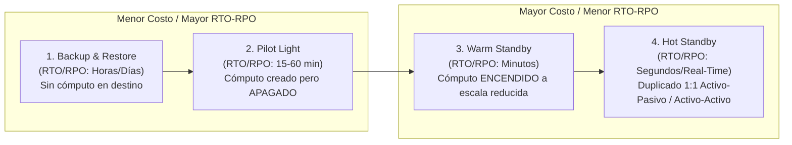

# Disaster Recovery

> [!abstract] Qué es este archivo
> Cuarta lección del módulo de resiliencia operativa. Establece la distinción técnica formal entre **Backup** y **Disaster
> Recovery (DR)**, desglosa el espectro clásico de las **cuatro estrategias de DR en AWS** (Backup & Restore, Pilot Light,
> Warm Standby y Hot Standby), y analiza los compromisos (*trade-offs*) entre **RTO, RPO, costos de infraestructura** y el
> estado operativo del cómputo en el sitio secundario.
>
> Video: **7 minutos 35 segundos** + Lectura comparativa + Los 4 niveles de estrategia.

> [!quote] La idea que ordena todo
> **“Backup is about saving your data, while disaster recovery is about keeping your entire business operational during and after a crisis.”**
> *(El backup consiste en guardar tus datos; la recuperación ante desastres consiste en mantener todo tu negocio operativo durante y después de una crisis).*

---

## Resumen en una frase

> Mientras el **backup** solo guarda datos con RTO/RPO de horas o días y exige reconstruir la infraestructura, el **disaster
> recovery** recupera la aplicación y el estado del sistema con RTO/RPO medidos en minutos o segundos, navegando un espectro
> de cuatro estrategias gobernadas por el costo y el estado del cómputo en destino: desde **Backup & Restore** (sin cómputo
> previo) y **Pilot Light** (cómputo creado pero **apagado**, 15–60 min), hasta **Warm Standby** (cómputo **encendido a escala
> mínima**, minutos) y **Hot Standby** (duplicado 1:1 activo-pasivo o activo-activo en tiempo real).

---

## 1. Backup vs. Disaster Recovery: La Distinción Fundamental

Aunque operan juntos en una estrategia integral de protección, **Backup** y **Disaster Recovery** persiguen objetivos técnicos
y de negocio completamente distintos:

| Dimensión | Backup | Disaster Recovery (DR) |
| --- | --- | --- |
| **Alcance de la recuperación** | Restaura **datos y archivos** individuales o tablas. | Recupera la **aplicación completa y el estado del sistema** (cómputo, red, configuraciones, dependencias). |
| **Objetivos de tiempo (RTO)** | Horas o días. | Minutos o segundos. |
| **Objetivos de punto (RPO)** | Horas o días (gobernado por la última copia). | Segundos o minutos (gobernado por replicación continua). |
| **Mecanismo de captura** | Copias puntuales programadas (*scheduled point-in-time*). | Replicación continua basada en cambios (*change-based, continuous replication*). |
| **Período de retención** | Retención a **largo plazo** (meses, años) por cumplimiento legal. | Retención a **corto plazo** (solo el estado más reciente para failover). |
| **Infraestructura necesaria** | Ninguna en destino; se provisiona tras la caída. | Infraestructura pre-aprovisionada (apagada, reducida o completa). |

> [!important] La falacia del backup como DR
> Tener un backup exitoso de una base de datos **no significa tener Disaster Recovery**. Si ocurre un desastre regional y
> no existen plantillas de infraestructura como código (CloudFormation/Terraform), imágenes (AMIs) ni dependencias de red
> listas en la región secundaria, el negocio permanecerá caído durante horas mientras se levanta la infraestructura. El DR
> resuelve **el cómputo, la red y el estado**, no solo los bytes de almacenamiento.

---

## 2. El Espectro de las Cuatro Estrategias de DR

La elección de una estrategia de DR en AWS es un balance estricto entre **RTO/RPO (tiempo y pérdida tolerable)** y **costo de
infraestructura ociosa**:

| Estrategia | RPO | RTO | Costo Relativo | Estado del Cómputo en Destino | Mecanismo de Activación / Failover |
| --- | --- | --- | --- | --- | --- |
| **1. Backup and restore** | Horas / Días | Horas / Días | **El más bajo** ($\$$) | **Inexistente.** Solo datos almacenados en S3 / Glacier / AWS Backup. | Provisión manual o automatizada de toda la infraestructura desde cero tras el desastre. |
| **2. Pilot light** | Decenas de minutos (15–60 min) | Decenas de minutos (15–60 min) | **Bajo - Medio** ($\$\$$) | **Aprovisionado pero APAGADO.** Instancias EC2 creadas en estado detenido (*switched-off*). | Encender instancias EC2 existentes, actualizar registros DNS/enrutamiento y escalar horizontalmente. |
| **3. Warm standby** | Minutos | Minutos | **Medio - Alto** ($\$\$\$$) | **Aprovisionado y ENCENDIDO.** Flota mínima (*scaled-down*) corriendo en producción pasiva. | Escalar la flota (*scale-out* vía Auto Scaling) para absorber el 100% del tráfico y desviar DNS. |
| **4. Hot standby** | Segundos / Tiempo real | Segundos / Casi nulo | **El más alto** ($\$\$\$\$$) | **Duplicado idéntico 1:1.** Capacidad completa corriendo permanentemente. | Conmutación inmediata de tráfico (*swap-over*) mediante Route 53 o balanceadores de carga. |

---

## 3. Desglose Técnico de cada Estrategia

### 3.1 Backup and Restore
* **Cómo opera:** Los datos se respaldan regularmente a almacenamiento duradero (Amazon S3, AWS Backup). No se mantiene cómputo ni redes activas en la región secundaria.
* **Comportamiento en desastre:** Al fallar la región primaria, se debe ejecutar infraestructura como código (CloudFormation, Terraform) para crear la VPC, balanceadores, instancias EC2 y restaurar las bases de datos desde snapshots o copias de seguridad de S3.
* **Cuándo usarlo:** Cargas de trabajo no críticas, entornos de desarrollo/pruebas, o aplicaciones que toleran horas/días de caída sin impacto severo al negocio.

### 3.2 Pilot Light (Llama Piloto)
* **La analogía:** Como la llama piloto de un calentador a gas: una pequeña flama siempre encendida lista para prender los quemadores principales cuando se abre el agua.
* **Componentes clave:**
  * **Datos:** Se replican continuamente hacia la región secundaria (ej. réplicas de lectura de RDS entre regiones o replicación continua a nivel de bloque con **AWS DRS**).
  * **Cómputo (EC2):** Los servidores críticos están aprovisionados como instancias EC2 pero en **estado apagado (*switched-off state*)**.
  * **Costo en AWS:** Las instancias EC2 apagadas **no pagan costo de cómputo** (solo se paga el volumen EBS y la replicación de datos).
* **Comportamiento en desastre:** Se envían comandos para encender las instancias EC2 ya existentes, se promueve la base de datos a maestra, y se escalan instancias adicionales si la demanda lo requiere. RTO de **15 a 60 minutos**.

### 3.3 Warm Standby (Respaldo Tibio)
* **Cómo opera:** Una versión funcional idéntica del sistema pero dimensionada a **capacidad mínima (*scaled-down*)** corre continuamente en la región de recuperación.
* **Diferencia crucial frente a Pilot Light:** En Warm Standby, las instancias EC2 **están encendidas y corriendo**. Pueden atender pruebas continuas, procesar tráfico mínimo en segundo plano o servir tareas de solo lectura.
* **Comportamiento en desastre:** Al detectar la caída del sitio principal, se desvía el tráfico hacia el sistema secundario mediante Route 53 y se dispara el **escalado horizontal automático (Auto Scaling)** para llevar la flota al tamaño de producción completa. RTO medido en **minutos**.

### 3.4 Hot Standby (Active-Passive / Multi-Site Active-Active)
* **Cómo opera:** La región secundaria contiene una copia exacta (1:1) de toda la infraestructura de producción, dimensionada para soportar el 100% de la carga de trabajo en cualquier momento.
* **Variantes de arquitectura:**
  * **Active-Passive:** El sitio secundario está al 100% de capacidad pero en espera; Route 53 conmuta todo el tráfico si el health check del sitio primario falla.
  * **Active-Active (Multi-Site):** Ambos sitios reciben tráfico productivo simultáneamente (vía Route 53 Weighted o Latency routing) y sincronizan datos en tiempo real (ej. Aurora Global Database, DynamoDB Global Tables).
* **Comportamiento en desastre:** Conmutación prácticamente instantánea (*near-real-time*). RTO y RPO en el orden de segundos o cero. Máximo costo operativo.

---

## 4. Las Ventajas del Cloud en Disaster Recovery

El video destaca por qué implementar DR en AWS transforma radicalmente la viabilidad de la continuidad del negocio en
comparación con centros de datos locales (on-premises):

1. **Eliminación del costo de capital (CapEx):** On-premises exige comprar servidores idénticos que permanecen ociosos en un segundo datacenter. En AWS, con estrategias como Pilot Light, solo se paga cómputo al momento del desastre.
2. **Infraestructura virtualizada y descartable:** Servidores, redes y almacenamiento se definen como código y se aprovisionan en minutos vía API.
3. **Simulacros y pruebas de DR no destructivas (*Testing*):** En la nube es posible levantar el entorno secundario en una VPC aislada, probar el failover completo, certificar la recuperación y destruir los recursos inmediatamente después, pagando solo por las pocas horas que duró el simulacro.
4. **Automatización nativa:** Reglas automáticas de ciclo de vida, replicación nativa entre regiones (S3 CRR, RDS Read Replicas, Aurora Global Database) y replicación continua de servidores con **AWS Elastic Disaster Recovery (DRS)**.

---

## 5. Cierre Conceptual: Cuadro de Decisión de DR

| Requisito del Negocio | RTO / RPO | Estrategia Elegida | Estado de EC2 en Destino | Justificación de Elección |
| --- | --- | --- | --- | --- |
| Máximo ahorro de costos; caída tolerable de 24+ horas. | Horas a Días | **Backup and Restore** | Inexistente | Solo paga almacenamiento en S3; reconstruye todo si hay fallo. |
| Negocio crítico; tolera entre 15 y 60 min; presupuesto medio. | 15 – 60 minutos | **Pilot Light** | **Creado pero APAGADO** | Cero costo de cómputo en AWS hasta encender las máquinas. |
| Servicios financieros o transaccionales; failover en pocos minutos. | Minutos | **Warm Standby** | **ENCENDIDO a baja escala** | Menor RTO; el cómputo ya corre y solo requiere escalar horizontalmente. |
| Tolerancia cero a pérdida de datos; negocio online 24/7 de misión crítica. | Segundos / Casi nulo | **Hot Standby** | **Capacidad completa 1:1** | Conmutación inmediata sin esperar a que el cómputo levante ni escale. |

---

## 6. Traducción del contenido

> [!info] Sección de referencia (opcional)
> Traducción fiel y completa de las fuentes de Skill Builder. Se recomienda estudiar las secciones **1 a 5** y repasar
> las reglas de examen en la sección **7**.

### 6.1 Video principal (transcripción)

Entonces, al diferenciar claramente entre los términos **backup y disaster recovery**, como prometimos que haríamos al
principio del módulo: **backup** es donde realmente solo estamos **almacenando los datos que nuestras aplicaciones están
usando**, ¿bien?

Entonces, debido a que todavía podríamos necesitar levantar algún nivel de infraestructura en el caso del backup —porque solo
son nuestros datos los que estamos respaldando—, por eso los **objetivos de recuperación pueden ser mucho más largos** que en
algunos de los escenarios más tradicionales de recuperación ante desastres, ¿de acuerdo?

Mientras que cuando hablamos del término **disaster recovery**, esto tiene que ver con **poner en marcha nuestras aplicaciones
o nuestros servicios nuevamente**, y estos pueden ser otros tipos de infraestructura que necesitamos más allá y por encima de
solo los datos. Y así, como dijimos, esto tiene que ver con **recuperar el estado de la aplicación y del sistema** más que con
solo respaldar los datos.

Y esa es parte de la razón por la cual, debido a que ya podríamos tener alguna otra infraestructura en ejecución mientras
tanto, el **RPO y el RTO comienzan a disminuir a medida que tienes más recursos aprovisionados** con anticipación, ¿bien?

Entonces, con respecto a RPO y RTO y los diferentes tipos de estrategias de backup y recuperación: fíjense que **tenemos 4
aquí**, desde **backup and restore** hasta **hot standby**. Tenemos:
1. **Backup and restore**
2. **Pilot light**
3. **Warm standby**
4. **Hot standby**

Ahora, las diferencias aquí a las que me gustaría que presten atención son las **designaciones o medidas de tiempo relativo
para cuánto tardan el RPO y el RTO en cada una**. Y también el **costo relativo de cada una** con respecto a ese objetivo de
tiempo y punto de recuperación, y luego también vamos a hablar sobre la **cantidad de infraestructura que tenemos aprovisionada**
en términos de poder tener nuestros recursos o servicios en funcionamiento.

Ahora fíjense que con **backup and restore**, el RPO y el RTO generalmente están en términos de **algún número de horas**,
porque solo estamos respaldando nuestros datos. Esto realmente no está tan preocupado por la infraestructura que tenemos que
levantar para ejecutar nuestra aplicación. Por eso usaríamos esto para casos de uso de menor prioridad, pero realmente uno de
los mayores impactos es el **costo**: este va a ser el **menor costo** porque tenemos los mayores objetivos de tiempo y punto
de recuperación, y también tenemos la menor cantidad de aprovisionamiento de infraestructura de antemano: **solo estamos
almacenando los datos**.

Ahora hablemos de **Pilot light**. El RPO y el RTO son de **decenas de minutos**, no una cuestión de horas. Entonces, como
pueden imaginar, para obtener este método de recuperación más receptivo, eso **nos va a costar más**, y parte de la razón es
que tenemos algún nivel de infraestructura en funcionamiento; no solo estamos almacenando los datos. Tenemos infraestructura
mínima en el sitio de destino, pero tenemos más infraestructura que con backup and restore. Y al tener algún nivel de
infraestructura ya aprovisionado, esto es lo que nos ayuda a **disminuir nuestro RTO y RPO a algo más ideal**, pero también
viene a un costo relativamente mayor porque ahora tenemos otros tipos de recursos ejecutándose, aunque sea a un nivel muy mínimo.

Con **warm standby**, podemos ver que obtenemos algo más de optimización en términos de nuestro RPO y RTO: ahora es una cuestión
de **minutos en lugar de decenas de minutos**. Fíjense que tenemos un costo relativo mayor en comparación con Pilot light. Por
ejemplo, con **Pilot light**, podríamos tener una instancia EC2 creada como recurso de cómputo, **pero puede no estar en
ejecución (not running)**. Esencialmente tenemos algo allí, pero no está operando. Mientras que con **warm standby**, podemos
tener una instancia EC2 creada y **esa instancia está en ejecución (running)**. Entonces, como pueden imaginar, debido a que la
instancia se está ejecutando, eso es parte de lo que contribuye a que tenga un costo relativo más alto que Pilot light.

Ahora bien, tengan en cuenta que tanto con warm standby como con pilot light, ninguno de los dos puede estar escalado a la
intensidad con la que se estaban ejecutando nuestros recursos en el sitio de origen. Por lo tanto, con warm standby y con pilot
light, **es posible que tengamos que escalar horizontalmente (*scale out*) esas instancias** para satisfacer la demanda que
llegaba a nuestros recursos principales.

Ahora con **hot standby**, aquí es donde tenemos **RPO y RTO casi en tiempo real**. Y eso se debe a que esencialmente tenemos
un **duplicado de cualquier infraestructura que tengamos en ejecución en el sitio principal**; tenemos un duplicado de eso en
AWS que es esencialmente **completamente operativo**, de modo que si tenemos una interrupción en lo que se está ejecutando en
las instalaciones locales, podemos conmutar eso hacia el extremo en ejecución en AWS. Pero debido a que eso es completamente
funcional y está ejecutándose en su mayor parte, es por eso que **tenemos el costo más alto para hot standby**.

Y elegimos las estrategias en función de los requisitos que admite la organización o el caso de uso.

Con respecto a las ventajas cuando hablamos de backup y disaster recovery en la nube en comparación con las implementaciones
locales más tradicionales:
* No tenemos ese costo inicial por nuestro hardware.
* No tenemos tanta sobrecarga en la administración y creación de más recursos de cómputo como máquinas virtuales u otros tipos de servicios.
* No tenemos que lidiar con tantas de las limitaciones que tendríamos en un escenario on-premises.

Mientras que cuando hablamos de backup y disaster recovery en la nube, tenemos un **modelo de costos diferente** porque no
estamos pagando ese costo inicial. No tenemos tanta sobrecarga en la gestión porque nuestros recursos ahora están virtualizados
y se pueden crear y destruir mucho más fácilmente. Tenemos muchas características complementarias, como poder **automatizar
ciertos aspectos** de la forma en que usamos nuestro almacenamiento y otros recursos. Y, en última instancia, nos brinda otras
comodidades, como poder **probar mucho más fácilmente**: si tenemos que probar nuestra estrategia de backup y DR, lo hacemos de
nuevo con recursos virtualizados, y ahora que hay mucha menos sobrecarga en la gestión, aprovisionamiento y despliegue, es por
eso que en la nube podemos tener **RTOs y RPOs mucho más óptimos**.

*Duración del video: **7 minutos, 35 segundos**.*

### 6.2 Lectura: ¿En qué se diferencia Disaster Recovery de Backup?

Si bien backup y disaster recovery son conceptos relacionados que trabajan juntos en las estrategias de protección de datos,
cumplen diferentes propósitos:

| Backup | Disaster Recovery |
| --- | --- |
| Restaura datos y archivos | Recupera la aplicación completa y el estado del sistema |
| Objetivos de recuperación de horas o días | RPO de segundos, RTO de minutos |
| Período de retención más prolongado | Replicación continua basada en cambios |

### 6.3 Backup y Disaster Recovery: RPO y RTO (Los 4 Marcadores)

RPO y RTO son métricas críticas que definen los requisitos de disaster recovery y guían la planificación de la continuidad
del negocio. El RTO y RPO necesarios varían según la aplicación y los requisitos organizacionales. Tienes una amplia gama de
opciones para considerar y aplicar:

1. **Backup and restore:** Proporciona protección de datos rentable pero tiene marcos temporales de RPO y RTO más prolongados.
2. **Pilot light:** La arquitectura de DR Pilot light es una buena opción para cumplir con los requisitos de RPO y RTO. Es
   adecuada para servicios críticos de negocio que pueden soportar **15–60 minutos de tiempo de inactividad**. Proporciona una
   opción de costo de rango medio para DR. Tenga en cuenta que en este escenario de DR, sus recursos se encuentran en un **estado
   apagado (*switched-off state*)**, lo que **no genera costos en AWS**. Luego, cuando ocurre un desastre, inicia sus recursos
   según sea necesario.
3. **Warm standby:** Proporciona plazos de RPO y RTO más cortos como parte de la solución. Los costos asociados aumentan a medida
   que los recursos son más significativos mientras se prepara para la conmutación por error y la recuperación crítica en caso de
   un desastre.
4. **Hot standby:** Proporciona una arquitectura activo-pasivo. El sistema en espera incluye los recursos para satisfacer las
   demandas de la aplicación y proporcionar una conmutación por error casi en tiempo real en caso de una interrupción del sistema.

---

## 7. Para el examen (SAP-C02)

> [!important] Lo que hay que retener
> 1. **Pilot Light vs. Warm Standby (La distinción reina):**
>    * En **Pilot Light**, los servidores EC2 existen pero están **APAGADOS (stopped/switched-off)**. No pagan cómputo, solo almacenamiento EBS. RTO de **15 a 60 minutos**.
>    * En **Warm Standby**, los servidores EC2 están **ENCENDIDOS y CORRIENDO (running)** a escala reducida (*scaled-down fleet*). Pagan cómputo continuo. RTO de **minutos**.
> 2. **Ambos requieren Scale-Out:** Ni Pilot Light ni Warm Standby están dimensionados para el 100% de la carga productiva. Ambos dependen de **Auto Scaling** para alcanzar la capacidad completa tras el failover.
> 3. **Hot Standby (Active-Passive vs Active-Active):**
>    * Si el enunciado dice que el sistema secundario debe absorber el tráfico de inmediato sin esperar que el cómputo levante ni escale, es **Hot Standby**.
>    * Active-Active (Multi-site) distribuye tráfico continuamente entre dos regiones (Route 53 latency/weighted + replicación bidireccional).
> 4. **Backup and Restore es solo para RTO/RPO de horas/días:** Si el enunciado pide una solución de *menor costo* y tolera caídas prolongadas (ej. 24 horas), la respuesta siempre es Backup & Restore con S3 y CloudFormation.
> 5. **Replicación continua en Pilot Light:** En Pilot Light, los **datos sí se replican continuamente** (ej. AWS DRS o RDS Cross-Region Read Replica). Lo que está apagado es el **cómputo**. Si los datos no se replicaran continuamente, no sería Pilot Light sino Backup and Restore.
> 6. **Pruebas de DR en AWS:** AWS permite validar planes de DR sin impactar producción clonando VPCs y recursos mediante CloudFormation y AWS DRS en modo de prueba (*Drill*).

> [!warning] Trampa clásica del examen
> **Escenario:** Una compañía necesita diseñar una solución de recuperación ante desastres entre dos regiones de AWS para su aplicación web crítica. La empresa exige un **RTO no mayor a 30 minutos** y necesita **minimizar los costos de cómputo** en la región de recuperación mientras la región principal esté operativa y saludable.
>
> * **Respuesta trampa:** "Desplegar un entorno Warm Standby con instancias EC2 de tamaño t3.micro corriendo continuamente y configurar Auto Scaling para cambiar el tipo de instancia a c5.xlarge al detectar la caída."
> * **Por qué falla:** Warm Standby mantiene cómputo encendido pagando costos 24/7 y cambiar el tipo de instancia (*instance type*) en caliente o al escalar es lento y complejo.
> * **La respuesta correcta:** Implementar una arquitectura **Pilot Light**. Mantener la replicación continua de bases de datos hacia la región secundaria, aprovisionar las instancias EC2 en **estado detenido (stopped / switched-off)** para tener **costo cero de cómputo**, y automatizar el encendido y escalado horizontal de la flota mediante Auto Scaling y scripts de recuperación al momento del desastre (cumple holgadamente el RTO de 30 minutos dentro del rango de 15–60 min).

---

## Relacionado

- [[AWS Solutions Architect Advanced - Operational Resilience]] *(índice del módulo)*
- [[Course Overview - Operational Resilience]] — lección 01: encuadre de RTO/RPO y métricas de DR
- [[Gathering the Customer Requirements - Resilience]] — lección 02: el caso del Data Lake y requerimientos de recuperación
- [[Building a Data Protection Strategy]] — lección 03: el marco de protección en 5 capas y el rol de AWS DRS
- [[2.2 Diseñar una solución para garantizar la continuidad de actividades]] — tarea principal del SAP-C02 para estrategias de DR
- [[1.3 Diseñar arquitecturas fiables y resistentes]] — arquitecturas multi-región y tolerancia a fallos
- [[1.5 Determinar las estrategias de optimización de costos y visibilidad]] — costos de infraestructura ociosa en DR
- [[Guia AWS]] — pesos y tareas oficiales del SAP-C02
- Siguiente paso del módulo: **Lección 05**.

---

## Registro de integración

| Fecha | Qué llegó | Dónde se integró |
| --- | --- | --- |
| 29/10/2026 | Lección 04 completa: Video transcript (7 min 35 s), tabla Backup vs DR, y detalle de los 4 niveles de estrategia de DR | Nota completa (`Disaster Recovery.md`), secciones 1 a 7 |

**Discrepancias y vacíos registrados (no corregidos):**
1. **La fuente no incluye diagramas de arquitectura por estrategia:** La lección enumera las cuatro estrategias en formato de marcadores interactivos. Se complementa con un diagrama Mermaid en la §2 que sintetiza el espectro RTO/RPO vs. Costo.
2. **Denominación Active-Passive vs Active-Active:** La lectura de la fuente define *Hot Standby* como "active-passive architecture"; el video del instructor aclara que puede extenderse a escenarios casi en tiempo real / activo-activo en la nube. Se integran ambas perspectivas en las §3.4 y §5.
