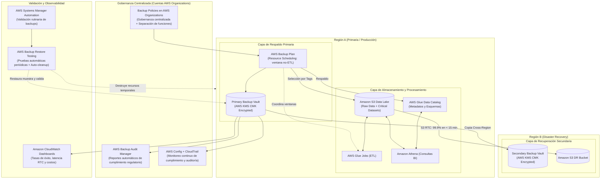
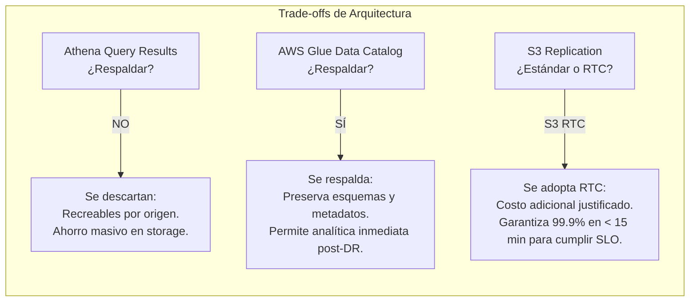

# Finished Architecture - Resilience

> [!abstract] Qué es este archivo
> Novena lección del módulo de resiliencia operativa y **capstone de arquitectura**. Cierra el caso práctico presentado
> en la lección 02 para la institución financiera, integrando todos los componentes del curso en una **arquitectura de
> Data Lake resiliente en Amazon S3**. Despliega **AWS Backup** multi-cuenta gobernado centralmente por **AWS Organizations**,
> dos bóvedas multi-región cifradas con **KMS CMKs**, replicación con **S3 Replication Time Control (S3 RTC)** para predecir
> tiempos de SLO, pruebas automatizadas con **AWS Backup Restore Testing** y **SSM Automation**, y auditoría continua
> mediante **AWS Backup Audit Manager**, **AWS Config** y **CloudWatch**.
>
> Video: **5 minutos 31 segundos** + Recapitulación arquitectónica + Análisis de trade-offs.

> [!quote] La idea que ordena todo
> **“Un backup solo es tan bueno como tu capacidad demostrada para restaurar desde él.”**
> La arquitectura final demuestra que proteger un Data Lake de petabytes no es cuestión de respaldar todo a ciegas:
> requiere **clasificación por tags**, **replicación garantizada (S3 RTC)**, sincronización del **Glue Data Catalog**,
> y **simulacros automatizados de restauración que se autolimpian**, logrando cumplimiento normativo sin arruinar el
> rendimiento analítico ni disparar los costos.

---

## Resumen en una frase

> La arquitectura final resuelve la resiliencia del Data Lake financiero implementando **AWS Backup** gobernado por
> **AWS Organizations** con dos bóvedas multi-región (**KMS CMKs**), replicación de datos crudos con **S3 RTC** (99.9%
> en $< 15\text{ min}$), protección selectiva por **Tags** (respaldando el **Glue Data Catalog** y excluyendo resultados de
> Athena), ventanas coordinadas de backup con **AWS Glue**, pruebas de restauración que limpian recursos temporales
> (**Restore Testing** + **SSM Automation**) y reportes regulatorios vía **AWS Backup Audit Manager**.

---

## 1. La Arquitectura Resiliente Integrada

El diseño final orquesta los servicios para cumplir con los seis requisitos del cliente sin degradar el rendimiento:

---

## 2. Componentes de la Solución y Decisiones de Diseño

### 2.1 Gobernanza Centralizada Multi-Cuenta con AWS Organizations
* **Implementación:** Se definen **Backup Policies** dentro de **AWS Organizations**.
* **Beneficio:** Las políticas de backup se gestionan y auditan centralmente desde la cuenta de administración o de servicios compartidos, propagándose automáticamente a todas las cuentas miembros del Data Lake.
* **Separación de funciones (*Separation of Duties*):** Los ingenieros de datos en las cuentas operativas no pueden modificar ni eliminar las políticas de retención corporativas.

### 2.2 Estrategia Selectiva de Backup basada en Etiquetas (Tags)
* **El problema:** Respaldar indiscriminadamente petabytes de un data lake es inviable financieramente.
* **Mecanismo:** El Backup Plan aplica únicamente a recursos que tengan asignadas etiquetas específicas (ej. `DataClassification = Critical`, `BackupPlan = Required`).
* **Qué se respalda:**
  1. **Datos crudos esenciales para el negocio (*Business essential raw data*).**
  2. **Datos transformados (*Transformed data*).**
  3. **Datos de referencia críticos (*Critical reference data*).**
  4. **AWS Glue Data Catalog:** Se respalda explícitamente para preservar esquemas, particiones y definiciones de tablas, garantizando que Athena y Glue puedan operar de inmediato tras un desastre.
* **Qué se excluye (Trade-off explícito):**
  * **Resultados de consultas de Amazon Athena (*Athena Query Results*):** Se tomó la decisión consciente de **no respaldarlos**. El costo de almacenamiento masivo superaba ampliamente el beneficio, ya que estos resultados pueden regenerarse fácilmente re-ejecutando las consultas sobre los datos de origen.

### 2.3 Bóvedas Multi-Región y Cifrado con KMS CMK
* **Primary Vault en Región A:** Gestiona los puntos de recuperación diarios y semanales de producción.
* **Secondary Vault en Región B:** Destino de Disaster Recovery (DR). AWS Backup replica automáticamente los recovery points entre regiones (*Cross-Region Copy*).
* **Cifrado riguroso:** Ambas bóvedas están cifradas con **AWS KMS utilizando Customer Managed Keys (CMKs)** con rotación automática anual, cumpliendo con los mandatos regulatorios de la industria bancaria.

### 2.4 Replicación Predecible con S3 Replication Time Control (S3 RTC)
* **El desafío del SLO:** La replicación estándar de S3 (Cross-Region Replication - CRR) no ofrece garantías de tiempo; un retraso impredecible violaría los nuevos SLOs del banco.
* **La solución:** Se activó **S3 Replication Time Control (S3 RTC)** sobre los datasets críticos del bucket crudo.
* **Garantía técnica:** S3 RTC garantiza contractualmente que el **99.9% de los objetos nuevos se replican en un plazo máximo de 15 minutos**, respaldado por un SLA formal.
* **Justificación del costo:** Aunque S3 RTC tiene un costo incremental por GB replicado y cargos por métricas, el análisis de impacto al negocio justificó el gasto para garantizar la disponibilidad inmediata de datos en la región secundaria.

### 2.5 Pruebas Automatizadas de Restauración: Restore Testing y SSM Automation
* **AWS Backup Restore Testing:**
  * Define un *Testing Plan* periódico totalmente automatizado.
  * AWS Backup selecciona muestras de datos respaldados, las restaura en un entorno de pruebas, cronometra la duración del trabajo y valida la integridad de los datos.
  * **Autolimpieza (*Auto-cleanup*):** Al finalizar la prueba, **elimina y destruye automáticamente los recursos restaurados temporales**, evitando costos fantasma de almacenamiento o cómputo.
* **AWS Systems Manager Automation:** Ejecuta runbooks complementarios para validar la consistencia de los sistemas y coordinar pruebas operativas regulares.

### 2.6 Coordinación de Ventanas y Rendimiento (Resource Scheduling)
* **Prevención de colisiones:** Las operaciones de backup compiten por I/O si se ejecutan durante las ventanas de procesamiento analítico.
* **Programación:** Mediante **Resource Scheduling** en AWS Backup, las ventanas de inicio y finalización (*start within / complete within*) se calibraron para ejecutarse en horarios valle, desfasadas respecto a los jobs de **AWS Glue ETL** y las horas de mayor actividad de **Amazon Athena**.

### 2.7 Auditoría Demostrable: Config, CloudTrail y Backup Audit Manager
* **AWS Backup Audit Manager:** Genera informes automatizados periódicos que rastrean métricas de cumplimiento: frecuencia de backup, retención legal, antigüedad de puntos de recuperación (*recovery point age*) y estados de Vault Lock.
* **AWS Config:** Monitorea de forma continua la deriva de configuración para asegurar que ningún bucket crítico pierda sus etiquetas de backup.
* **Amazon CloudWatch Dashboards:** Paneles centralizados que visualizan tasas de éxito de trabajos, latencia de replicación S3 RTC y consumo presupuestario.

---

## 3. Matriz de Cumplimiento de Requisitos

| # | Requisito del Cliente (Lección 02) | Componente que lo Resuelve en la Arquitectura Final | Justificación Técnica |
| --- | --- | --- | --- |
| **1** | **Scalable backup solution** | **AWS Backup + AWS Organizations** | La política escala automáticamente a nuevas cuentas y datasets etiquetados sin rediseño. |
| **2** | **Multi-level data protections** | **Etiquetado por criticidad + S3 RTC** | Solo se respaldan capas esenciales; replicación rápida de 15 min solo para datos críticos. |
| **3** | **Automated procedures** | **Backup Plans + Restore Testing + SSM** | Ejecución desatendida de respaldos, pruebas periódicas de restauración y autolimpieza. |
| **4** | **Immutable backups** | **Backup Vaults con KMS CMK + Vault Lock** | Bóvedas multi-región protegidas con claves administradas por el cliente y bloqueo WORM. |
| **5** | **Comprehensive audit trails** | **Backup Audit Manager + Config + CloudTrail** | Reportes automatizados de conformidad y registro inmutable de llamadas de API. |
| **6** | **Cost optimization** | **Exclusión de Athena Results + Tags + Cleanup** | Ahorro masivo descartando datos recreables y destruyendo recursos de testing. |

---

## 4. Trade-offs y Decisiones de Diseño

| Decisión Arquitectónica | Opción Elegida | Alternativa Descartada | Justificación de la Elección |
| --- | --- | --- | --- |
| **Resultados de Athena** | **Excluir del backup** | Respaldar bucket de resultados | Los resultados son transitorios y se reproducen re-ejecutando la consulta; almacenarlos en petabytes es un gasto inútil. |
| **Metadatos de Glue** | **Respaldar el Data Catalog** | Confiar en redescubrimiento con Crawlers | Volver a ejecutar Glue Crawlers sobre petabytes tras un desastre toma horas y puede alterar esquemas; el backup del catálogo es inmediato. |
| **Replicación Cross-Region** | **S3 Replication Time Control (S3 RTC)** | Replicación estándar CRR sin SLA | La replicación estándar es de mejor esfuerzo (*best-effort*); S3 RTC garantiza SLA formal de 15 min para satisfacer los nuevos SLOs bancarios. |
| **Pruebas de Recuperación** | **AWS Backup Restore Testing nativo** | Scripts manuales o lambdas caseras | Restore Testing es totalmente administrado, cronometra la restauración y **destruye automáticamente los recursos de prueba**. |

---

## 5. Cierre Conceptual: El Ciclo de Vida Resiliente del Data Lake

| Etapa | Responsable | Mecanismo en AWS | Resultado para el Negocio |
| --- | --- | --- | --- |
| **1. Ingesta** | **Amazon S3** | Feeds de socios, sensores y cargas manuales. | Repositorio central escalable en la nube. |
| **2. Clasificación** | **Etiquetas (Tags)** | Asignación basada en criticidad empresarial. | Discriminación de costos: solo lo crítico se respalda. |
| **3. Protección** | **AWS Backup** | Backup Policies en Organizations hacia Vaults A y B. | Gobernanza centralizada y redundancia geográfica. |
| **4. Replicación** | **S3 RTC** | Transferencia predecible en menos de 15 minutos. | Cumplimiento estricto de SLOs de disponibilidad de datos. |
| **5. Verificación** | **Restore Testing + SSM** | Pruebas periódicas de restauración con auto-cleanup. | Certeza demostrada de recuperación sin costos ociosos. |
| **6. Auditoría** | **Audit Manager + Config** | Reportes de conformidad contra marcos normativos. | Evidencia lista para auditores regulatorios. |

---

## 6. Traducción del contenido

> [!info] Sección de referencia (opcional)
> Traducción fiel de las fuentes de Skill Builder. Se recomienda estudiar las secciones **1 a 5** y repasar las reglas de
> examen en la sección **7**.

### 6.1 Final Architecture (Transcripción del Video)

**Melissa examina las soluciones para la arquitectura resiliente de BI de la compañía financiera.**

Una compañía financiera necesita mejorar la resiliencia de su infraestructura de BI. Los nuevos objetivos de nivel de servicio
(SLOs) los están obligando a reconsiderar su estrategia de backup. Necesitan una solución de respaldo que pueda escalar con su
data lake en crecimiento mientras mantiene el rendimiento, controles granulares sobre los datos, capacidades integrales de
monitoreo y auditoría, y automatización para manejar el backup y la recuperación de rutina.

#### Transcripción

Ahora que entendemos sus requisitos, permítanme guiarlos a través de la **arquitectura resiliente de data lake** que hemos
diseñado. Lo que hace que esta solución sea elegante es cómo **desafía su enfoque tradicional de no hacer backup de los data
lakes**, mientras sigue manteniendo las cosas **rentables y con alto rendimiento**.

Comencemos con la estrategia de backup, que es el núcleo de nuestro diseño. Estamos implementando **AWS Backup como nuestro
servicio central de respaldo**. Lo inteligente de este enfoque es cómo estamos utilizando **políticas de backup en AWS
Organizations** para administrar y aplicar planes de backup de forma centralizada en todas las cuentas. Esto nos brinda una
**gobernanza de backup consistente mientras mantiene una clara separación de funciones**.

La arquitectura utiliza **etiquetas (tags)** para identificar conjuntos de datos críticos que necesitan protección. En lugar de
respaldar todo, estamos siendo selectivos: los buckets de S3 que contienen **datos transformados, datos de referencia críticos
y datos crudos esenciales para el negocio se etiquetan para backup**. Este enfoque mantiene los costos manejables mientras asegura
que protejamos lo que más importa.

Para la implementación real del backup, estamos creando **dos bóvedas de AWS Backup**: la **bóveda primaria en la Región A**
maneja los backups regulares, mientras que una **bóveda secundaria en la Región B sirve como nuestro destino de Disaster
Recovery (DR)**. Ambas bóvedas utilizan **AWS KMS con claves administradas por el cliente (CMK)** para el cifrado. Esta
configuración satisface sus requisitos de cumplimiento para la protección de datos y nos brinda la **redundancia geográfica**
que necesitan.

Aquí es donde se pone aún más interesante: estamos usando **replicación de S3 para su data lake de datos crudos**, pero con una
vuelta de tuerca. En lugar de replicar todo, estamos utilizando **S3 Replication Time Control (S3 RTC)** para conjuntos de datos
críticos. Esto nos brinda **tiempos de replicación predecibles** y ayuda a cumplir con sus nuevos SLOs. Sí, cuesta un poco más,
pero cuando analizamos el impacto en el negocio de la disponibilidad retrasada de los datos, el costo estaba totalmente
justificado para ellos.

Para el monitoreo y la automatización, estamos implementando varios componentes clave. **AWS Systems Manager Automation** maneja
la validación y las pruebas rutinarias de backup. Hemos creado **paneles personalizados de CloudWatch** que rastrean las tasas de
éxito de los backups, la latencia de replicación y los costos de almacenamiento. Estas métricas alimentan sus requisitos de
reportes de SLO.

Ahora hablemos de la recuperación, porque un backup es tan bueno como su capacidad para restaurar a partir de él.
Afortunadamente, AWS Backup tiene eso incorporado con **pruebas de restauración (Restore Testing)**. Creas un plan de pruebas,
estableces con qué frecuencia se ejecuta y eliges los recursos a incluir. **AWS Backup restaura automáticamente datos de muestra,
monitorea la duración de los trabajos y puede validar los resultados. Cuando finalizan las pruebas, limpia los recursos
temporales para evitar costos adicionales.**

Un desafío que tuvimos que resolver fue **mantener un rendimiento constante durante las operaciones de backup**. Nuestra
solución utiliza la **programación de recursos (Resource Scheduling) de AWS Backup** para coordinar las ventanas de backup con
sus procesos de ETL. Esto asegura que los backups no interfieran con sus ventanas críticas de procesamiento de datos.

Para la gobernanza y el cumplimiento, estamos aprovechando **AWS Config** para monitorear el cumplimiento de los backups y **AWS
CloudTrail** para pistas de auditoría completas. También hemos configurado informes de cumplimiento automatizados utilizando
**AWS Backup Audit Manager**. Estos informes rastrean métricas como la frecuencia de backup, el cumplimiento de la retención y la
antigüedad del punto de recuperación.

Ahora analicemos algunos **trade-offs (compensaciones)** que consideramos:
* Evaluamos respaldar los **resultados de consultas de Amazon Athena**, pero decidimos **no hacerlo**, ya que estos se pueden recrear a partir de los datos de origen; el costo de almacenamiento superaba el tiempo ahorrado en la recreación.
* Sin embargo, **sí estamos respaldando su AWS Glue Data Catalog** para preservar las definiciones de tablas y los metadatos.

La belleza de este diseño es su **flexibilidad**. A medida que su data lake crece, la estrategia de backup escala con él: las
nuevas fuentes de datos solo necesitan las etiquetas correctas para heredar las políticas de backup, y si sus SLOs cambian,
podemos ajustar las frecuencias de backup y los períodos de retención a través de AWS Organizations sin tocar los recursos
individuales.

Lo que me gusta especialmente de esta solución es cómo equilibra la protección con la practicidad. Obtienen la resiliencia que
necesitan para sus datos críticos mientras mantienen costos y rendimiento razonables. Las pruebas automatizadas y el monitoreo
les dan confianza en sus capacidades de recuperación, y los informes de cumplimiento los ayudan a demostrar que están cumpliendo
con su obligación regulatoria.

Esta arquitectura los prepara para el éxito tanto ahora como en el futuro: tienen la protección de datos que necesitan, la
capacidad de demostrar el cumplimiento y una base que puede evolucionar a medida que cambian sus requisitos comerciales.

*Duración del video: **5 minutos, 31 segundos**.*

### 6.2 Architecture Recap (Puntos Literales de la Fuente)

* Implementar **AWS Backup** como servicio central de respaldo.
* Crear **dos bóvedas de AWS Backup**: la bóveda principal en la Región A maneja copias de seguridad regulares, mientras que una bóveda secundaria en la Región B sirve como destino de DR.
* Aplicar políticas de backup en **AWS Organizations** para administrar y aplicar planes de backup de forma centralizada entre cuentas.
* Utilizar **etiquetas (tags)** para identificar conjuntos de datos críticos que necesitan protección; mantiene los costos manejables mientras asegura proteger los datos más importantes.
* Aprovechar **AWS KMS** con claves administradas por el cliente (CMK) para el cifrado.
* Utilizar **AWS Systems Manager Automation** para manejar la validación y pruebas rutinarias de backup.
* Crear **paneles de CloudWatch personalizados** que rastreen tasas de éxito de backup, latencia de replicación y costos de almacenamiento.
* **AWS Backup** restaura automáticamente los datos, monitorea la duración de los trabajos y valida los resultados para necesidades de recuperación.
* Usar la **programación de recursos de AWS Backup** para coordinar las ventanas de backup con los procesos de ETL y mantener el rendimiento en horas pico.
* Aprovechar **AWS Config** para monitorear el cumplimiento de backup y **AWS CloudTrail** para pistas de auditoría integrales.

---

## 7. Para el examen (SAP-C02)

> [!important] Lo que hay que retener
> 1. **S3 Replication Time Control (S3 RTC):** Si una pregunta del examen exige replicación entre regiones en Amazon S3 con **garantía estricta de tiempo (RPO predecible de 15 minutos)** para cumplir con normativas o SLOs, la respuesta correcta es habilitar **S3 RTC**. Ofrece un compromiso del **99.9% de objetos replicados en $< 15$ minutos**.
> 2. **Restore Testing con Limpieza Automática:** La forma recomendada por AWS para validar que los backups funcionan sin acumular costos de almacenamiento ni requerir scripts manuales es **AWS Backup Restore Testing**. Levanta una muestra, valida y **destruye automáticamente los recursos creados**.
> 3. **Qué respaldar en un Data Lake de S3:**
>    * **SÍ:** Datos crudos irreemplazables, datos transformados consolidados y el **AWS Glue Data Catalog** (esquemas y particiones).
>    * **NO:** Resultados de consultas de Athena (*query results*), logs temporales o datos de staging transitorios fácilmente reproducibles.
>    * **Mecanismo:** Selección automática por **Tags** vinculada al Backup Plan.
> 4. **Gobernanza Multi-Cuenta (Backup Policies):** Las políticas de backup administradas desde **AWS Organizations** aseguran que las cuentas miembros no puedan saltarse los planes de retención ni borrar puntos de recuperación protegidos por Vault Lock.
> 5. **Coordinación de Cargas (Resource Scheduling):** Para evitar que el proceso de backup compita por ancho de banda y cuotas de API con trabajos de **AWS Glue ETL** o consultas masivas en **Amazon Athena**, se deben programar ventanas de backup que inicien en horarios de baja demanda.
> 6. **Bóvedas Multi-Región con KMS CMK:** Implementar bóvedas separadas en Región A y Región B con replicación automática cruzada (*Cross-Region Backup*) y cifradas mediante claves gestionadas por el cliente (**Customer Managed Keys - CMKs**) para cumplir regulaciones financieras de soberanía y custodia.

> [!warning] Trampa clásica del examen
> **Escenario:** Un banco opera un Data Lake de 5 PB en Amazon S3 en `us-east-1` procesado por AWS Glue y consultado por Amazon Athena. La entidad firma un nuevo acuerdo con reguladores donde se compromete a tener una copia exacta de los datos financieros en `us-west-2` con un **RPO no mayor a 15 minutos** y la capacidad de reanudar consultas analíticas de inmediato en caso de fallo regional.
>
> * **Respuesta trampa:** "Configurar S3 Cross-Region Replication (CRR) estándar hacia `us-west-2` y crear un job diario de AWS Glue Crawler en la región secundaria para reconstruir el catálogo."
> * **Por qué falla:** S3 CRR estándar es de mejor esfuerzo (*best-effort*) y **no garantiza que los objetos se repliquen en menos de 15 minutos** bajo cargas pesadas. Además, reconstruir el Glue Catalog con Crawlers sobre 5 PB puede tomar horas o días, violando el RTO analítico.
> * **La respuesta correcta:** Habilitar **S3 Replication Time Control (S3 RTC)** en las reglas de replicación del bucket (garantiza el 99.9% en $< 15$ minutos). Utilizar **AWS Backup** con políticas de AWS Organizations para respaldar el **AWS Glue Data Catalog** hacia una bóveda secundaria en `us-west-2`, garantizando que tanto los datos como los esquemas estén sincronizados y disponibles para Athena de inmediato.

---

## Relacionado

- [[AWS Solutions Architect Advanced - Operational Resilience]] *(índice del módulo)*
- [[Course Overview - Operational Resilience]] — lección 01: encuadre de RTO/RPO, DR y SLAs
- [[Gathering the Customer Requirements - Resilience]] — lección 02: el caso de negocio del Data Lake financiero
- [[Building a Data Protection Strategy]] — lección 03: marco en 5 capas de protección
- [[Disaster Recovery]] — lección 04: estrategias de DR (Pilot Light, Warm Standby)
- [[Disaster Recovery Strategies]] — lección 05: arquitectura de AWS Backup, PITR y Vaults
- [[AWS Systems Manager]] — lección 06: SSM Automation para validación de backups
- [[AWS Service Level Agreements]] — lección 07: SLAs y disponibilidad compuesta
- [[Key Performance Indicators]] — lección 08: baselines, thresholds y CloudWatch
- [[Finished Architecture]] — capstone del módulo Multi-Account
- [[Finished Architecture - Networking]] — capstone del módulo de Redes Avanzadas
- [[Finished Architecture - Security]] — capstone del módulo de Seguridad
- [[2.2 Diseñar una solución para garantizar la continuidad de actividades]] — tarea principal del SAP-C02
- [[2.4 Diseñar una estrategia para cumplir con los requisitos de fiabilidad]] — fiabilidad del almacenamiento
- [[1.2 Prescribir controles de seguridad]] — cifrado KMS CMK y bóvedas
- [[1.4 Diseñar un entorno de AWS de varias cuentas]] — Backup Policies en AWS Organizations
- [[1.5 Determinar las estrategias de optimización de costos y visibilidad]] — trade-offs de costos en backups de petabytes
- [[Guia AWS]] — pesos y tareas oficiales del SAP-C02
- Siguiente paso del módulo: **Lección 10**.

---

## Registro de integración

| Fecha | Qué llegó | Dónde se integró |
| --- | --- | --- |
| 29/10/2026 | Lección 09 completa: Video transcript (5 min 31 s), arquitectura final integrada, S3 RTC, Restore Testing, trade-offs y recap | Nota completa (`Finished Architecture - Resilience.md`), secciones 1 a 7 |

**Discrepancias y vacíos registrados (no corregidos):**
1. **Imagen no descargada:** La referencia visual `assets/images/ZSDWGGXH1U.jpeg` (diagrama de la arquitectura final) no está en el vault; se suple con un diagrama Mermaid detallado en la §1 que mapea la interacción entre Región A, Región B, Organizations y observabilidad.
2. **Sufijo `- Resilience`:** Siguiendo la regla de oro del vault para evitar ambigüedad en los wikilinks con los otros módulos cerrados (`Finished Architecture - Networking`, `Finished Architecture - Security`), se utiliza el sufijo `- Resilience`.
