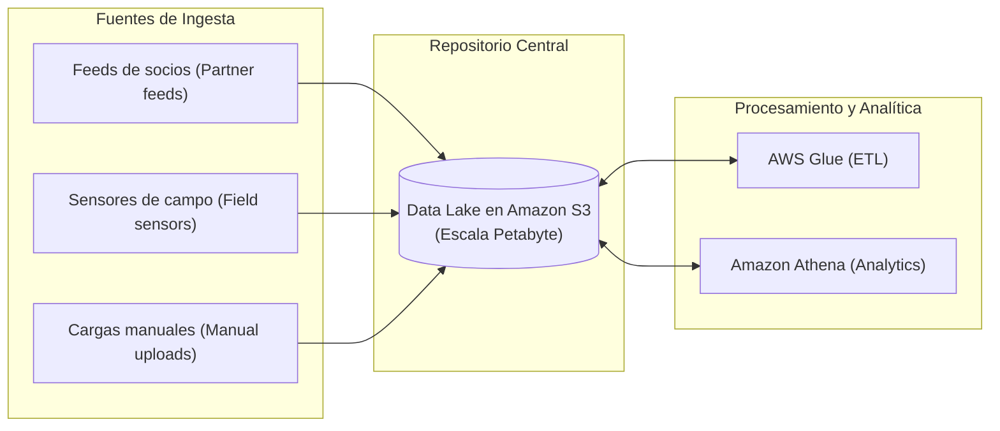

# Gathering the Customer Requirements - Resilience

> [!abstract] Qué es este archivo
> Segunda lección del módulo y **primera con caso de estudio**. Una institución financiera replantea la
> estrategia de protección de su **data lake en Amazon S3**: desafía la creencia tradicional de que los data lakes
> no se respaldan porque sus datos pueden recrearse, impulsada por nuevos **SLOs**, exigencias de **RTO/RPO**,
> regulaciones financieras de auditoría e inmutabilidad, y optimización de costos a escala de petabytes.
>
> Video: **4 minutos 01 segundo**. Autora: **Melissa Coger-Huezo**.

> [!quote] La idea que ordena todo
> **“Recrear un data lake de petabytes no es una estrategia de recuperación ante desastres.”** En un entorno
> regulado con SLOs estrictos, el tiempo y costo de reprocesar pipelines de ETL violan el RTO y el RPO; la
> resiliencia exige **backups automatizados, inmutables (WORM) y estratificados por criticidad**, sin penalizar
> el rendimiento analítico.

---

## Resumen en una frase

> Una institución financiera con un data lake en **Amazon S3** (ingesta de feeds de socios, sensores y cargas
> manuales; ETL con **AWS Glue** y analítica con **Amazon Athena**) debe cumplir nuevos SLOs y auditorías
> mediante una solución de backup **escalable, automatizada, con protección multinivel por criticidad, inmutabilidad
> (WORM) y trazabilidad completa**, controlando el impacto en el rendimiento y los costos.

---

## 1. El quiebre del paradigma tradicional

**El punto de partida del cliente:** una institución financiera reunió a sus equipos de **data engineering** y
**operaciones** para mejorar la resiliencia de su infraestructura de **Business Intelligence (BI)**.

| Paradigma tradicional | La nueva realidad del negocio |
| --- | --- |
| **Visión histórica:** “Los data lakes no se respaldan” porque contienen datos transformados que **se pueden recrear** si es necesario. | **Evolución de requisitos:** Recrear petabytes de datos tras un desastre toma días o semanas, violando cualquier **RTO** aceptable. |
| Se asumía que las fuentes de ingesta siempre estaban disponibles para reprocesar. | Muchas fuentes externas (**feeds de socios**, **sensores de campo**) son efímeras o no guardan histórico. |
| El cómputo para re-ejecutar transformaciones se consideraba marginal. | Reprocesar pipelines a escala masiva genera **costos exorbitantes de cómputo (ETL)** y ventanas de caída inaceptables. |
| Ausencia de mandatos regulatorios sobre datos analíticos. | Nuevos **SLOs corporativos** y normativas financieras exigen **inmutabilidad y auditoría** sobre el repositorio central. |

> [!important] El mito del Data Lake en el examen SAP-C02
> En el examen, asumir que *“basta con volver a correr el job de Glue desde el origen”* es un **anti-patrón** si
> el escenario define un **RTO estricto** o si las fuentes de ingesta son externas y no persistentes. El data
> lake moderno es un activo crítico que requiere su propio plan de respaldo.

---

## 2. La arquitectura actual del cliente

El relevamiento identificó los componentes clave del entorno existente:

| Componente | Rol en la arquitectura | Desafío de resiliencia |
| --- | --- | --- |
| **Amazon S3** | **Capa de almacenamiento central** del data lake. Crece a escala de **petabytes**. | Volumen masivo que encarece y ralentiza backups si no hay discriminación (*tiering*). |
| **Ingesta heterogénea** | **Partner feeds**, **field sensors** y **manual uploads**. | Datos que ingresan a ritmos dispares; si se pierden en el data lake, no siempre pueden re-solicitarse al socio o al sensor. |
| **AWS Glue** | Orquestación y ejecución de **jobs de ETL**. | Cargas de transformación intensivas que no deben competir con los procesos de respaldo. |
| **Amazon Athena** | Motor de **consultas interactivas y analítica** serverless sobre S3. | Las consultas del negocio operan en horas pico y exigen **rendimiento consistente**. |

---

## 3. Las preguntas clave del relevamiento

Melissa Coger-Huezo estructuró la sesión de requisitos en **seis conversaciones críticas** con Data Engineering
y Operaciones:

### RPO y RTO (Tolerancia a pérdida y tiempo de inactividad)
* **Pregunta formulada:** *“How quickly do you need to recover your data lake in case of an incident?”*
* **Objetivo:** Definir los límites tolerables de **tiempo de recuperación (RTO)** y **pérdida máxima de datos (RPO)**.
* **Criterio:** No se puede diseñar la solución de backup sin conocer estas dos métricas exactas.

### Criticidad del dato y protección por niveles
* **Pregunta formulada:** *“How do you categorize your data in terms of business criticality?”*
* **Objetivo:** Evitar el enfoque de “respaldar todo por igual”. No todos los datos del data lake demandan la misma protección.
* **Criterio:** Establecer una **estrategia de protección estratificada (tier protection)** que separe datos crudos e irreemplazables de datos intermedios o temporales.

### Rendimiento operativo vs. Ventanas de backup
* **Pregunta formulada:** *“How do your backup windows impact your analytics workloads?”*
* **Objetivo:** Analizar los horarios de **procesamiento pico** de analítica y BI.
* **Criterio:** La operación de backup **no debe degradar** el rendimiento de Amazon Athena ni bloquear los pipelines de AWS Glue durante horas hábiles.

### Seguridad y cumplimiento normativo
* **Pregunta formulada:** *“What are your compliance obligations for data retention and protection?”*
* **Objetivo:** Relevar las regulaciones estrictas del sector financiero.
* **Criterio:** Obligación de generar **backups inmutables (WORM)** para prevenir alteraciones o ransomware, y mantener **pistas de auditoría completas (audit trails)**.

### Optimización de costos a escala de petabytes
* **Pregunta formulada:** Estrategias de identificación de datos que realmente justifican el costo de backup.
* **Objetivo:** Frenar el crecimiento exponencial del costo de almacenamiento redundante.
* **Criterio:** Control granular y políticas de ciclo de vida para no pagar backup por datos transitorios fácilmente regenerables.

### Monitoreo, alertas y gobierno de SLAs
* **Pregunta formulada:** *“How do you currently track and demonstrate compliance with your backup SLAs?”*
* **Objetivo:** Pasar de una operación a ciegas a una gobernanza demostrable.
* **Criterio:** Implementar **monitoreo, alertas y reportes continuos** que sirvan como evidencia fehaciente ante auditores externos.

---

## 4. Los seis requisitos arquitectónicos

Al finalizar la sesión, se consolidaron los **seis requisitos oficiales**:

| # | Requisito arquitectónico | Justificación técnica |
| --- | --- | --- |
| 1 | **Scalable backup solution** | Debe escalar automáticamente junto con el crecimiento del data lake a escala de petabytes sin requerir rediseños ni pérdida de rendimiento. |
| 2 | **Multi-level data protections** | Protección por capas (*tiering*): aplicar distintas políticas de retención y frecuencia según la criticidad del dato (raw vs curated vs transient). |
| 3 | **Automated procedures** | Automatización total de la ejecución y verificación de backups; eliminar la dependencia de tareas manuales propensas a errores. |
| 4 | **Immutable backups** | Garantizar que las copias de seguridad no puedan ser eliminadas, alteradas ni sobreescritas durante el período de retención legal (protección WORM). |
| 5 | **Comprehensive audit trails** | Registro exhaustivo de todas las operaciones de backup, restauración y accesos, listo para ser presentado ante auditorías regulatorias. |
| 6 | **Cost optimization** | Control granular para seleccionar exactamente qué datos se respaldan y optimizar costos de almacenamiento mediante políticas de ciclo de vida. |

---

## 5. De requisito a servicio (Mapeo anticipado del curso)

> [!note] Mapeo conceptual preliminar (no declarado explícitamente en la lección)
> La fuente enuncia los requisitos pero deja las propuestas de servicio para las lecciones siguientes. Este
> cuadro cruza los requisitos con los servicios adelantados en [[Course Overview - Operational Resilience]]:

| Requisito | Servicios candidatos en AWS | Mecanismo clave |
| --- | --- | --- |
| **Escalabilidad y Automatización (1 y 3)** | **AWS Backup** | Backup plans centralizados, asignación por tags y soporte nativo para Amazon S3. |
| **Protección multinivel y Costos (2 y 6)** | **AWS Backup + S3 Lifecycle** | Transición de recovery points a cold storage y selección por prefijos/tags según criticidad. |
| **Inmutabilidad (4)** | **AWS Backup Vault Lock** / **S3 Object Lock** | Modo Compliance (WORM) que impide incluso al usuario root o administradores borrar los backups. |
| **Pistas de auditoría y Demostración (5)** | **AWS Backup Audit Manager** + **AWS Config** + **CloudTrail** | Reportes automatizados de conformidad contra marcos regulatorios y tracking de deriva. |
| **Continuidad y RTO/RPO estricto** | **AWS Elastic Disaster Recovery (DRS)** / **S3 Cross-Region Replication (CRR)** | Replicación continua y failover rápido ante desastres regionales. |

---

## 6. Los límites de esta fuente

| Elemento | Situación | Consecuencia metodológica |
| --- | --- | --- |
| **Flashcards interactivas** | El texto incluye la instrucción de dar vuelta las tarjetas para ver propuestas, pero **no contiene los textos de las flashcards**. | No se inventan propuestas ni opciones que la fuente omitió; se espera a que las lecciones de servicio las desarrollen. |
| **Imagen `TZAWQM3N74.jpeg`** | Imagen de la autora junto a la cita; no está presente localmente en el vault. | Se documenta su existencia sin inventar descripciones visuales ajenas. |
| **Cifras cuantitativas del data lake** | Se menciona "escala de petabytes", pero no se especifican GB/s de ingesta ni número de buckets. | Los dimensionamientos cuantitativos se reservan para cuando la fuente los declare. |

---

## 7. Traducción del contenido

> [!info] Sección de referencia (opcional)
> Traducción fiel y completa de las fuentes de Skill Builder. Lo esencial para el estudio conceptual se
> encuentra desarrollado en las secciones **1 a 5** y sintetizado en la sección **8**.

### 7.1 Video principal: Business Summary and Requirements (transcripción)

Hola a todos. Hoy quiero guiarlos a través de una **sesión de relevamiento de requisitos** que acabo de tener con
una **institución financiera** que está **replanteando su enfoque sobre la protección de data lakes**. Lo que hace
que esto sea particularmente fascinante es cómo **desafía la sabiduría tradicional sobre el respaldo de data lakes**.

Permítanme poner el contexto. Me reuní con sus equipos de **data engineering y de operaciones** para entender por
qué buscan mejorar la **resiliencia de su infraestructura de BI**. Tradicionalmente, muchas organizaciones no
hacían backup de sus data lakes porque los consideraban **repositorios de datos transformados que podían recrearse
si era necesario**. Pero la situación de este cliente pone de manifiesto cómo los **requisitos de negocio están
evolucionando**.

Durante nuestra discusión, me enfoqué en entender su **entorno actual** y qué está impulsando este cambio. Tienen un
data lake sofisticado construido sobre **Amazon S3** que ingiere datos de diversas fuentes, incluyendo **feeds de
socios, sensores de campo y cargas manuales**. Utilizan servicios como **AWS Glue para ETL** y **Amazon Athena
para analítica**.

Pero aquí está la parte interesante: **nuevos objetivos de nivel de servicio (SLOs)** los están obligando a
reconsiderar su estrategia de backup.

Hice varias preguntas clave para comprender mejor sus requisitos:
* Primero, discutimos sus **necesidades de RPO y RTO**: *¿Con qué rapidez necesitan recuperar su data lake en caso de un incidente?* Esto ayudó a establecer su tolerancia a la pérdida de datos y al tiempo de inactividad.
* También exploramos la **criticidad de sus datos**: no todos los datos en un data lake necesitan el mismo nivel de protección.
* Cuando nos adentramos en sus **desafíos operativos**, compartieron inquietudes sobre **mantener un rendimiento consistente durante las operaciones de backup**: *¿Cómo impactan sus ventanas de backup en sus cargas de trabajo analíticas?* Esto nos llevó a una discusión detallada sobre sus momentos de procesamiento pico y cómo minimizar el impacto en las operaciones de negocio.
* La **seguridad y el cumplimiento** surgieron como consideraciones primordiales. Las instituciones financieras operan bajo estrictas regulaciones, así que dedicamos tiempo a entender sus requisitos de auditoría: *¿Cuáles son sus obligaciones de cumplimiento para la retención y protección de datos?* Sus respuestas resaltaron la necesidad de **backups inmutables** y **pistas de auditoría completas**.
* El **costo** fue otro factor. Los data lakes pueden crecer a escala de petabytes, por lo que discutimos estrategias para identificar qué datos realmente necesitan protección de backup: *¿Cómo categorizan sus datos en términos de criticidad para el negocio?* Esto nos ayudó a pensar en **estrategias de protección por niveles (tier protection)**.
* Los requisitos de **monitoreo y gobernanza** fueron particularmente interesantes. Necesitan demostrar el cumplimiento de sus SLAs, por lo que exploramos sus necesidades de monitoreo de backups, alertas y reportes: *¿Cómo rastrean y demuestran actualmente el cumplimiento de sus SLAs de backup?*

Hacia el final de nuestra sesión, surgieron varios **requisitos clave**:
1. Necesitan una **solución de backup que pueda escalar** con su data lake en crecimiento mientras mantiene el rendimiento.
2. Necesitan **control granular** sobre lo que se respalda para gestionar los costos de manera efectiva.
3. Necesitan **capacidades integrales de monitoreo y auditoría** para demostrar cumplimiento.
4. Y finalmente, necesitan **automatización** para garantizar la ejecución consistente de sus procedimientos de backup.

Lo particularmente desafiante de este caso es equilibrar estos requisitos frente a las limitaciones prácticas de
hacer backup a data lakes de gran escala. En nuestra próxima discusión, les mostraré cómo podemos abordar estos
requisitos utilizando servicios de AWS, manteniendo los estándares de rendimiento y cumplimiento que su negocio exige.

*Duración del video: **4 minutos, 01 segundo**.*

### 7.2 Architecture Requirements (texto literal)

- **Scalable backup solution** (Solución de backup escalable)
- **Multi-level data protections** (Protecciones de datos multinivel)
- **Automated procedures** (Procedimientos automatizados)
- **Immutable backups** (Backups inmutables)
- **Comprehensive audit trails** (Pistas de auditoría exhaustivas)
- **Cost optimization** (Optimización de costos)

> *“What makes this particularly fascinating is how it challenges traditional wisdom about backing up data lakes.”*
>
> **— Melissa Coger-Huezo**

### 7.3 Flashcards (nota de la fuente)

*“Review the information on each of the following flashcards and think about what solution you would propose. Then choose the flashcard to flip it over and see my proposals. To move to the previous card, choose the left arrow. To move to the next card, choose the right arrow.*

*Throughout the course, you'll learn more about the AWS services that will enhance their BI infrastructure's resilience.”*

---

## 8. Para el examen (SAP-C02)

> [!important] Lo que hay que retener
> 1. **El anti-patrón de regeneración:** Para el examen SAP-C02, **nunca asumas** que un Data Lake no requiere backup. Si el escenario fija SLOs/RTOs agresivos o ingiere de orígenes externos no persistentes (sensores, partners), la reconstrucción mediante re-ejecución de ETL (**AWS Glue**) queda descartada por tiempo y costo.
> 2. **RTO vs. RPO en Data Lakes:** RTO define el tiempo para restaurar la operatividad de Athena/Glue; RPO define cuántas horas/días de ingesta se tolera perder.
> 3. **Estratificación (Tiering) de protección:** En petabyte scale, respaldar todo el bucket de S3 genera sobrecostos gigantescos. La solución óptima clasifica datos: **Raw / Ingestion** (crítico e irreemplazable) vs. **Curated / Analytics** vs. **Transient / Staging** (no requiere backup).
> 4. **Inmutabilidad regulatoria (WORM):** En el sector financiero, los backups deben protegerse contra ransomware y borrado accidental mediante **AWS Backup Vault Lock** (Compliance Mode) o **S3 Object Lock**. En Compliance Mode, nadie (ni el root de la cuenta) puede borrar los recovery points hasta expirar la retención.
> 5. **Interferencia operativa:** Los backups no deben ejecutarse en ventanas donde degraden el rendimiento de **Amazon Athena** o saturen las cuotas de API de S3 (GET/PUT rate limits).
> 6. **Cumplimiento demostrable:** No basta con tener un backup exitoso; el arquitecto debe proveer evidencia continua de auditoría mediante **AWS Backup Audit Manager** y **AWS Config**.
> 7. **Automatización centralizada:** La política de backup debe desacoplarse de scripts manuales y gestionarse vía **AWS Backup** asignando recursos automáticamente por etiquetas (`BackupPlan = DailyGold`).

> [!warning] Trampa clásica del examen
> **Escenario:** Una empresa opera un Data Lake en Amazon S3 alimentado por sensores IoT y feeds de terceros, procesado con AWS Glue. La gerencia solicita una solución de recuperación ante desastres que garantice un RTO menor a 4 horas y cumpla con estrictas normativas bancarias que impiden la alteración de copias de seguridad.
>
> * **Respuesta trampa:** "Configurar AWS Glue para re-ejecutar los scripts de ETL desde los repositorios de código fuente en caso de fallo y almacenar los scripts en S3 con versionado habilitado."
> * **Por qué falla:** Re-ejecutar el ETL sobre petabytes excede con creces el RTO de 4 horas, requiere que los sensores re-emitan datos que ya no existen, y **no proporciona backups inmutables (WORM)** ni evidencia para auditores.
> * **La respuesta correcta:** Implementar **AWS Backup para Amazon S3** con políticas automatizadas, habilitar **AWS Backup Vault Lock** en modo cumplimiento para garantizar inmutabilidad, y utilizar **AWS Backup Audit Manager** para verificar y certificar los SLAs de respaldo.

---

## Relacionado

- [[AWS Solutions Architect Advanced - Operational Resilience]] *(índice del módulo)*
- [[Course Overview - Operational Resilience]] — lección 01: encuadre de RTO/RPO, SLAs y servicios del módulo
- [[Gathering the customer REquirements]] — relevamiento del caso Multi-Account
- [[Gathering the Customer Requirements - Networking]] — relevamiento del caso Redes Avanzadas
- [[Gathering the Customer Requirements - Security]] — relevamiento del caso Seguridad
- [[Gathering the Customer Requirements - Hybrid]] — relevamiento del caso Híbrido
- [[2.2 Diseñar una solución para garantizar la continuidad de actividades]] — tarea clave de continuidad y DR
- [[2.4 Diseñar una estrategia para cumplir con los requisitos de fiabilidad]] — fiabilidad del dato y resiliencia
- [[1.2 Prescribir controles de seguridad]] — controles de inmutabilidad y WORM
- [[1.5 Determinar las estrategias de optimización de costos y visibilidad]] — impacto en costos del almacenamiento masivo
- [[Guia AWS]] — pesos y tareas oficiales del SAP-C02
- Siguiente paso del módulo: **Lección 03** (primera lección de servicio/arquitectura del módulo).

---

## Registro de integración

| Fecha | Qué llegó | Dónde se integró |
| --- | --- | --- |
| 29/10/2026 | Lección 02 completa: Business summary, transcript, architecture requirements y flashcard prompt | Nota completa (`Gathering the Customer Requirements - Resilience.md`), secciones 1 a 8 |

**Discrepancias y vacíos registrados (no corregidos):**
1. **Flashcards sin propuestas en la fuente:** El texto del scraper indica "Review the information on each of the following flashcards and think about what solution you would propose. Then choose the flashcard to flip it over and see my proposals", pero el contenido de las propuestas no venía en el cuerpo extraído. No se inventan propuestas ajenas a la fuente.
2. **Imagen no descargada:** La referencia `assets/images/TZAWQM3N74.jpeg` no existe localmente en el vault. Se conserva el registro sin forzar visualización.
3. **Mapeo de servicios no declarado:** La fuente plantea los 6 requisitos sin nombrar aún los servicios de AWS que los resolverán (lo anuncia para la próxima sesión). El cuadro de la §5 es una anticipación analítica propia y se rotula explícitamente como tal.
