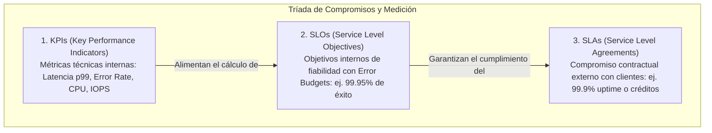
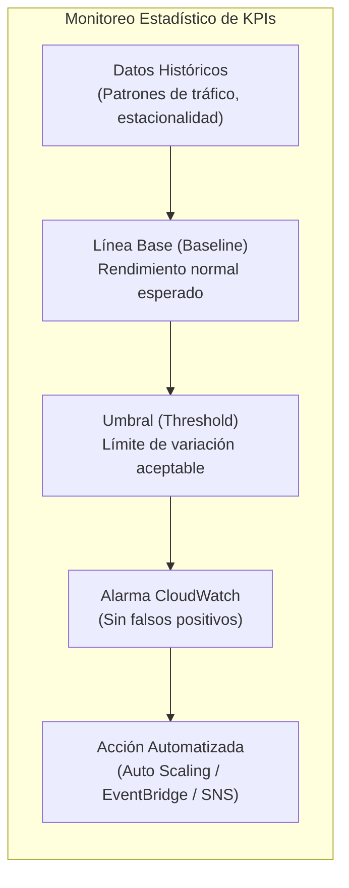
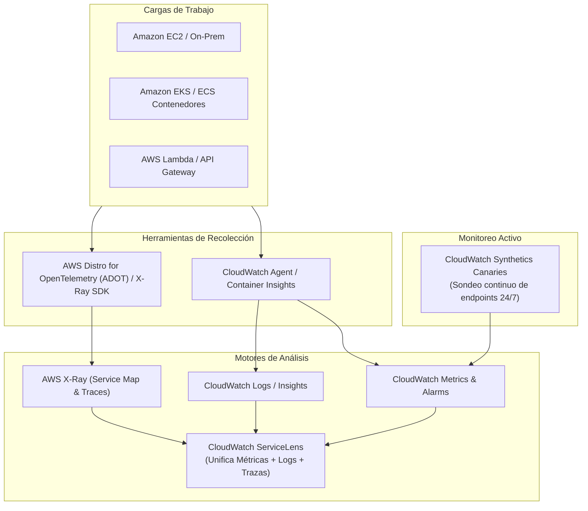

# Key Performance Indicators

> [!abstract] Qué es este archivo
> Octava lección del módulo de resiliencia operativa. Establece el marco metodológico para definir, medir y gobernar
> **Indicadores Clave de Rendimiento (KPIs)** en AWS, diferenciándolos de los **SLAs** contractuales y los **SLOs** de
> fiabilidad. Analiza la creación de **líneas base (baselines)** a partir de datos históricos, la configuración de
> **umbrales (thresholds)** libres de falsos positivos, la observabilidad profunda combinando **Amazon CloudWatch**
> (Container Insights, Custom Metrics) con **AWS X-Ray** (Service Map, ServiceLens), y el flujo de integración en 6 pasos
> utilizando **CloudWatch Synthetics** y **AWS Distro for OpenTelemetry (ADOT)**.
>
> Lectura profunda + Comparativa SLA/SLO/KPI + Arquitectura CloudWatch/X-Ray + Estrategia en 6 pasos.

> [!quote] La idea que ordena todo
> **“Los SLAs definen el compromiso con el cliente externo; los KPIs miden el rendimiento del equipo y los sistemas internos.”**
> Para que un SLA contractual no se rompa, el arquitecto debe gobernar los KPIs internos (latencia, tasas de error, throughput)
> estableciendo líneas base históricas y umbrales que disparen alertas preventivas mucho antes de que se agote el presupuesto
> de error (*error budget*) del SLO.

---

## Resumen en una frase

> La resiliencia operativa de una carga de trabajo en AWS se sustenta en la tríada **SLA $\rightarrow$ SLO $\rightarrow$ KPI**,
> donde los KPIs internos se vigilan contra **líneas base históricas y umbrales** configurados en **Amazon CloudWatch**
> (Container Insights, métricas de negocio), complementados con trazabilidad distribuida en **AWS X-Ray** y monitoreo
> activo con **CloudWatch Synthetics Canaries** para detectar anomalías antes del impacto en producción.

---

## 1. La Tríada de Gestión: SLA vs. SLO vs. KPI

En arquitectura cloud avanzada, confundir estos tres términos conduce a errores de diseño y brechas de cumplimiento:

| Dimensión | SLA *(Service Level Agreement)* | SLO *(Service Level Objective)* | KPI *(Key Performance Indicator)* |
| --- | --- | --- | --- |
| **Definición** | Compromiso formal y contractual entre un proveedor y un cliente. | Objetivo técnico interno de nivel de servicio que el equipo busca alcanzar. | Métrica cuantificable que mide la eficacia y rendimiento de un proceso o sistema. |
| **Ámbito** | **Externo** (relación cliente-proveedor). | **Interno** (ingeniería / operaciones). | **Interno** (técnico o de negocio). |
| **Audiencia** | Clientes, abogados, finanzas, directivos. | Desarrolladores, SREs, arquitectos. | Equipos de operaciones, producto, soporte. |
| **Consecuencia de incumplimiento** | Penalización financiera (**Service Credits**), demandas o pérdida de clientes. | Alerta operativa, congelamiento de despliegues para pagar deuda técnica (*Error Budget agotado*). | Diagnóstico de degradación; revisión de arquitectura o capacidad. |
| **Ejemplo típico** | "Disponibilidad mensual $\ge 99.9\%$ o 10% de crédito". | "99.95% de las llamadas a la API responden con código 200 en $< 200\text{ ms}$". | "Latencia p99 en API Gateway", "Tasa de errores 5xx", "IOPS consumidos en EBS". |

---

## 2. Líneas Base (Baselines) y Umbrales (Thresholds)

Para detectar anomalías operativas de manera fiable, las métricas deben interpretarse contra referencias estadísticas:

### Componentes del Análisis
1. **Línea Base (*Performance Baseline*):** Es el perfil de rendimiento normal de la aplicación derivado del análisis de patrones históricos (ej. tráfico diurno vs. nocturno, picos de fin de mes). Se construye recolectando métricas a intervalos regulares:
   * Métricas de infraestructura automáticas de AWS (CPU, red, disco).
   * **Métricas de negocio personalizadas (*Custom Metrics*):** Publicadas por la aplicación (ej. órdenes procesadas por minuto, usuarios concurrentes).
   * **Las tres métricas críticas:** **Latencia** (*latency*), **Tasa de errores** (*error rates*) y **Tasa de peticiones** (*request rates*).
2. **Umbrales (*Thresholds*):** Fronteras numéricas que definen cuándo una variación de rendimiento es aceptable y cuándo constituye un incidente que requiere intervención.
3. **El imperativo de evitar falsos positivos:** Las alarmas mal calibradas generan fatiga de alertas (*alert fatigue*), provocando que los equipos ignoren fallos reales. Se recomienda utilizar **CloudWatch Anomaly Detection** (que calcula bandas de desviación estándar automáticas) en lugar de umbrales estáticos rígidos para cargas con tráfico fluctuante.
4. **Presupuestos de Error (*Error Budgets*):** Margen de error tolerable permitido por el SLO (ej. si el SLO es 99.9% en un mes, el presupuesto de error es 0.1% o ~43 minutos de caída). Si el presupuesto se consume rápidamente (*burn rate alto*), se disparan alarmas antes de que se viole el SLA.

---

## 3. Arquitectura de Observabilidad de KPIs en AWS

La observabilidad de KPIs se implementa combinando **Amazon CloudWatch** y **AWS X-Ray**:

### Amazon CloudWatch: El Tronco Operativo
* **Container Insights:** Módulo especializado que recolecta, agrega y visualiza métricas y logs de clústeres y pods en **Amazon EKS, Amazon ECS, AWS Fargate** y Kubernetes bare-metal (CPU, memoria, reinicios de contenedores, volumen de red).
* **Agregación y Análisis de Logs (*CloudWatch Logs Insights*):** Motor de consultas interactivo que permite filtrar millones de líneas de log en segundos usando lenguaje estructurado (`fields`, `filter`, `stats`, `sort`).
* **Dashboards Unificados:** Paneles visuales personalizables que cruzan métricas y logs en una vista única. Soporta visibilidad multi-cuenta y multi-región mediante **CloudWatch Cross-Account Observability (OAM)**.
* **Alarmas Automatizadas:** Disparan acciones proactivas de escalado (EC2 Auto Scaling), notificaciones de incidentes (Amazon SNS) o flujos de auto-remediación vía **Amazon EventBridge**.

### AWS X-Ray: Trazabilidad Distribuida y Análisis de Latencia
* **Service Map:** Diagrama visual dinámico que representa la topología de la aplicación, identificando dependencias entre microservicios, bases de datos y llamadas externas.
* **Rastreo de Solicitudes (*Request Tracking*):** Sigue el viaje de cada petición de extremo a extremo a través de servicios distribuidos mediante un ID de correlación (`X-Amzn-Trace-Id`).
* **Aislamiento de Cuellos de Botella:** Identifica con precisión qué microservicio, consulta SQL o llamada HTTP externa genera picos de latencia (*latency spikes*) o respuestas HTTP 5xx.
* **Integración con CloudWatch ServiceLens:** Interfaz que enlaza directamente las métricas de CloudWatch, los logs de la instancia y las trazas de X-Ray en un solo clic, acelerando el tiempo medio de resolución (MTTR).

---

## 4. Flujo de Integración en 6 Pasos para Monitoreo de KPIs

Para establecer una arquitectura de monitoreo de KPIs de grado empresarial, el arquitecto de soluciones debe implementar la
siguiente secuencia técnica:

1. **Habilitar X-Ray en servicios nativos de AWS:** Activar el tracing activo en **Amazon S3, AWS Lambda y Amazon API Gateway** desde la configuración del servicio sin modificar código.
2. **Instrumentar aplicaciones con ADOT o X-Ray SDK:** Integrar **AWS Distro for OpenTelemetry (ADOT)** o los SDKs de X-Ray en el código fuente de los microservicios para propagar encabezados de trazabilidad y registrar metadatos de negocio.
3. **Configurar métricas y alarmas en CloudWatch:** Establecer alarmas basadas en umbrales estáticos o de detección de anomalías para los KPIs críticos de salud y rendimiento (latencia p90/p99, tasas de error 4xx/5xx).
4. **Construir Dashboards unificados en CloudWatch:** Crear paneles operacionales centralizados para visualizar los KPIs clave de negocio e infraestructura en tiempo real.
5. **Desplegar CloudWatch Synthetics Canaries:** Crear scripts programados basados en Node.js/Python (canarios) que simulen la navegación de usuarios reales, sondeando endpoints y APIs 24/7 para detectar caídas antes de que afecten a los clientes.
6. **Implementar trazabilidad integral end-to-end:** Asegurar que los flujos de peticiones complejos que atraviesan colas SQS, tópicos SNS y múltiples microservicios mantengan el contexto de la traza para auditoría y diagnóstico de cuellos de botella.

---

## 5. Cierre Conceptual: Matriz de Instrumentación de KPIs por Capa

| Capa Arquitectónica | KPI Crítico a Medir | Servicio de AWS | Mecanismo de Alerta y Respuesta |
| --- | --- | --- | --- |
| **Borde y CDN** | Latencia de primer byte, Tasa de aciertos de caché (*Cache Hit Ratio*) | **Amazon CloudFront** | Métricas estándar de CloudWatch $\rightarrow$ Alarma SNS. |
| **API / Ingesta** | Latencia de integración, Conteo de errores 4xx / 5xx | **Amazon API Gateway** | X-Ray Tracing + CloudWatch Alarms $\rightarrow$ EventBridge. |
| **Cómputo en Contenedores** | Uso de CPU/Memoria por Pod, Reinicios continuos (*CrashLoopBackOff*) | **Container Insights (EKS/ECS)** | Métricas de Container Insights $\rightarrow$ Auto Scaling de Pods (HPA). |
| **Microservicios Serverless** | Tiempo de ejecución, Throttles, Errores no controlados | **AWS Lambda** | X-Ray Service Map + Embedded Metric Format (EMF). |
| **Base de Datos** | Conexiones activas, Latencia de lectura/escritura, IOPS consumidos | **Amazon RDS / Aurora** | Enhanced Monitoring + Performance Insights. |
| **Experiencia de Usuario** | Disponibilidad de endpoints, Latencia global de APIs | **CloudWatch Synthetics** | Canaries periódicos (1 min) $\rightarrow$ Alarma CloudWatch compuesta. |

---

## 6. Traducción del contenido

> [!info] Sección de referencia (opcional)
> Traducción fiel de las fuentes de Skill Builder. Se recomienda estudiar las secciones **1 a 5** y repasar las reglas de
> examen en la sección **7**.

### 6.1 Key Performance Indicators (Definición y Enfoque)

Por lo general, los **KPIs** se utilizan para medir los estándares de rendimiento internos, mientras que un **acuerdo de
nivel de servicio (SLA)** es más adecuado para definir estándares en relaciones cliente-proveedor:
* Un **acuerdo de nivel de servicio (SLA)** establece cómo trabajan juntos un cliente y un proveedor de servicios y cuáles son sus responsabilidades individuales.
* Un **indicador clave de rendimiento (KPI)** mide con qué éxito las personas o los equipos se desempeñan frente a un grupo de estándares.

### 6.2 Baselines and Thresholds (Líneas Base y Umbrales)

Para los arquitectos de soluciones, establecer **líneas base (baselines) y umbrales (thresholds)** efectivos de Indicadores Clave de Rendimiento (KPI) es fundamental para medir el éxito de la solución y detectar anomalías operativas. Las líneas base representan el **rendimiento normal esperado derivado de patrones de datos históricos**, mientras que los umbrales definen los **límites aceptables de variación del rendimiento** que llaman la atención al ser superados.

Un marco sólido de KPIs con líneas base y umbrales bien definidos permite a los arquitectos tomar decisiones basadas en datos, justificar inversiones en infraestructura y mantener la alineación entre el rendimiento técnico y los objetivos de negocio.

* **Establecimiento de líneas base de rendimiento:** Comience recopilando y rastreando datos clave de rendimiento a intervalos definidos por el usuario mediante métricas. Muchos servicios de AWS informan métricas automáticamente, pero también debe publicar métricas personalizadas desde sus aplicaciones para capturar indicadores de rendimiento específicos del negocio. Concéntrese en recopilar datos para indicadores críticos de rendimiento como **latencia, tasas de error y tasas de peticiones**, que se pueden detectar y monitorear automáticamente sin instrumentación manual.
* **Configuración de umbrales y alertas:** Configure alarmas que monitoreen continuamente sus métricas contra umbrales definidos por el usuario. Estas alarmas deben diseñarse para alertar automáticamente ante infracciones de los umbrales y también pueden responder automáticamente a cambios en el comportamiento de sus recursos activando acciones automatizadas. Es crucial asegurarse de **no ver falsos positivos**, ya que esto es clave para una solución de monitoreo efectiva.
* **Implementación de Service Level Objectives (SLOs):** Utilice Objetivos de Nivel de Servicio (SLO) para definir, rastrear y alertar sobre objetivos de fiabilidad específicos para sus aplicaciones. Esto le ayuda a mantener los compromisos de calidad del servicio mediante el establecimiento de presupuestos de error (*error budgets*) y el monitoreo del cumplimiento del SLO a lo largo del tiempo, lo que aborda directamente sus requisitos de cumplimiento del SLA.
* **Desarrollo de mecanismos de informes:** Cree paneles (*dashboards*) que ofrezcan una vista unificada de sus recursos y aplicaciones con visualizaciones de sus métricas y registros en una sola ubicación. Puede compartir estos paneles entre cuentas y regiones para una mayor conciencia operativa. Muchos servicios proporcionan paneles automáticos seleccionados para que no tenga que construirlos desde cero.

### 6.3 Monitoreo de KPIs con CloudWatch y AWS X-Ray

AWS proporciona marcos de monitoreo robustos que brindan a las organizaciones capacidades para rastrear KPIs críticos a través de servicios como **Amazon CloudWatch** y **AWS X-Ray**.

#### Amazon CloudWatch
CloudWatch sirve como la columna vertebral de las soluciones de monitoreo de AWS con amplias capacidades para rastrear KPIs, incluyendo:
* **Container Insights:** Proporciona métricas granulares para contenedores y clústeres, lo que permite un monitoreo detallado del rendimiento de las aplicaciones en contenedores.
* **Agregación y análisis de logs:** Centraliza el registro en varios recursos de AWS, esencial para la resolución de problemas y la auditoría.
* **Paneles personalizables:** Permite la creación de visualizaciones personalizadas para el seguimiento de KPIs.
* **Alarmas automatizadas:** Proporciona notificaciones proactivas cuando los KPIs se desvían de los umbrales esperados.
* **Métricas personalizadas:** Permite rastrear KPIs específicos de la aplicación más allá de las métricas de infraestructura estándar.

#### AWS X-Ray
X-Ray complementa a CloudWatch proporcionando capacidades sofisticadas de trazabilidad distribuida:
* **Visualización del Service Map:** Ofrece información clara sobre la arquitectura de la aplicación y las dependencias.
* **Rastreo de peticiones:** Identifica cuellos de botella de rendimiento en todos los servicios.
* **Trazabilidad de sistemas distribuidos:** Rastrea peticiones a través de arquitecturas complejas de microservicios.
* **Integración con ServiceLens:** Se combina con CloudWatch para una observabilidad integral.

X-Ray es clave para identificar problemas de latencia en arquitecturas de microservicios, rastrear flujos de peticiones de extremo a extremo a través de múltiples servicios de AWS y comprender las dependencias y los cuellos de botella del servicio.

Su solución de monitoreo debe recopilar datos operativos y de monitoreo en forma de registros, métricas y eventos de las cargas de trabajo. Esto le ayuda a analizar y depurar aplicaciones de producción, obtener información sobre el rendimiento de las aplicaciones, descubrir causas raíz e identificar cuellos de botella de rendimiento para que pueda reaccionar rápidamente y mantener su carga de trabajo funcionando sin problemas.

### 6.4 Integración para el Monitoreo Exhaustivo de KPIs (6 Pasos)

La implementación de esta combinación de marcos de monitoreo integrales proporciona la visibilidad necesaria para rastrear KPIs críticos:
1. Habilite X-Ray en los servicios de AWS compatibles (por ejemplo, Amazon S3, AWS Lambda y API Gateway).
2. Instrumente las aplicaciones utilizando **AWS Distro for OpenTelemetry (ADOT)** o los SDKs de X-Ray.
3. Configure métricas y alarmas de CloudWatch basadas en el estado de los recursos y los umbrales de rendimiento.
4. Cree paneles de CloudWatch para visualizar KPIs críticos.
5. Utilice **CloudWatch Synthetics canaries** para el monitoreo de endpoints y APIs.
6. Implemente trazabilidad de extremo a extremo para flujos de peticiones complejos.

---

## 7. Para el examen (SAP-C02)

> [!important] Lo que hay que retener
> 1. **SLA vs. SLO vs. KPI:**
>    * **SLA:** Acuerdo contractual vinculante con compensaciones financieras para clientes externos.
>    * **SLO:** Meta técnica interna medible (debe ser más estricta que el SLA) vinculada a un presupuesto de error (*Error Budget*).
>    * **KPI:** Métrica elemental (latencia, porcentaje de errores, CPU) utilizada para monitorear el estado y alimentar el SLO.
> 2. **AWS Distro for OpenTelemetry (ADOT):** En preguntas modernas del SAP-C02 sobre observabilidad, **ADOT** es la recomendación estándar de AWS para instrumentar aplicaciones de forma agnóstica a proveedores, compatible con métricas y trazas abiertas, enviando datos tanto a X-Ray como a CloudWatch y OpenSearch.
> 3. **CloudWatch Synthetics Canaries:** Cuando una pregunta requiera **monitorear la disponibilidad de APIs o sitios web de forma proactiva 24/7 incluso cuando no hay tráfico real de usuarios**, la solución es desplegar **CloudWatch Synthetics** (scripts configurables con Puppeteer/Playwright).
> 4. **CloudWatch ServiceLens:** Integra en una sola vista visual métricas de CloudWatch, logs de CloudWatch Logs y mapas de trazas de AWS X-Ray, acelerando el aislamiento de cuellos de botella en arquitecturas de microservicios.
> 5. **Container Insights:** Servicio específico para monitorear el rendimiento de clústeres y pods en **EKS, ECS y Fargate**. Debe recordarse que no viene habilitado por defecto en todos los clústeres; debe activarse explícitamente en la configuración del clúster.
> 6. **CloudWatch Anomaly Detection:** Aplica algoritmos de machine learning sobre datos históricos para crear bandas de comportamiento esperado dinámicas, evitando falsos positivos en métricas con estacionalidad horaria o semanal.
> 7. **Embedded Metric Format (EMF):** Permite generar métricas personalizadas de alta cardinalidad en CloudWatch emitiendo logs en formato JSON asíncrono desde AWS Lambda o contenedores, reduciendo costos de llamadas a la API `PutMetricData`.

> [!warning] Trampa clásica del examen
> **Escenario:** Una compañía ejecuta una aplicación de microservicios altamente distribuida en Amazon EKS y AWS Lambda. Los usuarios reportan picos esporádicos de latencia de más de 3 segundos en ciertas transacciones de compra, pero las métricas de CPU y memoria de los contenedores se mantienen por debajo del 40%, y los logs individuales no muestran errores. El equipo necesita identificar la causa raíz exacta de la lentitud con el menor esfuerzo operativo.
>
> * **Respuesta trampa:** "Habilitar VPC Flow Logs en todas las subredes de la VPC y utilizar Amazon Athena para analizar los tiempos de transferencia de red entre los pods de EKS."
> * **Por qué falla:** Los VPC Flow Logs solo capturan metadatos de paquetes IP en capa 3/4 (IPs, puertos, bytes, ACCEPT/REJECT), pero **no miden la latencia de aplicación ni trazan dependencias lógicas** entre microservicios en capa 7.
> * **La respuesta correcta:** Instrumentar los microservicios con **AWS Distro for OpenTelemetry (ADOT)** o el SDK de **AWS X-Ray** y habilitar **CloudWatch ServiceLens**. Utilizar el **X-Ray Service Map** para visualizar el grafo de dependencias de la transacción e identificar exactamente qué microservicio, llamada descendente o consulta a base de datos está causando el retraso de 3 segundos en el segmento correspondiente.

---

## Relacionado

- [[AWS Solutions Architect Advanced - Operational Resilience]] *(índice del módulo)*
- [[Course Overview - Operational Resilience]] — lección 01: compromisos de SLA/KPI en resiliencia
- [[Gathering the Customer Requirements - Resilience]] — lección 02: impacto en analítica y ventanas operativas
- [[Building a Data Protection Strategy]] — lección 03: monitoreo y respuesta a incidentes
- [[AWS Service Level Agreements]] — lección 07: acuerdos contractuales de disponibilidad y créditos
- [[Designing Observability Solutions]] — módulo de observabilidad: los 3 pilares y métricas EMF
- [[Distributed Tracing for Microservices]] — módulo de observabilidad: X-Ray, ADOT y sampling
- [[Synthetic Monitoring and Service-Level Objectives]] — módulo de observabilidad: canarios, RUM y SLOs
- [[3.1 Estrategia para mejorar la excelencia operativa general]] — tarea de observabilidad y KPIs en Dominio 3
- [[3.3 Estrategia para mejorar el rendimiento]] — optimización de latencia y cuellos de botella
- [[2.5 Diseñar una solución para cumplir con los objetivos de rendimiento]] — objetivos de latencia y throughput
- [[Guia AWS]] — pesos y tareas oficiales del SAP-C02
- Siguiente paso del módulo: **Lección 09**.

---

## Registro de integración

| Fecha | Qué llegó | Dónde se integró |
| --- | --- | --- |
| 29/10/2026 | Lección 08 completa: KPIs vs SLAs/SLOs, baselines y thresholds, CloudWatch (Container Insights), X-Ray (ServiceLens) y flujo en 6 pasos | Nota completa (`Key Performance Indicators.md`), secciones 1 a 7 |

**Discrepancias y vacíos registrados (no corregidos):**
1. **Imagen no descargada:** La referencia visual `assets/images/8BP8RJHF7Q.jpeg` (gráfico conceptual de baselines y thresholds) no está presente localmente; se suple con un diagrama Mermaid en la §2 que modela el flujo estadístico de detección y alertas.
2. **Cruce conceptual con módulos cerrados:** La lección consolida y sintetiza herramientas vistas previamente en el módulo cerrado de *Observability and Management Controls* (ADOT, Synthetics, ServiceLens, EMF), enriqueciéndolas bajo el prisma de la resiliencia operativa y la gobernanza de KPIs.
