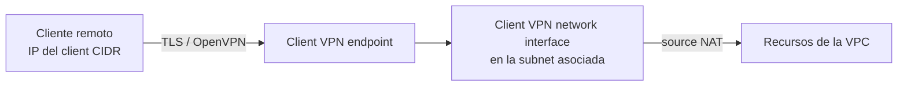

# AWS Client VPN

> [!abstract] Qué es este archivo
> Tercera lección del módulo y **primera de servicio**. **AWS Client VPN** es la VPN **de usuarios**: cada persona
> corre un cliente y entra a AWS **desde donde esté**, sin pasar por la VPN corporativa.
>
> No reemplaza a **Site-to-Site VPN**: resuelve **acceso remoto**, no unión de redes. La comparación entre las dos
> es el objetivo 1 del curso.
>
> Video: **5 min 49 s**. Demo: **12 min 23 s**.

> [!quote] La idea que ordena todo
> **“AWS Client VPN acts as your own express lane directly into AWS.”** La VPN corporativa es la ruta general,
> con todas las paradas; Client VPN es la **vía rápida** que va del usuario al recurso, sin desviarse por la red
> de la oficina.

---

## Resumen en una frase

> Un **endpoint regional** termina las sesiones **TLS** de clientes **OpenVPN**, las autentica contra **AD**,
> **SAML** o **certificado**, y las deja entrar —según **authorization rules** y **routes**— a una subnet de la
> VPC, a una VPC peered, a servicios de AWS, a internet o a la red on-premises.

---

## 1. Qué problema resuelve

**El escenario de la fuente:** un lead developer pregunta **cómo conectarse a AWS sin usar la VPN on-premises**.
El caso típico es el trabajo remoto: desde casa o desde un café, todo el tráfico tiene que pasar por una **VPN
corporativa lenta** antes de llegar a AWS.

| | **VPN corporativa** | **AWS Client VPN** |
| --- | --- | --- |
| **Camino** | Usuario → red de la empresa → AWS | Usuario → **endpoint de Client VPN** → AWS |
| **Cuello de botella** | La red corporativa y sus servidores | El endpoint, que **escala** con la demanda |
| **Mantenimiento** | Servidores VPN propios | **Totalmente administrado** por AWS |
| **Autenticación** | La de la empresa | **La que ya usás**: AD, SAML o certificado |
| **Acceso** | General a la red | **Reglas por recurso y por usuario** |

**La analogía de la fuente:** el endpoint es una **puerta segura**; la subnet asociada es **a qué piso abre**; las
**authorization rules** deciden **quién puede usar la puerta**; los **security groups** son los **guardias que
controlan credenciales**.

> [!important] El caso de los contratistas
> La fuente cuenta un cliente que necesitaba dar acceso a **contratistas** sin sumarlos a la VPN corporativa. Lo
> resolvió con **acceso temporario, limitado a recursos específicos y con vencimiento automático** al terminar el
> proyecto. Es el argumento más fuerte de Client VPN frente a “abrir la VPN de la empresa”: **el acceso se acota
> por regla y por tiempo**, no por confianza.

---

## 2. Las siete capacidades

**Lo que ofrece el servicio, según la lectura:**

| # | Capacidad | Qué significa | Dónde se nota |
| --- | --- | --- | --- |
| 1 | **Secure, ease of use** | Conexión **TLS** desde cualquier lugar a AWS **y on-premises**, con **un solo túnel VPN** | El usuario no configura túneles: usa el cliente |
| 2 | **Managed service** | Saca la carga de **desplegar y operar** una VPN de acceso remoto de terceros | No hay servidores que mantener |
| 3 | **High availability and elasticity** | **Escala automáticamente** al número de usuarios | No se dimensiona a mano |
| 4 | **Authentication** | **Active Directory**, **federada** y **basada en certificados** | Se integra con lo que ya existe |
| 5 | **Granular control** | **Reglas de acceso basadas en red** | Se limita por **CIDR de destino**, no solo por usuario |
| 6 | **Manageability** | **Connection logs** y **terminación de conexiones activas** | Operación y auditoría del día a día |
| 7 | **Deep integration** | **AWS Directory Service** y **Amazon VPC** | No es un appliance externo: vive en la VPC |

> [!warning] “Single VPN tunnel” no significa “un solo túnel para toda la empresa”
> La fuente dice que la conexión TLS llega a AWS y on-premises con **un solo túnel**. Es **por cliente**: cada
> usuario abre **su** sesión contra el endpoint. No es un túnel **site-to-site** compartido por una red.

---

## 3. El setup mínimo: cuatro pasos

**Antes de empezar, la fuente pide dos cosas:**

1. **Una VPC con al menos una subnet**, y anotar el **CIDR IPv4** de la subnet que se va a asociar.
2. **Un CIDR para los clientes** que **no se superponga** con el CIDR de la VPC.

**Después, los cuatro pasos:**

| # | Paso | Qué queda |
| --- | --- | --- |
| 1 | **Crear el Client VPN endpoint** en la **misma Region** | El recurso que termina las sesiones |
| 2 | **Asociar la subnet** al endpoint | El **target network**: por ahí entra el tráfico |
| 3 | **Agregar una authorization rule** | Los clientes quedan habilitados para llegar a la VPC |
| 4 | **Permitir en el security group del recurso** el acceso desde el **security group** de la subnet del paso 2 | El recurso acepta el tráfico que llega por el endpoint |

> [!note] Precisión externa (no está en la fuente)
> En la consola, el **security group** se elige **en el endpoint** —el demo lo hace así—. La lectura lo describe
> desde el lado del **recurso**: “el security group del recurso tiene que permitir el acceso desde el security
> group asignado a la subnet”. Las dos formas dicen lo mismo: **sin una regla de security group que habilite la
> entrada, la conexión se establece pero no llega al recurso**. Se registra la diferencia de redacción.

> [!warning] El orden importa
> El endpoint nace en **`pending-associate`**. **Recién cuando asociás la primera subnet** pasa a **`available`**
> y los clientes pueden conectarse. Si el endpoint “existe” pero nadie entra, mirá **la asociación** antes que
> cualquier otra cosa.

---

## 4. Los seis componentes

| Término | Definición de la fuente | La analogía del video |
| --- | --- | --- |
| **Client VPN endpoint** | El recurso que se crea y configura para **habilitar y administrar** las sesiones; donde **terminan** todas las sesiones | El **corazón** del sistema y la **puerta** de entrada |
| **Target network** | Una **subnet de una VPC** que se asocia al endpoint | El **lobby** del edificio |
| **Route** | Cada endpoint tiene una **route table** con las **rutas de destino disponibles** | Los **pasillos** que llevan a cada departamento |
| **Authorization rule** | **Restringe qué usuarios** pueden acceder a una red. **Por defecto no hay ninguna, y nadie accede hasta que exista** | El **equipo de seguridad** que deja pasar a zonas específicas |
| **Client CIDR range** | El **rango de IP** del que se asignan las IP a los clientes | La **pila de credenciales de visitante** |
| **Client VPN network interface** | La **ENI** que AWS crea en la subnet asociada. El **source IP** del cliente se **traduce** a la IP de esa interfaz | El **traductor** entre la credencial de visitante y el **ID de empleado** |

**El mecanismo que hay que entender:** el cliente tiene una IP **del client CIDR** —por ejemplo, `10.2.0.x`—,
pero el recurso de la VPC lo ve llegar **desde la IP de la ENI** del endpoint. Es **source NAT**: la VPC no
necesita rutas de vuelta hacia el rango de clientes, y por eso el client CIDR **no puede superponerse** con el
CIDR de la VPC.

> [!important] Default deny
> **Sin authorization rule no hay acceso**, aunque la conexión TLS funcione y la subnet esté asociada. Es el
> primer lugar donde hay que mirar cuando “conecta pero no llega a nada”.

---

## 5. Autenticación: tres puertas

**Al crear el endpoint hay que elegir al menos un método.** La fuente separa **autenticación de usuario** de
**autenticación mutua por certificado**:

| Método | Cómo funciona | Qué pide al crearlo | Analogía |
| --- | --- | --- | --- |
| **Active Directory** | Valida contra un **directorio** existente | **Directory ID** | La **credencial de empleado** contra la base de la empresa |
| **Federada (SAML 2.0)** | Redirige al **IdP** de la organización y vuelve con una **assertion** | **SAML provider ARN** | Un **socio de confianza** que responde por vos |
| **Certificado mutuo** | El cliente presenta un **certificado** emitido en **ACM** | **Client certificate ARN** | Una **tarjeta llave**: la tenés o no la tenés |

**Se pueden combinar:** autenticación **de usuario** (AD o SAML) **más** **certificado mutuo**. El certificado
del **servidor** —también en **ACM**— es necesario en todos los casos.

### El flujo SAML con IAM Identity Center

| # | Paso | Qué pasa |
| --- | --- | --- |
| 1 | **Initiate** | El usuario abre el **cliente VPN de AWS** e inicia la conexión |
| 2 | **Auth request** | El endpoint devuelve una **URL del IdP** y la solicitud de autenticación |
| 3 | **Open sign-in page** | El cliente abre un **navegador** y pide la página del IdP |
| 4 | **Sign-in page** | El usuario ingresa credenciales; el IdP devuelve una **SAML assertion** firmada por **HTTP POST** |
| 5 | **SAML assertion** | El cliente pasa la assertion al **endpoint** |
| 6 | **Allow or deny** | El endpoint **valida** y **permite o deniega** |

> [!warning] AD on-premises necesita un túnel
> El demo lo dice explícito: si el **Active Directory** está **on-premises**, se puede usar para autenticar
> **siempre que ya exista una Site-to-Site VPN** habilitada. Sin ese camino, el endpoint no llega al directorio.
> Es el primer punto donde **Client VPN depende de Site-to-Site VPN**, no lo reemplaza.

---

## 6. Split tunnel: la decisión que cambia el tráfico

**El demo lo presenta como una opción al crear el endpoint, y la deja habilitada.**

| | **Split tunnel habilitado** | **Split tunnel deshabilitado** |
| --- | --- | --- |
| **Qué va por la VPN** | Solo el tráfico **destinado a la VPC** (y a las rutas configuradas) | **Todo** el tráfico del cliente, **incluido internet** |
| **Qué pasa con internet** | Sale **directo** por la conexión local del usuario | Sale por **AWS** y vuelve |
| **Ventaja** | Menos carga en el endpoint y mejor performance para el usuario | **Control y filtrado central** de todo el tráfico |
| **Costo / riesgo** | El tráfico personal **no** pasa por los controles de la empresa | Más tráfico, más latencia y más costo de procesamiento |

**La regla del demo:** *split tunnel* es lo habitual **salvo** que se quiera enrutar **todo** por la red por
razones de seguridad.

> [!note] Lectura propia (no está en la fuente)
> La fuente describe el efecto pero **no da el criterio de costos**. La consecuencia práctica: con **split tunnel
> deshabilitado**, todo el tráfico de internet de cada usuario pasa por el endpoint y por la VPC; eso **aumenta
> el consumo** y puede meter tráfico personal en el perímetro de la empresa. Es una decisión de **seguridad vs.
> performance**, no un default técnico.

---

## 7. Redes de destino y reglas de asociación

**Client VPN no está limitada a una VPC.** La fuente enumera **cinco destinos**:

| Destino | Cómo se llega |
| --- | --- |
| **VPC subnet** | La subnet asociada como **target network** |
| **Peered VPC** | Por el **peering** existente |
| **Servicios de AWS** (por ejemplo, **Amazon S3** o **Amazon DynamoDB**) | Por la red de la VPC o por **endpoints** |
| **Internet** | Con una **authorization rule** y una **ruta** hacia `0.0.0.0/0` |
| **Red on-premises** | Por **AWS Direct Connect** o **AWS Site-to-Site VPN** ya existentes |

**Las reglas de las target networks, literales:**

| Regla | Detalle |
| --- | --- |
| **Máscara mínima** | La subnet debe tener un CIDR de **al menos `/27`** (por ejemplo, `10.0.0.0/27`) |
| **IPs disponibles** | Al menos **8 direcciones IP libres** en la subnet |
| **Sin superposición** | El CIDR de la subnet **no puede superponerse** con el **client CIDR** del endpoint |
| **Una subnet por AZ** | Si asociás **más de una**, cada una debe estar en una **Availability Zone distinta** |
| **Recomendación** | Asociar **al menos dos subnets** para tener **redundancia de AZ** |
| **Misma VPC** | Si especificaste una VPC al crear el endpoint, la subnet debe ser de **esa VPC**; todas las asociaciones siguientes, también |
| **Cambio de VPC** | Para asociar una subnet de **otra VPC**, primero hay que **modificar el endpoint** y cambiar la VPC |
| **Ruta local** | Al asociar una subnet, AWS **agrega automáticamente** la **local route** de la VPC a la route table del endpoint |
| **Estado** | Con la **primera** subnet asociada, el endpoint pasa de **`pending-associate`** a **`available`** |

> [!warning] Las tres causas de “conecta pero no llega”
> 1. **Falta la asociación** de subnet: el endpoint no tiene por dónde entrar.
> 2. **Falta la authorization rule**: por defecto **nadie** pasa.
> 3. **Falta la ruta** hacia el destino: la fuente lo dice en el demo —las rutas **no se crean solas**.
>
> A eso se suma la **regla de security group** del recurso. En el demo, las cuatro se configuran **a mano**.

> [!note] La imagen de la fuente no está en el vault
> `assets/images/8U84G6DF7F.png` (diagrama de Client VPN Solutions) y `assets/images/2XU26Z5X85.png` (diagrama
> de redes de destino). **No se describen** porque su contenido no viene en el texto.

---

## 8. El demo, paso a paso

**Duración: 12 min 23 s. Escenario: un endpoint con acceso a una sola VPC y a internet.**

| # | Acción | Valor concreto del demo |
| --- | --- | --- |
| 1 | Ir a **VPC** → **Client VPN endpoints** | — |
| 2 | **Create Client VPN endpoint** | Nombre: **`demo-client-vpn`** |
| 3 | Definir el **client CIDR** | **`10.2.0.0/22`** — **no** se superpone con la VPC |
| 4 | Elegir **server certificate** | Importado en **ACM** |
| 5 | Elegir **authentication** | **Active Directory**, con un directorio existente |
| 6 | Elegir **transport protocol** | **UDP** (mejor performance); **TCP** disponible |
| 7 | **Split tunnel** | **Habilitado** |
| 8 | Elegir **VPC** y **security group** | VPC 1 y su security group |
| 9 | **Self-service portal** | **Habilitado** |
| 10 | **Associate target network** | Subnet **`private-1a`** de la VPC 1 |
| 11 | **Authorization rule** privada | Destino **`10.1.0.0/16`** (toda la VPC) |
| 12 | **Authorization rule** pública | Destino **`0.0.0.0/0`** |
| 13 | **Route** privada | **`10.1.0.0/16`** → subnet asociada |
| 14 | **Route** pública | **`0.0.0.0/0`** → subnet asociada |
| 15 | **Download client configuration** | Archivo **`.ovpn`** |
| 16 | **Self-service portal** | El usuario entra con sus credenciales y **baja su propio `.ovpn`** |
| 17 | **AWS VPN Client** → **File → Manage Profiles** | Hasta **cinco perfiles** |
| 18 | **Connect** | Credenciales de **Active Directory** |

**Los errores que el instructor marca como frecuentes:**

| Síntoma | Causa probable |
| --- | --- |
| **No conecta** | **CIDR superpuesto** entre client CIDR y VPC |
| **Conecta pero no llega a la VPC** | Falta la **asociación** de subnet, la **authorization rule** o la **ruta** |
| **Conecta pero no resuelve / no alcanza un recurso** | Falta la regla de **security group** |
| **El cliente no abre el perfil** | **`.ovpn` equivocado**, credenciales incorrectas o **certificado** vencido o mal importado en **ACM** |

> [!note] Discrepancia: CloudTrail vs. CloudWatch Logs
> La transcripción dice que se obtiene **“detailed logging through CloudTrail”**. En la documentación de
> **Client VPN**, los **connection logs** —quién se conectó, cuándo y desde dónde— se publican en **CloudWatch
> Logs**; **CloudTrail** registra las **llamadas a la API** del servicio. Se transcribe literal en §10.1 y se
> registra la diferencia; **no se corrige el original**.

---

## 9. Los límites de esta fuente

| Qué falta | Consecuencia |
| --- | --- |
| **Las dos imágenes** (`8U84G6DF7F.png`, `2XU26Z5X85.png`) | No están en el vault; no se describen |
| **Cuotas del servicio** | La lectura **enlaza** a la guía de límites, pero **no transcribe** los valores |
| **Precios** | No hay costo por hora de endpoint ni por conexión |
| **Tamaño máximo del client CIDR** | Solo se da el ejemplo **`10.2.0.0/22`**; no el rango admitido |
| **Número máximo de authorization rules o rutas** | No figura |
| **Requisitos de la VPC** más allá de “al menos una subnet” | No hay detalle de route tables de la VPC ni de DNS |
| **Knowledge Check** | La lección no trae preguntas de control |

**Lo que sí trae:** dos videos (concepto y demo), la lectura de capacidades, el setup mínimo, la tabla de
componentes, el flujo SAML completo y las reglas de las target networks. Es la lección **más operativa** del
bloque de conectividad.

> [!note] Erratas de la fuente
> - Los títulos **“Client VPC Set for Single VPC Access”** y **“Limitations and rules of Client VPC”** dicen
>   **Client VPC**; el servicio es **Client VPN**. Se conserva el original en §10 y se usa el nombre correcto en
>   el cuerpo.
> - La transcripción dice **“Dynamo DP”** por **DynamoDB**.
> - La transcripción dice *“which we'll use to to the VPN”* (palabra duplicada) y *“set up an in available
>   status”* (por **“and in”**). Se traducen por el sentido.

---

## 10. Traducción del contenido

> [!info] Sección de referencia (opcional)
> Esto es la **traducción fiel** de las fuentes, para verificar que no se perdió nada. **No hace falta leerla
> para estudiar**: lo que se estudia son las secciones **1 a 9** y se cierra con la **12**.
> Usala solo si (a) algo de arriba te quedó dudoso, (b) querés el detalle exacto del demo, o (c) antes del examen
> querés chequear una cifra o un nombre.

### 10.1 Video: Introduction to AWS Client VPN (transcripción)

**Hasta la arquitectura cloud más increíble necesita convivir con tus sistemas existentes.**

Este es el escenario. Imaginate que estás en una reunión con **tu lead developer** y te está haciendo **preguntas
bastante importantes** sobre **infraestructura híbrida**. El developer pregunta: **¿cómo nos conectamos a AWS sin
usar nuestra VPN on-premises?** La mayoría sentimos **lo frustrante que puede ser** cuando trabajás **desde casa
o desde un café** y necesitás conectarte a **tus recursos de AWS** a través de una **VPN corporativa lenta**.
**AWS Client VPN** puede ayudar a **reducir ese dolor de cabeza** actuando como **tu propia vía rápida directo a
AWS**.

Entonces, **¿qué hace a Client VPN tan especial?** Vamos a **las características**. Tus **usuarios finales pueden
conectarse desde cualquier lugar** usando un **client VPN endpoint**. Es como tener **una llave universal que
funciona desde cualquier ubicación**. Y lo que lo hace **todavía mejor**: está **totalmente administrado por
AWS**, así que **chau al mantenimiento de servidores VPN de madrugada**. A medida que **más gente necesita
conectarse**, **escala automáticamente** para satisfacer la demanda. Podés **seguir usando tus sistemas de
autenticación existentes**, y **mi característica favorita** es la posibilidad de **configurar reglas de acceso
muy específicas**.

Tuve **un cliente hace poco** que usó esto para **dar a sus contratistas acceso temporario a recursos específicos
de AWS** sin tener que **agregarlos a su VPN corporativa**. Estaban **realmente luchando** con **administrar de
forma segura el acceso de contratistas** mientras **mantenían sus políticas de seguridad estrictas**. **AWS
Client VPN lo resolvió** permitiéndoles **crear acceso limitado en el tiempo y específico por recurso, que
vencía automáticamente cuando terminaba el proyecto**. Bastante prolijo, ¿no? Y **la mejor parte** es que tenés
**logging detallado a través de CloudTrail**, así **siempre sabés exactamente quién accede a qué y cuándo**.

Nuestro lead developer preguntó **cómo conectarse a AWS sin la VPN on-premises**, así que veamos **exactamente
cómo se configura**. Es **más simple de lo que pensás**. El proceso **empieza creando nuestro client VPN
endpoint**. Pensalo como **instalar la puerta segura**. Después, vamos a **nuestra subnet privada de VPN**, que
es como **decidir a qué piso del edificio abre**. Luego **configuramos las authorization rules**: básicamente,
**¿quién puede usar esa puerta?** Y finalmente **configuramos los security groups**, que actúan como **guardias
de seguridad que controlan credenciales**. Este **proceso de setup directo** es **exactamente lo que va a ayudar
a nuestro equipo de desarrollo** a conseguir **ese acceso remoto simplificado** que busca.

Ahora que hablamos de **configurar un client VPN endpoint**, **desglosemos qué lo hace funcionar**. Entender
**estos componentes** es **crucial** cuando necesitás **hacer troubleshooting u optimizar** tu setup. El **client
VPN endpoint** es **realmente el corazón del sistema**: es **tu puerta de entrada principal a AWS**. Cuando llega
tráfico, **primero golpea este endpoint**, que después **trabaja con los otros componentes** para llevarte **a
donde necesitás ir**. La **target network** es como **el lobby del edificio**, mientras que **las rutas son los
pasillos** que llevan a **los distintos departamentos**. Las **authorization rules** actúan como **tu equipo de
seguridad**, asegurando que **solo las personas correctas entren a áreas específicas**. Y el **client CIDR
range** es como tener **una pila de credenciales de visitante temporales** que se asignan **a medida que la gente
se conecta**. La **client VPN network interface** **une todo**, **traduciendo** entre **tu credencial de
visitante temporal** y **tu ID de empleado permanente**.

La **seguridad es un tema importante** con las VPN, y **AWS nos da varias formas** de manejarla. Pensalo como
**tener distintos niveles de seguridad para distintas partes de tu edificio**. Veamos **algunos de estos métodos
de autenticación**. Primero, **la autenticación basada en certificados**, que funciona como **una tarjeta llave
especial**: **la tenés o no la tenés**. **La autenticación con Active Directory** es más como **usar tu
credencial de empleado**, **validando contra la base de usuarios existente de tu empresa**. Y después está **la
autenticación federada basada en SAML**, que es como **tener un socio de confianza que responde por vos**.

Te cuento **cómo funciona SAML con AWS IAM Identity Center**. Cuando alguien **intenta conectarse**, primero **se
lo redirige al identity provider de su organización**. Después de **probar quién es**, **obtiene acceso a los
recursos de AWS que está autorizado a usar**. Es **simple para los usuarios**, pero **mantiene una seguridad
estricta**.

**El verdadero poder de AWS Client VPN es su flexibilidad** para **acceder a distintas partes de tu
infraestructura**. **No está limitado a una sola VPC**: es más como **tener una llave maestra que funciona en
todo tu complejo de edificios**. Una vez que **tus usuarios finales están conectados** por Client VPN, **pueden
llegar a recursos de tu VPC**. Seguro, pero **eso es solo el principio**. ¿Necesitás acceder a **algo en una VPC
peered**? **No hay problema**. ¿Y a **recursos de tu red on-premises** a través de **Direct Connect** o
**Site-to-Site VPN**? **También funciona**. Incluso podés llegar a **servicios de AWS como S3 o DynamoDB** y, por
supuesto, **a internet** si lo necesitás. Imaginá **un equipo de desarrollo global** trabajando en **distintas
partes de tu aplicación**. Podrían necesitar **acceder a bases de datos en una VPC**, **entornos de prueba en
otra** y **sistemas legacy on-premises**, **todo a través de una sola conexión segura**. Ese es **el tipo de
flexibilidad que AWS Client VPN provee**.

*Duración del video: **5 minutos 49 segundos**.*

### 10.2 Lectura: Client VPN Solutions

**AWS Client VPN** es un **servicio de VPN administrado y basado en cliente** que podés usar para **acceder de
forma segura a tus recursos de AWS**. Con Client VPN, podés **acceder a tus recursos desde cualquier ubicación**
usando **un cliente VPN basado en OpenVPN**. Podés **agregar o quitar acceso VPN a trabajadores temporarios**.

*[Diagrama conceptual del uso de Client VPN.]*

**Client VPN ofrece las siguientes características y funcionalidades:**

- **Seguro y fácil de usar.** Provee una **conexión TLS segura** desde cualquier ubicación a **tus recursos de
  AWS y on-premises**, usando **un solo túnel VPN**.
- **Servicio administrado.** Elimina **la carga operativa** de **desplegar y administrar** una **solución de VPN
  de acceso remoto de terceros**.
- **Alta disponibilidad y elasticidad.** **Escala automáticamente** al **número de usuarios**.
- **Autenticación.** Provee autenticación usando **Active Directory**, **autenticación federada** y
  **autenticación basada en certificados**.
- **Control granular.** Podés implementar **controles de seguridad personalizados** definiendo **reglas de acceso
  basadas en red**.
- **Administrabilidad.** Podés **ver los logs de conexión** con **detalles de los intentos de conexión** de los
  clientes. También podés **administrar las conexiones activas**, con la **capacidad de terminarlas**.
- **Integración profunda.** Se integra con **servicios existentes de AWS**, incluidos **AWS Directory Service** y
  **Amazon Virtual Private Cloud (Amazon VPC)**.

### 10.3 Lectura: Client VPC Set for Single VPC Access

**Antes de comenzar, asegurate de hacer lo siguiente:**

1. **Crear o identificar una VPC con al menos una subnet.** Identificá **la subnet de la VPC** que querés
   asociar al **Client VPN endpoint** y **anotá sus rangos CIDR IPv4**.
2. **Identificar un rango CIDR adecuado para las IP de los clientes** que **no se superponga con el CIDR de la
   VPC**.

**Ahora que completaste esos pasos, empecemos el setup:**

| # | Paso |
| --- | --- |
| **1** | **Crear un Client VPN endpoint en la misma Region.** |
| **2** | **Asociar la subnet** al Client VPN endpoint. |
| **3** | **Agregar una authorization rule** para **dar acceso de clientes a la VPC**. |
| **4** | **Agregar una regla al security group del recurso** que **permita el acceso desde el security group asignado a la subnet** del paso 2. |

### 10.4 Demo: AWS Client VPN Setup (transcripción)

Hola, y bienvenidos a **esta sesión de training de AWS** sobre **cómo configurar AWS Client VPN**. Vamos a
**recorrer todo el proceso** de **configuración de AWS Client VPN** para que **puedas conectarte de forma segura a
tu VPC desde cualquier lugar**. Esto es **muy útil**, especialmente para **equipos remotos o entornos híbridos**.
Al final de la sesión, **vas a poder configurar y probar tu propio client VPN**.

Igual que **en nuestro ejemplo de la documentación de AWS** que se muestra acá, en este demo vas a **crear un AWS
Client VPN endpoint** que **da a todos los clientes acceso a una sola VPC y acceso a internet**. Así que
**arranquemos**. Voy a **ir a mi consola de AWS** que tengo abierta y **vamos a ir al dashboard de VPC**. En la
**barra lateral**, voy a **navegar a la sección de client VPN endpoints**. Van a ver que **ya tengo un endpoint
creado para nuestro demo** porque **a veces tardan unos minutos en estar disponibles**, así que, **como cualquier
buen conductor de programa de cocina**, **volveremos a nuestro ejemplo completamente horneado en un minuto**.

Primero, **quiero mostrarles cómo crear un client VPN endpoint nuevo desde cero**, así que **seleccionemos eso** y
**démosle un nombre claro y reconocible**, algo como **`demo-client-vpn`**, que **va muy bien para esto**. Ahora
**tenés que definir el client CIDR range**. Este debería ser **un rango que no se superponga con tu VPC
existente**. Para esto, **voy a usar `10.2.0.0/22`**, que **es compatible con la subnet de la VPC** que voy a usar
para este demo.

Después, **necesitamos seleccionar un server certificate**. Si **nunca configuraste certificados**, **vas a
querer revisar la documentación de AWS Certificate Manager** e **importar el tuyo**. También **vamos a elegir la
autenticación**, así que **déjenme encontrar mi server certificate**. Como **ya tengo un directory service**,
**vamos a usar autenticación con Active Directory**. Así que voy a usar **autenticación basada en usuario**,
**autenticación con Active Directory** y **mi Active Directory existente**.

**Active Directory es una configuración muy común en las empresas** para **gestión de usuarios**. Si **ya tenés un
servidor de Active Directory on-premises**, **podés usarlo para autenticar siempre que ya tengas una Site-to-Site
VPN habilitada**. Para **nuestro protocolo de transporte**, tenemos **dos opciones: UDP y TCP**. **UDP suele ser la
mejor elección** porque **ofrece mejor performance**, pero **TCP está disponible si lo necesitás**. Ahí vamos,
**ese es el default**, y después **vamos a habilitar split tunnel**. Esta es **una opción importante** porque
**controla si todo el tráfico de internet del cliente se enruta por la VPN, o solo el tráfico destinado a la
VPC**. **Split tunnel suele ser preferible** salvo que **quieras enrutar todo por tu red por razones de
seguridad**.

Voy a **elegir mi VPC y mi security group**, y también **voy a habilitar mi self-service portal**, dejando **todas
las otras opciones por defecto**. Muy bien, ahora **vamos a hacer clic en Create Client VPN endpoint** y **esperar
que se inicialice**. Como dije, **ya tengo uno preinicializado para nuestro demo**, pero **hagamos una pausa y
hablemos de un error común**: **usar un rango CIDR superpuesto**. Si **configurás accidentalmente tu client VPN
con un rango que entra en conflicto con tu VPC**, **vas a tener problemas de conexión**, así que **siempre
revisá eso primero**.

Ahora que **nuestro VPN endpoint está configurado y en estado available**, **necesitamos asociarlo a una subnet**.
Esto **permite que el tráfico fluya entre la VPN y nuestra VPC**. Así que **seleccionemos el endpoint** y
**vamos a Target network associations**, acá. **Seleccionás Associate target network** y **elegimos una subnet de
nuestra VPC**. Si **estás siguiendo el ejemplo**, **asegurate de que la subnet pertenezca a la misma VPC** a la
que **querés conectarte**. En nuestro caso, **VPC número 1**, y estamos usando **`private-1a`**. Esto **también
puede tardar unos minutos**, así que **mientras tanto volvemos a nuestro ejemplo ya horneado**.

**Este paso suele pasarse por alto**, pero **sin esta asociación, tu VPN no va a poder enrutar tráfico hacia la
VPC**. **He visto gente quedarse trabada acá**, preguntándose **por qué no funciona la conexión**, para **darse
cuenta después de que se olvidaron este paso**.

Muy bien, ahora **definamos quién tiene acceso**. **Seleccionemos el endpoint de nuevo** y **vamos a
Authorization rules**. Normalmente **esto va a estar vacío**, pero **veamos cómo agregar una regla que permita el
tráfico hacia la VPC**, que era **uno de nuestros objetivos principales**, ¿no? **Vamos a agregar la authorization
rule** y **vamos a ingresar el destination CIDR**, que en este caso es **`10.1.0.0/16`**, así que **todo el
tráfico destinado a nuestra VPC va a estar permitido**. **Por simplicidad, vamos a permitir el acceso a todos los
usuarios**, pero si **necesitás restringir el acceso a security groups específicos**, **podés configurarlo con
políticas de Active Directory**. Y después **seleccionaría Add authorization rule**.

Ahora **vamos a repetir ese paso, pero para nuestra regla pública**, así que **de nuevo Authorization rules, Add
authorization rule**. Como **agregué estas reglas antes para que estuvieran activas en nuestro demo**, **vamos a
desplazarnos un segundo hasta el destination CIDR**. **¿Ven la diferencia entre la regla privada de la VPC y la
regla pública?** Acá van a ver que **es simplemente que ingresamos `0.0.0.0/0`**, que es **el destination CIDR
público**.

**Un error común que he visto es olvidarse de configurar las authorization rules del todo**. **Todo puede
parecer correcto**, pero **sin una regla explícita que otorgue acceso**, **los clientes no van a poder llegar a
nada dentro de la VPC**. Si **alguna vez te encontrás conectado pero sin poder llegar a ningún recurso**, **quizá
quieras revisar tus authorization rules**.

Muy bien, **asegurémonos de que el tráfico realmente sepa a dónde ir**. **Este setup es similar al de las
authorization rules**. Así que **vamos a abrir la sección de route table del VPN endpoint** y **seleccionar Create
route**. Ahora **vamos a ingresar `10.1.0.0/16` como destination** y después **elegimos la subnet que asociamos
antes como target**, y **creamos la ruta**. Esto **va a asegurar que el tráfico destinado a la VPC realmente
pase por la VPN**. Como ven, **es básicamente mapear todos los caminos o saltos que tenemos que hacer**.

Muy bien, ahora **también agregamos otra ruta**. **Volvamos a nuestra route table** y **veamos las versiones
activas que tenemos**. Pueden ver que **el destination CIDR mapea a nuestra VPC y a la internet pública**, y **la
target subnet es la misma para ambas**. **Otra cosa fácil de pasar por alto** es **asumir que las rutas se crean
automáticamente**. **No se crean**: **necesitás definirlas explícitamente**, o **tu tráfico no se va a enrutar
bien**. Si **tu VPN conecta pero no podés llegar a nada**, **esa sería una señal para revisar esas route
tables**.

**Ya casi estamos**. Ahora que **nuestro VPN endpoint está completamente configurado y disponible**, **pongámonos
el sombrero de usuario**. **Necesitamos descargar el archivo de configuración del cliente**. Así que **voy a
volver a mis endpoints** y **seleccionar el botón**. Podemos **hacer esto de una de dos formas**. Como
**administrador de esta cuenta**, puedo **ir al VPN endpoint** y **seleccionar mi endpoint**, como acabo de
hacer, y después **ir acá y descargar la configuración del cliente**. Esto **nos va a dar un archivo OVPN**, que
**vamos a usar para conectarnos a la VPN**. Una vez descargado, **asegurate de tenerlo a mano**.

También **quiero mostrarles cómo tus usuarios pueden descargar el archivo de configuración** para el setup.
Como **quizás recuerden, al principio, cuando creamos nuestro client VPN endpoint, optamos por la self-service
portal URL**. Así que **lo que voy a hacer acá es seleccionar el VPN endpoint** e **ir a la sección Details**.
Van a ver acá **la self-service portal URL**, y **vamos a copiarla**. **Pegámosla en otra pestaña del
navegador**, y **acá podemos ingresar nuestras credenciales e iniciar sesión**. Lo que **va a hacer** es **dar a
nuestros usuarios acceso a la página donde pueden descargar su archivo OVPN ahí mismo**. **Les muestro cómo se
ve**. Y **tienen acceso a descargar la configuración del cliente**, **igual que vos como administrador**.
Perfecto.

Muy bien, ahora **este es nuestro momento de la verdad**. **Probemos esa conexión**. Lo que **vamos a hacer** es
**abrir la aplicación AWS VPN Client**. Si **todavía no la instalaste**, **podés encontrarla en el sitio web de
AWS para instalarla gratis**. Ahora **vamos a abrirla**. Una vez **instalada y abierta**, **van a ir a File**,
después **Manage Profiles**, y **acá pueden agregar hasta cinco perfiles distintos**, así que **voy a hacer clic
en Add Profile** para **fines de demostración**, y **voy a elegir un nombre de visualización fácil de recordar**,
como **`demovpn`**, y después **buscaría mi archivo OVPN**. Pueden ver que **tengo un par acá**, y **lo abriría**,
y **Add to profile**. Ahora, como dije, **ya tengo esto configurado** porque **tarda unos minutos en
configurarse**, pero **tenemos nuestro perfil acá**, así que **podemos elegir Done** y **volver a la ventana
principal de AWS Client VPN**. Ahora **voy a seleccionar Connect** e **ingresar mis credenciales de Active
Directory**. Si **todo está configurado correctamente**, **deberías ver una conexión exitosa**.

Si **te encontrás con problemas**, **acá hay algunas cosas para revisar**: **¿descargaste el archivo OVPN
correcto? ¿Ingresaste las credenciales correctas? ¿Tus authorization rules están configuradas correctamente, o
tus server certificates están activos e importados correctamente en ACM?** **Hacer troubleshooting de VPNs puede
ser un poco complicado**, pero **estos son los culpables más comunes**. Y **ahí está**: **configuramos
exitosamente un AWS Client VPN de principio a fin**. **Creamos un VPN endpoint**, **configuramos autenticación**,
**configuramos authorization rules**, **agregamos route tables**, **descargamos el archivo de configuración** y
**nos conectamos con éxito**. Si **alguna vez necesitás desconectarte**, **simplemente hacé clic en Disconnect en
la app de AWS Client VPN**. **Gracias por seguirnos**. **Esperamos que esta demostración te ayude a empezar con
AWS Client VPN**.

*Duración del video: **12 minutos 23 segundos**.*

**Enlaces de la lectura:** [AWS User Guide](https://docs.aws.amazon.com/vpc/latest/userguide/how-it-works.html#how-it-works-subnet)
(VPCs y subnets) · [AWS Administrator Guide](https://docs.aws.amazon.com/vpn/latest/clientvpn-admin/what-is-best-practices.html)
(limitaciones y reglas) · [AWS Docs](https://docs.aws.amazon.com/vpn/latest/clientvpn-admin/how-it-works.html#scenario)
(escenarios y ejemplos).

### 10.5 Lectura: Client VPN Components

| Término | Definición |
| --- | --- |
| **Client VPN endpoint** | El recurso que **creás y configurás** para **habilitar y administrar** las sesiones de Client VPN. Es **el recurso donde terminan todas las sesiones**. |
| **Target network** | **Una subnet de una VPC** que **asociás a un Client VPN endpoint**. |
| **Route** | Cada Client VPN endpoint tiene **una route table** que **describe las rutas de red de destino disponibles**. |
| **Authorization rule** | **Restringe los usuarios que pueden acceder a una red**. **Por defecto no hay authorization rules**, y **ningún usuario puede acceder hasta que exista una regla**. |
| **Client CIDR range** | Un **rango de direcciones IP** que **elegís**, del cual **se asignan las direcciones IP de los clientes**. |
| **Client VPN network interface** | Cuando **asociás una subnet** a tu Client VPN endpoint, **AWS crea Client VPN network interfaces en esa subnet**. Para **el tráfico entrante de la VPC** por esta interfaz, **la dirección IP de origen del client CIDR se traduce a la dirección IP de la Client VPN network interface**. |

### 10.6 Lectura: Client VPN Authentication Methods

**El diagrama ilustra la integración de Client VPN con AWS IAM Identity Center** (sucesor de **AWS Single
Sign-On**) **a través de una aplicación SAML 2.0 personalizada**, para **autenticar y autorizar** las conexiones
y el tráfico de Client VPN.

| # | Paso | Detalle |
| --- | --- | --- |
| **1** | **Initiate** | El usuario **abre el cliente VPN provisto por AWS** en su dispositivo e **inicia una conexión** al Client VPN endpoint. |
| **2** | **Auth request** | El endpoint **envía una URL del IdP** y una **solicitud de autenticación** al cliente, **según la información provista en el IAM SAML provider**. |
| **3** | **Open sign-in page** | El **cliente VPN de AWS abre una nueva ventana de navegador** en el dispositivo del usuario. El navegador **hace una solicitud al IdP** y **muestra una página de inicio de sesión**. |
| **4** | **Sign-in page** | El usuario **ingresa sus credenciales** y **el IdP envía una SAML assertion firmada** al cliente **como HTTP POST** al cliente VPN de AWS. |
| **5** | **SAML assertion** | La **SAML assertion** se **pasa del cliente VPN de AWS al Client VPN endpoint**. |
| **6** | **Allow or deny** | El endpoint **valida la assertion** y **permite o deniega** el acceso al usuario. |

**Al crear un Client VPN endpoint, especificás el método de autenticación** de los clientes al establecer una
conexión VPN. **Debés seleccionar al menos un método.**

**Para habilitar autenticación basada en usuario**, elegí **Use user-based authentication**, y después una de
estas:

- **Active Directory authentication**: elegí esta opción para **autenticación con Active Directory**. En
  **Directory ID**, especificá **el ID del Active Directory** a usar.
- **Federated authentication**: elegí esta opción para **autenticación federada basada en SAML**. En **SAML
  provider ARN**, especificá **el ARN del proveedor de identidad SAML de AWS Identity and Access Management
  (IAM)**.

**Para usar autenticación mutua por certificado**, seleccioná **Use mutual authentication**, y después, en
**Client certificate ARN**, especificá **el ARN del certificado de cliente aprovisionado en AWS Certificate
Manager (ACM)**.

**Autenticar usuarios de AWS Client VPN con IAM Identity Center:** [AWS Blog](https://aws.amazon.com/blogs/security/authenticate-aws-client-vpn-users-with-aws-single-sign-on/).

### 10.7 Lectura: Client VPN Destination Networks

**Te conectás a distintos destinos a través de tu Client VPN. Esto incluye:**

- **VPC Subnet**
- **Peered VPC**
- **Servicios de AWS**, como **Amazon S3** o **Amazon DynamoDB**
- **Internet**
- **Red on-premises**, usando **AWS Direct Connect** o **AWS Site-to-Site VPN**

*[Diagrama conceptual de los distintos tipos de redes de destino.]*

**Podés asociar una o más target networks (subnets) a un Client VPN endpoint. Aplican las siguientes reglas:**

- La subnet **debe tener un bloque CIDR con una máscara de al menos `/27`**, por ejemplo, `10.0.0.0/27`. La subnet
  **también debe tener al menos ocho direcciones IP disponibles**.
- El **bloque CIDR de la subnet no puede superponerse con el client CIDR range** del Client VPN endpoint.
- Si **asociás más de una subnet** a un Client VPN endpoint, **cada subnet debe estar en una Availability Zone
  distinta**. **Recomendamos asociar al menos dos subnets** para proveer **redundancia de Availability Zone**.
- Si **especificaste una VPC al crear el Client VPN endpoint**, **la subnet debe estar en la misma VPC**. Si
  **todavía no asociaste una VPC** al endpoint, **podés elegir cualquier subnet de cualquier VPC**.
- **Todas las asociaciones de subnets posteriores deben ser de la misma VPC.** Para **asociar una subnet de otra
  VPC**, primero **tenés que modificar el Client VPN endpoint** y **cambiar la VPC asociada**.
- Cuando **asociás una subnet** a un Client VPN endpoint, **agregamos automáticamente la local route de la VPC**
  en la que **está aprovisionada la subnet asociada** a **la route table del Client VPN endpoint**.
- Después de **asociar la primera subnet** al Client VPN endpoint, **el estado del endpoint cambia de
  `pending-associate` a `available`** y **los clientes pueden establecer una conexión VPN**.

**ModifyClientVpnEndpoint:** [AWS Reference Guide](https://docs.aws.amazon.com/AWSEC2/latest/APIReference/API_ModifyClientVpnEndpoint.html).

---

## 11. Client VPN vs. Site-to-Site VPN

> [!note] Lectura propia (no está en la fuente)
> La fuente **no hace la comparación**: describe Client VPN y menciona Site-to-Site solo como **camino hacia
> on-premises**. El cuadro cruza lo que esta lección dice de Client VPN con lo que el **Course Overview** declara
> de Site-to-Site. Es el objetivo **1** del curso y se cierra cuando llegue esa lección.

| | **AWS Client VPN** | **AWS Site-to-Site VPN** |
| --- | --- | --- |
| **Qué conecta** | **Usuarios** con recursos | **Redes o sitios** entre sí |
| **Dónde corre el cliente** | En el **dispositivo** del usuario (**OpenVPN**) | En el **dispositivo de red** del sitio (**CPE**) |
| **Quién se autentica** | La **persona** (AD, SAML, certificado) | Los **extremos** del túnel (**IPsec**) |
| **Alcance** | El usuario y las rutas que se le autoricen | **Todo** el sitio, según las rutas |
| **Caso típico** | Trabajo remoto, **contratistas**, acceso temporario | Unir un **data center** o una **sucursal** con la VPC |
| **En este caso** | El **equipo de desarrollo** que trabaja desde cualquier lado | El **enlace del data center** de la institución financiera |

**El criterio que resuelve el examen:** si el enunciado habla de **personas** que se conectan, es **Client VPN**;
si habla de **sitios o redes** que se unen, es **Site-to-Site VPN**. Y si el requisito es **latencia consistente
para el data center**, ninguna de las dos alcanza sola: eso es **Direct Connect**.

---

## 12. Para el examen (SAP-C02)

> [!important] Lo que hay que retener
> 1. **Client VPN** es **acceso remoto de usuarios** con cliente **OpenVPN**; **no** une redes.
> 2. El **endpoint** es **regional** y es donde **terminan** las sesiones.
> 3. **Sin authorization rule no hay acceso**: el default es **deny**.
> 4. El **client CIDR** **no puede superponerse** con el CIDR de la VPC.
> 5. La **target subnet** necesita **al menos `/27`** y **8 IPs disponibles**.
> 6. **Varias subnets** → **una por AZ**, y se recomiendan **al menos dos** para redundancia.
> 7. La **local route** de la VPC se **agrega sola**; las **rutas de destino, no**.
> 8. **Tres autenticaciones**: **AD** (Directory ID), **SAML** (provider ARN) y **certificado** (ACM); **al menos
>    una**.
> 9. **Split tunnel**: habilitado, solo va por la VPN el tráfico de la VPC; deshabilitado, **todo**.
> 10. **Destinos**: VPC, **peered VPC**, **servicios de AWS**, **internet** y **on-premises** por **DX** o
>     **Site-to-Site VPN**.

> [!warning] Trampas clásicas del examen
> **a) “Conectar la oficina con la VPC.”** Eso es **Site-to-Site VPN**, no Client VPN. Client VPN conecta
> **personas**.
>
> **b) “El endpoint está `available`, entonces ya funciona.”** Puede estar disponible y **no tener authorization
> rules**: conecta el túnel y **no llega a nada**.
>
> **c) “Pongo el client CIDR igual al de la VPC para simplificar.”** **No se puede**: la superposición rompe la
> conexión. Es el error que el demo marca primero.
>
> **d) “Una subnet de `/28` alcanza.”** Para la **target network** no: mínimo **`/27`** y **8 IPs libres**.
>
> **e) “CloudTrail me da los connection logs.”** La transcripción lo dice, pero los **connection logs** de Client
> VPN van a **CloudWatch Logs**; **CloudTrail** registra las **llamadas a la API**. En el examen, “quién se
> conectó y cuándo” → **logs de conexión**.
>
> **f) “AD on-premises funciona sin nada más.”** Necesita una **Site-to-Site VPN** ya establecida para que el
> endpoint llegue al directorio.

---

## Relacionado

- [[AWS Solutions Architect Advanced - Optimizing Hybrid Architectures]] *(índice del módulo)*
- [[Course Overview - Optimizing Hybrid Architectures]] — el objetivo **1**: comparar Client VPN con
  Site-to-Site VPN
- [[Gathering the Customer Requirements - Hybrid]] — el caso que estos servicios tienen que resolver
- [[Gathering the Customer Requirements - Security]] — el mismo método de relevamiento, con un caso de auditoría
- [[1.1 Diseñar estrategias de conectividad de redes]] — la tarea que cubre el acceso remoto y la conectividad
- [[2.5 Diseñar una solución para cumplir con los objetivos de rendimiento]] — el cruce con latencia y split
  tunnel
- [[Guia AWS]] — pesos y tareas oficiales del SAP-C02
- Siguiente paso del módulo: **Site-to-Site VPN** (aún sin cargar)

---

## Registro de integración

| Fecha | Qué llegó | Dónde se integró |
| --- | --- | --- |
| 27/10/2026 | Lección 03 completa: video conceptual (5:49), lectura de capacidades, setup, componentes, autenticación, destinos y demo (12:23) | Nota completa (secciones 1–12) |

**Discrepancias y vacíos registrados (no corregidos):**

1. **Los títulos de la fuente dicen “Client VPC”** (“Client VPC Set for Single VPC Access” y “Limitations and
   rules of Client VPC”). El servicio es **Client VPN**. Se conserva el original en §10.3 y se usa el nombre
   correcto en el cuerpo.
2. **CloudTrail vs. CloudWatch Logs**: la transcripción atribuye el **logging detallado** a **CloudTrail**. Los
   **connection logs** de Client VPN se publican en **CloudWatch Logs**; **CloudTrail** registra **llamadas a la
   API**. Se transcribe literal y se registra la diferencia (§8).
3. **“Dynamo DP”** en la transcripción por **DynamoDB**.
4. **Erratas menores del demo**: *“which we'll use to to the VPN”* (palabra duplicada) y *“set up an in available
   status”* (por **“and in”**). Se traducen por el sentido.
5. **Las dos imágenes no están en el vault** (`8U84G6DF7F.png` y `2XU26Z5X85.png`); no se describen.
6. **La lectura enlaza a la guía de límites pero no transcribe las cuotas**: no hay máximo de client CIDR,
   authorization rules ni rutas.
7. **No hay precios** de endpoint ni de conexión.
8. **El paso 4 del setup** está redactado desde el **security group del recurso**; en la consola el security
   group se elige **en el endpoint**. Se anota como **precisión externa** en §3.
9. **La fuente no compara Client VPN con Site-to-Site VPN**: el cuadro de §11 es **lectura propia** con lo que
   declara el Course Overview.
10. **Sin Knowledge Check**: la lección cierra con el demo.

**Decisiones de transcripción:**

- Se conservan **Client VPN**, **Client VPN endpoint**, **target network**, **authorization rule**, **client
  CIDR range**, **split tunnel**, **OpenVPN**, **TLS**, **Active Directory**, **SAML 2.0**, **IAM Identity
  Center**, **ACM**, **`.ovpn`**, **CloudTrail**, **CloudWatch Logs**, **self-service portal**, **peered VPC**,
  **Direct Connect** y **Site-to-Site VPN**.
- Las **cifras** se transcriben literales: **5 min 49 s**, **12 min 23 s**, **`10.2.0.0/22`**,
  **`10.1.0.0/16`**, **`0.0.0.0/0`**, **`/27`**, **8 IPs**, **cinco perfiles**, **dos subnets** recomendadas.
- Se conservan las **analogías** de la fuente —vía rápida, llave universal, puerta, lobby, pasillos, credenciales
  de visitante— porque son el orden del video.
- Se conserva el nombre del **instructor** solo cuando la fuente lo nombra; el demo no lo nombra.
