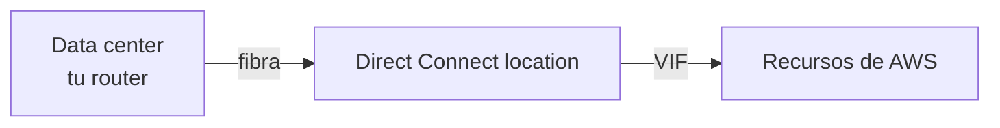

# AWS Direct Connect — Connection Options

> [!abstract] Qué es este archivo
> Quinta lección del módulo y **tercera de servicio**. **AWS Direct Connect** es la **autopista privada**: un enlace
> **dedicado** entre tu data center y AWS, que **no comparte tráfico con nadie** y da **ancho de banda y latencia
> predecibles**.
>
> Cubre los **tres componentes** (connection, location, **VIF**), los **tres tipos de VIF** y las **cinco formas de
> armar el camino lógico** hasta la VPC. Tarea **1.1** del examen, con cruces en **1.3** (resiliencia), **2.2**
> (continuidad) y **1.5** (costos de transferencia).
>
> Video: **7 min 52 s**. **Sin demo y sin Knowledge Check.**

> [!quote] La idea que ordena todo
> **“Unlike the public internet, which can get congested like a busy city street, Direct Connect gives you a
> dedicated route that's always available, always predictable.”**
> La VPN es tomar las **calles existentes**; Direct Connect es **construir tu propia autopista**. Cuesta más al
> principio y **no tiene peajes de congestión**.

---

## Resumen en una frase

> Un enlace **dedicado de fibra** que termina en una **Direct Connect location** y se reparte en **VIF** —**public**,
> **private** o **transit**— para llegar a **servicios públicos**, a **una VPC** o a un **transit gateway**, con
> cinco configuraciones posibles y **sin cifrado por default**.

---

## 1. Qué problema resuelve

**La pregunta del lead developer:** cómo mantener **ancho de banda consistente** y **minimizar el riesgo de perder
conectividad** con AWS.

| | **Internet público** | **Site-to-Site VPN** | **Direct Connect** |
| --- | --- | --- | --- |
| **Camino** | Compartido con todos | Túneles **IPsec** sobre internet | **Fibra dedicada** |
| **Ancho de banda** | Variable según la hora | Limitado por el túnel (**1.25 Gbps**) | **Predecible**, por velocidad de puerto |
| **Latencia** | Variable | Buena, pero depende de internet | **Consistente y baja** |
| **Cifrado** | Depende de la app | **Sí, IPsec** | **No por default** |
| **Costo inicial** | Bajo | Bajo | **Alto** (instalación y puerto) |
| **Costo de transferencia** | Alto en volúmenes grandes | Medio | **Menor** en volúmenes grandes |

**Lo que la fuente dice sin vueltas:** Direct Connect **requiere más setup inicial** que una VPN, porque *estás
levantando una autopista privada en vez de usar las rutas existentes*. Hay **más inversión inicial**, pero si movés
**muchos datos**, esos costos **se justifican** y suelen **compensarse** con mejor rendimiento y **menores costos de
transferencia**.

**Los tres beneficios que enumera el video:**

1. **Rendimiento de red predecible** — se termina la duda de si el tráfico pico de internet va a frenar la
   aplicación crítica.
2. **Menor costo de ancho de banda**, sobre todo con **grandes volúmenes** de datos.
3. **Latencia baja y consistente**, lo que la hace apta para **aplicaciones que necesitan respuesta en tiempo real**.

> [!warning] Lo que Direct Connect NO trae
> **El enlace es privado, no cifrado.** La fuente lo dice explícito: *no está automáticamente cifrado; si manejás
> datos sensibles, tenés que implementar medidas adicionales de cifrado*. Privado y cifrado son **dos
> propiedades distintas**, y el examen las separa.

---

## 2. Los tres componentes

| # | Componente | Qué es | Analogía |
| --- | --- | --- | --- |
| 1 | **Physical connection** | **Línea de fibra óptica dedicada** entre tu data center y AWS | La **calzada** de la autopista |
| 2 | **Direct Connect location** | **Instalación física** donde AWS tiene presencia de red **y donde termina tu conexión** | La **estación de peaje** donde entrás a la autopista |
| 3 | **Virtual interface (VIF)** | **Configuración lógica** que determina **cómo fluye el tráfico** por la conexión | Los **carriles**: uno por tipo de destino |

**Cómo se conecta físicamente:** un **cable de fibra Ethernet estándar**; **un extremo va a tu router** y **el otro
al router de Direct Connect**.

**Cómo llegar a una location — la fuente pide una de estas tres condiciones:**

1. Tu red está **colocada** (*collocated*) en una Direct Connect location existente.
2. Trabajás con un **Direct Connect partner** miembro del **AWS Partner Network (APN)**.
3. Trabajás con un **proveedor de servicios independiente** que te conecta a Direct Connect.

**Alcance regional que suele confundirse:** una **location** da acceso a AWS **en la Region con la que está
asociada**. Pero **una sola conexión en una Region pública (o en GovCloud)** puede acceder a los **servicios públicos
de todas las demás Regions públicas** —eso aplica a **public VIF**, no a VPC privadas—.

---

## 3. Los tres tipos de VIF

| Tipo | Para qué sirve | Alcance |
| --- | --- | --- |
| **Public VIF** | Acceder a **todos los servicios públicos de AWS** por **direcciones IP públicas** | **Todas las Regions públicas**, cualquier endpoint público |
| **Private VIF** | Conectar a **VPC** usando **direcciones IP privadas**, directo o vía **Direct Connect gateway** | **Una Region** (la del enlace) |
| **Transit VIF** | Conectar a **transit gateways** vía **Direct Connect gateway** | Multi-VPC y **multi-Region** |

**Las analogías del video:** la **public VIF** es la **vía expresa a todos los servicios públicos**; la **private
VIF** es **tu carril personal** hacia tu nube privada en una Region; la **transit VIF** es una **llave universal que
abre varias puertas**.

**Dos detalles técnicos que se preguntan:**

1. **Jumbo frames**: Direct Connect soporta **9,023 bytes** de frame (y **1,522 bytes** como frame estándar); el video
   destaca **hasta 9,023 bytes** para **eficiencia** en la transferencia.
2. **Sub-1 Gb links soportan un solo VIF**. Si el enlace es menor a **1 Gbps**, no hay varios VIF por conexión.

> [!important] Public VIF no es “salida a internet”
> El tráfico de una **public VIF** hacia servicios como **Amazon S3** **sigue dentro de la nube de AWS**. Eso da
> **menos superficie de amenaza** y **ahorro** al bajar datos. Es acceso a **endpoints públicos**, no navegación
> abierta.

---

## 4. Las cinco formas de armar el camino

**Una vez que la fibra existe, hay que decidir el camino lógico.** La fuente avisa que **no son las únicas**
opciones, pero sí las comunes.

| # | Configuración | Llega a | Cuándo |
| --- | --- | --- | --- |
| 1 | **Private VIF → virtual private gateway** | **Una sola VPC**, misma Region | Latencia predecible para **una** carga |
| 2 | **Private VIF → Direct Connect gateway** | **Varias VPC en varias Regions** | Recursos distribuidos con gestión central |
| 3 | **Transit VIF → transit gateway** | **Muchas VPC y sedes** | Arquitectura compleja, routing automático |
| 4 | **VPN sobre public VIF** | **VPC** con **IPsec** | Hace falta **cifrado** sobre DX |
| 5 | **Private IP VPN con Direct Connect gateway** | **VPC** cifrada con **IPs privadas** | Datos sensibles + esquema propio de IPs |

---

## 5. Opción 1: private VIF a virtual private gateway

**Qué da:** conectividad privada **dedicada a una sola VPC**, en la **misma Region** que el enlace.

**El caso que usa la fuente:** una **plataforma de trading de acciones**, donde **cada milisegundo cuenta** y hay que
mover datos de mercado entre el sistema on-premises y la analítica en AWS **rápido y confiable**.

**Lo que hay que saber de las private VIF:**

| Punto | Regla |
| --- | --- |
| **Cómo acceden** | Por **IP privada** de los recursos de la VPC, **en lugar de** un internet gateway |
| **VPC endpoints** | **No** dan acceso a **VPC endpoints** |
| **Transitividad** | **No** crean conexiones transitivas por **VPC peering** |
| **Cuántas** | **Una por cada VPC** que necesite acceso |
| **Dónde se adjuntan** | Al VGW, **en el mismo lugar** donde se adjunta una VPN |
| **Resiliencia** | Con **varias conexiones DX**, se aprovisionan private VIF **en cada una** y se adjuntan **varios VIF al VGW** |
| **BGP** | Al ser **private VIF**, se puede usar **cualquier IP y cualquier ASN** para las sesiones BGP |

**El ejemplo de servicio:** con Direct Connect y una private VIF se puede acceder a **Amazon EFS** aprovisionado
dentro de una **VPC privada**.

> [!warning] Las dos negaciones que deciden un examen
> **No hay acceso a VPC endpoints** y **no hay transitividad** (ni por peering). Si el requisito es “llegar a varias
> VPC por esta VIF”, esta opción **no es la respuesta**: hay que ir a **Direct Connect gateway** o **transit
> gateway**.

---

## 6. Opción 2: private VIF a Direct Connect gateway

**Qué agrega:** un **Direct Connect gateway** permite **conectarse a varias Regions** desde **una** conexión.

**Cómo se arma:**

1. Se asocia el **Direct Connect gateway** al **virtual private gateway** de la VPC.
2. Se crea una **private VIF** de la conexión **hacia el Direct Connect gateway**.
3. Se pueden **adjuntar varias private VIF** al Direct Connect gateway.

**La propiedad que hay que memorizar:** el **Direct Connect gateway es un recurso global**. Se crea **en cualquier
Region pública** y **se accede desde todas las Regions públicas**.

**Con qué se puede asociar:**

| Se asocia a | Cuándo |
| --- | --- |
| **Virtual private gateway** | Pocas VPC, o una por Region |
| **Transit gateway** | **Varias VPC en la misma Region** |

**El caso del video:** producción en **Virginia**, **disaster recovery** en **Oregon** y **desarrollo** en
**Irlanda**; **una** conexión por Direct Connect gateway llega a **las tres**.

**Las dos reglas de tránsito — acá está la trampa:**

1. **No permite** que dos asociaciones del **mismo** Direct Connect gateway **se hablen entre sí**. Ejemplo: un
   **VGW → otro VGW**.
2. **Sí permite** que el tráfico vuelva **a la propia asociación**: por ejemplo, una **supernet on-premises** que
   contenga los prefijos de esa asociación.

**Cómo se evita que las VPC se hablen:** si hay **varias VPC conectadas al mismo transit gateway**, **pueden**
comunicarse. Para impedirlo: **attachments separados** y **una route table con la opción `blackhole`**.

> [!important] El Direct Connect gateway NO es un router de tránsito
> Resuelve **alcance** (llegar a muchas Regions con una conexión), **no** interconexión entre las VPC. Si el
> requisito es “que las VPC se hablen entre ellas”, el DXGW **no** lo hace: **transit gateway**, y si hay que
> aislarlas, **`blackhole`**.

---

## 7. Opción 3: transit VIF a transit gateway

**Qué cambia:** se usa **transit VIF + transit gateway** en vez de private VIF. Permite llegar a **varias VPC o
transit gateways en varias Regions**.

**Los dos beneficios que enumera la fuente:**

1. **Gestionar una sola conexión** para múltiples **VPC o VPN** de la **misma Region**.
2. **Anunciar prefijos** de **on-premises hacia AWS** y de **AWS hacia on-premises**.

**El caso del video:** aplicaciones **customer-facing** en una VPC, **bases de datos** en otra, **desarrollo** en una
tercera y **varios data centers** que necesitan hablar con todas. En vez de administrar **conexiones individuales**,
se crea **un transit VIF al transit gateway** y **él maneja el routing automáticamente**: **menos complejidad
operativa** con **alto rendimiento y seguridad**.

---

## 8. Opción 4: VPN sobre public VIF

**Qué agrega:** **cifrado**. Es un **enlace de Direct Connect cifrado** usando **IPsec**.

**La combinación:** una o más conexiones **Direct Connect** dedicadas + **Amazon VPC VPN**. Resultado: una
**conexión privada cifrada con IPsec** que:

- **reduce costos de red**,
- **aumenta el throughput**,
- da una **experiencia de red más consistente** que una VPN por internet.

**Cómo se piensa:** el enlace dedicado une tu red con **recursos públicos de AWS** —por ejemplo, el **endpoint IPsec
de un virtual private gateway**—. Así se **suman** los beneficios administrados de la VPN con la **baja latencia, el
ancho de banda y la consistencia** de Direct Connect, con una **conexión IPsec de punta a punta**.

> [!note] Discrepancia del video (registrada)
> La narración de la **opción 4** en el video **arranca describiendo un transit VIF a transit gateway** —texto
> casi igual al de la opción 3— y recién al final habla de **cifrado**. La lectura es clara: **opción 4 = VPN sobre
> public VIF**. Se sigue la lectura en el cuerpo y se conserva el original en §11.1.

---

## 9. Opción 5: private IP VPN con Direct Connect gateway

**Qué es:** la opción 4 pero **con direcciones IP privadas** en vez de públicas, cifrando sobre **transit VIF** en
lugar de public VIF.

**Los tres beneficios que da la fuente:**

| Beneficio | Antes (sin private IP VPN) | Ahora |
| --- | --- | --- |
| **Operación** | Había que desplegar **VPN y routers de terceros** para hacer VPN privadas sobre DX | **No** se despliega ni administra infraestructura de VPN propia → **operación más simple y menos costo** |
| **Seguridad** | Se usaba **public VIF**, que exige **IPs públicas** para los endpoints → **más probabilidad de ataques (DoS)**; y la public VIF **abre todos los servicios públicos** a la red on-premises | Cifrado sobre **transit VIF** + **IPs privadas** → **conectividad privada de punta a punta además del cifrado** |
| **Escala de rutas** | Direct Connect solo: **20 rutas de salida y 100 de entrada** | **5,000 rutas de salida y 1,000 de entrada** |

**El caso del video:** procesar **transacciones de tarjetas de crédito** —se necesita la **velocidad** de Direct
Connect, la **seguridad** de una VPN, **aislamiento total de internet** y **tu propio esquema de direccionamiento
IP**—. Esta opción entrega **las cuatro cosas juntas**.

> [!important] El número que vale un punto
> **5,000 outbound / 1,000 inbound** con private IP VPN contra **20 outbound / 100 inbound** con Direct Connect solo.
> Si el enunciado habla de **miles de rutas**, la respuesta es **private IP VPN**.

---

## 10. Los límites de esta fuente

> [!note] Huecos registrados (no se inventan)
> - **Sin demo y sin Knowledge Check**: video + **dos lecturas**.
> - **Sin precios** y **sin velocidades de puerto** (no se dice qué capacidades de conexión existen).
> - **Sin LAG** (*link aggregation groups*), **sin BFD** (solo se enlaza la guía) y **sin MACsec** (el cifrado se
>   enlaza, no se explica).
> - **Sin SLA ni diseño de alta disponibilidad**: la resiliencia de DX queda para otra lección.
> - **Sin cuotas** de conexiones, VIF o gateways.
> - **Las nueve imágenes no están en el vault**; no se describen.
> - **Los enlaces de la fuente** (encryption, features, partners, BFD, MTU, User Guide) **no traen contenido**.
> - **Sin ejemplo de ASN** ni de sesión BGP concreta.
> - **La fuente no dice cuántas lecciones tiene el módulo.**

---

## 11. Traducción del contenido

> [!info] Sección de referencia (opcional)
> Esto es la **traducción fiel** de las fuentes, para verificar que no se perdió nada. **No hace falta leerla
> para estudiar**: lo que se estudia son las secciones **1 a 10** y se cierra con la **13**.
> Usala solo si (a) algo de arriba te quedó dudoso, (b) querés el detalle textual de las opciones, o (c) antes del
> examen querés chequear que no se escapó un matiz.

### 11.1 Video: Introduction to Connection Options (transcripción)

Muy bien, bienvenidos de nuevo. El **lead developer** de nuestro escenario tiene esta pregunta: **¿cómo podemos
mantener un ancho de banda consistente y minimizar el riesgo de una pérdida potencial de conectividad con AWS?**
Bueno, acá es donde entra en juego **AWS Direct Connect**. Direct Connect provee **conectividad de red dedicada**
entre tu entorno on-premises y AWS, ofreciendo **rendimiento consistente** en comparación con las conexiones basadas
en internet. A diferencia del **internet público**, que se puede congestionar **como una calle de ciudad muy
transitada**, Direct Connect te da una **ruta dedicada siempre disponible, siempre predecible**.

Ahora, debería mencionarlo desde el principio: **Direct Connect requiere más configuración inicial** que una
solución de VPN, porque **estás levantando una autopista privada en vez de tomar las rutas existentes**. Hay **más
inversión inicial**, pero si estás moviendo **muchos datos**, a veces esos costos **se justifican** para un negocio y
pueden **compensarse** con mejor rendimiento y **menores costos de transferencia de datos**.

Y acá es donde respondemos directamente a la necesidad del lead developer de **ancho de banda consistente**. A
diferencia del internet público, donde **tu tráfico se mezcla con el de todos los demás**, esto es **completamente
privado**. Y lo que lo hace especial: obtenés **rendimiento de red predecible**. Se terminó preguntarte si el
tráfico pico de internet va a frenar tus aplicaciones críticas. A menudo podés **reducir tus costos de ancho de
banda**, especialmente si movés **grandes cantidades de datos**, y si corrés aplicaciones que necesitan **respuestas
en tiempo real**, Direct Connect te da la **conexión de baja latencia consistente** que necesitás.

Veamos cómo funciona Direct Connect a nivel fundamental. Direct Connect consiste en **tres componentes centrales**.
Primero, la **conexión física**: una **línea de fibra óptica dedicada** entre tu data center y AWS. Después están las
**Direct Connect locations**: **instalaciones físicas** donde AWS mantiene presencia de red y **donde termina tu
conexión**. Y por último tenés las **virtual interfaces** o **VIF**: **configuraciones lógicas** que determinan **cómo
fluye el tráfico** a través de tu conexión.

Hay algo importante para recordar: **aunque es una conexión privada y dedicada, no está cifrada automáticamente**.
Si manejás **datos sensibles**, vas a querer implementar **medidas adicionales de cifrado** para asegurar la
protección de los datos.

Ahora profundicemos en esas **virtual interfaces**, o **VIF**, que mencioné. Son **cruciales** para entender cómo
fluye tu tráfico por Direct Connect. Cuando configurás tus VIF, esencialmente estás **creando carriles dedicados para
distintos tipos de tráfico**. Las **public VIF** son las **rutas expresas a todos los servicios públicos de AWS**, en
**cualquier Region, cualquier endpoint público**: todo accesible. Y las **private VIF**, por otro lado, son más una
**línea directa a tu entorno de nube privada en una Region específica**. Pensalo como **tu propio carril rápido**.

Acá hay un detalle técnico que vale la pena notar: Direct Connect soporta **jumbo frames de hasta 9,023 bytes**,
**optimizando la eficiencia** de la transferencia de datos.

Así que tenemos **tres tipos de virtual interfaces** con las que trabajar. Tu **public VIF** es la **ruta expresa a
todos los servicios públicos de AWS**. La **private VIF** te da ese **túnel seguro hacia tu VPC**. Y después está la
**transit VIF**, que es como tener una **llave universal que abre varias puertas**. Cada tipo sirve a un propósito
específico, y **entender cuándo usar cada uno es esencial** para diseñar un setup de Direct Connect efectivo.

Ahora quiero ver las distintas formas de conectar nuestra red on-premises a AWS usando Direct Connect. Tenemos
**cinco formas principales** de hacerlo. Podés conectar una **private VIF a un virtual gateway** o a un **Direct
Connect gateway**, y podrías elegir conectar una **transit VIF a un transit gateway**. Algunos corren una **VPN
sobre una public VIF**, y después está la opción de configurar una **VPN de IP privadas con un Direct Connect
gateway**. Así que desglosemos una por una y veamos qué hace única a cada opción.

Empecemos con nuestra **primera opción de configuración**: conectar una **private virtual interface a un virtual
private gateway** te da **conectividad privada dedicada directamente a una sola VPC**. Es perfecto para cargas que
requieren **rendimiento de baja latencia predecible**. Supongamos que corrés una **plataforma de trading de
acciones** donde **cada milisegundo cuenta**: necesitás mover datos de mercado entre tu sistema on-premises y tu
plataforma de analítica en AWS **rápido y de forma confiable**. Este setup te da esa **conexión directa y dedicada**.

Ahora la **opción 2**: ¿qué pasa si necesitás llegar a **varias VPC** pero no querés configurar **conexiones
separadas para cada una**? Ahí es donde un **Direct Connect gateway** viene bien. Un Direct Connect gateway funciona
como un **punto de conexión central**, que te permite llegar a **múltiples VPC en distintas Regions de AWS a través
de una sola conexión**. Es ideal cuando tenés recursos **distribuidos globalmente** pero querés mantener una
**gestión centralizada de la conectividad**. Quizás tus aplicaciones principales están en **Virginia**, tu
**disaster recovery** en **Oregon** y tu **entorno de desarrollo** en **Irlanda**. **Una conexión** a través de un
Direct Connect gateway puede llegar a **las tres**.

Acá es donde la cosa se vuelve realmente potente. Una **transit VIF conectada a un transit gateway** provee
**gestión centralizada de la conectividad para toda tu infraestructura de nube**. Cuando tenés **múltiples VPC**
alojando distintas cargas —quizás aplicaciones **customer-facing** en una, **bases de datos** en otra, **entornos de
desarrollo** en una tercera— más **varios data centers on-premises** que necesitan comunicarse con todas, el
**transit gateway simplifica la arquitectura**. En vez de administrar **múltiples conexiones individuales**, creás
**una transit VIF hacia tu transit gateway**, que después **maneja todo el routing automáticamente**. Eso **reduce
significativamente la complejidad operativa** manteniendo **alto rendimiento y seguridad**.

A veces necesitás agregar **una capa extra de seguridad** a tu autopista de Direct Connect. Una **transit VIF
conectada a un transit gateway** provee **gestión centralizada para arquitecturas de red complejas**. Esta
configuración habilita **conectividad eficiente** entre **múltiples VPC, data centers on-premises y otros recursos de
red** a través de **un único punto de conexión**. Obtenés **lo mejor de los dos mundos**: el **rendimiento
consistente** de Direct Connect combinado con el **cifrado** de una VPN. Es perfecto cuando manejás **datos
sensibles** que necesitan **velocidad y seguridad**. Por ejemplo, si transferís **datos financieros de clientes**
entre tus sistemas on-premises y AWS, este setup asegura que los datos **se muevan rápido y se mantengan
protegidos**.

Y la **opción 5**, nuestra última conexión, combina **direccionamiento IP privado** con **Direct Connect** y
**cifrado de VPN**, creando una **conexión altamente segura**. Es particularmente valiosa para organizaciones que
requieren **control completo de su esquema de direccionamiento IP** mientras mantienen **los beneficios de
rendimiento de Direct Connect** y **la seguridad de cifrado de VPN**. Este setup es ideal para manejar **cargas
sensibles** que requieren **cumplimiento estricto de seguridad** manteniendo **alto rendimiento**. Y pensá en el
**procesamiento de transacciones de tarjetas de crédito**: necesitás la **velocidad** de Direct Connect, la
**seguridad** de una VPN, **aislamiento completo del internet público** y la **capacidad de usar tu propio esquema
de direccionamiento IP**. Esta opción entrega **todo eso en un solo paquete**.

### 11.2 Lectura: Direct Connect to VPC Connections

**AWS Direct Connect** enlaza tu red interna con una **Direct Connect location** sobre un **cable de fibra óptica
Ethernet estándar**. **Un extremo del cable se conecta a tu router** y **el otro a un router de Direct Connect**. Con
esta conexión, podés crear **virtual interfaces** directamente hacia **servicios públicos de AWS** (por ejemplo,
**Amazon S3**) o hacia **Amazon VPC**, **evitando a los proveedores de servicios de internet** en el camino de red.
Una **Direct Connect location** provee acceso a AWS **en la Region con la que está asociada**. Podés usar **una sola
conexión en una Region pública o en AWS GovCloud (US)** para acceder a **servicios públicos de AWS en todas las demás
Regions públicas**.

*[Imagen: data center on-premises usando Direct Connect para conectarse a una VPC con dos Availability Zones.]*

#### Arquitectura de Direct Connect

Para usar AWS Direct Connect en una Direct Connect location, **tu red tiene que cumplir una** de las siguientes
condiciones:

- Tu red está **colocada** (*collocated*) en una **Direct Connect location existente**.
- Estás trabajando con un **Direct Connect partner** que es **miembro del AWS Partner Network (APN)**.
- Estás trabajando con un **proveedor de servicios independiente** para conectarte a Direct Connect.

Además, **tu red tiene que cumplir algunas condiciones**. Para información más detallada, visitá el enlace
**User Guide**.

Direct Connect soporta **los protocolos IPv4 e IPv6**. Las **direcciones IPv6** provistas por los servicios públicos
de AWS son **accesibles a través de las public virtual interfaces** de Direct Connect. Direct Connect soporta un
**tamaño de frame Ethernet de 1,522 o 9,023 bytes** (**14 bytes de encabezado Ethernet + 4 bytes de tag VLAN + bytes
del datagrama IP + 4 bytes de FCS**) en la **capa de enlace**. **Podés configurar la MTU de tus private virtual
interfaces.**

*[Imagen: data center on-premises conectándose a una cuenta de AWS usando una Direct Connect location; dentro de la
location se muestran varias VLAN.]*

**Encryption in AWS Direct Connect** — para información sobre el cifrado del tráfico de Direct Connect, seleccioná el
enlace **User Guide**.

**AWS Direct Connect features** — para información sobre las locations disponibles, seleccioná el enlace del sitio de
**Direct Connect**.

**AWS Direct Connect Delivery Partners** — para información sobre los partners de APN que soportan Direct Connect,
seleccioná el enlace de la **página de AWS**.

**How do I enable BFD for my Direct Connect connection?** — para información sobre cómo habilitar **Bidirectional
Forwarding Detection (BFD)** en tu conexión, seleccioná el enlace de **AWS re:Post**.

**Setting network MTU for private virtual interfaces or transit virtual interface** — para información sobre cómo
enlazar tu red interna a una location sobre un cable de fibra Ethernet estándar, seleccioná el enlace **User Guide**.

Una **public virtual interface (VIF)** te da acceso **a todas las direcciones IP públicas de Amazon** de la **Region
asociada**. Aunque estás accediendo a **endpoints públicos** de servicios como **Amazon S3**, **el tráfico de la
public VIF se queda dentro de la nube de AWS**. Eso tiene el efecto de **reducir las amenazas de seguridad** de la
comunicación por internet y de **generar ahorros** al descargar datos de servicios como **Amazon S3**.

Al **intercambiar prefijos de IP públicas por la sesión BGP**, usá **IPs públicas** para la sesión y como
**anuncio del lado del cliente** de la conexión. **Usá direcciones IP públicas que ya poseas**. Si no tenés ninguna
o no encajan bien con tu arquitectura de red, **abrí un caso con AWS Support**: **se te asignará un `/31`** que podés
usar. Si querés usar un **Autonomous System Number (ASN) público**, **tiene que ser tuyo**. Si no, **un ASN privado
está bien**. Las Direct Connect locations pueden acceder a los **recursos públicos de cualquier Region de AWS usando
una public VIF**. **Los enlaces de menos de 1 Gb soportan un solo VIF.**

*[Imagen: arquitectura de Direct Connect.]*

#### Tipos de interfaz de Direct Connect

Direct Connect ofrece los siguientes **tipos de interfaz**:

| Tipo | Propósito |
| --- | --- |
| **Public VIF** | Acceder a **todos los servicios públicos de AWS** usando **direcciones IP públicas** |
| **Private VIF** | Conectar a **Amazon VPC** usando **direcciones IP privadas**; directo o vía **Direct Connect gateway** |
| **Transit VIF** | Conectar a **transit gateways** vía **Direct Connect gateway** |

### 11.3 Lectura: Direct Connect VPC Connect Options

Veamos algunas opciones distintas al crear una **ruta de red lógica** con AWS Direct Connect **una vez establecido
el enlace físico**. Veamos las opciones comunes, pero tené en cuenta que **no son las ÚNICAS**.

En el diagrama tenemos una **red de cliente**, una **Direct Connect location** y **alguna Region de AWS**. Esa Region
podría tener **una o más VPC** y, en algunos casos, podemos querer conectarnos a **más de una Region**. Según
nuestras necesidades, veamos algunas opciones distintas.

*[Imagen: Region con dos VPC conectadas a una Direct Connect location; dentro de la location hay un router de Direct
Connect y un router de cliente; la location se conecta a un customer gateway que enlaza a la red del cliente.]*

#### Opción 1: private VIF a virtual gateway

Una opción directa: usás una **private VIF** para crear una **ruta de red a una sola VPC** dentro de la **misma
Region** que el enlace de Direct Connect.

Las **private VIF** dan acceso a **recursos dentro de una VPC** usando **sus direcciones IP privadas** en lugar de un
**internet gateway**. **No te dan acceso a VPC endpoints** y **no podés usarlas para crear conexiones transitivas
mediante VPC peerings**.

**Desplegá private VIF por cada VPC** que necesite acceso. Las private VIF **se adjuntan a tu VPC en el mismo lugar
que una VPN**. Si tenés **múltiples conexiones de Direct Connect**, podés **aprovisionar private VIF en cada
conexión** y **adjuntar múltiples VIF a tus virtual gateways para resiliencia**. Como es una **private VIF**, podés
usar **cualquier dirección IP y cualquier ASN** para las **sesiones de BGP peering**.

Usando Direct Connect y una private VIF, podés acceder a un **Amazon Elastic File System (Amazon EFS)**
aprovisionado dentro de una **VPC privada**. **Amazon EFS** es un **servicio totalmente administrado** que podés usar
para **configurar y escalar almacenamiento de archivos** en la nube de AWS. Con la **consola de administración de
AWS**, podés crear **sistemas de archivos accesibles a instancias Amazon EC2** mediante una **llamada a la API de
interfaz de sistemas de archivos**.

#### Opción 2: private VIF a Direct Connect gateway

En esta opción usás un **Direct Connect gateway**. Esto permite **conectar a múltiples Regions**.

Podés usar un **Direct Connect gateway** para conectar tu conexión de Direct Connect **sobre una private VIF**.
Podés conectarlo a **una o más VPC de tu cuenta** que estén en la **misma Region o en Regions distintas**.
**Asociás un Direct Connect gateway con el virtual private gateway de la VPC**. Después, **creás una private VIF**
de tu conexión de Direct Connect **hacia el Direct Connect gateway**. Podés **adjuntar múltiples private VIF** a tu
Direct Connect gateway.

Un **Direct Connect gateway es un recurso globalmente disponible**. **Creás el Direct Connect gateway en cualquier
Region pública y accedés a él desde todas las Regions públicas.** Asociás un Direct Connect gateway con **uno** de
los siguientes gateways:

- Un **transit gateway**, cuando tenés **múltiples VPC en la misma Region**.
- Un **virtual private gateway**.

Un **Direct Connect gateway no permite** que las **asociaciones de gateway del mismo Direct Connect gateway** se
**envíen tráfico entre sí**. Un ejemplo sería **un virtual private gateway a otro virtual private gateway**. Un
Direct Connect gateway **no impide** que se envíe tráfico **de una asociación de gateway de vuelta a esa misma
asociación**. Por ejemplo, podrías tener una **ruta supernet on-premises** que contenga los prefijos de la asociación
de gateway.

Si tenés una configuración con **múltiples VPC conectadas al mismo transit gateway**, **las VPC podrían
comunicarse**. Para **evitar que las VPC se comuniquen**, usá **attachments separados al transit gateway** y
**asociá una route table a los attachments con la opción `blackhole`**.

#### Opción 3: transit VIF a transit gateway

En esta opción usamos una **transit VIF** y un **transit gateway** en vez de una private VIF. Este setup permite
**conexiones a múltiples VPC o transit gateways en múltiples Regions**.

El diagrama ilustra cómo podés usar el **Direct Connect gateway** para crear **una sola conexión que todas tus VPC
puedan usar**. **Adjuntá un transit gateway a un Direct Connect gateway usando una transit virtual interface**. Esta
configuración ofrece los siguientes beneficios:

- **Administrar una sola conexión** para **múltiples VPC o VPN** que están en la **misma Region**.
- **Anunciar prefijos** de **on-premises a AWS** y de **AWS a on-premises**.

*[Imagen: Direct Connect gateway usando asociaciones de transit gateway para conectar dos Regions distintas, cada
una con dos VPC.]*

#### Opción 4: VPN sobre public VIF

En esta opción introducimos una **VPN**. Esto usa un **enlace de Direct Connect cifrado**.

Con **Direct Connect y VPN**, podés **combinar una o más conexiones de red dedicadas de Direct Connect con la VPN de
Amazon VPC**. Esta combinación provee una **conexión privada cifrada con IPsec** que **reduce los costos de red**,
**aumenta el throughput** y provee una **experiencia de red más consistente** que las conexiones VPN basadas en
internet.

Podés usar Direct Connect para **establecer una conexión de red dedicada dentro de tu red**. También podés **crear
una conexión lógica a recursos públicos de AWS**, como un **endpoint IPsec de un virtual private gateway**. Esta
solución combina los **beneficios administrados de la solución VPN** con la **baja latencia, el mayor ancho de banda
y los beneficios más consistentes de Direct Connect**, y una **conexión IPsec segura de punta a punta**.

*[Imagen: Direct Connect location usando una public VIF para conectarse a una Site-to-Site VPN de AWS; la VPN IPsec
se conecta a un transit gateway dentro de una Region, que a su vez conecta dos VPC.]*

#### Opción 5: private IP VPN con Direct Connect gateway

En la opción anterior usamos una **public VIF** para conectarnos a nuestra **site-to-site VPN**. En esta opción
usamos **IPs privadas**. Esto da varios beneficios.

**Gestión y operación de red simplificadas:**

Sin **private IP VPN**, tendrías que **desplegar VPN y routers de terceros** para implementar VPN privadas sobre las
redes de AWS Direct Connect. Con la capacidad de **private IP VPN**, **no tenés que desplegar ni administrar tu propia
infraestructura de VPN**. Eso lleva a **operaciones de red más simples** y **menores costos**.

**Mejor postura de seguridad:**

Antes, podrías haber usado una **public VIF** de AWS Direct Connect para **cifrar el tráfico sobre Direct Connect**,
lo que **requería direcciones IP públicas para los endpoints de VPN**. Usar **IPs públicas aumenta la probabilidad de
ataques externos (DoS)**, lo que a su vez te lleva a **desplegar equipamiento de seguridad adicional** para proteger
la red. Además, una **public VIF abre acceso entre todos los servicios públicos de AWS y las redes on-premises**,
**aumentando la severidad del riesgo**. La funcionalidad de **private IP VPN** permite **cifrado sobre transit VIF de
Direct Connect** (en lugar de public VIF), junto con la **capacidad de configurar IPs privadas**. Eso provee
**conectividad privada de punta a punta además del cifrado**, mejorando la **postura de seguridad general**.

**Mayor escala de rutas:**

Las conexiones de **private IP VPN** ofrecen **límites de rutas más altos** (**5,000 rutas de salida y 1,000 rutas de
entrada**). Se comparan favorablemente con **AWS Direct Connect solo**, que actualmente tiene un límite de **20 rutas
de salida y 100 rutas de entrada**.

*[Imagen: arquitectura de private IP VPN con Direct Connect gateway.]*

---

## 12. Qué opción usar (quién hace qué)

| Necesidad | Configuración | Por qué |
| --- | --- | --- |
| **Una VPC**, misma Region, latencia mínima | **Private VIF → VGW** | Camino directo, sin intermediarios |
| **Varias VPC en varias Regions**, con una conexión | **Private VIF → DX gateway** | El DXGW es **global** |
| **Muchas VPC y sedes**, routing automático | **Transit VIF → TGW** | Hub central, sin conexiones individuales |
| **Cifrado** sobre DX, sin cambiar el esquema IP | **VPN sobre public VIF** | IPsec sobre el enlace dedicado |
| **Cifrado + IPs privadas + miles de rutas** | **Private IP VPN con DX gateway** | **5,000/1,000** rutas y sin IPs públicas |
| **Servicios públicos** (S3, APIs) por red privada | **Public VIF** | Acceso a endpoints públicos sin salir a internet |
| **Aislar VPC** conectadas al mismo TGW | **Attachments + route table `blackhole`** | Evita que se hablen |

---

## 13. Para el examen (SAP-C02)

> [!important] Lo que hay que retener
> 1. **Direct Connect no cifra por default**: privado **no** es lo mismo que cifrado. Para cifrar: **VPN sobre
>    public VIF** o **private IP VPN**.
> 2. **Tres componentes**: **physical connection**, **Direct Connect location** y **VIF**. La VIF es **lógica**; la
>    fibra es **física**.
> 3. **Public VIF** = servicios públicos de **todas las Regions**; **private VIF** = **una VPC**; **transit VIF** =
>    **transit gateway**.
> 4. **Private VIF a VGW**: una VPC, misma Region; **no** da **VPC endpoints** y **no** hay **transitividad** por
>    peering.
> 5. **Direct Connect gateway es global**: se crea en cualquier Region pública y se usa desde todas.
> 6. **El DXGW no enruta entre sus asociaciones** (VGW → VGW). Para que las VPC se hablen: **TGW**; para aislarlas:
>    **`blackhole`**.
> 7. **Transit VIF + TGW** = una conexión para **muchas VPC y muchas Regions**.
> 8. **Private IP VPN**: **5,000 outbound / 1,000 inbound** contra **20 / 100** de Direct Connect solo.
> 9. **Sub-1 Gb links soportan un solo VIF**; los **jumbo frames** llegan a **9,023 bytes** (estándar **1,522**).
> 10. **BGP en public VIF** usa **IPs públicas propias**; si no tenés, **AWS te asigna un `/31`**. El **ASN público**
>     debe ser tuyo; si no, **privado**.

> [!warning] Trampa clásica del examen
> Escenario: “una sola conexión de Direct Connect debe llegar a **VPC en tres Regions** **y** las VPC tienen que
> **hablarse entre ellas**”. La respuesta **no** es “**Direct Connect gateway**”: el DXGW llega a las tres, pero
> **no permite tráfico entre sus asociaciones**. La respuesta es **transit VIF + transit gateway** (y, si el
> requisito es **aislarlas**, **attachments separados con route table `blackhole`**). Segunda trampa del mismo
> escenario: si además piden **cifrado**, hay que sumar **VPN** — **Direct Connect no cifra solo**.

---

## Relacionado

- [[AWS Site-to-Site VPN]] — la VPN que acá se usa **encima** de Direct Connect para cifrar
- [[AWS Client VPN]] — la tercera pata: acceso **de usuarios**
- [[AWS Solutions Architect Advanced - Optimizing Hybrid Architectures]] *(índice del módulo)*
- [[Use Cases - Transit Gateway]] — el hub que acá aparece como destino de la **transit VIF**
- [[VPC Connectivity]] — VGW, rutas y propagación desde el lado de la VPC
- [[AWS Resource Access Manager (RAM) Solutions]] — compartir el TGW y el DX gateway entre cuentas
- [[1.1 Diseñar estrategias de conectividad de redes]] — la tarea que esta lección cubre
- [[1.3 Diseñar arquitecturas fiables y resistentes]] — resiliencia del enlace dedicado
- [[2.2 Diseñar una solución para garantizar la continuidad de actividades]] — VPN como respaldo de DX
- [[1.5 Determinar las estrategias de optimización de costos y visibilidad]] — costos de transferencia
- Siguiente paso del módulo: **alta disponibilidad de Direct Connect + VPN de respaldo** — lección 06 esperada
  según los ocho objetivos; a confirmar con la fuente

---

## Registro de integración

| Fecha | Qué llegó | Dónde se integró |
| --- | --- | --- |
| 29/10/2026 | Lección 05 completa: video (7:52) + dos lecturas (Direct Connect to VPC Connections, VPC Connect Options) | Nota completa (secciones 1–13) |

**Discrepancias y vacíos registrados (no corregidos):**

1. **Artefactos de transcripción del video.** “public 5”, “private 5th”, “private vis”, “transit 5th”, “transit 5”,
   “VVF”, “VI” son **VIF**. Se traducen por el sentido y se conserva el original en §11.1.
2. **La opción 4 del video no coincide con la lectura.** La narración arranca describiendo **transit VIF a transit
   gateway** (texto casi igual al de la opción 3) y termina hablando de **cifrado**. La lectura define **opción 4 =
   VPN sobre public VIF**. Se sigue la lectura en el cuerpo (§8) y se anota la diferencia.
3. **“3 types of virtual interfaces”** aparece **dos veces** en el video, con la misma lista repetida. Se transcribe
   una sola vez por claridad y se registra.
4. **La cifra de rutas de la opción 5 está solo en la lectura** (5,000 / 1,000 contra 20 / 100); el video no la da.
5. **Jumbo frames:** el video dice “hasta 9,023 bytes”; la lectura agrega el **1,522** y el **desglose** (14 + 4 +
   datagrama + 4). Se integran las dos.
6. **“Una sola conexión en una Region pública (o GovCloud) accede a servicios públicos de todas las Regions”** aplica
   a **public VIF**; el video lo dice como beneficio general de DX. Se acota en §2.
7. **Artefacto de formato en la lectura:** títulos con `****dobles negritas****` y `#` sueltos. No se reproducen.
8. **Las nueve imágenes no están en el vault**; se marcan como `[Imagen: …]` con la descripción de la fuente.
9. **Los enlaces de la fuente** (encryption, features, partners, BFD, MTU, User Guide) **no traen contenido**: son
   referencias.
10. **Sin demo, sin Knowledge Check, sin precios y sin cuotas**: no se inventan.
11. **Sin alta disponibilidad ni LAG**: la resiliencia de DX y la VPN de respaldo **no** están en esta fuente; quedan
    para la lección siguiente.
12. **La fuente no indica cuántas lecciones tiene el módulo**: el mapa de progreso sigue sin total.

**Decisiones de transcripción:**

- Se conservan **Direct Connect**, **DX**, **VIF**, **public VIF**, **private VIF**, **transit VIF**, **virtual
  private gateway**, **transit gateway**, **Direct Connect gateway**, **Direct Connect location**, **BGP**, **ASN**,
  **APN**, **BFD**, **MTU**, **jumbo frames**, **VLAN**, **FCS**, **IPsec**, **GovCloud**, **Amazon EFS** y
  **`blackhole`**.
- Las **cifras** se transcriben literales: **7 min 52 s**, **9,023 bytes**, **1,522 bytes**, **1 Gb**, **`/31`**,
  **5,000 / 1,000** rutas, **20 / 100** rutas, **14 + 4 + 4 bytes**, **dos lecturas**, **nueve imágenes**.
- Se conservan las **analogías** de la fuente —**calle congestionada vs. autopista**, **carril rápido**, **llave
  universal**, **estación de peaje**— porque son el orden del video.
- La tabla de **§12** es **lectura propia** que cruza las cinco opciones con las necesidades típicas; la fuente
  **no** la trae.
