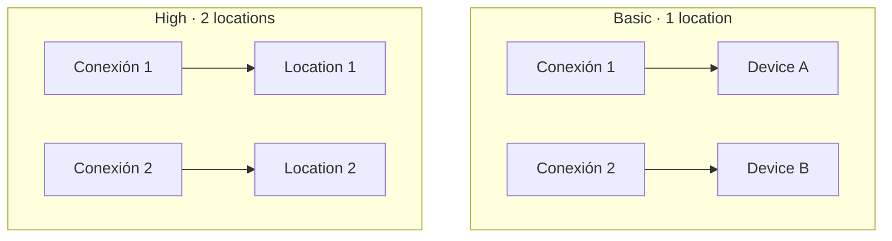

# AWS Direct Connect — Redundancy and Resilience

> [!abstract] Qué es este archivo
> Sexta lección del módulo y **cuarta de servicio**. Responde la segunda mitad de la pregunta del lead developer:
> ya hay un enlace dedicado, **¿qué pasa cuando se cae?**
>
> Cubre los **tres modelos de resiliencia** de Direct Connect (**basic**, **high**, **maximum**), los **LAG** para
> agrupar conexiones y la **VPN como respaldo**. Tarea **1.3** del examen, con cruces directos en **2.2**
> (continuidad de actividades) y **1.1** (conectividad).
>
> Video: **2 min 16 s**. **Sin demo y sin Knowledge Check.**

> [!quote] La idea que ordena todo
> **“Everything fails, all the time.”** — Werner Vogels, CTO de Amazon.
>
> La pregunta no es **si** el enlace se cae, sino **qué hacés cuando se cae**. Y hay una escala: tener un **repuesto
> en el baúl** (VPN de respaldo), **dos motores en el mismo avión** (basic), **un auto de repuesto en otro garaje**
> (high) o **dormir tranquilo** (maximum).

---

## Resumen en una frase

> Tres niveles de resiliencia que se compran con **más conexiones y más locations** —**basic** cubre la falla de un
> dispositivo, **high** cubre la de una location, **maximum** cubre las dos cosas a la vez— más **LAG** para
> agrupar y **VPN** como respaldo barato, con una regla dura: si ambos anuncian las mismas rutas, **Direct Connect
> siempre gana**.

---

## 1. Qué problema resuelve

**La fuente arranca con la frase que hay que memorizar:** *todo falla, todo el tiempo*. Por eso hace falta una
**estrategia para mantener las operaciones incluso frente a fallas múltiples**.

**La pregunta que se repite en el diseño:** *“¿qué voy a hacer **cuando** (no **si**) esta conexión falle?”*

| Pieza que puede fallar | Qué la cubre |
| --- | --- |
| **Un dispositivo** de borde en la location | **Basic device resiliency** |
| **Un corte de fibra** o un dispositivo | **High resiliency** |
| **La location entera** | **High** (la previene) y **maximum** (la cubre explícitamente) |
| **El enlace dedicado completo** | **VPN de respaldo** |

> [!important] El orden mental
> Primero se decide **cuánto se puede caer** (impacto), después **cuánto se puede pagar**. La fuente lo dice sin
> rodeos: **maximum es la opción más cara** y solo se justifica cuando **cada segundo de caída cuesta dinero serio**.

---

## 2. Los tres modelos, de un vistazo

| | **Basic device resiliency** | **High resiliency** | **Maximum resiliency** |
| --- | --- | --- | --- |
| **Conexiones** | **2**, en **dispositivos distintos** | **2**, **una por location** | **2 o más por location**, en **dispositivos distintos** |
| **Locations** | **1** | **2 o más** | **Más de una** |
| **Cubre falla de dispositivo** | **Sí** | **Sí** | **Sí** |
| **Cubre corte de fibra** | **No** | **Sí** | **Sí** |
| **Cubre falla total de location** | **No** | **La previene** | **Sí** |
| **Para qué carga** | **Desarrollo y prueba**, no crítica | **Crítica** | **Crítica, “dormir tranquilo”** |
| **Analogía del video** | **Dos motores en el mismo avión** | **Auto de repuesto en otro garaje** | **Planes de respaldo para los planes de respaldo** |
| **Costo** | Bajo | Medio | **El más alto** |

**La diferencia entre *high* y *maximum* está en la cantidad de conexiones por location y en los dispositivos.**
*High* usa **dos conexiones simples a múltiples locations** (una por location); *maximum* usa **conexiones separadas
en dispositivos separados en más de una location** (dos por location), como en el diagrama de la fuente: **dos data
centers**, cada uno con **dos conexiones**, a **dos locations distintas**.

---

## 3. Basic device resiliency

**Qué es:** **conexiones separadas** que terminan en **dispositivos distintos** dentro de **una sola location**.

**Qué garantiza:** **resiliencia contra la falla de un dispositivo**.

**Qué no garantiza:** **resiliencia contra la falla de la location**. Si la instalación se cae, se cae todo.

**Para qué sirve, según la fuente:** **desarrollo y prueba**, cargas **no críticas**.

**La analogía del video:** dos motores en un avión: si uno falla, **el otro te mantiene volando**; el tráfico pasa
**automáticamente** por la conexión que funciona y **los usuarios ni se enteran**.

> [!warning] El error clásico
> Poner **dos conexiones en la misma location** y llamarlo “alta disponibilidad”. Cubre **el equipo**, no **el
> edificio**. Si el requisito menciona **corte de fibra** o **falla de location**, este modelo **no alcanza**.

---

## 4. High resiliency

**Qué es:** **dos conexiones simples a múltiples locations**.

**Qué garantiza:**

- Resiliencia contra **fallas de conectividad** causadas por un **corte de fibra**.
- Resiliencia contra **falla de un dispositivo**.
- **Ayuda a prevenir** una **falla completa de location**.

**Para qué sirve:** cargas **críticas** que necesitan **acceso constante a AWS**.

**La analogía del video:** no es un repuesto en el baúl, es **un auto entero de respaldo en otro garaje**: te
protege de los problemas del vehículo **y** de los problemas del garaje.

---

## 5. Maximum resiliency

**Qué es:** **conexiones separadas** que terminan en **dispositivos separados** en **más de una location**.

**Qué garantiza:** resiliencia contra **falla de dispositivo**, **de conectividad** y **de location completa**.

**Para qué sirve:** lo que el video llama *el setup para dormir tranquilo*. Es la opción **más cara** y se justifica
en cosas como una **plataforma global de e-commerce**, donde **cada segundo de caída cuesta mucho dinero**.

**La frase que cierra el video:** *tenés planes de respaldo para tus planes de respaldo*.

> [!important] Cómo reconocerla en un escenario
> Si el enunciado dice **“más de una location”** **y** **“dispositivos separados en cada extremo”**, es **maximum**.
> Si dice **“dos locations con una conexión cada una”**, es **high**. La palabra *dispositivos* (plural, por
> location) es la que marca la diferencia.

---

## 6. LAG: agrupar conexiones

**Qué es:** un **link aggregation group (LAG)** es una **interfaz lógica** que usa **LACP** (*Link Aggregation
Control Protocol*) para **agregar múltiples conexiones dedicadas en un único endpoint de Direct Connect**, y así
**tratarlas como una sola conexión administrada**.

**Por qué conviene:** **simplifica la configuración**, porque lo que se configura en el LAG **aplica a todas las
conexiones del grupo**.

**El ejemplo de la fuente:** **cuatro conexiones dedicadas**, **dos por location**. Se crea **un LAG por location**
y se administran **dos LAG en vez de cuatro conexiones**.

**Las cinco reglas:**

| # | Regla |
| --- | --- |
| 1 | Los enlaces pueden ser de **100, 10 o 1 Gbps** |
| 2 | **No se permiten enlaces de menos de 1 Gbps** |
| 3 | Se pueden agregar **hasta cuatro enlaces** |
| 4 | Todos los enlaces deben tener **la misma velocidad** |
| 5 | Todos los enlaces deben **terminar en el mismo equipamiento** |

> [!warning] LAG no es resiliencia de location
> Un LAG **agrupa conexiones que terminan en el mismo endpoint**. Sirve para **simplificar la administración** (y para
> sumar capacidad dentro de ese endpoint), **no** para sobrevivir a la caída de una location. Si el requisito es
> **location failure**, hay que ir a **high** o **maximum**. Y el detalle que delata: **mismo equipamiento**.

---

## 7. VPN como respaldo de Direct Connect

**Cuándo:** cuando se busca una solución de **corto plazo** o de **menor costo** para tener un **failover**.

**La advertencia que hay que leer dos veces:** **las VPN no están diseñadas para dar el mismo ancho de banda** que la
mayoría de las conexiones de Direct Connect. **La aplicación tiene que tolerar menos ancho de banda** si la VPN va a
ser el respaldo.

**Cómo se configura — los cuatro pasos:**

| # | Paso | Detalle |
| --- | --- | --- |
| 1 | **Mismo virtual private gateway** | El de Direct Connect y el de la VPN tienen que ser **el mismo** para la VPC |
| 2 | **BGP: mismo prefijo** | Si la VPN es **BGP**, **anunciar el mismo prefijo** que Direct Connect |
| 3 | **Estático: mismos prefijos** | Si la VPN es **estática**, **cargar los mismos prefijos estáticos** que se anuncian por la **VIF** de Direct Connect |
| 4 | **Preferencia del lado on-premises** | Asegurar que **Direct Connect sea la ruta preferida desde tu lado** mientras la **VIF está arriba**, para **evitar ruteo asimétrico** |

**La regla que resuelve el examen:**

> Si se anuncian **las mismas rutas** hacia la VPC, **el camino de Direct Connect siempre se prefiere**,
> **independientemente del AS-Path prepending**.

**O sea:** no se puede “empujar” el tráfico hacia la VPN prependeando el AS-Path. **Direct Connect gana igual**. Y
como el tráfico de ida y vuelta tiene que usar el **mismo camino**, hay que cuidar el lado on-premises: si vos
preferís la VPN mientras la VIF está arriba, **el retorno va a volver por Direct Connect** → **ruteo asimétrico**.

> [!important] La VPN es un repuesto, no un carril más
> El video lo dice con la analogía del **neumático de repuesto**: *esperás no necesitarlo nunca, pero te alegra
> tenerlo*. No está para sumar ancho de banda ni para repartir carga: está para que **haya camino** cuando el
> principal se corta.

---

## 8. Cómo se elige

| Necesidad / restricción | Respuesta |
| --- | --- |
| Carga **no crítica**, presupuesto bajo | **Basic device resiliency** |
| **Corte de fibra** o **falla de dispositivo**, carga crítica | **High resiliency** |
| **Falla de location completa**, carga crítica | **Maximum resiliency** |
| **Simplificar** varias conexiones y **sumar capacidad** en un endpoint | **LAG** |
| **Failover barato y rápido** de un enlace dedicado | **VPN de respaldo** |
| La app **no tolera** menos ancho de banda | **No** sirve la VPN como respaldo: hace falta **otra conexión DX** |
| Querés que la VPN **gane** con AS-Path prepending | **No se puede**: Direct Connect gana si las rutas son iguales |

---

## 9. Los límites de esta fuente

> [!note] Huecos registrados (no se inventan)
> - **Sin demo y sin Knowledge Check**: video de **2 min 16 s** + **una lectura**.
> - **Sin SLA** ni tiempos de conmutación (el video dice “automáticamente”, sin cifra).
> - **Sin precios** de conexiones ni de locations.
> - **Sin MACsec ni BFD** (BFD solo se enlaza desde la lección anterior).
> - **Sin combinaciones**: no se dice cómo se combinan **LAG + VPN**, ni **LAG** con **maximum resiliency**.
> - **Sin el “resilience toolkit”** de AWS (los modelos con nombre propio: *development*, *high*, *maximum* y sus
>   variantes con dos locations y dos dispositivos); la fuente describe **tres** modelos, no la tabla completa.
> - **Las cinco imágenes no están en el vault**; no se describen.
> - **El enlace** a *Site-to-Site VPN routing options* **no trae contenido**.
> - **La fuente no indica cuántas lecciones tiene el módulo.**

---

## 10. Traducción del contenido

> [!info] Sección de referencia (opcional)
> Esto es la **traducción fiel** de las fuentes, para verificar que no se perdió nada. **No hace falta leerla
> para estudiar**: lo que se estudia son las secciones **1 a 9** y se cierra con la **12**.
> Usala solo si (a) algo de arriba te quedó dudoso, (b) querés el detalle textual de los modelos, o (c) antes del
> examen querés chequear que no se escapó un matiz.

### 10.1 Video: Introduction to Redundancy and Resilience (transcripción)

Ahora, incluso las **mejores autopistas** a veces necesitan una **ruta de respaldo**. Por eso a menudo **combinamos
Direct Connect con una solución de VPN de respaldo**. Pensá en Direct Connect como tu **autopista rápida y fluida** y
en la VPN como tu **camino de respaldo**. Seguro, la VPN **puede no ser tan rápida ni tener tanta capacidad**, pero
si algo le pasa a tu conexión de Direct Connect, **todavía tenés una forma de llegar a destino**. La **VPN de
respaldo es nuestro neumático de repuesto** en este escenario: **esperás no necesitarlo nunca, pero te alegra tenerlo
cuando lo necesitás**.

Siguiendo, abordemos otro aspecto de la **preocupación del lead developer por minimizar el riesgo de conectividad**.
Considerá cómo podríamos **construir redundancia en tu setup de Direct Connect**. La **resiliencia básica de
dispositivo** es tu **primera línea de defensa** contra los problemas. En este setup, **creamos conexiones separadas
que terminan en dispositivos distintos de la misma location**. Es como tener **dos motores en un avión**: si uno
tiene problemas, **el otro te mantiene volando**. Tu tráfico **fluye automáticamente por la conexión que funciona** y
**tus usuarios podrían ni siquiera notar** que hubo un problema. De hecho, **esperás que no lo noten**.

Ahora, **subamos la apuesta**. La **alta resiliencia** es más que un neumático de repuesto: es **un auto entero de
respaldo en otro garaje**. Estás protegido contra **los problemas del vehículo y los problemas del garaje** al
**conectarte a múltiples locations de Direct Connect**: estás protegiéndote contra **fallas a nivel de instalación**.
Si una location tiene problemas, **tu tráfico fluye por la otra location**. Para los negocios que corren
**aplicaciones críticas** que necesitan **acceso constante a AWS**, este setup da **tranquilidad**.

Ahora tomemos esa tranquilidad y ampliémosla. Esto es lo que yo llamo el **setup para dormir tranquilo**. La
**resiliencia máxima** significa tener **múltiples conexiones en múltiples locations con múltiples dispositivos en
cada extremo**. Sí, es la **opción más cara**, pero si estás corriendo algo como una **plataforma global de
e-commerce**, donde **cada segundo de caída cuesta mucho dinero**, este nivel de redundancia **tiene sentido**. Ahora
tenés **planes de respaldo para tus planes de respaldo**.

### 10.2 Lectura: Designing for Resilience

La **redundancia** sigue siendo **la mejor estrategia** para **mitigar el impacto de las fallas de hardware**. Si una
conexión a un servicio o a un conjunto de datos es importante, **vale la pena tener más de un camino** para llegar.
**Preguntate siempre: “¿qué voy a hacer cuando (no si) esta conexión falle?”**

#### Link aggregation groups (LAG)

Podés usar **múltiples conexiones para redundancia**. Un **link aggregation group (LAG)** es una **interfaz lógica**
que usa el **Link Aggregation Control Protocol (LACP)** para **agregar múltiples conexiones dedicadas en un único
endpoint de Direct Connect**, de modo que **se puedan tratar como una sola conexión administrada**. Los **LAG
simplifican la configuración** porque **la configuración del LAG aplica a todas las conexiones del grupo**.

En el diagrama de abajo tenés **cuatro conexiones dedicadas**, con **dos conexiones a cada location**. Podés crear
**un LAG para las conexiones que terminan en la misma location** y después usar **los dos LAG en vez de las cuatro
conexiones** para configuración y administración.

Hay algunas cosas para tener en cuenta al crear un LAG:

- Los enlaces pueden ser de **100, 10 o 1 Gbps**.
- **No se permiten enlaces de menos de 1 Gbps.**
- Podés **agregar hasta cuatro enlaces**.
- Los enlaces deben ser **de la misma velocidad**.
- Los enlaces deben **terminar en el mismo equipamiento**.

*[Imagen: conceptualización del uso de link aggregation groups (LAG).]*

#### Direct Connect con respaldo de VPN

Si querés una **solución de corto plazo o de menor costo**, podrías considerar **configurar una VPN de hardware como
opción de failover** para una conexión de Direct Connect. **Las conexiones VPN no están diseñadas para proveer el
mismo nivel de ancho de banda** disponible en la mayoría de las conexiones de Direct Connect. **Asegurate de que tu
caso de uso o aplicación pueda tolerar un ancho de banda menor** si configurás una VPN como respaldo de una conexión
de Direct Connect.

Para configurar la **VPN de hardware como respaldo** de tu conexión de Direct Connect, hacé lo siguiente:

- **Asegurate de usar el mismo virtual private gateway** para Direct Connect y para la conexión VPN a la VPC.
- Si configurás una **VPN BGP**, **anunciá el mismo prefijo** para Direct Connect y para la VPN.
- Si configurás una **VPN estática**, **agregá los mismos prefijos estáticos** a la conexión VPN que estás anunciando
  con la **virtual interface** de Direct Connect.
- Si estás anunciando **las mismas rutas** hacia la **Amazon VPC**, **el camino de Direct Connect siempre va a ser
  preferido**, **independientemente del AS-Path prepending**.

*[Imagen: arquitectura de Direct Connect con respaldo de VPN.]*

**Importante:** asegurate de que **Direct Connect sea la ruta preferida desde tu lado**, y **no la VPN cuando la
virtual interface de Direct Connect está arriba**, para **evitar ruteo asimétrico**.

**Opciones de routing de Site-to-Site VPN** — para información sobre **prioridad de rutas y opciones de routing**,
seleccioná el enlace **User Guide**.

#### Resiliencia básica de dispositivo

Podés lograr **resiliencia de desarrollo y prueba** para **cargas no críticas** usando **conexiones separadas que
terminan en dispositivos separados en una location**. Este modelo provee **resiliencia contra la falla de un
dispositivo**, pero **no provee resiliencia contra la falla de una location**.

*[Imagen: arquitectura de resiliencia básica de dispositivo.]*

#### Alta resiliencia

Podés lograr **alta resiliencia** para **cargas críticas** usando **dos conexiones simples a múltiples locations**.
Este modelo provee **resiliencia contra fallas de conectividad causadas por un corte de fibra o por la falla de un
dispositivo**. También **ayuda a prevenir una falla completa de location**.

*[Imagen: arquitectura de alta resiliencia.]*

#### Resiliencia máxima

Podés lograr **resiliencia máxima** para **cargas críticas** usando **conexiones separadas que terminan en
dispositivos separados en más de una location**. Este modelo provee **resiliencia contra fallas de dispositivo, de
conectividad y de location completa**.

*[Imagen: dos data centers de cliente, cada uno con dos conexiones separadas. El data center 1 se conecta a la
Direct Connect location 1; el data center 2, a la Direct Connect location 2. Ambas locations se conectan a la nube
de AWS.]*

---

## 11. Qué falla y qué lo cubre (cierre)

| Falla | Basic | High | Maximum | VPN backup |
| --- | --- | --- | --- | --- |
| **Un dispositivo de la location** | ✅ | ✅ | ✅ | — |
| **Corte de fibra** | ❌ | ✅ | ✅ | ⚠️ (respaldo por internet) |
| **Location completa** | ❌ | ✅ (la previene) | ✅ | ⚠️ |
| **Enlace DX completo** | ❌ | ⚠️ (si la otra location sigue viva) | ⚠️ | ✅ |
| **Ancho de banda completo tras el failover** | ❌ | ✅ | ✅ | ❌ (**menor**) |
| **Costo** | 💲 | 💲💲 | 💲💲💲 | 💲 |

**Lectura de la tabla:** ninguna fila tiene un único dueño. La **VPN** es el único respaldo cuando **se cae el
enlace**; **high** y **maximum** son los únicos que sobreviven a **una location**.

---

## 12. Para el examen (SAP-C02)

> [!important] Lo que hay que retener
> 1. **“Everything fails, all the time”** (Werner Vogels): se diseña para **cuando** falla, no para **si** falla.
> 2. **Basic**: **dos conexiones, una location, dispositivos distintos** → cubre **dispositivo**, **no location**.
> 3. **High**: **dos conexiones a dos locations** → cubre **fibra** y **dispositivo**, y **previene** la falla de
>    location.
> 4. **Maximum**: **dispositivos separados en más de una location** → cubre **dispositivo + conectividad +
>    location**. Es la **más cara**.
> 5. **LAG** = **LACP**, hasta **4 enlaces**, **100/10/1 Gbps**, **misma velocidad** y **mismo equipamiento**; **no**
>    admite **< 1 Gbps**.
> 6. **LAG no protege de una location**: agrupa en **un único endpoint**.
> 7. **VPN de respaldo**: **mismo VGW** y **mismos prefijos** (BGP o estáticos).
> 8. Si las rutas son iguales, **Direct Connect gana siempre**, **aunque haya AS-Path prepending**.
> 9. **Cuidado con el ruteo asimétrico**: Direct Connect tiene que ser el preferido **también desde on-premises**
>    mientras la **VIF está arriba**.
> 10. **La VPN no da el mismo ancho de banda**: la aplicación tiene que **tolerarlo**.

> [!warning] Trampa clásica del examen
> Escenario: “hay que **preferir la VPN** sobre Direct Connect mientras la VIF está arriba; se propone **AS-Path
> prepending**”. **No funciona**: con las mismas rutas anunciadas, **Direct Connect siempre se prefiere**, sin
> importar el prepending. Y la segunda trampa, en el mismo tema: “**cuatro conexiones en un LAG** para sobrevivir a
> la caída de una location” → un **LAG termina en el mismo equipamiento y en un único endpoint**, así que **no**
> cubre la location: para eso hace falta **high** o **maximum resiliency**.

---

## Relacionado

- [[AWS Direct Connect - Connection Options]] — el enlace, los VIF y las cinco configuraciones que acá se vuelven
  redundantes
- [[AWS Site-to-Site VPN]] — la VPN que se usa como respaldo y sus cuatro caminos
- [[AWS Client VPN]] — la tercera pata del módulo: acceso de usuarios
- [[AWS Solutions Architect Advanced - Optimizing Hybrid Architectures]] *(índice del módulo)*
- [[Use Cases - Transit Gateway]] — el hub cuando hay muchas VPC de por medio
- [[AWS Transit Gateway Network Manager]] — visibilidad del enlace híbrido
- [[1.3 Diseñar arquitecturas fiables y resistentes]] — la tarea que esta lección cubre
- [[2.2 Diseñar una solución para garantizar la continuidad de actividades]] — RTO/RPO y failover
- [[1.1 Diseñar estrategias de conectividad de redes]] — el diseño del enlace
- Siguiente paso del módulo: **Route 53 Resolver endpoints** — lección 07 esperada según los ocho objetivos; a
  confirmar con la fuente

---

## Registro de integración

| Fecha | Qué llegó | Dónde se integró |
| --- | --- | --- |
| 29/10/2026 | Lección 06 completa: video (2:16) + lectura *Designing for Resilience* (LAG, VPN de respaldo y los tres modelos) | Nota completa (secciones 1–12) |

**Discrepancias y vacíos registrados (no corregidos):**

1. **Artefacto de transcripción:** *“your first line of **events** against problems”* por **“first line of
   defense”**. Se traduce por el sentido en §3 y se registra acá.
2. **La fuente no da el conteo exacto de conexiones de *high*.** Dice *“two single connections to multiple
   locations”* y, para *maximum*, *“separate connections that terminate on separate devices in more than one
   location”*. La diferencia se interpreta por el **diagrama** (dos conexiones por location en *maximum*) y se
   explicita en §2.
3. **La cita de Werner Vogels está en el texto de introducción, no en el video.** Se integra al `[!quote]` y a §1.
4. **El video no menciona LAG** y **la lectura no menciona las analogías** (avión, garaje, neumático). Se integran
   las dos fuentes.
5. **“Los enlaces pueden ser de 100, 10 o 1 Gbps”** y **“no se permiten de menos de 1 Gbps”** conviven en la misma
   lista. Se conservan **las dos** frases literales.
6. **“Maximum resiliency”** no se define por cantidad sino por **dispositivos separados + más de una location**. Se
   respeta esa definición y no se agregan números que la fuente no da.
7. **Artefactos de formato:** títulos con `****dobles negritas****` y encabezados con `~`. No se reproducen.
8. **Las cinco imágenes no están en el vault**; se marcan como `[Imagen: …]` con la descripción de la fuente.
9. **El enlace** a *Site-to-Site VPN routing options* **no trae contenido**: es una referencia.
10. **Sin demo, sin Knowledge Check, sin precios, sin SLA y sin tiempos de conmutación**: no se inventan.
11. **La fuente no cubre la combinación LAG + VPN** ni LAG dentro de *maximum*: queda como hueco.
12. **La fuente no indica cuántas lecciones tiene el módulo**: el mapa de progreso sigue sin total.

**Decisiones de transcripción:**

- Se conservan **Direct Connect**, **DX**, **VIF**, **virtual private gateway**, **VPN de respaldo**,
  **link aggregation group (LAG)**, **LACP**, **AS-Path prepending**, **BGP**, **ruteo asimétrico**, **basic device
  resiliency**, **high resiliency** y **maximum resiliency**.
- Las **cifras** se transcriben literales: **2 min 16 s**, **100 / 10 / 1 Gbps**, **menos de 1 Gbps**, **hasta cuatro
  enlaces**, **dos conexiones**, **dos locations**, **cinco imágenes**.
- Se conservan las **analogías** de la fuente —**autopista y camino de respaldo**, **neumático de repuesto**, **dos
  motores en un avión**, **auto de repuesto en otro garaje**, **dormir tranquilo**, **planes de respaldo para los
  planes de respaldo**— porque son el orden del video.
- La tabla de **§11** es **lectura propia** que cruza fallas con modelos; la fuente **no** la trae.
