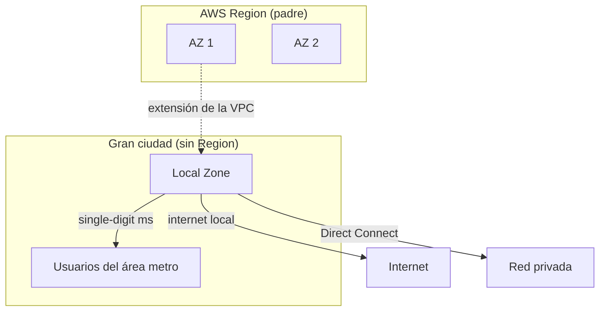

# AWS Local Zones

> [!abstract] Qué es este archivo
> Novena lección del módulo y **segunda del bloque de borde**. La pregunta del **deployment manager** ahora es de
> **latencia**, no de residencia: *¿cómo correr aplicaciones de baja latencia en una zona geográfica **donde AWS no
> tiene Region**?*
>
> Cubre **qué es** una Local Zone, en qué se diferencia de **Outposts**, el **setup** (encender y crear subnet), el
> **catálogo** de cómputo, storage, contenedores y servicios, la **red** (subnet asociada, internet local y
> **Direct Connect**) y los **casos de uso** que describe el video.
>
> Video: **3 min 39 s** + **dos lecturas** (*The Need* y *AWS Local Zones*), cerrando con una sección **vacía**
> (*Local Zones use cases*). **Sin demo y sin Knowledge Check.**

> [!quote] La idea que ordena todo
> **“Think about Local Zones as AWS Region satellites.”**
>
> Y la frase que las separa de Outposts: **Outposts vive en tu data center**; **una Local Zone es una instalación
> construida y operada por AWS en una gran ciudad**. Misma idea —**extender** la Region—, **terreno distinto**.

---

## Resumen en una frase

> Una **Local Zone** es un **despliegue de infraestructura de AWS** —construido y operado por AWS— en **centros
> urbanos e industriales donde no hay Region**, que **extiende tu VPC** para dar **latencia de un dígito en
> milisegundos** a los usuarios de esa **metrópoli**, con **los mismos servicios, APIs y controles** y **sin
> infraestructura física que administrar**.

---

## 1. Qué problema resuelve

**La pregunta del deployment manager:** *¿cómo corremos aplicaciones de **baja latencia** en un área geográfica
donde **AWS no tiene Region**?*

**Por qué importa — los ejemplos del video:**

| Carga | Por qué la latencia es crítica |
| --- | --- |
| **Plataforma de trading** | *“Cada microsegundo cuenta”* |
| **Suite de producción de medios** | Maneja archivos enormes y **no puede esperar** que los datos viajen entre Regions |
| **Servidores de gaming en tiempo real** | Necesitan **respuesta instantánea** |
| **Virtual desktop infrastructure (VDI)** | Tiene que **sentirse local, no remoto** |

**El diagnóstico de la fuente (*The Need*):** la mayoría de las aplicaciones **funciona bien en otras Regions
públicas de AWS**; pero para **cargas sensibles a la latencia** —**gaming remoto en tiempo real**, **producción de
cine** y **workstations virtuales con uso intensivo de gráficos**— los usuarios finales necesitan **latencia de un
dígito en milisegundos**.

**Las dos alternativas malas que la fuente descarta:**

| Alternativa | Problema |
| --- | --- |
| **Construir tu propio data center** | **Caro** y **lento** |
| **Administrar infraestructura compleja en múltiples ubicaciones** | *“Una pesadilla para el compliance”* |
| **Construir los componentes de baja latencia con APIs y herramientas distintas** | **Mucho esfuerzo y gasto extra** |

**La propuesta de Local Zones:** **infraestructura administrada por AWS exactamente donde la necesitás**, con
**el mismo conjunto de servicios** que el resto de la aplicación ya usa.

> [!important] El eje de la decisión
> **Outposts** se elige por **residencia de datos** (el dato no puede salir del predio). **Local Zones** se elige
> por **latencia** (el dato puede estar en AWS, pero **tiene que estar cerca**). Son dos problemas distintos y el
> examen los mezcla a propósito.

---

## 2. Qué es una Local Zone

**La definición de la fuente:** **despliegues de infraestructura** que **ubican cómputo, almacenamiento y otros
servicios selectos de AWS más cerca de grandes centros de población e industriales donde actualmente no existe una
Region de AWS**.

**El resultado:** las aplicaciones sensibles a la latencia logran **latencia de un dígito en milisegundos**, lo que
las hace ideales para **media y entretenimiento**, **gaming**, **AR/VR** y **aplicaciones en tiempo real**.

**La analogía del video:** **satélites de una Region**. Y la aclaración que evita la confusión con Outposts:
**son instalaciones construidas y operadas por AWS en ciudades importantes**.

**Las cinco características clave de la lectura:**

| # | Característica |
| --- | --- |
| 1 | **Nuevo tipo de despliegue de infraestructura de AWS** |
| 2 | **Ubica cómputo, almacenamiento, base de datos y otros servicios más cerca de los clientes** |
| 3 | **Para aplicaciones exigentes que requieren latencia de un dígito** |
| 4 | **Permite entregar nuevas aplicaciones de baja latencia** |
| 5 | **Vienen más Local Zones** |

**Lo que AWS administra y lo que ganás:** **AWS administra y soporta** las Local Zones, y trae **toda la
elasticidad, escalabilidad y seguridad de la nube**. Se puede **escalar hacia arriba o hacia abajo** y **pagar
solo por los recursos que se usan**.

---

## 3. Local Zones vs. Outposts

**La comparación que la fuente regala en una frase:** *“A diferencia de Outposts, que vive en tu data center, estas
son instalaciones construidas y operadas por AWS en ciudades importantes.”*

| | **AWS Outposts** | **AWS Local Zones** |
| --- | --- | --- |
| **Dónde está** | **Tu data center** | **Instalaciones de AWS** en una **gran ciudad** |
| **Quién la construye y opera** | **AWS** (hardware propiedad de AWS, **en tu sitio**) | **AWS**, en **su** instalación |
| **Problema que resuelve** | **Residencia de datos** y procesamiento local | **Latencia** para usuarios de una **metrópoli** |
| **Forma** | **Rack 42U** o **server 1U/2U** | **Sin forma física para el cliente**: no hay nada que instalar |
| **Dependencia** | **Service link** a la Region padre | **Extensión** de la Region (subnet asociada) |
| **Latencia** | Local al sitio | **Un dígito en milisegundos** **dentro del área metropolitana** |
| **Qué administrás vos** | **Capacidad, VLAN, local gateway, endpoints** | **Nada físico**: encender, elegir ubicación y crear subnet |
| **Analogía** | **Ampliación de tu casa** | **Satélite de la Region** |

> [!warning] No son intercambiables
> **Outposts no da latencia de metro** si el data center está lejos de los usuarios, y **una Local Zone no cumple
> residencia** si el requisito es que **el hardware esté dentro de tu edificio**. El enunciado del examen casi
> siempre da **una** de las dos pistas: *“los datos no pueden salir”* → **Outposts**; *“los usuarios están en una
> ciudad sin Region”* → **Local Zones**.

---

## 4. El setup

**La frase del video:** *“El setup es muy directo.”*

| # | Paso | Detalle |
| --- | --- | --- |
| 1 | **Habilitar** | Se **habilitan las Local Zones en la cuenta**, *como encender una nueva funcionalidad de AWS* |
| 2 | **Elegir ubicación** | Se elige la **Local Zone según dónde están los usuarios** |
| 3 | **Crear subnet** | Se crea **igual que en cualquier otro entorno de AWS**; se **asocia a la Local Zone** |
| 4 | **Desplegar** | Se usan **los mismos servicios y herramientas** de siempre; **solo cambia la cercanía** |

**Lo que NO hay que hacer:** **no hay infraestructura física que administrar** y **no hay red compleja que
configurar**.

**Lo que se mantiene:** la VPC **se extiende**, y **se conservan los security groups y las network ACLs**.

**El dato del video:** una **empresa de medios** tuvo su **infraestructura de renderizado de video** funcionando en
una Local Zone **en menos de un día**. Y el argumento de adopción: **el equipo no tiene que aprender nada nuevo**.

> [!important] El argumento de venta
> *“Es el mismo AWS que ya conocen.”* Local Zones **no agrega un plano de control nuevo**: agrega **un lugar más**
> donde la VPC existe.

---

## 5. Cómputo y almacenamiento

### Instancias EC2

**Familias disponibles:** **general-purpose**, **compute-optimized**, **memory-optimized**, **accelerated-computing**
y **storage-optimized**, **incluyendo T3, C5, M5, R5, R5d, I3en y G4**.

| Familia | Tipo |
| --- | --- |
| **T3** | **General-purpose** |
| **C5** | **Compute-optimized** |
| **M5** | **General-purpose** |
| **R5 / R5d** | **Memory-optimized** |
| **I3en** | **Storage-optimized** |
| **G4** | **Accelerated-computing** |

### Almacenamiento de bloque

**EBS** ofrece **lo mismo que en la Region**, por ejemplo:

- **General Purpose SSD (gp2)**.
- **Provisioned IOPS SSD (io1)** — para **almacenamiento de bloque local persistente**.

### Los dos servicios de archivos

| Servicio | Qué es, según la fuente |
| --- | --- |
| **Amazon FSx for Lustre** | Un **sistema de archivos POSIX de alto rendimiento** |
| **Amazon FSx for Windows File Server** | Un **sistema de archivos original de Microsoft Windows** |

> [!note] Ampliación (no está en la fuente)
> La lectura lista **gp2** e **io1** como ejemplos de EBS **disponibles en Local Zones**. La fuente **no** dice
> que sean los únicos ni aclara cuotas de tamaño o IOPS por Local Zone. Se transcribe el ejemplo tal cual.

---

## 6. Contenedores y red

### Contenedores

- **Kubernetes pods** en Local Zones **como parte de tus clústeres de Amazon EKS**.
- **Tareas de Amazon ECS** en Local Zones.

### La red: una subnet más

**La definición literal:** *“Extendé sin costuras una VPC de una cuenta para abarcar Availability Zones y Local
Zones.”* Se **crea una subnet en la VPC regional** y **se asocia a una Local Zone** —**igual que se asocia una
subnet a una AZ**— y así se **extienden todas las funcionalidades de la VPC** a la Local Zone.

**Lo que se extiende:**

| Funcionalidad | Se extiende |
| --- | --- |
| **Security groups** | **Sí** |
| **Network ACLs** | **Sí** |
| **Route tables** | **Sí** |

### Internet y Direct Connect

| Camino | Qué aporta |
| --- | --- |
| **Internet local, inbound y outbound** | **Reduce la latencia** |
| **AWS Direct Connect** | Permite **enrutar el tráfico por una conexión de red privada** |

> [!important] El detalle que muchos pasan por alto
> La Local Zone tiene **internet local de entrada y salida**, pero **también soporta Direct Connect**. Si el
> escenario pide **baja latencia + camino privado**, no hay que descartar la Local Zone: **las dos cosas conviven**.

---

## 7. Servicios disponibles y capacidad reservada

**Los servicios que la lectura nombra:**

| Servicio | Para qué |
| --- | --- |
| **Amazon EC2** | Cómputo |
| **Amazon VPC** | Red |
| **Amazon EBS** | Bloque |
| **Amazon FSx** | Archivos (**Lustre** y **Windows File Server**) |
| **Elastic Load Balancing (ELB)** | Distribución de carga |
| **Amazon EMR** | Procesamiento de datos |
| **Amazon ElastiCache** | Caché |
| **Amazon RDS** | Base de datos |

**Lo que viene:** *“más servicios se agregarán en el futuro”*.

**La capacidad reservada:** se puede usar **on-demand capacity reservation** para **reservar capacidad de
instancias Amazon EC2 en una Local Zone específica**.

> [!note] Ampliación (no está en la fuente)
> La lectura dice **“various AWS services”** y **“more services to be added”**, pero **no publica el catálogo
> completo** de una Local Zone ni cuáles servicios **no** están. Cualquier lista cerrada sería inventada.

---

## 8. Casos de uso

> El video los desarrolla; **la lectura cierra con el título *Local Zones use cases* y sin contenido**. Se
> registra como hueco en el **Registro de integración** (punto 3).

| Caso de uso | Qué resuelve la Local Zone |
| --- | --- |
| **Media y entretenimiento** | **Renderizado de video** y trabajo con **archivos enormes** sin transferencias entre facilities |
| **Gaming** | **Servidores en tiempo real** con **respuesta instantánea** |
| **AR/VR** | Aplicaciones sensibles a la latencia |
| **Real-time applications** | Cualquier flujo que no tolera el viaje a la Region |
| **Virtual desktop infrastructure (VDI)** | Que el escritorio **se sienta local, no remoto** |
| **Financial trading** | Plataformas donde **cada microsegundo cuenta** |
| **Machine learning inference** | **Reducir el tiempo de procesamiento de segundos a milisegundos** |
| **Workstations gráficas** | *Graphics-intensive virtual workstations* (lectura) |

**El caso que el video cuenta completo:** un **estudio de post-producción** movió su **pipeline de renderizado** a
una Local Zone y sus **artistas pudieron trabajar contenido en alta resolución en tiempo real**, **sin esperar** que
los archivos se transfirieran entre instalaciones.

---

## 9. Los límites de esta fuente

> [!note] Huecos registrados (no se inventan)
> - **Sin demo y sin Knowledge Check**: video de **3 min 39 s** + **dos lecturas** (*The Need* y *AWS Local
>   Zones*), la última cerrando con la sección **vacía** *Local Zones use cases*.
> - **La sección *Local Zones use cases* está vacía**: solo el encabezado y la frase introductoria.
> - **Sin cantidad de Local Zones** ni lista de ciudades: solo *“the number of locations keeps growing”* y *“more
>   Local Zones to come”*.
> - **Sin precios** más allá de *“pay only for the resources that you use”*.
> - **Sin latencia numérica**: el techo declarado es **“single-digit millisecond”**, sin cifra exacta ni SLA.
> - **Sin cuotas** de instancias, volúmenes o subnets por Local Zone.
> - **Sin alta disponibilidad**: no se dice cuántas Local Zones hay por metro ni qué pasa si una falla.
> - **Sin comparación con Wavelength** ni con Regions: la comparación explícita es **solo contra Outposts**.
> - **Sin `on-demand capacity reservation` en detalle** (duración, compromiso, alcance).
> - **Una sola imagen** (la infraestructura global de AWS); no está en el vault.
> - **La fuente no indica cuántas lecciones tiene el módulo.**

---

## 10. Traducción del contenido

> [!info] Sección de referencia (opcional)
> Esto es la **traducción fiel** de las fuentes, para verificar que no se perdió nada. **No hace falta leerla
> para estudiar**: lo que se estudia son las secciones **1 a 9** y se cierra con la **12**.
> Usala solo si (a) algo de arriba te quedó dudoso, (b) querés el detalle textual del catálogo, o (c) antes del
> examen querés chequear que no se escapó un matiz.

### 10.1 Video: Introduction to AWS Local Zones (transcripción)

Muy bien. Abordemos la pregunta de tu **deployment manager**: **¿cómo podemos correr aplicaciones de baja latencia
dentro de un área geográfica donde AWS no tiene Region?** Esto es **crucial** para aplicaciones que necesitan estar
**lo más cerca posible de tus usuarios**. Quizás estás corriendo una **plataforma de trading** donde **los
microsegundos importan**, o una **suite de producción de medios** que **no puede permitirse demoras**.

Antes de meternos en las **local zones**, entendamos **por qué** tu deployment manager está preguntando por
**latencia**. Cuando corrés cosas como **plataformas de trading financiero**, **cada milisegundo cuenta**. De la
misma forma, las **suites de producción de medios** que manejan **archivos masivos** no pueden esperar que los
datos **viajen entre Regions**, ni los **servidores de gaming en tiempo real**, que necesitan **tiempos de respuesta
instantáneos**, ni la **infraestructura de escritorio virtual**, que necesita **sentirse local, no remota**.

Las **soluciones tradicionales** significarían **construir tus propios data centers** —**caro y consumidor de
tiempo**— o **administrar infraestructura compleja en múltiples ubicaciones**, **una pesadilla para el compliance**.
**Las local zones ofrecen una forma mejor**: **infraestructura administrada por AWS exactamente donde la
necesitás**.

Pensá en las **local zones** como **satélites de la Region de AWS**. A diferencia de **Outposts**, que **vive en tu
data center**, estas son **instalaciones construidas y operadas por AWS en ciudades importantes**. Obtenés
**latencia de un dígito en milisegundos** para los usuarios **dentro del área metropolitana**, **extensión sin
costuras de la VPC** y **la experiencia de AWS consistente** a la que estás acostumbrado, y **la cantidad de
ubicaciones sigue creciendo**. Así es como nuestro deployment manager puede **extender su presencia de AWS a nuevas
ubicaciones sin dolores de cabeza de infraestructura**.

Ahora, acá es donde el deployment manager va a **apreciar de verdad** las local zones. **El setup es muy directo**.
**Habilitás las local zones en tu cuenta** como si **encendieras una nueva funcionalidad de AWS**. **No hay
infraestructura física que administrar**, **no hay red compleja que configurar**. Solo **elegís la ubicación de tu
local zone según dónde están tus usuarios** y **estás listo para arrancar**. **Crear subnets en la local zone es
igual que crearlas en cualquier otro entorno de AWS**. **Extiende tu VPC existente** y **mantiene todos tus
security groups y tus network access control lists (NACL)**. Trabajé hace poco con **una empresa de medios** que
tuvo su **infraestructura de renderizado de video funcionando en una local zone en menos de un día**. Cuando
**desplegás tus aplicaciones**, estás usando **los mismos servicios y herramientas familiares de AWS**. La única
diferencia es que ahora **corren más cerca de tus usuarios**. A tu deployment manager le va a **encantar** que su
equipo **no tenga que aprender nada nuevo**: **es el mismo AWS que ya conocen**.

Ahora, **el verdadero poder** de las local zones se ve en **cómo resuelven el desafío de latencia** de nuestro
deployment manager. En vez de **construir sus propios data centers** o **administrar infraestructura compleja en
múltiples ubicaciones**, obtienen **infraestructura administrada por AWS exactamente donde la necesitan**. Déjame
compartir **un ejemplo perfecto**. Cuando estás trabajando con **archivos de video masivos** y **trabajos de
renderizado complejos**, **la latencia de red puede matar la productividad**. Un **estudio de post-producción**
movió su **pipeline de renderizado** a una local zone y sus **artistas pudieron de repente trabajar contenido en
alta resolución en tiempo real** **sin esperar que los archivos se transfirieran entre instalaciones**. **La
inferencia de machine learning** es otro caso de uso interesante: cuando necesitás **procesar datos y obtener
resultados rápido**, correr tus **cargas de inferencia** en una local zone puede hacer **una diferencia dramática**.
Estamos hablando de **reducir el tiempo de procesamiento de segundos a milisegundos**.

*[Imagen: la infraestructura global de AWS, incluyendo las Regions existentes, las Availability Zones, los puntos
de presencia (PoP) y las conexiones de red.]*

### 10.2 Lectura: The Need

Hoy, las empresas tienen **una cantidad significativa de aplicaciones** que quieren correr en **la nube de AWS**.
**La mayoría de las aplicaciones funcionan bien en otras Regions públicas de AWS**; sin embargo, para **algunas
cargas sensibles a la latencia** —incluyendo **gaming remoto en tiempo real**, **producción de cine** y
**workstations virtuales con uso intensivo de gráficos**— **los usuarios finales necesitan latencia de un dígito en
milisegundos**.

Para **cargas exigentes**, los clientes **a menudo piden una mayor presencia global de AWS**. De lo contrario,
tienen que **comprar, operar y mantener infraestructura de TI en su propio data center o instalación de
colocation**. También tienen que **construir y correr esos componentes de baja latencia con un conjunto distinto de
APIs y herramientas** que el resto de sus aplicaciones que corren en **la nube de AWS**. Esto **da como resultado
mucho esfuerzo y gasto extra**.

### 10.3 Lectura: AWS Local Zones

**AWS administra y soporta las Local Zones**, trayéndote **todos los beneficios de elasticidad, escalabilidad y
seguridad de la nube**. Con Local Zones podés **construir y desplegar aplicaciones sensibles a la latencia más cerca
de tus usuarios finales** usando **un conjunto consistente de servicios de AWS**. Podés **escalar hacia arriba o
hacia abajo**, y **pagás solo por los recursos que usás**.

**Características clave de Local Zones:**

- **Nuevo tipo de despliegue de infraestructura de AWS**.
- **Ubica cómputo, almacenamiento, base de datos y otros servicios más cerca de los clientes**.
- **Para aplicaciones exigentes que requieren latencia de un dígito**.
- **Entrega nuevas aplicaciones de baja latencia**.
- **Vienen más Local Zones**.

#### Setup de Local Zones

Con Local Zones **el setup es muy directo**. **Habilitás las Local Zones en tu cuenta**, igual que **encender una
nueva funcionalidad de AWS**. **No hay infraestructura física que administrar**, **no hay red compleja que
configurar**. Solo **elegís la ubicación de tu Local Zone según dónde están tus usuarios**, y **estás listo para
arrancar**.

#### Cómputo y almacenamiento

Local Zones ofrecen **una selección de familias de instancias EC2** de **uso general, optimizadas para cómputo,
optimizadas para memoria, de cómputo acelerado y optimizadas para almacenamiento**, incluyendo **T3, C5, M5, R5, R5d,
I3en y G4**. Local Zones ofrecen **lo mismo para volúmenes EBS**, como **General Purpose SSD (gp2)** y **Provisioned
IOPS SSD (io1)** para **almacenamiento de bloque local persistente**. Local Zones también ofrecen **dos servicios de
archivos localmente**:

1. **Amazon FSx for Lustre** (un **sistema de archivos POSIX de alto rendimiento**), y
2. **Amazon FSx for Windows File Server** (un **sistema de archivos original de Microsoft Windows**).

#### Contenedores

Podés correr **pods de Kubernetes en Local Zones como parte de tus clústeres de Amazon EKS**. También podés correr
**tareas de Amazon ECS en Local Zones**.

#### Redes

**Extendé sin costuras una VPC en una cuenta para abarcar Availability Zones y Local Zones.** Podés **crear una
subnet en tu VPC regional y asociarla a una Local Zone**, **igual que asociás subnets a una Availability Zone en una
Region de AWS**, para **extender todas las funcionalidades de la VPC a una Local Zone**. Estas funcionalidades
incluyen **security groups**, **network access control lists (network ACL)** y **route tables**.

#### Internet y Direct Connect

Local Zones tienen **internet local de entrada y salida** para **reducir la latencia**. Local Zones también
**soportan AWS Direct Connect**, dándote la oportunidad de **enrutar tu tráfico por una conexión de red privada**.

#### Servicios de AWS

Podés usar Local Zones para correr **varios servicios de AWS**, como **Amazon EC2**, **Amazon VPC**, **Amazon EBS**,
**Amazon FSx**, **ELB**, **Amazon EMR**, **Amazon ElastiCache** y **Amazon RDS**, **en proximidad geográfica a tus
usuarios finales**, con **más servicios que se agregarán en el futuro**. También podés usar **on-demand capacity
reservation** para **reservar capacidad para tus instancias Amazon EC2 en una Local Zone específica**.

### 10.4 Cierre de la lectura: Local Zones use cases (vacía)

**Los siguientes son casos de uso potenciales para Local Zones.**

*[La fuente termina acá: el encabezado y la frase de introducción, sin la lista de casos.]*

---

## 11. Qué pieza para qué problema (cierre)

| El escenario dice… | Pieza | Por qué |
| --- | --- | --- |
| *“Los datos **no pueden salir del predio**”* | **Outposts** | El servicio y el dato corren **en tu data center** |
| *“Los usuarios están en una **ciudad sin Region** y necesitan **un dígito de ms**”* | **Local Zones** | Instalación de AWS en **la metrópoli** |
| *“Necesitamos **baja latencia** y **camino privado**”* | **Local Zone + Direct Connect** | Soporta **DX** además del **internet local** |
| *“Queremos **extender la VPC** sin administrar hardware”* | **Local Zones** | **Subnet asociada** a la Local Zone |
| *“El equipo **no quiere aprender** herramientas nuevas”* | **Local Zones** | **Mismos servicios, APIs y controles** |
| *“Necesitamos **reservar capacidad** en esa ubicación”* | **On-demand capacity reservation** | Reserva **EC2** en una Local Zone específica |
| *“Necesitamos **todo el catálogo** de servicios”* | **Ninguna de las dos** | Local Zones ofrece **una selección** y **Outposts un subconjunto** |

---

## 12. Para el examen (SAP-C02)

> [!important] Lo que hay que retener
> 1. **Local Zones** = **infraestructura de AWS en grandes centros urbanos e industriales donde no hay Region**;
>    **construida y operada por AWS**.
> 2. El objetivo es **latencia de un dígito en milisegundos** para los usuarios de **esa área metropolitana**.
> 3. **La diferencia con Outposts**: Outposts **vive en tu data center** y resuelve **residencia**; Local Zones
>    **vive en una ciudad** y resuelve **latencia**.
> 4. **Setup**: **habilitar** en la cuenta, **elegir ubicación** y **crear una subnet** — **sin hardware ni red
>    compleja**.
> 5. La VPC **se extiende**: **security groups**, **NACLs** y **route tables** funcionan **igual** en la Local Zone.
> 6. **Cómputo**: familias **T3, C5, M5, R5, R5d, I3en, G4**; **EBS gp2/io1**; **FSx for Lustre** y **FSx for
>    Windows File Server**.
> 7. **Contenedores**: **pods de EKS** y **tareas de ECS**.
> 8. **Red**: **internet local inbound/outbound** **y** soporte de **Direct Connect**.
> 9. **Servicios**: **EC2, VPC, EBS, FSx, ELB, EMR, ElastiCache, RDS**, con **más por venir**; y **on-demand
>    capacity reservation** para **EC2 en una Local Zone específica**.
> 10. **Casos de uso**: **media y entretenimiento**, **gaming**, **AR/VR**, **tiempo real**, **VDI**, **trading**,
>     **inferencia de ML** y **workstations gráficas**.

> [!warning] Trampa clásica del examen
> Escenario: “los usuarios de una ciudad **sin Region** necesitan **latencia de un dígito** y la empresa **no
> quiere administrar hardware**”. La respuesta **no** es **Outposts**: Outposts **se instala en tu data center** y
> **hay que administrar capacidad, VLAN y local gateway**. Es **Local Zones**. Y la trampa inversa: si el requisito
> es **residencia de datos** o **que el hardware esté en el edificio**, **Local Zones no lo garantiza** — el
> escenario correcto es **Outposts**.

---

## Relacionado

- [[AWS Outposts]] — la otra forma de “extender la Region”, con el eje puesto en **residencia**
- [[Amazon Route 53 Resolver]] — el DNS que resuelve entre la Local Zone y el resto de la red
- [[AWS Direct Connect - Connection Options]] — el camino privado que una Local Zone soporta
- [[AWS Direct Connect - Redundancy and Resilience]] — cómo se hace redundante ese camino
- [[AWS Site-to-Site VPN]] — la alternativa de conectividad privada
- [[AWS Solutions Architect Advanced - Optimizing Hybrid Architectures]] *(índice del módulo)*
- [[Use Cases - Transit Gateway]] — el hub que conecta la VPC extendida
- [[1.1 Diseñar estrategias de conectividad de redes]] — el diseño de la VPC extendida
- [[2.5 Diseñar una solución para cumplir con los objetivos de rendimiento]] — la tarea de latencia
- Siguiente paso del módulo: **AWS Wavelength** — la última del bloque de borde según los ocho objetivos; a
  confirmar con la fuente

---

## Registro de integración

| Fecha | Qué llegó | Dónde se integró |
| --- | --- | --- |
| 29/10/2026 | Lección 09 completa: video (3:39) + lecturas *The Need* y *AWS Local Zones* (cerrando con *Local Zones use cases* vacía) | Nota completa (secciones 1–12) |

**Discrepancias y vacíos registrados (no corregidos):**

1. **La sección *Local Zones use cases* está vacía en la fuente:** aparece el encabezado y la frase *“The following
   are potential use cases for Local Zones”*, **sin la lista**. Los casos de uso se toman del **video** y de la
   **introducción de la lección**; se marca el hueco en §8 y §9.
2. **“Microsegundos” vs “milisegundos”:** el video dice que en **trading** *“every microsecond counts”*, mientras
   la métrica de la lección es **single-digit millisecond**. Se conservan las dos formulaciones: **microsegundos**
   como énfasis del video y **un dígito de milisegundos** como objetivo del servicio.
3. **“Más Local Zones”** aparece dos veces (**“More Local Zones to come”** y **“the number of locations keeps
   growing”**) **sin cantidad ni lista de ciudades**. No se completan con datos externos.
4. **Artefacto del video:** *“Local zones offers a better way”* (concordancia) y *“a one U”* de la lección
   anterior; se traduce por el sentido.
5. **Artefacto de la lectura:** *“Seamlessly extend aVPC in an account”* — falta el espacio; se traduce como **“una
   VPC”**.
6. **“An original Microsoft Windows file system”** para FSx for Windows File Server: la frase es llamativa pero se
   conserva literal en §10.3 y se parafrasea en §5.
7. **La lectura no menciona** la analogía de los **satélites**, los **casos de uso** del video (post-producción,
   inferencia de ML) ni el **dato de “menos de un día”**; el video no menciona **FSx**, **contenedores**, **Direct
   Connect** ni **capacity reservations**. Se integran las dos fuentes y se distinguen en el cuerpo.
8. **Una sola imagen** (infraestructura global de AWS con Regions, AZ, PoP y conexiones); no está en el vault y no
   se describe más allá del pie.
9. **Sin demo, sin Knowledge Check, sin precios, sin SLA y sin cuotas**: no se inventan.
10. **La fuente no compara Local Zones con Wavelength**; esa comparación queda para la lección siguiente.
11. **La fuente no indica cuántas lecciones tiene el módulo**: el mapa de progreso sigue sin total.

**Decisiones de transcripción:**

- Se conservan **AWS Local Zones**, **Local Zone**, **Outposts**, **VPC**, **subnet**, **security groups**,
  **network ACLs**, **route tables**, **Direct Connect**, **PoP**, **on-demand capacity reservation**, **FSx for
  Lustre**, **FSx for Windows File Server**, **EKS**, **ECS**, **ELB**, **EMR** y **ElastiCache**.
- Las **cifras y nombres** se transcriben literales: **3 min 39 s**, **single-digit millisecond**, **T3, C5, M5,
  R5, R5d, I3en, G4**, **gp2**, **io1**, **una imagen**, **dos lecturas**.
- Se conservan las **analogías** del video —**satélites de la Region**, **“el escritorio tiene que sentirse local, no
  remoto”**, **“no tienen que aprender nada nuevo”**— porque son el orden de la explicación.
- Las tablas de **§1**, **§3** y **§11** son **lectura propia** que cruzan escenarios con piezas; la fuente **no**
  las trae.
- El mapeo de tareas del examen (**1.1**, **2.5**) es **lectura propia**; la fuente **no** asigna tareas a la
  lección.
