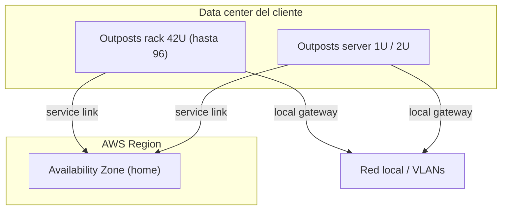

# AWS Outposts

> [!abstract] Qué es este archivo
> Octava lección del módulo y **primera del bloque de borde**. La pregunta del **deployment manager** no es cómo
> conectar: es cómo **dejar la base de datos on-premises por compliance** y **aun así** usarla como si estuviera en
> la VPC.
>
> Cubre las **dos formas** de Outposts (**rack** de 42U y **server** de 1U/2U), **qué extiende** (la VPC), **qué
> corre local** (EC2, EBS, S3, RDS), los **seis conceptos** del servicio, las **dos opciones de control**
> (**AWS** y **VMware**) y el **setup** en cuatro frentes.
>
> Video: **6 min 46 s** + **cuatro lecturas**. **Sin demo y sin Knowledge Check.**

> [!quote] La idea que ordena todo
> **“Sometimes you just need something specialized.”**
>
> Y la frase que define el servicio: Outposts **no es un data center aparte**, es **una extensión de tu entorno de
> AWS**. La analogía del video es una **ampliación de la casa**: misma estructura, misma llave, mismas
> instalaciones —solo que en otro terreno.

---

## Resumen en una frase

> **AWS Outposts** lleva **hardware diseñado y administrado por AWS** a tu data center —en un **rack de 42U** o en
> un **server de 1U/2U**— **extiende la VPC hasta ahí** y te deja correr un **subconjunto de servicios** (**EC2**,
> **EBS**, **S3**, **RDS**) con los **datos sin salir del predio**, todo administrado desde **la misma consola** y
> **dependiendo siempre de la Region** a la que está anclado.

---

## 1. Qué problema resuelve

**La pregunta del deployment manager:** *¿cómo puede AWS asegurar que **nuestra base de datos permanezca local**
por razones de compliance?*

**La distinción que abre la lección:** **Storage Gateway ayuda con el caching**; **Outposts trae toda la
experiencia de AWS on-premises**. No son el mismo problema: uno **cachea** datos que viven en AWS; el otro **pone
el servicio** —y el dato— **en tu predio**.

**El business case, según la lectura:** cuando hace falta **almacenar y procesar de forma segura datos de clientes
que tienen que permanecer on-premises o en países fuera de una Region de AWS**; cuando hay **cargas intensivas en
datos** que se procesan **localmente**; o cuando se quiere **más control sobre el análisis, el backup y la
restauración** de datos.

| Necesidad | Respuesta de la fuente |
| --- | --- |
| El dato **no puede salir del país** o del predio | **Outposts** |
| **Cachear** datos que viven en AWS | **Storage Gateway** |
| **Procesar localmente** cargas intensivas en datos | **Outposts** |
| Control fino de **análisis, backup y restore** | **Outposts** |
| Correr AWS **sin conexión** a la Region | **No**: Outposts **no** está diseñado para eso |

> [!important] El límite que define el servicio
> **“An Outpost relies on connectivity to the parent AWS Region.”** La lectura es explícita: **Outposts no está
> diseñado para operaciones desconectadas** ni para entornos **con conectividad limitada o nula**, y recomienda
> **conexiones de red de alta disponibilidad** hacia la Region. Residencia de datos **no** es lo mismo que
> **air-gapped**.

---

## 2. Las dos formas, de un vistazo

| | **Outposts rack** | **Outposts server** |
| --- | --- | --- |
| **Forma** | **Rack de 42U**, ensamblado y listo para rodar | **1U / 2U**, rack-mountable |
| **Para qué** | *“A complete AWS Region experience right to your data center”* | *“AWS capabilities **but have limited space**”* |
| **Escala** | **Hasta 96 racks** de 42U | **2 SKUs**: 1U y 2U |
| **Dónde encaja** | Data center propio | **Edge sites**: torres de celular, locales de retail, clínicas |
| **Consumo** | — | **Menor draw de energía y menor ancho de banda** que el rack más chico |
| **Instalación** | **AWS** la hace: llega, rueda el rack, lo conecta a energía y red | Se monta en **racks existentes** (EIA-310, **19 pulgadas**) |
| **Imagen de la fuente** | — | El video lo compara con **una casa a medida** |

> [!warning] La decisión no es de tamaño, es de sitio
> **El rack** es para el **data center** donde entra un gabinete completo con **energía redundante**. **El server**
> es para **donde no hay espacio ni presupuesto de energía**: una sucursal, una torre o una clínica. Elegir rack
> “porque es más potente” en una sucursal es el error que el examen describe como *limited space*.

---

## 3. Outposts rack

**Qué llega:** un **rack de 42U**, **completamente ensamblado y listo para ser rodado a su posición**.

**Cómo se instala:** **empleados de AWS** llegan al data center **en un horario coordinado** con el rack, **lo
ruedan**, y lo **conectan a la energía y a la red**.

**Qué trae adentro:**

| Componente | Detalle |
| --- | --- |
| **Energía** | **Unidad centralizada de conversión de energía redundante** con **distribución de energía en corriente directa (DC)** |
| **Componentes activos** | **Redundantes**, como **switches** y **capacidad de repuesto** |
| **Failover** | **Hot spare hosts** para failover inmediato (video) |
| **Escala** | **Hasta 96 racks estándar de 42U** |
| **Capacidad** | Se puede **agrupar (pool) cómputo y almacenamiento entre varios Outposts racks** |

**Lo que AWS hace y vos no:** **AWS maneja la instalación**. *“Sus expertos vienen, conectan todo y se aseguran de
que funcione perfecto.”* La frase del video que cierra la idea: **no es solo hardware en tu data center, es un
entorno de AWS completamente funcional que vive en tus instalaciones**.

---

## 4. Outposts server

**Para qué fue diseñado:** **cómputo de alto rendimiento en sitios de borde** —la lectura nombra **torres de
celular**, **locales de retail** y **clínicas de salud**.

**Las dos SKU:**

| SKU | Procesador |
| --- | --- |
| **1U** | **AWS Graviton2** |
| **2U** | **Intel** |

**Los detalles de forma:**

- Se pueden **pedir servers rack-mountable** que **entran en racks existentes**, por ejemplo **racks con
  equipamiento de switches de red**.
- **Dos SKU** de **1 y 2 unidades de rack** de alto, que **entran en racks de 19 pulgadas EIA-310**.
- Cada server tiene **menor consumo de energía** y **menores requisitos de ancho de banda** que **el rack de
  Outposts más chico**.

**Lo que no cambia:** **las mismas APIs de AWS** para **construir aplicaciones, desplegar software, administrar
permisos y compartir recursos** en **todas tus ubicaciones**.

**El caso del video:** un **cliente de retail** los usa en sus **sucursales** para **procesar datos localmente**
manteniendo **una experiencia de AWS consistente**.

---

## 5. Qué extiende y qué corre local

### La VPC, literalmente

**La definición de la fuente:** Outposts **extiende la Virtual Private Cloud (VPC) hasta el data center**. Las
**aplicaciones en AWS pueden hablar con esa base de datos local como si estuviera en la misma VPC** —
**porque lo está**. Todo está conectado por **redes privadas y seguras**, y **se administra con las mismas
herramientas de AWS** que ya se usan.

### Los servicios que corren local

| Servicio | Para qué |
| --- | --- |
| **Amazon EC2** | Cómputo |
| **Amazon EBS** | Almacenamiento de bloque |
| **Amazon S3** | Almacenamiento de objetos (video) |
| **Amazon RDS** | **La base de datos**: el dato **nunca deja el predio** y sigue siendo **un servicio totalmente administrado** |

**La frase que hay que retener:** *“Your data never leaves your premises, but you still get all the benefits of a
fully managed database service.”*

### Las cuatro características clave

| # | Característica |
| --- | --- |
| 1 | **La misma infraestructura diseñada por AWS** que en los data centers de AWS |
| 2 | **AWS la administra, monitorea y opera por completo**, como si estuviera en las Regions |
| 3 | **Single pane of management** en la nube de AWS |
| 4 | **Las mismas APIs y herramientas** que en las Regions |

> [!important] El argumento que gana discusiones
> El video lo pone como testimonio de cliente: el **single pane of glass** fue *un cambio de juego* para su equipo
> de operaciones. **Outposts aparece en la consola al lado de los recursos de la Region** — **no** es un panel
> aparte ni un inventario paralelo.

> [!note] Ampliación (no está en la fuente)
> El video menciona **S3** entre los servicios que corren localmente; la lectura, en cambio, ubica a **S3**,
> **DynamoDB** y **Lambda** como **endpoints de AWS PrivateLink en la VPC del cliente**. Las dos cosas pueden ser
> ciertas —**S3 on Outposts** para buckets locales y **endpoint** para el servicio regional—, pero **la fuente no
> lo aclara**. Queda anotado como tensión en el **Registro de integración**, no como dato.

---

## 6. Los seis conceptos clave

| Concepto | Definición de la fuente |
| --- | --- |
| **Outpost site** | Los **edificios físicos administrados por el cliente** donde AWS instalará el Outpost. Un site tiene que **cumplir los requisitos de instalaciones, red y energía** |
| **Outpost configurations** | **Combinaciones de capacidad de cómputo EC2, capacidad de almacenamiento EBS y soporte de red**. Cada configuración tiene **requisitos propios de energía, refrigeración y peso** |
| **Outpost capacity** | Los **recursos de cómputo y almacenamiento disponibles** en el Outpost; se **ven y administran desde la consola de AWS Outposts** |
| **Outpost equipment** | El **hardware físico** que da acceso al servicio —**racks, servers, switches y cableado**— **propiedad de AWS y administrado por AWS** |
| **Service link** | La **ruta de red** que habilita la **comunicación entre el Outpost y su Region de AWS asociada**. **Cada Outpost es una extensión de una Availability Zone y de su Region asociada** |
| **Local gateway** | Un **router virtual de interconexión lógica** que habilita la **comunicación entre el Outpost y tu red on-premises** |

**Los dos que se confunden en el examen:**

| | **Service link** | **Local gateway** |
| --- | --- | --- |
| **Conecta** | Outpost ↔ **Region** | Outpost ↔ **red on-premises** |
| **Si falla** | El Outpost **pierde el plano de control** de la Region | El tráfico **no llega a la LAN** local |
| **Analogía del video** | La **conexión con la casa matriz** | La **instalación de plomería y electricidad** de la ampliación |

> [!warning] El ancla: una AZ
> **“An Outpost is homed to an Availability Zone in the Region, and it is an extension of that Availability Zone
> that you can use for resiliency.”** El Outpost **no** es una Region nueva ni una AZ nueva: **está anclado a una
> AZ existente**. Si el escenario pide **sobrevivir a la caída de una AZ**, un solo Outpost **no** lo hace.

---

## 7. Las dos opciones de control: AWS o VMware

**La elección, según la fuente:** depende de **la experiencia existente del equipo**. *“Ambos caminos llevan al
mismo destino; es cuestión de elegir la ruta que mejor le funciona al equipo.”*

### Opción AWS

- Se usan **las mismas APIs y el mismo plano de control** que en la nube de AWS, **pero on-premises**.
- Se corren **instancias Amazon EC2** y **volúmenes EBS** en el Outpost.
- **Al lanzamiento o poco después**, están disponibles **localmente**: **Amazon RDS**, **Amazon ECS**, **Amazon
  EKS**, **Amazon SageMaker**, **Amazon EMR** y **Elastic Load Balancing (ELB)**.
- **Otros servicios** —**Amazon S3**, **DynamoDB** y **AWS Lambda**— están disponibles como **endpoints de AWS
  PrivateLink en la VPC del cliente**.

### Opción VMware

- Se corre **VMware Cloud on AWS localmente en Outposts**, con **el mismo plano de control y las mismas APIs de
  VMware** que ya se usan para la infraestructura on-premises.
- Entrega **toda la infraestructura VMware SDDC** —**cómputo, almacenamiento y red**— **corriendo on-premises
  sobre AWS Outposts**.
- Ventaja declarada: **facilidad de administración e integración con los servicios de AWS**.

| | **Opción AWS** | **Opción VMware** |
| --- | --- | --- |
| **Plano de control** | **AWS** | **VMware** |
| **Para quién** | Equipo **AWS-savvy** | Equipo **cómodo con herramientas VMware** |
| **Qué corre** | **EC2 + EBS** y servicios administrados | **VMware SDDC** completo (cómputo, storage, red) |
| **Resultado** | El mismo destino | El mismo destino |

---

## 8. El setup, en cuatro frentes

**La analogía del video:** es como **construir una casa a medida** —primero el **diseño**, después **los expertos
construyen**, y al final **te mudás**.

| # | Frente | Qué se hace |
| --- | --- | --- |
| 1 | **Order, install, launch** | Se elige **capacidad de cómputo y almacenamiento**; **AWS entrega e instala**; se **lanzan recursos** con la consola o las APIs |
| 2 | **Network configuration** | **Mapeos de virtual interface** hacia las **VLAN**, con **LACP**, y **local gateway** para el tráfico entre el Outpost y la red local |
| 3 | **Availability Zones** | La **VPC estándar con subnets en varias AZ** es el **plano arquitectónico** de partida |
| 4 | **Extend architecture + enabling access** | Se **extiende la arquitectura** al Outpost y se **habilita el acceso a los servicios regionales** por **VPC endpoints** |

### Los pasos de consola que da la lectura

**Crear el Outpost:**

1. Abrir la consola de **AWS Outposts** (`https://console.aws.amazon.com/outposts/`).
2. Elegir **Create Outpost**.
3. Dar **nombre y descripción**.
4. Elegir **Create site**, completar y enviar el formulario, y después **elegir el site creado**.
5. Elegir una **Availability Zone** para el Outpost.
6. Elegir **Create Outpost**.

**Pedir capacidad:**

1. Abrir la consola de **AWS Outposts**.
2. En el panel de navegación, elegir **Outposts catalog**.
3. Elegir una **configuración de capacidad**; si las disponibles **no alcanzan**, se puede **pedir una
   configuración personalizada**.
4. Elegir **Place order**.
5. Elegir el **Outpost creado**.
6. Elegir **Place order**.

### Lo que se extiende con la VPC

> **“AWS Outposts extends an Amazon VPC from an AWS Region to an Outpost with the VPC components that are
> accessible in the Region, including internet gateways, virtual private gateways, transit gateways, and VPC
> endpoints.”**

**Resultado:** las instancias del Outpost **hablan con otras instancias de la VPC por IP privada**, *como si
estuvieran en el mismo edificio*.

### El último paso: acceso a los servicios regionales

- **Interface endpoints** o **gateway endpoints** (con **AWS PrivateLink**) para acceder a **todos los servicios
  regionales de AWS** dentro de la **VPC privada**.
- **O** usar sus **endpoints públicos regionales**.

| Necesidad | Cómo se resuelve |
| --- | --- |
| Monitorear con **CloudWatch** | **Endpoint** en la VPC privada |
| Leer un **bucket de S3 de la Region** | **Endpoint** en la VPC privada |
| Llegar a **todo servicio regional** | **Interface/gateway endpoints** o **endpoints públicos regionales** |

> [!important] Las dos advertencias de sizing y diseño
> **Sizing:** *“Es mucho más fácil acertar desde el principio que ajustarlo después.”* **VPC endpoints:** *“Planificá
> tu estrategia de VPC endpoints temprano; es más fácil armar los patrones de seguridad y routing al inicio que
> retrofitearlos después.”*

---

## 9. Cuándo es Outposts y cuándo no

| Requisito del escenario | ¿Outposts? | Por qué |
| --- | --- | --- |
| **El dato no puede salir del predio** (compliance) | **Sí** | **RDS local**: el dato **nunca deja las instalaciones** |
| **Procesar localmente** cargas intensivas en datos | **Sí** | Cómputo y storage **en el sitio** |
| **Poco espacio**, sucursal o torre | **Sí**, **server 1U/2U** | *Smaller form factors* |
| **Data center** con gabinete disponible | **Sí**, **rack 42U** | Hasta **96 racks**, energía redundante |
| Operar **sin conexión** a la Region | **No** | **Depende del service link** a la Region |
| **Cachear** datos que ya viven en AWS | **No** (para eso, **Storage Gateway**) | Outposts **trae el servicio**, no un caché |
| **Sobrevivir a la caída de una AZ** | **No con uno solo** | Está **anclado a una AZ** |
| Querer **todo** el catálogo de servicios localmente | **No** | Es **un subconjunto** |

**Los huecos de esta fuente (no se inventan):**

> [!note] Huecos registrados
> - **Sin demo y sin Knowledge Check**: video de **6 min 46 s** + **cuatro lecturas**.
> - **Sin precios**, **sin SLA**, **sin latencia** y **sin tiempos de instalación**.
> - **Sin cuotas** de instancias, volúmenes ni buckets por Outpost.
> - **Sin alta disponibilidad explícita** de un Outpost individual (solo la frase de *“extension of that AZ …
>   that you can use for resiliency”*).
> - **Sin la conexión con Local Zones ni Wavelength**: el bloque de borde se compara recién en la lección
>   siguiente.
> - **Sin cifras de consumo** de los servers más allá de *“lower power draw and lower bandwidth”*.
> - **Las cinco imágenes no están en el vault**; se describen solo por el pie de foto.
> - **La fuente no indica cuántas lecciones tiene el módulo.**

---

## 10. Traducción del contenido

> [!info] Sección de referencia (opcional)
> Esto es la **traducción fiel** de las fuentes, para verificar que no se perdió nada. **No hace falta leerla
> para estudiar**: lo que se estudia son las secciones **1 a 9** y se cierra con la **12**.
> Usala solo si (a) algo de arriba te quedó dudoso, (b) querés el detalle textual del setup, o (c) antes del
> examen querés chequear que no se escapó un matiz.

### 10.1 Video: Introduction to AWS Outposts (transcripción)

**A veces simplemente necesitás algo especializado.** ¿Hace falta llevar **toda la experiencia de AWS
on-premises**? Ahí es donde entra **Outpost**.

Ahora abordemos una pregunta de tu **deployment manager**: **¿cómo puede AWS asegurar que nuestra base de datos
permanezca local por razones de compliance?** Si bien **Storage Gateway ayuda con el caching**, **Outposts trae
toda la experiencia de AWS on-premises**. Con **AWS Outposts** tenés **dos opciones**, y elegir entre ellas es
**una de las primeras decisiones** que tu deployment manager va a tener que tomar. **Outpost Rack trae una
experiencia completa de Region de AWS directamente a tu data center**, perfecto para esa **base de datos que
necesita quedarse local**. Después están los **outpost servers**, que vienen en **formatos más chicos** cuando
necesitás **capacidades de AWS pero tenés espacio limitado**.

Acá es donde se pone **realmente interesante** para tu deployment manager. Outposts **extiende tu virtual private
cloud (VPC) directamente hasta tu data center**: tus **aplicaciones y AWS pueden hablar con esa base de datos
local como si estuviera en la misma VPC**, porque **lo está**. Todo está conectado por **redes privadas y
seguras**, y **lo administrás todo con las mismas herramientas de AWS** que ya estás usando. Esto atiende
directamente **lo que le quita el sueño** a tu deployment manager.

Corriendo **servicios de AWS localmente** con Outposts, podés correr **un subconjunto de servicios de AWS
localmente**, incluyendo **Amazon EC2** para necesidades de cómputo, **EBS** para almacenamiento de bloque y
**hasta Amazon S3** para almacenamiento de objetos. Pero acá está **lo que realmente importa** para ese requisito
de base de datos: **podés correr Amazon RDS directamente en tu data center**. **Tu dato nunca deja tus
instalaciones**, pero **seguís teniendo todos los beneficios de un servicio de base de datos totalmente
administrado**.

Lo que hace especial a Outposts **no es solo mantener el dato local**: es **traer toda la experiencia de AWS
on-premises**. Estás obteniendo **la misma infraestructura diseñada por AWS** que corre en las **Regions de AWS**.
**AWS se encarga de todo el monitoreo, el patching y el mantenimiento**, y **todo aparece en tu consola de AWS**
junto a tus **recursos de la Region**. Un cliente me contó hace poco que esta **administración de panel único
(single pane of glass)** fue **un cambio de juego** para su **equipo de operaciones**.

Ahora, para **cargas más grandes** como las necesidades de base de datos de tu deployment manager, veamos los
**outpost racks** en detalle. Estamos hablando de **potencia de cómputo seria**. Podés **escalar hasta 96 racks**
si hace falta. Cada rack **viene completamente ensamblado** e incluye **sistemas de energía redundantes** y **hot
spare hosts para failover inmediato**. **AWS se encarga de la instalación**: sus **expertos vienen, conectan todo
y se aseguran de que esté funcionando perfectamente**. Esto **no es solo hardware en tu data center**: es un
**entorno de AWS completamente funcional que resulta vivir en tus instalaciones**.

Si bien tu deployment manager mencionó **bases de datos**, podría también tener **ubicaciones más chicas** que
necesiten **capacidades locales de AWS**. Ahí es donde **brillan los outpost servers**. Podés elegir entre **un
1U con procesadores AWS Graviton2** o **un 2U con Intel**, los dos llevando **servicios de AWS a lugares donde un
rack completo sería innecesario**. Hace poco trabajamos con **un cliente de retail** que los usó en sus
**sucursales** para **procesar datos localmente** manteniendo **una experiencia de AWS consistente**.

Ahora, el deployment manager tiene **dos formas de interactuar con Outposts**, y esta elección **a menudo depende
de la experiencia existente de su equipo**. Pueden **usar los servicios de AWS directamente**, perfecto si su
equipo **ya es AWS-savvy**, o pueden **usar VMware Cloud on Outposts** si están **más cómodos con las herramientas
de VMware**. **Los dos caminos llevan al mismo destino**; es solo cuestión de **elegir la ruta que mejor le
funciona a su equipo**.

Ahora es momento de un **deep dive**. Recorramos la **puesta en marcha de un Outpost**. Es **un poco como
construir una casa a medida**, donde **empezás con un diseño**, después **los expertos se encargan de la
construcción** y finalmente **te mudás**. Primero **seleccionás tu capacidad de cómputo y almacenamiento** según
tus necesidades. Después **AWS entrega e instala todo**. Finalmente, **estás listo para lanzar recursos** usando la
**consola o las APIs familiares de AWS**. Siempre les digo a los clientes que **piensen con cuidado el primer
paso, el sizing**: es **mucho más fácil acertar desde el principio** que **ajustarlo después**.

Ahora hablemos de la **configuración de red**. Esto es **crucial** para nuestro deployment manager. Pensalo como
**armar la plomería y la instalación eléctrica** de esa casa a medida. Vas a **configurar mapeos de virtual
interface hacia tus virtual local area networks (VLAN)**, usando **Link Aggregation Control Protocol (LACP)**, y a
**configurar el local gateway** para manejar el **tráfico entre tu Outpost y tu red local**. Hace poco trabajé con
un cliente que encontró este paso **particularmente importante**, porque **determinaba cuán fluidamente sus
aplicaciones se comunicaban entre su red local y los recursos de su Outpost**.

Acá es donde **empezamos con una arquitectura básica de AWS**. Tu **VPC estándar con subnets en varias
Availability Zones**. Pensalo como tu **plano arquitectónico**: es **territorio familiar** para la mayoría de los
usuarios de AWS, pero **está por ponerse más interesante**. Ahora **extendemos esa arquitectura para incluir tu
Outposts**. Es como **agregar una ampliación a tu casa que se conecta sin costuras con la estructura existente**.
Tus **instancias en el Outpost pueden comunicarse con otras instancias de tu VPC usando direcciones IP privadas**,
**igual que si estuvieran en el mismo edificio**. Uno de nuestros clientes describió esto como **su momento
“ajá”**, cuando se dio cuenta de que **sus recursos on-premises podían interactuar con sus recursos de la nube
como si no hubiera separación alguna**.

Y finalmente **completamos el setup habilitando el acceso a todos los servicios regionales de AWS a través de VPC
endpoints**. Ahora estamos **agregando todas las comodidades modernas a la ampliación de tu casa**: **pisos
radiantes, termostato inteligente, cámara en la puerta**, todo eso. ¿Querés usar **CloudWatch** para monitoreo o
necesitás **acceder a buckets de S3 en la Region**? **Todo es posible** y **todo funciona a través de tu entorno
privado de VPC**. Un tip que siempre comparto con los deployment managers: **planificá tu estrategia de VPC
endpoints temprano**. Es **mucho más fácil armar tus patrones de seguridad y routing desde el principio** que
**retrofitearlos después**.

Esto completa nuestro **deep dive en el setup de Outposts**. Tu deployment manager ahora tiene **un camino claro
para mantener esa base de datos local** manteniendo **todos los beneficios de AWS**. Recordá: **la clave del éxito
con Outposts es tratarlo como una extensión de tu entorno de AWS, no como una entidad separada**. Es **un solo
sistema integrado**, solo **distribuido en distintas ubicaciones**.

### 10.2 Lectura: AWS Outpost Family

El **business case** de **AWS Outpost** es cuando necesitás **una solución para almacenar y procesar de forma
segura datos de clientes que tienen que permanecer on-premises o en países fuera de una Region de AWS**. Necesitás
correr **cargas intensivas en datos** y **procesar los datos localmente**, o querés **más control sobre el análisis,
el backup y la restauración** de datos.

**AWS Outposts** tiene **dos opciones**:

1. **AWS Outposts rack** — **trae una experiencia completa de Region de AWS directamente a tu data center**:
   perfecto para esa **base de datos que necesita quedarse local**.
2. **Outposts server de 1U o 2U** — viene en **formatos más chicos** cuando **necesitás capacidades de AWS pero
   tenés espacio limitado**.

#### Outposts Rack

*[Imagen: un rack de 42U.]*

**¿Cómo es el Outpost?** Viene en **forma de rack de 42U**, **completamente ensamblado y listo para ser rodado a
su posición**. Los **asociados de AWS** se presentan en tu data center **en un horario coordinado** con el rack.
**Lo ruedan y lo enchufan a la energía y a la red.** Viene con una **unidad centralizada de conversión de energía
redundante** con **distribución de energía en corriente directa (DC)**. Tiene **componentes activos redundantes**,
como **switches** y **capacidad de repuesto**.

**Un Outpost depende de la conectividad con la Region de AWS padre.** **Los Outposts no están diseñados para
operaciones desconectadas ni para entornos con conectividad limitada o nula.** Recomendamos que los clientes
tengan **conexiones de red de alta disponibilidad** hacia su **Region de AWS**.

- **Escalar hasta 96 racks estándar de 42U.**
- **Agrupar (pool) capacidad de cómputo y almacenamiento entre múltiples Outposts racks.**

#### Outposts Server

*[Imagen: dos Outposts servers, uno de 1U y uno de 2U.]*

Los **Outpost servers** están diseñados para **cómputo de alto rendimiento en sitios de borde**, como **torres de
celular**, **locales de retail** y **clínicas de salud**. Podés usar **las mismas APIs de AWS** para **construir
aplicaciones, desplegar software, administrar permisos y compartir recursos** con **todas tus ubicaciones** con
**AWS Outpost servers**.

Podés elegir entre **un 1U con procesadores AWS Graviton2** o **un 2U con Intel**: los dos llevan **servicios de
AWS a lugares donde un rack completo podría ser innecesario**.

- Podés **pedir servers rack-mountable** que **entren en el espacio de rack existente**, por ejemplo, **racks con
  equipamiento de switches de red**.
- Los servers tienen **2 SKU** que son de **1 y 2 unidades de rack** de alto, y **entran en racks de 19 pulgadas de
  ancho EIA-310**.
- Cada server tendrá **menor consumo de energía** y **menores requisitos de ancho de banda** que **el Outposts rack
  más chico de hoy**.

### 10.3 Lectura: Outposts Functionality

**Outposts extiende la Virtual Private Cloud (VPC) directamente hasta el data center.** Las **aplicaciones en AWS
pueden hablar con esa base de datos local como si estuviera en la misma VPC**, **¡porque lo está!** Todo está
conectado por **redes privadas y seguras**, y **lo administrás todo con las mismas herramientas de AWS** que ya
usás.

*[Imagen: el dispositivo de Outposts está on-premises pero también en la VPC; el dispositivo apunta a una
Availability Zone de la Region.]*

Lo que hace especial a Outposts **no es solo mantener el dato local**: es **traer toda la experiencia de AWS
on-premises**. Estás obteniendo **la misma infraestructura diseñada por AWS** que corre en las **Regions de AWS**.

#### Extend VPC

Outposts **extiende la Virtual Private Cloud (VPC) directamente hasta el data center**. Las **aplicaciones en AWS
pueden hablar con esa base de datos local como si estuviera en la misma VPC**, **porque lo está**. Todo está
conectado por **redes privadas y seguras**, y **lo administrás todo con las mismas herramientas de AWS** que ya
usás.

*[Imagen: el dispositivo de Outposts está on-premises pero también en la VPC.]*

#### Run services Locally

Con Outposts podés correr **un subconjunto de servicios de AWS localmente**, incluyendo **Amazon EC2** para
cómputo, **EBS** para almacenamiento de bloque y **hasta Amazon S3** para almacenamiento de objetos. Pero acá está
**lo que realmente importa** para ese requisito de base de datos: **podés correr Amazon RDS directamente en tu data
center**. **Tu dato nunca deja tus instalaciones**, pero **seguís teniendo todos los beneficios de un servicio de
base de datos totalmente administrado**.

*[Imagen: columna de base de datos mostrando Amazon RDS y Amazon ElastiCache.]*

#### Outposts key features and Concepts

Además de **extender la VPC** y **correr servicios localmente**, estas son las **características y conceptos
clave**.

**Key features:**

- **La misma infraestructura diseñada por AWS** que en los data centers de AWS.
- **AWS la administra, monitorea y opera por completo**, como si estuviera en las Regions de AWS.
- **Panel único de administración** en la nube de AWS.
- **Las mismas APIs y herramientas** que en las Regions de AWS.

**Key concepts:**

**Outpost site** — Los **edificios físicos administrados por el cliente** donde AWS instalará tu Outpost. Un site
tiene que **cumplir los requisitos de instalaciones, red y energía** para tu Outpost.

**Outpost configurations** — **Combinaciones de capacidad de cómputo de Amazon EC2, capacidad de almacenamiento de
Amazon EBS y soporte de red**. Cada configuración tiene **requisitos únicos de energía, refrigeración y soporte de
peso**.

**Outpost capacity** — Los **recursos de cómputo y almacenamiento disponibles** en el Outpost. Podés **ver y
administrar la capacidad** de tu Outpost desde la **consola de AWS Outposts**.

**Outpost equipment** — El **hardware físico** que provee acceso al servicio AWS Outposts, incluyendo **racks,
servers, switches y cableado**, **propiedad de AWS y administrado por AWS**.

**Service link** — **Ruta de red** que habilita la **comunicación entre tu Outpost y su Region de AWS asociada**.
**Cada Outpost es una extensión de una Availability Zone y de su Region asociada**.

**Local gateway** — Un **router virtual de interconexión lógica** que habilita la **comunicación entre tu Outpost y
tu red on-premises**.

### 10.4 Lectura: Outposts Options

Hay **dos formas de interactuar con Outposts**, y esta elección **a menudo depende de la experiencia existente de
los equipos**. Pueden **usar los servicios de AWS directamente** —perfecto si su equipo **ya es AWS-savvy**— o
pueden **usar VMware Cloud on Outposts** si están **más cómodos con las herramientas de VMware**.

#### Opción AWS

Con la **opción original de AWS** de Outposts, podés usar **las mismas APIs y el mismo plano de control** que usás
en **la nube de AWS** para **construir y correr tus aplicaciones**, pero **hacerlo on-premises**. Podés correr
**instancias Amazon EC2** y **volúmenes EBS** en Outposts. **Al lanzamiento o poco después**, servicios como
**Amazon RDS**, **Amazon ECS**, **Amazon Elastic Kubernetes Service (Amazon EKS)**, **Amazon SageMaker**, **Amazon
EMR** y **Elastic Load Balancing (ELB)** están disponibles **localmente**. **Otros servicios**, como **Amazon S3**,
**DynamoDB** y **AWS Lambda**, están disponibles como **endpoints de AWS PrivateLink en la VPC del propio
cliente**.

#### Opción VMware

Con la **opción VMware**, podés correr **VMware Cloud on AWS localmente en Outposts** para usar **el mismo plano de
control y las mismas APIs de VMware** que usás para correr tu **infraestructura on-premises**. Esta opción entrega
**toda la infraestructura VMware SDDC** —**cómputo, almacenamiento y red**—, que **corre on-premises usando AWS
Outposts**. Esto significa que podés **aprovechar la facilidad de administración y la integración con los servicios
de AWS**.

### 10.5 Lectura: Outposts Setup

#### Order, install, and launch

Primero **seleccionás tu capacidad de cómputo y almacenamiento** según tus necesidades. Después **AWS entrega e
instala todo**. Finalmente, **estás listo para lanzar recursos** usando la **consola o las APIs familiares de
AWS**.

**Para crear un Outpost:** abrí la **consola de AWS Outposts** en `https://console.aws.amazon.com/outposts/`.
Elegí **Create Outpost**. Proveé **un nombre y una descripción** para tu Outpost. Elegí **Create site**. Completá y
enviá el formulario, y después **elegí el site que creaste**. Elegí **una Availability Zone** para tu Outpost.
Elegí **Create Outpost**.

**Para pedir capacidad de Outpost:** abrí la **consola de AWS Outposts** en `https://console.aws.amazon.com/outposts/`.
En el panel de navegación, elegí **Outposts catalog**, y después hacé lo siguiente: elegí **una configuración de
capacidad** para tu Outpost. Si **las configuraciones de capacidad disponibles no cumplen tus necesidades**, podés
**pedir una configuración de capacidad personalizada** en su lugar. Elegí **Place order**. Elegí **el Outpost que
creaste**. Elegí **Place order**.

#### Network configuration

Después viene la **configuración de red**. Vas a **configurar mapeos de virtual interface hacia tus Virtual Local
Area Networks (VLAN)** usando **Link Aggregation Control Protocol (LACP)**, y a **configurar el local gateway**
para manejar el **tráfico entre tu Outpost y tu red local**.

#### Availability Zones

Acá hay **una arquitectura básica de AWS** con tu **VPC estándar con subnets en varias Availability Zones**. Este es
tu **plano arquitectónico**.

#### Extend architecture

Ahora **extendemos esa arquitectura para incluir tu Outpost**. Tus **instancias en el Outpost pueden comunicarse
con otras instancias de tu VPC usando direcciones IP privadas**, **igual que si estuvieran en el mismo edificio**.
**AWS Outposts extiende una Amazon VPC desde una Region de AWS hasta un Outpost con los componentes de VPC que son
accesibles en la Region**, incluyendo **internet gateways**, **virtual private gateways**, **transit gateways** y
**VPC endpoints**. **Un Outpost está anclado (homed) a una Availability Zone de la Region, y es una extensión de esa
Availability Zone que podés usar para resiliencia.**

#### Enabling access

Finalmente, **completá el setup habilitando el acceso a todos los servicios regionales de AWS a través de VPC
endpoints**. ¿Querés usar **CloudWatch** para monitoreo? ¿Necesitás **acceder a buckets de S3 en la Region**? **Todo
es posible**, y **todo funciona a través de tu entorno privado de VPC**. **Las instancias en el Outpost pueden
hablar de forma segura con otras instancias de tu VPC por direcciones IP privadas.** Usá **interface endpoints** o
**gateway endpoints** (impulsados por **AWS PrivateLink**) para **acceder a todos los servicios regionales de AWS**
en tu **entorno privado de VPC**. O usá sus **endpoints públicos regionales**, como se muestra acá.

---

## 11. Quién resuelve qué (cierre)

| Necesidad | Pieza | Cómo lo resuelve |
| --- | --- | --- |
| El **dato no puede salir del predio** | **Outposts + RDS local** | El servicio corre en tu data center; **el dato nunca se va** |
| **Cómputo y storage local** | **Outposts** (EC2, EBS, S3) | La VPC **se extiende** hasta el sitio |
| **Caché** de datos que viven en AWS | **Storage Gateway** | Cachea, **no** trae el servicio |
| **Procesar en la sucursal** | **Outposts server 1U/2U** | Formato chico, **menor energía y ancho de banda** |
| **Conectar el Outpost con la Region** | **Service link** | Ruta de red al **plano de control**; el Outpost **depende** de ella |
| **Conectar el Outpost con la LAN** | **Local gateway** | Router virtual de **interconexión lógica** |
| **Usar los servicios regionales** desde el Outpost | **VPC endpoints** (interface/gateway) o **endpoints públicos** | Todo por la **VPC privada** |
| **Administrar todo** | **Consola y APIs de AWS** | **Single pane of glass** junto a los recursos de la Region |
| **Equipo con expertise VMware** | **VMware Cloud on Outposts** | Mismo **plano de control y APIs de VMware** |

---

## 12. Para el examen (SAP-C02)

> [!important] Lo que hay que retener
> 1. **Outposts = residencia de datos + experiencia AWS on-premises**: hardware **diseñado, propiedad y
>    administrado por AWS** en tu sitio.
> 2. **Dos formas**: **rack de 42U** (hasta **96 racks**, experiencia completa de Region) y **server 1U
>    (Graviton2) / 2U (Intel)** para **sitios de borde** con **espacio limitado**.
> 3. **Extiende la VPC**: las instancias del Outpost hablan con las de la VPC **por IP privada**, como si
>    estuvieran en el mismo edificio.
> 4. **Corre un subconjunto**: **EC2**, **EBS**, **S3** y —la clave para compliance— **RDS local**: *el dato nunca
>    deja el predio*.
> 5. **Depende de la Region**: *“relies on connectivity to the parent AWS Region”*; **no** es para operaciones
>    **desconectadas** ni con conectividad limitada. Se recomienda **red de alta disponibilidad**.
> 6. **Anclado a una AZ**: *“homed to an Availability Zone … an extension of that AZ that you can use for
>    resiliency”*.
> 7. **Los seis conceptos**: **site**, **configurations**, **capacity**, **equipment**, **service link** (Outpost ↔
>    Region) y **local gateway** (Outpost ↔ red local).
> 8. **Dos opciones de control**: **AWS** (mismas APIs y plano de control; EC2/EBS local, RDS/ECS/EKS/SageMaker/
>    EMR/ELB localmente, S3/DynamoDB/Lambda por **PrivateLink**) y **VMware Cloud on Outposts** (mismo plano de
>    control VMware, **SDDC** completo).
> 9. **Setup**: **order → install → launch**, después **VLANs con LACP + local gateway**, y por último **VPC
>    endpoints** para los servicios regionales.
> 10. **Single pane of glass**: aparece en la **consola de AWS** junto a los recursos de la Region; **mismas APIs y
>     herramientas**.

> [!warning] Trampa clásica del examen
> Escenario: “la empresa exige que los datos **no salgan del país** y además quiere **operar aunque se corte el
> enlace** con AWS”. **Outposts resuelve la residencia, no el aislamiento**: **depende del service link** a la
> Region y **no está diseñado para operaciones desconectadas**. Segunda trampa: proponer **un solo Outpost** para
> **alta disponibilidad entre AZs** — está **anclado a una AZ**; para resiliencia hacen falta **varias
> instalaciones**. Tercera: confundir **Storage Gateway** (cachea datos que viven en AWS) con **Outposts** (trae el
> servicio y el dato al predio).

---

## Relacionado

- [[Amazon Route 53 Resolver]] — el DNS que hace que los recursos del Outpost se encuentren por nombre
- [[AWS Direct Connect - Redundancy and Resilience]] — el enlace del que cuelga el **service link**
- [[AWS Direct Connect - Connection Options]] — la capa 3 que conecta el sitio con la Region
- [[AWS Site-to-Site VPN]] — alternativa de conectividad hacia la Region
- [[AWS Client VPN]] — el acceso de usuarios que consume esos recursos locales
- [[AWS Solutions Architect Advanced - Optimizing Hybrid Architectures]] *(índice del módulo)*
- [[VPC Endpoints]] — la pieza que habilita los servicios regionales desde el Outpost
- [[Use Cases - Transit Gateway]] — el hub por donde se extiende la VPC
- [[1.1 Diseñar estrategias de conectividad de redes]] — la tarea que esta lección toca de lleno
- [[2.5 Diseñar una solución para cumplir con los objetivos de rendimiento]] — procesamiento local y latencia
- Siguiente paso del módulo: **AWS Local Zones** — lección 09 esperada según los ocho objetivos; a confirmar con la
  fuente

---

## Registro de integración

| Fecha | Qué llegó | Dónde se integró |
| --- | --- | --- |
| 29/10/2026 | Lección 08 completa: video (6:46) + cuatro lecturas (*AWS Outpost Family*, *Outposts Functionality*, *Outposts Options*, *Outposts Setup*) | Nota completa (secciones 1–12) |

**Discrepancias y vacíos registrados (no corregidos):**

1. **“AWS Graviton, two processors” vs “AWS Graviton2”**: el video dice *“A one U with AWS Graviton, two
   processors”*; la lectura dice **“1U with AWS Graviton2 processors”**. Se usa **Graviton2** en §4 y en §12, y se
   conserva la forma del video en §10.1.
2. **El nombre del servicio oscila en la fuente**: *“AWS Outpost”* (título de la lectura), *“AWS Outposts”*
   (cuerpo), *“Outpost rack”* / *“Outposts rack”* y *“outpost servers”* / *“Outposts server”*. Se normaliza a
   **AWS Outposts** para el servicio y **Outposts rack / Outposts server** para las formas.
3. **S3 local vs S3 por endpoint**: el video y la lectura *Functionality* dicen que **S3 corre localmente**; la
   lectura *Options* ubica a **S3, DynamoDB y Lambda** como **endpoints de PrivateLink en la VPC**. Se registra la
   tensión (ver la nota de ampliación en §5) y **no se resuelve** por no estar en la fuente.
4. **Amazon ElastiCache aparece solo en el pie de una imagen** (*“Database column showing Amazon RDS and Amazon
   ElastiCache”*); el texto nunca lo menciona. No se integra al cuerpo para no inventar alcance.
5. **El pie de la imagen de *Functionality* está corrupto en la fuente** (*“Device points to a p northeast 3 a
   availability zone”*). Se traduce como *“apunta a una Availability Zone de la Region”*.
6. **El video no menciona el `service link` ni la dependencia de la Region**; la lectura sí, y es el límite más
   importante del servicio. Se integra en §1 y §6 como dato de la lectura.
7. **“Hasta 96 racks”** y **“pool de capacidad entre racks”** aparecen **solo en la lectura**; el video dice
   *“podés escalar hasta 96 racks”* pero no habla del pool.
8. **La lectura *Family* dice “96 42U standard racks”** sin aclarar si es por sitio, por cuenta o por Region. Se
   transcribe literal.
9. **“Outposts server” tiene “2 SKUs”** de 1U y 2U, mientras el video describe *“AWS Graviton”* y *“Intel”* como
   si fueran dos modelos separados. Se conservan las dos formulaciones.
10. **Artefactos de formato:** títulos con `****dobles negritas****` y un encabezado con `####` para
    *Outposts key features and Concepts*. No se reproducen.
11. **Las cinco imágenes no están en el vault**; se marcan como `[Imagen: …]` con el pie de la fuente.
12. **Sin demo, sin Knowledge Check, sin precios, sin SLA, sin latencia y sin tiempos de instalación**: no se
    inventan.
13. **La fuente no compara Outposts con Local Zones ni con Wavelength**; esa comparación queda para la lección
    siguiente.
14. **La fuente no indica cuántas lecciones tiene el módulo**: el mapa de progreso sigue sin total.

**Decisiones de transcripción:**

- Se conservan **AWS Outposts**, **Outposts rack**, **Outposts server**, **VPC**, **service link**, **local
  gateway**, **outpost site**, **outpost configurations**, **outpost capacity**, **outpost equipment**, **LACP**,
  **VLAN**, **hot spare hosts**, **EIA-310**, **Graviton2**, **VMware Cloud on Outposts**, **VMware SDDC**,
  **AWS PrivateLink**, **interface endpoints** y **gateway endpoints**.
- Las **cifras** se transcriben literales: **6 min 46 s**, **42U**, **96 racks**, **1U y 2U**, **19 pulgadas**,
  **cinco imágenes**, **cuatro lecturas**.
- Se conservan las **analogías** del video —**casa a medida**, **plomería y electricidad**, **ampliación de la
  casa**, **pisos radiantes y termostato inteligente**, **momento “ajá”**, **panel único de vidrio**— porque son el
  orden de la explicación.
- La tabla de **§11** y la de **§9** son **lectura propia** que cruzan necesidades con piezas; la fuente **no** las
  trae.
- La frase *“residencia de datos **no** es lo mismo que **air-gapped**”* (§1) es **lectura propia** que parafrasea
  el límite literal de la fuente (*“not designed for disconnected operations”*); la palabra *air-gapped* **no**
  aparece en la fuente.
- El mapeo de tareas del examen (**1.1**, **2.5**) es **lectura propia**; la fuente **no** asigna tareas a la
  lección.
