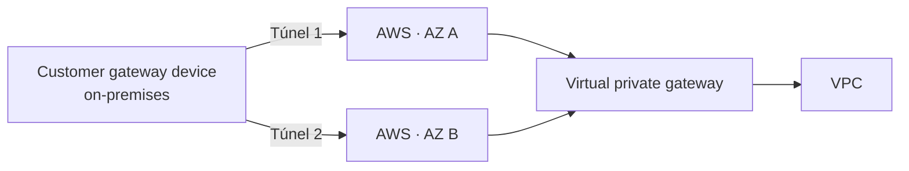
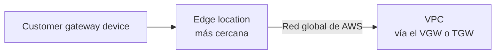

# AWS Site-to-Site VPN

> [!abstract] Qué es este archivo
> Cuarta lección del módulo y **segunda de servicio**. **AWS Site-to-Site VPN** es la VPN **de redes**: une la red
> **on-premises** con la **VPC** mediante túneles **IPsec** **siempre encendidos**, sin que ningún usuario abra nada.
>
> Cubre las **tres formas de conectarla** (**VGW**, **EC2** y **TGW**), la **redundancia** (dos túneles por conexión),
> el **escalado** con **ECMP** y la **aceleración** con **Global Accelerator**. Tarea **1.1** del examen, con cruces
> en **1.3**, **2.2**, **2.5** y **1.5**.
>
> Video: **7 min 52 s**. **Sin demo y sin Knowledge Check.**

> [!quote] La idea que ordena todo
> **Elegir la conexión es elegir el tipo de puente entre dos ciudades.** Directo y administrado por otro (**VGW**),
> construido por vos (**EC2**), o un **hub central** al que todo llega (**TGW**). El resto de la lección es
> **cuántos carriles tiene el puente** y **qué pasa si se cae**.

---

## Resumen en una frase

> Un **túnel IPsec siempre encendido** entre un **customer gateway** on-premises y AWS —por **VGW**, **EC2** o
> **TGW**—, con **dos túneles por conexión**, **BGP** para el failover automático, **ECMP** para pasar el techo de
> **1.25 Gbps por túnel** y **Global Accelerator** para acortar el camino.

---

## 1. Qué problema resuelve

**La diferencia con Client VPN es de sujeto, no de tecnología.** Client VPN conecta **personas**; Site-to-Site
conecta **redes completas**.

| | **AWS Client VPN** *(lección 03)* | **AWS Site-to-Site VPN** *(esta lección)* |
| --- | --- | --- |
| **Conecta** | Un **usuario** con su equipo | Una **red** on-premises entera con la VPC |
| **Cliente** | Se instala en cada dispositivo (**OpenVPN**) | El **customer gateway device**: un router o firewall |
| **Duración** | La sesión del usuario | **Siempre encendida** (“always on”) |
| **Quién la levanta** | El usuario, al conectarse | El **dispositivo on-premises**, generando tráfico e iniciando **IKE** |
| **Recurso del otro lado** | **Client VPN endpoint** | **Virtual private gateway**, **EC2** o **transit gateway** |
| **Autenticación** | **AD**, **SAML 2.0** o **certificado** | **IPsec** con claves y **BGP** o rutas estáticas |

**La frase de la fuente:** una vez establecida, la conexión dedicada **habilita comunicación segura entre tus
entornos sin requerir conexiones VPN individuales por usuario**.

> [!important] El default que sorprende
> **Las instancias lanzadas en una VPC no pueden comunicarse con tu red remota por default.** Eso se habilita
> **creando la Site-to-Site VPN y configurando el routing** para que el tráfico pase por la conexión. No es una
> regla de security group: es **routing**.

---

## 2. Las tres formas de conectar

**La fuente las presenta como tres “puentes” distintos; la elección depende de qué querés lograr, cuánto tráfico
esperás y cuánta complejidad tolerás.**

| # | Opción | Qué es | Quién la administra | Cuándo elegirla |
| --- | --- | --- | --- | --- |
| 1 | **Virtual private gateway (VGW)** | Servicio **totalmente administrado** que maneja el **lado AWS** de la conexión | **AWS** | Lo simple: poco tráfico, una o pocas VPC, sin ganas de operar nada |
| 2 | **EC2 con software VPN** | Una **instancia** en la VPC corriendo un appliance de VPN | **Vos** (*unmanaged*) | Necesitás **control total de los dos extremos** o un protocolo **que no sea IPsec** |
| 3 | **Transit gateway (TGW)** | **Hub central** al que se conectan VPC, VPN y **Direct Connect** | **AWS** (el hub) | Muchas VPC y muchas sedes: una conexión, **routing para todas** |

**La analogía de la fuente:**VGW y EC2 son **puentes individuales**; el **TGW** es una **estación central de
transporte** —“tu propia Grand Central”— a la que te conectás **una vez** y desde ahí llegás a todos los barrios.

> [!warning] La opción 2 no es “la gratis”
> Es la única **no administrada**. La fuente lo dice con todas las letras: *con un gran poder viene una gran
> responsabilidad de cliente AWS*. **Parches, updates y disponibilidad de la instancia son tuyos.**

---

## 3. Los actores del túnel

| Término | Definición de la fuente | Dónde vive |
| --- | --- | --- |
| **Virtual private gateway (VGW)** | El **concentrador de VPN** del **lado AWS** de la conexión | En la **VPC** |
| **Customer gateway device** | El **dispositivo físico o aplicación de software** de **tu** lado. Lo configurás **vos** para que funcione con la conexión | **On-premises** |
| **Customer gateway** | El **recurso de AWS** que **representa** a ese dispositivo. Al crearlo, le das a AWS **información sobre tu equipo**: IP pública y **BGP ASN** | En **AWS** |
| **Túnel** | Cada una de las **dos** conexiones IPsec de una VPN connection | Entre el VGW/TGW y el CGW |
| **Customer gateway device (rol)** | Es quien **levanta los túneles**: genera tráfico e **inicia la negociación IKE** | On-premises |

**La trampa de vocabulario:** *customer gateway* es el **objeto en AWS**; *customer gateway device* es el
**equipo de tu sala de servidores**. La fuente usa los dos nombres y no son intercambiables.

**Criptografía que anuncia la fuente:** túnel IPsec con **AES 256**, **SHA-2** y **los grupos Diffie-Hellman más
recientes**.

**Lo que se configura de cada lado:**

| Lado | Qué se hace |
| --- | --- |
| **AWS** | Crear el **CGW**, crear la **VPN connection**, descargar el **archivo de configuración específico del dispositivo** (trae la configuración de **cada túnel**) |
| **On-premises** | El administrador de red **configura el dispositivo** con ese archivo. Puede usar **BGP** (dinámico) si el equipo lo soporta, o **rutas estáticas** si no |
| **Opcional** | Definir a mano las **tunnel options**; si no, **AWS pone los valores por default**. **DPD** (Dead Peer Detection) se puede habilitar como opción |

> [!note] Ampliación (no está en la fuente)
> **DPD** (*Dead Peer Detection*) no se explica en la lección: es el mecanismo por el que cada extremo pregunta
> “¿seguís ahí?” y derriba el túnel si el otro deja de responder. La fuente solo dice que **se soporta como
> opción para mejorar la resiliencia**.

---

## 4. Opción 1: virtual private gateway

**Qué la hace atractiva:** es **totalmente administrada**, así que **simplifica la implementación y el
mantenimiento**. Lo que no se opera, no se rompe.

**Lo que ya viene incluido:**

- **Endpoints redundantes del lado AWS**, automáticamente.
- **Dos túneles por conexión**, que **terminan en Availability Zones distintas**. La fuente lo llama *el puente de
  respaldo listo para usar*.

**Routing: dos caminos**

| | **Estático** | **Dinámico (BGP)** |
| --- | --- | --- |
| **Quién define las rutas** | Vos, **a mano** | El protocolo, **automáticamente** |
| **Qué pasa si cambia la red o se cae un enlace** | Hay que **corregir la ruta** | **Encuentra el mejor camino disponible** |
| **Requisito** | El equipo **no** soporta BGP | El equipo **soporta BGP** |

**La analogía de la fuente:** BGP es **el mismo protocolo que mueve el routing de todo internet**; es como
**señales de tráfico inteligentes que se actualizan según las condiciones del camino**.

**Límites que declara la fuente para esta opción:**

1. **IPv6 no está soportado** en VPN connections sobre un **virtual private gateway**.
2. La conexión **no soporta Path MTU Discovery**.
3. Se recomienda **usar bloques CIDR que no se superpongan** entre las redes.

> [!warning] Los dos límites se leen juntos
> **IPv6** está ausente **en el VGW**, no en toda la familia Site-to-Site VPN: la fuente lo acota explícitamente a
> “VPN connections on a virtual private gateway”. Y **sin Path MTU Discovery**, un paquete demasiado grande para el
> túnel **no se ajusta solo**: hay que dimensionar la MTU a mano.

---

## 5. Opción 2: EC2 con software VPN

**Cómo se ve:** el tráfico de la VPN del data center **termina en un appliance de software** que corre en una
**instancia EC2 dentro de la VPC**.

**Cuándo tiene sentido — las dos razones que da la fuente:**

1. **Control total de los dos extremos.** Para algunas organizaciones es un **requisito de compliance**.
2. **Un protocolo que no sea IPsec**, por ejemplo **GRE** (*generic routing encapsulation*).

**Lo que hay que aceptar:** es **unmanaged**. **Vos administrás la instancia**. AWS **no provee ni mantiene** los
appliances de VPN; se eligen del **AWS Marketplace** (partners de AWS y comunidades open source).

> [!important] La responsabilidad no se negocia
> En un examen, si el requisito es “**control completo de ambos extremos**” o “**protocolo no IPsec**”, la respuesta
> es **EC2 con software VPN**. Si el requisito es “**menor esfuerzo operativo**”, esta opción queda descartada de
> entrada.

---

## 6. Opción 3: transit gateway

**Qué agrega el hub:** un **punto único** con **throughput burstable** hacia **VPC**, **VPN connections** y
**Direct Connect gateways**.

**El cambio de modelo:**

| | **VGW por VPC** | **TGW** |
| --- | --- | --- |
| **Conexiones necesarias** | Una **por cada VPC** que necesite la VPN | **Una sola** para todo el hub |
| **Alcance del attachment** | Esa VPC | **Todas las VPC** adjuntas al TGW |
| **Mezcla de tipos** | No | Sí: **Site-to-Site VPN + Direct Connect + VPC attachments** en el mismo hub |
| **Control** | Por VPC | **Centralizado** de seguridad y routing |

**La potencia que remarca la fuente:** el TGW puede manejar **varios tipos de conexión al mismo tiempo**, da
**control centralizado de las políticas de red y seguridad** y **escala automáticamente**; además, el **TGW peering**
permite armar una **red global** manteniendo el tráfico en la **red privada de AWS**.

**El número que da el video:** soporta **hasta 50 gigabytes por segundo por VPC attachment**. *(La lectura no repite
esa cifra: ver la discrepancia de unidades en el registro.)*

**Al crear el attachment de VPN al TGW, la fuente pide:**

| Campo | Opciones |
| --- | --- |
| **Customer Gateway** | **Existing** (elegir uno) o **New** (IP pública estática + **BGP ASN**) |
| **Si el CGW está detrás de NAT** | Usar la **IP pública del dispositivo NAT** (con **NAT-T** habilitado) y **abrir UDP 4500** en el firewall |
| **Routing options** | **Dynamic** o **Static** |

> [!warning] UDP 4500 es el detalle que se olvida
> Si el customer gateway está detrás de un NAT con **NAT traversal**, la IP que se registra es la **del NAT**, no la
> del equipo, y el firewall tiene que **desbloquear UDP 4500**. Sin eso, el túnel no levanta por más que el resto
> esté bien configurado.

---

## 7. Redundancia: cuatro caminos

**La regla de la casa:** *en networking, la redundancia es tu mejor amigo; es el plan de respaldo del plan de
respaldo.*

**Cómo se construye:**

| # | Paso | Resultado |
| --- | --- | --- |
| 1 | Crear una **segunda VPN connection** contra **el mismo VGW** | Dos conexiones independientes |
| 2 | Crear un **segundo customer gateway** | El recurso que representa al segundo equipo |
| 3 | Configurar el **segundo customer gateway device** | El equipo físico del otro lado |
| 4 | **Anunciar los mismos rangos IP** desde los dos equipos | BGP ve dos caminos equivalentes al mismo destino |

**La cuenta que hay que saber:** **2 conexiones × 2 túneles = 4 caminos** entre tu red y AWS.

**El failover:** AWS **monitorea constantemente** la salud de los túneles y **cambia a los sanos en segundos**. **No
requiere intervención humana.**

**El beneficio operativo que la fuente destaca:** con dos equipos y dos conexiones podés **hacer mantenimiento en
uno mientras el tráfico sigue por el otro**.

> [!important] Requisito que se pasa por alto
> La **IP del customer gateway de la segunda conexión tiene que ser públicamente accesible**. Y los dos equipos
> deben **anunciar los mismos rangos**: si anuncian distintos, no hay caminos equivalentes y el failover cambia de
> forma.

**Dinámico vs. estático, en la redundancia:**

- **Dinámico:** BGP intercambia la información de routing entre los customer gateways y los virtual private
  gateways.
- **Estático:** hay que **cargar a mano las rutas** hacia la red remota del lado del customer gateway.

En los dos casos, la información de rutas permite a **ambos lados** saber **qué túneles están disponibles** y
**reenrutar** si algo falla. La recomendación de la fuente: **usar la información que provee BGP** si está
disponible.

---

## 8. Throughput: el techo de 1.25 Gbps y ECMP

**El techo por túnel:** **1.25 Gbps** máximo **por túnel**.

**La regla que rompe el sentido común:** **las VPN connections no se agregan automáticamente**. Agregar túneles
**no acelera cada túnel**: agrega **carriles**. Sin ECMP, cada conexión sigue **atada a su límite de 1.25 Gbps**.

**La analogía de la fuente:** es el **límite de velocidad de cada carril** de una autopista; sumar carriles deja
pasar **más tráfico en total**, no hace más rápido a cada auto.

**ECMP (*equal-cost multi-path*): los cuatro requisitos**

| # | Requisito | Detalle |
| --- | --- | --- |
| 1 | **Transit gateway** | Es el único que soporta ECMP para escalar IPsec |
| 2 | **Dynamic routing habilitado** en el TGW | Sin routing dinámico no hay ECMP |
| 3 | **Múltiples túneles VPN** | Varios caminos reales por donde repartir |
| 4 | **Customer gateway compatible con ECMP** | Es el que hace el hash y reparte los paquetes |

**Cómo reparte: el hash de 5 tuplas**

> **Número de protocolo · IP de origen · IP de destino · puerto de origen · puerto de destino**

**Las dos consecuencias que hay que retener:**

1. **Un flujo = un túnel.** Un solo flujo **no puede** pasar de **1.25 Gbps**, por más túneles que haya. Para
   aprovechar todo hay que **generar múltiples flujos** (la fuente sugiere **varias corrientes en paralelo**, con el
   parámetro `-P` de **iPerf**).
2. **El ruteo asimétrico está bien.** El hash de 5 tuplas manda paquetes por túneles distintos; **el routing IP es
   stateless**, así que no importa. **Excepción:** si el customer gateway es un **firewall stateful**, puede hacer
   falta una regla de **source NAT** para que los flujos vuelvan simétricos.

> [!warning] “Puse cinco túneles y no mejora”
> Casi siempre es **un solo flujo**. El hash manda **cada flujo** a **un** túnel: la prueba con un `iperf` de una
> sola corriente va a marcar **1.25 Gbps** aunque haya 5 túneles levantados. Se mide con **flujos paralelos**.

---

## 9. Aceleración con Global Accelerator

**Qué hace:** **AWS Global Accelerator** enruta el tráfico desde tu red on-premises hasta la **ubicación perimetral
de AWS más cercana al customer gateway device**, y desde ahí viaja por la **red global de AWS**.

**Para qué:** **evitar las interrupciones** que aparecen cuando el tráfico va por **internet público**. El resultado
que promete la fuente: **mejor rendimiento, menor latencia y conexiones más consistentes**, sobre todo **desde
lejos**.

**El detalle de administración:** al crear una **accelerated VPN connection**, AWS **crea y administra dos
aceleradores**, **uno por túnel**. **No se ven ni se gestionan** desde la consola ni las API de Global Accelerator.

> [!important] Dos aceleradores, cero control
> No es un recurso tuyo para tocar: **AWS los maneja**. Si el examen pregunta quién los administra, la respuesta no
> es “el cliente”.

---

## 10. Los límites de esta fuente

> [!note] Huecos registrados (no se inventan)
> - **Sin demo y sin Knowledge Check**: la lección es **video + cinco lecturas**.
> - **Sin precios**: ni por conexión, ni por hora de túnel, ni de Global Accelerator.
> - **Sin cuotas**: la guía de límites se enlaza pero **no se transcribe**.
> - **Las siete imágenes no están en el vault** (`NPU2M5QHB4.png`, `DDB24597RV.png`, `VQ49ARFMHA.png`,
>   `ZPXKT66Z6H.png`, `T4G3B4JRBX.png`, `7TEV4U21KR.png`, `QTF4M57PXK.png`); no se describen.
> - **Sin ejemplo de BGP ASN** ni de tunnel options concretas.
> - **Sin valores de MTU** ni de tamaño de paquete.
> - **Los enlaces a la guía** (customer gateway, tunnel options, CGW options, ECMP, Global Accelerator) **no traen
>   contenido**: son referencias.

---

## 11. Traducción del contenido

> [!info] Sección de referencia (opcional)
> Esto es la **traducción fiel** de las fuentes, para verificar que no se perdió nada. **No hace falta leerla
> para estudiar**: lo que se estudia son las secciones **1 a 10** y se cierra con la **12**.
> Usala solo si (a) algo de arriba te quedó dudoso, (b) querés el detalle textual de la explicación, o (c) antes del
> examen querés chequear que no se escapó un matiz.

### 11.1 Video: Introduction to AWS Site-to-Site VPN (transcripción)

Bien, es momento de hablar de **AWS Site-to-Site VPN**. Nuestro lead developer preguntó: ¿cómo podemos optimizar
nuestro diseño de VPN? Acá es donde la cosa se pone interesante. Mientras que **Client VPN** es genial para el
**acceso individual**, **Site-to-Site VPN** crea una **conexión cifrada siempre encendida** entre **toda tu red
on-premises y AWS**. Una vez establecida, esta conexión dedicada **habilita comunicación segura entre tus entornos
sin requerir conexiones VPN individuales por usuario**.

Cuando se trata de **conectar tu red on-premises con AWS**, tenés **tres formas principales** de hacerlo. Podés
conectarte a un **virtual private gateway**, al que llamamos **VGW**, o podés conectarte a una **instancia EC2** —y
no me refiero a hacer SSH sobre IPs públicas, sino a **correr software de VPN en EC2** para crear una conexión
site-to-site propiamente dicha—. Y después está la opción de conectarte a un **transit gateway** o **TGW**. Cada una
de estas opciones te da ese **túnel cifrado** para la comunicación segura entre tus redes. Y cada una es como
**elegir un tipo distinto de puente para conectar dos ciudades**: la elección correcta depende de **qué querés
lograr**, **cuánto tráfico esperás** y **cuánta complejidad** necesita tu red.

Empecemos con la opción del **virtual private gateway**. Es un **servicio totalmente administrado** que maneja **el
lado AWS** de tu conexión VPN. Es directo y **simplifica la implementación y el mantenimiento**. Lo que hace grande a
esta opción es que **automáticamente obtenés endpoints redundantes del lado de AWS**. Una conexión VPN viene con
**dos túneles** y **terminan en Availability Zones distintas**. Es tu **puente de respaldo listo para usar** si algo
le pasa al principal. Podés usar **routing estático**, donde especificás **manualmente** a dónde va el tráfico, o
**routing dinámico** usando **Border Gateway Protocol**, o **BGP**, que se **ajusta automáticamente** a medida que tu
red cambia. BGP es **el mismo protocolo que impulsa el routing de todo internet**. Es como si tu red **hablara el
mismo idioma** que usan los grandes proveedores de internet para compartir información de routing entre ellos. Cuando
las redes cambian o los enlaces fallan, **BGP encuentra automáticamente el mejor camino disponible**, parecido a tener
**señales de tráfico inteligentes que se actualizan según las condiciones del camino**.

Tu **segunda opción** es conectarte a una **instancia EC2 corriendo software de VPN** para crear una conexión
site-to-site. Es para quienes quieren **ser sus propios constructores de puentes**. Obtenés **control completo de
los dos extremos** de la conexión VPN, lo que puede ser realmente potente si lo necesitás. Podrías elegir este
camino si querés usar **un protocolo de VPN específico que no sea IPsec**, o si necesitás **personalizar tu setup de
VPN** de formas que no son posibles con servicios administrados. Solo recordá: **con un gran poder viene una gran
responsabilidad de cliente AWS**. Vas a tener que **encargarte de todo el mantenimiento y las actualizaciones** vos
mismo en esta opción.

Bien, ahora acá es donde la cosa se pone aún más interesante: **conectarse a un transit gateway**. Si nuestras
opciones anteriores eran como **construir puentes individuales**, pensá en **Transit Gateway** como **construir un
hub de transporte central**. En vez de crear conexiones separadas para cada parte de tu red, **te conectás una vez
al transit gateway** y él **maneja el routing hacia todas tus VPC**. Es tu propia **Grand Central station** que
conecta con cada barrio de tu ciudad. Este enfoque puede **simplificar tu arquitectura de red** y **potencialmente
ahorrarte dinero** al **reducir la cantidad de conexiones** que tenés que administrar.

Lo que hace particularmente potente al **Transit Gateway** es su capacidad de **manejar varios tipos de conexión al
mismo tiempo**. Así que podés **mezclar y combinar conexiones site-to-site VPN, Direct Connect y VPC attachments**,
todo a través del **mismo hub**. También te da **control centralizado sobre las políticas de seguridad y de routing
de red**, lo que facilita **mantener controles de acceso consistentes** en toda tu red. Además, **escala
automáticamente** para manejar tus necesidades de throughput, **soportando hasta 50 gigabytes por segundo por VPC
attachment**. Y si operás en **múltiples regiones**, el **TGW peering** te deja crear una **columna vertebral de red
global**, conectando tus recursos en todo el mundo mientras **mantenés todo el tráfico en la red privada de AWS**.

Ahora, cambiando de tema, hablemos de **mantener tu red confiable**. En el mundo del networking, **la redundancia es
tu mejor amigo**. Es **el plan de respaldo del plan de respaldo**. Una forma fácil de agregar redundancia es **crear
una segunda conexión desde otro customer gateway hacia tu virtual private gateway**. Si una conexión tiene problemas,
**el tráfico fluye automáticamente por la otra**. Cada conexión tiene **dos túneles**, así que en realidad estás
obteniendo **cuatro caminos** entre tu red y AWS. Es **redundancia seria**, y lo mejor es que el **failover ocurre
automáticamente**. AWS **monitorea constantemente la salud de estos túneles** y **cambia a las partes sanas dentro de
segundos** de detectar un problema. **Sin intervención humana.**

Ahora, el **lead developer** de nuestro escenario tenía **preocupaciones sobre optimizar su diseño de VPN**. Esto se
vuelve particularmente relevante cuando hablamos de **escalar tráfico**. A medida que tu negocio crece, **tu red
necesita crecer con él**. Y cuando usás un **transit gateway**, podés conectarte a **múltiples VPC y ubicaciones
on-premises**. Pero hay algo importante para recordar: **las conexiones VPN no se agregan automáticamente**. Cada
**túnel VPN** tiene un **throughput máximo de 1.25 gigabytes por segundo**, que sería como tener **un límite de
velocidad en cada carril** de tu autopista. **Agregar más túneles es esencialmente agregar más carriles**: no hace
necesariamente más rápido a cada carril, pero **deja pasar más tráfico a la vez**.

Ahora hablemos de algo realmente potente: **el routing de costo equivalente multi-camino, o ECMP**. Acá es donde la
cosa se pone fina para quienes necesitan **throughput serio**. **ECMP** es una **capacidad de routing avanzada** que
**distribuye inteligentemente el tráfico de red entre múltiples caminos simultáneamente**. Para implementarlo,
necesitás un **transit gateway con routing dinámico habilitado** y **múltiples túneles VPN configurados**. Tu
**customer gateway también tiene que soportar configuración de ECMP**. Bien configurado, esta solución **habilita
mayor throughput agregado** al **utilizar efectivamente todos los caminos disponibles**.

Ahora cerremos nuestra discusión de site-to-site VPN con algo especial: **la Site-to-Site VPN acelerada**. Acá le
estamos dando a tu conexión VPN **un impulso turbo**. Esta funcionalidad usa **AWS Global Accelerator** para
**enrutar el tráfico de tu VPN a través de la Red Global de AWS**. En vez de que tu tráfico tome **el camino largo por
internet público**, está obteniendo **acceso a las vías rápidas privadas de AWS**; el resultado: **mejor rendimiento,
menor latencia y conexiones más consistentes**, especialmente si te conectás **desde lejos**. Cuando habilitás la
aceleración, **AWS maneja automáticamente todo el routing complejo**. Tu tráfico **entra a la red de AWS en la
ubicación perimetral más cercana** y **viaja por la red privada de AWS** hasta llegar a tu VPC. Recordá: la clave del
éxito con site-to-site VPN es **elegir la combinación correcta de funcionalidades para tus necesidades específicas**.
Ya sea que necesites **conectividad simple, alta disponibilidad, throughput máximo o rendimiento acelerado**, hay una
configuración que te va a servir.

### 11.2 Lectura: Site-to-Site VPN Connection Options

**AWS Site-to-Site VPN** es un **servicio totalmente administrado** que crea una **conexión segura** entre tu **data
center o sucursal** y tus **recursos de AWS** usando **túneles IPsec** (*IP Security*). Al usar Site-to-Site VPN,
podés conectarte tanto a tus **Amazon Virtual Private Clouds (VPC)** como a **AWS Transit Gateway**, y se usan **dos
túneles por conexión** para **mayor redundancia**.

Para **aplicaciones distribuidas globalmente**, la opción **Accelerated Site-to-Site VPN** brinda **aún mejor
rendimiento** al trabajar con **AWS Global Accelerator** para **enrutar inteligentemente tu tráfico al endpoint de la
red de AWS más cercano con el mejor rendimiento**.

Hay **tres métodos de conexión distintos** para tu conexión VPN hacia AWS:

1. Conectarse a un **virtual gateway**.
2. Conectarse a una **instancia Amazon EC2**. (Esta es una **solución no administrada**.)
3. Conectarse a un **transit gateway**.

**Por default, las instancias que lanzás en una Amazon VPC no pueden comunicarse con tu propia red (remota).** Podés
**habilitar el acceso a tu red remota desde tu VPC** creando una **conexión AWS Site-to-Site VPN** y **configurando
el routing** para que el tráfico pase por la conexión. Aunque el término **VPN connection** es un término general, en
esta documentación una VPN connection se refiere a **la conexión entre tu VPC y tu propia red on-premises**.
Site-to-Site VPN soporta **conexiones VPN IPsec**.

Veamos estas tres opciones de conexión con más detalle.

#### Opción 1: conectarse a un virtual gateway

Una conexión Site-to-Site VPN ofrece **dos túneles VPN** entre un **virtual private gateway** o un **transit
gateway** del lado de AWS y un **customer gateway** (que representa un **dispositivo de VPN**) del lado **remoto
(on-premises)**. Esta solución genera un **túnel IPsec site-to-site** con **AES 256** (*Advanced Encryption
Standard*), **SHA-2** (*Secure Hash Algorithm*) y **los grupos Diffie-Hellman (DH) más recientes**.

- Un **virtual private gateway** es el **concentrador de VPN del lado de AWS** de la conexión Site-to-Site VPN.
- Un **customer gateway device** es un **dispositivo físico o aplicación de software de tu lado** de la conexión.
  **Configurás el dispositivo** para que funcione con la conexión. **Por default, tu customer gateway device debe
  levantar los túneles** de la conexión **generando tráfico e iniciando el proceso de negociación IKE** (*Internet
  Key Exchange*).
- Un **customer gateway** es un **recurso que creás en AWS** que **representa al customer gateway device** de tu red
  on-premises. Cuando creás un customer gateway, **le das a AWS información sobre tu dispositivo**.

Para usar Amazon VPC con una conexión Site-to-Site VPN, tu **administrador de red también tiene que configurar el
customer gateway device o aplicación** en tu red remota. **Si tu customer gateway device soporta BGP**, el
administrador debería especificar **routing dinámico**. **Si no soporta BGP**, debería especificar **routing
estático**. **Te damos la información de configuración necesaria**, y el administrador de red normalmente es quien
la aplica. Cuando creás una conexión Site-to-Site VPN, **descargás un archivo de configuración específico para tu
customer gateway device** que contiene la información para configurar el dispositivo, **incluida la de cada túnel**.
Podés **especificar opcionalmente algunas de las tunnel options** vos mismo al crear la conexión; **si no, AWS
provee valores por default**. **Dead peer detection (DPD)** se soporta como **opción para mejorar la resiliencia de
la red**.

Una conexión Site-to-Site VPN tiene las siguientes **limitaciones**:

- **El tráfico IPv6 no está soportado** para conexiones VPN sobre un **virtual private gateway**.
- Una conexión VPN de AWS **no soporta Path MTU Discovery**.

Además, **recomendamos usar bloques CIDR que no se superpongan** para tus redes.

*[Imagen: arquitectura con conexión a una instancia EC2. Pestaña 1 de 3.]*

#### Opción 2: conectarse a una instancia EC2

También podés crear una conexión VPN a tu red remota usando una **instancia Amazon EC2 en tu VPC que corra un
appliance de software de VPN**. En esta lámina, **el tráfico VPN del data center hacia AWS termina en un appliance de
software de VPN que corre en una instancia EC2 dentro de una VPC**.

Recordá que esta es una **solución no administrada**. **Vos sos responsable de administrar la instancia EC2.** Las
razones para considerar esta opción incluyen:

- **¿Necesitás control completo de los dos extremos de la conexión VPN?** Para algunas organizaciones es un
  **requisito de compliance**.
- **¿Necesitás usar un protocolo que no sea IPsec**, como **GRE** (*generic routing encapsulation*), para tu VPN?

**AWS no provee ni mantiene appliances de software de VPN**; sin embargo, podés elegir entre una variedad de
productos de **partners de AWS** y de **comunidades open source** en **AWS Marketplace**.

*[Imagen: arquitectura con conexión a una instancia EC2. Pestaña 2 de 3.]*

#### Opción 3: conectarse a un transit gateway

**AWS Transit Gateway** ofrece un **hub simplificado con throughput burstable** hacia **VPC**, **conexiones VPN** y
**gateways de AWS Direct Connect**. Para **adjuntar una conexión VPN a tu transit gateway, tenés que especificar el
customer gateway**. Esta conexión **habilita conectividad potencial con todas las VPC adjuntas al mismo transit
gateway**. Esto **elimina el requisito de crear una conexión a cada virtual gateway de cada VPC** que necesite
conexión.

Al crear el **attachment de VPN del transit gateway**, para **Customer Gateway** hacé una de las siguientes:

- Para usar un **customer gateway existente**, elegí **Existing** y después elegí el gateway a usar.
- Si tu customer gateway está **detrás de un dispositivo de network address translation (NAT)** habilitado para
  **NAT traversal (NAT-T)**, usá la **IP pública de tu dispositivo NAT** y **ajustá tus reglas de firewall para
  desbloquear el puerto UDP 4500**.
- Para **crear un customer gateway**, elegí **New**, y después, para **IP Address**, escribí una **IP pública
  estática** y el **BGP ASN**.
- Para **Routing options**, podés elegir usar **Dynamic** o **Static**.

*[Imagen: arquitectura con conexión a un transit gateway. Pestaña 3 de 3. No hay más pestañas en esta sección.]*

**Tu customer gateway device**

Para información sobre los requisitos y la configuración del customer gateway device, seleccioná el siguiente
enlace: **AWS User Guide**.

**Tunnel options para tu conexión Site-to-Site VPN**

Para más información sobre la **iniciación de túneles** de Site-to-Site VPN, seleccioná el siguiente enlace: **AWS
User Guide**.

**Customer gateway options para tu conexión Site-to-Site VPN**

Para más información sobre las **opciones de customer gateway**, seleccioná el siguiente enlace: **AWS User Guide**.

### 11.3 Lectura: Redundant VPN Connections

Para **protegerte contra la pérdida de conectividad** en caso de que tu **customer gateway device deje de estar
disponible**, podés configurar una **segunda conexión Site-to-Site VPN a tu VPC y virtual private gateway agregando
un segundo customer gateway device**. Usando **conexiones VPN y customer gateway devices redundantes**, podés **hacer
mantenimiento en uno de tus dispositivos mientras el tráfico sigue fluyendo por la segunda conexión VPN**. El
diagrama siguiente muestra **dos conexiones VPN**. **Cada conexión VPN tiene sus propios túneles y su propio customer
gateway**.

*[Imagen: arquitectura con conexiones VPN redundantes.]*

Para este escenario, hacé lo siguiente:

- **Configurá una segunda conexión Site-to-Site VPN usando el mismo virtual private gateway y creá un customer
  gateway nuevo.** La **dirección IP del customer gateway** de la segunda conexión Site-to-Site VPN **tiene que ser
  públicamente accesible**.
- **Configurá un segundo customer gateway device.** **Los dos dispositivos deberían anunciar los mismos rangos IP**
  al virtual private gateway. Usamos **BGP** para **determinar el camino del tráfico**. **Si un customer gateway
  device falla, el virtual private gateway dirige todo el tráfico al customer gateway device que funciona.**

Las conexiones Site-to-Site VPN con **routing dinámico** usan **BGP** para **intercambiar información de routing**
entre tus customer gateways y los virtual private gateways. Las conexiones Site-to-Site VPN con **routing estático**
**requieren que ingreses rutas estáticas** para la red remota de tu lado del customer gateway. **La información de
rutas anunciada por BGP y la ingresada estáticamente** permiten a los gateways de **ambos lados** **determinar qué
túneles están disponibles** y **reenrutar el tráfico si ocurre una falla**. **Recomendamos configurar tu red para usar
la información de routing que provee BGP** (si está disponible) para **seleccionar un camino disponible**. La
configuración exacta **depende de la arquitectura de tu red**.

### 11.4 Lectura: Scaling Site-to-Site VPN Traffic

Con **AWS Transit Gateway**, podés **simplificar la conectividad entre múltiples VPC** y también **conectar
cualquier VPC adjunta a un transit gateway con una sola conexión VPN**.

Un **solo túnel VPN** tiene un **throughput máximo de 1.25 gigabits por segundo (Gbps)**. Aunque podés **crear
túneles VPN adicionales hacia el transit gateway**, **por default cada conexión es separada y está limitada por el
límite de 1.25 Gbps**.

*[Imagen: data center on-premises usando un transit gateway para conectarse a la nube de AWS por VPN.]*

### 11.5 Lectura: Site-to-Site VPN and ECMP

Podés usar **AWS Transit Gateway** para **escalar el throughput de IPsec VPN** con soporte de **routing equal-cost
multi-path (ECMP)** sobre **múltiples túneles VPN**. Un **solo túnel VPN** sigue teniendo un **throughput máximo de
1.25 Gbps**. Si **establecés múltiples túneles VPN hacia un transit gateway con ECMP habilitado**, **puede escalar
más allá del límite default de 1.25 Gbps**. También **tenés que habilitar la opción de routing dinámico en tu transit
gateway** para poder aprovechar **ECMP para escalabilidad**. **ECMP en transit gateway usa el hash de 5 tuplas**
(**número de protocolo, dirección IP de origen, dirección IP de destino, número de puerto de origen, número de puerto
de destino**) para hacer que **los paquetes tomen uno de los caminos o túneles VPN**. De manera similar, **los
clientes tienen que configurar el customer gateway para aprovechar ECMP**, **realizando el hash para reenviar los
paquetes de manera equivalente por múltiples caminos**.

Para **validar el tráfico por múltiples túneles**, la sugerencia es **usar múltiples flujos al enviar tráfico** para
**aprovechar al máximo los túneles**. **Un solo flujo se mapea a un solo túnel**, así que **no puede obtener más de
1.25 Gbps de throughput**. En el recorrido siguiente, **se usan corrientes paralelas en el comando iPerf** (parámetro
`-P`) para **usar túneles distintos**.

**El hash de 5 tuplas con ECMP da como resultado ruteo asimétrico con múltiples túneles**, lo cual **está bien
porque el routing IP es stateless**. En el caso de que el **customer gateway sea un firewall stateful**, puede ser
necesario **crear una regla de source NAT** para el tráfico para **asegurar flujos simétricos**.

*[Imagen: arquitectura escalando Site-to-Site VPN y tráfico ECMP.]*

**Scaling VPN throughput using AWS Transit Gateway** — para información sobre ECMP y AWS Transit Gateway,
seleccioná el siguiente enlace: **AWS Blog**.

### 11.6 Lectura: Accelerate Site-to-Site VPN

Podés **opcionalmente habilitar la aceleración** para tu conexión Site-to-Site VPN. Una **conexión Site-to-Site VPN
acelerada** (*accelerated VPN connection*) usa **AWS Global Accelerator** para **enrutar el tráfico de tu red
on-premises hacia una ubicación perimetral de AWS que esté más cerca de tu customer gateway device**. **Global
Accelerator optimiza el camino de red**, usando la **red global de AWS libre de congestión** para **enrutar el
tráfico al endpoint que provee el mejor rendimiento de aplicación**. Podés usar una **conexión VPN acelerada para
evitar las interrupciones de red** que podrían ocurrir cuando **el tráfico va por internet público**.

Cuando creás una **conexión VPN acelerada**, **AWS crea y administra dos aceleradores en tu nombre**, **uno por cada
túnel VPN**. **No podés ver ni administrar esos aceleradores vos mismo** usando la **consola o las API de AWS Global
Accelerator**.

*[Imagen: arquitectura escalando tráfico de Site-to-Site VPN acelerado.]*

**What is AWS Global Accelerator** — para información sobre AWS Global Accelerator, seleccioná el siguiente enlace:
**Developer Guide**.

---

## 12. Client VPN vs. Site-to-Site VPN (quién hace qué)

| Necesidad | Herramienta | Mecanismo |
| --- | --- | --- |
| Que **una persona** entre desde cualquier lugar | **Client VPN** | **Endpoint** + cliente **OpenVPN** + **TLS** |
| Que **una red entera** esté conectada siempre | **Site-to-Site VPN** | **IPsec** entre **CGW** y **VGW/TGW** |
| **Redundancia del enlace** sin operar nada | **Site-to-Site VPN** | **2 túneles por conexión** en **AZs distintas**; **2 conexiones = 4 caminos** |
| **Failover automático** | **Site-to-Site VPN** | **BGP** + health checks de AWS (**segundos**) |
| **Muchas VPC** con una sola conexión | **Site-to-Site VPN sobre TGW** | **VPN attachment** en el hub |
| **Más de 1.25 Gbps** por VPN | **TGW + ECMP** | **Dynamic routing** + **varios túneles** + **hash de 5 tuplas** |
| **Latencia estable desde lejos** | **Accelerated Site-to-Site VPN** | **Global Accelerator** → **edge más cercana** → red privada de AWS |
| **Control total del protocolo** (ej. **GRE**) | **EC2 con software VPN** | Appliance propio, **unmanaged** |

---

## 13. Para el examen (SAP-C02)

> [!important] Lo que hay que retener
> 1. **Dos túneles por conexión**, en **Availability Zones distintas**: la HA **ya viene incluida**. No hay que
>    “crear el segundo túnel”.
> 2. **VGW** = administrado y simple · **EC2** = **no administrado** (vos mantenés) · **TGW** = **hub** para muchas
>    VPC con **una** conexión.
> 3. **BGP** = failover automático; **estático** = rutas a mano. Si el **customer gateway device** soporta BGP, va
>    **dinámico**.
> 4. **1.25 Gbps por túnel** y **las VPN no se agregan solas**: sumar túneles **no** sube el techo de un flujo.
> 5. **ECMP** exige **TGW + routing dinámico + varios túneles + CGW compatible**; reparte con **hash de 5 tuplas**;
>    **un flujo = un túnel**.
> 6. **IPv6 no soportado en conexiones sobre VGW** y **sin Path MTU Discovery**: dos límites literales.
> 7. **Acelerada** = **Global Accelerator**, **dos aceleradores** que administra **AWS** y **no** se ven en la
>    consola.
> 8. **NAT-T**: se registra la **IP pública del NAT** y hay que **abrir UDP 4500**.
> 9. **Redundancia real** = **2 conexiones + 2 CGW devices** = **4 caminos**; la segunda IP del CGW debe ser
>    **públicamente accesible**.
> 10. **CIDR sin superposición** y **routing** configurado: sin routing, la VPC **no** ve la red remota.

> [!warning] Trampa clásica del examen
> Escenario: “necesitamos **más de 1.25 Gbps** por la VPN y ya hay **cuatro túneles** contra un **virtual private
> gateway**”. La respuesta **no** es “agregar más túneles al VGW”: las conexiones **no se agregan**, cada una queda
> atada a **1.25 Gbps**. La respuesta es **transit gateway con routing dinámico + ECMP** (y un **CGW** que soporte
> ECMP). Y la segunda trampa, en el mismo escenario: **un solo flujo nunca pasa de 1.25 Gbps** aunque haya ECMP —
> hay que probar con **flujos paralelos**.

---

## Relacionado

- [[AWS Client VPN]] — la VPN **de usuarios**; esta es la de **redes**. La comparación es el objetivo 1 del curso
- [[AWS Solutions Architect Advanced - Optimizing Hybrid Architectures]] *(índice del módulo)*
- [[Use Cases - Transit Gateway]] — el TGW que acá aparece como **opción 3**, con sus casos de uso
- [[AWS Transit Gateway Setup]] — el armado del hub que esta lección usa para escalar
- [[VPC Connectivity]] — VGW, rutas y propagación vistos desde el lado de la VPC
- [[AWS Resource Access Manager (RAM) Solutions]] — compartir el TGW entre cuentas
- [[1.1 Diseñar estrategias de conectividad de redes]] — la tarea que esta lección cubre
- [[1.3 Diseñar arquitecturas fiables y resistentes]] — redundancia de los cuatro caminos
- [[2.2 Diseñar una solución para garantizar la continuidad de actividades]] — failover entre entornos
- [[2.5 Diseñar una solución para cumplir con los objetivos de rendimiento]] — ECMP y latencia
- Siguiente paso del módulo: **Direct Connect** — lección 05 esperada según los ocho objetivos; a confirmar con la
  fuente

---

## Registro de integración

| Fecha | Qué llegó | Dónde se integró |
| --- | --- | --- |
| 29/10/2026 | Lección 04 completa: video (7:52) + cinco lecturas (opciones de conexión, redundancia, escalado, ECMP, aceleración) | Nota completa (secciones 1–13) |

**Discrepancias y vacíos registrados (no corregidos):**

1. **Unidades del throughput, en el video.** La transcripción dice **“1.25 gigabytes per second”** por túnel y
   **“50 gigabytes per second per VPC attachment”**; la lectura dice **“1.25 gigabits per second (Gbps)”**. Se
   conserva la cifra del video en la traducción (§11.1) y la unidad correcta de la lectura en el cuerpo (§8).
2. **“HVPN connection”** en la transcripción es un artefacto por **“A VPN connection”**. Se traduce por el sentido.
3. **“Virtual gateway” vs. “virtual private gateway”.** El título de la opción 1 dice *virtual gateway*; el texto y
   el video dicen *virtual private gateway*. Se usa el nombre completo en el cuerpo y se conserva el título
   original en §11.2.
4. **La cifra de 50 Gbps por VPC attachment aparece solo en el video**: la lectura de TGW habla de **“throughput
   burstable”** sin número. Se registra como dato del video.
5. **Cinco lecturas, no una.** La fuente llega como un bloque de “Connection Options” **más cuatro lecturas
   sueltas** (Redundant, Scaling, ECMP, Accelerate). Se separaron en §11.2 a §11.6 para poder referenciarlas.
6. **Artefacto de formato en la lectura de Scaling:** queda un **encabezado vacío (`###`)** y el título del bloque
   siguiente se pierde. No se reproduce.
7. **Los enlaces de la fuente** (customer gateway, tunnel options, CGW options, ECMP, Global Accelerator) **no traen
   contenido**: son referencias a la guía y al blog de AWS.
8. **Las siete imágenes no están en el vault**; se marcan como `[Imagen: …]` con la descripción que da la fuente y no
   se describen.
9. **IPv6:** la limitación está acotada a **VPN connections sobre un virtual private gateway**. No se generaliza al
   resto de las opciones.
10. **La fuente no explica qué es DPD**: solo lo menciona como opción. La definición va como
    `[!note] Ampliación (no está en la fuente)` en §3.
11. **Sin demo, sin Knowledge Check, sin precios y sin cuotas**: no se inventan.
12. **La fuente no indica cuántas lecciones tiene el módulo**: el mapa de progreso sigue sin total.

**Decisiones de transcripción:**

- Se conservan **Site-to-Site VPN**, **Client VPN**, **VGW**, **TGW**, **customer gateway**, **customer gateway
  device**, **virtual private gateway**, **transit gateway**, **IPsec**, **BGP**, **ECMP**, **NAT-T**, **GRE**,
  **DPD**, **IKE**, **AES 256**, **SHA-2**, **Diffie-Hellman**, **Global Accelerator**, **iPerf** y **Path MTU
  Discovery**.
- Las **cifras** se transcriben literales: **7 min 52 s**, **dos túneles**, **cuatro caminos**, **1.25 Gbps**,
  **50 gigabytes por segundo**, **UDP 4500**, **5 tuplas**, **parámetro `-P`**.
- Se conservan las **analogías** de la fuente —**tipos de puente**, **Grand Central**, **límite de velocidad por
  carril**, **señales de tráfico inteligentes**, **impulso turbo**— porque son el orden del video.
- La tabla de **§12** es **lectura propia** con lo que declaran esta lección y la 03; la fuente **no compara** los
  dos servicios.
