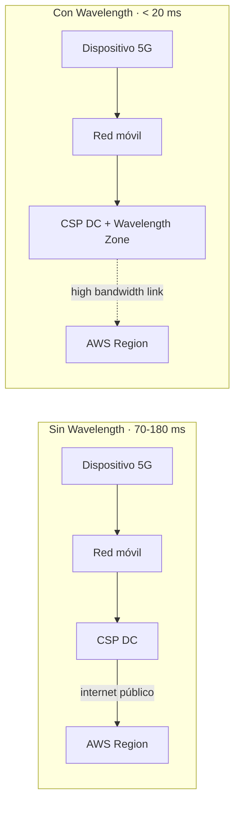

# AWS Wavelength

> [!abstract] Qué es este archivo
> Décima lección del módulo y **cierre del bloque de borde**. La pregunta ya no es *dónde* poner el cómputo, sino
> **cuán cerca del dispositivo móvil**: Wavelength **mete infraestructura de AWS dentro de la red 5G del carrier**.
>
> Cubre el **problema de latencia** (de **70–180 ms** a **menos de 20 ms**), qué es una **Wavelength Zone**, los
> **racks**, el **carrier gateway**, la **experiencia de desarrollo** y la **configuración en cuatro pasos**.
>
> **Sin video, sin demo y sin Knowledge Check**: la fuente es una página con pestañas y **tres imágenes**.

> [!quote] La idea que ordena todo
> **“AWS Wavelength allows you to deploy workloads closer to 5G-connected users and devices.”**
>
> Y la frase que explica por qué funciona: **la red 5G del telco aloja el cómputo y el almacenamiento
> directamente**. El tráfico **no sale a internet**: va del dispositivo a la instancia **por la red del carrier**.

---

## Resumen en una frase

> **AWS Wavelength** instala **racks de AWS dentro de la red de un proveedor de servicios de comunicaciones
> (CSP)** —en torres de celular o puntos de agregación de tráfico— y los conecta **directamente a la red de acceso
> 5G** mediante un **carrier gateway**, para que un dispositivo móvil llegue a la aplicación **sin pasar por
> internet** y con **menos de 20 ms** de ida y vuelta en lugar de **70–180 ms**.

---

## 1. Qué problema resuelve

**El punto de partida:** hay aplicaciones que necesitan **respuestas casi en tiempo real** y que hoy, cuando el
usuario está en una **red 5G**, pagan un viaje largo: **red móvil → data center del CSP → internet público →
Region de AWS**.

**Lo que muestra el primer diagrama:** con ese camino, el **round-trip time (RTT)** es de **70 a 180 ms**.

**Lo que propone Wavelength:**

| Palanca | Efecto |
| --- | --- |
| **Procesar en el borde de la red** | **Evita transmitir grandes volúmenes de datos** por la infraestructura del proveedor |
| **Descargar procesamiento del dispositivo** | **Menos trabajo en el hardware del móvil** |
| **Alojar cómputo y storage en la red 5G** | **Menos saltos de red** y **menos congestión** |

**La promesa:** *“AWS Wavelength lleva el poder de la nube de AWS al borde de la red para servir casos de uso
sensibles a la latencia que requieren respuestas casi en tiempo real.”*

> [!important] El eje de la lección
> No es “más Region” ni “más ciudad”: es **la red del carrier**. Wavelength no compite con **Local Zones** por el
> mismo terreno —una está en la **metrópoli**, la otra **dentro de la red 5G**— y eso es lo que el examen
> diferencia.

---

## 2. Qué es una Wavelength Zone

**La definición:** **AWS Wavelength es una oferta de infraestructura de AWS instalada en sitio** (*installed on
site*).

**La pieza concreta:** una **Wavelength Zone** **actúa como una extensión lógica de su Region de AWS asociada** y
está **ubicada e instalada en un sitio físico que es parte de una red de CSP**.

**Qué es un CSP:** un **proveedor de servicios de comunicaciones** con **ubicaciones físicas** —**torres de
celular** y **puntos de agregación de tráfico** a nivel **metropolitano o regional**— que **pueden alojar
equipamiento de TI**.

| Concepto | Definición |
| --- | --- |
| **Wavelength** | Oferta de infraestructura de AWS **instalada en sitio**, en la red del carrier |
| **Wavelength Zone** | **Extensión lógica de su Region**; **rack de AWS dentro de la red del CSP** |
| **CSP** | Proveedor de servicios de comunicaciones: **dueño del sitio** y de la **red 5G** |
| **Carrier gateway** | Constructo que **conecta directamente la red de acceso 5G** con la Wavelength Zone |

**Los racks, según la fuente:** **diseñados por AWS**, con **distribución de energía**, **cableado**, **switches
top of rack (ToR)** y **servidores y discos de AWS**.

> [!warning] No es “una Region chica”
> La Wavelength Zone **no es independiente**: es **una extensión lógica de la Region asociada**. Si el escenario
> pide **aislamiento total** o **residencia en tus instalaciones**, esta no es la pieza — para eso está
> **Outposts**.

---

## 3. Las dos latencias, lado a lado

| | **Sin Wavelength** | **Con Wavelength** |
| --- | --- | --- |
| **Camino** | Red móvil → **CSP DC** → **internet público** → **Region de AWS** | Red móvil → **CSP DC con cómputo y storage de AWS adentro** |
| **RTT** | **70–180 ms** | **< 20 ms** |
| **Saltos** | Los del viaje a la Region | **Los mínimos posibles** |
| **Internet** | **Sí**, en el medio | **No**: el tráfico va por la **red 5G del carrier** |

**Las cifras son las de los pies de las dos imágenes de la fuente**, no del texto corrido: **70 a 180 ms** sin
Wavelength y **menos de 20 ms** con Wavelength.

---

## 4. La red 5G y el carrier gateway

**Por qué es más rápido, según la fuente:** con Wavelength se va **de un dispositivo en la red 5G a los recursos de
la aplicación en la nube de AWS con la menor cantidad de saltos de red posible**, **porque los proveedores de
telecomunicaciones alojan el cómputo y el almacenamiento directamente**.

**Qué se evita:** la latencia causada por **congestión de red** o por **rutas más largas** que harían falta para
llegar a recursos **fuera de la red 5G**.

**Qué habilita:** **nuevas clases de aplicaciones** que son **intensivas en cómputo y sensibles a la latencia** al
mismo tiempo.

**El mecanismo de conexión — la frase clave:**

> **La red de acceso 5G del CSP está conectada directamente a la Wavelength Zone a través de un constructo llamado
> carrier gateway. Por lo tanto, los dispositivos móviles tienen acceso a las instancias de una Wavelength Zone por
> la red 5G del CSP sin pasar por internet.**

| Pieza | Qué conecta |
| --- | --- |
| **Carrier gateway** | **Red de acceso 5G del CSP** ↔ **Wavelength Zone** |
| **High bandwidth link** | **Wavelength Zone** ↔ **Region** (según el diagrama) |
| **Subnet de la Wavelength Zone** | Las instancias **dentro** de la zona |

> [!important] La frase que hay que poder repetir
> **“Sin ir a internet.”** El tráfico del dispositivo **entra por la red del carrier** y llega a la instancia. Si el
> escenario pide **latencia ultra baja para dispositivos móviles**, ese es el argumento que decide.

---

## 5. Dónde se instala

**La fuente es explícita sobre el tipo de sitio:** una **red de CSP** tiene **ubicaciones físicas** como **torres
de celular** y **puntos de agregación de tráfico** a nivel **metropolitano o regional**, y **esas ubicaciones pueden
alojar equipamiento de TI**.

| Sitio del CSP | Sirve para |
| --- | --- |
| **Torre de celular** | Estar **lo más cerca posible** del dispositivo |
| **Punto de agregación de tráfico** (metro o regional) | Concentrar cómputo para un **área metropolitana** |

**Lo que la fuente no dice:** **cuántas** Wavelength Zones hay, **en qué ciudades** ni **con qué carriers**. Solo
afirma que la experiencia es **consistente en múltiples redes 5G alrededor del mundo**.

---

## 6. La experiencia de desarrollo

**La promesa:** **una experiencia de desarrollador consistente** en **múltiples redes 5G alrededor del mundo**.

**Qué implica, literalmente:** se pueden construir **aplicaciones de latencia ultra baja** con **los mismos
servicios, APIs, herramientas y funcionalidad de AWS** que ya se usan, y **desplegarlas en distintas Wavelength
Zones, en distintos carriers, globalmente**.

**Por qué importa para un arquitecto:** **minimiza la necesidad de rearquitecturar** la aplicación para bajar la
latencia de los clientes finales.

> [!note] Ampliación (no está en la fuente)
> La fuente dice *“the same familiar AWS services”* **sin listar el catálogo**. En la configuración solo nombra
> **EC2**, **ECS** y **EKS**. Cualquier lista más amplia sería inventada.

---

## 7. La configuración, en cuatro pasos

**El punto de partida:** las Wavelength Zones **son extensiones de una Region de AWS**, así que **se usan las
mismas herramientas y capacidades**.

**Si ya tenés una aplicación:**

| # | Paso | Qué queda |
| --- | --- | --- |
| 1 | **Opt in to Wavelength Zones** | La cuenta **habilita** las zonas |
| 2 | **Select a VPC** | Se elige la **VPC** que va a abarcar la zona |
| 3 | **Create a carrier gateway** | Queda el **punto de entrada desde la red 5G** |
| 4 | **Create a subnet in the Wavelength Zone** | Queda el **rango de IPs** donde se lanzan las instancias |

**El asistente:** por default, el **Carrier Gateway wizard** **habilita las Wavelength Zones de todos los carriers
y ubicaciones disponibles en la Region**, o se pueden **elegir las específicas**. El asistente **ayuda a configurar
las subnets de cada Wavelength Zone**.

**Después:**

- **Lanzar instancias Amazon EC2** en las subnets nuevas.
- **Correr aplicaciones contenerizadas** en **Amazon ECS** y **Amazon EKS**.

### El diagrama de la configuración

| Pieza | Dato del diagrama |
| --- | --- |
| **Region** | **`us-east-2`** |
| **VPC** | **`10.0.0.0/16`**, abarcando **Region y CSP DC** |
| **Subnet 1** (AZ) | **`10.0.1.0/24`** |
| **Subnet 2** (AZ) | **`10.0.2.0/24`** |
| **Subnet 3** (Wavelength Zone) | **`10.0.4.0/24`** |
| **Enlace** | **High bandwidth link** entre la Region y el CSP DC |
| **Dentro de la zona** | **Carrier gateway** + **una instancia EC2** |

> [!warning] El detalle que delata el diseño
> La subnet de la Wavelength Zone **es una subnet más de la misma VPC** —en el ejemplo, `10.0.4.0/24`—, no una VPC
> aparte. Y el **carrier gateway** es **el camino de entrada**, no un internet gateway: el tráfico móvil **no pasa
> por internet**.

---

## 8. Casos de uso

**Los tres ejemplos que da la fuente:**

| Caso | Qué hace |
| --- | --- |
| **Flota de autos autónomos** | **Interactúa con sensores de la ruta** para **prevenir choques** |
| **Robots industriales inteligentes** | **Evalúan y reaccionan** a las condiciones de la planta en un **entorno de manufactura peligroso** |
| **Retailers** | Sirven **promociones personalizadas** a los **teléfonos de los compradores en tiempo real**, mientras pasan frente a las góndolas |

**El patrón común:** **cómputo intensivo + sensibilidad a la latencia + el usuario se mueve** (en el auto, en la
planta, en la tienda). Es exactamente la combinación que la fuente declara como objetivo: *“nuevas clases de
aplicaciones que son a la vez intensivas en cómputo y sensibles a la latencia”*.

---

## 9. Los límites de esta fuente

> [!note] Huecos registrados (no se inventan)
> - **Sin video, sin demo y sin Knowledge Check**: la lección es una **página con pestañas** y **tres imágenes**.
>   Es la primera del módulo **sin transcripción de video ni duración**.
> - **Sin cantidad de Wavelength Zones**, **sin ciudades** y **sin carriers**.
> - **Sin precios** ni modelo de facturación de las zonas.
> - **Sin SLA**: el **< 20 ms** viene del **pie de una imagen**, no de una garantía contractual.
> - **Sin catálogo completo de servicios**: solo se nombran **EC2**, **ECS** y **EKS**.
> - **Sin alta disponibilidad**: no se dice qué pasa si la zona o el sitio del CSP falla, ni cuántas zonas hay por
>   metro.
> - **Sin cuotas** de subnets, instancias o gateways.
> - **Sin `opt-in` en detalle**: no se explica el trámite, ni el costo, ni si requiere contrato con el carrier.
> - **Sin comparación con Local Zones ni con Outposts**: esa comparación es de esta nota (§11), no de la fuente.
> - **Sin mención de Direct Connect, VPN ni Route 53** en el contexto de Wavelength.
> - **El enlace a la documentación** (*What is AWS Wavelength?*) **no trae contenido** en la fuente: es una
>   referencia.
> - **La fuente no indica cuántas lecciones tiene el módulo.**

---

## 10. Traducción del contenido

> [!info] Sección de referencia (opcional)
> Esto es la **traducción fiel** de las fuentes, para verificar que no se perdió nada. **No hace falta leerla
> para estudiar**: lo que se estudia son las secciones **1 a 9** y se cierra con la **12**.
> Usala solo si (a) algo de arriba te quedó dudoso, (b) querés el detalle textual del diagrama, o (c) antes del
> examen querés chequear que no se escapó un matiz.

### 10.1 Latency-sensitive use cases

**AWS Wavelength permite desplegar cargas de trabajo más cerca de los usuarios y dispositivos conectados a 5G.**

*[Imagen: diagrama de una conexión de red 5G **sin** Wavelength. A la izquierda, una red móvil se enlaza con el
data center de un proveedor de servicios de comunicaciones (CSP DC). A la derecha, una Region de AWS. La red móvil
enruta a través del CSP DC, que después se conecta a la Region de AWS por **internet público**, con un **round-trip
time (RTT) de 70 a 180 ms**.]*

#### Latencia

**AWS Wavelength lleva el poder de la nube de AWS al borde de la red** para **servir casos de uso sensibles a la
latencia que requieren respuestas casi en tiempo real**. Podés usar **procesamiento en el borde de la red** para
**evitar transmitir grandes volúmenes de datos** por la **infraestructura del proveedor de red**. También
**descarga el procesamiento del hardware de los dispositivos móviles**.

**Beneficios de la red 5G**

*[Imagen: diagrama de una conexión de red 5G **con** Wavelength. A la izquierda, una red móvil se enlaza con el CSP
DC con el servicio Wavelength. A la derecha, una Region de AWS. La red móvil enruta a través del CSP DC, que ahora
tiene **infraestructura de cómputo y almacenamiento de AWS embebida adentro**, con un **RTT de menos de 20 ms**.]*

#### Red 5G

Con **AWS Wavelength**, podés ir **de un dispositivo en la red 5G a los recursos de tu aplicación en la nube de
AWS con la menor cantidad de saltos de red**. Esto es porque **las redes 5G de los proveedores de telecomunicaciones
alojan el cómputo y el almacenamiento directamente**. Esto **reduce la latencia causada por congestión de red o por
rutas más largas** que harían falta para **acceder a recursos de la aplicación fuera de la red 5G**. **AWS
Wavelength soporta nuevas clases de aplicaciones que son a la vez intensivas en cómputo y sensibles a la
latencia.**

**Ejemplos** — una **flota de autos autónomos** interactuando con **sensores de la ruta** para **prevenir choques**;
**robots industriales inteligentes** que **evalúan y reaccionan a las condiciones de la planta** en un **entorno de
manufactura peligroso**. También incluye **retailers** que sirven **promociones personalizadas a los teléfonos de
los compradores en tiempo real**, mientras **pasan frente a las exhibiciones de productos**.

### 10.2 AWS Wavelength features

**AWS Wavelength es una oferta de infraestructura de AWS instalada en sitio.**

#### Extiende la infraestructura de AWS

Una **Wavelength Zone actúa como una extensión lógica de su Region de AWS asociada**. Una zona está **ubicada e
instalada en un sitio físico que es parte de una red de CSP**. Una **red de CSP tiene ubicaciones físicas**, como
**torres de celular** y **puntos de agregación de tráfico a nivel metropolitano o regional**, que **pueden alojar
equipamiento de TI**.

*[La fuente invita a pasar a la pestaña siguiente para ver los racks.]*

#### Racks diseñados por AWS

Las **Wavelength Zones son racks diseñados por AWS** con **distribución de energía**, **cableado**, **switches top
of rack (ToR)**, y **servidores y discos de AWS**. Las zonas están **integradas en la red del CSP** en el sentido de
que **la red de acceso 5G del CSP está conectada directamente a la Wavelength Zone a través de un constructo llamado
carrier gateway**. Por lo tanto, **los dispositivos móviles tienen acceso a las instancias de una Wavelength Zone
por la red 5G del CSP sin ir a internet**.

*[La fuente invita a pasar a la pestaña siguiente para ver la experiencia del desarrollador.]*

#### Experiencia de desarrollador

Las **Wavelength Zones entregan una experiencia de desarrollador consistente** a través de **múltiples redes 5G
alrededor del mundo**. Podés **construir aplicaciones de latencia ultra baja** usando **los mismos servicios, APIs,
herramientas y funcionalidad de AWS** que ya usás hoy y **desplegarlas en distintas Wavelength Zones, en distintos
carriers, globalmente**.

### 10.3 AWS Wavelength Configuration

Las **Wavelength Zones son extensiones de una Region de AWS**, así que podés **usar las mismas herramientas y
capacidades de AWS** que ya usás hoy, y **minimizar la necesidad de rearquitecturar tu aplicación** para **reducir
la latencia a tus clientes finales**.

**Si tenés una aplicación existente:**

1. **Opt in to Wavelength Zones.**
2. **Select a VPC.**
3. **Create a carrier gateway.**
4. **Create a subnet in the Wavelength Zone.**

Por default, **el asistente de Carrier Gateway habilita las Wavelength Zones de todos los carriers y ubicaciones
disponibles en la Region**, o podés **elegir las específicas**. El **asistente ayuda a configurar las subnets para
cada Wavelength Zone**. Después podés **lanzar instancias Amazon EC2** en las **subnets nuevas** y **correr
aplicaciones contenerizadas en Amazon ECS y Amazon EKS**.

*[Imagen: configuración de AWS Wavelength. A la izquierda, la Region `us-east-2`. A la derecha, el data center del
proveedor de servicios de comunicaciones. Un **high bandwidth link** los conecta. Una **VPC con CIDR
`10.0.0.0/16`** abarca los dos. Del lado izquierdo de la VPC (dentro de la Region) se muestra **una AZ con 2
subnets**: (1) **`10.0.1.0/24`** y (2) **`10.0.2.0/24`**. Del lado derecho de la VPC (dentro del CSP DC) hay una
**Wavelength Zone con una tercera subnet `10.0.4.0/24`**. También dentro de la Wavelength Zone hay un **carrier
gateway** y una **instancia EC2**.]*

#### Información de Wavelength

Para más información, ver *“What is AWS Wavelength?”* en la documentación de AWS.

---

## 11. Las tres formas de acercarse al usuario (cierre)

> Esta tabla es **lectura propia**: la fuente de esta lección **no compara** los tres servicios. Se arma con lo que
> dicen las lecciones 08, 09 y 10 del módulo.

| | **Outposts** | **Local Zones** | **Wavelength** |
| --- | --- | --- | --- |
| **Dónde vive** | **Tu data center** | **Ciudad de AWS** sin Region | **Red del carrier 5G** |
| **A quién acerca** | A **tu instalación** | A los **usuarios de la metrópoli** | A los **dispositivos móviles 5G** |
| **Problema** | **Residencia** de datos | **Latencia** de metro | **Latencia ultra baja** móvil |
| **Latencia declarada** | Local al sitio | **Un dígito de ms** | **< 20 ms** (y **70–180 ms** sin ella) |
| **Quién opera** | **AWS**, en tu sitio | **AWS**, en su sitio | **AWS**, dentro del **CSP** |
| **Pieza de entrada** | **Local gateway** / service link | **Subnet asociada** | **Carrier gateway** |
| **Pasa por internet** | Según el diseño | **Internet local** o **DX** | **No**: red 5G del carrier |
| **Requisito de arranque** | **Order, install, launch** | **Opt in** y subnet | **Opt in**, VPC, carrier gateway y subnet |

**La escalera de latencia, de menos a más cerca del usuario:** **Region** → **Local Zone** (metro) → **Wavelength**
(dentro de la red móvil) → **Outposts** (en tu edificio, pero elegido por otra razón).

---

## 12. Para el examen (SAP-C02)

> [!important] Lo que hay que retener
> 1. **Wavelength** despliega cargas **más cerca de usuarios y dispositivos conectados a 5G**.
> 2. **Wavelength Zone** = **extensión lógica de su Region**, instalada **en un sitio de la red de un CSP**.
> 3. **El sitio** puede ser una **torre de celular** o un **punto de agregación de tráfico** **metropolitano o
>    regional**.
> 4. **Racks diseñados por AWS**: **energía**, **cableado**, **ToR switches**, **servidores y discos**.
> 5. **Carrier gateway**: conecta **directamente la red de acceso 5G** con la zona; el móvil llega a la instancia
>    **sin pasar por internet**.
> 6. **Latencia**: **70–180 ms** sin Wavelength; **menos de 20 ms** con Wavelength (cifras de los diagramas).
> 7. **Beneficios**: **menos saltos**, **menos congestión**, **no transmitir grandes volúmenes** por la red del
>    proveedor y **descargar procesamiento del móvil**.
> 8. **Configuración en 4 pasos**: **opt in** → **VPC** → **carrier gateway** → **subnet en la Wavelength Zone**;
>    después **EC2**, **ECS** y **EKS**.
> 9. **El asistente** habilita **todos los carriers y ubicaciones de la Region** por default, o **los elegidos**.
> 10. **Casos de uso**: **autos autónomos con sensores**, **robots industriales** y **promociones en tiempo real**
>     en retail.

> [!warning] Trampa clásica del examen
> Escenario: “una app para **dispositivos móviles 5G** necesita **latencia ultra baja** y el tráfico **no debe pasar
> por internet**”. La respuesta **no** es **Local Zones** (está en la ciudad, no en la red del carrier) ni
> **Outposts** (está en tu data center): es **Wavelength**, con **carrier gateway**. Y la trampa inversa: si el
> requisito es **residencia de datos** o **hardware en el edificio**, Wavelength **no** lo cumple aunque sea el más
> rápido — ahí va **Outposts**.

---

## Relacionado

- [[AWS Local Zones]] — la otra forma de bajar latencia, pero en la **metrópoli** y no en la red móvil
- [[AWS Outposts]] — la que resuelve **residencia**, no latencia de borde
- [[Amazon Route 53 Resolver]] — el DNS del entorno extendido
- [[AWS Direct Connect - Connection Options]] — cómo se conecta el borde con la Region y con el predio
- [[AWS Solutions Architect Advanced - Optimizing Hybrid Architectures]] *(índice del módulo)*
- [[VPC Endpoints]] — cómo se llega a los servicios regionales desde el borde
- [[1.1 Diseñar estrategias de conectividad de redes]] — la tarea que cubre el diseño híbrido
- [[2.5 Diseñar una solución para cumplir con los objetivos de rendimiento]] — la tarea de latencia
- Cierre del módulo: quedan **el mapa de progreso final**, el **checklist** y el **quiz integrador**

---

## Registro de integración

| Fecha | Qué llegó | Dónde se integró |
| --- | --- | --- |
| 29/10/2026 | Lección 10 completa: página con pestañas (*Latency-sensitive use cases*, *AWS Wavelength features*, *AWS Wavelength Configuration*) y tres imágenes | Nota completa (secciones 1–12) |

**Discrepancias y vacíos registrados (no corregidos):**

1. **La lección no tiene video**: es la **primera del módulo sin transcripción ni duración**. La fuente es una
   página con **pestañas** (*Move to the next tab…*) y **tres imágenes**. No se inventa un video.
2. **Las cifras de latencia están en los pies de las imágenes**, no en el texto: **70–180 ms** sin Wavelength y
   **< 20 ms** con Wavelength. Se integran a §3 y se aclara el origen.
3. **La estructura en pestañas se perdió en la fuente**: los encabezados *Latency*, *5G network benefits*, *Racks
   designed by AWS* y *Developer experience* aparecen como secciones sueltas. Se reordenan en §4 y §6, y se
   conserva el orden literal en §10.
4. **“Installed on site”** es ambiguo en la definición (*“AWS Wavelength is an AWS infrastructure offering
   installed on site”*). Se interpreta —con el resto de la misma lectura— como **sitio del CSP**, no del cliente.
5. **El diagrama de la configuración salta de `10.0.2.0/24` a `10.0.4.0/24`** (no hay `10.0.3.0/24`). Se transcribe
   literal en §7 y §10.3; no se corrige.
6. **“The telco providers' 5G networks host the compute and storage directly”** convive con *“Wavelength Zones are
   racks designed by AWS”*. Se conservan las dos frases: **el rack es de AWS** y **el sitio y la red son del CSP**.
7. **El enlace a la documentación** (*What is AWS Wavelength?*) **no trae contenido**: es una referencia externa.
8. **Sin precios, sin SLA, sin cantidad de zonas, sin carriers y sin cuotas**: no se inventan.
9. **La fuente no compara Wavelength con Local Zones ni con Outposts**; la tabla de **§11** es **lectura propia**
   que cruza las lecciones 08–10 del módulo.
10. **La fuente no indica cuántas lecciones tiene el módulo**: el mapa de progreso sigue sin total. Con esta
    lección, los **ocho objetivos** de la lección 01 quedan **cubiertos**.

**Decisiones de transcripción:**

- Se conservan **AWS Wavelength**, **Wavelength Zone**, **CSP** (communication service provider), **carrier
  gateway**, **cell towers**, **traffic aggregation points**, **top of rack (ToR)**, **high bandwidth link**,
  **opt in**, **VPC**, **subnet**, **EC2**, **ECS** y **EKS**.
- Las **cifras y CIDR** se transcriben literales: **70–180 ms**, **< 20 ms**, **`us-east-2`**, **`10.0.0.0/16`**,
  **`10.0.1.0/24`**, **`10.0.2.0/24`**, **`10.0.4.0/24`**, **tres imágenes**.
- Se conservan las **imágenes descriptas** por su pie: el viaje por **internet público** sin Wavelength y la
  **infraestructura de AWS embebida** en el CSP DC con Wavelength.
- Las tablas de **§3**, **§8** y **§11** son **lectura propia** que ordenan y cruzan la fuente; la fuente **no** las
  trae.
- El mapeo de tareas del examen (**1.1**, **2.5**) es **lectura propia**; la fuente **no** asigna tareas a la
  lección.
