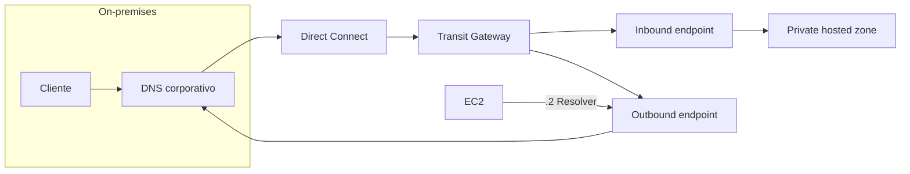

# Amazon Route 53 Resolver

> [!abstract] Qué es este archivo
> Séptima lección del módulo y **primera del bloque de DNS**. Ya hay red, pero **la red no sirve si las aplicaciones
> no se encuentran por nombre**: **Route 53 Resolver** es el que traduce entre el DNS de AWS y el DNS de tu data
> center.
>
> Cubre **private hosted zones**, los **endpoints inbound y outbound**, el **conditional forwarder** del lado
> on-premises y el **modelo de cuenta de red** con **RAM**. Tarea **1.1** del examen, con cruces en **1.3** y **2.5**.
>
> Video: **3 min 7 s**. **Sin demo y sin Knowledge Check.**

> [!quote] La idea que ordena todo
> **“If our applications can't find each other by name, it's like having a phone book where half the numbers are
> missing.”**
> La conectividad te lleva al recurso; **el DNS te dice a qué número llamar**. Resolver es el **traductor** entre los
> dos directorios: el de AWS y el de tu data center.

---

## Resumen en una frase

> **Private hosted zones** dan nombres a los recursos privados de una VPC; los **endpoints inbound y outbound** del
> Resolver conectan ese directorio con el DNS on-premises —con **conditional forwarding** de un lado y **forwarding
> rules** del otro— y todo se centraliza en una **cuenta de red** con reglas compartidas por **RAM**.

---

## 1. Qué problema resuelve

**La pregunta del lead developer:** *¿cómo hace la gente on-premises para **conectarse a recursos en zonas
privadas**?*

**El problema real no es la red, es el nombre.** Ya se construyeron las conexiones entre AWS y el data center, pero
si las aplicaciones **no se encuentran por nombre**, es *como tener una guía telefónica a la que le falta la mitad de
los números*.

| | **Sin Resolver** | **Con Resolver** |
| --- | --- | --- |
| **Dentro de la VPC** | IPs (`10.0.1.123`) cableadas o documentadas a mano | Nombres (`app.internal.company.com`) |
| **Entre VPC** | Cada VPC con su propia isla de DNS | Nombres **consistentes** en todo AWS |
| **Hacia on-premises** | Dos DNS separados, reglas de forwarding a mano | **Un solo camino de resolución** |
| **Alta de servicios** | Cambiar IPs en cada app | Se agrega un **registro** |

> [!important] La distinción que ordena todo
> **Conectividad** (TGW, peering, VPN, DX) resuelve **llegar**. **DNS** resuelve **saber a dónde llegar**. En un
> escenario híbrido **hacen falta las dos**, y el examen suele preguntar por la que falta.

---

## 2. Private hosted zones

**Qué son, según la fuente:** el **directorio telefónico personal de tu VPC**. En vez de memorizar IPs complejas, se
usan **nombres amigables**.

**Para qué sirven — las cuatro definiciones de la lectura:**

| # | Propiedad |
| --- | --- |
| 1 | **Contienen registros** que especifican **cómo enrutar el tráfico** dentro de una **Amazon VPC** |
| 2 | Sirven para **acceder a los recursos de la VPC con nombres de dominio personalizados** |
| 3 | Se **vinculan a una o más VPC** |
| 4 | Se crean registros **A** o **AAAA** |

**El caso típico:** **microservicios en distintas VPC** que necesitan hablarse; cada servicio recibe un **nombre
amigable que funciona igual en todo el entorno de AWS**.

**El detalle que habilita todo lo demás:** cuando se crea un **VPC endpoint** hacia un **servicio de AWS** o un
**SaaS de PrivateLink**, se puede **habilitar Private DNS**. Eso **crea una private hosted zone administrada por
AWS** automáticamente.

| Esa zona administrada… | Resultado |
| --- | --- |
| Dentro de **la VPC** | **Funciona**: resuelve el nombre del servicio |
| **Fuera** de esa VPC | **No funciona** |
| Desde el **DNS on-premises** | **No funciona por default** |

**De ahí sale el resto de la lección:** para tener **resolución unificada** de un endpoint compartido hay que
**compartir la private hosted zone** y usar **Route 53 Resolver**.

> [!warning] Private DNS no es global
> La zona que AWS crea al habilitar **Private DNS** vive **dentro de una VPC**. Si el requisito dice “que
> **on-premises** resuelva el nombre del servicio”, con eso solo **no alcanza**: hace falta **inbound endpoint** +
> **conditional forwarder**.

---

## 3. El Resolver como traductor

**La analogía de la fuente:** un **traductor universal** entre el DNS de AWS y el de on-premises; o un **recepcionista
inteligente** que sabe **a dónde derivar cada llamada**, venga de AWS o del data center.

| Consulta | Quién la resuelve |
| --- | --- |
| On-premises pregunta por **`database.internal.aws`** | **Route 53 Resolver** sabe dónde encontrarlo |
| Una aplicación de AWS pregunta por **`legacy-app.company.local`** | **Route 53 Resolver** lo deriva al DNS on-premises |

**Lo que se deja de mantener:** **dos sistemas de DNS separados** y **reglas de forwarding complejas** a mano.

---

## 4. Los dos endpoints y el forwarder

**El principio:** la resolución va en **dos direcciones**, y cada dirección tiene **su endpoint**.

| Dirección | Endpoint | Dónde vive | Qué hace |
| --- | --- | --- | --- |
| **On-premises → AWS** | **Inbound endpoint** | En la **misma VPC que el VPC endpoint** | Recibe consultas del DNS on-premises y las resuelve contra la **private hosted zone** |
| **AWS → on-premises** | **Outbound endpoint** | En la VPC | Saca las consultas que matchean una **forwarding rule** hacia el **DNS on-premises** |

**Lo que hace falta del lado de la red, en los dos casos:** **conectividad de capa 3**. Para el caso on-premises:
**AWS VPN** o **Direct Connect** hacia un **transit gateway** (la fuente aclara que *podría ser también un virtual
private gateway*).

**El paso que se olvida:** del lado on-premises hay que crear un **conditional forwarder** para el nombre del
servicio, **apuntando a las IPs del inbound endpoint**. Sin ese forwarder, el DNS de la empresa **nunca pregunta** a
AWS.

> [!important] La regla de oro del inbound
> El **inbound endpoint tiene que estar en la misma VPC que el VPC endpoint**. Recién así la respuesta devuelve las
> **IPs privadas del endpoint de servicio**. Si está en otra VPC, la respuesta no sirve.

---

## 5. Los dos flujos, paso a paso

### Flujo A — on-premises pregunta por un dominio de Route 53

| # | Paso |
| --- | --- |
| 1 | Un **cliente** se conecta al **DNS on-premises** |
| 2 | El DNS on-premises se conecta a **AWS Direct Connect** |
| 3 | Direct Connect comunica con el **transit gateway** de la cuenta de AWS |
| 4 | El transit gateway pasa por el **Route 53 Resolver inbound endpoint** |
| 5 | Route 53 Resolver **matchea una private hosted zone** y responde |

### Flujo B — una EC2 pregunta por un dominio alojado on-premises

| # | Paso |
| --- | --- |
| 1 | La **instancia EC2** usa el **Route 53 Resolver (`.2`)** de la VPC |
| 2 | El Resolver aplica sus **forwarding rules** |
| 3 | Hay **rule match**: `host.example.com` corresponde a una **IP de DNS on-premises** → se manda al **outbound endpoint** de la VPC |
| 4 | El pedido sale hacia el **transit gateway** |
| 5 | El transit gateway conecta con **Direct Connect** |
| 6 | Direct Connect **resuelve** contra el **DNS on-premises** |

> [!warning] Dos flujos, dos endpoints
> Si la consulta **entra**, la resuelve el **inbound**. Si **sale**, la saca el **outbound** por una **forwarding
> rule**. Confundirlos es el error más común: un inbound endpoint **no** reenvía nada a on-premises.

---

## 6. El modelo de cuenta de red

**La analogía de la fuente:** en un edificio grande conviene **una recepción central** en vez de una recepcionista
**en cada piso**.

**Cómo se arma:**

1. Los **Route 53 Resolver endpoints** viven en una **VPC de red dedicada** (*network account approach*).
2. Con **AWS Resource Access Manager (RAM)** se **comparten las Resolver rules** con **todas las demás cuentas**.
3. En vez de administrar consultas **VPC por VPC**, hay **un solo lugar** para todo el DNS híbrido.

**El límite que hay que dimensionar:** el **Resolver `.2` puede manejar 1024 packets per second**. La fuente lo
compara con una recepcionista **muy eficiente pero ocupada**: en un entorno con mucho tráfico, **una sola** recepción
no alcanza para miles de visitantes.

**La mitigación:** **DNS caching**, que la fuente describe como **directorios de visitantes por departamento** que
consultan **antes de llamar a la recepción**.

| Ventaja del modelo | Detalle |
| --- | --- |
| **Un solo lugar** | Toda la resolución híbrida se administra centralmente |
| **Reglas compartidas** | **RAM** evita duplicar forwarding rules por cuenta |
| **Menos carga** | **Caching** reduce las consultas que llegan al `.2` |
| **Más control** | Un punto único de cambio y de auditoría |

> [!note] Ampliación (no está en la fuente)
> La fuente dice **“1024 packets per second”** del `.2` **sin aclarar por interfaz ni por endpoint**. En la práctica
> el límite se mide **por ENI del endpoint**, y por eso se agregan endpoints o caché. Se anota como precisión, no
> como dato de la lección.

---

## 7. Cuándo hace falta cada pieza

| Necesidad | Pieza |
| --- | --- |
| Nombrar recursos **dentro de una VPC** | **Private hosted zone** |
| Resolver un **servicio de AWS/PrivateLink** dentro de la VPC | **Private DNS** (crea la zona administrada) |
| Que **otra VPC** resuelva ese nombre | **Capa 3** (TGW o peering) + **compartir la zona** |
| Compartir la zona entre **cuentas** | **AWS CLI / SDK** (misma cuenta: consola) |
| Que **on-premises** resuelva nombres de AWS | **Inbound endpoint** + **conditional forwarder** on-premises |
| Que **AWS** resuelva nombres on-premises | **Outbound endpoint** + **forwarding rule** |
| Centralizar todo | **Cuenta de red** + **RAM** |
| Bajar la carga del `.2` | **DNS caching** |

---

## 8. Los límites de esta fuente

> [!note] Huecos registrados (no se inventan)
> - **Sin demo y sin Knowledge Check**: video de **3 min 7 s** + **una lectura**.
> - **Sin precios** de endpoints ni de consultas.
> - **Sin cuotas** (endpoints por VPC, reglas por Resolver, TTL).
> - **Sin mención de DNSSEC**, ni de **Resolver Query Logging**, ni de **firewall DNS** (*Route 53 Resolver DNS
>   Firewall*), que son parte del tema en AWS.
> - **Sin el tercer tipo de endpoint** que AWS documenta (los **Resolver endpoints** también existen para **DNS
>   Firewall**), y sin las **reglas del sistema** (*system rules*).
> - **Sin alta disponibilidad** de los endpoints (cuántas IPs, cuántas AZs).
> - **Las dos imágenes no están en el vault**; no se describen.
> - **La fuente no indica cuántas lecciones tiene el módulo.**

---

## 9. Traducción del contenido

> [!info] Sección de referencia (opcional)
> Esto es la **traducción fiel** de las fuentes, para verificar que no se perdió nada. **No hace falta leerla
> para estudiar**: lo que se estudia son las secciones **1 a 8** y se cierra con la **11**.
> Usala solo si (a) algo de arriba te quedó dudoso, (b) querés el detalle textual de los flujos, o (c) antes del
> examen querés chequear que no se escapó un matiz.

### 9.1 Video: Introduction to Amazon Route 53 Resolver (transcripción)

Ahora, digamos que tu **lead developer** hace la pregunta: **“¿cómo puede la gente on-premises conectarse a recursos
en zonas privadas?”**. Acá es donde entra en juego **Route 53 Resolver**. Pensalo: construimos todas estas **grandes
conexiones** entre AWS y nuestro data center. Pero **si nuestras aplicaciones no se pueden encontrar por nombre, es
como tener una guía telefónica a la que le falta la mitad de los números**. Route 53 Resolver **arregla ese
problema**.

Empecemos con las **private hosted zones**. Pensalas como el **directorio telefónico personal de tu VPC**. En vez de
recordar direcciones IP complejas, como **`10.0.1.123`**, podés usar **nombres amigables**, como
**`app.internal.company.com`**. Por ejemplo, si tenés **microservicios corriendo en distintas VPC**, todos necesitan
hablarse. Las private hosted zones **hacen esto simple**: le dan a **cada servicio un nombre amigable** que funciona
**consistentemente en todo tu entorno de AWS**.

Ahora, acá es donde **Route 53 Resolver realmente brilla**. Actúa como un **traductor universal** entre tus sistemas
DNS de **AWS y on-premises**. Cuando tu **equipo on-premises** necesita acceder a **`database.internal.aws`**,
Route 53 Resolver **sabe exactamente dónde encontrarlo**. Y cuando tus **aplicaciones de AWS** necesitan encontrar
**`legacy-app.company.local`**, también lo maneja. Es como tener un **recepcionista inteligente** que sabe
**exactamente a dónde derivar cada llamada**, venga de AWS o de tu data center. **Se terminó mantener sistemas DNS
separados o reglas de forwarding complejas.**

Ahora hablemos de **llevar tu resolución DNS al siguiente nivel**. Ya sabés que en un **edificio de oficinas
grande** tiene sentido tener **una recepción central** en vez de recepcionistas **en cada piso**. Eso es exactamente
lo que estamos haciendo acá con la resolución DNS. En vez de administrar las **consultas DNS por separado en cada
VPC**, podemos crear lo que llamamos un **enfoque de cuenta de red**. Pensalo como **construir un centro de comando
central para todo tu tráfico DNS**. Tus **Route 53 Resolver endpoints viven en una VPC de red dedicada**. Y usando
**Resource Access Manager**, podés **compartir estas Resolver rules con todas tus otras cuentas de AWS**.

Ahora, algo crucial para tener en cuenta. Es como tener una recepcionista **muy eficiente pero muy ocupada**. El
**Resolver `.2` puede manejar 1024 packets per second**. Eso puede sonar como mucho, pero en un **entorno ocupado**,
nuestra **única recepcionista** está tratando de dirigir **miles de visitantes**. Para manejar esto, vas a querer
configurar un **DNS caching** apropiado. Pensalo como **darle a los departamentos sus propios directorios de
visitantes** que pueden consultar **antes de llamar a la recepción**. Este **enfoque centralizado** te da **un solo
lugar para administrar toda tu resolución DNS híbrida**. Es **más simple, más eficiente y más fácil de controlar**,
exactamente lo que nuestro **lead developer** necesita para un **entorno híbrido bien organizado**.

### 9.2 Lectura: Private Hosted Zones

Para los **VPC endpoints** que usás para conectarte a **servicios de endpoint** (servicios que creás usando **AWS
PrivateLink** detrás de un **Network Load Balancer**), la arquitectura es **bastante directa**. Como las **entradas de
DNS** del VPC endpoint son **públicas**, **solo necesitás conectividad de capa 3** entre una VPC y su destino. Podés
usar **VPC peering**, **transit gateway** o una **VPN**. Donde la arquitectura se vuelve más compleja es cuando querés
**compartir endpoints** para **servicios de AWS** y **software as a service (SaaS) de AWS PrivateLink**.

Cuando creás un **VPC endpoint** hacia un **servicio de AWS** o un **SaaS de AWS PrivateLink**, podés **habilitar
Private DNS**. Cuando se habilita, la configuración **crea una private hosted zone administrada por AWS** para vos.
La **private hosted zone administrada funciona muy bien para resolver el nombre DNS dentro de una VPC**; sin embargo,
**no funciona fuera de la VPC** y **no permite la resolución desde el DNS on-premises por default**. Acá es donde el
**uso compartido de private hosted zones** y **Amazon Route 53 Resolver** ayudan a obtener **resolución de nombres
unificada** para **VPC endpoints compartidos**.

*[Imagen: arquitectura con private hosted zones.]*

- **Contienen registros** que especifican **cómo querés enrutar el tráfico en una Amazon VPC**.
- Se usan para **acceder a los recursos de tu VPC usando nombres de dominio DNS personalizados**.
- **Vinculá la zona a una o más VPC**.
- **Creá registros A o AAAA**.

#### Resolución híbrida con zonas privadas

Para **compartir un VPC endpoint con otras VPC**, van a necesitar **conectividad de capa 3** a través de un
**transit gateway** o de **VPC peering**. Después de que las VPC tengan **conectividad de capa 3** al VPC endpoint,
**la private hosted zone que creaste para el servicio tendrá que compartirse**. Para **VPC dentro de la misma
cuenta**, este uso compartido se puede hacer **directamente desde la consola de Amazon Route 53**.

Si las VPC **residen en cuentas distintas**, las **private hosted zones se pueden compartir a través de la AWS
Command Line Interface (AWS CLI) o del SDK**. Después de configurar ese uso compartido, **la VPC resuelve el nombre
del servicio de AWS o del SaaS de AWS PrivateLink a las direcciones IP privadas del VPC endpoint**.

Para **compartir un VPC endpoint con un entorno on-premises**, usá **Route 53 Resolver** para **facilitar el DNS
híbrido**. De nuevo necesitás **conectividad de capa 3** a través de **AWS VPN** o **Direct Connect** hacia un
**transit gateway** (que **también podría ser un virtual private gateway**). Después, **creá un inbound Route 53
Resolver endpoint en la misma VPC que el VPC endpoint**. Como **el VPC endpoint y el inbound endpoint residen en la
misma VPC**, **se devuelven las direcciones IP privadas del VPC endpoint** para el servicio. Finalmente, **se crea un
conditional forward en el servidor DNS on-premises** para el **nombre del servicio**, que **apunta a las direcciones
IP del inbound Route 53 Resolver endpoint**.

En las secciones siguientes veamos cómo podemos crear la **comunicación inbound y outbound de Route 53 Resolver**. En
el diagrama de abajo tenemos algunas cosas representadas. Primero, **en un data center de cliente**. El data center
está usando **AWS Direct Connect** para conectarse a un **AWS Transit Gateway** en una **cuenta de AWS**. Hay una
**VPC dentro de la cuenta de AWS con dos Availability Zones y una instancia EC2**. La VPC también tiene **algunos
Route 53 Resolvers distintos**, un **inbound endpoint** y un **outbound endpoint**. **Fuera de la VPC** está lo que
sea que **las reglas o matches de Route 53 conecten**.

#### Pedido desde on-premises por un nombre de dominio de cliente en Route 53

Primero, veamos un **pedido desde on-premises** por un **nombre de dominio de cliente en Route 53**.

Para aprender más, elegí cada uno de los **marcadores numerados**.

**1: Cliente hacia el DNS on-premises.** Un **cliente** se conecta al **servidor DNS on-premises**.

**2: DNS hacia AWS Direct Connect.** El **servidor DNS on-premises** se conecta a **AWS Direct Connect**.

**3: Comunicación.** **AWS Direct Connect** se comunica con el **AWS Transit Gateway** de la **cuenta de AWS**.

**4: Route 53.** El **transit gateway** pasa por el **Route 53 Resolver inbound endpoint**.

**5: Resolver.** **Route 53 Resolver** **matchea una private hosted zone**.

#### Pedido desde una instancia EC2 por un nombre de dominio de cliente alojado en el DNS on-premises

Ahora, veamos un **pedido desde una instancia EC2** por un **nombre de dominio de cliente que está alojado en el DNS
on-premises**.

Para aprender más, elegí cada uno de los **marcadores numerados**.

**1: La EC2 usa Route 53 Resolver.** Una **instancia EC2** en la VPC usa un **Route 53 Resolver (`.2`)**.

**2: Reglas de forwarding.** El **Route 53 Resolver** sigue sus **reglas de forwarding**.

**3: Match de regla.** Se encuentra un **match**: **`host.example.com`**. Es para una **IP de DNS on-premises**. Se
envía al **Route 53 Resolver outbound endpoint** de la VPC.

**4: Pedido enviado.** El pedido se envía al **AWS Transit Gateway**.

**5: El transit gateway conecta.** El **transit gateway** se conecta a **AWS Direct Connect**.

**6: Resolver el pedido.** Finalmente, **AWS Direct Connect resuelve el pedido** conectándose al **servidor DNS
on-premises**.

---

## 10. Qué pieza resuelve cada consulta (cierre)

| Consulta | Origen | Destino | Pieza que actúa |
| --- | --- | --- | --- |
| `app.internal.company.com` | **EC2 en la VPC** | **Private hosted zone** | **Resolver `.2`** (resolución local) |
| `database.internal.aws` | **On-premises** | **Private hosted zone** | **Inbound endpoint** |
| `legacy-app.company.local` | **EC2 en la VPC** | **DNS on-premises** | **Outbound endpoint** + **forwarding rule** |
| Nombre de un **servicio PrivateLink** | **Otra VPC** | **VPC endpoint** | **Zona compartida** + **capa 3** |
| Nombre de un **servicio PrivateLink** | **On-premises** | **VPC endpoint** | **Inbound endpoint** + **conditional forwarder** |
| Cualquiera de las anteriores, en varias cuentas | — | — | **Reglas compartidas por RAM** |

---

## 11. Para el examen (SAP-C02)

> [!important] Lo que hay que retener
> 1. **Private hosted zone** = registros **A/AAAA** para **nombres personalizados** dentro de una o más **VPC**.
> 2. **Private DNS** en un **VPC endpoint** crea una **zona administrada por AWS** que **solo resuelve dentro de esa
>    VPC** y **no** desde on-premises.
> 3. Para **otra VPC**: **capa 3** (TGW o peering) **+ compartir la zona** (consola misma cuenta; **CLI/SDK** entre
>    cuentas).
> 4. Para **on-premises**: **inbound endpoint** en la **misma VPC que el VPC endpoint** + **conditional forwarder**
>    on-premises apuntando a sus IPs.
> 5. Para que **AWS resuelva on-premises**: **outbound endpoint** + **forwarding rule**.
> 6. **Inbound** = entran consultas; **outbound** = salen. **No son intercambiables**.
> 7. Todo el tráfico de endpoints atraviesa **capa 3**: **VPN** o **Direct Connect** hacia **TGW** (o VGW).
> 8. **Cuenta de red** = endpoints en una **VPC dedicada** + **reglas compartidas por RAM**.
> 9. El **Resolver `.2`** soporta **1024 packets per second**: en entornos grandes, **DNS caching** y más endpoints.
> 10. Si el nombre **no resuelve** pero el ping a la IP **sí**, el problema es **DNS**, no **routing**.

> [!warning] Trampa clásica del examen
> Escenario: “el servicio ya funciona desde las **VPC** de la misma cuenta, pero **on-premises no resuelve** el
> nombre”. La respuesta **no** es **compartir la zona con la VPC** (ya funciona ahí) ni **abrir security groups**: es
> crear un **inbound Resolver endpoint en la misma VPC del VPC endpoint** y un **conditional forwarder** en el DNS
> on-premises. Segunda trampa: si el que **no resuelve es AWS hacia un dominio de la empresa**, la pieza que falta es
> el **outbound endpoint**, no el inbound.

---

## Relacionado

- [[AWS Direct Connect - Redundancy and Resilience]] — la capa 3 que el DNS necesita debajo
- [[AWS Direct Connect - Connection Options]] — el enlace dedicado por donde viajan las consultas
- [[AWS Site-to-Site VPN]] — la alternativa de capa 3 cuando no hay DX
- [[AWS Client VPN]] — el acceso de usuarios que también consume DNS
- [[AWS Solutions Architect Advanced - Optimizing Hybrid Architectures]] *(índice del módulo)*
- [[VPC Endpoints]] — PrivateLink y las zonas que se comparten en esta lección
- [[AWS Resource Access Manager (RAM) Solutions]] — cómo se comparten las Resolver rules entre cuentas
- [[Use Cases - Transit Gateway]] — el hub por donde pasan los endpoints
- [[1.1 Diseñar estrategias de conectividad de redes]] — la tarea que esta lección cubre
- [[1.3 Diseñar arquitecturas fiables y resistentes]] — resolución cuando falla un endpoint
- Siguiente paso del módulo: **AWS Outposts** — lección 08 esperada según los ocho objetivos; a confirmar con la
  fuente

---

## Registro de integración

| Fecha | Qué llegó | Dónde se integró |
| --- | --- | --- |
| 29/10/2026 | Lección 07 completa: video (3:07) + lectura *Private Hosted Zones* (zonas, compartición, inbound/outbound y los dos flujos) | Nota completa (secciones 1–11) |

**Discrepancias y vacíos registrados (no corregidos):**

1. **“1024 packets per second”** del `.2`: la fuente **no aclara** si es **por interfaz**, **por endpoint** o **por
   VPC**. Se transcribe literal en §6 y se agrega una **ampliación externa** que lo acota a **por ENI**.
2. **“Un transit gateway (que también podría ser un virtual private gateway)”**: la lectura mezcla **transit
   gateway** y **virtual private gateway** en el mismo paréntesis. Se conserva literal en §9.2 y se normaliza en §4.
3. **La lectura dice “`.2` Resolver”** sin explicar que es la **dirección base + 2** del CIDR de la VPC. Se mantiene
   el nombre tal cual; el detalle va como lectura propia en el cuerpo.
4. **El flujo B usa `host.example.com`** como ejemplo de dominio on-premises; el flujo A no da un nombre concreto.
   Se conservan los dos.
5. **Artefactos de formato:** títulos con `****dobles negritas****`, un encabezado `### ****Hybrid resolution…****`
   y la frase truncada *“Outside of the VPC are is whatever the Route 53 matches or rules connect to”*. Se traduce
   por el sentido y se registra.
6. **Las dos imágenes no están en el vault**; se marcan como `[Imagen: …]`.
7. **Sin demo, sin Knowledge Check, sin precios y sin cuotas**: no se inventan.
8. **La fuente no menciona** DNSSEC, **Resolver Query Logging** ni **DNS Firewall**; quedan como huecos.
9. **La fuente no indica cuántas lecciones tiene el módulo**: el mapa de progreso sigue sin total.

**Decisiones de transcripción:**

- Se conservan **Route 53 Resolver**, **private hosted zone**, **Private DNS**, **VPC endpoint**, **AWS PrivateLink**,
  **Network Load Balancer**, **inbound endpoint**, **outbound endpoint**, **conditional forward**, **forwarding
  rules**, **Resource Access Manager (RAM)**, **transit gateway**, **virtual private gateway**, **capa 3**,
  **registros A/AAAA** y **`.2`**.
- Las **cifras** se transcriben literales: **3 min 7 s**, **1024 packets per second**, **dos Availability Zones**,
  **dos imágenes**.
- Se conservan las **analogías** de la fuente —**guía telefónica incompleta**, **directorio telefónico de la VPC**,
  **traductor universal**, **recepcionista inteligente**, **recepción central del edificio**, **directorios de
  visitantes por departamento**— porque son el orden del video.
- La tabla de **§10** es **lectura propia** que cruza consultas con piezas; la fuente **no** la trae.
