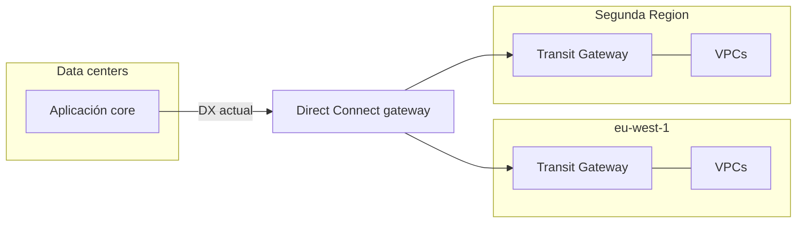

# BuildingBlocks Videos — Hybrid

> [!abstract] Qué es este archivo
> Lección **12**: **dos videos de troubleshooting** en formato de diálogo entre **Melissa y Joe**, con el mismo
> método —**síntoma → hipótesis → por qué se descarta → causa → remediación**— aplicado dos veces.
>
> **Caso 1** (**3 min 6 s**): cargas de AWS que **no resuelven de forma confiable** los dominios internos
> on-premises; la causa es la **falta de forwarding rules** en Route 53 Resolver.
>
> **Caso 2** (**2 min 33 s**): extender el acceso a una aplicación core **on-premises** desde **VPC en dos
> Regiones**; la respuesta es **Direct Connect inter-region peering** con **Direct Connect gateway** y **Transit
> Gateway**, en lugar de *hairpin*, VPN o un segundo circuito.
>
> **Sin demo y sin Knowledge Check.**

> [!quote] La idea que ordena todo
> **“The VPC DNS Resolver needs to know which queries to send to the resolver endpoints in the first place.”**
>
> Y su equivalente del segundo caso: **no agregues capas — usá el camino nativo**. Las dos lecciones son la misma:
> **el problema casi nunca es el componente que ya está configurado, sino el que falta**.

---

## Resumen en una frase

> Dos casos que se resuelven **descartando lo obvio**: en DNS, el endpoint **outbound** no sirve de nada sin
> **forwarding rules** que le digan **qué zona** mandar ahí; en multi-Region, **no** se resuelve con *peering*,
> *overlays* ni un segundo circuito, sino **extendiendo el Direct Connect existente** con **DX inter-region
> peering**.

---

## 1. Cómo están armados estos videos

**El formato:** dos conversaciones de **diagnóstico**, sin laboratorio y sin demo. **Melissa** trae el caso y
**Joe** propone; cada propuesta se **evalúa y se descarta o se acepta** con un argumento.

**El método, igual en los dos casos:**

| Paso | Qué se hace |
| --- | --- |
| 1 | **Síntoma** concreto (*“no resuelve de forma confiable”*, *“necesitan latencia baja”*) |
| 2 | **Configuración actual** (qué ya está puesto) |
| 3 | **Hipótesis** de solución |
| 4 | **Descarte razonado** (por qué **no** funciona) |
| 5 | **Causa raíz** o **decisión** |
| 6 | **Remediación** y **verificación** |

**El marco que usan explícitamente:** los **pilares del Well-Architected Framework** —**reliability** en el caso de
DNS y en el de conectividad, **performance efficiency** en el de multi-Region— y la idea de **reducir puntos de
falla**.

> [!important] Por qué importa el método
> En el examen, la respuesta correcta suele ser **la que elimina la causa**, no la que **agrega una capa**. Los dos
> videos están construidos para que las opciones “razonables pero equivocadas” queden **explícitamente
> descartadas**.

---

## 2. Caso 1 — el síntoma y lo que ya estaba configurado

**El síntoma:** las **cargas de AWS no pueden resolver de forma confiable los nombres de dominio internos
on-premises**. **A veces las consultas incluso salen por DNS público**.

**Lo que ya estaba configurado:**

| Pieza | Estado |
| --- | --- |
| **Interface endpoints** para servicios de AWS como **S3** y **DynamoDB** | **Configurados** |
| **Route 53 Resolver** con **outbound endpoint** apuntando al **servidor DNS on-premises** | **Configurado** |
| La **zona interna** `onprem.company.local` | **Especificada en la configuración** |
| **Forwarding rules** en Route 53 Resolver | **Faltaban** ← la causa |

**El detalle que confunde:** la zona **está nombrada** en la configuración y el endpoint **existe**, pero **la
resolución sigue fallando de forma intermitente**. Tener las piezas **no es** tener el camino.

> [!warning] El síntoma que delata
> **Intermitencia + consultas que se escapan al DNS público** = el resolver **no tiene una regla** para esa zona y
> **cae al comportamiento por default**. No es un problema de red: es un problema de **configuración de resolución**.

---

## 3. Caso 1 — las hipótesis descartadas

### Hipótesis 1: alinear las subnets

**La propuesta:** que el **resolver endpoint** use **las mismas subnets** que los interface endpoints, para que
**todo el tráfico DNS fluya por el mismo camino de red**.

**El descarte:** *“la alineación de subnets no es el problema”*.

### Hipótesis 2: habilitar Private DNS en los interface endpoints

**La propuesta:** **habilitar Private DNS** en los interface endpoints para **forzar todo el tráfico DNS** por
ellos.

**El descarte, textual:** **Private DNS en interface endpoints solo afecta cómo se resuelven los endpoints de
servicios de AWS**; **no ayuda a resolver los nombres on-premises**.

| Hipótesis | ¿Resuelve? | Por qué |
| --- | --- | --- |
| **Mismas subnets** para el endpoint | **No** | El problema no es el **camino de red** |
| **Private DNS** en los interface endpoints | **No** | Solo aplica a **servicios de AWS**, no a dominios on-premises |

> [!important] La frase que separa las dos cosas
> **Private DNS resuelve servicios de AWS; las forwarding rules resuelven dominios on-premises.** Son mecanismos
> distintos y el examen los ofrece como si fueran intercambiables.

---

## 4. Caso 1 — la causa y la remediación

### La causa raíz

**El VPC DNS Resolver necesita saber a qué consultas responder con los resolver endpoints.** Con el **outbound
endpoint** configurado pero **sin DNS forwarding rules** en Route 53 Resolver, **la VPC no sabe que debe usar ese
endpoint**.

**Qué hace una forwarding rule, literalmente:** le dice al resolver **“cuando veas una consulta por
`onprem.company.local`, mandala al resolver endpoint”**.

**Por qué no rompe lo demás:** las reglas de forwarding son **específicas por zona** (*zone specific*), así que
**las otras consultas DNS siguen funcionando normalmente**.

| Pieza | Función |
| --- | --- |
| **Outbound endpoint** | **Sale** hacia el DNS on-premises |
| **Forwarding rule** | **Decide** que esa zona **sale por ahí** |
| **Asociación de la regla a la VPC** | Hace que **esa VPC** la use |

> [!warning] El orden importa
> **Endpoint sin regla = tráfico que no sale.** Y **regla sin asociación a la VPC = regla que no aplica**. El video
> se concentra en la **regla**; la asociación es el mismo mecanismo visto desde el otro lado.

### La remediación y la verificación

1. **Implementar las forwarding rules** para `onprem.company.local`.
2. **Monitorear la resolución DNS** para **verificar que el problema se resuelve**.
3. **Configurar DNS monitoring** para **verificar la consistencia en el tiempo**.
4. **Usar métricas de CloudWatch en los resolver endpoints** para **detectar problemas temprano**.

**El argumento de fondo:** esto se alinea con la guía del **Well-Architected Framework** sobre **redes híbridas
confiables**: **resolución DNS consistente y predecible**.

> [!important] El cierre del caso
> **Agregar la regla** es la corrección; **medir** es lo que evita la recaída. En el examen, si la opción incluye
> **monitoreo** además del fix, suele ser la respuesta completa.

---

## 5. Caso 2 — el requisito y la configuración actual

**El escenario:** un **cliente enterprise** tiene una **aplicación core corriendo en sus data centers** y necesita
**extender el acceso a esa aplicación desde múltiples VPC en dos Regiones de AWS**.

**La configuración que ya existe:**

| Pieza | Detalle |
| --- | --- |
| **Circuitos de Direct Connect** | Desde los data centers **hacia `eu-west-1`** |
| **Transit Gateway** | **Ya en uso** en esa Región |

**Los requisitos, textuales:**

- **Latencia baja**.
- **Performance estable**.
- **Minimizar la complejidad** alrededor de **NAT**, **VPN** y **overlays**.

> [!important] El requisito que descarta la mitad de las opciones
> *“Minimizar la complejidad de NAT, VPN y overlays”* **no es un detalle**: es el criterio que elimina las
> soluciones “que funcionan pero agregan capas”. El examen lo usa igual.

---

## 6. Caso 2 — las tres opciones, y por qué caen dos

### Opción A: **peering de todas las VPC al TGW de `eu-west-1`**

**La propuesta:** conectar por **peering** todas las VPC de **las dos Regiones** al **Transit Gateway de
`eu-west-1`**, y usar el **DX existente** para el tráfico on-premises. **Centraliza**.

**El descarte, textual:** **el VPC peering cross-Region hacia el Transit Gateway no transporta la conectividad
on-premises**. El tráfico terminaría **haciendo hairpin de ida y vuelta**, lo que **mataría el requisito de
latencia**.

### Opción B: **VPN sobre Direct Connect** por cada VPC

**La propuesta:** montar **VPN over Direct Connect** para cada VPC, **centralizado con el Transit Gateway**.

**El descarte, doble:**

- **Agrega complejidad innecesaria** — y el cliente pidió **minimizar VPN y overlays**.
- **Desde reliability:** hay que **minimizar la cantidad de puntos de conexión que pueden fallar**.

### Opción C: **Direct Connect inter-region peering** — la elegida

**La propuesta:** **extender la conexión DX existente a la segunda Region** **a través de un Direct Connect
gateway** y **adjuntarlo al Transit Gateway**.

**Por qué gana:**

| Argumento | Detalle |
| --- | --- |
| **Reliability** | **Reduce puntos potenciales de falla** |
| **Performance efficiency** | Usa **capacidades nativas de red de AWS** en lugar de **agregar complejidad de overlay** |
| **Aprovecha la inversión** | Usa **el DX que ya tienen** |
| **Latencia** | **Camino directo**, sin *hairpin* |
| **Simplicidad** | **Mejor** que **duplicar la conectividad física** con un **segundo circuito DX y un TGW en la otra Region** |
| **Costo** | **El más rentable**: **no hacen falta circuitos DX adicionales** |

> [!warning] La trampa del *hairpin*
> **Peering cross-Region hacia un TGW** resuelve **VPC ↔ VPC**, pero **no** lleva el tráfico **on-premises**. Si el
> escenario pide **extender el data center a dos Regiones**, el *peering* **no alcanza** — el tráfico **vuelve** a
> la Region del TGW.

> [!note] Cruce con la lección 05 (lectura propia)
> El **Direct Connect gateway** **no enruta** entre sus propias asociaciones: por eso el patrón es **DXGW + Transit
> Gateway** en cada Región. Acá el video dice *“adjuntarlo al mismo transit gateway”*; con VPC en **dos Regiones**,
> lo esperable es **una asociación por Region**. La fuente **no lo detalla** y queda registrado.

---

## 7. El método, en las dos direcciones

| Pregunta de diagnóstico | Caso DNS | Caso multi-Region |
| --- | --- | --- |
| **¿Qué falta?** | **Forwarding rules** | **Camino nativo entre Regiones** |
| **¿Qué se descarta?** | Subnets y **Private DNS** | **Peering**, **VPN over DX**, **segundo circuito** |
| **¿Con qué criterio?** | **Reliability**: resolución **consistente y predecible** | **Reliability** + **performance efficiency** + **costo** |
| **¿Qué se mide?** | **CloudWatch metrics** en los endpoints | Ninguna métrica en el video |
| **¿Qué se conserva?** | El **outbound endpoint** ya configurado | El **DX existente** y el **TGW** |

**La regla general que queda:** **primero se pregunta qué pieza falta o qué camino nativo existe**, y **después** se
evalúa agregar capas.

---

## 8. Los límites de esta fuente

> [!note] Huecos registrados (no se inventan)
> - **Sin demo y sin Knowledge Check**: **dos videos** de **3 min 6 s** y **2 min 33 s**.
> - **Sin imágenes ni diagramas** en la fuente.
> - **Sin nombres de métricas** de CloudWatch para los resolver endpoints.
> - **Sin el detalle de la asociación** de las forwarding rules a las VPC (el video habla de **configurarlas**, no
>   de asociarlas).
> - **Sin ASN, BGP ni detalles de los circuitos** en el caso 2.
> - **Sin precios**: solo *“el más rentable”* por **no requerir circuitos adicionales**.
> - **Sin la segunda Region nombrada**: solo **`eu-west-1`**.
> - **Sin evaluar TGW peering** entre Regiones como alternativa: no aparece en el video.
> - **Sin alta disponibilidad** de los circuitos ni de los endpoints.
> - **La fuente no indica cuántas lecciones tiene el módulo**: con esta van **12**.

---

## 9. Traducción del contenido

> [!info] Sección de referencia (opcional)
> Esto es la **traducción fiel** de las fuentes, para verificar que no se perdió nada. **No hace falta leerla
> para estudiar**: lo que se estudia son las secciones **1 a 8** y se cierra con la **11**.
> Usala solo si (a) algo de arriba te quedó dudoso, (b) querés el detalle textual de los descartes, o (c) antes del
> examen querés chequear que no se escapó un matiz.

### 9.1 Video: Troubleshooting Hybrid DNS Resolution (transcripción)

**Joe, estaba revisando el setup de DNS híbrido de esta empresa. Veámoslo.** Están teniendo problemas con sus
**cargas de AWS**, que **no pueden resolver de forma confiable los nombres de dominio internos on-prem**. **A veces
las consultas incluso salen por DNS público.**

**Bueno, eso es preocupante. ¿Cómo se ve su setup actual?** Tienen **interface endpoints** configurados para
**servicios de AWS como S3 y DynamoDB**. También configuraron **Route 53 resolver con un outbound endpoint** y lo
**apuntaron a su servidor DNS on-prem**. Puedo ver que **especificaron su zona interna `onprem.company.local` en su
configuración**, pero **la resolución DNS sigue fallando de forma intermitente**.

**Bueno, dado que están usando interface endpoints, quizás deberíamos asegurarnos de que el resolver endpoint use
las mismas subnets.** Así **todo el tráfico DNS fluiría por el mismo camino de red**. **También lo pensé. Pero la
alineación de subnets no es realmente el problema acá.** **El VPC DNS Resolver necesita saber qué consultas enviar
a los resolver endpoints en primer lugar.** Mirando esto con la **lente de reliability del Well-Architected
Framework**, necesitamos **asegurar una resolución DNS consistente y predecible**.

**Claro. Bueno, ¿qué tal habilitar private DNS en los interface endpoints? Eso forzaría todo el tráfico DNS a pasar
por ellos.** **Eso tampoco es del todo correcto.** Los **ajustes de private DNS en interface endpoints solo afectan
cómo se resuelven los endpoints de servicios de AWS**. **No va a ayudar a resolver esos nombres on-prem.**

**Ah, ya veo lo que querés decir. Sí. Necesitamos asegurarnos de que el VPC DNS Resolver sepa usar los resolver
endpoints para esa zona específica. Entonces, ¿no necesitamos agregar algunas DNS forwarding rules?** **Sí, eso es
correcto. Creo que encontramos el problema.** Si bien tienen el **resolver outbound endpoint** configurado, **no
configuraron las DNS forwarding rules en Route 53 resolver**. **Estas reglas son críticas porque le dicen
explícitamente al VPC DNS resolver: cuando veas una consulta por `onprem.company.local`, mandala al resolver
endpoint.** **Sin esas reglas, la VPC no sabe que debería usar el resolver endpoint que configuramos.** Esto se
alinea con la **guía del Well-Architected Framework sobre redes híbridas confiables**. Y como **las forwarding
rules son específicas por zona**, **las otras consultas DNS siguen funcionando normalmente**.

**Tiene todo el sentido. ¿Deberíamos recomendar que implementen las forwarding rules y monitoreen la resolución DNS
para verificar que resuelve el problema?** **Definitivamente. Y deberíamos sugerirles que configuren algo de
monitoreo de DNS para verificar una resolución consistente en el futuro.** **Métricas de CloudWatch en los resolver
endpoints** ayudarían a **detectar cualquier problema temprano**. **Es una buena decisión, y les va a dar la
visibilidad que necesitan para mantener una resolución DNS confiable en su entorno híbrido.**

### 9.2 Video: Extending On-Premises Connectivity Across Multiple AWS Regions (transcripción)

**Estaba justo hablando con este cliente enterprise sobre su arquitectura de red.** Tienen esta **aplicación core
corriendo en sus data centers**, y **necesitan extender el acceso a ella desde múltiples VPC en dos Regiones de
AWS**. **¿Y cuál es su setup de conectividad actual?** **Dejame mostrártelo.** Ahí está. Tienen **circuitos de
direct connect desde sus data centers hacia `eu-west-1`**, y **ya están usando un transit gateway ahí**. **Los
requisitos clave son latencia baja, performance estable, y quieren minimizar la complejidad alrededor de NAT, VPN y
overlays.**

**Bueno, podríamos hacer peering de todas las VPC de ambas Regiones al transit gateway de `eu-west-1`**, y después
**usar la conexión direct connect existente para el tráfico on-prem**. Eso **mantendría las cosas centralizadas**.
**También lo pensé, pero el VPC peering cross-Region hacia el transit gateway no transporta la conectividad
on-prem.** Terminaríamos con **tráfico haciendo hairpin de ida y vuelta**, lo que **mataría nuestros requisitos de
latencia**.

**Sí, buen punto. Bueno, ¿qué tal configurar VPN sobre el direct connect para cada VPC? Podríamos usar el transit
gateway para centralizarlo.** **Eso agrega complejidad innecesaria.** Recordá que **pidieron específicamente
minimizar la complejidad de VPN y overlays**. Además, **desde la perspectiva de reliability, queremos minimizar la
cantidad de puntos de conexión que podrían fallar**.

**Eso es correcto. Sí. Bueno, ¿qué pasa si aprovechamos el direct connect inter-region peering? Podríamos extender
su conexión DX existente a la segunda Region a través de un direct connect gateway y adjuntarlo al mismo transit
gateway.** **Ese es un enfoque mucho mejor.** Se alinea con **el pilar de reliability al reducir puntos potenciales
de falla**. Y **desde el punto de vista de performance efficiency**, estamos usando **capacidades nativas de red de
AWS** en lugar de **agregar complejidad de overlay**.

**Exacto. Pueden aprovechar su inversión existente en direct connect, mantener latencia baja con un camino
directo, y mantener las cosas simples**, mucho mejor que **duplicar la conectividad física con un segundo circuito
direct connect y un transit gateway en la otra Region**. **Buenísimo. ¿Deberíamos recomendarle este enfoque al
cliente?** **Definitivamente. Cumple todos sus requisitos: latencia baja, performance estable a través de conexiones
dedicadas y complejidad mínima. Además, es lo más rentable, ya que no necesitan circuitos direct connect
adicionales.**

---

## 10. Las dos decisiones (cierre)

| | **Caso 1 — DNS híbrido** | **Caso 2 — multi-Region** |
| --- | --- | --- |
| **Síntoma** | Resolución **intermitente** de dominios on-prem; consultas **al DNS público** | Acceso **on-prem** desde VPC en **dos Regiones** |
| **Lo que ya existía** | **Outbound endpoint** + zona nombrada | **DX a `eu-west-1`** + **TGW** |
| **Lo que faltaba** | **Forwarding rules** | **Camino nativo entre Regiones** |
| **Solución** | **Reglas por zona** + **monitoreo con CloudWatch** | **DX inter-region peering** con **DXGW** + **TGW** |
| **Descartado** | **Subnets alineadas** y **Private DNS** | ***Peering***, **VPN over DX**, **segundo circuito** |
| **Criterio** | **Consistencia y previsibilidad** | **Latencia + estabilidad + simplicidad + costo** |

---

## 11. Para el examen (SAP-C02)

> [!important] Lo que hay que retener
> 1. **Síntoma → causa**: endpoint **outbound** configurado pero **sin forwarding rules** = **no resuelve** los
>    dominios on-premises.
> 2. **Las forwarding rules son específicas por zona**: `onprem.company.local` se manda al endpoint; **el resto
>    sigue normal**.
> 3. **Private DNS en interface endpoints** solo resuelve **servicios de AWS**; **no** sirve para dominios
>    on-premises.
> 4. **Alinear subnets** no arregla un problema de **configuración de resolución**.
> 5. **Verificación**: **métricas de CloudWatch en los resolver endpoints** + monitoreo de DNS.
> 6. **Caso multi-Region**: el **VPC peering cross-Region hacia un TGW** **no transporta** la conectividad
>    on-premises → **hairpin** → **mata la latencia**.
> 7. **La solución** es **Direct Connect inter-region peering** con **Direct Connect gateway**, asociado al
>    **Transit Gateway**.
> 8. **Por qué gana**: **menos puntos de falla** (reliability), **red nativa sin overlays** (performance
>    efficiency) y **sin circuitos adicionales** (costo).
> 9. **Lo que se descarta**: **VPN over DX** (complejidad y puntos de falla) y **un segundo circuito DX + TGW en la
>    otra Region** (duplica la conectividad física).
> 10. **El criterio transversal**: **usar el camino nativo y no agregar capas**.

> [!warning] Trampa clásica del examen
> Escenario: “las cargas de AWS **no resuelven** nombres on-premises y ya existe un **outbound endpoint**”. La
> respuesta **no** es **habilitar Private DNS** ni **alinear subnets**: es **crear las forwarding rules** para esa
> zona. Y en el caso multi-Region, la respuesta **no** es ***peering*** ni **VPN over DX**: es **extender el DX con
> inter-region peering**, porque el *peering* **no lleva el tráfico on-premises** y la VPN **agrega capas y puntos
> de falla**.

---

## Relacionado

- [[Amazon Route 53 Resolver]] — los endpoints y las reglas que este caso da por faltantes
- [[AWS Direct Connect - Redundancy and Resilience]] — el enlace y su respaldo
- [[AWS Direct Connect - Connection Options]] — el DXGW y las VIF que habilitan el *inter-region peering*
- [[Finished Architecture]] — el diseño completo del mismo caso financiero
- [[AWS Site-to-Site VPN]] — la opción de VPN que acá se descarta como overlay
- [[AWS Wavelength]] — el borde 5G del mismo módulo
- [[AWS Solutions Architect Advanced - Optimizing Hybrid Architectures]] *(índice del módulo)*
- [[Use Cases - Transit Gateway]] — el hub y sus asociaciones entre Regiones
- [[1.1 Diseñar estrategias de conectividad de redes]] — la tarea que cubren los dos casos
- [[1.3 Diseñar arquitecturas fiables y resistentes]] — el pilar de **reliability** que se cita en ambos videos
- Cierre del módulo: queda el **quiz integrador** y el **mapa de progreso final**

---

## Registro de integración

| Fecha | Qué llegó | Dónde se integró |
| --- | --- | --- |
| 29/10/2026 | Lección 12 completa: dos videos de troubleshooting (3:06 DNS híbrido y 2:33 multi-Region) | Nota completa (secciones 1–11) |

**Discrepancias y vacíos registrados (no corregidos):**

1. **“Interface endpoints para S3 y DynamoDB”**: la fuente los llama **interface endpoints**. Se transcribe literal
   y **no se corrige**; en el módulo (lección 07) se vio que S3 y DynamoDB también se resuelven por **gateway
   endpoints**.
2. **La zona aparece “especificada en la configuración” pero faltan las reglas**: el video no aclara **dónde**
   estaba especificada (¿una regla a medio crear?, ¿el `.local` del servidor?). Se mantiene la tensión y **no se
   inventa** el detalle.
3. **El video habla de “forwarding rules” sin mencionar la asociación a la VPC**, que es el otro paso necesario. Se
   marca en §4 como **lectura propia** y no se atribuye a la fuente.
4. **“Adjuntarlo al mismo transit gateway”** en el caso multi-Region es ambiguo: con **VPC en dos Regiones** lo
   esperable es **una asociación del DXGW por Region**. Se registra en §6 como **cruce con la lección 05** y **no
   se resuelve**.
5. **No se evalúa TGW peering** entre Regiones como alternativa; el video solo descarta **VPC peering** al TGW. Se
   registra como hueco.
6. **Artefactos de transcripción:** *“V VPC DNS resolver”*, *“onprem”* sin punto, *“direct connect”* en minúsculas,
   *“the well architected frameworks”*, y el cierre truncado *“…across their hybrid environment. I.”*. Se traduce
   por el sentido y **no** se reproducen.
7. **La segunda Region no se nombra**; solo `eu-west-1`. No se completa.
8. **Sin nombres de métricas** de CloudWatch: *“CloudWatch metrics on Resolver endpoints”* es todo lo que hay.
9. **Sin imágenes ni diagramas** en la fuente; el mermaid de §6 es **lectura propia**.
10. **Sin demo, sin Knowledge Check, sin precios** (solo *“el más rentable”* por no requerir circuitos) **y sin
    ASN/BGP**.
11. **La fuente no indica cuántas lecciones tiene el módulo**: con esta van **12**.
12. **Nombre del archivo con sufijo de módulo** (`BuildingBlocks Videos - Hybrid`): ya existe un
    `BuildingBlocks Videos.md` en **Multi-Account** y un `BuildingBlocks Videos - Networking` / `- Security` en los
    otros módulos. Se sigue la convención del vault para que el wikilink **no sea ambiguo**.

**Decisiones de transcripción:**

- Se conservan **Route 53 Resolver**, **outbound endpoint**, **interface endpoints**, **private DNS**,
  **forwarding rules**, **zone specific**, **VPC DNS Resolver**, **Direct Connect**, **Direct Connect gateway**,
  **Direct Connect inter-region peering**, **Transit Gateway**, **VPC peering**, **hairpin**, **VPN over Direct
  Connect**, **overlay** y **Well-Architected Framework**.
- Las **cifras** se transcriben literales: **3 min 6 s**, **2 min 33 s**, **dos Regiones**, **`eu-west-1`**.
- Se conservan las **expresiones del diálogo** —**“eso es preocupante”**, **“eso tampoco es del todo correcto”**,
  **“creo que encontramos el problema”**, **“mataría nuestros requisitos de latencia”**, **“minimizar los puntos de
  conexión que podrían fallar”**— porque son el razonamiento del caso.
- Las tablas de **§1**, **§3**, **§7** y **§10** son **lectura propia** que ordenan los dos videos; la fuente **no**
  las trae.
